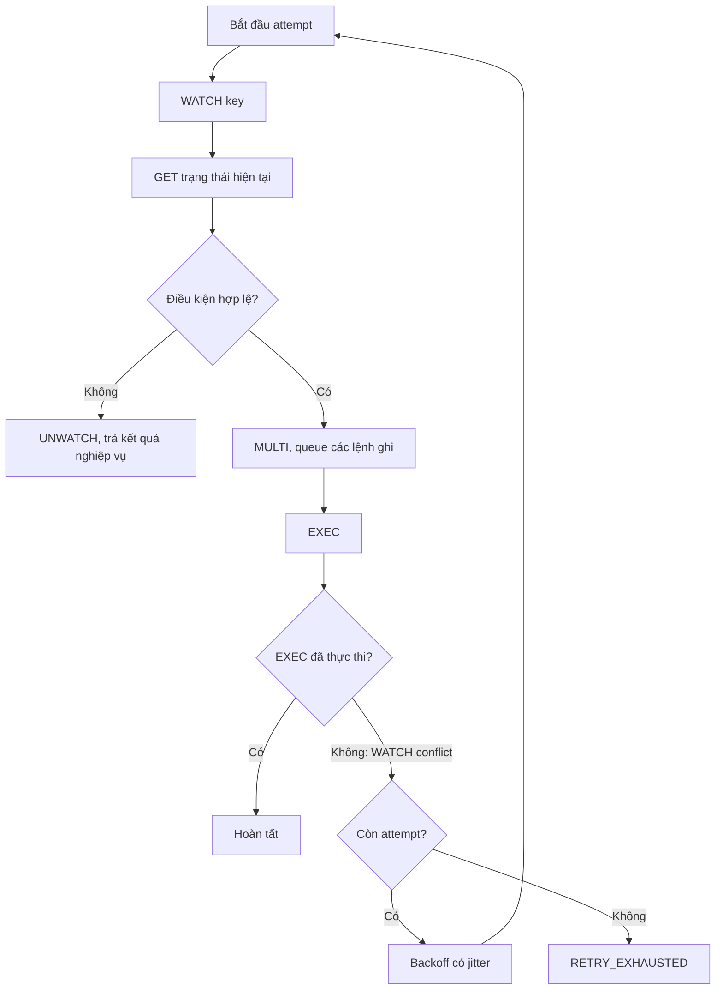

# Retry có giới hạn khi WATCH phát hiện khóa thay đổi

Trong Spring Data Redis, `WATCH` kết hợp `MULTI` và `EXEC` cho phép thực hiện một giao dịch **optimistic locking**: ứng dụng đọc trạng thái hiện tại, kiểm tra điều kiện, rồi chỉ ghi nếu các khóa được theo dõi không bị thay đổi trong khoảng thời gian đó. Nếu có tiến trình khác sửa khóa, Redis hủy giao dịch và client có thể thử lại bằng dữ liệu mới.

Việc retry phải có **giới hạn số lượt**, khoảng nghỉ phù hợp và kết quả rõ ràng khi không thể commit. Nếu lặp vô hạn, một khóa được cập nhật liên tục có thể khiến ứng dụng chiếm thread, tăng tải Redis và làm request treo. Bài này xây dựng một quy trình retry cụ thể với `SessionCallback` của Spring Data Redis, đồng thời phân biệt xung đột `WATCH` với lỗi nghiệp vụ hoặc tình huống không biết giao dịch đã commit hay chưa.

## 1. Vì sao đọc rồi ghi dễ mất cập nhật?

Giả sử Redis lưu tồn kho mặt hàng `sku-42` trong key `stock:sku-42`:

```redis
SET stock:sku-42 8
```

Hai khách hàng đồng thời đặt mua 6 sản phẩm:

```text
Request A                               Request B
---------                               ---------
GET stock:sku-42 -> "8"
                                        GET stock:sku-42 -> "8"
Thấy đủ 6; tính còn 2
                                        Thấy đủ 6; tính còn 2
SET stock:sku-42 2
                                        SET stock:sku-42 2
Thông báo đặt hàng thành công
                                        Thông báo đặt hàng thành công
```

Giá trị cuối cùng là 2 nhưng hai request đều cho rằng đã bán thành công, tổng cộng 12 sản phẩm. Đây là lỗi *lost update* do điều kiện được kiểm tra từ dữ liệu cũ.

Chỉ bọc lệnh `SET` vào `MULTI`/`EXEC` chưa đủ: Redis vẫn cần biết liệu một tiến trình khác có cập nhật khóa **sau lúc ta đọc** nhưng **trước lúc commit** hay không. `WATCH` giải quyết phần kiểm tra thay đổi đó.

## 2. Cơ chế của `WATCH`, `MULTI`, `EXEC`

Trong mỗi lần thử (*attempt*), luồng cơ bản là:

1. Gửi `WATCH stock:sku-42` trên kết nối Redis đang sử dụng.
2. `GET stock:sku-42` để đọc giá trị và đánh giá quy tắc nghiệp vụ.
3. Nếu không đủ hàng, gọi `UNWATCH`, trả kết quả không đủ hàng.
4. Nếu đủ hàng, gọi `MULTI`; xếp lệnh trừ tồn kho vào transaction.
5. Gọi `EXEC`. Redis chỉ thực thi hàng đợi nếu khóa đã watch không bị thay đổi.
6. Nếu `EXEC` bị hủy, bắt đầu **một lần thử mới từ `WATCH` và `GET`**, không tái sử dụng giá trị trước.



Một tình huống điển hình:

```text
Client A                               Client B
--------                               --------
WATCH stock:sku-42
GET -> 8
                                       WATCH stock:sku-42
                                       GET -> 8
MULTI
DECRBY stock:sku-42 6
EXEC -> [2]
                                       MULTI
                                       DECRBY stock:sku-42 6
                                       EXEC -> nil (bị hủy)
                                       WATCH stock:sku-42
                                       GET -> 2
                                       UNWATCH (không đủ 6)
```

Trong Redis CLI, `EXEC` trả **null reply** khi một khóa được watch bị sửa trước commit. Các lệnh ghi đã queue sẽ **không được thực thi**. Thay đổi do client khác, do chính kết nối trước lúc `MULTI`, hoặc do Redis hết hạn/evict khóa đều có thể làm `WATCH` mất hiệu lực. Từ Redis `6.0.9`, khóa watched hết hạn cũng khiến giao dịch abort.

`WATCH` theo dõi **toàn bộ key**, không theo dõi từng field riêng. Một `HSET` vào trường khác trên cùng hash cũng có thể gây conflict.

## 3. Thiết kế hợp đồng retry có giới hạn

Một vòng lặp retry nên công khai các quyết định sau:

| Quy tắc | Ví dụ | Lý do |
| --- | --- | --- |
| Số lượt thử tối đa | `MAX_ATTEMPTS = 4` | Gồm lần đầu và ba lần thử bổ sung |
| Điều kiện retry | Chỉ khi `EXEC` bị hủy bởi `WATCH` | Không lặp lại lỗi dữ liệu hoặc thao tác đã commit |
| Backoff | 10–20, 20–40, 40–80 ms | Hạn chế nhiều client tranh chấp ngay lập tức |
| Jitter | Chọn độ trễ ngẫu nhiên trong khoảng | Giảm trường hợp các client cùng nhịp retry |
| Kết quả hết lượt | `RETRY_EXHAUSTED` | Caller quyết định hiển thị lỗi hoặc thử lại sau |
| Ngân sách thời gian | Ví dụ 500 ms/request | Giới hạn thời gian chờ ngoài số lượt retry |

Phân biệt:

- **`WATCH_CONFLICT`:** Redis từ chối thực thi transaction; đọc lại và thử mới là hợp lý.
- **`INSUFFICIENT_STOCK`:** dữ liệu mới nhất được đọc không thỏa điều kiện; trả về ngay, không tiếp tục cố trừ.
- **`NOT_FOUND`:** key không tồn tại tại thời điểm đọc; xử lý theo hợp đồng nghiệp vụ.
- **Lỗi kết nối/timeout/command:** không được coi mặc nhiên là conflict. Đặc biệt, khi đã gửi `EXEC` nhưng không nhận được phản hồi, giao dịch có thể **đã chạy**.

Gọi tham số `maxAttempts` giúp tránh nhầm lẫn: `4 attempts` nghĩa là tối đa **4 lần WATCH/EXEC**, còn `maxRetries = 3` thường nghĩa là 3 lần thử lại sau lần đầu.

## 4. Spring Data Redis phải giữ cùng một kết nối

`WATCH` có phạm vi theo **Redis connection**. Các lời gọi độc lập trên `RedisTemplate` không được bảo đảm luôn dùng cùng một connection, trong khi `WATCH`, `GET`, `MULTI` và `EXEC` bắt buộc thuộc cùng một session.

Spring Data Redis có `SessionCallback` cho mục đích này:

```java
redis.execute(new SessionCallback<List<Object>>() {
    @Override
    @SuppressWarnings({"rawtypes", "unchecked"})
    public List<Object> execute(RedisOperations operations) {
        operations.watch("counter");

        // Thực hiện GET và kiểm tra điều kiện trước MULTI.
        // Nếu không cần ghi: operations.unwatch(), rồi return.

        operations.multi();
        operations.opsForValue().increment("counter", 1L);
        return operations.exec();
    }
});
```

Đoạn trên minh họa phạm vi kết nối; ví dụ đầy đủ ở phần sau sẽ xử lý cả nhánh không ghi, cleanup và retry.

**Không đọc bằng `GET` sau `MULTI` để quyết định có ghi hay không.** Lúc transaction đang mở, các lệnh được xếp hàng, nên lời gọi Java có thể nhận `null` thay vì giá trị thật; kết quả lệnh queue chỉ có sau `EXEC`.

`@Transactional` trên service không thay thế `WATCH`: tích hợp Redis với Spring-managed transactions cần cấu hình `setEnableTransactionSupport(true)` và có ngữ nghĩa connection riêng. Dùng `SessionCallback` giúp ranh giới của mỗi attempt được thể hiện trực tiếp.

## 5. Ví dụ: giữ tồn kho bằng WATCH và tối đa bốn attempt

Ví dụ giả định `stock:<sku>` chứa số nguyên không âm dưới dạng Redis string. Service chỉ trừ khi lượng còn lại đủ; nếu hai request cùng nhìn thấy số cũ, chỉ một transaction được commit.

### 5.1. Mã Java hoàn chỉnh

```java
package com.example.inventory;

import java.util.List;
import java.util.concurrent.ThreadLocalRandom;
import org.springframework.dao.DataAccessException;
import org.springframework.data.redis.core.RedisOperations;
import org.springframework.data.redis.core.SessionCallback;
import org.springframework.data.redis.core.StringRedisTemplate;
import org.springframework.stereotype.Service;

@Service
public class InventoryReservationService {

    private static final int MAX_ATTEMPTS = 4;
    private final StringRedisTemplate redis;

    public InventoryReservationService(StringRedisTemplate redis) {
        this.redis = redis;
    }

    public enum ReserveResult {
        RESERVED,
        NOT_FOUND,
        INSUFFICIENT_STOCK,
        RETRY_EXHAUSTED
    }

    private enum Attempt {
        COMMITTED,
        MISSING,
        NOT_ENOUGH,
        WATCH_CONFLICT
    }

    public ReserveResult reserve(String sku, long quantity) {
        if (sku == null || sku.isBlank()) {
            throw new IllegalArgumentException("sku must not be blank");
        }
        if (quantity <= 0) {
            throw new IllegalArgumentException("quantity must be positive");
        }

        String key = "stock:" + sku;
        for (int attemptNo = 1; attemptNo <= MAX_ATTEMPTS; attemptNo++) {
            Attempt outcome = attemptOnce(key, quantity);

            switch (outcome) {
                case COMMITTED:
                    return ReserveResult.RESERVED;
                case MISSING:
                    return ReserveResult.NOT_FOUND;
                case NOT_ENOUGH:
                    return ReserveResult.INSUFFICIENT_STOCK;
                case WATCH_CONFLICT:
                    if (attemptNo == MAX_ATTEMPTS) {
                        return ReserveResult.RETRY_EXHAUSTED;
                    }
                    boundedBackoff(attemptNo);
                    break;
            }
        }
        throw new IllegalStateException("Unreachable retry state");
    }

    private Attempt attemptOnce(String key, long quantity) {
        return redis.execute(new SessionCallback<Attempt>() {
            @Override
            @SuppressWarnings({"rawtypes", "unchecked"})
            public Attempt execute(RedisOperations operations)
                    throws DataAccessException {

                // Mọi lệnh trong callback dùng cùng Redis connection.
                operations.watch(key);
                boolean inMulti = false;

                try {
                    // Đọc sau WATCH, trước MULTI.
                    String raw = (String) operations.opsForValue().get(key);
                    if (raw == null) {
                        operations.unwatch();
                        return Attempt.MISSING;
                    }

                    long available = Long.parseLong(raw);
                    if (available < quantity) {
                        operations.unwatch();
                        return Attempt.NOT_ENOUGH;
                    }

                    operations.multi();
                    inMulti = true;

                    // INCRBY với delta âm. Khác SET, thao tác này
                    // thông thường giữ nguyên expiration hiện có.
                    operations.opsForValue().increment(key, -quantity);

                    List<Object> replies = operations.exec();
                    inMulti = false;

                    // Redis trả null reply nếu EXEC bị WATCH abort.
                    // Một commit hợp lệ có đúng 1 kết quả INCRBY.
                    if (replies == null || replies.isEmpty()) {
                        return Attempt.WATCH_CONFLICT;
                    }
                    if (replies.size() != 1 ||
                            !(replies.get(0) instanceof Number)) {
                        throw new IllegalStateException(
                                "Unexpected EXEC reply: " + replies);
                    }
                    return Attempt.COMMITTED;

                } catch (RuntimeException failure) {
                    // Không để connection còn MULTI/WATCH khi thoát lỗi.
                    try {
                        if (inMulti) {
                            operations.discard();
                        } else {
                            operations.unwatch();
                        }
                    } catch (RuntimeException cleanupFailure) {
                        failure.addSuppressed(cleanupFailure);
                    }
                    throw failure;
                }
            }
        });
    }

    private static void boundedBackoff(int attemptNo) {
        long capMs = Math.min(160L, 20L << (attemptNo - 1));
        long delayMs = capMs / 2
                + ThreadLocalRandom.current().nextLong(capMs / 2 + 1);

        try {
            Thread.sleep(delayMs);
        } catch (InterruptedException interrupted) {
            Thread.currentThread().interrupt();
            throw new IllegalStateException(
                    "Interrupted during Redis WATCH retry", interrupted);
        }
    }
}
```

Với đoạn mã này, các attempt bị abort sẽ dừng sau tối đa bốn lần. Trước ba attempt tiếp theo, service ngủ khoảng 10–20, 20–40 và 40–80 mili giây. Độ trễ tổng còn gồm cả các lệnh mạng Redis. `Thread.sleep` chỉ thích hợp với ví dụ đồng bộ; **không chặn event loop của WebFlux/Reactor**. Ứng dụng reactive cần chiến lược delay không chặn và phạm vi kết nối tương ứng với API reactive.

### 5.2. Chuẩn bị dữ liệu và sử dụng

Tạo khóa trên Redis dùng để học tập:

```redis
SET stock:sku-42 8
```

Gọi từ service hoặc controller:

```java
InventoryReservationService.ReserveResult result =
        inventoryReservationService.reserve("sku-42", 6);

switch (result) {
    case RESERVED -> System.out.println("Đã giữ hàng");
    case NOT_FOUND -> System.out.println("Không tìm thấy tồn kho");
    case INSUFFICIENT_STOCK -> System.out.println("Không đủ hàng");
    case RETRY_EXHAUSTED -> System.out.println("Kho đang bận, thử lại sau");
}
```

Nếu một request xử lý đơn lẻ và key bắt đầu từ `8`, kết quả là `RESERVED` và còn `2`. Nếu hai request cùng yêu cầu `6` dựa trên giá trị `8`, một transaction có thể được commit trước; transaction còn lại sẽ bị `WATCH` từ chối. Khi retry và đọc `2`, request đó trả `INSUFFICIENT_STOCK`.

### 5.3. Ý nghĩa của các nhánh code

| Nhánh | Hành vi |
| --- | --- |
| Giá trị key là `null` | `UNWATCH`, trả `NOT_FOUND` |
| Giá trị key nhỏ hơn lượng cần trừ | `UNWATCH`, trả `INSUFFICIENT_STOCK` |
| Đủ điều kiện và `EXEC` thành công | Nhận một reply số từ `INCRBY`, trả `RESERVED` |
| `EXEC` bị hủy do watched key đổi | Trả `WATCH_CONFLICT`, vòng ngoài ngủ và retry nếu còn lượt |
| `NumberFormatException`, Redis exception hoặc reply bất thường | Không che lỗi thành watch conflict; dọn connection nếu có thể rồi ném lỗi |
| Hết attempt mà lần nào cũng conflict | Trả `RETRY_EXHAUSTED` |

`INCRBY` dùng delta âm để trừ tồn kho, giúp tránh dùng `SET` ghi đè string và làm mất TTL hiện có. **Chỉ dùng `INCRBY` riêng lẻ không bảo vệ được quy tắc "tồn kho không âm"**; phần `WATCH` + `GET` + `EXEC` mới bảo đảm rằng điều kiện đã đọc được kiểm tra trước khi transaction commit.

Đoạn mã giới hạn phạm vi transaction Redis; `RESERVED` chỉ có nghĩa tồn kho Redis đã được trừ. Nếu cần đồng thời tạo đơn hàng trong SQL, thu tiền hoặc gửi thông báo, phải thiết kế tính nhất quán giữa các hệ thống và idempotency riêng.

## 6. Diễn giải kết quả EXEC và phân biệt lỗi

Ở Redis CLI:

```redis
WATCH stock:sku-42
# OK

GET stock:sku-42
# "8"

# Một kết nối khác sửa stock:sku-42 tại đây.

MULTI
# OK

DECRBY stock:sku-42 6
# QUEUED

EXEC
# (nil)  — transaction đã bị Redis từ chối
```

Trong Spring Data Redis, `RedisOperations.exec()` trả kết quả đã được chuyển đổi thành các đối tượng Java. Cách biểu diễn chính xác null reply phụ thuộc phiên bản Spring Data Redis/driver, nhưng **không được coi transaction abort là thành công**.

Với ví dụ chỉ queue một `INCRBY`, commit hợp lệ phải có một kết quả số. Đoạn mã minh họa coi `null` hoặc danh sách rỗng là conflict và báo lỗi với reply có hình dạng không mong đợi. Khi triển khai, cần kiểm tra hợp đồng `exec()` của phiên bản client thực tế, đặc biệt ở nhánh bị abort.

`EXEC` bị hủy bởi `WATCH` khác với ba tình huống:

1. **`DISCARD`**: client chủ động xóa hàng đợi transaction trước commit và thoát trạng thái giao dịch.
2. **Lỗi khi xếp một command**: Redis có thể không thực thi transaction nếu lệnh không hợp lệ trong giai đoạn queue.
3. **Lỗi thực thi một command sau `EXEC`**: Redis không bảo đảm rollback các lệnh trước trong cùng transaction nếu một lệnh lỗi lúc chạy. Kết quả có thể gồm lỗi ở từng command; không nên retry toàn bộ như một abort vì `WATCH`.

Nếu `EXEC` đã được gửi tới Redis nhưng kết nối đứt trước khi client nhận response, transaction **có thể đã commit**. Tự động retry `DataAccessException` có thể làm trừ kho hai lần. Chỉ nên retry trong đoạn mẫu khi có tín hiệu xác định rằng Redis đã abort transaction do `WATCH`.

## 7. Cleanup: UNWATCH và DISCARD

`WATCH` gắn với một kết nối Redis. Khi sử dụng connection pool, dọn trạng thái sau nhánh lỗi rất quan trọng:

| Thời điểm thoát | Lệnh phù hợp | Vì sao |
| --- | --- | --- |
| Đã `WATCH`, chưa mở `MULTI`, không cần ghi | `UNWATCH` | Bỏ theo dõi những khóa đã đăng ký |
| Đã `MULTI`, cần hủy trước `EXEC` | `DISCARD` | Xóa hàng đợi transaction và trạng thái watch |
| `EXEC` trả kết quả thành công | Không cần `UNWATCH` thêm | Redis tự giải phóng watched keys khi kết thúc |
| `EXEC` bị watch conflict | Không cần `UNWATCH` thêm | Redis đã kết thúc attempt và bỏ watch |
| Mất kết nối hoặc timeout | Không giả định cleanup đã thành công | Driver/pool cần xử lý kết nối lỗi; kết quả commit có thể không xác định |

Phần `try/catch` trong service cố gắng gọi `DISCARD` nếu đang ở `MULTI`, hoặc `UNWATCH` trước `MULTI`, rồi ném lại ngoại lệ ban đầu. Không được nuốt lỗi dọn connection để trả thành công giả.

Không thực hiện gọi dịch vụ ngoài, truy vấn SQL dài hoặc chờ trong khoảng **giữa `WATCH` và `EXEC`**. Cửa sổ đó càng dài, cơ hội khóa bị sửa càng lớn. Backoff nên diễn ra **sau khi transaction đã abort**, trước attempt mới.

## 8. Tính toán backoff và timeout tổng

Backoff có thể là cố định, tuyến tính hoặc exponential. Với mức tranh chấp vừa phải, exponential backoff có jitter là lựa chọn phổ biến:

```text
attempt 1: WATCH conflict -> nghỉ khoảng 10..20 ms
attempt 2: WATCH conflict -> nghỉ khoảng 20..40 ms
attempt 3: WATCH conflict -> nghỉ khoảng 40..80 ms
attempt 4: WATCH conflict -> hết lượt, không nghỉ thêm
```

Ngay cả khi dùng `MAX_ATTEMPTS`, request vẫn có thể mất thời gian nếu mỗi lệnh Redis timeout lâu. Một deadline tổng bổ sung giúp không vượt thời gian phục vụ:

```java
long start = System.nanoTime();
long budget = java.util.concurrent.TimeUnit.MILLISECONDS.toNanos(500);

for (int attempt = 1; attempt <= MAX_ATTEMPTS; attempt++) {
    if (System.nanoTime() - start >= budget) {
        // Hết thời gian; không bắt đầu thêm attempt.
        break;
    }

    // Một attempt gồm WATCH, GET, MULTI, EXEC.
    // Chỉ ngủ và thử lại nếu gặp WATCH conflict.
}
```

Đây là minh họa cách kiểm tra ngân sách thời gian ở **ranh giới attempt**. Nó không thể ngắt lệnh Redis đang bị treo; ứng dụng vẫn cần cấu hình timeout lệnh, timeout kết nối, circuit breaker và giới hạn thời gian request theo hạ tầng thực tế.

Khi hết lượt, trả kết quả có nghĩa rõ ràng. Trong HTTP API, có thể chọn `409 Conflict` cho thao tác gặp cạnh tranh, hoặc `503 Service Unavailable` cho quá tải tạm thời, tùy hợp đồng đã thống nhất. Caller không nên tự hiểu mọi lỗi `500` là trường hợp có thể thử lại.

## 9. Retry nhiều khóa và Redis Cluster

Có nghiệp vụ cần kiểm tra cả tồn kho lẫn trạng thái coupon trước khi commit:

```redis
WATCH stock:sku-42 coupon:code-7
GET stock:sku-42
GET coupon:code-7
MULTI
DECRBY stock:sku-42 1
SET coupon:code-7 used
EXEC
```

Nếu **một** khóa được theo dõi bị sửa, Redis hủy toàn bộ transaction. Attempt tiếp theo phải `WATCH` và đọc lại **tất cả dữ liệu** ảnh hưởng điều kiện.

Trong Spring Data Redis:

```java
operations.watch(java.util.List.of(
        "stock:sku-42",
        "coupon:code-7"));
```

Với **Redis Cluster**, transaction nhiều key cần tuân thủ giới hạn **cùng hash slot**. Một kỹ thuật tổ chức khóa là dùng hash tag chung cho dữ liệu có thể tham gia cùng transaction:

```text
stock:{checkout-123}
coupon:{checkout-123}
```

Các key cùng phần `{checkout-123}` được định tuyến về cùng hash slot. Không nên kỳ vọng `WATCH` trên những key ở các slot tùy ý tạo ra giao dịch nguyên tử toàn cluster.

Tuy nhiên, càng watch nhiều key, càng dễ có một thay đổi không liên quan khiến transaction abort. Chỉ watch những khóa thực sự tham gia quy tắc nghiệp vụ.

## 10. Bẫy retry cần tránh

### 10.1. Retry vô hạn

```java
// Không nên: không có giới hạn lượt hay thời gian.
while (true) {
    // WATCH, GET, MULTI, EXEC; conflict thì lặp ngay.
}
```

Trong giờ cao điểm, vòng lặp này có thể làm tăng thêm tranh chấp thay vì giúp transaction hoàn tất. Luôn có ngưỡng dừng và cơ chế báo lỗi có kiểm soát.

### 10.2. Dùng lại dữ liệu cũ sau conflict

```text
Lần 1: GET tồn kho = 8, EXEC abort
Lần 2: vẫn tin tồn kho = 8, bỏ qua GET, xếp lại DECRBY 6
```

Giá trị hiện tại có thể đã là 2 hoặc khóa đã bị xóa. **Bắt đầu lại toàn bộ attempt** và đánh giá điều kiện trên dữ liệu mới là bắt buộc.

### 10.3. Đặt GET sau MULTI

Trong transaction, các lệnh được queue nên `opsForValue().get()` gọi sau `multi()` không phải là phép đọc đồng bộ bình thường để dùng trong `if`. Đọc trước `MULTI`, sau `WATCH`.

### 10.4. Thực hiện side effect trong vòng retry

Không gửi email, gọi payment gateway hay tạo giao dịch ở dịch vụ ngoài **trước khi xác định Redis commit thành công**. Nếu attempt bị abort, side effect đó không tự hoàn tác. Ngay cả sau commit, khi network response mất, vẫn có thể cần idempotency để tránh tác dụng phụ lặp lại do client gửi lại request.

### 10.5. Coi mọi exception là WATCH conflict

`WRONGTYPE`, lỗi số học, thiếu quyền, timeouts và lỗi kết nối không tự biến mất khi retry. Đặc biệt, kết quả của `EXEC` có thể không xác định nếu Redis đã thực thi nhưng client bị mất phản hồi. Chỉ retry theo nhánh kết quả conflict được xác nhận; để các lỗi khác đến nơi xử lý phù hợp.

### 10.6. Hiểu MULTI như khóa ngăn người khác sửa

`MULTI` không ngăn client khác cập nhật key đã watch trước khi `EXEC`. `WATCH` khiến `EXEC` có điều kiện, và có thể buộc transaction abort. Đây là **optimistic concurrency**, không phải khóa độc quyền.

## 11. Khi nào dùng Lua script thay WATCH?

Nếu nghiệp vụ chỉ cần “trừ kho khi đủ” và key có tranh chấp cao, một Lua script thực hiện toàn bộ phần đọc và ghi trong **một lần chạy nguyên tử** có thể giảm round-trip và tránh vòng `WATCH`/retry:

```lua
-- KEYS[1] = khóa tồn kho
-- ARGV[1] = số lượng muốn trừ
local current = redis.call('GET', KEYS[1])
if not current then
    return -1  -- không có key
end

local available = tonumber(current)
local requested = tonumber(ARGV[1])
if not available or not requested or requested <= 0 then
    return redis.error_reply('invalid stock or quantity')
end

if available < requested then
    return 0   -- không đủ hàng
end

redis.call('DECRBY', KEYS[1], requested)
return 1       -- đã trừ thành công
```

Lua giữ logic ngắn gọn trên Redis Server và có thể hữu ích khi key rất nóng. Tuy vậy, script chạy phải nhanh để không chặn các lệnh khác; với Redis Cluster, mọi key liên quan vẫn phải cùng hash slot. **Lua không tự cung cấp exactly-once** nếu client gửi lại request sau một lần mất phản hồi. Khi cần chống trừ kho hai lần, thêm **idempotency key** và ghi dấu vết đã xử lý cùng thao tác trừ kho trong một đơn vị nguyên tử.

`WATCH` vẫn phù hợp khi quyết định cần logic Java, khi lượng tranh chấp thấp hoặc khi cần làm rõ điều kiện dựa trên nhiều giá trị trước commit. Chọn Lua hay `WATCH` là quyết định về mô hình dữ liệu, độ phức tạp và tải hệ thống, không chỉ về số dòng code.

## 12. Quan sát vận hành

Để biết chiến lược retry có hiệu quả, nên ghi nhận:

| Chỉ số | Mục đích |
| --- | --- |
| `watch_attempts_total` | Tổng số attempt, bao gồm lần đầu |
| `watch_conflicts_total` | Lượt `EXEC` bị Redis hủy do watched key thay đổi |
| `watch_retry_exhausted_total` | Request dùng hết giới hạn attempt |
| `reservation_rejected_total` | Request không đạt điều kiện nghiệp vụ |
| `redis_transaction_errors_total` | Exception Redis/driver, tách riêng khỏi conflict |
| `watch_to_exec_latency` | Thời gian từ `WATCH` đến `EXEC` trong một attempt |
| `reservation_latency` | Tổng thời gian request gồm backoff |

Conflict tăng không nhất thiết là Redis bị lỗi. Đó có thể là tín hiệu khóa quá nóng, giao dịch mở quá lâu, quá nhiều key được watch hoặc nhiều worker cùng ghi vào một aggregate. Việc chỉ tăng `MAX_ATTEMPTS` có thể khiến tải Redis tăng tiếp; nên xem lại mô hình thao tác khi xung đột kéo dài.

Nếu nghiệp vụ bảo đảm mỗi request chỉ thực hiện một lần logic, thêm ID thao tác bền vững và trạng thái đã xử lý. Một giao dịch Redis đã commit nhưng caller chưa nhận reply không thể được khôi phục chính xác chỉ dựa vào việc chạy lại `WATCH`.

## 13. Quy trình thực hành

Có thể diễn tập bằng hai cửa sổ Redis CLI:

**Client A:**

```redis
SET demo:stock 8
WATCH demo:stock
GET demo:stock
```

**Client B:**

```redis
SET demo:stock 5
```

**Trở lại Client A:**

```redis
MULTI
DECRBY demo:stock 6
EXEC
# (nil): A không được phép commit dựa trên giá trị 8 cũ
```

**Client A bắt đầu attempt mới:**

```redis
WATCH demo:stock
GET demo:stock
# "5": lúc này không đủ cho yêu cầu 6
UNWATCH
```

Ví dụ cho thấy retry có ý nghĩa là **đọc và ra quyết định lại**. Không có lý do trừ 6 tiếp khi Redis đã cập nhật còn 5.

## 14. Ghi nhớ

`WATCH` cho phép transaction Redis hoạt động như một phép kiểm tra rồi ghi có điều kiện. Nếu khóa được theo dõi thay đổi, `EXEC` abort và các lệnh đã queue không thực thi. Trong Spring Data Redis, mỗi attempt cần dùng **cùng connection** qua `SessionCallback`; `GET` diễn ra trước `MULTI` và lần thử mới phải đọc lại toàn bộ trạng thái liên quan.

Một chiến lược retry an toàn đặt **giới hạn số lần**, có **backoff + jitter**, **dừng ngay khi điều kiện nghiệp vụ không thỏa** và chỉ retry xung đột `WATCH` đã xác định. Không retry mù timeout sau `EXEC`, vì commit có thể đã xảy ra. Với thao tác có side effect quan trọng, bổ sung idempotency và cân nhắc Lua hoặc thiết kế dữ liệu khác khi mức tranh chấp cao.

### Tài liệu tham khảo

- [Redis — Transactions](https://redis.io/docs/latest/develop/using-commands/transactions/): `WATCH`, `MULTI`, `EXEC`, null reply, `DISCARD` và giới hạn rollback.
- [Redis — WATCH](https://redis.io/docs/latest/commands/watch/): phạm vi theo dõi và các thay đổi khiến giao dịch abort.
- [Redis — EXEC](https://redis.io/docs/latest/commands/exec/): thực thi hàng đợi lệnh theo transaction.
- [Spring Data Redis — Transactions](https://docs.spring.io/spring-data/redis/reference/redis/transactions.html): `SessionCallback`, `MULTI`/`EXEC` và dọn trạng thái khi gặp lỗi.
- [Spring Data Redis — SessionCallback API](https://docs.spring.io/spring-data/redis/reference/api/java/org/springframework/data/redis/core/SessionCallback.html): phạm vi session và cùng một kết nối Redis.
