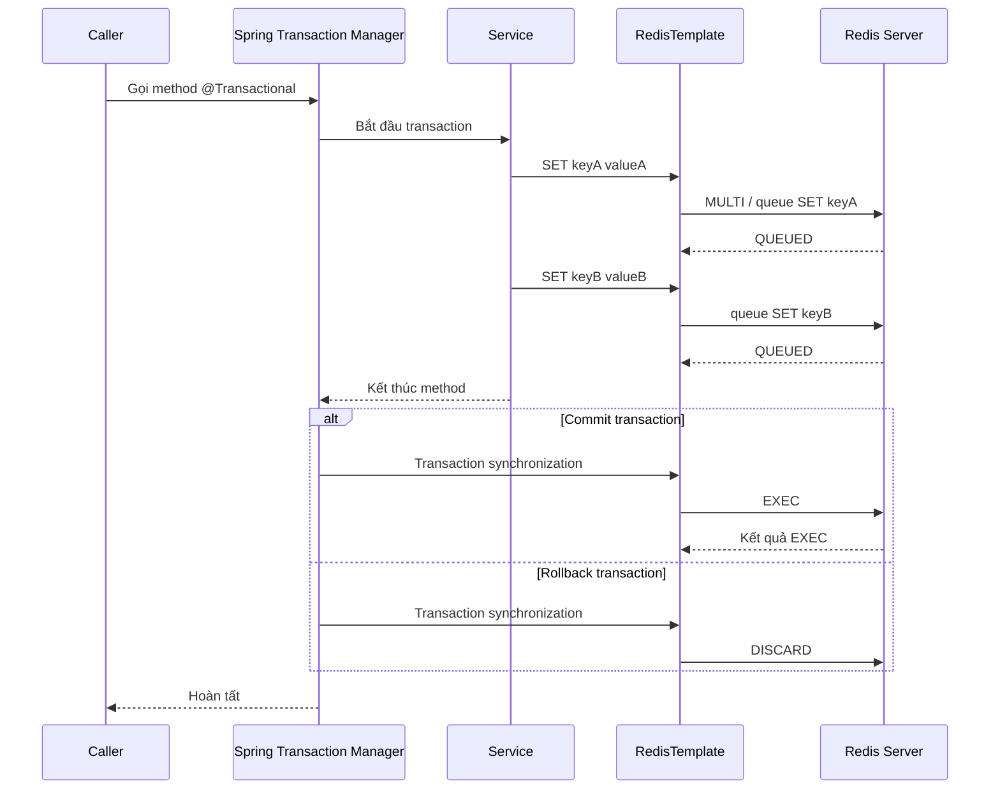

# Bật transaction support cho RedisTemplate trong Spring Data Redis

## 1. Bài toán: nhiều lệnh Redis cần được thực thi theo một giao dịch

Giả sử ứng dụng xác nhận một đơn hàng và cần thay đổi hai khóa Redis:

```text
demo:order:501:status       → CONFIRMED
demo:order:501:confirmedBy  → staff-12
```

Nếu chạy từng lệnh độc lập, lỗi kết nối giữa hai lần ghi có thể làm trạng thái lưu trong Redis không đồng bộ. Redis cung cấp giao dịch với các lệnh `MULTI`, `EXEC` và `DISCARD` để gom những lệnh cần thực thi thành một nhóm. Spring Data Redis cho phép sử dụng cơ chế này thông qua `RedisTemplate` và tích hợp vào giao dịch do Spring quản lý.

Điểm dễ nhầm: **chỉ gắn `@Transactional` lên một phương thức không tự động khiến mọi lệnh `RedisTemplate` tham gia Redis transaction**. Theo mặc định, transaction support của `RedisTemplate` không được bật. Để tham gia giao dịch Spring, template cần được cấu hình:

```java
redisTemplate.setEnableTransactionSupport(true);
```

Bài học giải thích điều kiện để cấu hình trên có hiệu lực, cách Spring gắn kết nối Redis vào giao dịch, cách đọc/ghi vận hành trong lúc `MULTI` đang hoạt động và các giới hạn quan trọng khi dùng Redis cùng cơ sở dữ liệu quan hệ.

## 2. Hiểu Redis transaction trước khi cấu hình Spring

Một giao dịch Redis thông thường:

```redis
MULTI
SET demo:tx:order:501:status CONFIRMED
SET demo:tx:order:501:confirmedBy staff-12
EXEC
```

Diễn biến:

1. `MULTI` bắt đầu giao dịch trên **một kết nối Redis**.
2. Các lệnh tiếp theo được Redis đưa vào hàng đợi, thường phản hồi bằng `QUEUED`.
3. `EXEC` yêu cầu Redis thực thi các lệnh đã xếp hàng theo thứ tự.
4. `DISCARD` có thể được dùng trước `EXEC` để hủy hàng đợi lệnh và thoát chế độ giao dịch.

Ví dụ hủy:

```redis
MULTI
SET demo:tx:order:501:status CANCELLED
DISCARD
```

Sau `DISCARD`, lệnh `SET` đã xếp hàng không được thực thi.

### Redis transaction khác giao dịch cơ sở dữ liệu quan hệ ở đâu?

Redis bảo đảm các lệnh trong `EXEC` được thực thi tuần tự, không bị lệnh từ client khác chen ngang giữa các lệnh thuộc cùng giao dịch. Nhưng Redis **không hỗ trợ rollback các lệnh đã thực thi trong `EXEC`** theo cách một hệ quản trị SQL có thể đảo ngược giao dịch.

Một lỗi được phát hiện khi **xếp hàng lệnh** có thể khiến `EXEC` từ chối cả giao dịch. Trái lại, khi một lệnh chỉ phát sinh lỗi **trong lúc thực thi**, những lệnh khác trong giao dịch vẫn có thể được thực thi; Redis không tự đảo ngược phần đã thành công.

Ví dụ:

```redis
SET demo:tx:number not-a-number
MULTI
INCR demo:tx:number
SET demo:tx:other OK
EXEC
```

`INCR` không thể tăng chuỗi `not-a-number`, nhưng lệnh `SET` còn lại vẫn có thể hoàn thành trong `EXEC`. Vì thế, “giao dịch Redis” không đồng nghĩa “mọi lệnh đều thành công hoặc không có thay đổi nào”.

**Hệ quả thiết kế:** chỉ dùng Redis transaction cho nhóm lệnh có semantics phù hợp; việc kiểm tra điều kiện và chiến lược xử lý lỗi ở mức nghiệp vụ vẫn cần được thiết kế.

## 3. Vai trò của RedisTemplate trong Spring Data Redis

`RedisTemplate<K, V>` là lớp trung tâm để thực hiện thao tác Redis trong ứng dụng Spring. `StringRedisTemplate` là biến thể thuận tiện với key và value kiểu chuỗi.

Một ứng dụng thường có:

```text
Service
   |
   v
RedisTemplate hoặc StringRedisTemplate
   |
   v
RedisConnectionFactory
   |
   v
Redis server
```

Khi không bật transaction support, lời gọi như:

```java
redis.opsForValue().set("demo:tx:a", "one");
redis.opsForValue().set("demo:tx:b", "two");
```

sẽ được thực hiện thông qua cơ chế kết nối thông thường; hai lệnh không tự trở thành một giao dịch Redis chỉ vì được viết liền nhau trong Java.

Khi bật transaction support **và tồn tại giao dịch Spring đang hoạt động**, Spring Data Redis có thể ràng buộc một `RedisConnection` với luồng thực thi hiện tại, bắt đầu `MULTI` và quyết định `EXEC` hay `DISCARD` theo kết quả giao dịch.

Chính sự kết hợp giữa **template có transaction support** và **Spring transaction thực sự** mới tạo nên hành vi này.

## 4. Điều kiện cần trước khi bật transaction support

Để ví dụ tích hợp với `@Transactional` hoạt động, cần có:

1. Một ứng dụng Spring có dependency Spring Data Redis, Redis server và `RedisConnectionFactory` hợp lệ.
2. Một bean `RedisTemplate` hoặc `StringRedisTemplate` được bật `setEnableTransactionSupport(true)`.
3. Một `PlatformTransactionManager` để Spring mở và kết thúc transaction.
4. Transaction management của Spring được kích hoạt và lời gọi tới phương thức `@Transactional` đi qua Spring proxy hoặc cơ chế interception tương ứng.
5. Các thao tác Redis trong transaction thực sự sử dụng **đúng bean template đã bật hỗ trợ**.

Với Spring Boot, dependency Redis cơ bản:

**Gradle:**

```kotlin
dependencies {
    implementation("org.springframework.boot:spring-boot-starter-data-redis")
}
```

**Maven:**

```xml
<dependency>
    <groupId>org.springframework.boot</groupId>
    <artifactId>spring-boot-starter-data-redis</artifactId>
</dependency>
```

Ví dụ kết nối Redis ở môi trường local:

```yaml
spring:
  data:
    redis:
      host: localhost
      port: 6379
```

Spring Boot thường tự tạo `RedisConnectionFactory` dựa trên cấu hình Redis. Để minh họa giao dịch Spring với một `PlatformTransactionManager` đã tồn tại, các phần sau dùng tình huống ứng dụng có JDBC transaction manager.

**Lưu ý:** Spring Data Redis không cung cấp một `PlatformTransactionManager` riêng để tự bật `@Transactional` chỉ bằng Redis starter. Nếu ứng dụng chỉ dùng Redis mà không có transaction manager khác, cần chủ động chọn giải pháp điều phối giao dịch hoặc dùng API `MULTI`/`EXEC` thủ công cho một nhóm thao tác Redis.

## 5. Cấu hình một StringRedisTemplate có transaction support

Với dữ liệu chuỗi, có thể tạo bean riêng để thể hiện rõ mục đích giao dịch.

**`RedisTransactionConfig.java`**

```java
package com.example.demo.config;

import org.springframework.context.annotation.Bean;
import org.springframework.context.annotation.Configuration;
import org.springframework.data.redis.connection.RedisConnectionFactory;
import org.springframework.data.redis.core.StringRedisTemplate;
import org.springframework.transaction.annotation.EnableTransactionManagement;

@Configuration
@EnableTransactionManagement
public class RedisTransactionConfig {

    @Bean("transactionalRedisTemplate")
    public StringRedisTemplate transactionalRedisTemplate(
            RedisConnectionFactory connectionFactory
    ) {
        StringRedisTemplate template =
                new StringRedisTemplate(connectionFactory);

        template.setEnableTransactionSupport(true);

        return template;
    }
}
```

Ở đây:

- `StringRedisTemplate` sử dụng serializer chuỗi phù hợp với key và value kiểu `String`.
- `RedisConnectionFactory` do Spring cung cấp chịu trách nhiệm quản lý kết nối tới Redis.
- `setEnableTransactionSupport(true)` cho phép template tham gia cơ chế transaction synchronization của Spring.
- Tên bean `transactionalRedisTemplate` giúp phân biệt cấu hình nếu ứng dụng có nhiều template.
- `@EnableTransactionManagement` cho phép áp dụng `@Transactional` theo cơ chế Spring; nhiều ứng dụng Spring Boot đã có cấu hình tương ứng, nhưng minh họa đặt tường minh để dễ theo dõi.

Khi Spring Boot thấy một bean `StringRedisTemplate` tự định nghĩa, việc tự tạo bean `StringRedisTemplate` mặc định có thể bị bỏ qua do điều kiện auto-configuration. Vì vậy, khi dự án cần nhiều template khác cấu hình, hãy kiểm tra các bean thực sự được đăng ký và sử dụng `@Qualifier` để chọn chính xác bean.

### Nếu dự án đang dùng RedisTemplate<K, V>

Với template có key và value không phải đều là chuỗi, ý tưởng tương tự:

```java
RedisTemplate<String, MyValue> template = new RedisTemplate<>();

template.setConnectionFactory(connectionFactory);
template.setKeySerializer(new StringRedisSerializer());
// Cấu hình value/hash serializer phù hợp với model trước khi dùng.

template.setEnableTransactionSupport(true);
template.afterPropertiesSet();
```

Đoạn này minh họa vị trí của lệnh bật hỗ trợ; không phải cấu hình đầy đủ cho `MyValue`. Cần lựa chọn serializer của value và hash theo quy ước của dự án. Việc bật transaction support **không thay đổi serializer** và không tự sửa lỗi định dạng dữ liệu.

## 6. PlatformTransactionManager: điều kiện quan trọng của @Transactional

`@Transactional` không tự tạo transaction chỉ từ annotation. Spring cần một `PlatformTransactionManager` để mở, commit hoặc rollback transaction của luồng xử lý.

Trong một ứng dụng có JDBC, có thể có `JdbcTransactionManager` hoặc `DataSourceTransactionManager`. Với Spring Boot cùng dependency và cấu hình DataSource phù hợp, transaction manager thường được auto-configure. Chỉ khi cần cấu hình thủ công mới thêm bean tương ứng.

Ví dụ cho JDBC:

```java
package com.example.demo.config;

import javax.sql.DataSource;

import org.springframework.context.annotation.Bean;
import org.springframework.context.annotation.Configuration;
import org.springframework.jdbc.support.JdbcTransactionManager;
import org.springframework.transaction.PlatformTransactionManager;

@Configuration
public class JdbcTransactionConfig {

    @Bean
    public PlatformTransactionManager transactionManager(
            DataSource dataSource
    ) {
        return new JdbcTransactionManager(dataSource);
    }
}
```

Không thêm bean trên nếu dự án đã có transaction manager phù hợp, vì trùng hoặc có nhiều manager có thể làm lựa chọn `@Transactional` trở nên mơ hồ.

**Tại sao JDBC transaction manager có thể liên quan Redis?** Spring Data Redis dùng cơ chế *transaction synchronization* gắn vào transaction do manager đang điều khiển. Khi transaction Spring kết thúc, Redis connection được thông báo commit hoặc rollback tương ứng. Điều này là **phối hợp theo lifecycle của Spring**, không biến JDBC và Redis thành một giao dịch phân tán nguyên tử.

### Nếu ứng dụng không có SQL database

Nếu chỉ cần một chuỗi thao tác Redis có `MULTI`/`EXEC`, có thể sử dụng `RedisTemplate.execute(SessionCallback)` để bảo đảm các lệnh nằm trên cùng một kết nối và điều khiển `multi()`/`exec()` tường minh. Cách này không yêu cầu tạo JDBC transaction manager giả chỉ để gọi `@Transactional`.

Không nên hiểu `setEnableTransactionSupport(true)` là một “RedisTransactionManager” mới: nó chỉ cho phép template **tham gia transaction Spring đang tồn tại**.

## 7. Sử dụng @Transactional với bean đã bật hỗ trợ

Giả sử ứng dụng lưu trạng thái đơn hàng bằng JDBC và ghi trạng thái phụ trợ vào Redis.

**`OrderConfirmationService.java`**

```java
package com.example.demo.service;

import java.time.Duration;

import org.springframework.beans.factory.annotation.Qualifier;
import org.springframework.data.redis.core.StringRedisTemplate;
import org.springframework.jdbc.core.JdbcTemplate;
import org.springframework.stereotype.Service;
import org.springframework.transaction.annotation.Transactional;

@Service
public class OrderConfirmationService {

    private final JdbcTemplate jdbc;
    private final StringRedisTemplate redis;

    public OrderConfirmationService(
            JdbcTemplate jdbc,
            @Qualifier("transactionalRedisTemplate")
            StringRedisTemplate redis
    ) {
        this.jdbc = jdbc;
        this.redis = redis;
    }

    @Transactional
    public void confirm(String orderId, String staffId) {
        int updated = jdbc.update(
                "UPDATE orders SET status = ? WHERE id = ?",
                "CONFIRMED",
                orderId
        );

        if (updated != 1) {
            throw new IllegalArgumentException(
                    "Không tìm thấy đúng một đơn hàng"
            );
        }

        String prefix = "demo:order:" + orderId + ":";

        redis.opsForValue().set(
                prefix + "status",
                "CONFIRMED",
                Duration.ofHours(1)
        );

        redis.opsForValue().set(
                prefix + "confirmedBy",
                staffId,
                Duration.ofHours(1)
        );
    }
}
```

Đoạn mã giả định ứng dụng đã có bảng `orders`, bean `JdbcTemplate` và transaction manager cho JDBC. Đây là ví dụ tích hợp transaction, không phải ứng dụng có thể chạy độc lập khi thiếu DataSource và schema SQL.

Khi `confirm(...)` được gọi thông qua Spring bean proxy:

1. Spring mở JDBC transaction và kích hoạt transaction synchronization.
2. `JdbcTemplate` gửi câu lệnh cập nhật SQL trong JDBC transaction đó.
3. Lần gọi Redis đầu tiên qua `transactionalRedisTemplate` tham gia transaction Spring; lệnh Redis ghi được xếp hàng trong Redis transaction.
4. Lệnh Redis tiếp theo được xếp hàng trên kết nối Redis phục vụ cùng giao dịch.
5. Nếu transaction Spring hoàn thành thành công, Spring Data Redis yêu cầu thực thi `EXEC` theo cơ chế đồng bộ hóa.
6. Nếu Spring transaction rollback trước commit, Spring Data Redis gửi `DISCARD` để bỏ các lệnh Redis đang chờ.

**Điểm quan trọng:** việc SQL commit và Redis `EXEC` không phải hai nhánh của giao dịch XA/2-phase commit. Sự cố sau khi SQL đã commit nhưng trước hoặc trong Redis `EXEC` vẫn có thể làm trạng thái hai kho dữ liệu khác nhau. Nếu cần tính nhất quán mạnh giữa SQL và Redis, hãy chọn mô hình phù hợp như transactional outbox và cập nhật cache có thể thử lại.

### Tình huống xảy ra ngoại lệ

Giả sử phần cuối phương thức có thêm:

```java
if (shouldReject) {
    throw new IllegalStateException("Không thể xác nhận đơn hàng");
}
```

Ngoại lệ runtime phát sinh trước khi transaction Spring hoàn tất thường khiến transaction manager rollback; các lệnh Redis còn đang chờ sẽ bị `DISCARD`. Theo mặc định, Spring `@Transactional` rollback với `RuntimeException` và `Error`; ngoại lệ checked có quy tắc rollback khác, có thể yêu cầu cấu hình `rollbackFor`.

Không dựa vào việc “có exception là Redis chắc chắn không đổi gì” nếu lỗi xảy ra **sau** khi `EXEC` đã thực thi hoặc một phần lệnh trong `EXEC` gặp lỗi runtime.

## 8. Giao dịch thực sự xảy ra ở đâu?

Có thể hình dung luồng điều khiển như sau:



Sơ đồ lược bỏ các chi tiết JDBC, lifecycle kết nối và callback nội bộ để nhấn mạnh vị trí của `RedisTemplate` trong giao dịch. Trình tự chính xác giữa các callback commit của tài nguyên khác phụ thuộc transaction manager; không nên xem sơ đồ là bảo đảm commit nguyên tử liên hệ thống.

## 9. Khi đọc Redis ngay trong @Transactional

Đây là nguồn nhầm lẫn thường gặp. Trong Redis transaction, các lệnh ghi được **xếp hàng** cho tới `EXEC`. Spring Data Redis còn có cách xử lý riêng với lệnh chỉ đọc trên template tham gia transaction: các thao tác đọc như `GET` hoặc `KEYS` có thể được gửi bằng một kết nối Redis khác **không nằm trong transaction**, để có kết quả đọc hiện hành.

Xét ví dụ:

```java
@Transactional
public void updateAndInspect() {
    redis.opsForValue().set("demo:tx:flag", "NEW");

    String value = redis.opsForValue().get("demo:tx:flag");

    System.out.println(value);
}
```

Không được giả định `value` là `NEW`. Nếu key chưa tồn tại ở trạng thái committed trước đó, kết quả có thể là `null`; nếu đã tồn tại, kết quả đọc có thể là giá trị cũ. Giá trị `NEW` vẫn đang chờ `EXEC`.

Điều này khác với một số ứng dụng SQL vốn quen với đặc tính “read your writes” trong cùng transaction.

### Giá trị trả về của lệnh ghi trong transaction

Nhiều lệnh Redis khi đang được xếp hàng trả về giá trị không giống kết quả khi thực thi ngay. Trong các API Spring Data Redis, một số phương thức có thể trả về `null` khi đang nằm trong pipeline hoặc transaction.

Ví dụ:

```java
Boolean added = redis.opsForSet().add(
        "demo:tx:members",
        "member-1"
);
```

Không nên lập tức kiểm tra `added.booleanValue()` để quyết định nghiệp vụ trong khi Redis transaction chưa `EXEC`. Giá trị `null` có thể phản ánh thao tác đang chờ chứ không phải lệnh thất bại.

Nếu nghiệp vụ cần dùng kết quả của một thao tác Redis để quyết định lệnh tiếp theo, phải thiết kế theo các phương pháp có điều kiện như `WATCH`/`MULTI`/`EXEC`, Lua script hoặc Redis Function, thay vì cố đọc kết quả của lệnh đang nằm trong hàng đợi.

## 10. @Transactional không hoạt động trong những trường hợp nào?

### 10.1. Chỉ bật cờ mà không có Spring transaction

```java
template.setEnableTransactionSupport(true);
template.opsForValue().set("demo:a", "one");
template.opsForValue().set("demo:b", "two");
```

Khi không có transaction Spring đang hoạt động, hai lệnh trên không tự gom thành một `MULTI`/`EXEC`. Cờ cấu hình chỉ kích hoạt việc **tham gia** transaction nếu có ngữ cảnh transaction phù hợp.

### 10.2. Có @Transactional nhưng dùng sai bean

Nếu cấu hình một template tên `transactionalRedisTemplate` nhưng service lại inject một bean `StringRedisTemplate` khác chưa bật hỗ trợ, lời gọi Redis của service đó không tham gia transaction theo ý định.

Sử dụng `@Qualifier("transactionalRedisTemplate")`, hoặc kiểm soát bean duy nhất của loại tương ứng trong ứng dụng.

### 10.3. Gọi nội bộ qua this

```java
@Service
public class ExampleService {

    public void run() {
        updateInTransaction();  // Lời gọi nội bộ qua this
    }

    @Transactional
    public void updateInTransaction() {
        // Redis writes
    }
}
```

Với mô hình `@Transactional` dựa trên Spring proxy thông thường, lời gọi nội bộ cùng đối tượng có thể **bỏ qua transaction interceptor**. Phương thức được gắn annotation không có nghĩa cứ gọi từ bất kỳ vị trí nào cũng sẽ mở transaction.

Để dùng proxy, đặt phương thức transactional ở một Spring bean được gọi từ bean khác, hoặc chọn cấu trúc/service phù hợp.

### 10.4. Không có PlatformTransactionManager hợp lệ

Ứng dụng chỉ có Redis starter và cấu hình `@Transactional` mà không có transaction manager phù hợp có thể gặp lỗi khi khởi tạo hoặc gọi phương thức. Spring Data Redis không tự cung cấp transaction manager chỉ vì ta bật cờ trên template.

### 10.5. Lời gọi đi qua một luồng khác

Transaction synchronization của Spring trong mô hình đồng bộ thường gắn với ngữ cảnh của thread. Nếu một phương thức `@Transactional` tự tạo `new Thread(...)`, gọi `@Async` hoặc chuyển sang cơ chế xử lý bất đồng bộ mà không có transaction riêng, không được mặc định rằng thread mới dùng cùng Redis transaction.

## 11. So sánh cách bật hỗ trợ theo giao dịch Spring và giao dịch thủ công

Có hai mô hình phổ biến:

| Mô hình | Bắt đầu/kết thúc | Khi nào phù hợp |
|---|---|---|
| `setEnableTransactionSupport(true)` + `@Transactional` | Spring transaction manager điều khiển lifecycle; Redis đồng bộ `EXEC`/`DISCARD` | Ứng dụng đã có Spring transaction và cần Redis tham gia vòng đời transaction |
| `SessionCallback` với `multi()` / `exec()` / `discard()` | Ứng dụng điều khiển Redis transaction tường minh trên một connection | Chỉ cần giao dịch Redis, không cần đồng bộ với SQL/JPA transaction |

### Ví dụ giao dịch Redis thuần qua SessionCallback

Khi chỉ muốn dùng Redis transaction, có thể gọi các thao tác trong một `SessionCallback` để chúng dùng cùng kết nối:

```java
import java.util.List;

import org.springframework.dao.DataAccessException;
import org.springframework.data.redis.core.RedisOperations;
import org.springframework.data.redis.core.SessionCallback;
import org.springframework.data.redis.core.StringRedisTemplate;

// redis là một StringRedisTemplate thông thường.
List<Object> results = redis.execute(
        new SessionCallback<List<Object>>() {
            @Override
            public <K, V> List<Object> execute(
                    RedisOperations<K, V> operations
            ) throws DataAccessException {
                operations.multi();
                try {
                    operations.opsForValue().set(
                            (K) "demo:tx:manual:status",
                            (V) "CONFIRMED"
                    );
                    operations.opsForValue().set(
                            (K) "demo:tx:manual:by",
                            (V) "staff-12"
                    );

                    return operations.exec();
                } catch (RuntimeException ex) {
                    operations.discard();
                    throw ex;
                }
            }
        }
);
```

Trong ví dụ, `K` và `V` là type parameter tổng quát do interface `SessionCallback` khai báo. Ép kiểu ở đây chỉ nhằm minh họa API generic với template đang dùng key/value `String`; nếu muốn tránh ép kiểu, có thể tổ chức một callback chuyên biệt sử dụng `RedisCallback` cấp thấp và serializer tương ứng.

`SessionCallback` không phải yêu cầu bắt buộc khi dùng `@Transactional` đã đồng bộ trên template. Ngược lại, nếu dùng transaction thủ công, phải bảo đảm `MULTI` và `EXEC` nằm trên **cùng kết nối**; không tách từng lệnh sang những template hoặc connection độc lập.

**Không trộn tự động và thủ công tùy tiện:** không nên gọi `multi()`/`exec()` tường minh trên chính connection đang được Spring transaction synchronization quản lý mà không hiểu rõ trạng thái kết nối. Hai cơ chế điều khiển lifecycle cùng lúc có thể dẫn tới hành vi không như mong đợi.

## 12. Cách kiểm tra hành vi commit và rollback

Trong môi trường thử nghiệm có transaction manager hợp lệ, ta có thể xây dựng một service chỉ ghi Redis:

```java
package com.example.demo.service;

import org.springframework.beans.factory.annotation.Qualifier;
import org.springframework.data.redis.core.StringRedisTemplate;
import org.springframework.stereotype.Service;
import org.springframework.transaction.annotation.Transactional;

@Service
public class RedisTxDemoService {

    private final StringRedisTemplate redis;

    public RedisTxDemoService(
            @Qualifier("transactionalRedisTemplate")
            StringRedisTemplate redis
    ) {
        this.redis = redis;
    }

    @Transactional
    public void writeAndCommit(String id) {
        redis.opsForValue().set("demo:tx:" + id + ":one", "1");
        redis.opsForValue().set("demo:tx:" + id + ":two", "2");
    }

    @Transactional
    public void writeAndRollback(String id) {
        redis.opsForValue().set("demo:tx:" + id + ":one", "1");
        redis.opsForValue().set("demo:tx:" + id + ":two", "2");

        throw new IllegalStateException("Rollback có chủ đích");
    }
}
```

Gọi hai phương thức từ **một bean khác** hoặc lớp test tích hợp thông qua Spring proxy, đồng thời dùng một ID thử nghiệm khác nhau cho hai trường hợp.

Ví dụ kiểm tra từ Redis CLI sau khi phương thức đã hoàn tất:

```redis
GET demo:tx:commit-demo:one
GET demo:tx:commit-demo:two

GET demo:tx:rollback-demo:one
GET demo:tx:rollback-demo:two
```

Nếu dữ liệu thử nghiệm ban đầu chưa tồn tại và giao dịch Spring được mở đúng:

- Trường hợp commit: hai key có giá trị lần lượt `1` và `2`.
- Trường hợp rollback trước khi `EXEC`: hai lệnh ghi bị hủy, các key không có giá trị mới.

Không kiểm chứng bằng cách đọc ngay trong cùng phương thức transaction rồi giả định Redis đã thực thi các lệnh `SET`.

### Điều gì xảy ra nếu lỗi ở chính EXEC?

Nếu commit Spring đã bước sang giai đoạn hoàn tất nhưng Redis gặp lỗi khi `EXEC`, không nên mặc định có thể “rollback lại toàn bộ” những tài nguyên khác như JDBC. Cần ghi log đủ thông tin, xác định phần nào đã commit và có biện pháp đồng bộ/bù trừ thích hợp.

## 13. WATCH, optimistic locking và kiểm tra điều kiện ghi

`MULTI`/`EXEC` gom lệnh để thực thi theo trình tự, nhưng **không tự ngăn lost update** khi hai client cùng đọc rồi sửa một giá trị.

Ví dụ hai worker đọc cùng bộ đếm trước khi bắt đầu giao dịch, rồi cùng tính và ghi lại giá trị dựa trên bản đọc cũ. Dù các lệnh ghi của mỗi worker nằm trong `MULTI`, worker ghi sau vẫn có thể ghi đè kết quả của worker trước.

Redis cung cấp `WATCH` để theo dõi thay đổi của key trước khi bắt đầu transaction. Quy trình khái niệm:

```redis
WATCH demo:wallet:balance
GET demo:wallet:balance
MULTI
SET demo:wallet:balance 900
EXEC
```

Nếu có client khác thay đổi key được `WATCH` trước lúc `EXEC`, giao dịch có thể bị hủy và `EXEC` trả về kết quả cho biết không thực thi. Ứng dụng thường cần cơ chế retry có giới hạn và tính toán lại dữ liệu.

Với thao tác kiểm tra rồi cập nhật, không nên kết hợp `WATCH` tùy tiện với `@Transactional` và template đã vào `MULTI`. Một luồng `WATCH` hợp lệ phải được thiết kế để thao tác kiểm tra và transaction sử dụng đúng kết nối, đúng thứ tự. Khi điều kiện ghi có thể mô tả bằng một thao tác nguyên tử, đôi khi Lua script hoặc Redis Function đơn giản và phù hợp hơn.

## 14. Transaction support và tính nhất quán giữa SQL với Redis

Khi một ứng dụng dùng cả JDBC/JPA và Redis, nhiều người nhìn thấy `@Transactional` rồi cho rằng “SQL rollback thì Redis rollback; SQL commit thì Redis commit; tất cả luôn cùng thành công”. Nhận định này quá mạnh.

Ví dụ service:

```text
1. Cập nhật bảng orders bằng JDBC.
2. Ghi cache order:501:status bằng RedisTemplate có transaction support.
3. Kết thúc @Transactional.
```

Nếu xảy ra lỗi trước commit, Spring có thể rollback JDBC và hủy các lệnh Redis đang xếp hàng. Nhưng giữa quá trình hoàn tất giao dịch, có thể có sự cố:

```text
JDBC transaction commit thành công
        |
        v
Mất kết nối Redis trước khi EXEC hoàn tất
        |
        v
SQL có trạng thái mới, cache Redis có thể chưa cập nhật
```

Không có giao dịch phân tán nguyên tử chỉ nhờ cấu hình `setEnableTransactionSupport(true)`. Redis cũng không hỗ trợ kiểu rollback lệnh đã thực thi mà SQL transaction có thể cung cấp.

### Cách thiết kế khi cache có thể xây dựng lại

Với Redis đóng vai trò cache dữ liệu SQL, một thiết kế phổ biến là:

1. Commit thay đổi nghiệp vụ trong cơ sở dữ liệu chính.
2. Sau khi commit thành công, xóa cache liên quan hoặc phát sự kiện cập nhật cache.
3. Đảm bảo thao tác cache có thể thử lại; khi cache trống, đọc từ nguồn chính và dựng lại.

Nếu một sự kiện cập nhật cache **không được phép bị bỏ sót**, có thể dùng transactional outbox: ghi thay đổi nghiệp vụ và bản ghi sự kiện trong **cùng giao dịch SQL**, sau đó worker đọc outbox và cập nhật/invalidate Redis có retry.

Cần chọn theo tính chất hệ thống: dữ liệu chỉ là cache có thể chấp nhận nhất quán cuối cùng, trong khi thao tác tiền tệ hoặc trạng thái kinh doanh quan trọng cần giải pháp dữ liệu nguồn và kiểm soát giao dịch chặt hơn.

## 15. Transaction support, pipeline và Lua script khác nhau thế nào?

| Kỹ thuật | Mục đích chính | Đặc tính quan trọng |
|---|---|---|
| Redis transaction `MULTI`/`EXEC` | Xếp lệnh rồi thực thi tuần tự thành một nhóm | Không có rollback từng lệnh sau lỗi runtime trong `EXEC` |
| Spring `@Transactional` + RedisTemplate support | Cho Redis transaction tham gia vòng đời Spring transaction | Cần `PlatformTransactionManager` và đúng template; không phải distributed transaction |
| Pipelining | Giảm round trip khi gửi nhiều lệnh | Không tự bảo đảm một giao dịch có điều kiện hoặc cô lập lệnh |
| Lua script / Redis Function | Thực hiện logic nhiều thao tác trên server | Có thể xử lý điều kiện đọc/ghi trong một thao tác nguyên tử trên Redis |
| `WATCH` + `MULTI`/`EXEC` | Optimistic locking khi cần so sánh trước khi ghi | Cần phát hiện conflict và retry |

**Ví dụ phân biệt:** gửi hai lệnh `SET` bằng pipeline có thể giảm số lượt truyền mạng nhưng không tự tạo điều kiện “chỉ ghi cả hai nếu một key chưa thay đổi”. Dùng `MULTI`/`EXEC` có trình tự thực thi tập lệnh. Dùng `WATCH` có thể hủy giao dịch khi key bị sửa, còn script giúp gói điều kiện và ghi trên server.

Trong Redis Cluster, thao tác nhiều key còn chịu ràng buộc hash slot và topology. Không mặc định rằng một transaction với các key trải ở nhiều slot có thể chạy như trên Redis đơn node. Khi thiết kế cần `MULTI`/`EXEC` đa key trong cluster, phải xác nhận các key nằm trên slot phù hợp và khả năng của Redis driver.

## 16. Những lỗi thường gặp khi cấu hình

| Triệu chứng | Nguyên nhân có thể | Hướng xử lý |
|---|---|---|
| `@Transactional` có nhưng Redis vẫn ghi ngay | Template đang dùng chưa bật transaction support | Kiểm tra `setEnableTransactionSupport(true)` trên đúng bean |
| Có cấu hình transaction support nhưng không thấy `MULTI` | Không có Spring transaction đang hoạt động | Đảm bảo `@Transactional` được intercept qua Spring proxy và có transaction manager |
| Không tìm thấy transaction manager | Chỉ có Redis starter, không có `PlatformTransactionManager` | Bổ sung/cấu hình manager phù hợp hoặc dùng Redis transaction thủ công |
| Có nhiều transaction manager | `@Transactional` chọn nhầm hoặc không biết chọn manager nào | Chỉ rõ `transactionManager` bằng tên khi cần |
| Đọc ngay sau `SET` trong cùng transaction thấy giá trị cũ | Write đang chờ `EXEC`; lệnh đọc có thể dùng connection khác | Đọc sau khi transaction hoàn thành hoặc thiết kế luồng khác |
| Giá trị trả về của write là `null` | Lệnh đang được queue | Không dùng return value này làm quyết định nghiệp vụ trước `EXEC` |
| Tự gọi `multi()` và gặp hành vi kỳ lạ | Trộn transaction thủ công với Spring-managed transaction | Chọn một cơ chế quản lý lifecycle nhất quán |
| Redis rollback nhưng JDBC đã commit | Không có atomic commit giữa hai kho dữ liệu | Dùng chiến lược đồng bộ sau commit, outbox hoặc bù trừ |
| `CROSSSLOT` trong Redis Cluster | Lệnh/transaction đa key ở nhiều hash slot | Thiết kế key theo slot hoặc tách thao tác phù hợp |
| Lệnh trong `EXEC` bị lỗi nhưng lệnh khác thành công | Redis không rollback những lệnh thành công sau lỗi runtime | Kiểm tra điều kiện trước, đọc kết quả `EXEC` hoặc dùng logic nguyên tử phù hợp |
| Method `@Transactional` bị gọi từ `this` | Spring proxy không intercept self-invocation | Gọi qua một Spring bean khác hoặc tái cấu trúc service |
| Transaction giữ kết nối quá lâu | Transaction kéo dài với thao tác chặn hoặc chờ I/O | Giữ transaction ngắn, hạn chế thao tác ngoài phạm vi cần thiết |

### Về vòng đời kết nối

Khi transaction support bật, Spring Data Redis gắn connection với transaction của thread. Một transaction kéo dài có thể giữ tài nguyên kết nối lâu hơn mong muốn, đặc biệt nếu sử dụng nhiều thao tác hoặc chờ dịch vụ ngoài.

Không đặt lời gọi HTTP chậm, sleep dài hoặc quy trình tương tác với người dùng bên trong transaction chỉ để giữ kết nối Redis đang chờ `EXEC`. Phân tách giai đoạn đọc/chuẩn bị dữ liệu và giai đoạn commit ngắn giúp hạn chế việc giữ tài nguyên.

## 17. Quy trình triển khai có kiểm soát

Khi thêm transaction support vào dự án Spring Data Redis, có thể làm theo trình tự:

1. **Xác định phạm vi.** Chỉ các thao tác Redis nào cần nằm trong transaction Spring? Có thật sự cần nhiều lệnh cùng commit hay chỉ cần một lệnh Redis nguyên tử?
2. **Xác nhận manager.** Dự án dùng JDBC/JPA transaction manager nào? Nếu có nhiều manager, chọn đúng manager cho `@Transactional`.
3. **Tạo hoặc cấu hình template.** Gọi `setEnableTransactionSupport(true)` trước khi bean được sử dụng và kiểm soát serializer, connection factory.
4. **Inject đúng template.** Dùng `@Qualifier` nếu cần để tránh các service vô tình dùng template không tham gia transaction.
5. **Đặt ranh giới @Transactional.** Method phải được Spring intercept; giữ transaction ngắn, không dùng self-invocation.
6. **Hiểu cách đọc/ghi.** Không chờ lệnh write queued trả về kết quả cuối cùng hoặc đọc giá trị mới trước `EXEC`.
7. **Chọn chiến lược lỗi.** Phân biệt rollback trước commit, lỗi trong Redis `EXEC` và lỗi phối hợp giữa Redis với kho dữ liệu khác.
8. **Theo dõi vận hành.** Quan sát độ trễ Redis, số kết nối, thời gian transaction và các trường hợp transaction kết thúc bất thường.

## 18. Câu hỏi luyện tập

**Tình huống 1:** Một service đã dùng `@Transactional` do JDBC manager quản lý, nhưng `RedisTemplate` vẫn giữ cấu hình mặc định. Nếu method ném `RuntimeException` sau khi gọi `redis.opsForValue().set(...)`, có bảo đảm Redis không thay đổi không?

**Giải thích:** không. Template mặc định không tự tham gia giao dịch Spring. Lệnh Redis có thể đã ghi trước khi JDBC rollback. Cần bật transaction support trên đúng template và hiểu giới hạn phối hợp sau đó.

**Tình huống 2:** Đã bật `setEnableTransactionSupport(true)` nhưng gọi `opsForValue().set(...)` từ một method không có transaction Spring. Redis có đợi `EXEC` không?

**Giải thích:** không. Bật cờ không tự mở Redis transaction. Nó chỉ cho template tham gia cơ chế đồng bộ hóa khi transaction Spring đang hoạt động.

**Tình huống 3:** Trong một method `@Transactional`, gọi `SET key NEW` rồi `GET key` ngay sau đó. Kết quả có chắc là `NEW`?

**Giải thích:** không. Lệnh write đang được queue. Lệnh đọc có thể nhìn thấy giá trị cũ từ connection khác; không được suy ra “read your writes”.

**Tình huống 4:** Trong `EXEC` có ba lệnh; lệnh thứ hai lỗi do kiểu dữ liệu không phù hợp. Redis có đảo ngược lệnh thứ nhất và hủy lệnh thứ ba?

**Giải thích:** không mặc định. Lỗi runtime của một lệnh khi `EXEC` đang thực thi không khiến Redis rollback các lệnh thành công khác.

**Tình huống 5:** JDBC commit đã thành công nhưng Redis mất kết nối trước khi cập nhật cache hoàn tất. `@Transactional` có tự đưa SQL về giá trị trước không?

**Giải thích:** không thể dựa vào bảo đảm đó. Spring Data Redis transaction synchronization không phải distributed transaction. Với cache, cân nhắc invalidate sau commit và retry; nếu yêu cầu không mất sự kiện, dùng transactional outbox.

**Tình huống 6:** Có hai Redis key ở các slot khác nhau trong Redis Cluster. Có thể luôn đặt chúng trong một lệnh transaction như khi dùng Redis đơn node?

**Giải thích:** không. Redis Cluster có giới hạn về hash slot và khả năng transaction đa key; cần thiết kế placement của các key và đường xử lý phù hợp.

## 19. Ghi nhớ

Để bật hỗ trợ giao dịch của `RedisTemplate`, bước cấu hình quyết định là:

```java
template.setEnableTransactionSupport(true);
```

Nhưng dòng này chỉ có ý nghĩa đầy đủ khi **một Spring transaction đang hoạt động**, có `PlatformTransactionManager` hợp lệ và mã sử dụng đúng template đã cấu hình. Khi đó các lệnh Redis ghi có thể được xếp hàng và hoàn tất bằng `EXEC` hoặc hủy bằng `DISCARD` cùng vòng đời giao dịch Spring.

Phải hiểu rõ ba giới hạn: **đọc trong transaction không đương nhiên thấy giá trị write đang queue; Redis `EXEC` không có rollback sau lỗi runtime của lệnh; và SQL + Redis không trở thành một giao dịch phân tán nguyên tử**. Việc nắm vững các giới hạn này giúp chọn đúng phạm vi transaction, tránh lệch dữ liệu và thiết kế phương án khôi phục khi có lỗi.

### Tài liệu tham khảo

- [Spring Data Redis — Transactions](https://docs.spring.io/spring-data/redis/reference/redis/transactions.html)
- [Spring Data Redis — RedisTemplate](https://docs.spring.io/spring-data/redis/reference/redis/template.html)
- [Spring Framework — Transaction Management](https://docs.spring.io/spring-framework/reference/data-access/transaction.html)
- [Spring Data Redis — RedisTemplate API](https://docs.spring.io/spring-data/redis/reference/api/java/org/springframework/data/redis/core/RedisTemplate.html)
- [Redis — Transactions](https://redis.io/docs/latest/develop/using-commands/transactions/)
- [Redis — MULTI](https://redis.io/docs/latest/commands/multi/)
- [Redis — EXEC](https://redis.io/docs/latest/commands/exec/)
- [Redis — WATCH](https://redis.io/docs/latest/commands/watch/)
