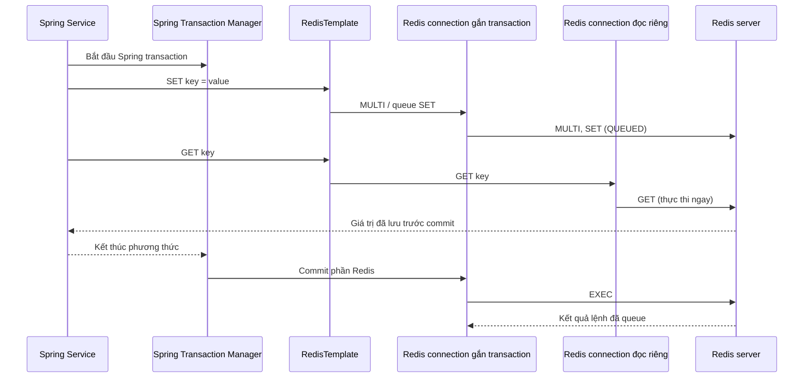

# Hành vi lệnh đọc trong giao dịch do Spring quản lý với Spring Data Redis

## 1. Vấn đề: vì sao `GET` ngay sau `SET` có thể trả về giá trị cũ?

Khi dùng Spring Data Redis, lập trình viên có thể đặt các thao tác đọc và ghi trong một phương thức gắn `@Transactional`, rồi kỳ vọng chúng hoạt động giống giao dịch cơ sở dữ liệu quan hệ:

```java
@Transactional
public String changeAndRead() {
    redis.opsForValue().set("cart:42:status", "CHECKED_OUT");
    return redis.opsForValue().get("cart:42:status");
}
```

Trong giao dịch Redis được **Spring quản lý** với `RedisTemplate` đã bật transaction support, kết quả đọc bên trong phương thức **không nhất thiết là `"CHECKED_OUT"`**. Nếu key ban đầu mang giá trị `"OPEN"` thì `get(...)` có thể trả về `"OPEN"`; nếu key chưa tồn tại, có thể trả về `null`.

Điều này xuất phát từ cách Spring Data Redis sử dụng kết nối:

- Các **lệnh ghi** được đưa vào hàng đợi của giao dịch trên Redis connection gắn với luồng xử lý.
- Các **lệnh đọc thuần túy**, chẳng hạn `GET` hoặc `KEYS`, được thực hiện bằng một Redis connection **không gắn với giao dịch đang queue lệnh**.
- Redis chỉ áp dụng các lệnh đã queue trên kết nối giao dịch khi Spring thực hiện `EXEC` ở thời điểm hoàn tất transaction.

Vì vậy, câu hỏi quan trọng là **lệnh đọc chạy trên kết nối nào và được thực thi ở giai đoạn nào**. Chỉ nhìn thấy hai câu lệnh Java nằm trong cùng phương thức `@Transactional` chưa đủ để kết luận chúng cùng đọc trạng thái chưa commit.

## 2. Các lớp tham gia trong Spring-managed Redis transaction

Hãy tách bốn thành phần:

| Thành phần | Vai trò |
| --- | --- |
| `@Transactional` và Spring transaction manager | Mở, quản lý và kết thúc transaction scope của Spring. |
| `RedisTemplate` / `StringRedisTemplate` | Giao diện thao tác Redis, có tùy chọn tham gia transaction scope qua `setEnableTransactionSupport(true)`. |
| Kết nối Redis gắn với thread | Nhận `MULTI` và queue các thao tác ghi để `EXEC`/`DISCARD` khi transaction kết thúc. |
| Kết nối Redis không gắn transaction | Thực thi lệnh đọc để trả về kết quả ngay, dựa trên dữ liệu đã được Redis công bố tại thời điểm đọc. |

Redis không có khái niệm transaction manager XA/JTA tích hợp sẵn trong `RedisTemplate`. Spring Data Redis đồng bộ vòng đời giao dịch Redis với một Spring transaction manager đang hoạt động, chẳng hạn transaction manager của JDBC. **Transaction Redis không tự tạo ra một giao dịch nguyên tử duy nhất bao trùm Redis và cơ sở dữ liệu SQL.**

### Bật transaction support là điều kiện bắt buộc

Theo mặc định, `RedisTemplate` **không** tự tham gia transaction của Spring. Muốn dùng cơ chế quản lý giao dịch Redis mô tả trong bài này, phải bật:

```java
@Configuration
public class RedisConfig {

    @Bean("transactionalStringRedisTemplate")
    public StringRedisTemplate transactionalStringRedisTemplate(
            RedisConnectionFactory connectionFactory) {

        StringRedisTemplate template =
                new StringRedisTemplate(connectionFactory);
        template.setEnableTransactionSupport(true);
        return template;
    }
}
```

Cần có một Spring `PlatformTransactionManager` thực sự và quản lý transaction scope cho lời gọi `@Transactional`; ví dụ Spring Boot thường đã cấu hình transaction manager cho JDBC/JPA nếu các thành phần tương ứng tồn tại. Annotation `@Transactional` phải được Spring AOP áp dụng qua proxy hợp lệ, chẳng hạn gọi public method qua một Spring bean khác.

**Không bật transaction support:** lệnh `SET` thông thường được gửi ngay; `GET` kế tiếp có thể thấy kết quả mới. Khi đó không được lấy hành vi ấy làm bằng chứng rằng Redis đã tham gia giao dịch Spring.

**Đã bật transaction support nhưng không có Spring transaction đang hoạt động:** RedisTemplate vẫn thực thi lệnh theo cơ chế thông thường, không tự sinh một giao dịch `MULTI` chỉ vì bean đã bật tùy chọn.

## 3. Vòng đời của giao dịch: `MULTI`, hàng đợi và `EXEC`

Giả sử phương thức được gọi bên trong transaction Spring hợp lệ, dùng template có transaction support:

```java
@Transactional
public void updateCart() {
    redis.opsForValue().set("cart:42:status", "CHECKED_OUT");
    redis.opsForHash().put("cart:42", "paymentState", "CAPTURED");

    // Khi method chạy đến đây, hai lệnh ghi vẫn có thể
    // đang nằm trong Redis transaction queue.
}
```

Luồng khái niệm:



Sơ đồ mô tả hành vi logic. Kết nối “đọc riêng” là kết nối **không bị ràng buộc vào Redis transaction hiện tại**; driver/pool có thể tái sử dụng socket vật lý, nên không có nghĩa nhất thiết tạo một kết nối TCP mới cho mỗi lệnh đọc.

Ở đầu transaction, `MULTI` chuyển Redis connection vào chế độ queue. Redis trả `QUEUED` cho các lệnh bên trong transaction đó, chưa thực hiện chúng. Khi `EXEC` được gửi, Redis thực thi các lệnh đã queue theo thứ tự. Trường hợp Spring rollback trước khi `EXEC`, kết nối giao dịch dùng `DISCARD` để bỏ hàng đợi.

Lưu ý: giao dịch Redis không cung cấp rollback theo kiểu RDBMS sau khi lệnh đã được `EXEC`. Một lỗi tại một lệnh khi thực thi `EXEC` cũng không có nghĩa Redis hoàn tác tự động các lệnh khác đã thực hiện trong cùng batch.

## 4. Phân loại lệnh trong giao dịch do Spring quản lý

| Thao tác gọi qua template | Kết nối sử dụng khi đã tham gia Spring-managed Redis transaction | Kết quả quan sát trong method |
| --- | --- | --- |
| `SET`, `HSET`, `DEL` và các lệnh ghi thông thường | Kết nối gắn giao dịch, lệnh được queue | Thay đổi chưa xuất hiện như dữ liệu đã commit; method có thể không nhận kết quả thực thi cuối cùng ngay. |
| `GET`, `HGET`, `EXISTS`, `KEYS` và các lệnh chỉ đọc được template nhận diện | Kết nối không gắn giao dịch | Đọc dữ liệu Redis đã có ở thời điểm lệnh thực thi; không thấy các lệnh ghi còn queue. |
| Lệnh đọc sau khi transaction đã commit | Kết nối bình thường | Có thể thấy dữ liệu đã được `EXEC`, nếu commit thành công và không có writer khác ghi đè. |
| Lệnh đọc sau khi transaction rollback | Kết nối bình thường | Không thấy các lệnh ghi đã bị `DISCARD`. |
| Gọi `MULTI`/`EXEC` thủ công bằng `SessionCallback` | Một kết nối dùng để queue cả lệnh ghi lẫn lệnh đọc | Giá trị lệnh đọc bên trong `MULTI` chỉ xuất hiện trong danh sách kết quả của `EXEC`. |

Bảng nói về **các lệnh đọc mà Spring Data Redis định tuyến như read-only**. Không suy luận mọi API Java tên `get...` đều chắc chắn dùng đường đọc riêng; có lệnh vừa đọc vừa thay đổi trạng thái, lệnh scripting hoặc Redis module có hành vi khác. Hãy xác định Redis command thực tế khi sử dụng API đặc biệt.

### Ví dụ: đọc key chưa tồn tại

Trước giao dịch:

```redis
GET cart:42:status
(nil)
```

Gọi từ Spring service:

```java
@Transactional
public String putAndReadStatus() {
    redis.opsForValue().set("cart:42:status", "CHECKED_OUT");
    return redis.opsForValue().get("cart:42:status");
}
```

Diễn biến:

1. `SET cart:42:status CHECKED_OUT` được queue trên kết nối giao dịch.
2. `GET cart:42:status` được thực hiện ngay trên kết nối không gắn giao dịch.
3. Vì Redis chưa nhận `EXEC` cho lệnh ghi, `GET` có thể trả `null`.
4. Sau khi Spring transaction commit và Redis `EXEC` thành công, một lời gọi `GET` bên ngoài transaction sẽ có thể thấy `"CHECKED_OUT"`.

### Ví dụ: đọc một key đã có giá trị cũ

Trước giao dịch:

```redis
SET cart:42:status OPEN
```

Trong service:

```java
@Transactional
public String updateStatus() {
    redis.opsForValue().set("cart:42:status", "CHECKED_OUT");
    return redis.opsForValue().get("cart:42:status");
}
```

`get(...)` có thể trả `"OPEN"`. Sau khi method hoàn tất và transaction commit thành công, đọc lại có thể trả `"CHECKED_OUT"`.

Từ khóa “có thể” là cần thiết: nếu một tác vụ khác thay đổi key ngay trong lúc transaction chạy, kết nối đọc có thể thấy dữ liệu đã commit bởi tác vụ đó. **Không có read-your-writes**, cũng **không có snapshot cố định trong toàn bộ transaction** trên đường đọc riêng.

## 5. Một ví dụ service hoàn chỉnh

Giả sử ứng dụng sử dụng Spring transaction manager đã cấu hình để quản lý một transaction Spring hợp lệ và inject `StringRedisTemplate` có transaction support.

```java
import org.springframework.beans.factory.annotation.Qualifier;
import org.springframework.data.redis.core.StringRedisTemplate;
import org.springframework.stereotype.Service;
import org.springframework.transaction.annotation.Transactional;

@Service
public class InventoryProjectionService {

    private final StringRedisTemplate redis;

    public InventoryProjectionService(
            @Qualifier("transactionalStringRedisTemplate")
            StringRedisTemplate redis) {
        this.redis = redis;
    }

    public record Observation(
            String valueReadInsideTransaction,
            boolean wasVisibleInsideTransaction) {}

    @Transactional
    public Observation stageStock(String sku, int amount) {
        String key = "stock:" + sku;

        // Lệnh ghi được queue trong Redis transaction.
        redis.opsForValue().set(key, Integer.toString(amount));

        // Lệnh đọc được thực hiện qua kết nối khác.
        // Nó phản ánh trạng thái Redis đã commit, không phải
        // giá trị vừa được queue ở dòng trên.
        String observed = redis.opsForValue().get(key);

        return new Observation(observed, observed != null);
    }

    public String readStock(String sku) {
        return redis.opsForValue().get("stock:" + sku);
    }
}
```

Trên dữ liệu thử nghiệm, nếu trước đó `stock:sku-1` chưa tồn tại:

```java
Observation o = service.stageStock("sku-1", 15);

// Trong transaction: o.valueReadInsideTransaction() có thể là null.
// Khi stageStock(...) trả về và commit hoàn tất:
String after = service.readStock("sku-1"); // thường là "15"
```

Các giả định của ví dụ: phương thức `stageStock` được gọi qua Spring proxy, Spring transaction manager đang hoạt động, không có writer khác và việc commit Redis thành công. Nếu gọi `stageStock` trực tiếp từ một method khác trên cùng đối tượng (self-invocation) khiến `@Transactional` không được áp dụng, hành vi có thể khác.

Trong ứng dụng thực tế, không đặt logic quyết định nghiệp vụ quan trọng dựa vào `observed` nếu bạn cần đọc được **chính giá trị vừa queue**. Tùy yêu cầu, nên giữ giá trị đã tính trong Java, đổi thời điểm đọc hoặc sử dụng một mô hình cập nhật nguyên tử khác.

## 6. Đọc trước, ghi sau, rồi đọc lại: có nhất quán không?

Xét chuỗi:

```java
@Transactional
public void process() {
    String before = redis.opsForValue().get("account:42:state");
    redis.opsForValue().set("account:42:state", "ACTIVE");
    String after = redis.opsForValue().get("account:42:state");
}
```

Nếu ban đầu là `"PENDING"` và không có tác vụ khác, `before` và `after` thường cùng là `"PENDING"`. Các lệnh đọc thấy trạng thái đã commit; `SET` vẫn đang queue nên không làm thay đổi kết quả đọc.

Tuy nhiên, nếu luồng khác thực hiện:

```text
T1: GET state     -> PENDING
T1: queue SET state=ACTIVE
T2: SET state     -> LOCKED  (đã thực thi)
T1: GET state     -> LOCKED
T1: EXEC queued SET -> ACTIVE
```

thì lần đọc thứ hai trong transaction T1 có thể khác lần đọc thứ nhất, dù thay đổi do T1 queue chưa được commit. Đây không phải một transaction isolation level với snapshot đọc ổn định như trong nhiều hệ quản trị cơ sở dữ liệu quan hệ.

Ngoài ra, một key có TTL có thể hết hạn giữa hai lần đọc. Kết quả có thể chuyển từ giá trị cũ sang `null` dù không có người ghi mới.

### Hệ quả với kiểm tra điều kiện

Mã như sau có thể không đảm bảo thao tác đúng khi nhiều tiến trình cùng chạy:

```java
@Transactional
public void reserve(String sku) {
    String available = redis.opsForValue().get("available:" + sku);

    if ("1".equals(available)) {
        redis.opsForValue().set("available:" + sku, "0");
        redis.opsForValue().set("reserved:" + sku, "1");
    }
}
```

Hai transaction có thể đồng thời đọc `available = 1` trên các kết nối đọc riêng, cùng queue thao tác đặt `0` rồi đều commit. Redis `MULTI/EXEC` không tự biến phép **đọc kiểm tra bên ngoài + ghi được queue** thành compare-and-swap.

Nếu cần “chỉ một giao dịch được đặt chỗ khi giá trị đang bằng 1”, phải dùng thiết kế nguyên tử như Lua script kiểm tra rồi ghi, hoặc cơ chế `WATCH`/`MULTI`/`EXEC` với cùng connection và retry khi tranh chấp. Việc lựa chọn tùy yêu cầu và mô hình dữ liệu.

## 7. Khác biệt với `MULTI/EXEC` do ứng dụng chủ động gọi

Redis có cơ chế transaction riêng:

```redis
MULTI
SET example:key NEW
GET example:key
EXEC
```

Trong `redis-cli`, phản hồi của `SET` và `GET` trước `EXEC` đều là `QUEUED`. Sau `EXEC`, danh sách kết quả gồm phản hồi của `SET` và giá trị mà `GET` đọc được khi Redis thực thi lệnh theo thứ tự, tức `NEW`.

Đây là một mô hình **khác** với việc gọi `redisTemplate.opsForValue().get(...)` trong Spring-managed transaction. Đối với lệnh đọc qua template được nhận diện là read-only, Spring Data Redis dùng kết nối không gắn transaction để có kết quả ngay, nên không tự queue `GET` cùng `SET` đang chờ commit.

### Sử dụng kết nối trực tiếp để minh họa việc queue `GET`

Ví dụ với một `StringRedisTemplate` thông thường, ngoài transaction Spring:

```java
import java.nio.charset.StandardCharsets;
import java.util.List;
import org.springframework.data.redis.core.RedisCallback;
import org.springframework.data.redis.core.StringRedisTemplate;

public List<Object> writeThenReadAtExec(StringRedisTemplate template) {
    return template.execute((RedisCallback<List<Object>>) connection -> {
        byte[] key = "demo:transaction:key"
                .getBytes(StandardCharsets.UTF_8);
        byte[] value = "NEW"
                .getBytes(StandardCharsets.UTF_8);

        connection.multi();

        connection.stringCommands().set(key, value);
        // GET này được queue vì cùng Redis connection ở chế độ MULTI.
        // Giá trị trực tiếp ở đây chưa phải là giá trị thật sau EXEC.
        connection.stringCommands().get(key);

        return connection.exec(); // Kết quả được giải mã theo API/serializer.
    });
}
```

Trong mô hình này, `GET` thực sự được queue và trả kết quả sau `EXEC`. Cần kiểm tra kiểu phần tử `List<Object>` theo driver và serializer của kết nối; không giả định mọi byte array tự chuyển thành String. Kết nối phải được quản lý bằng callback hoặc cơ chế bảo đảm `DISCARD` khi phát sinh lỗi giữa `MULTI` và `EXEC`. Đoạn mã này nhằm minh họa cơ chế, chưa phải một helper transaction production có đầy đủ xử lý lỗi.

Spring Data Redis cũng hỗ trợ dùng `SessionCallback` với `multi()` và `exec()` để giữ các thao tác liên quan trên cùng connection. Khi sử dụng callback, đọc kết quả lệnh đã queue từ danh sách `exec()`; đừng dựa vào giá trị trả về của lời gọi `get()` trong lúc đang `MULTI`.

**Không trộn bừa `@Transactional`, `SessionCallback.multi/exec` và callback connection tùy biến.** Mỗi cách có lifecycle riêng; nếu dùng đồng thời mà không thiết kế, có thể gây `MULTI` lồng nhau, kết nối còn ở trạng thái transaction hoặc commit ngoài dự kiến.

## 8. Kết quả trả về của API khi câu lệnh được queue

Khi lệnh nằm trong hàng đợi Redis transaction, server chưa trả giá trị cuối cùng cho thao tác ấy. Do đó nhiều phương thức Spring Data Redis có thể trả `null` trong transaction hoặc không mang kết quả cuối cùng ngay tại thời điểm gọi.

Hai trường hợp `null` cần phân biệt:

| Tình huống | Ý nghĩa của `null` |
| --- | --- |
| `get(key)` qua `RedisTemplate` trong Spring-managed transaction, trên kết nối đọc riêng | Key không tồn tại trong trạng thái Redis đã commit tại thời điểm đọc; `null` là kết quả đọc dữ liệu. |
| Lệnh nằm trong `MULTI` qua cùng Redis connection/`SessionCallback` và phương thức trả `null` | Lệnh mới được queue; `null` là placeholder của API, kết quả thực tế phải lấy từ `EXEC`. |

Sự khác biệt này rất quan trọng khi gỡ lỗi. Ví dụ thấy `null` từ `get` rồi kết luận “Redis không đọc được trong transaction” là diễn giải chưa đủ: phải biết `get` đã chạy ngay trên kết nối khác hay chỉ được queue trong `MULTI`.

Khi cần biết kết quả của lệnh ghi sau commit, không nên quyết định thành công chỉ từ giá trị trả về của một API được queue. Xử lý kết quả `EXEC`, callback sau hoàn tất giao dịch hoặc trạng thái dữ liệu sau commit theo thiết kế cụ thể. Cũng cần tính đến lỗi mạng và kết nối làm trạng thái commit chưa chắc chắn.

## 9. Giao dịch chỉ đọc có gì khác?

Một phương thức đánh dấu:

```java
@Transactional(readOnly = true)
public String load(String key) {
    return redis.opsForValue().get(key);
}
```

không tạo ra snapshot Redis giống mặc định của một số transaction isolation level trong SQL. `readOnly = true` là thuộc tính transaction của Spring; việc transaction manager tối ưu hoặc áp đặt read-only ở tài nguyên nào phụ thuộc cách cấu hình manager và tài nguyên đó.

Đối với Redis:

- Lệnh đọc thuần túy thông qua template không cần `MULTI/EXEC` chỉ để lấy một giá trị.
- Nếu template có transaction support và tham gia vào một Spring-managed transaction, việc định tuyến lệnh read-only vẫn không bảo đảm có read-your-writes.
- `readOnly = true` **không biến Redis thành kho dữ liệu có snapshot isolation** và không nên coi là chính sách phân quyền ngăn mọi lệnh ghi Redis ở tầng server.

Nếu method chỉ đọc cache, thông thường không cần bật transaction support để lấy tính nhất quán; hãy xác định riêng mức nhất quán yêu cầu. Đọc nhiều khóa trong các lệnh riêng có thể chứng kiến thay đổi ở giữa.

## 10. Khi có cả cơ sở dữ liệu SQL và Redis

Một ứng dụng có thể sử dụng `@Transactional` để quản lý JDBC/JPA và đồng thời bật `RedisTemplate.setEnableTransactionSupport(true)`:

```java
@Transactional
public void approveOrder(String orderId) {
    orderRepository.markApproved(orderId); // SQL
    redis.opsForValue().set("order:" + orderId, "APPROVED"); // queue Redis
}
```

Spring Data Redis sẽ đồng bộ transaction Redis với transaction Spring đang hoạt động. Tuy nhiên, **đây không phải giao dịch phân tán hai pha (2PC)** bao gồm cả SQL và Redis. Nếu hệ thống gặp lỗi tại thời điểm commit một bên, không thể tự khẳng định cả hai tài nguyên chắc chắn đồng bộ tuyệt đối.

Điểm liên quan tới hành vi đọc: ngay cả trong phương thức chung SQL + Redis, `redis.opsForValue().get("order:" + orderId)` qua đường đọc riêng vẫn không tự nhìn thấy lệnh `SET` còn queue.

Nếu một nghiệp vụ cần chính xác trạng thái SQL và cache, nên xác định chiến lược cụ thể: cập nhật SQL là nguồn sự thật; cập nhật hoặc invalidation Redis sau commit; có retry/outbox nếu cần đảm bảo eventual consistency. Đừng dựa vào việc cả hai lời gọi xuất hiện trong cùng `@Transactional` để coi Redis và SQL có rollback nguyên tử liên tài nguyên.

## 11. Kiểm tra thực hành trong môi trường Redis riêng

Phần này dành cho ứng dụng thử nghiệm; các key dùng prefix `demo:tx:` để dễ quan sát. Không dùng `FLUSHDB` hoặc `FLUSHALL` trên Redis dùng chung.

### Chuẩn bị

- Một Spring bean `StringRedisTemplate` với `setEnableTransactionSupport(true)`.
- Một Spring transaction manager đang hoạt động.
- Một service có phương thức `@Transactional` gọi qua proxy Spring.
- Một service hoặc method **khác** để đọc kết quả sau khi phương thức transaction đã trả về.

Trước mỗi thử nghiệm, thiết lập dữ liệu bằng một template thông thường **ngoài transaction** hoặc bằng `redis-cli` trên key thử nghiệm.

### Trường hợp A — Key mới

```text
Bước 1: DEL demo:tx:new
Bước 2: @Transactional -> SET demo:tx:new = X, rồi GET demo:tx:new
Bước 3: Quan sát GET bên trong: thường là null
Bước 4: Commit thành công
Bước 5: GET ngoài transaction: X
```

### Trường hợp B — Key đã tồn tại

```text
Bước 1: SET demo:tx:existing OLD
Bước 2: @Transactional -> SET demo:tx:existing NEW, rồi GET
Bước 3: Quan sát GET bên trong: thường là OLD
Bước 4: Commit thành công
Bước 5: GET ngoài transaction: NEW
```

### Trường hợp C — Rollback

```java
@Transactional
public void rollbackCase() {
    redis.opsForValue().set("demo:tx:rollback", "NEW");
    throw new IllegalStateException("Ví dụ rollback");
}
```

Với lỗi unchecked khiến Spring transaction rollback đúng cấu hình, Redis sẽ `DISCARD` hàng đợi thay vì `EXEC`. Sau khi bắt lỗi ở caller bên ngoài transaction, kiểm tra key: không có thay đổi từ lệnh `SET` đã queue.

### Trường hợp D — Giao dịch Redis thủ công

Trong môi trường thử nghiệm:

```redis
MULTI
SET demo:tx:manual "NEW"
GET demo:tx:manual
EXEC
```

Trước `EXEC`, cả `SET` và `GET` được báo `QUEUED`. Tại `EXEC`, Redis thực hiện `SET` trước `GET`, nên danh sách kết quả có giá trị `NEW` cho phần `GET`.

### Những gì cần quan sát

| Câu hỏi | Cách kiểm tra |
| --- | --- |
| `@Transactional` có thực sự mở transaction không? | Xác nhận phương thức được gọi qua Spring proxy và có transaction manager. |
| Template đã bật transaction support chưa? | Xác nhận bean inject đúng tên/cấu hình. |
| Lệnh ghi đã commit chưa? | Đọc kết quả **sau** khi method transaction hoàn tất, dùng kết nối ngoài transaction. |
| `GET` trong method có thấy `SET` chưa commit không? | So sánh kết quả với trạng thái đã có trước khi gọi method. |
| Kết quả `null` là “không có key” hay “lệnh được queue”? | Xác định API đang dùng đường đọc riêng của Spring-managed transaction hay `MULTI/EXEC` thủ công. |
| Lệnh đọc có bị tác động bởi writer khác không? | Thử hai tiến trình với thứ tự được điều phối trong môi trường test. |

Không cần dựa vào `MONITOR` trên Redis production để chứng minh hành vi; công cụ này có thể tốn chi phí và làm lộ dữ liệu. Thử nghiệm có thể dùng test integration với Redis riêng, log tại service và kết quả đọc trước/sau commit.

## 12. Hệ quả thiết kế và cách lựa chọn API

### Khi cần đọc đúng giá trị vừa tính

Nếu nghiệp vụ cần giá trị bạn vừa tính rồi đưa vào hàng đợi ghi, hãy **giữ giá trị đó trong biến Java**:

```java
@Transactional
public String updateAndReturn(String key, String newValue) {
    redis.opsForValue().set(key, newValue);
    return newValue; // Giá trị dự định ghi, không phải xác nhận đã commit.
}
```

Cách này trả lại giá trị dự định lưu, nhưng caller vẫn phải hiểu transaction có thể rollback hoặc commit thất bại. Không được coi giá trị trả về là bằng chứng Redis đã ghi thành công.

### Khi cần đọc dữ liệu mới nhất sau commit

Đặt thao tác đọc ở **sau khi transaction hoàn tất**, chẳng hạn một lời gọi ngoài scope hoặc callback `afterCommit` phù hợp:

```text
@Transactional method:
    queue SET key=value
    kết thúc method
Spring commit -> Redis EXEC
sau commit:
    GET key
```

Lúc đó kết quả thường phản ánh ghi vừa commit, nhưng writer đồng thời vẫn có thể thay đổi key sau commit. Cần điều kiện nhất quán mạnh hơn nếu nghiệp vụ không chấp nhận tranh chấp.

### Khi cần điều kiện đọc và ghi phải nguyên tử

Dùng thao tác Redis atomically kiểm tra và cập nhật, chẳng hạn script Lua:

```lua
-- KEYS[1]: khóa trạng thái
-- ARGV[1]: giá trị kỳ vọng
-- ARGV[2]: giá trị mới
if redis.call('GET', KEYS[1]) == ARGV[1] then
    redis.call('SET', KEYS[1], ARGV[2])
    return 1
end
return 0
```

Triển khai script qua `RedisScript`/`RedisTemplate.execute(...)` với key và argument cụ thể, xác định chiến lược retry khi trả `0`. Script kiểm tra rồi ghi trong một lần Redis xử lý giúp tránh khoảng đua giữa một `GET` qua kết nối riêng và lệnh `SET` được queue cho commit. Lưu ý script chạy ngay tại Redis; **không tự trở thành một thao tác có thể rollback theo transaction SQL bên ngoài**.

Hoặc dùng `WATCH` + `MULTI/EXEC`, bảo đảm cả logic watch/queue/exec diễn ra đúng trên cùng Redis connection và xử lý trường hợp `EXEC` trả `null` khi key bị thay đổi. Cần kiểm soát connection lifecycle; không trộn tùy ý với Spring-managed transaction đang mở.

### Khi cần đọc một nhóm khóa nhất quán

Đọc nhiều key bằng nhiều lệnh riêng trong Spring-managed transaction không tạo snapshot. Tùy yêu cầu, cân nhắc lấy một bản chụp logic bằng một command/script atomic, hoặc thiết kế schema có version và kiểm tra version trước/sau. Đừng gán ý nghĩa transaction SQL cho các lời gọi Redis chỉ vì chúng cùng nằm trong một method `@Transactional`.

## 13. Các lỗi tư duy thường gặp

**“Cùng nằm trong `@Transactional` thì `GET` phải thấy `SET` trước đó.”**  
Không đúng khi dùng Spring-managed Redis transaction với template có transaction support: lệnh ghi được queue, còn lệnh đọc thuần túy đi qua connection riêng.

**“`GET` trả `null` vì nó bị Redis queue như trong `MULTI`.”**  
Chưa chắc; với `RedisTemplate` trong Spring-managed transaction, `GET` thường được thực thi ngay trên connection đọc riêng. Cần phân biệt với `GET` đặt thủ công trong `MULTI`, khi đó kết quả chỉ có sau `EXEC`.

**“Tắt transaction support làm `@Transactional` không còn tác dụng với JDBC.”**  
Không. Transaction manager vẫn quản lý tài nguyên của nó; chỉ là RedisTemplate không được cấu hình để đồng bộ giao dịch Redis với Spring scope ấy.

**“Bật `@Transactional(readOnly = true)` sẽ bảo đảm mọi lần đọc Redis được snapshot nhất quán.”**  
Không. Spring transaction read-only không tạo snapshot Redis và không thay thế cơ chế isolation được thiết kế riêng.

**“Kết hợp JDBC và Redis dưới một annotation tạo giao dịch phân tán bảo đảm tuyệt đối.”**  
Không. Đồng bộ lifecycle không đồng nghĩa atomic commit giữa nhiều hệ thống lưu trữ.

**“Redis transaction rollback tất cả thay đổi khi một lệnh trong `EXEC` lỗi.”**  
Không. `DISCARD` chỉ bỏ hàng đợi trước khi thực thi; Redis không có cơ chế rollback mọi lệnh đã áp dụng trong `EXEC` như transaction engine của RDBMS.

## 14. Câu hỏi tự kiểm tra

1. Tại sao một `GET` trong Spring-managed Redis transaction có thể trả giá trị cũ ngay sau `SET`?
2. `setEnableTransactionSupport(true)` khác gì với chỉ thêm `@Transactional` vào service?
3. Kết quả `null` từ `get(...)` trong Spring-managed transaction khác gì `null`/placeholder từ lệnh được queue trong `SessionCallback.multi()`?
4. Vì sao hai lần `GET` trong cùng Spring transaction có thể thấy hai giá trị khác nhau nếu có writer thứ ba?
5. Thứ tự `SET` rồi `GET` trong một `MULTI/EXEC` thủ công khác gì khi gọi hai API tương ứng qua Spring-managed template?
6. Khi cần kiểm tra tồn kho rồi trừ kho nguyên tử, vì sao đọc bằng connection riêng trước khi queue `SET` không đủ an toàn?
7. Nếu method vừa ghi SQL vừa queue Redis, rủi ro nào vẫn tồn tại dù cùng nằm trong `@Transactional`?

**Ghi nhớ:** Trong giao dịch Redis **do Spring quản lý**, `RedisTemplate` có transaction support thường đưa **lệnh ghi vào queue trên kết nối transaction**, còn **lệnh đọc thuần túy chạy trên kết nối không gắn transaction** để trả kết quả ngay. Vì vậy lệnh đọc thấy trạng thái Redis đã được thực thi, không thấy những lệnh ghi của cùng phương thức còn chờ `EXEC`. Khi cần kết quả đọc sau chính các lệnh đã queue, hãy chọn cơ chế thực thi khác một cách có chủ đích.

## Tài liệu tham khảo

- [Spring Data Redis Reference — Transactions](https://docs.spring.io/spring-data/redis/reference/redis/transactions.html): transaction support của `RedisTemplate`, kết nối gắn thread, định tuyến lệnh đọc và `MULTI/EXEC`.
- [Spring Data Redis Reference — `RedisTemplate`](https://docs.spring.io/spring-data/redis/reference/redis/template.html): cách thực thi command qua template, connection và callback.
- [Spring Framework Reference — Declarative Transaction Management](https://docs.spring.io/spring-framework/reference/data-access/transaction/declarative.html): proxy, scope và semantics của `@Transactional`.
- [Redis Documentation — Transactions](https://redis.io/docs/latest/develop/interact/transactions/): `MULTI`, `EXEC`, `DISCARD` và `WATCH`.
