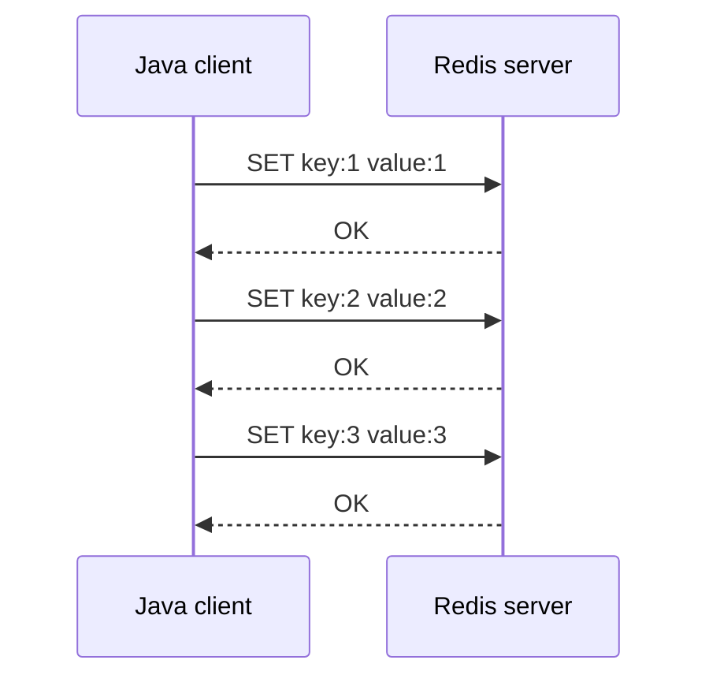
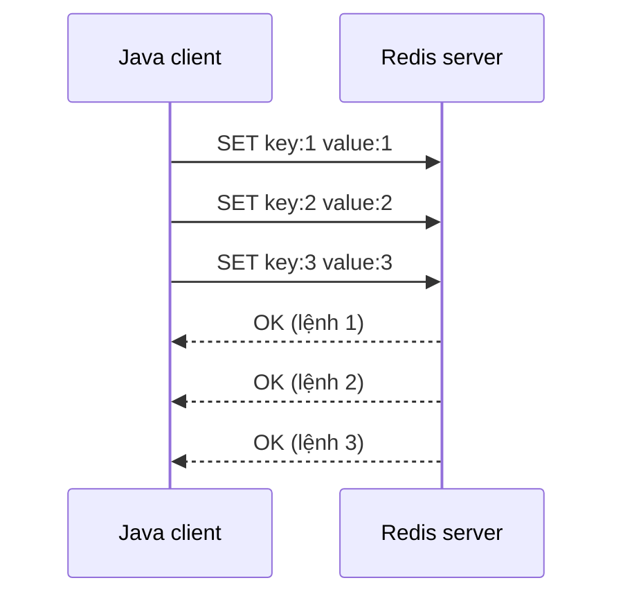

# Pipeline là gì và giảm chi phí mạng như thế nào trong Spring Data Redis

## 1. Khi một nghìn thao tác nhỏ trở nên chậm

Giả sử một dịch vụ cần cập nhật trạng thái của 1.000 đơn hàng trong Redis. Cách dễ viết nhất là gọi một lệnh Redis cho từng đơn hàng:

```java
for (Map.Entry<String, String> entry : statuses.entrySet()) {
    redis.opsForValue().set(
        "order:status:" + entry.getKey(),
        entry.getValue()
    );
}
```

Đoạn mã trên có thể hoạt động đúng nhưng tạo ra nhiều thao tác gửi lệnh và chờ phản hồi. Nếu ứng dụng đợi lệnh thứ nhất trả kết quả trước khi gửi lệnh thứ hai, thời gian đi và về trên mạng có thể tích lũy thành một phần đáng kể của tổng thời gian.

**Redis pipelining** là kỹ thuật cho phép client **gửi nhiều lệnh liên tiếp mà không cần chờ phản hồi của từng lệnh**, sau đó thu thập các phản hồi tương ứng. Nó đặc biệt hữu ích khi có nhiều thao tác Redis độc lập, mỗi thao tác xử lý rất nhanh nhưng kết nối mạng có độ trễ đáng kể.

Ba điều cần phân biệt ngay từ đầu:

1. **Pipeline giảm thời gian chờ mạng**, chứ không biến các lệnh thành một lệnh xử lý duy nhất ở Redis.
2. **Pipeline không phải transaction**: các lệnh trong pipeline không tự có tính nguyên tử như một nhóm và không có rollback khi một lệnh lỗi.
3. **Một lời gọi Java chứa vòng lặp không tự động là pipeline**. Spring Data Redis có API để thực thi pipelining tường minh; một số driver còn có khả năng gom lệnh riêng, nhưng không nên suy diễn rằng mọi vòng lặp `opsForValue().set(...)` đều nhận lợi ích như một pipeline được kiểm soát.

Bài học này giải thích cơ chế request/response, mô hình chi phí RTT, cách dùng `StringRedisTemplate.executePipelined(...)`, cách chọn kích thước batch, các giới hạn trong Redis Cluster và những sai lầm thường gặp khi tối ưu.

## 2. Trước khi có pipeline: client gửi và chờ

Redis sử dụng giao thức request/response. Với lệnh `SET`:

```text
Client -> Redis: SET order:status:o-101 PAID
Redis  -> Client: OK
```

Nếu ứng dụng thực hiện nhiều lệnh **tuần tự và chờ từng phản hồi**, luồng thời gian có dạng:



Để lệnh thứ hai được gửi, client đã phải chờ lệnh thứ nhất đi qua mạng, được Redis xử lý và trả kết quả. Nếu mỗi lệnh chỉ tốn rất ít thời gian CPU ở server nhưng **round-trip time (RTT)** dài, hiệu năng bị chi phối bởi thời gian chờ.

Ví dụ giả định:

- 1.000 lệnh `SET` nhỏ.
- RTT trung bình giữa client và Redis là 3 ms.
- Client đợi phản hồi của từng lệnh rồi mới gửi lệnh tiếp theo.

Chỉ riêng thời gian đợi các RTT đã xấp xỉ:

```text
1.000 lệnh × 3 ms/lần chờ = 3.000 ms = 3 giây
```

Con số ba giây chỉ là **mô hình minh họa phần thời gian chờ mạng**. Thời gian thực tế còn phụ thuộc CPU Redis, dữ liệu truyền, serialization, connection pool, hệ điều hành, driver và các client khác. Một driver có I/O bất đồng bộ cũng có thể thay đổi hình thái chờ so với mô hình tuần tự đơn giản trên.

Vấn đề cốt lõi: khi xử lý nhiều lệnh nhỏ, ứng dụng có thể tốn phần lớn thời gian **đợi một kết quả để được gửi lệnh tiếp theo**.

## 3. Pipeline thay đổi chuỗi request/response ra sao?

Với pipelining, client có thể ghi một dãy lệnh ra kết nối mà **không bắt buộc đọc từng phản hồi ngay sau lệnh tương ứng**:



Redis vẫn tiếp nhận và xử lý các lệnh theo ngữ nghĩa thông thường. Client có thể gom quá trình gửi và nhận thành ít đợt chờ hơn, nên giảm tác động của RTT lặp lại.

Trong cùng một kết nối, **thứ tự phản hồi tương ứng với thứ tự các lệnh được gửi**. Nhờ đó, khi callback gửi `SET key1`, `SET key2`, `GET key3`, danh sách phản hồi có thể được đối chiếu theo chính thứ tự các lệnh đã xếp hàng. Tuy nhiên, các client khác vẫn có thể gửi lệnh xen vào giữa quá trình xử lý; **pipeline không khóa Redis cho riêng một client**.

### 3.1. Pipeline không có nghĩa là một gói tin TCP

Thuật ngữ "gửi cùng lúc" dễ gây hiểu nhầm. Pipelining **không bảo đảm** tất cả lệnh nằm trong một gói TCP hoặc chỉ có một system call ghi mạng. Driver, socket buffer và hệ điều hành quyết định các lần truyền ở mức thấp.

Điểm quan trọng hơn là client **không phải đợi nhận đủ phản hồi của lệnh trước rồi mới được gửi lệnh sau**. Do đó, số lượt chờ mang tính nhân quả giảm, dù số bytes và số lệnh Redis không thay đổi.

### 3.2. Server vẫn làm việc với từng lệnh

Giả sử có 1.000 lệnh `SET`:

```text
Không pipeline:
  1.000 lần gửi và chờ phản hồi tuần tự
  Redis xử lý 1.000 lệnh

Pipeline:
  gửi một đợt hoặc vài đợt lệnh, nhận phản hồi theo đợt
  Redis vẫn xử lý 1.000 lệnh
```

Pipeline thường cải thiện **throughput phía client** khi RTT là nút thắt. Nó không tự làm một lệnh Redis nặng nhanh hơn, không giảm dung lượng payload cần truyền, cũng không tạo thêm CPU cho Redis.

## 4. Hiểu bằng mô hình RTT và số đợt gửi

Đặt:

- `N`: tổng số lệnh Redis.
- `R`: RTT trung bình giữa ứng dụng và Redis.
- `B`: số lệnh được gửi trong một đợt pipeline, nếu xử lý theo chunk.
- `K = ceil(N / B)`: số đợt khi chia đều.

Đối với client **chờ từng lệnh**:

```text
Phần thời gian chờ RTT ≈ N × R
```

Đối với một client gửi các đợt pipeline rồi chờ hoàn tất mỗi đợt:

```text
Phần thời gian chờ giữa các đợt ≈ K × R
```

Đây là mô hình khái niệm ở điều kiện lý tưởng, **không phải công thức đo latency production**. Pipeline còn phải tính thời gian server xử lý đủ `N` lệnh, truyền toàn bộ phản hồi, overhead của client và cách driver flush dữ liệu. Với một pipeline lớn, phần việc này không biến mất chỉ vì `K = 1`.

### 4.1. Ví dụ định lượng

Cho `N = 1.000` và `R = 3 ms`:

| Cách gửi giả định | Số đợt đợi phản hồi | Thành phần RTT lý tưởng |
|---|---:|---:|
| Chờ từng lệnh | 1.000 | Khoảng 3.000 ms |
| Pipeline 10 lệnh/đợt | 100 | Khoảng 300 ms |
| Pipeline 100 lệnh/đợt | 10 | Khoảng 30 ms |
| Pipeline 500 lệnh/đợt | 2 | Khoảng 6 ms |
| Pipeline 1.000 lệnh/đợt | 1 | Khoảng 3 ms |

Không được hiểu hàng cuối nghĩa là toàn bộ 1.000 lệnh sẽ chạy xong trong 3 ms. Chừng nào Redis còn phải thực thi các lệnh và truyền dữ liệu, tổng thời gian vẫn lớn hơn thành phần RTT đơn lẻ này.

Bài học thực tế: giảm từ 1.000 lần phải chờ xuống 10 lần có thể đem lại cải thiện lớn; tăng tiếp từ batch 100 lên batch 1.000 có thể đem lại lợi ích ít hơn trong khi tiêu thụ bộ nhớ và gây tải đột biến lớn hơn.

### 4.2. Khi RTT thấp, tác dụng có thể nhỏ

Nếu Redis và ứng dụng nằm cùng máy hoặc cùng mạng gần, RTT có thể rất nhỏ. Khi đó, serialization, số lệnh Redis, kích thước dữ liệu hoặc chi phí ứng dụng có thể chi phối. Pipelining vẫn có thể hữu ích, nhưng cần đo chứ không mặc định mức cải thiện giống ví dụ mạng xa.

## 5. So sánh pipeline với các cách tối ưu khác

Các kỹ thuật sau giải quyết những vấn đề khác nhau:

| Kỹ thuật | Bản chất | Có giảm số lệnh phía Redis? | Có nhóm nguyên tử mặc định? |
|---|---|---|---|
| Gọi tuần tự rồi chờ từng kết quả | Mỗi lệnh một chu kỳ phụ thuộc kết quả | Không | Không |
| **Pipelining** | Gửi nhiều lệnh không chờ từng phản hồi | Không | **Không** |
| `MGET` / `MSET` | Một lệnh xử lý nhiều key String | Có thể thay nhiều lệnh đơn bằng một lệnh | Lệnh đa key có ngữ nghĩa nguyên tử ở mức lệnh, tùy loại |
| `MULTI` / `EXEC` | Gom nhiều lệnh vào Redis transaction | Không tự làm giảm logic cần xử lý | Thực thi nhóm tuần tự, không có rollback lỗi lệnh kiểu SQL |
| Lua script | Thực thi logic phía server theo một script | Có thể giảm lượt gọi và tính toán phía client | Script chạy nguyên tử so với các lệnh Redis khác trong lúc thực thi |
| Nhiều client/kết nối đồng thời | Cho nhiều yêu cầu đang chờ cùng lúc | Không | Không |

### 5.1. Pipelining và `MSET`

Khi chỉ cần lưu nhiều cặp String:

```redis
MSET status:o1 PAID status:o2 PACKED status:o3 SHIPPED
```

`MSET` là **một lệnh Redis** ghi nhiều key. Còn pipeline ba lệnh `SET` vẫn là ba lệnh:

```redis
SET status:o1 PAID
SET status:o2 PACKED
SET status:o3 SHIPPED
```

Cả hai có thể giảm thời gian chờ RTT so với ba lần gửi và đợi tuần tự, nhưng semantics khác nhau:

- `MSET` ghi nhiều String key trong một lệnh, không cho đặt TTL độc lập trên từng key ngay trong cú pháp `MSET`.
- Pipeline có thể trộn `SET` với `INCR`, `HSET`, `EXPIRE`, `GET` và các lệnh khác; từng lệnh vẫn có ngữ nghĩa riêng.
- `SET ... EX` trong pipeline có thể gắn TTL cùng thao tác ghi đối với từng key.
- Với Redis Cluster, lệnh đa key có thể bị hạn chế nếu key thuộc các hash slot khác nhau; các lệnh độc lập trong pipeline có thể được client cluster-aware định tuyến theo node.

Không có lý do để thay mọi lệnh bằng pipeline nếu một multi-key command đơn giản đã đáp ứng đúng nghiệp vụ.

### 5.2. Pipelining và transaction

Giả sử một pipeline gồm:

```redis
SET balance:a 100
SET balance:b 200
INCR counter:payments
```

Nếu lệnh thứ hai lỗi vì kiểu dữ liệu không phù hợp, lệnh thứ nhất có thể đã thành công, còn lệnh thứ ba vẫn có thể được xử lý. **Pipeline không rollback kết quả đã thực hiện**.

Ngược lại, `MULTI`/`EXEC` cung cấp cơ chế thực thi nhóm lệnh Redis như một transaction, tránh các lệnh của client khác xen vào trong giai đoạn thực thi. Dù vậy, Redis transaction **không rollback những lệnh đã chạy khi một lệnh gặp lỗi runtime** theo cách một transaction cơ sở dữ liệu quan hệ thường làm.

Nếu thao tác cần kiểm tra điều kiện rồi cập nhật nguyên tử, có thể cần `WATCH`/`MULTI` hoặc script Lua theo đúng logic nghiệp vụ. Pipelining chỉ xử lý bài toán **chờ mạng**.

## 6. Ví dụ Spring Data Redis với `StringRedisTemplate`

Spring Data Redis cung cấp `RedisTemplate.executePipelined(...)` để thực hiện một callback trong ngữ cảnh pipeline. Với key và value dạng chuỗi, `StringRedisTemplate` là lựa chọn thuận tiện vì đã dùng String serializer.

### 6.1. Dependency và kết nối

Ví dụ với ứng dụng Spring Boot 3.x:

```groovy
dependencies {
    implementation 'org.springframework.boot:spring-boot-starter-data-redis'
}
```

Cấu hình `application.yml` cho Redis chạy ở máy phát triển:

```yaml
spring:
  data:
    redis:
      host: localhost
      port: 6379
```

Spring Boot có thể tự cấu hình `StringRedisTemplate` nếu các điều kiện kết nối phù hợp. Một bean service chỉ cần inject template.

### 6.2. Ghi nhiều trạng thái mà không chờ từng lệnh

```java
import java.util.List;
import java.util.Map;

import org.springframework.data.redis.connection.RedisStringCommands;
import org.springframework.data.redis.core.RedisCallback;
import org.springframework.data.redis.core.StringRedisTemplate;
import org.springframework.data.redis.core.types.Expiration;
import org.springframework.data.redis.serializer.RedisSerializer;
import org.springframework.stereotype.Service;

@Service
public class OrderStatusPipelineService {

    private final StringRedisTemplate redis;

    public OrderStatusPipelineService(StringRedisTemplate redis) {
        this.redis = redis;
    }

    public List<Object> writeStatuses(Map<String, String> statuses) {
        RedisSerializer<String> serializer = redis.getStringSerializer();

        return redis.executePipelined((RedisCallback<Object>) connection -> {
            for (Map.Entry<String, String> entry : statuses.entrySet()) {
                byte[] key = serializer.serialize(
                    "order:status:" + entry.getKey()
                );
                byte[] value = serializer.serialize(entry.getValue());

                connection.stringCommands().set(
                    key,
                    value,
                    Expiration.seconds(300),
                    RedisStringCommands.SetOption.upsert()
                );
            }

            // executePipelined yêu cầu callback trả null.
            return null;
        });
    }
}
```

Sử dụng:

```java
Map<String, String> updates = Map.of(
    "o-101", "PAID",
    "o-102", "PACKED",
    "o-103", "SHIPPED"
);

List<Object> responses = service.writeStatuses(updates);
```

Ý nghĩa từng bước:

1. `StringRedisTemplate` cung cấp kết nối và serializer của template.
2. `executePipelined(...)` tạo ngữ cảnh gửi các lệnh theo pipeline.
3. Trong callback, mỗi vòng lặp gửi một lệnh Redis `SET ... EX 300` thông qua `RedisConnection`.
4. **Không chờ kết quả trực tiếp của từng lệnh** bên trong callback.
5. Callback trả `null`; Spring Data Redis thu thập và giải mã phản hồi khi pipeline đóng.
6. `responses` chứa các kết quả theo thứ tự các lệnh đã gửi trong pipeline.

Ở ví dụ trên, mỗi `SET` đặt TTL mới là 300 giây cùng lúc ghi giá trị. Đây là cách giảm rủi ro để một key được ghi thành công nhưng chưa kịp gắn expiration vì ứng dụng lỗi giữa `SET` và `EXPIRE`.

Mỗi phần tử trong `responses` là kiểu `Object` do phản hồi có thể khác nhau theo lệnh và driver. Với các lệnh `SET` thông thường, phản hồi là thành công; trong ứng dụng thực tế cần phân biệt kết quả hợp lệ, lỗi và tình huống thiếu phản hồi theo hợp đồng của driver.

**Quan trọng:** danh sách phản hồi được trả về **sau khi** callback kết thúc và framework đã xử lý pipeline. Không đọc các giá trị trả từ `connection.stringCommands().set(...)` trong chính callback rồi giả định đó là phản hồi đã hoàn tất.

### 6.3. Vì sao callback trả `null`?

Trong pipelining, phản hồi của các lệnh được xếp hàng để framework lấy ở cuối. Nếu callback cố trả về kết quả riêng, Spring Data Redis sẽ không dùng kết quả đó làm danh sách phản hồi của pipeline. Vì vậy, API `executePipelined` yêu cầu callback trả `null`.

Một mẫu cần tránh:

```java
redis.executePipelined((RedisCallback<Object>) connection -> {
    // Cách nghĩ sai: trả về phản hồi của một lệnh ngay khi queue.
    return connection.stringCommands().get(
        "order:status:o-101".getBytes(java.nio.charset.StandardCharsets.UTF_8)
    );
});
```

Thay vào đó:

```java
List<Object> result =
    redis.executePipelined((RedisCallback<Object>) connection -> {
        connection.stringCommands().get(
            "order:status:o-101".getBytes(
                java.nio.charset.StandardCharsets.UTF_8
            )
        );
        return null;
    });
```

Kết quả đọc được nằm trong `result`, không nằm trong giá trị `return` của callback. Khi dùng serializer tùy biến, phải mã hóa key đúng với cách template lưu trữ.

## 7. Pipelining các lệnh đọc

Pipeline không chỉ dùng để ghi. Giả sử ứng dụng muốn lấy trạng thái 50 đơn hàng đã biết ID. Ta có thể xếp các lệnh `GET` vào một pipeline:

```java
import java.util.ArrayList;
import java.util.LinkedHashMap;
import java.util.List;
import java.util.Map;

import org.springframework.data.redis.core.RedisCallback;
import org.springframework.data.redis.core.StringRedisTemplate;
import org.springframework.data.redis.serializer.RedisSerializer;

public class OrderStatusBatchReader {

    private final StringRedisTemplate redis;

    public OrderStatusBatchReader(StringRedisTemplate redis) {
        this.redis = redis;
    }

    public Map<String, String> readStatuses(List<String> ids) {
        RedisSerializer<String> serializer = redis.getStringSerializer();

        List<Object> results = redis.executePipelined(
            (RedisCallback<Object>) connection -> {
                for (String id : ids) {
                    byte[] key = serializer.serialize(
                        "order:status:" + id
                    );
                    connection.stringCommands().get(key);
                }
                return null;
            }
        );

        Map<String, String> byId = new LinkedHashMap<>();
        for (int i = 0; i < ids.size(); i++) {
            Object value = results.get(i);
            byId.put(ids.get(i), value == null ? null : (String) value);
        }
        return byId;
    }
}
```

Trong ví dụ này, callback phát một lệnh `GET` cho mỗi ID. Phản hồi được ghép theo **vị trí**; key không tồn tại trả `null`. Với `StringRedisTemplate` và serializer mặc định, dữ liệu chuỗi có thể đọc dưới dạng `String`.

Ở các ứng dụng dùng `RedisTemplate<K,V>` với serializer khác, phản hồi có thể được giải mã theo serializer của template hoặc overload `executePipelined` được chọn. Không nên tùy tiện ép mọi kết quả thành `String` nếu template đang dùng kiểu value khác.

### 7.1. Khi nào nên dùng `multiGet`?

Đối với nhiều String key, cách sau thường gọn hơn:

```java
List<String> keys = List.of(
    "order:status:o-101",
    "order:status:o-102",
    "order:status:o-103"
);

List<String> values = redis.opsForValue().multiGet(keys);
```

`multiGet` thường dùng Redis `MGET`: một lệnh server lấy nhiều key. Đây có thể là lựa chọn đơn giản và hiệu quả hơn việc pipeline nhiều `GET`, nếu các key phù hợp với hạn chế Redis topology và semantics của API.

Pipelining linh hoạt hơn khi muốn kết hợp **nhiều loại lệnh** hoặc key thuộc các kiểu dữ liệu khác nhau; `MGET` áp dụng cho nhóm String key.

## 8. Trộn nhiều lệnh trong một pipeline

Một pipeline có thể chứa các loại lệnh khác nhau:

```java
List<Object> results = redis.executePipelined(
    (RedisCallback<Object>) connection -> {
        RedisSerializer<String> s = redis.getStringSerializer();

        connection.stringCommands().set(
            s.serialize("demo:order:o-101"),
            s.serialize("PAID")
        );

        connection.stringCommands().incr(
            s.serialize("demo:metrics:paid-count")
        );

        connection.stringCommands().get(
            s.serialize("demo:order:o-102")
        );

        return null;
    }
);
```

Thứ tự phản hồi tương ứng với các lệnh `SET`, `INCR`, `GET`. Điều đó giúp xử lý danh sách trả về, nhưng cũng tạo ra trách nhiệm **biết mỗi vị trí có kiểu phản hồi gì**.

### 8.1. Lệnh phụ thuộc kết quả trước không phù hợp để pipeline một mạch

Ví dụ nghiệp vụ:

```text
1. GET account:42:balance
2. Nếu balance >= 100 thì trừ 100
3. Ghi nhận giao dịch
```

Nếu client cần đọc phản hồi `GET` để quyết định có gửi lệnh thứ hai hay không, nó **không thể đưa sẵn toàn bộ quyết định đó vào một pipeline đơn giản** rồi mong Redis tự nhánh theo kết quả. Callback pipeline xếp lệnh, trong khi phản hồi đầy đủ có sau khi kết thúc.

Trong trường hợp điều kiện cần được kiểm tra và thay đổi một cách nguyên tử, sử dụng thiết kế có script Lua hoặc cơ chế transaction/optimistic locking phù hợp. Pipelining không phải công cụ thay thế logic đồng bộ nghiệp vụ.

### 8.2. Một lệnh sai vẫn có thể ảnh hưởng cách đọc các phản hồi

Nếu pipeline phát:

```text
SET counter "hello"
INCR counter
GET counter
```

Lệnh `INCR` sẽ lỗi kiểu dữ liệu vì value không phải số nguyên hợp lệ. Việc lệnh tiếp theo có được xử lý và ứng dụng nhận/diễn giải lỗi ra sao phụ thuộc Redis client và cơ chế giải mã kết quả. Không được coi toàn bộ batch là thành công chỉ vì callback đã chạy đến cuối.

Trong các workload quan trọng, nên theo dõi phản hồi, exception và ID tương ứng với từng lệnh; đồng thời thiết kế retry an toàn.

## 9. Chia pipeline thành các lô có kích thước kiểm soát được

Không nên gửi mọi lệnh của một tập dữ liệu cực lớn vào một pipeline duy nhất. Redis vẫn phải giữ và truyền phản hồi; client cũng phải giữ các kết quả nhận được. Pipeline hàng trăm nghìn hoặc hàng triệu lệnh có thể làm tăng bộ nhớ, độ trễ và khả năng timeout.

Ví dụ chia danh sách thành chunk:

```java
import java.util.List;

public void updateInChunks(
        List<OrderStatusUpdate> updates,
        int chunkSize) {

    if (chunkSize <= 0) {
        throw new IllegalArgumentException(
            "chunkSize must be positive"
        );
    }

    for (int start = 0; start < updates.size(); start += chunkSize) {
        int end = Math.min(start + chunkSize, updates.size());
        List<OrderStatusUpdate> chunk = updates.subList(start, end);
        writeChunk(chunk);
    }
}
```

Trong đó `OrderStatusUpdate` có thể là một record:

```java
public record OrderStatusUpdate(String id, String status) {
}
```

Phương thức `writeChunk(chunk)` có thể dùng `executePipelined(...)` như mẫu ở mục 6, chuyển mỗi cặp `id/status` thành một lệnh `SET`. Mục tiêu ở đây là **giới hạn số lệnh và phản hồi của mỗi lần mở pipeline**, không yêu cầu tạo lại toàn bộ danh sách đầu vào.

Ví dụ 10.000 cập nhật, chunk 200 lệnh:

```text
10.000 / 200 = 50 pipeline
```

### 9.1. Kích thước chunk có đánh đổi

| Batch nhỏ | Batch lớn |
|---|---|
| Có nhiều đợt chờ hơn | Ít đợt chờ hơn |
| Giảm nhu cầu giữ nhiều phản hồi cùng lúc | Tăng bộ nhớ đệm và độ lớn kết quả |
| Phục hồi lỗi theo nhóm nhỏ dễ hơn | Một batch lỗi có thể khó xác định lệnh nào đã chạy |
| Ít tạo tải đột biến lên Redis | Có thể gây burst và tăng latency cho client khác |

Các con số như 50, 100, 500 hay 1.000 chỉ là **giá trị thử nghiệm ban đầu**. Kích thước tốt nhất tùy RTT, giá trị trung bình của payload, cấu hình kết nối, server, throughput mục tiêu và tình trạng tải.

### 9.2. Có thể trả về rất nhiều phản hồi

`executePipelined` thường tạo một danh sách kết quả tương ứng với các lệnh. Nếu mỗi lệnh trả về một giá trị lớn (chẳng hạn `GET` một blob hàng trăm KB), 1.000 phản hồi có thể tiêu thụ bộ nhớ đáng kể, ngay cả khi số lệnh không quá lớn.

Do đó, nên phân biệt **số lệnh trên pipeline** và **số byte phản hồi trên pipeline**. Trong nhiều ứng dụng, chính kích thước dữ liệu mới là giới hạn quan trọng.

## 10. Pipeline giảm RTT, nhưng có thể tăng áp lực lên server

Một câu hỏi thường gặp: nếu pipeline nhanh hơn, tại sao không gửi càng nhiều lệnh càng tốt?

Vì pipelining tăng tốc độ client **đẩy việc vào Redis**, còn Redis vẫn phải thực hiện các lệnh. Khi tải đến nhanh hơn khả năng xử lý, một số vấn đề có thể xuất hiện:

- Hàng đợi lệnh và phản hồi tăng lên.
- Bộ nhớ dùng cho phản hồi chờ gửi tăng.
- Độ trễ của những client khác tăng.
- Timeout và kết nối bị đóng khi quá tải.
- Một lệnh nặng ở giữa dãy lệnh làm các lệnh sau phải chờ lâu hơn.

Redis xử lý từng lệnh theo đặc tính server và dữ liệu của nó. Giảm thời gian chờ do mạng **không loại bỏ khả năng có lệnh nặng hoặc tài nguyên Redis bị giới hạn**.

Nếu ứng dụng có nhiều worker cùng pipeline, tổng số lệnh dồn vào Redis có thể vượt xa khả năng đáp ứng, dù từng worker thấy RTT thấp. Hãy đo throughput và latency ở cả client lẫn Redis khi tăng concurrency.

## 11. Pipeline có phải atomic không?

**Không.** Một pipeline thuần không cung cấp tính nguyên tử cho toàn bộ dãy lệnh.

Giả sử client gửi:

```redis
SET booking:42:status RESERVED
DECR inventory:item-1
SET booking:42:status CONFIRMED
```

Trong trường hợp Redis nhận và thực hiện một số lệnh trước khi kết nối mất, client có thể không biết chính xác đã có bao nhiêu lệnh hoàn tất. Hơn nữa, các lệnh của client khác có thể được xử lý xen kẽ giữa những lệnh trong pipeline.

Đây là vấn đề **tính đúng của nghiệp vụ**, không thể giải quyết chỉ bằng việc giảm RTT.

Nếu cần bảo đảm không bán vượt số lượng hoặc chỉ trừ tồn kho khi các điều kiện hợp lệ:

- Dùng script Lua khi cần logic kiểm tra và cập nhật nguyên tử trên Redis với các key phù hợp.
- Xem xét transaction Redis và `WATCH` khi cần optimistic concurrency.
- Thiết kế idempotency và xử lý thất bại từng phần nếu thao tác trải rộng nhiều hệ thống.
- Với Redis Cluster, lưu ý các giới hạn về key slot đối với thao tác nhiều key nguyên tử.

Một pipeline có thể chứa `MULTI`/`EXEC` ở mức giao thức, nhưng **khái niệm pipeline và transaction vẫn khác nhau**: transaction quản lý ngữ nghĩa thực thi; pipeline quản lý cách gửi và nhận lệnh để giảm chờ mạng.

## 12. Những tình huống retry dễ sai

### 12.1. Ghi trạng thái cố định thường dễ thử lại hơn tăng bộ đếm

Nếu ứng dụng thực hiện:

```redis
SET order:status:o-101 PAID
```

Việc gửi lại cùng giá trị có thể phù hợp về mặt giá trị cuối cùng, nếu không có cập nhật mới hơn bị ghi đè. Nhưng lệnh:

```redis
INCR order:metrics:paid-count
```

nếu được gửi lại vì client không nhận phản hồi, có thể **tăng thêm một lần** dù lần đầu đã được Redis xử lý. Đây là nguy cơ double-count.

### 12.2. Mất phản hồi không chứng minh lệnh chưa thực thi

Khi pipeline gặp timeout:

```text
Client gửi 200 lệnh
Redis có thể đã nhận và xử lý một phần hoặc toàn bộ
Kết nối bị gián đoạn trước khi client nhận đầy đủ phản hồi
```

Không được mặc định "cả batch thất bại" rồi retry vô điều kiện. Cần biết:

1. Các lệnh có idempotent không?
2. Key có định danh và version để tránh ghi đè dữ liệu mới hơn không?
3. Có thể kiểm tra trạng thái server sau lỗi không?
4. Có cần token chống trùng hoặc log tiến độ không?

Việc chọn pipeline lớn còn ảnh hưởng đến phạm vi cần đối chiếu nếu nhận phản hồi không đầy đủ.

## 13. Redis Cluster làm pipeline phức tạp hơn

Redis Cluster phân chia key thành các **hash slot** nằm trên những node khác nhau. Nếu pipeline gồm các key thuộc nhiều slot, một driver hiểu topology có thể cần định tuyến lệnh tới nhiều kết nối/node, rồi tổng hợp kết quả.

```text
Ứng dụng
   |
   |-- SET key của slot A --> Redis node A
   |-- SET key của slot B --> Redis node B
   |-- GET key của slot C --> Redis node C
```

Không nên giả định toàn bộ pipeline tới Cluster là **một chuyến mạng đến một máy chủ**. Các thuộc tính cần chú ý:

- Lệnh độc lập có thể được định tuyến theo slot, tùy driver.
- Một lệnh **đa key**, chẳng hạn `MGET`, có thể yêu cầu các key cùng hash slot khi thực thi trên server; nếu không có thể báo `CROSSSLOT`.
- Chuyển slot/resharding hoặc lỗi node có thể tạo redirect/retry và làm thay đổi latency.
- Thứ tự kết quả cấp API cần theo hợp đồng driver; không suy diễn về thứ tự thực thi giữa các node.
- Transaction/script nhiều key có các giới hạn đặc biệt về khả năng cùng slot.

### 13.1. Hash tag để đặt các key liên quan cùng slot

Redis Cluster hỗ trợ hash tag:

```text
order:{o-101}:status
order:{o-101}:customer
order:{o-101}:payment
```

Phần `{o-101}` giúp các key này được hash theo cùng tag. Nó hữu ích cho các tác vụ thực sự cần dùng lệnh đa key trên cùng slot.

Tuy nhiên, đưa **mọi key** của hệ thống vào cùng một hash tag sẽ khiến chúng dồn vào một shard, làm giảm khả năng phân tán tải. Đừng thay quy ước keyspace chỉ để pipeline khi không có yêu cầu thực sự về lệnh đa key.

## 14. Pipeline và Spring Data Redis Repository

Redis Repository cung cấp API ánh xạ entity:

```java
@RedisHash("shop:orders")
public class OrderRecord {
    @Id
    private String id;

    @Indexed
    private String customerId;

    private String status;
    // Constructor/getter/setter
}
```

```java
orderRepository.saveAll(orders);
```

Repository có thể quản lý nhiều cấu trúc dữ liệu cho một entity:

- Redis Hash chính.
- Tập định danh theo keyspace.
- Chỉ mục phụ từ `@Indexed`.
- TTL và metadata hỗ trợ expiration, khi được cấu hình.

Vì vậy, **không nên thay `saveAll` bằng việc pipeline một loạt `HSET` tự ghép key** rồi cho rằng nghiệp vụ tương đương:

```java
// Ví dụ ý tưởng không đủ để thay thế Repository:
connection.hashCommands().hSet(
    keyBytes, fieldBytes, valueBytes
);
```

Lệnh thô này có thể không cập nhật index, TTL và các metadata mà repository cần. Khi cần tối ưu thao tác nhiều entity, hãy bắt đầu từ ngữ nghĩa Repository và quan sát số lệnh thực tế. Nếu workload yêu cầu throughput vượt khả năng phù hợp của Repository, phải thiết kế cách lưu riêng cùng chiến lược duy trì dữ liệu phụ trợ.

Lưu ý: **`saveAll` không mặc định đồng nghĩa một pipeline hoặc một transaction**. Tên phương thức thể hiện thao tác nhiều entity ở tầng ứng dụng, không cam kết số lượt mạng hay chiến lược gửi lệnh.

## 15. Nên dùng pipeline khi nào?

Pipeline thường thích hợp khi:

1. Có **nhiều lệnh Redis nhỏ**, ví dụ ghi trạng thái, tăng các bộ đếm độc lập, kiểm tra hoặc lấy dữ liệu nhiều key.
2. Các lệnh có thể được **quyết định trước khi nhận kết quả** của lệnh trước.
3. Không yêu cầu cả nhóm lệnh được thực thi nguyên tử.
4. Client đang chịu chi phí đáng kể do RTT hoặc số lần trao đổi tuần tự.
5. Có thể chia batch hợp lý, giám sát lỗi và xử lý thử lại an toàn.

Ví dụ các trường hợp thực tế:

| Tình huống | Pipeline có hữu ích? | Lưu ý |
|---|---|---|
| Ghi 500 trạng thái String độc lập | Thường có | Dùng `SET ... EX` nếu cần TTL |
| Tăng 200 counter độc lập | Có thể | Retry `INCR` không an toàn nếu chưa có chống trùng |
| `GET` 100 key độc lập | Có thể | Cân nhắc `MGET` nếu semantics và topology cho phép |
| Mỗi lệnh phụ thuộc giá trị GET trước đó | Không thuận lợi | Cần chờ và rẽ nhánh hoặc chuyển logic sang server |
| Chuyển tiền giữa hai tài khoản | Pipeline không đủ | Cần atomicity và ràng buộc nghiệp vụ |
| Lưu `@RedisHash` entity với nhiều index | Cần thận trọng | Không bỏ qua mapping Repository |
| Chỉ thực hiện một lệnh Redis | Hầu như không có lợi | Overhead mở pipeline có thể không cần thiết |
| Gửi một thao tác CPU rất nặng | Không xử lý được nút thắt CPU | Phải tối ưu lệnh và dữ liệu |

## 16. Đo hiệu quả pipeline đúng cách

Không nên chỉ so sánh thời gian của một vòng lặp Java. Cần đo từ phía ứng dụng, và khi cần thì quan sát Redis.

### 16.1. Đo tổng thời gian ở Java

```java
import java.util.Map;
import java.util.concurrent.TimeUnit;

public long measurePipelineMillis(
        OrderStatusPipelineService service,
        Map<String, String> updates) {

    long started = System.nanoTime();
    service.writeStatuses(updates);

    return TimeUnit.NANOSECONDS.toMillis(
        System.nanoTime() - started
    );
}
```

Phép đo này bao gồm toàn bộ lời gọi pipeline (lập lệnh, truyền, server xử lý và nhận phản hồi). Muốn đánh giá công bằng, hãy dùng cùng payload, cùng topology và so sánh với cách gửi không pipeline trong điều kiện tương tự.

Đối với batch quá nhỏ, giá trị đo bằng mili giây có thể bị ảnh hưởng mạnh bởi việc khởi tạo JVM, JIT, GC hoặc độ chính xác của phép đo. Nên chạy nhiều lần sau warm-up và báo cáo phân vị thay vì chỉ chọn lần chạy nhanh nhất.

### 16.2. Các chỉ số cần xem

| Chỉ số | Giúp trả lời |
|---|---|
| Throughput lệnh/giây | Có xử lý được nhiều lệnh hơn không? |
| Latency toàn batch | Người gọi phải chờ bao lâu? |
| p95/p99 latency của request khác | Pipeline có làm tăng độ trễ phần còn lại của hệ thống không? |
| Số command Redis | Pipeline đã giảm chờ hay thực sự giảm số lệnh? |
| RTT client ↔ Redis | Chi phí mạng có đáng kể không? |
| CPU Redis | Server đã đạt giới hạn xử lý chưa? |
| Network bytes/s | Payload có trở thành điểm nghẽn không? |
| Bộ nhớ Redis/client | Batch lớn có làm tăng buffer phản hồi không? |
| Timeout, connection errors | Pipeline lớn có làm hệ thống kém ổn định không? |

### 16.3. Quan sát ở Redis

Các lệnh hỗ trợ quan sát:

```redis
INFO commandstats
INFO stats
SLOWLOG GET 10
```

`INFO commandstats` cho biết thống kê theo nhóm lệnh; `SLOWLOG` cho biết thời gian một số lệnh chậm ở phía server. **SLOWLOG không bao gồm toàn bộ độ trễ mạng**, nên Redis có thể báo lệnh rất nhanh trong khi ứng dụng lại chậm do chờ RTT, pool kết nối hoặc serialization.

`MONITOR` có thể giúp xem các lệnh thực tế trong môi trường thử nghiệm, nhưng có overhead và có thể làm lộ dữ liệu trong command payload. Không nên bật thường xuyên trên production có tải lớn chỉ để quan sát pipeline.

## 17. Một bài thực hành có thể tự làm

**Mục tiêu:** so sánh 1.000 lệnh `SET` tuần tự và 1.000 lệnh tương tự được đưa vào pipeline.

### Bước 1: chuẩn bị dữ liệu

Tạo 1.000 key thử nghiệm với giá trị nhỏ:

```java
import java.util.LinkedHashMap;
import java.util.Map;

Map<String, String> updates = new LinkedHashMap<>();
for (int i = 0; i < 1000; i++) {
    updates.put("o-" + i, "READY");
}
```

Dùng keyspace riêng cho thử nghiệm, ví dụ `demo:pipeline:status:`, để không ảnh hưởng dữ liệu thật.

### Bước 2: thực hiện cách tuần tự

```java
long t1 = System.nanoTime();

for (Map.Entry<String, String> entry : updates.entrySet()) {
    redis.opsForValue().set(
        "demo:pipeline:status:" + entry.getKey(),
        entry.getValue()
    );
}

long sequentialNanos = System.nanoTime() - t1;
```

Đây là một baseline với lời gọi template chờ kết quả theo từng lần lặp trong cách sử dụng đồng bộ. Những tối ưu I/O cụ thể của driver có thể ảnh hưởng con số đo.

### Bước 3: thực hiện bằng pipeline

```java
var serializer = redis.getStringSerializer();

long t2 = System.nanoTime();

List<Object> replies = redis.executePipelined(
    (RedisCallback<Object>) connection -> {
        for (Map.Entry<String, String> entry : updates.entrySet()) {
            connection.stringCommands().set(
                serializer.serialize(
                    "demo:pipeline:status:" + entry.getKey()
                ),
                serializer.serialize(entry.getValue())
            );
        }
        return null;
    }
);

long pipelineNanos = System.nanoTime() - t2;
```

Trong bài tập này, hai cách đều dùng `SET` **không có TTL** để dễ so sánh trực tiếp. Nếu cần dữ liệu thử tự hết hạn, hãy áp dụng TTL cho **cả hai cách** sao cho semantics tương đương; không nên đo một bên `SET` còn bên kia `SET ... EX` rồi kết luận thuần về pipeline.

### Bước 4: tính tốc độ tương đối

```text
sequentialMillis = sequentialNanos / 1_000_000
pipelineMillis   = pipelineNanos / 1_000_000

speedup = sequentialMillis / pipelineMillis
```

Ví dụ nếu đo được 2.000 ms và 200 ms, speedup là 10 lần. Đây **chỉ là phép tính minh họa**; kết quả thực tế không có một hệ số cố định.

Lặp lại phép đo nhiều lần, dùng keyspace khác nhau cho các lượt nếu cần, làm nóng ứng dụng và ghi cả độ trễ p95 của request khác khi Redis đang chịu tải.

### Bước 5: thay đổi kích thước pipeline

Thử chia 1.000 lệnh thành những batch khác nhau:

| Chunk size | Số lượt pipeline tương ứng |
|---:|---:|
| 10 | 100 |
| 50 | 20 |
| 100 | 10 |
| 250 | 4 |
| 500 | 2 |
| 1.000 | 1 |

Ghi lại thời gian, bộ nhớ và lỗi. Quan sát xem khi batch tăng, cải thiện có dần nhỏ đi hay không; nếu có, hệ thống có thể đã chuyển từ bottleneck RTT sang CPU, network throughput hoặc buffer.

### Bước 6: kiểm tra dữ liệu được ghi

```redis
GET demo:pipeline:status:o-0
GET demo:pipeline:status:o-999
```

Việc có kết quả đúng ở hai key chỉ là phép quan sát ban đầu. Nếu cần xác nhận toàn bộ 1.000 thao tác, phải kiểm tra đầy đủ phản hồi hoặc đọc lại những key cần bảo đảm, kèm chiến lược xử lý lỗi. Đừng coi việc `executePipelined` trả về một danh sách là đủ để kết luận mọi thao tác nghiệp vụ đã thành công.

## 18. Các hiểu nhầm thường gặp

### "Pipeline là một lệnh Redis lớn"

Không. Redis vẫn nhận và thực thi các lệnh riêng lẻ; khác biệt là client có thể gửi nhiều lệnh mà chưa cần chờ kết quả từng lệnh.

### "Pipeline luôn nhanh hơn theo đúng tỷ lệ kích thước batch"

Không. Khi RTT không còn chi phối, giới hạn server CPU, payload và truyền kết quả sẽ quyết định thời gian. Batch quá lớn còn có thể làm tăng tải và memory.

### "Pipeline tự động tạo transaction"

Không. Một lệnh có thể lỗi trong khi những lệnh khác vẫn có hiệu lực. Cần thiết kế atomicity riêng.

### "Có thể lấy kết quả của GET trong callback để quyết định lệnh tiếp"

Không theo mẫu pipelining thông thường: phản hồi đầy đủ được thu thập sau callback. Nếu cần kết quả trước để ra quyết định, phải chia bước hoặc dùng logic phía server.

### "Tăng số lệnh trong pipeline không ảnh hưởng Redis"

Sai. Redis vẫn xử lý toàn bộ lệnh và phản hồi. Pipelining chủ yếu giảm thời gian **client chờ giao tiếp**, không giảm công việc tính toán ở Redis.

### "Pipeline một loạt HSET có thể thay thế Redis Repository saveAll"

Không mặc nhiên. Entity được quản lý bởi Repository có thể cần cập nhật tracking, index, TTL và metadata khác.

### "Timeout nghĩa là Redis chưa thực thi gì"

Không. Kết nối có thể mất sau khi Redis đã thực thi một phần hoặc toàn bộ pipeline. Retry cần chú ý idempotency.

### "Một pipeline trên Redis Cluster chắc chắn đi đến một node"

Không. Với nhiều hash slot, driver có thể cần giao tiếp với nhiều node; một số lệnh đa key có yêu cầu cùng slot.

## 19. Kết luận: giảm vòng chờ, giữ nguyên ngữ nghĩa dữ liệu

Pipeline được chọn khi **nhiều lệnh nhỏ độc lập đang tốn thời gian do client phải chờ request/response lặp lại**. Đối với các thao tác tuần tự, thời gian chờ RTT có thể tăng gần theo số lệnh; pipeline cho phép gửi nhiều lệnh liên tiếp, nên giảm các chu kỳ chờ mạng.

Trong Spring Data Redis, `RedisTemplate.executePipelined(...)` và `StringRedisTemplate.executePipelined(...)` cung cấp cơ chế rõ ràng để xếp lệnh và thu thập phản hồi. Khi dùng chúng, hãy:

1. Chỉ đưa vào pipeline những lệnh đã biết và không đòi hỏi kết quả trước để quyết định lệnh sau.
2. Giữ kích thước batch đủ lớn để giảm RTT nhưng đủ nhỏ để kiểm soát memory, latency và lỗi.
3. Dùng các lệnh có semantics phù hợp, đặc biệt với TTL, giá trị ghi đè và thao tác tăng không idempotent.
4. Không thay thế transaction, Lua hoặc Repository mapping bằng pipeline khi cần atomicity, index hay lifecycle entity.
5. Đo độ trễ end-to-end, throughput và tác động lên Redis để xác nhận tối ưu thực sự hữu ích.

**Ý tưởng then chốt:** pipelining làm client **ít phải chờ mạng hơn**; nó không làm Redis **ít phải xử lý lệnh hơn**. Sự khác biệt này quyết định cả lợi ích hiệu năng lẫn giới hạn an toàn của kỹ thuật.

## Tài liệu tham khảo

- [Redis Documentation — Pipelining](https://redis.io/docs/latest/develop/using-commands/pipelining/)
- [Redis Documentation — Transactions](https://redis.io/docs/latest/develop/using-commands/transactions/)
- [Redis Documentation — MGET](https://redis.io/docs/latest/commands/mget/)
- [Redis Documentation — MSET](https://redis.io/docs/latest/commands/mset/)
- [Redis Documentation — Redis Cluster specification](https://redis.io/docs/latest/operate/oss_and_stack/reference/cluster-spec/)
- [Spring Data Redis Reference — Pipelining](https://docs.spring.io/spring-data/redis/reference/redis/pipelining.html)
- [Spring Data Redis Reference — RedisTemplate](https://docs.spring.io/spring-data/redis/reference/redis/template.html)
- [Spring Data Redis API — RedisTemplate](https://docs.spring.io/spring-data/redis/docs/3.3.7/api/org/springframework/data/redis/core/RedisTemplate.html)
