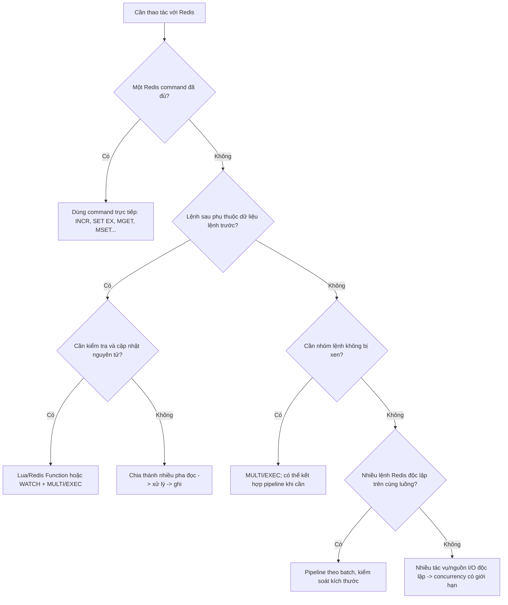

# Phân biệt pipeline với giao dịch và xử lý song song trong Spring Data Redis

> **Module:** Spring Data Redis  
> **Chương:** Pipeline  
> **Chủ đề:** Pipeline, transaction và concurrent/parallel execution đều có thể xuất hiện khi ứng dụng gửi nhiều lệnh Redis, nhưng giải quyết những bài toán khác nhau. Tài liệu này làm rõ mục tiêu, đảm bảo, API và cách lựa chọn trong ứng dụng Spring.

## 1. Ba khái niệm dễ nhầm lẫn

Giả sử một ứng dụng Spring Data Redis cần ghi 1.000 key, đồng thời cập nhật trạng thái đơn hàng và bộ đếm thống kê. Có ít nhất ba cách tổ chức lệnh:

- **Pipeline**: gửi nhiều lệnh qua kết nối Redis mà không phải chờ câu trả lời của từng lệnh trước khi gửi lệnh kế tiếp. Mục tiêu chính là **giảm chi phí vòng đi/vòng về mạng** và tăng thông lượng.
- **Giao dịch Redis (transaction, `MULTI`/`EXEC`)**: gom một chuỗi lệnh để Redis thực thi liên tiếp như một đơn vị **không bị chèn lệnh của client khác vào giữa**. Mục tiêu chính là **đảm bảo tính nguyên tử về sự xen kẽ thực thi** của chuỗi lệnh.
- **Xử lý song song/đồng thời (parallel/concurrent execution)**: nhiều tác vụ hoặc request tiến hành gửi lệnh cùng thời điểm, thường qua nhiều thread, task bất đồng bộ, kết nối hoặc client. Mục tiêu thường là **phân phối công việc, tăng độ đồng thời hoặc rút ngắn thời gian chờ của nhiều tác vụ độc lập**.

Một câu dễ nhớ:

> **Pipeline tối ưu việc truyền lệnh; transaction kiểm soát cách Redis thực thi một nhóm lệnh; xử lý song song tổ chức nhiều luồng công việc.**

Ba khái niệm không loại trừ nhau: một hệ thống có thể có nhiều worker cùng chạy, mỗi worker gửi lệnh theo pipeline, trong khi một số nhóm lệnh bắt buộc được bảo vệ bằng transaction hoặc Lua script.

### 1.1. Cùng 3 lệnh, ba cách nhìn

Giả sử phải chạy:

```redis
SET cache:a "A"
SET cache:b "B"
INCR stats:writes
```

**Gửi tuần tự và chờ từng kết quả:**

```text
Client                      Redis
  | ---- SET a ------------> |
  | <--- OK ---------------- |
  | ---- SET b ------------> |
  | <--- OK ---------------- |
  | ---- INCR --------------> |
  | <--- 1 ----------------- |
```

Client đợi phản hồi mỗi lệnh, nên độ trễ mạng lặp lại nhiều lần.

**Pipeline:**

```text
Client                      Redis
  | ---- SET a ------------> |
  | ---- SET b ------------> |
  | ---- INCR --------------> |
  | <--- OK ---------------- |
  | <--- OK ---------------- |
  | <--- 1 ----------------- |
```

Client đẩy nhiều yêu cầu đi trước khi đợi các phản hồi tương ứng. Redis vẫn thực thi các lệnh; pipeline không biến chúng thành một lệnh nguyên tử.

**Transaction:**

```text
Client                      Redis
  | ---- MULTI ------------> |
  | <--- OK ---------------- |
  | ---- SET a ------------> |
  | <--- QUEUED ------------ |
  | ---- SET b ------------> |
  | <--- QUEUED ------------ |
  | ---- INCR --------------> |
  | <--- QUEUED ------------ |
  | ---- EXEC -------------> |
  | <--- [OK, OK, 1] ------- |
```

Redis xếp các lệnh vào hàng đợi của transaction rồi thực thi chúng khi nhận `EXEC`. Đến thời điểm `EXEC`, các lệnh trong transaction được thực hiện liên tiếp, không có lệnh của client khác xen giữa.

**Nhiều tác vụ song song:**

```text
Java worker A ---- SET cache:a ----> Redis
Java worker B ---- SET cache:b ----> Redis
Java worker C ---- INCR stats:writes -> Redis
                       |
                 Server xử lý lệnh
```

Ba worker có thể cùng hoạt động và hoàn thành ở thứ tự khác nhau. Redis vẫn đảm bảo tính nguyên tử của từng lệnh đơn lẻ như `INCR`, nhưng **không có transaction** bảo đảm cả ba lệnh tạo thành một nhóm thống nhất.

## 2. Bảng so sánh trực tiếp

| Tiêu chí | Pipeline | Transaction (`MULTI`/`EXEC`) | Xử lý đồng thời/song song |
|---|---|---|---|
| Mục tiêu | Giảm round trip, tăng throughput của batch | Thực thi nhóm lệnh không xen kẽ lệnh client khác | Tăng concurrency giữa các tác vụ |
| Cơ chế | Gửi nhiều request trước khi đọc từng response | Queue command rồi thực thi tại `EXEC` | Nhiều thread/task/client cùng yêu cầu Redis |
| Giảm RTT của batch | Có, nếu được gửi/flush hiệu quả | Không tự động; có thể kết hợp pipeline | Không tự động; nhiều request vẫn có network overhead |
| Atomicity cho cả nhóm | **Không** | **Có** về sự xen kẽ thực thi | **Không** |
| Lệnh của client khác có thể xen giữa các lệnh trong nhóm | Có thể | Không, khi nhóm đang được thực thi bởi `EXEC` | Có thể |
| Có rollback khi lệnh sau thất bại? | Không | **Không có rollback kiểu SQL** | Không |
| Đọc kết quả lệnh trước để quyết định lệnh sau trong cùng lượt | Không thuận tiện; kết quả thường chỉ có sau khi flush pipeline | Không thể quyết định từ kết quả một lệnh đã QUEUED trước `EXEC` | Có thể xây dựng logic theo từng tác vụ, nhưng cần xử lý race |
| Kết quả trả về | Danh sách phản hồi theo thứ tự lệnh | Danh sách kết quả từ `EXEC` hoặc abort | Kết quả từng future/task |
| Tính nhất quán nhiều key | Không tăng so với lệnh riêng lẻ | Có nhóm thực thi liên tiếp, vẫn cần `WATCH`/Lua cho điều kiện | Phụ thuộc giao thức đồng bộ và từng lệnh |
| Lỗi giữa batch | Các lệnh trước có thể đã được thực thi | Lỗi lúc thực thi không rollback lệnh đã thành công | Có thể thành công một phần trên các task |
| Thích hợp | Bulk write, import, batch cache, nhiều GET độc lập | Cập nhật nhiều trạng thái phải được nhóm, optimistic locking | I/O tới nhiều dịch vụ/partition, nhiều request độc lập |
| API Spring Data Redis | `executePipelined(...)` | `multi()`, `exec()`, `watch()`, `SessionCallback` | `CompletableFuture`, `Executor`, async/reactive client |
| Rủi ro lớn | Bộ nhớ trả lời, batch quá lớn, tưởng có atomicity | Nhầm là có rollback, transaction chờ quá lâu, sai connection | Race condition, quá tải connection/server, kết quả không có thứ tự |

**Từ “song song” cần dùng chính xác:** nhiều Java thread có thể chạy thật trên nhiều CPU core, nhưng cùng một Redis instance thông thường vẫn xử lý logic lệnh theo cơ chế thực thi của Redis. Redis có các tối ưu I/O đa luồng trong một số phiên bản, song điều đó **không biến ba lệnh từ ba client thành một giao dịch**. Redis Cluster phân tán key trên nhiều shard có thể tăng khả năng xử lý tổng thể, nhưng cũng đặt thêm giới hạn cho các thao tác nhiều key.

## 3. Pipeline: giảm chi phí giao tiếp mạng

### 3.1. Vì sao pipeline nhanh hơn việc chờ từng lệnh?

Một request/response thông thường chịu chi phí:

```text
Thời gian ≈ thời gian gửi + thời gian Redis thực thi + thời gian phản hồi
            + chi phí round-trip của kết nối/client
```

Nếu cần gửi `N` lệnh và **chờ tuần tự** từng kết quả, độ trễ mạng có thể chiếm phần lớn tổng thời gian khi Redis ở xa ứng dụng.

Ví dụ minh họa:

- Có 500 lệnh `SET` độc lập.
- RTT giữa ứng dụng và Redis khoảng 2 ms.
- Mỗi lệnh rất nhẹ so với RTT.

Nếu hoàn toàn chờ lần lượt, chỉ riêng phần RTT lý tưởng có thể lên tới khoảng 500 × 2 ms = 1.000 ms. Pipeline cho phép nhiều lệnh nằm trên đường truyền cùng lúc, nên tránh việc chờ 500 vòng RTT riêng biệt.

Đây là **mô hình trực giác**, không phải cam kết “pipeline luôn chạy chỉ một RTT”. Kết quả thực tế còn phụ thuộc kích thước payload, số lần flush, TCP, driver, giới hạn mạng, thời gian thực thi trên Redis và việc server gửi/giữ kết quả trả về.

### 3.2. Redis xử lý pipeline như thế nào?

1. Client chuẩn bị và gửi nhiều lệnh cùng trên một kết nối theo đúng thứ tự.
2. Redis nhận, thực thi từng lệnh theo semantics thông thường.
3. Redis giữ/gửi các reply tương ứng.
4. Client thu thập kết quả theo thứ tự lệnh đã phát.

Pipeline **không phải** một lệnh Redis tên `PIPELINE`. Đó là cách **client sử dụng giao thức Redis**: không chờ từng phản hồi rồi mới gửi request tiếp theo.

Nếu lệnh thứ 5 bị lỗi kiểu dữ liệu, các lệnh 1–4 vẫn có thể đã thực thi thành công, và lệnh 6 vẫn có thể được xử lý. Không có cơ chế rollback toàn batch vì pipeline.

### 3.3. Ví dụ Spring Data Redis với `StringRedisTemplate`

```java
import java.nio.charset.StandardCharsets;
import java.util.List;

import org.springframework.data.redis.connection.RedisConnection;
import org.springframework.data.redis.core.RedisCallback;
import org.springframework.data.redis.core.StringRedisTemplate;
import org.springframework.stereotype.Service;

@Service
public class ProductCacheBatchWriter {

    private final StringRedisTemplate redis;

    public ProductCacheBatchWriter(StringRedisTemplate redis) {
        this.redis = redis;
    }

    public List<Object> writeBatch(int count) {
        return redis.executePipelined((RedisCallback<Object>) connection -> {
            for (int i = 0; i < count; i++) {
                byte[] key = ("cache:product:" + i)
                        .getBytes(StandardCharsets.UTF_8);
                byte[] value = ("product-" + i)
                        .getBytes(StandardCharsets.UTF_8);

                connection.stringCommands().set(key, value);
            }

            // executePipelined yêu cầu callback trả về null.
            return null;
        });
    }
}
```

Giải thích:

- `StringRedisTemplate` được Spring Boot thường tự cấu hình khi có Redis starter và connection factory.
- `executePipelined` mở phạm vi pipelining, chạy callback và thu thập replies thành `List<Object>`.
- Phần callback dùng `RedisConnection` trực tiếp nên key và value được chuyển thành `byte[]` bằng UTF-8, tương thích cách sử dụng String ở ví dụ.
- Mỗi lệnh `SET` có phản hồi riêng. Danh sách kết quả tương ứng với thứ tự lệnh. Với nhiều lệnh trả `OK`, thông tin có thể được chuyển đổi theo serializer/template của Spring Data Redis.
- **Không đọc kết quả từng `SET` trong vòng lặp để quyết định câu lệnh kế tiếp**. Trong pipeline, các thao tác có trả kết quả có thể trả `null` trong callback, vì reply chỉ có sau khi pipeline được thực thi/đọc.
- `executePipelined` yêu cầu callback trả `null`, không trả object tự xây dựng. Kết quả cần đọc ở **giá trị trả về của `executePipelined`**.

Lưu ý: nếu ứng dụng dùng `RedisTemplate` với serializer JDK/JSON thay vì String, thao tác low-level qua `RedisConnection` phải mã hóa bytes phù hợp định dạng thực tế. Đừng trộn `UTF-8` và serializer khác trên cùng key chỉ vì API đều gọi Redis.

### 3.4. `executePipelined` với thao tác template mức cao

Khi ứng dụng cần tận dụng serializer của template, có thể dùng `SessionCallback` ở phạm vi pipeline:

```java
import java.time.Duration;
import java.util.List;
import org.springframework.data.redis.core.RedisOperations;
import org.springframework.data.redis.core.SessionCallback;
import org.springframework.data.redis.core.StringRedisTemplate;

public class SessionPipelineExample {

    private final StringRedisTemplate redis;

    public SessionPipelineExample(StringRedisTemplate redis) {
        this.redis = redis;
    }

    public List<Object> writeWithTtl() {
        return redis.executePipelined(new SessionCallback<Object>() {
            @Override
            public <K, V> Object execute(RedisOperations<K, V> operations) {
                // Ví dụ này dùng cast có kiểm soát khi bean thực tế
                // là StringRedisTemplate được cấu hình cho String.
                @SuppressWarnings("unchecked")
                RedisOperations<String, String> ops =
                        (RedisOperations<String, String>) operations;

                ops.opsForValue().set(
                        "cache:a", "A", Duration.ofMinutes(10));
                ops.opsForValue().set(
                        "cache:b", "B", Duration.ofMinutes(10));
                return null;
            }
        });
    }
}
```

API `SessionCallback` đảm bảo các lệnh trong callback dùng cùng Redis session theo cơ chế Spring Data Redis. Việc sử dụng callback kiểu này có ích khi các thao tác mức cao của template phải cùng ở một connection. Ví dụ giới thiệu cơ chế; trong code thực tế nên thiết kế generic/bean type rõ ràng và tránh cast nếu có thể.

**Không suy luận pipeline tạo transaction** chỉ vì một callback dùng cùng connection. Hai điều kiện vẫn độc lập: có pipelining hay không, và có `MULTI`/`EXEC` hay không.

### 3.5. Pipeline không đảm bảo snapshot nhất quán

Giả sử client A pipeline hai lệnh:

```redis
GET balance:wallet1
GET balance:wallet2
```

Trong khoảng Redis xử lý hai lệnh, một client B có thể cập nhật một trong hai key. Hai kết quả có thể phản ánh **hai thời điểm khác nhau**; không có đảm bảo nhất quán liên key.

Nếu hai key đều là Redis String và cùng điều kiện hỗ trợ nhiều key, `MGET balance:wallet1 balance:wallet2` là **một lệnh Redis duy nhất**, giúp giảm số lệnh và có semantics atomic ở cấp một lệnh trên một Redis instance. Tuy nhiên `MGET` chỉ áp dụng đúng kiểu dữ liệu và có giới hạn khi key thuộc nhiều hash slot trong Redis Cluster.

### 3.6. Pipeline lớn gây vấn đề gì?

Pipeline tăng thông lượng nhưng cần giới hạn kích thước batch:

- Redis phải xử lý các request chưa hoàn tất và có thể tích lũy reply trong bộ nhớ khi client chưa đọc kịp.
- Client có thể giữ danh sách phản hồi lớn trong heap Java.
- Batch khổng lồ khiến một yêu cầu dài chiếm tài nguyên, tăng tail latency cho traffic khác.
- Khi network fail giữa batch, client có thể không biết chính xác những lệnh nào đã được thực thi.
- Khi batch có thao tác không idempotent như `INCR`, retry toàn bộ mà không kiểm soát có thể làm tăng đếm hai lần.

Cách tổ chức thực tế là **chia batch vừa phải**, đo throughput/latency/memory và thiết kế retry có nhận diện bản ghi hoặc tính idempotent. Không có con số batch lý tưởng cố định cho mọi payload và hạ tầng.

## 4. Transaction: nhóm thực thi nguyên tử, không phải cơ chế tăng tốc mạng

### 4.1. Redis `MULTI` và `EXEC` đảm bảo điều gì?

Một transaction Redis bắt đầu bằng `MULTI`. Các lệnh tiếp theo trên **cùng connection** được xếp hàng và nhận phản hồi `QUEUED`. Khi `EXEC` được gọi, Redis thực thi các lệnh đã xếp hàng theo thứ tự, không xen lệnh của client khác trong quá trình chạy transaction.

```redis
MULTI
SET orders:1001:status paid
INCR metrics:paid-orders
EXEC
```

Mục tiêu ở đây là hai cập nhật được thực thi liên tiếp tại `EXEC`. Client khác không thể thấy trạng thái đã thực thi lệnh đầu tiên của nhóm nhưng chưa thực thi lệnh thứ hai do chèn truy vấn giữa các lệnh của transaction trên cùng Redis instance.

**Giao dịch không tự giải quyết tính đúng đắn nghiệp vụ.** Nếu một trong hai lệnh có thể lỗi, Redis transaction không có rollback kiểu database quan hệ. Transaction cũng không cung cấp phép đọc kết quả lệnh đầu tiên để viết logic điều kiện ngay trong cùng tập lệnh queued.

### 4.2. Redis transaction không rollback kiểu SQL

Ví dụ:

```redis
MULTI
SET demo:kind "a-string"
LPUSH demo:kind "list-item"
EXEC
```

`SET` có thể thành công, còn `LPUSH` lỗi `WRONGTYPE` vì key đang là Redis String. Lỗi khi **thực thi** một lệnh trong `EXEC` không làm Redis tự hoàn tác các lệnh trước đó. Kết quả của `EXEC` có thể bao gồm cả kết quả thành công và lỗi từng lệnh.

Cần phân biệt:

- **Lỗi lúc queueing**: trong một số trường hợp transaction được đánh dấu lỗi và `EXEC` từ chối thực thi nhóm.
- **Lỗi lúc executing**: những lệnh hợp lệ khác có thể vẫn thực thi; Redis không cung cấp automatic rollback cho kết quả đã ghi.

Vì vậy, “atomic transaction” trong Redis nói chủ yếu đến **không xen kẽ lệnh từ client khác khi nhóm `EXEC` đang chạy**, không đồng nghĩa tính chất rollback đầy đủ như một RDBMS.

### 4.3. Spring Data Redis: transaction qua `RedisConnection`

Ví dụ dùng callback có cùng kết nối trong suốt chuỗi `MULTI` đến `EXEC`:

```java
import java.nio.charset.StandardCharsets;
import java.util.List;

import org.springframework.data.redis.core.RedisCallback;
import org.springframework.data.redis.core.StringRedisTemplate;
import org.springframework.stereotype.Service;

@Service
public class PaidOrderUpdater {

    private final StringRedisTemplate redis;

    public PaidOrderUpdater(StringRedisTemplate redis) {
        this.redis = redis;
    }

    public List<Object> markPaid(String orderId) {
        return redis.execute((RedisCallback<List<Object>>) connection -> {
            byte[] statusKey = ("orders:" + orderId + ":status")
                    .getBytes(StandardCharsets.UTF_8);
            byte[] paid = "paid".getBytes(StandardCharsets.UTF_8);
            byte[] countKey = "metrics:paid-orders"
                    .getBytes(StandardCharsets.UTF_8);

            connection.multi();

            connection.stringCommands().set(statusKey, paid);
            connection.stringCommands().incr(countKey);

            return connection.exec();
        });
    }
}
```

Khác với `executePipelined`:

- `execute(...)` chỉ mở callback với Redis connection, **không tự kích hoạt pipelining**.
- `connection.multi()` và `connection.exec()` mới tạo transaction.
- Các lệnh trong khoảng `MULTI`/`EXEC` được queue; kết quả thực của lệnh có khi `EXEC` chạy.
- Nếu gọi `DISCARD` trước `EXEC`, những lệnh đã queue sẽ bị bỏ; điều đó không đồng nghĩa Redis tự rollback lệnh đã được thực thi sau `EXEC`.

Với transaction phức tạp trong Spring Data Redis, `SessionCallback` là API cấp cao thường được dùng để giữ cùng session khi gọi `opsForValue()`, `multi()` và `exec()`. Dù dùng API nào, quy tắc **cùng connection xuyên suốt transaction** vẫn cần được đảm bảo.

### 4.4. `@Transactional` của Spring có đồng nghĩa Redis `MULTI` không?

Không thể chỉ nhìn thấy `@Transactional` rồi suy ra Redis sẽ chạy `MULTI`/`EXEC`. Spring transaction abstraction thường gắn với một transaction manager (ví dụ database). Cấu hình `RedisTemplate` và transaction synchronization phải được bật và liên kết đúng thì lệnh Redis mới tham gia cơ chế Redis transaction tương ứng.

Spring Data Redis có `setEnableTransactionSupport(true)` trên `RedisTemplate` nhằm hỗ trợ transaction-bound connection khi kết hợp Spring-managed transaction. Cần hiểu rõ:

- Đây là **cấu hình template**, không phải bật transaction tự động cho mọi đoạn code gọi Redis.
- Không nên gọi `multi()`, sau đó thực thi các lệnh qua connection/template không liên quan rồi kỳ vọng `exec()` gom được tất cả.
- Với transaction-bound context, các thao tác đọc có thể được định tuyến khác với lệnh ghi queued; không được suy diễn “đọc thấy dữ liệu vừa SET” trước `EXEC`.
- Spring Data Redis Repository không hỗ trợ transactions theo mô hình Redis Repository.
- Transaction Redis không khiến database giao dịch và Redis cùng commit nguyên tử chỉ nhờ một annotation; đây là hai hệ quản trị khác nhau.

Muốn nhất quán nghiệp vụ giữa database và Redis, cần thiết kế rõ ràng transactional outbox, cache invalidation, retry hoặc giao thức phối hợp phù hợp.

## 5. `WATCH`: phát hiện thay đổi để thực hiện cập nhật có điều kiện

Một Redis transaction thuần `MULTI`/`EXEC` không tự giải quyết bài toán “chỉ cập nhật nếu trạng thái chưa thay đổi kể từ lúc đọc”. Redis cung cấp `WATCH` để triển khai **optimistic locking**.

Ví dụ hai client muốn giảm số lượng tồn kho khi còn hàng:

```text
Client A:
  WATCH stock:sku-42
  GET stock:sku-42
  Nếu stock <= 0:
      UNWATCH
      Kết thúc
  MULTI
  DECR stock:sku-42
  EXEC
```

Quy trình:

1. `WATCH` đánh dấu key cần giám sát trên connection hiện tại.
2. Ứng dụng đọc giá trị và tự quyết định có nên cập nhật.
3. Ứng dụng gọi `MULTI`/`EXEC` để thực thi cập nhật.
4. Nếu một client khác đã sửa key được `WATCH` trước `EXEC`, transaction của client A **không thực thi**, và `EXEC` trả kết quả abort (null/nil tùy client).
5. Ứng dụng có thể retry toàn bộ chu trình **đọc → kiểm tra → ghi** theo chính sách phù hợp.

Lệnh `WATCH` phải nằm trên **cùng connection** dùng cho quá trình kiểm tra và `EXEC`. Nếu tách ba bước thành các callback thông thường không có session binding, có thể vô tình mất ngữ cảnh watch.

### 5.1. Vì sao pipeline không thay `WATCH`?

Giả sử thực hiện pipeline:

```redis
GET stock:sku-42
DECR stock:sku-42
```

Ứng dụng không thể dùng giá trị trả về của `GET` ngay trong pipeline để quyết định có gửi `DECR` hay không theo cùng một round-trip. Và ngay cả nếu đọc xong rồi mới gửi `DECR`, một client khác có thể thay đổi stock giữa hai lệnh.

Đối với thao tác điều kiện gọn và cần nguyên tử, một **Lua script/Redis Function** chạy phía Redis thường phù hợp hơn việc tự ghép pipeline. Ví dụ sử dụng Lua để “chỉ giảm tồn kho nếu > 0”:

```lua
local current = tonumber(redis.call('GET', KEYS[1]) or '0')
if current <= 0 then
    return 0
end
return redis.call('DECR', KEYS[1])
```

Script chạy theo tính chất nguyên tử của Redis script execution trên một Redis instance, kiểm tra và cập nhật trong cùng ngữ cảnh server. Khi triển khai Redis Cluster, các key trong script phải tuân thủ ràng buộc slot/command của cluster. Cần tránh script chạy lâu làm chặn Redis.

Đừng dùng pipeline để mô phỏng điều kiện đọc-rồi-ghi có tính cạnh tranh.

## 6. Xử lý song song: nhiều tác vụ độc lập cùng gọi Redis

### 6.1. Định nghĩa “đồng thời” ở tầng Spring

Một ứng dụng Spring có thể xử lý nhiều HTTP request hoặc nhiều message consumer cùng lúc. Mỗi request gọi `RedisTemplate` hoặc repository, tạo ra nhiều Redis operations đang “in flight” cùng thời điểm.

Điều đó là **concurrency**. Nếu có nhiều CPU core và thread, Java có thể chạy thực sự song song một phần công việc. Tuy nhiên:

- Thứ tự Redis nhận lệnh từ **các connection khác nhau** có thể thay đổi.
- Các thao tác trên hai key độc lập có thể hoàn tất ở thời điểm khác nhau.
- Nếu nhiều worker cùng sửa **một key**, cần dựa vào atomic commands như `INCR`, transaction/`WATCH`, Lua hoặc giao thức riêng để giữ invariant.
- Việc tăng thread không đảm bảo Redis xử lý nhanh hơn; contention, queue, pool và memory có thể trở thành nút thắt.

RedisTemplate được thiết kế để chia sẻ sau khi cấu hình hoàn chỉnh, nhưng **không nên chia sẻ cùng một low-level RedisConnection tùy ý giữa nhiều thread**. Chiến lược sử dụng và tái sử dụng connection phụ thuộc client driver (Lettuce/Jedis), connection factory, pool và chế độ transaction/pipeline.

### 6.2. Ví dụ `CompletableFuture` đọc các key độc lập

```java
import java.util.Arrays;
import java.util.List;
import java.util.concurrent.CompletableFuture;
import java.util.concurrent.Executor;

import org.springframework.beans.factory.annotation.Qualifier;
import org.springframework.data.redis.core.StringRedisTemplate;
import org.springframework.stereotype.Service;

@Service
public class ParallelCacheReader {

    private final StringRedisTemplate redis;
    private final Executor redisExecutor;

    public ParallelCacheReader(
            StringRedisTemplate redis,
            @Qualifier("redisReadExecutor") Executor redisExecutor) {
        this.redis = redis;
        this.redisExecutor = redisExecutor;
    }

    public List<String> readTwoProducts() {
        CompletableFuture<String> first = CompletableFuture.supplyAsync(
                () -> redis.opsForValue().get("cache:product:101"),
                redisExecutor);

        CompletableFuture<String> second = CompletableFuture.supplyAsync(
                () -> redis.opsForValue().get("cache:product:102"),
                redisExecutor);

        // Arrays.asList cho phép null khi một key không tồn tại.
        return Arrays.asList(first.join(), second.join());
    }
}
```

`redisReadExecutor` là một Spring bean `Executor` được định nghĩa ở nơi khác và có giới hạn thread/queue phù hợp. `CompletableFuture.join()` ném `CompletionException` khi tác vụ thất bại; ứng dụng thực tế phải xử lý timeout, cancellation và fallback tùy mục tiêu.

Trong ví dụ này:

- Hai thao tác GET có thể được gửi đồng thời;
- không có pipeline scope;
- không có `MULTI`/`EXEC`;
- mỗi future giữ kết quả của riêng nó;
- thứ tự bắt đầu/hoàn thành ở Redis có thể khác thứ tự tạo future;
- nếu các key độc lập thì concurrency thường dễ quản lý.

### 6.3. Nếu cùng dùng một connection thì có còn “song song” không?

Tùy driver và cấu hình, nhiều request có thể được multiplex trên một kết nối. Việc có nhiều Java future **không đồng nghĩa chắc chắn có nhiều TCP connection**, và cũng không đồng nghĩa Redis thực hiện các lệnh cùng lúc trên cùng một core.

Hơn nữa, một client có thể tự động gom/đẩy các lệnh ở tầng I/O. Việc này có thể tạo lợi ích tương tự pipelining ở giao thức, nhưng không thay thế semantics rõ ràng của `RedisTemplate.executePipelined(...)` và cũng không cấp atomicity.

Muốn quyết định chiến lược, hãy đo số request đồng thời, lượng connection, throughput, server CPU, latency P95/P99, các timeout và queue của executor.

### 6.4. Cảnh báo race condition trong song song

Ví dụ hai worker cùng làm:

```text
Worker A: GET counter  ->  10
Worker B: GET counter  ->  10
Worker A: SET counter 11
Worker B: SET counter 11
Kết quả cuối: 11, trong khi mong muốn 12
```

Dù worker A và B chạy tuần tự ở Redis, cách ghép **GET rồi SET** vẫn có race do client khác có thể xen giữa.

Nếu mục tiêu chỉ là cộng bộ đếm, dùng:

```redis
INCR counter
```

`INCR` là **một lệnh nguyên tử**. Hai worker cùng gọi `INCR` sẽ tăng được hai lần và không gặp lost update như chuỗi `GET`/`SET`. Không cần pipeline hay transaction cho một phép tăng đơn lẻ.

Đối với logic phức tạp như “kiểm tra còn quota rồi giảm quota và ghi log”, lựa chọn có thể là Lua script, `WATCH` + `MULTI`/`EXEC`, hoặc thiết kế lock/queue chính xác hơn.

## 7. Pipeline và transaction có thể kết hợp không?

Có. Đây là **hai trục độc lập**:

- **Transaction** quyết định những lệnh nào thuộc một nhóm thực thi `MULTI`/`EXEC`.
- **Pipeline** quyết định cách client gửi các Redis protocol requests và thu reply mà không chờ từng round trip.

Một client có thể gửi `MULTI`, các lệnh queued và `EXEC` qua pipeline để giảm round trip. Redis vẫn thực thi transaction tại `EXEC`.

```text
Kết hợp: pipeline vận chuyển một transaction

Client                         Redis
   | ---- MULTI -------------> |  (lệnh mở transaction)
   | ---- SET x 1 ------------> |  (queued)
   | ---- INCR y -------------> |  (queued)
   | ---- EXEC ---------------> |  (thực thi transaction)
   | <--- OK ----------------- |
   | <--- QUEUED ------------- |
   | <--- QUEUED ------------- |
   | <--- [OK, integer] ------ |
```

Tuy nhiên việc kết hợp pipeline và transaction trong Spring Data Redis còn phụ thuộc cách driver/callback trả results, giữ connection và xử lý trạng thái. Đặc biệt:

- Không giả định `executePipelined` sẽ làm mọi lệnh trong callback thành transaction.
- Không gọi `MULTI` ở một connection rồi `EXEC` ở connection khác.
- Khi transaction được queue trong pipeline, những kết quả nhận từ callback trước khi flush có thể là `null`, và reply cuối bao gồm cả thông tin queue/`EXEC` tùy client.
- Nếu không có yêu cầu giảm RTT cho nhiều transactions, một `SessionCallback` transaction bình thường thường dễ hiểu hơn.

Để truy cập kết quả lệnh trước rồi quyết định lệnh sau, pipeline + transaction thuần vẫn **không** giải quyết bài toán điều kiện. Sử dụng `WATCH` với nhiều vòng trao đổi hoặc logic server-side thích hợp.

## 8. Khi nào pipeline không phải lựa chọn tốt nhất?

### 8.1. Chỉ có một lệnh

`SET key value EX 60` đã là một command ghi giá trị cùng TTL, có tính nguyên tử ở cấp lệnh. Dùng pipeline cho:

```redis
SET key value
EXPIRE key 60
```

không đảm bảo hai lệnh là một phép cập nhật nguyên tử; client khác có thể xen giữa hoặc lệnh thứ hai bị lỗi. Khi một Redis command có thể thể hiện đầy đủ ý định, **ưu tiên một command**.

### 8.2. Redis có lệnh multi-key chuyên biệt

Ví dụ đọc nhiều Redis String:

```redis
MGET cache:a cache:b cache:c
```

So sánh:

```redis
GET cache:a
GET cache:b
GET cache:c
```

`MGET` là một lệnh, có thể đơn giản hơn pipeline của ba `GET` và giảm overhead xử lý giao thức. Với cập nhật nhiều key bằng `MSET`, lệnh đơn có tính nguyên tử theo semantics Redis trên một instance.

Dù vậy, `MGET`/`MSET` chỉ phù hợp kiểu dữ liệu và semantics hỗ trợ. Trong Redis Cluster, các lệnh yêu cầu nhiều key phải tuân thủ ràng buộc hash slot; pipeline GET độc lập ở các slot khác nhau cũng cần client cluster-aware định tuyến đúng node.

### 8.3. Cần ràng buộc logic nhiều bước

Ví dụ chuyển một số lượng hàng tồn giữa hai key chỉ khi đủ hàng: pipeline nhiều `GET`/`SET` có nguy cơ race. Cần transaction cộng `WATCH`, Lua/Functions hoặc thiết kế dữ liệu khác.

### 8.4. Đầu vào/phản hồi rất lớn

Một pipeline 100.000 truy vấn trả JSON vài KB có thể tạo lượng reply lớn trong server/client. Chia batch và áp dụng backpressure thường an toàn hơn.

### 8.5. Lệnh phụ thuộc kết quả trước đó

Nếu lệnh B phải được xây dựng từ giá trị trả về của lệnh A, việc dồn A và B vào cùng một pipeline chưa có lời đáp khiến B không đủ đầu vào. Cân nhắc hai pha (pipeline A, xử lý kết quả, pipeline B), hoặc đặt logic vào script chạy phía Redis nếu cần tính nguyên tử.

## 9. Các tình huống thực tế trong Spring Boot

### 9.1. Import nhiều bản ghi cache có thể tạo lại

**Mục tiêu:** nạp 20.000 sản phẩm vào Redis trước khi mở traffic. Mỗi key chứa snapshot cache riêng và có TTL.

**Lựa chọn:** pipeline theo batch vừa phải.

```text
Đọc dữ liệu nguồn
   -> chia thành các batch
   -> executePipelined(SET key value EX ttl)
   -> nhận replies, kiểm tra kết quả
   -> ghi nhận batch hoàn thành
```

Lý do: mỗi key độc lập; không cần transaction cho tất cả 20.000 key. Pipeline tránh chờ từng RTT. Với hệ thống Redis Cluster, client phải xử lý định tuyến tới các node đúng; không giả định một Redis connection có thể ghi được mọi slot.

### 9.2. Tạo đơn hàng cần cập nhật hai trạng thái Redis cùng lúc

**Mục tiêu:** chuyển `orders:1001:status` thành `paid` và tăng `metrics:paid-orders` như một nhóm.

**Lựa chọn:** transaction nếu cả hai key thuộc cùng Redis instance/slot và có semantics phù hợp; hoặc thiết kế lệnh/script khác cho invariant phức tạp.

Lý do: muốn tránh client khác quan sát hai phép cập nhật bị xen lệnh. Pipeline không bảo đảm điều đó. Tuy nhiên nếu hệ thống còn một database giao dịch là nguồn sự thật, transaction Redis không thay thế transaction của database.

### 9.3. Đọc hai profile độc lập để tổng hợp giao diện

**Mục tiêu:** lấy profile người gửi, người nhận và thông tin phụ trợ.

**Lựa chọn:** `MGET` nếu dữ liệu là Redis String tương thích; pipeline `GET` nếu phù hợp cơ chế batch; hoặc song song giữa **nhiều hệ thống** (Redis, database, HTTP service) khi độ trễ chờ độc lập.

Lý do: concurrency giúp tận dụng thời gian chờ của nhiều phụ thuộc; pipeline giúp giảm RTT khi nhiều lệnh cùng tới Redis. Tránh mở hàng trăm thread chỉ để thực hiện vài Redis GET nhẹ.

### 9.4. Nhiều worker cùng tiêu thụ quota

**Mục tiêu:** từ nhiều HTTP instance, giảm quota nhưng không cho xuống âm.

**Lựa chọn:** Lua script hoặc `WATCH` + transaction và retry. Có thể dùng một cấu trúc dữ liệu/hệ thống quota chuyên dụng.

Lý do: bài toán là **điều kiện cạnh tranh**, không phải gửi lệnh nhanh. Pipeline không ngăn double-spend hoặc lost update.

### 9.5. Nhiều notification service cùng cập nhật lượt gửi

**Mục tiêu:** cộng bộ đếm gửi email từ nhiều worker.

**Lựa chọn:** mỗi worker gọi `INCR metrics:mail-sent`. Nếu có nhiều key độc lập, có thể dùng pipeline cho các lệnh độc lập trong từng worker.

Lý do: atomicity của một lệnh `INCR` giải quyết cập nhật chung; mở transaction mỗi lần tăng một counter thường không cần thiết.

### 9.6. Redis Repository và pipeline

Redis Repository tập trung vào entity mapping và các thao tác CRUD. Một lần `save` có thể làm nhiều công việc liên quan Hash, index và TTL. Đừng nhầm việc gọi `repository.saveAll(...)` với một transaction hoặc pipeline được đảm bảo cho mọi trường hợp.

Nếu cần nạp cache đơn giản theo key tự định nghĩa, `RedisTemplate.executePipelined(...)` là lựa chọn chủ động. Nếu cần entity và index của Redis Repository, hãy tuân thủ cơ chế mapping của repository. Việc tự ghi trực tiếp những Hash hoặc Set index nội bộ qua pipeline có thể làm sai metadata/index.

Redis Repository cũng không hỗ trợ transaction theo cách của `RedisTemplate`. Không nên giả định annotation `@Transactional` bảo vệ mọi `repository.save(...)` vào một Redis transaction.

## 10. Tính chất lỗi và retry

Pipeline, transaction và concurrency đều có thể gặp lỗi mạng. Khác nhau ở khả năng nhận biết kết quả và ranh giới thực thi.

### 10.1. Lỗi giữa pipeline

Ví dụ một pipeline có 100 lệnh `SET`. Connection đứt khi client đang nhận phản hồi, nên client chỉ thấy 70 kết quả.

Không thể kết luận 30 lệnh còn lại **chưa chạy**. Redis có thể đã nhận và thực thi thêm lệnh mà phản hồi bị mất trên đường truyền.

Biện pháp:

- Ưu tiên các lệnh idempotent như `SET` với giá trị xác định khi retry batch.
- Gắn idempotency key hoặc sequence number khi xử lý công việc có side effect.
- Ghi nhận tiến độ theo batch; retry theo giao thức chấp nhận được.
- Tránh retry mù lệnh `INCR`, `LPUSH` hay thêm event nếu việc lặp gây kết quả sai.

### 10.2. Lỗi trong transaction

Nếu `EXEC` đã chạy nhưng kết nối mất trước khi client nhận reply, client có thể chưa biết transaction thành công hay chưa. Redis đảm bảo cách thực thi nhóm lệnh, nhưng **không giải quyết mọi trường hợp xác nhận kết quả qua mạng**.

Ví dụ transaction có `INCR metrics:paid-orders` mà client retry khi không chắc kết quả có thể làm count tăng hai lần. Cần thiết kế idempotency hoặc truy vấn trạng thái nghiệp vụ có thể xác minh.

### 10.3. Lỗi khi chạy song song

Một `CompletableFuture` có thể thành công, một future khác có thể thất bại. Đợi bằng `allOf`/`join` không tự undo những thao tác đã thành công.

Trong ứng dụng Spring, hãy xử lý:

- timeout của Redis và giới hạn số tác vụ đồng thời;
- exception riêng của mỗi task;
- retry có backoff, tránh bùng tải khi Redis đang quá tải;
- cancellation và kết nối còn sống;
- kết quả tổng hợp khi thiếu một phần dữ liệu.

### 10.4. Không có tính nguyên tử xuyên hệ thống

Ví dụ cập nhật database PostgreSQL rồi gửi pipeline Redis hoặc Redis transaction: **không có cam kết tất cả cùng commit**. Nếu yêu cầu đồng bộ chính xác, cần mô hình nghiệp vụ phù hợp (outbox, event-driven retry, cache-aside, saga, hoặc công cụ transaction được thiết kế riêng). Không dùng pipeline hay `MULTI` để thay cho giao thức nhất quán liên hệ thống.

## 11. Khác biệt với Redis Lua script và Redis Function

Một lựa chọn liên quan nhưng khác ba cơ chế chính là thực thi logic ngay trên Redis.

| Cách làm | Nơi đặt logic | Ưu thế chính | Giới hạn |
|---|---|---|---|
| Pipeline | Client tạo danh sách lệnh | Giảm round trip cho nhiều lệnh | Không tự atomic |
| `MULTI`/`EXEC` | Client queue, Redis chạy nhóm | Không interleave giữa lệnh thuộc transaction | Không dùng reply queued để branching, không rollback |
| Lua/Redis Function | Code chạy phía Redis | Logic điều kiện và cập nhật nguyên tử trong một lượt server-side | Script chạy lâu chặn server; giới hạn cluster/script |
| Song song | Nhiều task/client | Tăng concurrency cho công việc độc lập | Cần tránh race, giới hạn tài nguyên |

Ví dụ Lua atomic quota decrement:

```lua
local quota = tonumber(redis.call('GET', KEYS[1]) or '0')
if quota <= 0 then
    return -1
end
return redis.call('DECR', KEYS[1])
```

Trong Spring Data Redis, `DefaultRedisScript` và `RedisTemplate.execute(...)` là một cách gọi Lua script với danh sách key và arguments thích hợp.

Không nên chuyển mọi batch sang Lua: script cần phù hợp giới hạn thực thi, khả năng bảo trì, độ trễ, cluster slot và dữ liệu đầu vào. Với một batch cache độc lập, pipeline thường đơn giản hơn.

## 12. Redis Cluster làm thay đổi lựa chọn như thế nào?

Ở Redis standalone, mọi key đi qua một instance; transaction nhiều key có thể được thực thi cùng nhóm. Trong Redis Cluster, key được ánh xạ vào hash slot, phân tán qua các node.

### 12.1. Pipeline trên Cluster

Một pipeline gồm các lệnh trên nhiều slot có thể yêu cầu client **phân nhóm, định tuyến, gửi và nhận phản hồi** ở nhiều node. Không thể kết luận rằng dùng một `RedisConnection` cố định đến một node sẽ xử lý được mọi key.

Client driver và Spring Data Redis phải hỗ trợ cluster topology, redirect và quy tắc pipelining đang sử dụng. Kiểm tra tài liệu phiên bản driver/Lettuce/Jedis cụ thể, đặc biệt khi kết hợp pipelining với transaction.

### 12.2. Transaction trong Cluster

Các giao dịch nhiều key và các lệnh yêu cầu thao tác nhiều key trong Redis Cluster bị giới hạn bởi **hash slot**. Chúng không cung cấp atomicity đa shard tùy ý.

Có thể dùng hash tag để cố định các key liên quan vào cùng slot:

```text
order:{1001}:status
order:{1001}:payment
```

Hai key có cùng phần trong ngoặc nhọn `{1001}` được hash theo cùng tag và thường cùng slot. Không nên lạm dụng một hash tag cho quá nhiều key vì dễ tạo điểm nóng trên một shard.

### 12.3. Song song giữa shards

Cluster có thể xử lý workload phân tán trên các node, nên concurrency phù hợp có thể tăng throughput toàn hệ thống. Nhưng lệnh liên quan nhiều key cần cùng slot thì vẫn có những ràng buộc. Phân tán workload không tự tạo transaction phân tán hoặc thứ tự toàn cục.

## 13. Thử nghiệm và đo hiệu năng có ý nghĩa

Chọn pipeline vì **đo được lợi ích**, không chỉ vì số lượng lệnh lớn.

### 13.1. Các biến số cần kiểm soát

| Biến số | Vì sao phải kiểm soát? |
|---|---|
| RTT client ↔ Redis | RTT càng lớn, pipelining thường càng có lợi so với chờ từng command |
| Kích thước lệnh và response | Payload lớn có thể bão hòa băng thông và heap |
| Số lệnh mỗi batch | Batch quá nhỏ khó thấy lợi ích, quá lớn gây memory/tail latency |
| Số client/kết nối | Concurrency quá cao làm tăng contention và queue |
| Pipeline depth | Điều chỉnh số command in-flight ảnh hưởng memory và throughput |
| CPU Redis | Redis đã bão hòa CPU thì giảm RTT không nhất thiết tăng throughput |
| Workload GET/SET/Hash/Script | Độ phức tạp mỗi lệnh khác nhau; script/large-value có chi phí riêng |
| Redis Cluster/replication | Điều kiện mạng, định tuyến slot và lag khác standalone |
| Client serializer | Chuyển đổi JSON/JDK, cấp phát bytes có thể chiếm thời gian |
| P95/P99 latency | Throughput cao nhưng tail latency xấu có thể không chấp nhận được |

### 13.2. Dùng `redis-benchmark` để quan sát pipeline

Trên Redis thử nghiệm riêng, có thể dùng:

```bash
# Các SET tuần tự ở mức pipeline depth 1 với concurrency 20
redis-benchmark -h 127.0.0.1 -p 6379 -t set -n 100000 -c 20 -P 1 -q

# Cùng số command/client, pipeline depth 16
redis-benchmark -h 127.0.0.1 -p 6379 -t set -n 100000 -c 20 -P 16 -q
```

`-P` đặt pipeline depth, `-c` đặt số client đồng thời, `-n` đặt số yêu cầu. Hai tham số `-P` và `-c` kiểm tra **hai yếu tố khác nhau**: số lệnh in-flight trên một client và số client cùng hoạt động.

Không chạy benchmark tải lớn trên Redis production đang phục vụ người dùng vì nó có thể chiếm CPU, băng thông, bộ nhớ và ảnh hưởng SLA.

### 13.3. Đọc kết quả đúng cách

Giả sử pipeline depth 16 tăng requests/second so với depth 1. Điều đó cho thấy giảm round trip hoặc cách gửi lệnh hiệu quả hơn trong điều kiện đo, **không chứng minh**:

- nhóm 16 lệnh trở thành atomic;
- Redis thực hiện đồng thời 16 lệnh trên cùng instance;
- mọi request đơn lẻ giảm latency;
- không có ảnh hưởng tới các service khác cùng Redis.

Cần quan sát cả throughput, latency trung bình/P95/P99, CPU, network, memory và lỗi timeout. Đo với kích thước value và cách phân phối key gần giống production.

## 14. Những sai lầm cần tránh

### 14.1. “Pipeline thực thi mọi lệnh cùng lúc”

Không chính xác. Pipeline cho phép gửi và nhận theo lô. Redis vẫn thực thi từng command theo semantics của nó; không có đảm bảo mọi command chạy cùng thời điểm.

### 14.2. “Có pipeline thì hai lệnh không thể bị xen”

Không chính xác. Lệnh client khác có thể được thực thi giữa hai lệnh của một pipeline. Muốn nhóm `MULTI`/`EXEC` không interleave, phải tạo transaction; còn logic điều kiện cần thêm `WATCH` hoặc cơ chế thích hợp.

### 14.3. “Transaction luôn nhanh hơn pipeline vì gom nhiều lệnh”

Không chính xác. `MULTI`/`EXEC` thiên về semantics nguyên tử của nhóm. Nếu vẫn gửi và chờ từng round trip, nó không tự cắt RTT tương tự pipelining.

### 14.4. “Redis transaction rollback toàn bộ nếu một lệnh lỗi”

Không chính xác với lỗi xảy ra trong quá trình thực thi. Redis không có rollback kiểu SQL cho lệnh đã thành công trước đó trong transaction.

### 14.5. “Có nhiều CompletableFuture là Redis đang chạy đa luồng song song mọi lệnh”

Không chính xác. Java concurrency và Redis server command execution là hai tầng khác nhau. Tăng future còn có thể gây quá tải Redis hoặc connection pool.

### 14.6. “Gọi `@Transactional` là Redis Repository tự thành transaction”

Không chính xác. RedisTemplate có cơ chế hỗ trợ Redis transactions với cấu hình rõ ràng; Redis Repository không tự hỗ trợ transactional operations theo annotation đó.

### 14.7. “Retry pipeline có thể làm lại từ đầu mà không sợ gì”

Sai với lệnh không idempotent. `INCR`, `LPUSH`, side effect dạng ghi sự kiện có thể diễn ra hai lần nếu reply bị mất nhưng command đã được Redis thực thi.

### 14.8. “MGET, pipeline và transaction là ba cách viết của cùng một việc”

Không. `MGET` là **một Redis command**. Pipeline là chiến lược gửi nhiều command. Transaction là nhóm command được `EXEC` thực thi không xen kẽ.

### 14.9. “Pipeline kết hợp với MULTI đủ để thực hiện mọi điều kiện nghiệp vụ”

Không. `GET` queued trong transaction chưa trả dữ liệu thực để client ra quyết định. Cần `WATCH`/retry hoặc Lua/Redis Functions nếu muốn điều kiện và cập nhật nguyên tử.

## 15. Cây quyết định lựa chọn giải pháp



Cây quyết định mang tính định hướng. Khi Redis Cluster, keyspace của các command, điều kiện nhất quán và khả năng của driver có thể loại bỏ một số lựa chọn.

## 16. Ví dụ tổng hợp: ba bài toán khác nhau trong cùng hệ thống

Giả sử một hệ thống thương mại điện tử dùng Spring Data Redis.

**Bài toán A: Làm nóng cache sản phẩm trước chiến dịch**

Ứng dụng nạp 10.000 key độc lập. Chọn pipeline theo batch 100–500 key hoặc một kích thước đã đo được. Không cần transaction tất cả key vì cache có thể tái tạo. Theo dõi reply và tiến độ để retry đúng.

**Bài toán B: Giảm số lượng tồn kho nhưng không âm**

Nhiều request mua hàng cùng lúc. Không dùng pipeline `GET`/`DECR`. Dùng một Lua script atomic, hoặc `WATCH` + `MULTI`/`EXEC` và retry. Nếu tồn kho chính nằm ở database, database cần giữ tính nhất quán nghiệp vụ chính và Redis chỉ là cache/projection thích hợp.

**Bài toán C: Cùng lúc lấy profile khách hàng, cấu hình ưu đãi và giá giao hàng**

Ba nguồn có thể độc lập: profile từ Redis, cấu hình từ Redis, giá giao hàng từ HTTP service. Có thể chạy các tác vụ I/O đồng thời với executor/reactive composition, với timeout và giới hạn concurrency. Nếu chỉ có nhiều GET từ Redis, pipeline hoặc `MGET` có thể hiệu quả và đơn giản hơn mở nhiều thread.

Mỗi cách tiếp cận giải một vấn đề khác nhau, và quyết định đúng thường xuất phát từ **yêu cầu nhất quán trước**, sau đó mới tối ưu **độ trễ và throughput**.

## 17. Tóm lược ghi nhớ

- **Pipeline = tối ưu round trip:** nhiều request đi trước các reply, tăng throughput batch, **không tạo atomicity**.
- **Transaction = nhóm thực thi:** `MULTI`/`EXEC` chạy các lệnh queued liên tiếp, **không có rollback kiểu SQL** và không tự giải quyết mọi điều kiện đọc-rồi-ghi.
- **Parallelism/concurrency = tổ chức nhiều tác vụ:** giúp tận dụng thời gian chờ I/O và phân phối công việc, nhưng cần xử lý race, timeout, pool và giới hạn server.
- **`WATCH` = optimistic concurrency:** hủy transaction khi key bị thay đổi trước `EXEC`; client phải retry khi cần.
- **Lua/Redis Function = logic atomic phía Redis:** phù hợp thao tác có điều kiện, nhưng cần giữ thời gian chạy ngắn và tuân thủ ràng buộc cluster.
- **Một command có sẵn thường tốt nhất:** `INCR`, `SET ... EX`, `MGET`, `MSET` giúp tránh tự ghép nhiều lệnh khi không cần.
- **Trong Spring Data Redis:** `executePipelined(...)` dành cho pipeline; `multi()/exec()/watch()` và `SessionCallback` dành cho transactions; `CompletableFuture`/executor/reactive API dành cho concurrency. Sử dụng đúng kết nối và serializer để giữ semantics mong muốn.

## Tài liệu tham khảo

- Redis — [Pipelining](https://redis.io/docs/latest/develop/using-commands/pipelining/): cơ chế gửi nhiều lệnh không chờ từng reply, lợi ích và memory overhead.
- Redis — [Transactions](https://redis.io/docs/latest/develop/interact/transactions/): `MULTI`, `EXEC`, `DISCARD`, `WATCH`, lỗi và atomicity.
- Redis — [`MGET` command](https://redis.io/docs/latest/commands/mget/): đọc nhiều String key trong một command.
- Redis — [`MSET` command](https://redis.io/docs/latest/commands/mset/): ghi nhiều String key và semantics atomic.
- Redis — [Scripting with Lua](https://redis.io/docs/latest/develop/programmability/eval-intro/): chạy logic phía server và giới hạn thời gian thực thi.
- Spring Data Redis — [Pipelining](https://docs.spring.io/spring-data/redis/reference/redis/pipelining.html): `RedisTemplate.executePipelined(...)`, callback và xử lý kết quả.
- Spring Data Redis — [Redis Transactions](https://docs.spring.io/spring-data/redis/reference/redis/transactions.html): `SessionCallback`, `multi()`/`exec()`, `setEnableTransactionSupport(true)`.
