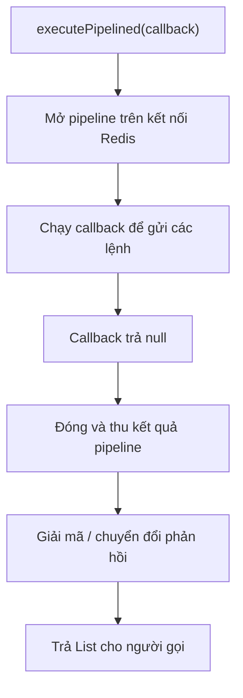

# Thứ tự kết quả và giá trị trả về trong callback khi dùng Pipeline của Spring Data Redis

Pipeline là kỹ thuật gửi nhiều lệnh Redis liên tiếp mà không phải chờ phản hồi của từng lệnh rồi mới gửi lệnh tiếp theo. Khi dùng Spring Data Redis, cách làm phổ biến là gọi `RedisTemplate.executePipelined(...)` và đặt các thao tác Redis bên trong `RedisCallback` hoặc `SessionCallback`.

Điểm quan trọng nhất khi đọc và viết code pipeline là **có hai loại giá trị trả về hoàn toàn khác nhau**:

1. **Giá trị mà các phương thức Redis trả về khi callback đang chạy:** thường là `null` vì lệnh đã được đưa vào pipeline, chưa có phản hồi tương ứng để xử lý đồng bộ.
2. **Giá trị callback phải `return`:** phải là `null` theo hợp đồng của `executePipelined(...)`. Kết quả thật không đi qua giá trị trả về của callback.
3. **Giá trị trả về từ chính `executePipelined(...)`:** danh sách `List<Object>` chứa kết quả sau khi Spring Data Redis hoàn tất pipeline và chuyển đổi phản hồi theo cấu hình.

Vì thế, nếu callback kết thúc bằng `return null;` thì **không có nghĩa pipeline trả về `null`**. Người gọi vẫn có thể nhận danh sách kết quả, theo thứ tự những lệnh đã gửi trong pipeline.

Bài học tập trung vào hợp đồng này, thứ tự kết quả, các kiểu phản hồi, cách dùng callback cấp cao và cấp thấp, cùng những tình huống dễ tạo lỗi khi xử lý dữ liệu Redis.

## 1. Pipeline giải quyết vấn đề gì?

Giả sử một ứng dụng cần đọc 100 khóa từ Redis.

Nếu gọi đồng bộ từng lệnh `GET`:

```text
Ứng dụng                          Redis
    | --- GET key:1 ------------> |
    | <----------- value:1 ------ |
    | --- GET key:2 ------------> |
    | <----------- value:2 ------ |
    |            ...              |
    | --- GET key:100 ----------> |
    | <----------- value:100 ---- |
```

Ứng dụng có thể phải chờ nhiều vòng truyền qua mạng. Dù mỗi lệnh Redis chạy nhanh, chi phí round trip tích lũy có thể đáng kể.

Với pipeline:

```text
Ứng dụng                          Redis
    | --- GET key:1 ------------> |
    | --- GET key:2 ------------> |
    | --- GET key:3 ------------> |
    |            ...              |
    | --- GET key:100 ----------> |
    | <----------- value:1 ------ |
    | <----------- value:2 ------ |
    | <----------- value:3 ------ |
    |            ...              |
    | <----------- value:100 ---- |
```

Ứng dụng gửi nhiều lệnh mà không chờ riêng từng phản hồi. Driver và Spring Data Redis thu thập các phản hồi để trả cho người gọi khi pipeline hoàn tất.

**Pipeline tối ưu việc trao đổi với Redis; nó không tự biến một nhóm lệnh thành giao dịch nguyên tử.** Redis xử lý lệnh trên cùng kết nối theo thứ tự nhận được, nhưng thao tác của client khác vẫn có thể xen vào giữa các lệnh của pipeline. Muốn có ngữ nghĩa transaction, phải chủ động sử dụng cơ chế như `MULTI`/`EXEC` hoặc script phù hợp.

## 2. Ba tầng giá trị trả về cần phân biệt

Đoạn mã dưới đây là ví dụ đơn giản nhất về hợp đồng của `executePipelined(...)`:

```java
List<Object> results = stringRedisTemplate.executePipelined(
        (RedisCallback<Object>) connection -> {
            byte[] key = "sample:key".getBytes(StandardCharsets.UTF_8);

            connection.stringCommands().get(key);

            // Hợp đồng callback trong executePipelined yêu cầu null.
            return null;
        });
```

Nhìn vào đoạn code này, có thể đặt câu hỏi: “Callback trả `null`, vậy tại sao `results` lại là `List<Object>`?”

Bởi vì Spring Data Redis thực hiện đại ý các bước sau:



| Vị trí | Ví dụ Java | Ý nghĩa |
|---|---|---|
| Giá trị một lời gọi Redis bên trong callback | `connection.stringCommands().get(key)` | Khi pipeline đang mở, lời gọi không chờ phản hồi như truy vấn đồng bộ bình thường |
| Giá trị `return` của callback | `return null;` | Hoàn tất phần **xếp lệnh**, không chứa danh sách kết quả |
| Giá trị nhận ở ngoài callback | `List<Object> results = ...` | Danh sách phản hồi của các lệnh được thu thập sau khi pipeline kết thúc |

Spring Data Redis yêu cầu callback dùng với `executePipelined(...)` trả `null`. Không nên `return "done";`, `return 42;` hay `return someList;` để tìm cách gửi kết quả ra ngoài. Những giá trị này không phải cơ chế trả kết quả pipeline và có thể khiến Spring báo lỗi do vi phạm hợp đồng callback.

## 3. Thứ tự kết quả: đối chiếu theo thứ tự lệnh gửi

Giả sử Redis đã có:

```redis
SET demo:pipeline:message "hello"
SET demo:pipeline:counter "0"
```

Sau đó ứng dụng đưa vào pipeline ba lệnh:

```redis
GET demo:pipeline:message
INCR demo:pipeline:counter
GET demo:pipeline:counter
```

Redis xử lý các lệnh trên kết nối này theo đúng thứ tự:

| Vị trí trong pipeline | Lệnh | Kết quả minh họa |
|---|---|---|
| 0 | `GET demo:pipeline:message` | `"hello"` |
| 1 | `INCR demo:pipeline:counter` | `1` |
| 2 | `GET demo:pipeline:counter` | `"1"` |

Ở Java, `executePipelined(...)` trả kết quả theo đúng thứ tự các lệnh đã phát ra:

```text
results
  ├── [0] = "hello"
  ├── [1] = 1L
  └── [2] = "1"
```

Hai giá trị thứ hai có cùng ý nghĩa số học nhưng **khác kiểu dữ liệu**: `INCR` trả kết quả số nguyên Redis, còn `GET` trả một giá trị chuỗi đã được serializer của template giải mã.

Thứ tự được nói tới ở đây là **thứ tự gửi lệnh**, không phải thứ tự tên khóa, không phải thứ tự server tìm thấy dữ liệu và cũng không phải thứ tự hoàn thành của những công việc ứng dụng chạy song song ở bên ngoài callback.

Một lệnh như `MGET` có thể trả về danh sách các giá trị bên trong **một vị trí** của kết quả pipeline. Đừng nhầm số lượng giá trị của `MGET` với số vị trí do số lệnh tạo ra.

## 4. Ví dụ đầy đủ với StringRedisTemplate và SessionCallback

`StringRedisTemplate` thích hợp cho ví dụ vì các giá trị được lưu dạng chuỗi. `SessionCallback` cho phép gọi API cấp cao của `RedisOperations` trong phạm vi một phiên làm việc.

### 4.1. Chuẩn bị dữ liệu

```java
stringRedisTemplate.opsForValue()
        .set("demo:pipeline:message", "hello");

stringRedisTemplate.opsForValue()
        .set("demo:pipeline:counter", "0");
```

Hai lệnh `SET` này chạy **trước** pipeline để kết quả minh họa dễ dự đoán. Trong môi trường nhiều writer, dữ liệu vẫn có thể bị client khác thay đổi; ví dụ chỉ giả định không có thao tác khác can thiệp trong lúc chạy.

### 4.2. Gửi lệnh và lấy kết quả ở bên ngoài callback

```java
package com.example.redis.pipeline;

import java.util.List;

import org.springframework.data.redis.core.RedisOperations;
import org.springframework.data.redis.core.SessionCallback;
import org.springframework.data.redis.core.StringRedisTemplate;
import org.springframework.stereotype.Service;

@Service
public class PipelineReadService {

    private final StringRedisTemplate redis;

    public PipelineReadService(StringRedisTemplate redis) {
        this.redis = redis;
    }

    public PipelineReport readAndIncrement() {
        List<Object> results = redis.executePipelined(
                new SessionCallback<Object>() {
                    @Override
                    public <K, V> Object execute(
                            RedisOperations<K, V> operations) {

                        // Callback đang được gọi từ StringRedisTemplate.
                        @SuppressWarnings("unchecked")
                        RedisOperations<String, String> stringOperations =
                                (RedisOperations<String, String>) operations;

                        // results[0]: GET message.
                        String queuedMessage = stringOperations
                                .opsForValue()
                                .get("demo:pipeline:message");

                        // results[1]: INCR counter.
                        Long queuedIncrement = stringOperations
                                .opsForValue()
                                .increment("demo:pipeline:counter");

                        // results[2]: GET counter sau INCR.
                        String queuedCounter = stringOperations
                                .opsForValue()
                                .get("demo:pipeline:counter");

                        // queuedMessage/queuedIncrement/queuedCounter
                        // thường đều null trong lúc pipeline đang mở.
                        // Chúng không phải kết quả cuối cùng.
                        return null;
                    }
                });

        if (results.size() != 3) {
            throw new IllegalStateException(
                    "Expected 3 pipelined command results, got "
                            + results.size());
        }

        String message = (String) results.get(0);
        long incremented = ((Number) results.get(1)).longValue();
        String counterAsText = (String) results.get(2);

        return new PipelineReport(
                message,
                incremented,
                counterAsText);
    }

    public record PipelineReport(
            String message,
            long incremented,
            String counterAsText
    ) {}
}
```

Với dữ liệu chuẩn bị ở trên, kết quả minh họa:

```java
PipelineReport report = service.readAndIncrement();

System.out.println(report.message());       // "hello"
System.out.println(report.incremented());   // 1
System.out.println(report.counterAsText()); // "1"
```

Những ý quan trọng:

- Tên biến `queuedMessage`, `queuedIncrement` và `queuedCounter` cố ý thể hiện rằng **không được dùng chúng làm dữ liệu nghiệp vụ ngay trong callback**.
- Thứ tự ba lời gọi Redis bên trong callback quyết định vị trí `results.get(0)`, `results.get(1)` và `results.get(2)`.
- Callback luôn `return null`, còn `executePipelined(...)` mới là lời gọi trả danh sách phản hồi.
- `INCR` trả kết quả dạng số; `GET` trả value do `StringRedisTemplate` giải mã. Không nên ép cả ba phần tử thành cùng một kiểu.
- Đoạn ví dụ không dùng transaction; nếu client khác thay đổi `demo:pipeline:counter` giữa các lệnh, giá trị quan sát có thể khác dự kiến.

Trong mã thực tế, có thể bỏ các biến `queued...` vì giá trị của chúng không được sử dụng. Giữ chúng trong bài học để làm rõ bẫy thường gặp.

## 5. RedisCallback: làm việc với lệnh Redis cấp thấp

Thay vì `SessionCallback`, có thể truyền `RedisCallback` để gửi lệnh trực tiếp qua `RedisConnection`.

```java
import java.nio.charset.StandardCharsets;
import java.util.List;

import org.springframework.data.redis.core.RedisCallback;
import org.springframework.data.redis.core.StringRedisTemplate;

public List<Object> fetchWithLowLevelCallback(
        StringRedisTemplate template) {

    byte[] first = "catalog:item:1"
            .getBytes(StandardCharsets.UTF_8);
    byte[] second = "catalog:item:2"
            .getBytes(StandardCharsets.UTF_8);

    return template.executePipelined(
            (RedisCallback<Object>) connection -> {
                connection.stringCommands().get(first);  // results[0]
                connection.stringCommands().get(second); // results[1]
                return null;
            });
}
```

Đây là API cấp thấp, nơi key/value ở dạng byte và ứng dụng chủ động lựa chọn cách mã hóa key. Kết quả trả về qua `StringRedisTemplate.executePipelined(...)` thường được xử lý theo các serializer tương ứng của template trước khi cung cấp cho Java.

Nếu dùng một `RedisTemplate` khác với serializer nhị phân hoặc JSON, các phần tử `results` có thể được giải mã thành object khác. Việc dùng `RedisConnection` ở bên trong callback **không có nghĩa** kết quả phía ngoài luôn là `byte[]`.

Đối với chuỗi lệnh đơn giản cần diễn đạt nghiệp vụ, `SessionCallback` cùng `RedisOperations` thường dễ đọc hơn. `RedisCallback` hữu ích khi cần API mức kết nối hoặc xử lý dữ liệu byte rõ ràng.

## 6. Kết quả xếp hàng không giống kết quả thực thi

So sánh lời gọi đồng bộ và lời gọi trong pipeline:

```java
// Không pipeline: lời gọi đọc đồng bộ trả kết quả thực tế.
String actual = stringRedisTemplate.opsForValue()
        .get("demo:pipeline:message");

// Trong pipeline: lệnh được gửi, phản hồi được thu sau.
List<Object> results = stringRedisTemplate.executePipelined(
        new SessionCallback<Object>() {
            @Override
            public <K, V> Object execute(
                    RedisOperations<K, V> operations) {

                @SuppressWarnings("unchecked")
                RedisOperations<String, String> typed =
                        (RedisOperations<String, String>) operations;

                String queued = typed.opsForValue()
                        .get("demo:pipeline:message");
                // queued thường là null, không phải dữ liệu Redis.
                return null;
            }
        });

String pipelined = (String) results.get(0);
```

Ở trường hợp đầu, ứng dụng có thể dùng `actual` ngay sau khi gọi `get`. Ở trường hợp thứ hai, chỉ sau khi `executePipelined(...)` hoàn thành thì ứng dụng mới có dữ liệu trong `results`.

Vì vậy, logic sau là sai về thời điểm quan sát dữ liệu:

```java
template.executePipelined((RedisCallback<Object>) connection -> {
    byte[] key = "user:1:status"
            .getBytes(StandardCharsets.UTF_8);

    byte[] queued = connection.stringCommands().get(key);

    if (queued != null) {
        // Không thể kết luận Redis key có tồn tại từ biến queued.
        processStatus(queued);
    }
    return null;
});
```

Biến `queued` không chứa phản hồi `GET` ở thời điểm kiểm tra. Nếu quyết định lệnh tiếp theo phụ thuộc vào giá trị đọc, phải tách thành hai pha hoặc đưa logic điều kiện tới server bằng lệnh Redis có điều kiện/Lua script.

## 7. Danh sách kết quả không phải giá trị return của callback

Hình thức lời gọi:

```java
List<Object> returnedByExecutePipelined =
        redisTemplate.executePipelined(callback);
```

Trong đó:

```java
// Callback được gọi để gửi các lệnh, không để tạo result list.
RedisCallback<Object> callback = connection -> {
    connection.stringCommands().get(myKey);
    return null;
};
```

Đừng làm thế này:

```java
// Ví dụ sai: callback trả một giá trị khác null.
redisTemplate.executePipelined((RedisCallback<Object>) connection -> {
    connection.stringCommands().get(myKey);
    return "completed";
});
```

Trong `executePipelined`, một kết quả khác `null` từ callback **không trở thành** giá trị trả về cuối. Hợp đồng API yêu cầu `null` và Spring Data Redis có thể ném lỗi vì callback trả giá trị không hợp lệ.

Đừng làm thế này:

```java
// Ví dụ sai: gom các giá trị trả trực tiếp của lệnh trong pipeline.
List<Object> guessed = new ArrayList<>();

redisTemplate.executePipelined((RedisCallback<Object>) connection -> {
    guessed.add(connection.stringCommands().get(myKey));
    return null;
});

// guessed chứa kết quả của lời gọi khi đang queue,
// không phải các giá trị được Redis trả sau khi pipeline hoàn tất.
```

Hãy sử dụng chính danh sách mà `executePipelined(...)` trả về.

Một điều cần phân biệt: API `RedisTemplate.execute(...)` thông thường và `executePipelined(...)` có **hợp đồng trả về khác nhau**. Với `execute(...)`, giá trị callback có thể được dùng làm giá trị trả về. Khi chuyển sang `executePipelined(...)`, không mang nguyên giả định đó sang.

## 8. Thứ tự lệnh khi dùng vòng lặp

Giả sử muốn đọc các key sản phẩm:

```java
List<String> keys = List.of(
        "catalog:item:1",
        "catalog:item:2",
        "catalog:item:3");
```

Một cách gửi lệnh theo thứ tự:

```java
List<Object> results = stringRedisTemplate.executePipelined(
        new SessionCallback<Object>() {
            @Override
            public <K, V> Object execute(
                    RedisOperations<K, V> operations) {

                @SuppressWarnings("unchecked")
                RedisOperations<String, String> typed =
                        (RedisOperations<String, String>) operations;

                for (String key : keys) {
                    typed.opsForValue().get(key);
                }
                return null;
            }
        });

for (int i = 0; i < keys.size(); i++) {
    String key = keys.get(i);
    String value = (String) results.get(i);
    System.out.println(key + " -> " + value);
}
```

Ý nghĩa:

```text
keys[0] -> GET catalog:item:1 -> results[0]
keys[1] -> GET catalog:item:2 -> results[1]
keys[2] -> GET catalog:item:3 -> results[2]
```

Nếu key không tồn tại, phản hồi `GET` của nó có thể là `null` tại **vị trí tương ứng**. Các phần tử còn lại không vì thế mà tự dịch vị trí trong danh sách.

Vì vậy, với pipeline đọc dữ liệu hàng loạt, nên giữ nguyên thứ tự nguồn key và lấy kết quả theo cùng chỉ số. Nếu cần gắn kết quả với key bằng `Map`:

```java
Map<String, String> byKey = new LinkedHashMap<>();
for (int i = 0; i < keys.size(); i++) {
    byKey.put(keys.get(i), (String) results.get(i));
}
```

Nếu `keys` chứa các giá trị trùng nhau, một `Map` sẽ giữ một entry cho mỗi key khác nhau; điều đó có thể phù hợp hoặc không phù hợp với bài toán. Đối với những yêu cầu cần giữ cả số lần lặp, hãy giữ danh sách cặp key–result theo từng vị trí.

### Tránh phát sinh lệnh phụ trong callback

Nếu callback phát thêm một lệnh kiểm tra hoặc ghi log theo Redis, số lượng và vị trí kết quả sẽ đổi:

```java
for (String key : keys) {
    typed.opsForValue().get(key); // Có một result.
    typed.hasKey(key);            // Có thêm một result.
}
```

Khi đó:

```text
results[0] = GET key[0]
results[1] = EXISTS key[0]
results[2] = GET key[1]
results[3] = EXISTS key[1]
...
```

Không thể tiếp tục dùng `results.get(i)` để lấy giá trị `GET` cho mỗi key. Cần xác định một lược đồ index mới, hoặc chỉ gửi đúng những lệnh thực sự cần cho đầu ra mong muốn.

## 9. Mỗi lệnh tạo một vị trí, nhưng một vị trí có thể chứa collection

Ví dụ dùng `MGET`:

```redis
MGET catalog:item:1 catalog:item:2 catalog:item:3
GET catalog:item:4
```

Về mặt phản hồi giao thức, `MGET` tạo **một phản hồi dạng mảng** chứa ba giá trị, còn `GET` tạo một phản hồi scalar. Trong danh sách kết quả pipeline:

```text
results[0] = [value1, value2, value3]  // Một kết quả của MGET
results[1] = value4                   // Một kết quả của GET
```

Không nên giả định pipeline “trải phẳng” phản hồi `MGET` thành ba phần tử cấp cao khác nhau.

Tương tự:

- `HGETALL` có thể tạo kết quả dạng map.
- `SMEMBERS` có thể tạo kết quả dạng tập phần tử.
- `LRANGE` có thể tạo kết quả dạng list.
- Các lệnh ghi có thể trả trạng thái, Boolean hoặc số đếm thay đổi theo adapter.

Khi trộn những loại lệnh này, cần phân biệt **danh sách kết quả pipeline cấp ngoài** và **collection nằm trong một phần tử**.

## 10. Kiểu dữ liệu sau khi giải mã: String, Number, Boolean, Map, List

Redis trả byte và các kiểu phản hồi giao thức; Spring Data Redis chuyển đổi kết quả pipeline theo cách lệnh/connection/serializer được cấu hình.

| Lệnh minh họa | Kết quả logic | Kiểu Java thường gặp sau chuyển đổi |
|---|---|---|
| `GET` với String serializer | Giá trị chuỗi | `String` hoặc `null` |
| `INCR` | Số nguyên mới | `Long` |
| `EXISTS` | Có hay không | `Boolean` hoặc dạng số ở API thấp hơn |
| `HGETALL` | Các field/value | `Map<?, ?>` |
| `MGET` | Nhiều giá trị | `List<?>`, có thể có `null` |
| `SADD` | Số phần tử mới thêm | Giá trị số sau chuyển đổi |
| `SET` | Trạng thái ghi | Kiểu đại diện status/Boolean do adapter xử lý |

Bảng mô tả kiểu **thường gặp**, không bảo đảm mọi driver và mọi phiên bản đều trả đúng một lớp Java cụ thể cho từng lệnh. Đặc biệt, API kết nối cấp thấp có thể trả byte array hoặc trạng thái khác với API template cấp cao.

Ví dụ cách đọc có kiểm soát:

```java
Object incrementResult = results.get(1);

if (!(incrementResult instanceof Number number)) {
    throw new IllegalStateException(
            "Expected a numeric INCR result, got: "
                    + incrementResult);
}

long counter = number.longValue();
```

Khi Redis key vắng mặt:

```java
Object getResult = results.get(0);

if (getResult == null) {
    // GET đã chạy, nhưng key không tồn tại.
} else if (getResult instanceof String text) {
    // GET đã chạy, trả một chuỗi.
} else {
    throw new IllegalStateException(
            "Unexpected GET result type: "
                    + getResult.getClass().getName());
}
```

Đoạn này giả định `StringRedisTemplate` và một lệnh `GET` trên value chuỗi. Với template dùng JSON serializer, kết quả có thể là một object khác; nên giải mã dựa vào hợp đồng serializer thực tế.

## 11. Serializer của RedisTemplate ảnh hưởng những gì?

Spring Data Redis quản lý các serializer độc lập cho Redis key, value, hash key và hash value. Trong pipeline, kết quả trả về được chuyển đổi dựa trên serializer/cơ chế chuyển đổi của template.

Ví dụ cấu hình `StringRedisTemplate`:

```java
StringRedisTemplate template =
        new StringRedisTemplate(redisConnectionFactory);
```

Template này dùng cách tuần tự hóa chuỗi cho các khóa và giá trị tương ứng, giúp kết quả `GET` dễ xử lý thành `String`.

Ngược lại, nếu `RedisTemplate<String, Product>` lưu JSON và pipeline chứa:

```java
operations.opsForValue().get("product:1");
operations.opsForHash().entries("product:1:metadata");
```

thì giá trị trả về có thể là object `Product` cùng một `Map` tùy cách cấu hình value/hash serializers. Không thể ép toàn bộ `List<Object>` thành `List<String>`.

Một overload của `executePipelined(...)` cho phép truyền serializer kết quả, ví dụ:

```java
List<Object> results = redisTemplate.executePipelined(
        (RedisCallback<Object>) connection -> {
            connection.stringCommands().get(rawKey);
            return null;
        },
        someResultSerializer);
```

`someResultSerializer` trong ví dụ là serializer đã được ứng dụng cấu hình phù hợp với dữ liệu đọc. Đây là tùy chọn **giải mã kết quả**, không thay thế việc định nghĩa serializer dùng khi ghi dữ liệu, và không có nghĩa mọi kết quả số/trạng thái hoặc mọi cấu trúc lồng nhau đều bị biến thành một kiểu Java duy nhất.

Với thao tác Hash, cần phân biệt hash-key serializer và hash-value serializer. Một `HGETALL` có thể chứa tên field và giá trị được giải mã bởi các serializer khác nhau.

**Không nên thay serializer chỉ để chữa `ClassCastException` ở bước đọc kết quả.** Trước hết cần xác định lệnh nào nằm ở từng vị trí và Redis đang lưu định dạng byte nào.

## 12. Kết quả null có ít nhất hai nguyên nhân khác nhau

Ở pipeline:

**Trường hợp A — null khi gọi lệnh trong callback.**

```java
String queuedValue = typed.opsForValue().get("some:key");
// Thường null vì đang pipeline: lệnh chưa có phản hồi đồng bộ.
```

**Trường hợp B — phần tử null trong List<Object> sau pipeline.**

```java
List<Object> results = ...;
Object value = results.get(0);
// null có thể là GET của key không tồn tại.
```

Hai `null` này có ý nghĩa khác nhau:

| Nơi xuất hiện | Có thể diễn giải là gì? | Cách xử lý |
|---|---|---|
| Giá trị trả trực tiếp từ `get()` trong callback | Phản hồi bị trì hoãn vì pipeline | Không dùng làm điều kiện quyết định nghiệp vụ trong callback |
| Phần tử tương ứng với `GET` trong danh sách kết quả | Key không tồn tại, dữ liệu nil hoặc cách adapter biểu diễn kết quả | Xử lý theo semantics của lệnh đó |
| Phần tử ứng với lệnh ghi/status | Có thể do conversion hoặc driver | Không suy ra “key thiếu” nếu chưa xác định lệnh và kiểu phản hồi |

Ngoài ra, một exception trong quá trình gửi lệnh, thu phản hồi hoặc deserialize là một trường hợp riêng. Không được biến mọi ngoại lệ thành `null` rồi coi như Redis không có dữ liệu.

## 13. Pipeline không tự đảm bảo tính nguyên tử

Giả sử gửi:

```java
typed.opsForValue().set("account:1:status", "ACTIVE");
typed.opsForValue().increment("account:1:revision");
```

Hai lệnh được gửi theo thứ tự trên một kết nối pipeline, nhưng một client khác **vẫn có thể thao tác giữa hai lệnh**. Nếu nghiệp vụ yêu cầu “trạng thái và revision phải đổi cùng nhau, không bị client khác xen vào”, pipeline tự thân không đủ.

So sánh:

| Tiêu chí | Pipeline | MULTI/EXEC |
|---|---|---|
| Mục tiêu chính | Giảm chờ mạng khi gửi nhiều lệnh | Xếp lệnh rồi thực thi liền nhau |
| Khi nào Redis thực thi lệnh? | Khi nhận và xử lý lệnh | Khi `EXEC` được gọi |
| Các lệnh của client khác có thể xen giữa? | Có thể | Không xen vào giữa chuỗi `EXEC` |
| Kết quả trung gian có sẵn đồng bộ trong callback? | Không theo cách gọi pipeline thông thường | Không trước `EXEC` |
| Thao tác tự rollback khi một lệnh lỗi lúc thực thi? | Không | Không |
| Đọc kết quả ở đâu? | Danh sách trả từ `executePipelined` | Danh sách trả từ `exec()` |

Có thể gặp pipeline kết hợp `MULTI`/`EXEC` ở API nâng cao. Khi đó cấu trúc kết quả và cách chuyển đổi còn phụ thuộc cách driver đóng gói phản hồi transaction; không nên tự suy diễn vị trí kết quả giống pipeline chỉ có `GET`/`INCR` thông thường. Trước tiên nên nắm vững hai mô hình riêng.

Nếu quyết định ghi phụ thuộc vào giá trị vừa đọc, lựa chọn phù hợp có thể là:

- `WATCH` và đọc trước `MULTI`, rồi kiểm tra kết quả `EXEC`.
- Lua script thực hiện kiểm tra và cập nhật trên server.
- Lệnh Redis có điều kiện như `SET ... NX` khi đáp ứng đúng yêu cầu.
- Chia hai pha đọc–xử lý–ghi khi nhất quán mạnh không phải yêu cầu.

Đừng cố dùng một `if` Java kiểm tra giá trị `get()` ngay trong callback pipeline để giả lập thao tác nguyên tử.

## 14. Kết quả và lỗi khi một lệnh trong pipeline thất bại

Pipeline không cung cấp rollback. Nếu một lệnh lỗi khi chạy, các lệnh khác có thể vẫn đã thực hiện.

Ví dụ:

```redis
SET demo:count "not-a-number"
INCR demo:count
SET demo:other "saved"
```

Nếu hai lệnh cuối được gửi qua pipeline, `INCR` sẽ không thành công vì value không phải số nguyên; nhưng `SET demo:other` vẫn có thể đã được thực thi.

Ở Java, cách driver và Spring Data Redis báo lỗi pipeline có thể khác nhau: lỗi có thể được ném lúc thu thập kết quả hoặc xuất hiện ở một dạng phản hồi do connection adapter cung cấp. Do đó, không được mặc định `results.size()` luôn bằng số lệnh trong **mọi trường hợp lỗi**, và cũng không được mặc định có danh sách kết quả đầy đủ nếu pipeline đã ném exception.

Đặc biệt, timeout khi đọc kết quả có thể xảy ra **sau khi server đã thực thi một phần hoặc toàn bộ lệnh**. Retry toàn bộ pipeline có chứa lệnh không idempotent như `INCR` sẽ có nguy cơ áp dụng thay đổi hai lần.

Khi xây dựng job pipeline:

1. Xác định lệnh nào idempotent, lệnh nào không.
2. Ghi nhận một operation ID hoặc chiến lược khôi phục nếu cần chống thao tác lặp.
3. Không coi exception là bằng chứng mọi lệnh đều chưa chạy.
4. Thống kê batch nào đã gửi, batch nào đã nhận đủ phản hồi, và các batch cần đối soát.
5. Hạn chế số lệnh mỗi batch để một lỗi không làm phạm vi không chắc chắn quá lớn.

## 15. Giới hạn kích thước pipeline và bộ nhớ

Pipeline giảm round trip nhưng không miễn phí. Redis phải xử lý các lệnh và giữ phản hồi trong quá trình gửi; phía client cũng cần lưu kết quả để tạo `List<Object>`.

Vì vậy:

- Không nên mở một pipeline chứa hàng triệu lệnh mà không giới hạn.
- Kích thước pipeline không nên chọn theo số key duy nhất, mà còn theo kích thước phản hồi từng lệnh.
- `GET` một giá trị lớn khác rất nhiều `INCR` về lượng dữ liệu trả về.
- Kết quả `HGETALL` hoặc `LRANGE` có thể lớn hơn dự kiến, dù chỉ là một lệnh.
- Một callback pipeline chạy dài dễ chiếm bộ nhớ và khiến thời gian xử lý lỗi lớn.

Đối với khối lượng lớn, nên chia danh sách key thành các batch có kích thước hợp lý và xử lý từng batch sau khi nhận kết quả.

Ví dụ service đọc nhiều key theo các batch cố định:

```java
import java.util.ArrayList;
import java.util.List;

import org.springframework.data.redis.core.RedisOperations;
import org.springframework.data.redis.core.SessionCallback;
import org.springframework.data.redis.core.StringRedisTemplate;

public class BatchedValueReader {

    private static final int BATCH_SIZE = 200;
    private final StringRedisTemplate redis;

    public BatchedValueReader(StringRedisTemplate redis) {
        this.redis = redis;
    }

    public List<String> readInInputOrder(List<String> keys) {
        List<String> allValues = new ArrayList<>(keys.size());

        for (int start = 0; start < keys.size(); start += BATCH_SIZE) {
            int end = Math.min(start + BATCH_SIZE, keys.size());
            List<String> batch = keys.subList(start, end);

            List<Object> results = redis.executePipelined(
                    new SessionCallback<Object>() {
                        @Override
                        public <K, V> Object execute(
                                RedisOperations<K, V> operations) {

                            @SuppressWarnings("unchecked")
                            RedisOperations<String, String> typed =
                                    (RedisOperations<String, String>) operations;

                            for (String key : batch) {
                                typed.opsForValue().get(key);
                            }
                            return null;
                        }
                    });

            if (results.size() != batch.size()) {
                throw new IllegalStateException(
                        "Unexpected result count in batch");
            }

            for (Object result : results) {
                allValues.add((String) result);
            }
        }

        return allValues;
    }
}
```

Phương thức trả về `List<String>` cùng độ dài và thứ tự tương ứng với đầu vào; giá trị có thể `null` nếu key không tồn tại.

Ở ví dụ này, danh sách kết quả toàn bộ vẫn được giữ trong bộ nhớ để trả cho caller, nhưng **mỗi pipeline** chỉ chứa tối đa 200 lệnh. Nếu lượng dữ liệu không giới hạn, nên cung cấp API xử lý callback từng batch hoặc đẩy kết quả sang bước tiếp theo, thay vì lưu mọi giá trị trong `allValues`.

Không có `BATCH_SIZE` tối ưu cho mọi môi trường; cần đo độ trễ Redis, kích thước phản hồi và bộ nhớ thực tế.

## 16. Cẩn thận với command count và cách diễn giải List<Object>

Suy nghĩ “mỗi dòng Java gọi Redis tạo một phần tử” đôi khi quá đơn giản:

- Có API cấp cao sử dụng nhiều lệnh Redis nội bộ để thực hiện một thao tác.
- Có lệnh Redis trả mảng hoặc map, nhưng vẫn là một phản hồi lệnh cấp ngoài.
- Các thao tác lồng nhau qua cấu trúc collection có thể tạo nhiều phản hồi nếu được triển khai bằng nhiều Redis command.
- Một số API hoặc driver có cách xử lý status, kết quả void hoặc lỗi khác nhau.

Do đó, với pipeline **dùng các lệnh rõ ràng như `GET`, `INCR`, `EXISTS`**, cách ánh xạ theo vị trí tương đối dễ kiểm soát. Với API phức tạp, cần hiểu những lệnh thực tế được gửi, thay vì giả định mọi thao tác Java chỉ sinh một reply.

Một cách viết dễ bảo trì là tập trung logic mapping:

```java
record LookupResult(String value, long version) {}

static LookupResult decodeLookupResult(List<Object> results) {
    if (results.size() != 2) {
        throw new IllegalStateException(
                "Expected GET and INCR results");
    }

    String value = (String) results.get(0);
    Object versionRaw = results.get(1);

    if (!(versionRaw instanceof Number number)) {
        throw new IllegalStateException(
                "INCR result is not a number");
    }

    return new LookupResult(value, number.longValue());
}
```

Phương thức này không tự phát lệnh Redis; nó chỉ diễn giải hợp đồng gồm đúng hai phản hồi, theo thứ tự `GET` rồi `INCR`.

Nếu sửa thứ tự lệnh trong callback, phải sửa logic giải mã tương ứng. Cách đặt tên riêng cho DTO giúp caller không phải tự đoán `results.get(0)` có ý nghĩa gì.

## 17. Những lỗi thường gặp

### Lỗi 1: Return giá trị khác null từ callback

```java
template.executePipelined((RedisCallback<Object>) connection -> {
    connection.stringCommands().get(key);
    return "done"; // Sai hợp đồng của executePipelined.
});
```

Callback phải trả `null`; kết quả pipeline nằm ở giá trị trả về từ `executePipelined(...)`.

### Lỗi 2: Dùng giá trị GET trả ngay trong callback

```java
String value = typed.opsForValue().get("demo:key");
if ("READY".equals(value)) {
    // Điều kiện không phản ánh kết quả GET khi pipeline còn mở.
}
```

Khi có pipeline, hãy đọc `List<Object>` sau khi callback hoàn tất. Nếu cần quyết định thao tác tiếp theo theo kết quả `GET`, chia thành giai đoạn phù hợp.

### Lỗi 3: Quên thứ tự sau khi thêm một lệnh mới

Ban đầu có `GET a`, `GET b`; sau đó thêm `EXISTS a` vào giữa. Kết quả từ `GET b` không còn ở vị trí `1`. Cần cập nhật logic giải mã hoặc làm rõ mỗi thao tác phát bao nhiêu lệnh.

### Lỗi 4: Ép toàn bộ List<Object> thành List<String>

Một pipeline có `INCR`, `EXISTS`, `GET` có thể trả `Long`, `Boolean`, `String`. Không dùng phép ép kiểu mù vì generic type không kiểm tra nội dung từng phần tử tại runtime.

### Lỗi 5: Nhầm phần tử null với lỗi pipeline

`GET` trên key vắng mặt có thể trả `null` hợp lệ sau khi pipeline kết thúc. Phân biệt dữ liệu vắng, status của lệnh ghi và exception từ driver.

### Lỗi 6: Mặc định pipeline là transaction

Pipeline không tự giữ các lệnh thành một thao tác nguyên tử. Nếu nghiệp vụ cần điều kiện cập nhật, hãy dùng công cụ phù hợp như `MULTI/EXEC`, `WATCH` hoặc Lua.

### Lỗi 7: Gửi quá nhiều lệnh trong một pipeline

Tạo pipeline rất lớn có thể làm tăng tiêu thụ bộ nhớ, kích thước kết quả và độ trễ. Chia batch theo cả số lệnh và kích thước phản hồi dự kiến.

### Lỗi 8: Retry một batch INCR sau timeout

Khi timeout, client không nhất thiết biết các lệnh đã thực thi đến đâu. Retry `INCR` có thể nhân đôi tác động. Cần đánh giá idempotency và khả năng đối soát.

### Lỗi 9: Trộn nhiều RedisTemplate trong một callback

Nếu callback đang xếp lệnh qua `operations` được cung cấp, gọi thêm một template khác có thể chọn kết nối khác hoặc không nằm trong pipeline. Giữ các thao tác cần ghép cùng một session/kết nối bằng cơ chế callback phù hợp.

### Lỗi 10: Tự suy ra kết quả có thứ tự theo tên khóa

`List<Object>` trả về theo **thứ tự lệnh đã gửi**, kể cả khi tên key không theo thứ tự chữ cái. Hãy ghép kết quả về input theo chỉ số, không sắp xếp lại các key sau khi đã gửi lệnh.

## 18. Bài tập thực hành

### Bài 1 — Đoán giá trị callback và kết quả pipeline

Cho dữ liệu:

```redis
SET tutorial:a "alpha"
SET tutorial:counter "5"
```

Callback gửi:

```java
String a = typed.opsForValue().get("tutorial:a");
Long count = typed.opsForValue().increment("tutorial:counter");
String after = typed.opsForValue().get("tutorial:counter");
return null;
```

Hãy xác định:

1. `a`, `count` và `after` có thể nhận gì khi callback đang xếp lệnh?
2. `results.get(0)`, `results.get(1)` và `results.get(2)` có giá trị và kiểu nào nếu không có client khác can thiệp?
3. Tại sao không thể thay `return null` bằng `return count`?

Đáp án định hướng: các biến nhận kết quả trực tiếp thường là `null` trong pipeline; kết quả cuối theo thứ tự là `"alpha"`, số nguyên `6`, chuỗi `"6"`.

### Bài 2 — MGET có bao nhiêu vị trí?

Trong một callback, gửi một `MGET` chứa ba key và một `GET` chứa một key khác. Xác định số phản hồi cấp ngoài trong danh sách pipeline và kiểu kết quả tương ứng. Giải thích vì sao không được suy ra tổng số kết quả cấp ngoài là bốn.

### Bài 3 — Trộn GET và EXISTS

Với các key `a`, `b`, gửi `GET a`, `EXISTS a`, `GET b`, `EXISTS b`. Viết một hàm decoder ghép bốn vị trí thành hai đối tượng `KeyState(key, value, exists)`, đồng thời xử lý giá trị `GET` bằng `null`.

### Bài 4 — Đọc hàng nghìn key theo batch

Tạo danh sách 2.000 tên key. Dùng `executePipelined` với batch 100–200 lệnh, so sánh cách nhận kết quả với vòng lặp gọi `GET` đồng bộ. Đo thời gian, kích thước kết quả và bộ nhớ thay vì mặc định pipeline luôn nhanh hơn trong mọi trường hợp.

### Bài 5 — Phân biệt pipeline và cập nhật nguyên tử

Một nghiệp vụ yêu cầu tăng bộ đếm và ghi trạng thái chỉ khi giá trị trước đó nhỏ hơn ngưỡng. Giải thích vì sao không thể dựa vào biến trả về từ `GET` trong callback để viết `if`, rồi đề xuất một giải pháp dùng `WATCH`/`MULTI` hoặc Lua phù hợp.

## 19. Ghi nhớ

| Câu hỏi | Trả lời |
|---|---|
| Lệnh Redis trong pipeline có trả kết quả dùng ngay trong callback không? | Thường không; phản hồi được thu sau |
| Callback của `executePipelined(...)` phải trả gì? | `null` |
| Kết quả thực tế của pipeline nhận ở đâu? | Từ giá trị `List<Object>` mà `executePipelined(...)` trả về |
| Thứ tự kết quả như thế nào? | Theo thứ tự các lệnh thực sự được gửi |
| `MGET` ba key tạo ba vị trí top-level? | Không; một lệnh trả một kết quả dạng collection |
| Kết quả `GET` có thể `null` không? | Có, khi dữ liệu không tồn tại hoặc có nil hợp lệ |
| Tất cả phần tử trong `List<Object>` đều là `String`? | Không; phụ thuộc lệnh và serializer |
| Pipeline có làm các lệnh nguyên tử không? | Không |
| Pipeline có phù hợp một triệu lệnh trong một callback không? | Nên chia batch và quản lý bộ nhớ |

Một pipeline dễ bảo trì cần giữ **thứ tự phát lệnh rõ ràng**, **callback trả `null`**, **đọc kết quả sau `executePipelined(...)`**, rồi **giải mã theo từng vị trí và đúng kiểu phản hồi**. Khi yêu cầu công việc phụ thuộc vào dữ liệu đọc ở giữa chuỗi thao tác, nên chuyển sang thiết kế có giai đoạn xử lý riêng hoặc cơ chế nguyên tử trên Redis.

### Tài liệu tham khảo

- [Spring Data Redis — Pipelining](https://docs.spring.io/spring-data/redis/reference/redis/pipelining.html)
- [Spring Data Redis — RedisTemplate API](https://docs.spring.io/spring-data/redis/reference/api/java/org/springframework/data/redis/core/RedisTemplate.html)
- [Spring Data Redis — RedisCallback API](https://docs.spring.io/spring-data/redis/reference/api/java/org/springframework/data/redis/core/RedisCallback.html)
- [Spring Data Redis — SessionCallback API](https://docs.spring.io/spring-data/redis/reference/api/java/org/springframework/data/redis/core/SessionCallback.html)
- [Redis — Pipelining](https://redis.io/docs/latest/develop/using-commands/pipelining/)
- [Redis — MGET](https://redis.io/docs/latest/commands/mget/)
- [Redis — MULTI](https://redis.io/docs/latest/commands/multi/)
