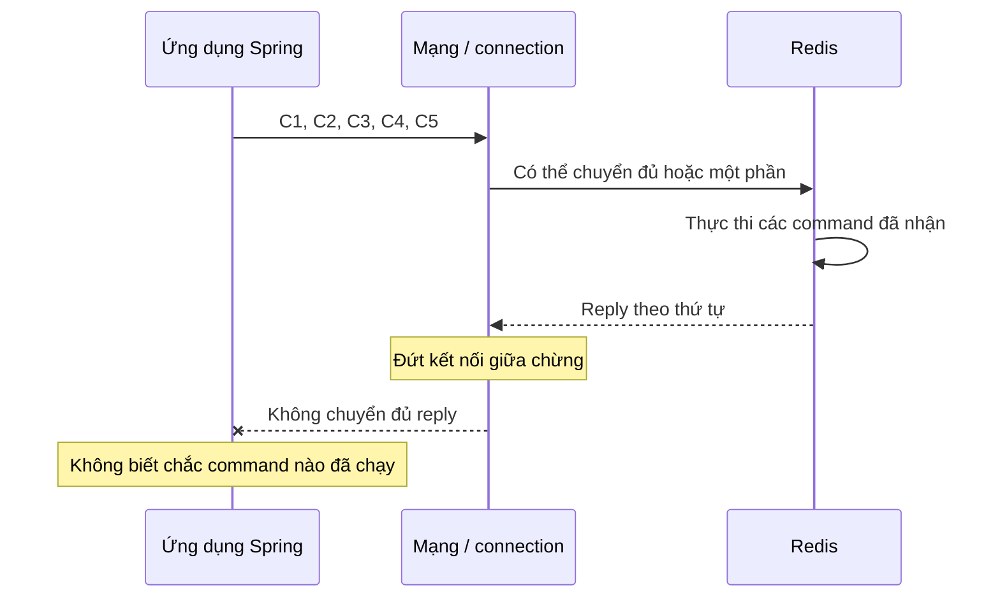
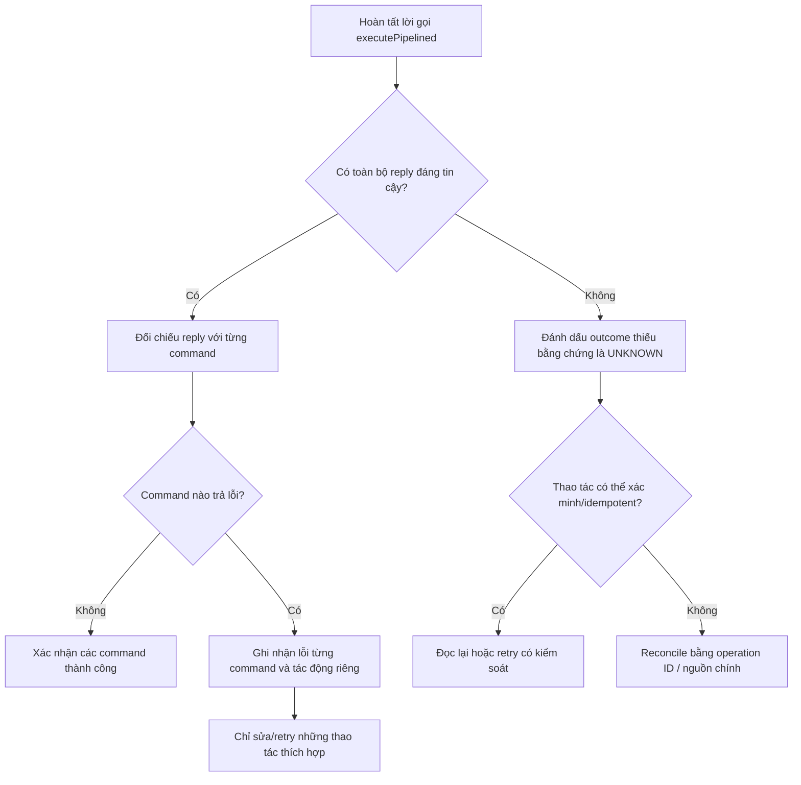

# Xử lý lỗi từng lệnh và trạng thái không chắc chắn khi đứt kết nối trong Spring Data Redis Pipeline

## 1. Bài toán: gửi nhanh nhiều lệnh nhưng vẫn phải biết chuyện gì đã xảy ra

**Redis pipelining** cho phép client gửi nhiều lệnh liên tiếp mà không cần chờ phản hồi của từng lệnh trước khi gửi lệnh kế tiếp. Thay vì lặp lại chu trình "gửi một lệnh → đợi kết quả → gửi lệnh tiếp theo", client có thể đẩy một nhóm command lên connection rồi thu các phản hồi theo thứ tự. Spring Data Redis hỗ trợ cách thực hiện này qua `RedisTemplate.executePipelined(...)`, `StringRedisTemplate.executePipelined(...)` và các API connection tương ứng.

Pipelining đặc biệt hữu ích khi ứng dụng phải thao tác với nhiều key độc lập và độ trễ mạng đáng kể so với thời gian Redis xử lý từng command. Tuy nhiên, **pipeline không phải transaction**:

- Redis không tự rollback những command trước đó nếu command tiếp theo lỗi.
- Các command có thể được gửi thành một nhóm nhưng Redis vẫn xử lý từng command theo ngữ nghĩa riêng.
- Lỗi của một command phải được phân biệt với lỗi mạng khi gửi/nhận phản hồi của cả pipeline.
- Nếu connection đứt giữa chừng, client có thể **không biết chính xác Redis đã nhận và thực thi bao nhiêu command**.

Giả sử hệ thống thực hiện ba lệnh trong một pipeline:

```text
1. SET order:42:state "PAID"
2. INCR metrics:orders:paid
3. LPUSH notifications:pending "42"
```

Nếu `notifications:pending` đang chứa một Redis String, lệnh thứ ba sẽ gặp `WRONGTYPE`. Hai lệnh đầu có thể đã thành công. Nếu connection đứt trước khi client đọc đủ các phản hồi, ứng dụng còn có thể không biết một số lệnh đã thực sự chạy hay chưa. Hai tình huống đòi hỏi **hai cách xử lý khác nhau**.

Mục tiêu của bài học là nhận diện lỗi theo từng command, phân loại kết quả đã biết và chưa biết, tránh retry gây trùng side effect, và thiết kế luồng phục hồi phù hợp khi sử dụng pipeline trong Spring Data Redis.

## 2. Pipeline hoạt động ra sao?

### 2.1. Gửi theo nhóm và nhận phản hồi theo thứ tự

Ví dụ không dùng pipeline:

```text
Ứng dụng                  Redis
    | ---- SET k1 v1 ----> |
    | <------ OK --------- |
    | ---- GET k1 -------> |
    | <------ v1 --------- |
    | ---- INCR counter -> |
    | <------ 1 ---------- |
```

Với pipeline, các command được đưa lên connection mà không phải chờ từng phản hồi để tiếp tục:

```text
Ứng dụng                  Redis
    | ---- SET k1 v1 ----> |
    | ---- GET k1 -------> |
    | ---- INCR counter -> |
    | <------ OK --------- |
    | <------ v1 --------- |
    | <------ 1 ---------- |
```

Redis xử lý command trên **một connection theo thứ tự nhận được** và trả phản hồi theo cùng thứ tự đó. Driver có thể buffer và flush lệnh theo cách riêng, nên "pipeline" không có nghĩa tất cả lệnh nhất thiết được gửi trong một TCP packet. Lợi ích chính là giảm thời gian chờ nhiều vòng request–response.

Với nhiều connection, nhiều node Redis Cluster hoặc các pipeline chạy đồng thời, không có một thứ tự toàn cục tương đương "toàn bộ các command của mọi node được thực thi như một lệnh duy nhất".

### 2.2. Pipeline không bảo đảm atomicity của cả nhóm

Mỗi command Redis vẫn có tính chất thực thi riêng. Trên một Redis instance, command từ các client khác có thể được xử lý **xen giữa** các command thuộc pipeline. Vì vậy không được suy ra rằng nhóm pipeline có cùng tính nguyên tử như `MULTI`/`EXEC`.

| Cơ chế | Ý nghĩa chính | Có tự rollback command đã chạy khi command sau lỗi? |
|---|---|---|
| Gửi lệnh tuần tự và chờ từng phản hồi | Dễ xử lý phản hồi ngay, nhiều vòng mạng | Không |
| **Pipeline** | Giảm vòng chờ mạng bằng cách gửi nhiều lệnh trước khi nhận kết quả | **Không** |
| `MULTI` / `EXEC` | Xếp hàng và thực thi transaction không bị client khác chen vào trong `EXEC` | Không rollback lỗi runtime của từng command |
| Lua script / Redis Function | Đưa một số logic lên server và thực thi liên tục | Không tự rollback thay đổi trước lỗi script |
| Transaction của database khác | Phụ thuộc hệ quản trị đó | Không thể áp đặt ngữ nghĩa lên Redis pipeline |

Có thể **pipeline các transaction command**, nhưng khi đó ngữ nghĩa của `MULTI`/`EXEC` thuộc về giao dịch, không phải bản thân pipeline. Việc dùng pipeline đơn thuần không khiến `SET`, `INCR` và `LPUSH` cùng thành một transaction.

## 3. Ba nhóm kết quả cần phân biệt

Khi nhiều lệnh được gửi trong pipeline, có ít nhất ba trạng thái nghiệp vụ quan trọng.

| Trạng thái | Bằng chứng | Kết luận có thể đưa ra |
|---|---|---|
| **Đã xác nhận thành công** | Nhận được phản hồi thành công của command | Redis đã xử lý command và tạo phản hồi thành công tại thời điểm đó |
| **Đã xác nhận lỗi command** | Nhận được error reply cụ thể từ Redis | Command đó bị từ chối/thất bại theo thông báo; các command khác có thể vẫn thành công |
| **Không chắc chắn (unknown outcome)** | Chưa nhận được phản hồi đáng tin cậy do timeout, mất kết nối hoặc lỗi driver ở giai đoạn không rõ | Chưa thể khẳng định command đã thực thi hay chưa |

Một trạng thái bổ sung là **chắc chắn chưa gửi** nếu ứng dụng có chứng cứ đáng tin cậy rằng command đã bị loại ngay trong validation trước khi gửi tới Redis. Đừng gán trạng thái này cho tất cả các lỗi xảy ra trước khi `executePipelined(...)` trả về: driver có thể đã gửi một phần hoặc toàn bộ batch.

Điều cần nhớ: **"Không nhận được kết quả" không tương đương "Redis không thực hiện lệnh"**.

## 4. Lỗi ở từng command: một phản hồi lỗi không hủy cả pipeline

### 4.1. Ví dụ WRONGTYPE ở giữa nhóm lệnh

Chuẩn bị key trên Redis thử nghiệm:

```redis
SET demo:pipe:payload "this-is-a-string"
DEL demo:pipe:before demo:pipe:after
```

Giả sử client gửi ba command dưới đây qua cùng một pipeline:

```text
SET demo:pipe:before "first"
LPUSH demo:pipe:payload "item"
SET demo:pipe:after "last"
```

Luồng phản hồi ở mức Redis protocol có thể hiểu như sau:

```text
Command 1: SET demo:pipe:before "first"
Reply   1: OK

Command 2: LPUSH demo:pipe:payload "item"
Reply   2: WRONGTYPE Operation against a key holding the wrong kind of value

Command 3: SET demo:pipe:after "last"
Reply   3: OK
```

Trạng thái Redis sau khi các command đã được xử lý:

```redis
GET demo:pipe:before
# "first"

GET demo:pipe:payload
# "this-is-a-string"

GET demo:pipe:after
# "last"
```

**Command 2 thất bại nhưng command 1 và 3 vẫn có hiệu lực.** Redis không tự dừng pipeline sau `WRONGTYPE` và không trả dữ liệu về trạng thái trước pipeline.

Một lỗi khác có thể xuất hiện khi dùng `INCR` trên chuỗi không phải số:

```redis
SET demo:pipe:counter "not-a-number"
INCR demo:pipe:counter
# (error) ERR value is not an integer or out of range
```

Nếu `INCR` nằm trong pipeline, lệnh đó sẽ có phản hồi lỗi của riêng mình. Các lệnh trước/sau nó cần được đánh giá theo kết quả tương ứng.

### 4.2. Một số loại lỗi thường gặp

| Lỗi/điều kiện | Ví dụ | Hệ quả cần quan tâm |
|---|---|---|
| `WRONGTYPE` | `LPUSH` vào String | Command đó không thực hiện thao tác dự kiến; các command khác không bị hoàn tác |
| Giá trị không hợp lệ | `INCR` với String không biểu diễn được số nguyên | Command tăng thất bại |
| Khóa/điều kiện không thỏa | `RENAME` nguồn không tồn tại | Command đổi tên thất bại |
| Giới hạn Redis/ACL | `NOPERM`, `READONLY`, lỗi OOM theo cấu hình | Một số command có thể bị từ chối, không suy ra cả batch được hủy |
| Lỗi cú pháp hoặc thiếu đối số | Command sai hoặc không hợp lệ | Redis trả error reply cho command đó, độc lập với các command khác |
| Lỗi client/serialization | Không serialize được một đối tượng trước hoặc trong lúc gửi | Có thể chưa gửi command đó, nhưng các command đã gửi trước đó cần được xét riêng |
| Mất kết nối | Connection đóng khi đang flush/đọc reply | Có thể chưa xác định được command nào chạy |

Không dùng số lượng exception Java làm số lượng Redis command thất bại. Một exception do driver báo khi đọc pipeline có thể đại diện cho một lỗi lệnh cụ thể, lỗi giải mã phản hồi hoặc lỗi đường truyền.

### 4.3. Kết quả của từng lệnh có thể bị adapter biểu diễn khác nhau

Ở giao thức Redis, các response có thứ tự và mỗi command có phản hồi riêng. Tuy nhiên, API driver và Spring Data Redis có thể:

- Trả danh sách kết quả đã được deserialize.
- Chuyển một error reply thành exception.
- Dừng quá trình trả kết quả cho caller khi xử lý reply thất bại.
- Bọc ngoại lệ ở tầng Spring Data dưới một kiểu `DataAccessException` hoặc ngoại lệ liên quan.

**Không bảo đảm** rằng mọi phiên bản Spring Data Redis luôn trả một `List<Object>` chứa đối tượng lỗi tại đúng index lỗi. Khi nhận được danh sách đầy đủ, đối chiếu vị trí kết quả với vị trí command; khi bị ném exception, cần xem **có bằng chứng gì** về command nào đã hoàn tất trước khi quyết định retry.

Do đó, lời giải trong ứng dụng nên tách **kết quả Redis đã được xác nhận** ra khỏi **cách framework biểu diễn kết quả đó**.

## 5. Ví dụ pipeline trong Spring Data Redis

### 5.1. Dependency và kết nối

Ví dụ sử dụng Spring Boot cùng Lettuce thông qua starter chuẩn:

```groovy
dependencies {
    implementation 'org.springframework.boot:spring-boot-starter-data-redis'
}
```

```yaml
spring:
  data:
    redis:
      host: localhost
      port: 6379
```

`StringRedisTemplate` dùng serializer chuỗi cho key/value, tiện để so sánh với Redis CLI.

### 5.2. Dùng executePipelined với RedisCallback

```java
package com.example.redis.pipeline;

import java.nio.charset.StandardCharsets;
import java.util.List;
import org.springframework.data.redis.core.RedisCallback;
import org.springframework.data.redis.core.StringRedisTemplate;
import org.springframework.stereotype.Service;

@Service
public class BatchRedisService {

    private final StringRedisTemplate redisTemplate;

    public BatchRedisService(StringRedisTemplate redisTemplate) {
        this.redisTemplate = redisTemplate;
    }

    private static byte[] bytes(String value) {
        return value.getBytes(StandardCharsets.UTF_8);
    }

    public List<Object> runPipeline() {
        return redisTemplate.executePipelined(
                (RedisCallback<Object>) connection -> {
                    connection.stringCommands().set(
                            bytes("demo:pipe:task:42"),
                            bytes("READY")
                    );

                    connection.stringCommands().get(
                            bytes("demo:pipe:task:42")
                    );

                    connection.stringCommands().incr(
                            bytes("demo:pipe:metrics:executed")
                    );

                    // Callback phải trả null: các reply được trả
                    // riêng từ executePipelined sau khi đóng pipeline.
                    return null;
                }
        );
    }
}
```

Ba command được gửi theo thứ tự: `SET`, `GET` và `INCR`. Nếu pipeline được thực thi và trả kết quả đầy đủ, `executePipelined(...)` trả về `List<Object>` biểu diễn các reply của những command đó theo thứ tự. Loại giá trị Java cụ thể phụ thuộc command, serializer và adapter (chẳng hạn kết quả `GET` có thể là String đã deserialize, `INCR` là số).

**Không** viết code phụ thuộc vào giá trị trả trực tiếp của `connection.stringCommands().incr(...)` bên trong callback để quyết định lệnh kế tiếp. Khi pipeline được mở, kết quả thực tế có thể chưa được nhận; một số API operation trả `null` cho lời gọi đang ở trạng thái queue. Chỉ sử dụng dữ liệu trả sau `executePipelined(...)` khi các phản hồi đã được thu nhận.

### 5.3. Tại sao callback phải return null?

Phương thức `executePipelined(RedisCallback<?>)` tự thu và trả các kết quả từ pipeline. Giá trị trả về trực tiếp của callback không được dùng làm kết quả cuối và theo hợp đồng Spring Data Redis callback cần trả `null`. Tư duy đúng:

```text
Callback:
  gửi các command
  return null

RedisTemplate:
  đóng pipeline/thu replies
  deserialize replies
  return List<Object>
```

Điều này khác với cách dùng `RedisTemplate.execute(...)` bình thường, nơi callback có thể trả trực tiếp kết quả của một thao tác.

### 5.4. Dùng SessionCallback

Khi cần thao tác ở mức `RedisOperations` thay vì `RedisConnection`, có thể sử dụng overload nhận `SessionCallback<?>`:

```java
List<Object> replies = redisTemplate.executePipelined(
        new SessionCallback<Object>() {
            @Override
            @SuppressWarnings("unchecked")
            public <K, V> Object execute(
                    RedisOperations<K, V> operations) {

                operations.opsForValue().set(
                        (K) "demo:pipe:status:42",
                        (V) "PROCESSING"
                );

                operations.opsForValue().get(
                        (K) "demo:pipe:status:42"
                );

                return null;
            }
        }
);
```

Cần import `org.springframework.data.redis.core.SessionCallback` và `org.springframework.data.redis.core.RedisOperations`. Hai phép cast ở đây chỉ phục vụ chữ ký generic của callback; ví dụ đang sử dụng `StringRedisTemplate` nên các value thực tế là String. Trong code sản phẩm nên chọn abstraction và serializer thống nhất, tránh ép kiểu tùy ý.

Các lệnh gửi cùng connection theo pipeline không mặc nhiên có quan hệ transaction; `SessionCallback` giúp giữ bối cảnh connection, **không tự động gọi `MULTI`**.

## 6. Thiết kế kết quả có thể đối chiếu theo từng command

Khi batch có nhiều loại lệnh khác nhau, cần lập một "kế hoạch command" rõ ràng **trước khi gửi**:

| Vị trí | Operation ID | Command dự kiến | Loại kết quả cần đọc |
|---|---|---|---|
| 0 | `op-001` | `SET batch:42:item:a READY` | Thành công hoặc error |
| 1 | `op-002` | `GET batch:42:item:a` | Giá trị hoặc error |
| 2 | `op-003` | `INCR batch:42:attempts` | Giá trị số hoặc error |
| 3 | `op-004` | `SADD batch:42:members user-7` | Số phần tử mới hoặc error |

Nếu nhận được đầy đủ danh sách reply, mỗi kết quả được gắn với command ở cùng index. Tuy nhiên, khi driver ném exception giữa quá trình thu reply, có thể không có một danh sách hoàn chỉnh để đối chiếu. **Đừng tự điền "FAILED" cho mọi vị trí không xuất hiện trong danh sách**, bởi một số command có thể đã thực thi dù reply không tới được ứng dụng.

Một mô hình kết quả ở tầng ứng dụng:

```java
public enum CommandOutcome {
    CONFIRMED_SUCCESS,
    CONFIRMED_COMMAND_ERROR,
    UNKNOWN
}
```

Đây là enum **do ứng dụng tự định nghĩa**, không phải type do Spring Data Redis cung cấp.

Ý nghĩa:

- `CONFIRMED_SUCCESS`: có reply thành công được gắn chắc chắn với command.
- `CONFIRMED_COMMAND_ERROR`: có bằng chứng command bị Redis trả lỗi.
- `UNKNOWN`: không có bằng chứng đủ mạnh để kết luận đã thành công hay thất bại.

Nếu ứng dụng biết chắc command đã bị loại ở bước validate và **chưa bao giờ được gửi**, có thể sử dụng trạng thái riêng `NOT_SENT`. Nhưng không nên suy luận "chưa được caller nhận reply" là `NOT_SENT`.

## 7. Mất kết nối giữa pipeline: vì sao kết quả trở nên không chắc chắn?

Giả sử client pipeline 5 lệnh:

```text
C1: SET user:42:lastSeen ...
C2: INCR metrics:logins
C3: SADD online:users 42
C4: LPUSH audit:logins ...
C5: EXPIRE user:42:session 600
```

Về phía client có thể xảy ra một trong các tình huống:

1. Chưa gửi lệnh nào vì bước chuẩn bị local thất bại.
2. Một số bytes của batch đã được gửi lên socket; Redis nhận và chạy **một phần** command.
3. Redis nhận và chạy tất cả command, nhưng reply bị mất khi quay về client.
4. Client nhận được một phần reply rồi connection đóng trước khi đọc hết.
5. Redis xử lý một lệnh và trả error reply, nhưng driver chưa trả được chi tiết lỗi cho application.

Do đó một exception như `RedisConnectionFailureException` hoặc timeout quanh `executePipelined(...)` **không cho phép tự kết luận** toàn bộ batch thất bại và có thể chạy lại an toàn.

### 7.1. Góc nhìn hai đầu của kết nối



Một socket write thành công ở client chủ yếu xác nhận dữ liệu đã được giao cho tầng socket/driver ở một thời điểm; nó không nhất thiết là xác nhận tất cả command đã được Redis thực thi. Ngược lại, một timeout khi chờ reply không chứng minh Redis chưa chạy command.

### 7.2. Partial success khác unknown outcome

**Partial success đã biết**: ứng dụng nhận phản hồi cho C1 và C2 thành công, C3 lỗi command, C4 và C5 thành công. Có bằng chứng rõ cho từng vị trí. Đơn giản hóa kết quả thành "pipeline failed" sẽ làm mất thông tin.

**Unknown outcome**: connection đóng trước khi ứng dụng nhận đủ reply. Dù biết các bytes được đưa vào pipeline, chưa thể suy ra C3–C5 chạy hay không. Nếu C1 và C2 đã được xác nhận thành công thì vẫn nên giữ bằng chứng đó; chỉ đánh dấu những command thiếu bằng chứng là `UNKNOWN`.

Tùy driver, khả năng trả một phần reply ra application có thể bị hạn chế; khi đó service cần bảo thủ, không tự tuyên bố biết kết quả từng lệnh nếu chỉ nhận một exception tổng thể.

### 7.3. Acknowledgement không đồng nghĩa durability vĩnh viễn

Ngay cả khi Redis trả reply thành công, điều đó xác nhận command đã được xử lý trên server tại thời điểm đó. Khả năng phục hồi dữ liệu sau sự cố máy chủ phụ thuộc cấu hình persistence, replication, failover và cơ chế durability đang dùng. Pipeline không bổ sung một cam kết durability mới.

Đừng trộn ba câu hỏi thành một: "Redis có trả thành công?", "các command khác có thành công?" và "dữ liệu có bền vững sau failover?". Mỗi câu hỏi có mức bằng chứng khác nhau.

## 8. Retry mù có thể làm hỏng dữ liệu như thế nào?

### 8.1. Nhóm lệnh có tính idempotent

Một thao tác **idempotent** cho trạng thái cuối giống nhau khi áp dụng lại cùng input, trong điều kiện không có thay đổi cạnh tranh làm thay đổi ý nghĩa.

Ví dụ:

```redis
SET demo:pipe:state:42 "READY"
SET demo:pipe:state:42 "READY"
```

Hai lần `SET` cùng giá trị đưa key về cùng trạng thái. Tuy nhiên, nếu có TTL gắn kèm lệnh `SET ... EX 600`, retry có thể **gia hạn lại TTL**, khác về hành vi thời gian. Nếu client khác đã cập nhật key giữa hai lần, retry còn có thể ghi đè trạng thái mới.

Các ví dụ khác thường mang tính idempotent về trạng thái đích khi input không đổi:

| Command | Điều kiện để retry tương đối an toàn |
|---|---|
| `SET key fixedValue` | Chấp nhận ghi đè cùng giá trị và không phá ghi mới hơn |
| `HSET hash field fixedValue` | Cùng field và value, không xóa cập nhật hợp lệ của tiến trình khác |
| `SADD set member` | Membership đã có thì không thêm lần hai; kết quả số nguyên có thể khác |
| `SREM set member` | Thành viên vắng mặt vẫn vắng mặt |
| `ZADD zset fixedScore member` | Cùng score và member; không áp dụng cách cộng điểm |
| `DEL key` | Trạng thái cuối vẫn là "khóa không tồn tại"; reply đếm số key bị xóa có thể khác |

**Idempotent của trạng thái cuối** không đồng nghĩa có thể replay bất kể thứ tự. Với ghi đồng thời, retry của một lệnh cũ có thể lấn át giá trị mới hợp lệ.

### 8.2. Nhóm lệnh không idempotent

Một số thao tác sẽ tạo side effect bổ sung mỗi khi chạy:

| Command | Tác hại nếu retry sau khi lần trước đã chạy |
|---|---|
| `INCR counter` | Tăng thêm lần nữa |
| `DECR stock` | Trừ hàng tồn kho lần nữa |
| `LPUSH queue item` | Chèn phần tử trùng |
| `RPUSH queue item` | Chèn phần tử trùng |
| `XADD stream * fields...` | Có thể tạo entry thứ hai với ID mới |
| `ZINCRBY score member` | Cộng điểm lần nữa |
| `RPOP queue` | Lấy mất thêm phần tử khác |

Ví dụ nguy hiểm:

```text
Ứng dụng gửi: INCR metrics:payments
Redis đã tăng:  100 -> 101
Reply bị mất khi mạng đứt
Ứng dụng retry: INCR metrics:payments
Redis lại tăng: 101 -> 102
```

Một payment thực tế nhưng bộ đếm tăng hai lần. Nếu đang xử lý số dư, số lượng hàng hoặc quyền truy cập, kết quả có thể nghiêm trọng hơn.

### 8.3. Không được retry cả batch chỉ vì catch Exception

Đoạn code giả minh họa cách dùng sai:

```java
try {
    runPipeline();
} catch (Exception error) {
    runPipeline(); // Nguy hiểm: có thể thực hiện lại INCR/LPUSH/XADD
}
```

Nó bỏ qua khả năng batch đầu tiên đã được Redis chạy. Retry phải dựa trên **ngữ nghĩa của từng command và mức bằng chứng về kết quả**, không chỉ dựa vào loại exception.

## 9. Những chiến lược để giảm unknown outcome

### 9.1. Đặt operation ID cho ý định nghiệp vụ

Một nghiệp vụ quan trọng nên mang mã định danh ổn định qua mọi lần thử, chẳng hạn `payment:invoice-42:attempt-1` hoặc UUID. Trong một pipeline, metadata có thể liên hệ từng command với `operationId` và `batchId`.

Operation ID giúp:

- Đối chiếu các lần thực thi trong log.
- Tìm dữ liệu đã ghi có liên quan.
- Xây cơ chế chống chạy lặp.
- Thực hiện reconciliation với nguồn dữ liệu chính.

Tuy nhiên, **chỉ gắn operation ID vào log không tự đảm bảo exactly-once**. Redis và các thao tác ghi phải được thiết kế để nhận diện operation đã xử lý.

### 9.2. Dùng thao tác một lệnh có điều kiện khi đủ

Nếu nghiệp vụ chỉ cần ghi trạng thái lần đầu:

```redis
SET demo:op:invoice-42 "ACCEPTED" NX EX 86400
```

`SET ... NX` chỉ thiết lập key khi chưa tồn tại và `EX` thêm TTL trong cùng một lệnh Redis. Khi retry với cùng operation ID, kết quả có thể khác lần đầu nhưng trạng thái của marker được bảo toàn theo chính sách đã đặt.

Tuy nhiên:

- `NX` trả "không ghi" không tự chứng minh lần trước **chính ứng dụng này** đã ghi; cần xác minh value mang operation ID nếu có cạnh tranh.
- TTL marker phải đủ dài so với cửa sổ retry và duplicate dự kiến.
- Nếu marker chỉ là "đã xử lý" nhưng side effect nằm ở **lệnh khác**, marker không tự đảm bảo hai bước nguyên tử.

### 9.3. Cảnh báo: pipeline marker + side effect vẫn không atomic

Đây là ví dụ **không đủ an toàn** để đảm bảo đúng một lần:

```text
Pipeline:
  1. SET processed:invoice-42 1 NX EX 86400
  2. INCR revenue:events
```

Nếu command 1 thành công còn command 2 lỗi hoặc chưa được gửi, marker đã tồn tại nhưng sự kiện chưa được đếm. Nếu cả hai đã thành công rồi client retry cả pipeline, command 1 sẽ không ghi lại nhưng command 2 **vẫn có thể tăng lần nữa**. Pipeline không tự biến command 2 thành "chỉ chạy khi command 1 trả true".

Để thực hiện một side effect cùng điều kiện idempotency, cần một **đơn vị thao tác atomic** ở phía Redis có bước kiểm tra điều kiện và ghi hiệu ứng theo logic phù hợp, chẳng hạn Lua script/Redis Function được thiết kế cẩn thận, hoặc một lệnh atomic duy nhất nếu mô hình dữ liệu cho phép.

### 9.4. Validation trước khi thay đổi trong script/function

Một Lua script phục vụ "một lần tăng counter cho mỗi operation ID" cần xử lý:

1. Kiểm tra marker của operation.
2. Kiểm tra kiểu dữ liệu và điều kiện của counter.
3. Kiểm tra các giá trị có thể gây lỗi runtime **trước mọi side effect**.
4. Nếu chưa xử lý và mọi điều kiện hợp lệ, cập nhật counter và marker theo một luồng có chủ đích.
5. Trả kết quả cho caller, cho phép caller retry cùng operation ID nếu không nhận được reply.

Không được tuyên bố script có rollback mặc định: Lua script/Redis Function **không tự hoàn tác những ghi đã thực hiện trước khi gặp runtime error**. Cần đảm bảo bước validation đủ chặt, xử lý overflow và các lỗi có thể dự đoán, cũng như điều kiện về hash slot trong Redis Cluster.

Với nghiệp vụ đi qua nhiều hệ thống, Redis script không tạo một transaction phân tán giữa Redis, database và dịch vụ ngoài. Cơ chế như transactional outbox và idempotent consumer thường phù hợp hơn.

### 9.5. Đọc lại trạng thái để hòa giải (reconciliation)

Nếu outcome không rõ, một cách tiếp cận là tra cứu trạng thái cuối từ **nguồn đáng tin cậy**:

```text
Không nhận đủ phản hồi pipeline
           |
           v
Ghi nhận batch/operation ID = UNKNOWN
           |
           v
Đọc trạng thái theo operation ID hoặc nguồn chính
           |
           +-- Đã áp dụng đúng? ------> Xác nhận hoàn thành
           |
           +-- Chưa áp dụng và biết chắc? -> Thực hiện lại có kiểm soát
           |
           +-- Vẫn không xác định? ----> Giữ pending, retry/reconcile có giới hạn
```

Chẳng hạn, một `SET key status` có thể được xác minh bằng `GET` nếu key còn tồn tại, giá trị có chứa version/operation ID và không bị thay đổi cạnh tranh. Nhưng chỉ nhìn thấy giá trị `READY` không luôn chứng minh *lần gửi cụ thể nào* đã tạo ra nó. Với `INCR`, chỉ đọc counter hiện tại thường **không đủ** để xác định một operation riêng đã tăng nó hay chưa.

Thiết kế dữ liệu để reconciliation được là một phần của giải pháp, không phải bước thêm sau khi production đã gặp lỗi.

## 10. Quy trình xử lý lỗi theo kết quả quan sát được

Một quy tắc có thể áp dụng cho pipeline:



Khi có đủ kết quả, xử lý từng command thay vì gắn một status duy nhất "pipeline success/failed". Khi không có đủ kết quả, giữ trạng thái **unknown** và quản lý luồng phục hồi riêng.

Một bảng quyết định chi tiết:

| Bằng chứng nhận được | Phân loại | Hành động hợp lý |
|---|---|---|
| Reply thành công cho command cụ thể | Confirmed success | Ghi nhận thành công; tránh chạy lại side effect |
| Error reply `WRONGTYPE` cho command cụ thể | Confirmed command error | Sửa schema/key type; không coi các command khác là thất bại |
| Client validation thất bại chắc chắn trước khi gửi batch | Not sent | Sửa input, có thể gửi lại sau khi hợp lệ |
| Timeout sau khi bắt đầu gửi, không nhận đủ reply | Unknown | Không retry mù; xác minh operation ID và trạng thái |
| Chỉ nhận reply cho prefix của batch | Prefix đã xác nhận, phần còn lại unknown | Giữ bằng chứng riêng cho từng command |
| Driver ném exception khi đọc một reply | Chưa đủ kết luận nếu không biết reply tương ứng | Phân loại theo nguyên nhân và dữ liệu đã quan sát |
| Một key đích có giá trị giống mong đợi | Bằng chứng trạng thái hiện tại | Kiểm tra version/operation ID, không tự suy ra lần gửi nào thành công |
| Nhận response thành công nhưng failover ngay sau đó | Đã có acknowledgement | Đánh giá riêng yêu cầu persistence/replication |

## 11. Tổ chức Java service không che giấu lỗi

### 11.1. Không biến mọi exception thành "đã rollback"

Ví dụ về đường xử lý rõ ràng:

```java
package com.example.redis.pipeline;

import java.util.List;
import org.springframework.dao.DataAccessException;
import org.springframework.stereotype.Service;

@Service
public class PipelineOrchestrator {

    private final BatchRedisService batchRedisService;

    public PipelineOrchestrator(BatchRedisService batchRedisService) {
        this.batchRedisService = batchRedisService;
    }

    public List<Object> executeOnce() {
        try {
            // Thành công ở cấp API mới cho phép đọc reply.
            return batchRedisService.runPipeline();
        } catch (DataAccessException failure) {
            // Có thể là lỗi command hoặc connection; phân loại
            // theo bằng chứng từ driver và trạng thái dữ liệu.
            // Không tuyên bố toàn bộ pipeline đã được rollback.
            throw failure;
        }
    }
}
```

Trong ứng dụng thực, tầng orchestration có thể lưu `batchId`, bản mô tả command và trạng thái kết quả; kết hợp metrics/logs từ driver để xử lý phục hồi. Việc bắt exception chỉ để ném lại như ví dụ là minh họa cho **ranh giới phân loại**, không phải một chiến lược recovery đầy đủ.

### 11.2. Mô hình state có thể lưu bền vững

Một dịch vụ xử lý batch dài hạn có thể sử dụng mô hình trạng thái tự định nghĩa:

```java
public enum BatchState {
    PREPARED,
    SENT,
    PARTIALLY_CONFIRMED,
    CONFIRMED,
    NEEDS_RECONCILIATION,
    FAILED_WITH_KNOWN_ERRORS
}
```

Đây là enum ứng dụng, không thuộc Spring Data Redis. Nếu cần phục hồi sau khi process chết, thông tin về batch và operation ID phải tồn tại ở một **nơi bền vững phù hợp** trước hoặc trong quy trình điều phối, không chỉ giữ trong RAM của process đang gửi pipeline.

Phân biệt hai trách nhiệm:

- **Transport adapter**: biết đã gọi driver ra sao, nhận được response/exception gì.
- **Business workflow**: biết command nào có thể replay, phải kiểm tra invariant nào, cần compensation hay reconciliation gì.

Tách hai phần giúp ứng dụng không nhồi quy tắc nghiệp vụ vào exception của thư viện Redis.

## 12. Timeout, reconnect và automatic retry của driver

Spring Data Redis thường sử dụng Lettuce làm Redis driver trong Spring Boot hiện đại; một hệ thống cũng có thể dùng driver khác hoặc cấu hình tùy biến.

Cần phân biệt ba loại timeout:

1. **Connect timeout**: không thiết lập được kết nối.
2. **Command timeout**: lời gọi không có kết quả trong giới hạn chờ.
3. **Network read/write failure**: kết nối bị đóng, reset hoặc tạm ngừng giữa lúc truyền dữ liệu.

Không phải mọi timeout đều chứng minh Redis chưa nhận command. Driver cũng có thể có cơ chế reconnect, command queue hoặc retry theo cấu hình và phiên bản. Nếu tự động gửi lại một command không idempotent sau reconnect, hệ thống có thể gặp duplicate effect khi lần gửi cũ thực tế đã thành công.

Vì vậy:

- Xác định rõ driver và chính sách auto-reconnect/auto-retry đang bật.
- Không bổ sung retry ở Spring service một cách chồng chéo nếu driver đã có chính sách riêng.
- Theo dõi **batch ID**, **operation ID** và số lần thử; xác định cửa sổ chống trùng.
- Đặt timeout phù hợp với số command mỗi batch và áp lực Redis, nhưng đừng tăng timeout vô hạn để che giấu nghẽn hệ thống.
- Phân biệt lỗi do Redis trả về với lỗi mất đường truyền bằng nguyên nhân gốc khi có bằng chứng.

Không nên dùng `catch (RuntimeException e) { retry(); }` cho toàn bộ pipeline có `INCR`, `LPUSH`, `XADD` hoặc thao tác ghi mang tính tích lũy.

## 13. Kích thước pipeline và khả năng quan sát

Pipelining là tối ưu về latency, nhưng một batch quá lớn có thể gây thêm vấn đề:

- Chiếm bộ nhớ ứng dụng để giữ command và kết quả.
- Làm tăng bộ nhớ ở Redis để buffer reply cho client chậm đọc.
- Tăng thời gian chờ đóng pipeline và thu đủ reply.
- Khi mất kết nối, khiến số command có trạng thái unknown lớn hơn.
- Làm khó việc phân loại lỗi và phục hồi theo từng operation.

Nên chọn batch size dựa trên đo đạc latency, throughput, kích thước payload, giới hạn bộ nhớ và yêu cầu recovery. Không có một con số cố định phù hợp mọi workload. Batch nhỏ hơn thường làm vùng không chắc chắn dễ kiểm soát hơn, dù có thể tăng số vòng mạng.

Một hệ thống có thể ghi metrics như:

| Metric | Mục đích |
|---|---|
| `pipeline.commands.submitted` | Số command dự định gửi |
| `pipeline.commands.confirmed` | Số command được xác nhận thành công |
| `pipeline.commands.command_error` | Số command có lỗi Redis đã xác định |
| `pipeline.commands.unknown` | Số command chưa thể kết luận |
| `pipeline.roundtrip.duration` | Thời gian gửi và thu kết quả |
| `pipeline.batch.size` | Kích thước batch |
| `pipeline.reconciliation.pending` | Số operation cần kiểm tra lại |
| `pipeline.retries` | Số lần thử lại có kiểm soát |

Tên metric là ví dụ, không phải metric tự sinh bởi Spring Data Redis. Khi ghi log, lưu loại lệnh và operation ID là đủ trong nhiều tình huống; tránh ghi password, token, dữ liệu khách hàng hoặc payload nhạy cảm.

### 13.1. Tách batch theo ý nghĩa nghiệp vụ

Không nên trộn 1.000 cache write có thể retry với một lệnh `DECR inventory` hoặc `INCR paymentCounter` trong cùng pipeline rồi chỉ có một khối xử lý exception.

Có thể nhóm:

- **Batch cache**: lệnh overwrite idempotent, dễ retry và làm mới.
- **Batch index**: các thao tác thêm/xóa set membership với kế hoạch sửa lệch index.
- **Batch nghiệp vụ có side effect**: cần operation ID, kiểm tra invariant và cơ chế xử lý riêng; có thể không phù hợp với pipeline độc lập.

Quy tắc nhóm theo hậu quả thất bại giúp việc ghi log và phục hồi đáng tin cậy hơn nhiều so với chỉ nhóm theo "gần nhau trong source code".

## 14. Redis Cluster và nhiều connection

Trong Redis Cluster, key có thể nằm ở nhiều hash slot và nhiều node. Một client cluster-aware có thể định tuyến command tới node sở hữu key. Bởi vậy:

- Không mặc định một pipeline chứa key ở nhiều slot sẽ được chạy tuần tự theo **một** connection duy nhất.
- Thứ tự phản hồi tại ứng dụng có thể được driver sắp xếp theo danh sách command, nhưng không suy ra thứ tự thực thi toàn cục giữa các node.
- Command nhiều key, Lua script và Redis transaction phải tuân theo các giới hạn hash slot của Cluster.
- Lỗi chuyển hướng, thay đổi topology, reconnect hoặc failover có thể làm việc suy luận kết quả phức tạp hơn.

Nếu một nghiệp vụ cần cập nhật nhiều key **nguyên tử**, đừng chỉ dựa vào pipeline phân tán qua nhiều slot. Cân nhắc thiết kế hash tag cho các key liên quan, giới hạn của transaction/script trên Cluster hoặc một cơ chế điều phối bên ngoài.

Ví dụ hash tag cho các key có liên quan trong cùng slot:

```text
invoice:{42}:state
invoice:{42}:events
invoice:{42}:dedup
```

Các key này dùng cùng chuỗi hash tag `{42}` nên có cùng hash slot trong Redis Cluster. Điều đó chỉ giải quyết **định tuyến cùng slot**, không tự làm pipeline trở nên nguyên tử hay có rollback.

## 15. Kịch bản thực tế: cập nhật trạng thái và gửi thông báo

Giả sử khi nhận thanh toán, ứng dụng muốn:

```text
SET invoice:42:status PAID
INCR stats:paid-invoices
LPUSH notifications:pending invoice-42
```

Nếu pipeline gặp timeout, retry cả ba lệnh có thể làm số thống kê tăng hai lần và tạo hai thông báo. Nếu `LPUSH` trả `WRONGTYPE` nhưng hai command trước thành công, trạng thái hóa đơn là `PAID` nhưng không có thông báo.

Một thiết kế đáng tin cậy hơn có thể là:

1. Ghi trạng thái nghiệp vụ của hóa đơn vào **nguồn dữ liệu chính** bằng một transaction phù hợp, cùng một sự kiện/outbox nếu hệ thống dùng database giao dịch.
2. Gán ID duy nhất cho sự kiện thanh toán.
3. Dùng consumer xử lý sự kiện idempotent; mỗi side effect kiểm tra/deduplicate theo ID đó bằng một thao tác atomic phù hợp.
4. Redis pipeline chỉ được sử dụng ở những đoạn mà duplicate và partial failure đã có chính sách giải quyết rõ.
5. Khi không nhận đủ reply, đưa operation vào hàng reconciliation thay vì tự cho rằng tất cả đều thất bại.

Trong hệ thống chỉ dùng Redis làm nguồn chính, vẫn cần xác định cụ thể cách lưu trạng thái, dedup và các thao tác liên quan để xử lý atomicity/Cluster; không thể lấy giao dịch từ một database khác làm giả định mặc định.

### 15.1. Bài toán nhẹ hơn: ghi hàng loạt cache

Nếu pipeline chỉ gồm:

```text
SET cache:product:P100 {...}
SET cache:product:P101 {...}
SET cache:product:P102 {...}
```

với payload cố định và không có ghi cạnh tranh, retry có thể được thiết kế tương đối đơn giản, nhất là khi cache có thể tái tạo từ nguồn chính. Tuy nhiên, nếu các giá trị có version hoặc TTL, vẫn phải tránh việc một lần retry muộn ghi đè bản mới hay kéo dài TTL trái ý muốn. Gắn version trong dữ liệu hoặc dùng chính sách invalidation thích hợp khi cần.

## 16. Những nhầm lẫn thường gặp

**"Pipeline chạy nhanh nên chắc là một transaction."** Sai. Pipeline giảm chờ mạng; transaction và script có hợp đồng riêng.

**"Một command trong pipeline lỗi thì Redis dừng lệnh sau."** Sai. Redis xử lý các command độc lập và trả phản hồi cho từng lệnh; một lỗi `WRONGTYPE` không tự hủy các command khác.

**"executePipelined trả List nghĩa là mọi command đã thành công."** Chưa đủ. Nếu thư viện trả danh sách đầy đủ, cần đọc kết quả tương ứng từng command. Tầng driver có thể báo lỗi bằng exception thay vì phần tử lỗi trong danh sách.

**"Không có reply nghĩa là lệnh không chạy."** Sai. Reply có thể bị mất sau khi Redis đã thực thi.

**"Retry toàn bộ batch sẽ sửa được timeout."** Không an toàn với `INCR`, `LPUSH`, `XADD *` và nhiều side effect khác.

**"SETNX marker rồi INCR trong pipeline là exactly-once."** Sai. Hai command độc lập, không có ràng buộc atomic giữa kiểm tra marker và tăng counter.

**"Redis Lua script tự rollback khi có lỗi runtime."** Sai. Phải thiết kế validation và cập nhật có chủ đích.

**"Tăng timeout sẽ giải quyết mọi lỗi."** Timeout lớn hơn có thể giảm số lần timeout nhưng không sửa lỗi logic, áp lực hệ thống, mất kết nối hay cách xử lý unknown outcome.

## 17. Tổng kết

**Xử lý lỗi trong Redis pipeline có hai cấp độ.** Ở cấp **command**, Redis trả kết quả hoặc lỗi riêng; một lệnh thất bại không làm các lệnh khác rollback. Ở cấp **connection**, một timeout hay đứt kết nối có thể khiến client không biết command nào đã được thực thi. Đây là trạng thái **unknown outcome**, khác với lỗi command đã được xác nhận.

Với Spring Data Redis, `executePipelined(...)` giúp thực hiện batch và thu các reply, nhưng ứng dụng phải giữ thứ tự command, biết khả năng driver biểu diễn exception và không dựa vào giá trị trả trực tiếp trong callback. Khi thiết kế recovery, hãy phân loại kết quả, dùng operation ID và idempotency, xác minh trạng thái bằng nguồn đáng tin cậy, giới hạn retry, và lựa chọn transaction/script hoặc cơ chế đồng bộ khác nếu nghiệp vụ thực sự đòi hỏi atomicity.

Một pipeline tốt không chỉ chạy nhanh trong điều kiện bình thường; nó còn giúp hệ thống **biết điều gì đã được xác nhận, điều gì thất bại, và điều gì vẫn chưa thể kết luận** sau sự cố mạng.
