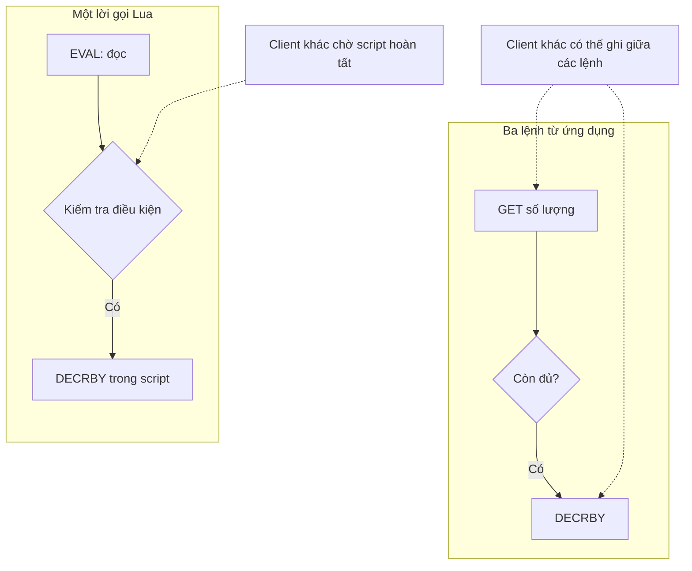
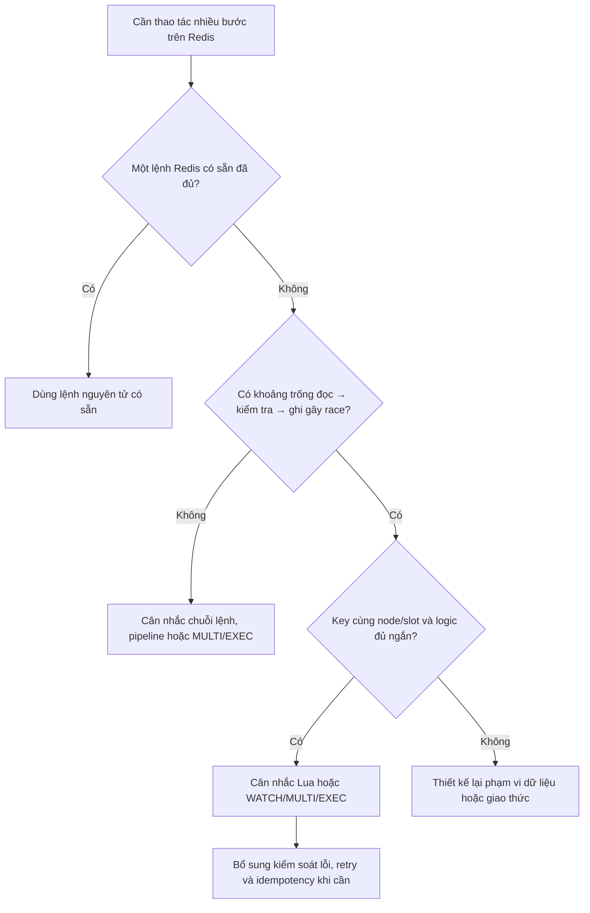

# Khi nào nên dùng Lua thay cho chuỗi lệnh từ ứng dụng trong Spring Data Redis

## 1. Vấn đề: từng lệnh Redis có thể đúng, nhưng cả chuỗi thao tác lại sai

Redis thực thi từng lệnh theo cách nguyên tử đối với các thao tác thông thường trên một Redis server. Tuy nhiên, một **quy trình nghiệp vụ gồm nhiều lệnh** do ứng dụng gửi lần lượt không tự động trở thành một thao tác nguyên tử.

Xét nghiệp vụ giữ chỗ số lượng sản phẩm. Redis lưu:

```text
app:stock:{sku-1001}:remaining = 5
```

Hai yêu cầu đồng thời đều muốn giữ 4 sản phẩm. Cách viết ngây thơ:

```java
String stockKey = "app:stock:{sku-1001}:remaining";

String raw = redis.opsForValue().get(stockKey);
long available = Long.parseLong(raw);

if (available >= 4) {
    redis.opsForValue().set(stockKey, Long.toString(available - 4));
    // Ứng dụng coi giữ chỗ đã thành công.
}
```

Chuỗi lệnh này có thể xảy ra như sau:

```text
Thời điểm   Request A                  Request B
---------   -------------------------  -------------------------
T1          GET stock -> 5
T2                                     GET stock -> 5
T3          5 >= 4 -> đủ
T4                                     5 >= 4 -> đủ
T5          SET stock 1
T6                                     SET stock 1
T7          Báo giữ 4 thành công       Báo giữ 4 thành công
```

Hai yêu cầu cùng được chấp nhận, tổng cộng giữ 8 sản phẩm dù ban đầu chỉ có 5. Redis không xử lý sai lệnh nào: **sai ở khoảng trống giữa thao tác đọc, kiểm tra điều kiện và ghi**.

Khoảng trống đó gọi là *race condition*. Nếu quy tắc “chỉ trừ khi còn đủ tồn kho” phải được kiểm tra và thực hiện như một đơn vị, ta cần một cách đưa **đọc + quyết định + ghi** lại gần nhau hơn. Trong Redis, Lua script là một lựa chọn quan trọng.

## 2. Khi nào một lệnh Redis đã đủ?

Trước khi chọn Lua, cần xác định Redis đã cung cấp sẵn lệnh nguyên tử nào cho thao tác cần làm.

| Yêu cầu | Lệnh/cách có sẵn | Có nhất thiết cần Lua? |
|---|---|---|
| Tăng một bộ đếm | `INCR`, `INCRBY` | Không |
| Giảm một bộ đếm, chấp nhận giá trị âm | `DECRBY` | Không |
| Thêm phần tử vào Set | `SADD` | Không |
| Thêm key chỉ khi chưa tồn tại | `SET key value NX` | Không |
| Tạo khóa tạm với TTL | `SET key token NX PX milliseconds` | Không |
| Đổi key cũ thành giá trị mới và lấy giá trị cũ | Xem các tùy chọn được hỗ trợ của `SET`/`GETSET` | Thường không |
| Giảm tồn kho **chỉ khi còn đủ** | Cần đọc, so sánh, giảm | Lua hoặc cơ chế điều kiện tương đương rất phù hợp |
| Chỉ xóa lock khi token còn khớp | Cần so sánh và xóa cùng lúc | Lua hoặc lệnh điều kiện nguyên tử được Redis hỗ trợ |
| Tăng bộ đếm và đặt TTL đúng khi lần đầu tạo | Cần ghép `INCR` và `EXPIRE` theo điều kiện | Lua thường hữu ích |
| Cập nhật nhiều key có ràng buộc điều kiện | Phải xem phạm vi key/slot và quy tắc nghiệp vụ | Lua, `WATCH`/`MULTI` hoặc thiết kế khác |

**Nguyên tắc đầu tiên:** nếu một lệnh Redis đã biểu diễn chính xác quy tắc, hãy sử dụng lệnh đó. Thêm Lua vào một `INCR` đơn giản chỉ tăng số mã cần bảo trì mà không thêm bảo đảm hữu ích.

Lua phù hợp khi **nhiều bước có quan hệ phụ thuộc**, đặc biệt bước sau quyết định dựa trên dữ liệu mà bước trước vừa đọc, và bên khác không được chen vào giữa các bước đó.

## 3. Vì sao Lua giải quyết được race condition?

Redis hỗ trợ chạy script Lua trên server bằng `EVAL` và `EVALSHA`. Khi script thực thi, Redis xử lý script như một tác vụ nguyên tử: trong lúc script đang chạy, lệnh từ các client khác không chen vào giữa các câu lệnh Redis do script gọi.

So sánh hai luồng:



Trong luồng Java thông thường, client khác có thể thay đổi key sau `GET` và trước `DECRBY`. Trong một script Lua ngắn chạy trên Redis, việc đọc số lượng, kiểm tra và giảm số lượng diễn ra liên tục trong cùng một lần thực thi.

### Cần hiểu đúng về "nguyên tử"

Với Redis Lua:

- Các client khác không quan sát được trạng thái trung gian giữa các lệnh do script thực thi.
- Một script ngắn có thể thực hiện phép đọc, điều kiện và ghi trên server với một round trip từ ứng dụng.
- **Không có rollback tự động** cho các lệnh đã thực thi nếu script phát sinh lỗi sau khi đã ghi một phần dữ liệu.
- Một script chạy lâu **chặn Redis phục vụ các yêu cầu khác** trong lúc script còn thực thi.
- Tính nguyên tử của script trên Redis không đồng nghĩa với giao dịch phân tán nguyên tử giữa Redis, SQL, HTTP và hệ thống hàng đợi.

Vì vậy, script nên **kiểm tra đầu vào và trạng thái cần thiết trước khi bắt đầu ghi**, giữ số thao tác nhỏ và hạn chế mọi vòng lặp có thể kéo dài không kiểm soát.

## 4. Ví dụ hoàn chỉnh: giữ chỗ tồn kho bằng Lua

Bài toán:

> Chỉ giảm số lượng tồn kho khi key đã được khởi tạo và số lượng hiện có không nhỏ hơn lượng yêu cầu. Nếu không thỏa điều kiện, không thay đổi tồn kho.

Quy ước lưu số lượng còn lại bằng Redis String chứa số nguyên không âm:

```text
Key:   app:stock:{sku-1001}:remaining
Value: 5
```

Cặp dấu ngoặc nhọn trong tên key là *hash tag* của Redis Cluster. Với một key duy nhất, nó không bắt buộc, nhưng giúp hình thành quy ước khi sau này có nhiều key cần nằm cùng hash slot.

### 4.1. Tạo file Lua

**`src/main/resources/scripts/reserve-stock.lua`**

```lua
-- KEYS[1]: key chứa số lượng còn lại
-- ARGV[1]: số lượng muốn giữ chỗ, là số nguyên dương
--
-- Giá trị trả về:
--   >= 0: số lượng còn lại sau khi giữ thành công
--   -1:   key tồn kho chưa tồn tại
--   -2:   không đủ số lượng
--
-- Các trường hợp dữ liệu/đầu vào không hợp lệ trả Redis error.

if #KEYS ~= 1 or #ARGV ~= 1 then
    return redis.error_reply("Expected one key and one quantity")
end

local quantity = tonumber(ARGV[1])

if not quantity
        or quantity <= 0
        or quantity % 1 ~= 0
        or quantity > 2147483647 then
    return redis.error_reply("Invalid quantity")
end

local stockKey = KEYS[1]
local raw = redis.call("GET", stockKey)

if not raw then
    return -1
end

local available = tonumber(raw)

if not available
        or available < 0
        or available % 1 ~= 0
        or available > 2147483647 then
    return redis.error_reply("Invalid stock value")
end

if available < quantity then
    return -2
end

return redis.call("DECRBY", stockKey, quantity)
```

Giải thích theo thứ tự:

1. `KEYS[1]` là khóa được truyền từ ứng dụng, `ARGV[1]` là lượng cần giữ.
2. Script kiểm tra số lượng tham số, kiểu số, tính nguyên và giới hạn của giá trị.
3. `GET` đọc số tồn kho hiện tại, trả mã `-1` nếu key chưa được khởi tạo.
4. Nếu không đủ, trả `-2` mà không ghi dữ liệu.
5. Nếu đủ, gọi `DECRBY` và trả số lượng còn lại.

Ví dụ chủ động giới hạn số lượng ở mức số nguyên 32-bit để việc chuyển chuỗi sang Lua number trong phiên bản Lua của Redis không vướng bài toán độ chính xác ở giá trị nguyên rất lớn. Hệ thống cần lượng vượt giới hạn đó nên chọn cách biểu diễn và xử lý phù hợp hơn.

**Điểm quyết định:** `GET`, kiểm tra `available < quantity` và `DECRBY` đều nằm trong **một script**. Hai request đồng thời không thể cùng đọc giá trị cũ rồi cùng được chấp nhận vượt quá tồn kho.

### 4.2. Thử Lua bằng redis-cli

Khởi tạo dữ liệu thử nghiệm:

```bash
redis-cli SET 'app:stock:{sku-1001}:remaining' 5
```

Gọi file Lua từ CLI tại thư mục dự án:

```bash
redis-cli --eval src/main/resources/scripts/reserve-stock.lua \
  'app:stock:{sku-1001}:remaining' , 4
```

Lệnh này yêu cầu giữ 4 sản phẩm. Kết quả dự kiến là số `1`: tồn kho từ 5 giảm còn 1.

Gọi tiếp:

```bash
redis-cli --eval src/main/resources/scripts/reserve-stock.lua \
  'app:stock:{sku-1001}:remaining' , 4
```

Script trả `-2`, vì tồn kho chỉ còn 1 nên không đủ để giữ thêm 4. Số lượng trong Redis vẫn là 1.

```bash
redis-cli GET 'app:stock:{sku-1001}:remaining'
```

Dấu phẩy `,` trong cú pháp `redis-cli --eval` phân tách danh sách **key** ở bên trái và **argument** ở bên phải. Lua sử dụng bảng `KEYS` và `ARGV` tương ứng. Ví dụ shell trên dùng cú pháp xuống dòng với dấu `\` cho môi trường hỗ trợ, có thể viết toàn bộ lệnh trên một dòng khi chạy PowerShell hoặc CMD.

### 4.3. Kết quả của script là một phần của giao thức

Không nên dùng chung một mã trả về cho hai ý nghĩa. Ví dụ script quy định:

| Giá trị | Ý nghĩa | Phản ứng hợp lý trong ứng dụng |
|---|---|---|
| `>= 0` | Giữ chỗ thành công; đây là số lượng còn lại | Tiếp tục quy trình giữ chỗ |
| `-1` | Key tồn kho không tồn tại | Báo dữ liệu chưa được khởi tạo hoặc điều tra |
| `-2` | Không đủ tồn kho | Trả kết quả hết hàng/không đủ số lượng |
| Redis error | Tham số hoặc dữ liệu không hợp lệ, lỗi thực thi | Xử lý như lỗi kỹ thuật, ghi log và điều tra |

Phân biệt **thiếu hàng** với **lỗi kỹ thuật** đặc biệt quan trọng. Không được coi exception mạng hoặc timeout là bằng chứng giữ chỗ thất bại: script có thể đã chạy thành công nhưng phản hồi về client bị mất.

## 5. Gọi script bằng Spring Data Redis

Spring Data Redis có abstraction `RedisScript<T>` và cơ chế thực thi script qua `RedisTemplate.execute(...)` hoặc `StringRedisTemplate.execute(...)`. Không cần tự ghép lệnh `EVAL` thành một chuỗi rồi gửi thủ công.

### 5.1. Dependency và kết nối

Dự án Spring Boot thông thường cần starter Redis.

**Gradle:**

```kotlin
dependencies {
    implementation("org.springframework.boot:spring-boot-starter-data-redis")
}
```

**Maven:**

```xml
<dependency>
    <groupId>org.springframework.boot</groupId>
    <artifactId>spring-boot-starter-data-redis</artifactId>
</dependency>
```

Ví dụ cấu hình Redis local bằng `application.yml`:

```yaml
spring:
  data:
    redis:
      host: localhost
      port: 6379
```

Trong môi trường thật, cần đặt kết nối, xác thực, TLS, topology và secret theo hạ tầng đang sử dụng.

### 5.2. Khai báo RedisScript<Long> dạng bean

**`RedisScriptConfig.java`**

```java
package com.example.stock.config;

import org.springframework.context.annotation.Bean;
import org.springframework.context.annotation.Configuration;
import org.springframework.core.io.ClassPathResource;
import org.springframework.data.redis.core.RedisScript;
import org.springframework.data.redis.core.script.DefaultRedisScript;

@Configuration
public class RedisScriptConfig {

    @Bean("reserveStockScript")
    public RedisScript<Long> reserveStockScript() {
        DefaultRedisScript<Long> script = new DefaultRedisScript<>();
        script.setLocation(
                new ClassPathResource("scripts/reserve-stock.lua")
        );
        script.setResultType(Long.class);
        return script;
    }
}
```

Ý nghĩa:

- `ClassPathResource` nạp file Lua từ `src/main/resources` khi ứng dụng chạy.
- `DefaultRedisScript<Long>` mô tả nội dung script và kiểu dữ liệu kết quả.
- `setResultType(Long.class)` cho Spring Data biết phản hồi dạng số nguyên từ Redis cần được chuyển sang `Long`.
- Khai báo bean giúp cùng một script được tái sử dụng, tránh đọc/khởi tạo script mới ở mỗi request.

Với script trả danh sách phức tạp, kiểu kết quả và serializer cần được cấu hình phù hợp. Trong ví dụ này, chỉ trả về một số nguyên nên `Long` là đủ.

### 5.3. Viết service gọi Lua

**`StockReservationService.java`**

```java
package com.example.stock.service;

import java.util.List;
import java.util.regex.Pattern;

import org.springframework.beans.factory.annotation.Qualifier;
import org.springframework.data.redis.core.RedisScript;
import org.springframework.data.redis.core.StringRedisTemplate;
import org.springframework.stereotype.Service;

@Service
public class StockReservationService {

    private static final Pattern SKU_PATTERN =
            Pattern.compile("[A-Za-z0-9_-]{1,64}");

    private final StringRedisTemplate redis;
    private final RedisScript<Long> reserveStockScript;

    public StockReservationService(
            StringRedisTemplate redis,
            @Qualifier("reserveStockScript")
            RedisScript<Long> reserveStockScript
    ) {
        this.redis = redis;
        this.reserveStockScript = reserveStockScript;
    }

    /**
     * Trả số lượng còn lại nếu giữ chỗ thành công.
     *
     * Ném IllegalStateException nếu không có stock hoặc không đủ.
     * Lỗi Redis thực tế được để lan lên để tầng gọi xử lý.
     */
    public long reserve(String sku, int requestedQuantity) {
        if (sku == null || !SKU_PATTERN.matcher(sku).matches()) {
            throw new IllegalArgumentException("Invalid SKU");
        }

        if (requestedQuantity <= 0) {
            throw new IllegalArgumentException(
                    "requestedQuantity must be positive"
            );
        }

        String key = "app:stock:{" + sku + "}:remaining";

        Long result = redis.execute(
                reserveStockScript,
                List.of(key),
                Integer.toString(requestedQuantity)
        );

        if (result == null) {
            throw new IllegalStateException(
                    "Redis returned no script result"
            );
        }

        if (result == -1L) {
            throw new IllegalStateException(
                    "Stock has not been initialized"
            );
        }

        if (result == -2L) {
            throw new IllegalStateException(
                    "Insufficient stock"
            );
        }

        if (result < 0L) {
            throw new IllegalStateException(
                    "Unexpected script result: " + result
            );
        }

        return result;
    }
}
```

Lời gọi minh họa:

```java
long remaining = stockReservationService.reserve("sku-1001", 4);
System.out.println("Số lượng còn lại: " + remaining);
```

Điểm đáng chú ý trong `redis.execute(...)`:

- `reserveStockScript` chứa Lua đã nạp.
- `List.of(key)` truyền tên key vào `KEYS[1]`.
- `Integer.toString(requestedQuantity)` truyền số lượng vào `ARGV[1]`.
- `StringRedisTemplate` giúp key và argument sử dụng cơ chế tuần tự hóa chuỗi thích hợp.

Việc ứng dụng **kiểm tra SKU và số lượng trước khi gửi** giúp báo lỗi sớm. Script vẫn kiểm tra một lần nữa để bảo vệ quy tắc ngay tại Redis, kể cả khi lời gọi đến từ client hoặc luồng xử lý khác.

### 5.4. Thực thi EVAL hay EVALSHA?

Thông thường, script executor của Spring Data Redis sử dụng hash của script để thử `EVALSHA`. Nếu Redis chưa có script trong cache, cơ chế có thể dùng `EVAL` để thực thi nội dung script.

Ưu điểm của việc dùng `RedisScript`:

- Script nằm trong file nguồn có thể đọc, version control và review.
- Có mô tả kiểu trả về rõ.
- Tái sử dụng script và tận dụng cơ chế script cache của Redis.
- Ứng dụng không phải tự quản lý các chuỗi `EVALSHA` hoặc tình huống cache không có script cho luồng phổ biến.

Tuy nhiên, cache script **không phải kho lưu trữ bền vững cần dựa vào như dữ liệu nghiệp vụ**. Restart, failover, lệnh quản trị hoặc thay đổi phiên bản Redis có thể khiến script không còn trong cache. Ứng dụng phải có cách nạp/chạy lại script khi cần. Cách dùng `RedisScript` của Spring Data Redis xử lý tình huống này thuận tiện hơn việc chỉ hard-code một SHA rồi luôn gọi `EVALSHA`.

## 6. So sánh chuỗi lệnh Java với Lua trong cùng một nghiệp vụ

Trở lại bài toán giữ chỗ:

**Chuỗi lệnh Java:**

```java
String raw = redis.opsForValue().get(key);
long available = Long.parseLong(raw);

if (available >= quantity) {
    redis.opsForValue().decrement(key, quantity);
}
```

Dù `DECRBY` là lệnh nguyên tử, điều kiện `available >= quantity` ở Java dựa trên một ảnh chụp **có thể đã cũ**. Sau khi `GET`, một client khác vẫn có thể giảm tồn kho.

**Lua:**

```lua
local available = tonumber(redis.call("GET", KEYS[1]))
local quantity = tonumber(ARGV[1])

if available < quantity then
    return -2
end

return redis.call("DECRBY", KEYS[1], quantity)
```

Trong đoạn lược giản trên, điều kiện và phép giảm nằm trong cùng script. Đoạn code minh họa nguyên lý; để xử lý key chưa tồn tại, giá trị không hợp lệ và tham số lỗi, sử dụng bản script đầy đủ ở phần trước.

### Một round trip có phải lợi ích chính?

Lua thường giúp giảm số lần ứng dụng phải gửi yêu cầu đến Redis, nhất là khi nghiệp vụ có nhiều bước. Nhưng **lý do quan trọng nhất trong ví dụ là tính nguyên tử**, không chỉ độ trễ mạng.

Một script dài có thể giảm round trip mà lại chặn Redis quá lâu. Vì vậy, không gom nhiều lệnh không liên quan vào một script chỉ để giảm số request. Nên ưu tiên Lua khi nhiều bước **phải cùng quan sát và quyết định trên một trạng thái không bị thay đổi xen giữa**.

## 7. Khi nào dùng MULTI/EXEC thay cho Lua?

Redis hỗ trợ transaction bằng `MULTI` và `EXEC`:

```redis
MULTI
SET app:order:1001:status RESERVED
SET app:order:1001:owner user-42
EXEC
```

Redis thực thi các lệnh đã xếp hàng theo thứ tự, không để client khác chen vào giữa lúc `EXEC` chạy. Phù hợp khi **danh sách lệnh và tham số đã biết trước**, không phải đọc giá trị để quyết định ngay trong transaction.

Nhưng xét một quy trình:

```text
GET stock
nếu stock >= 4 thì DECRBY stock 4
```

Nếu đưa `GET` vào `MULTI`, phản hồi thực tế của `GET` chỉ có sau `EXEC`. Ứng dụng không thể xem kết quả `GET` trong lúc xếp hàng để quyết định có đưa `DECRBY` vào cùng transaction hay không.

Redis có `WATCH` để giải quyết một số bài toán đọc–sửa–ghi bằng optimistic concurrency:

1. `WATCH` key tồn kho.
2. `GET` key và kiểm tra số lượng trong ứng dụng.
3. Nếu đủ, `MULTI` và xếp lệnh `DECRBY`.
4. Gọi `EXEC`. Nếu key bị client khác sửa kể từ `WATCH`, transaction không thực thi và ứng dụng có thể tính toán rồi thử lại.

| Khía cạnh | Lua | `WATCH` + `MULTI`/`EXEC` |
|---|---|---|
| Điều kiện đọc–quyết định–ghi | Tất cả diễn ra trên Redis server trong một script | Ứng dụng đọc/kiểm tra, Redis kiểm tra xung đột khi `EXEC` |
| Round trip | Thường một lần gọi script | Nhiều lệnh/round trip |
| Khi nhiều client cùng tranh chấp | Script thực thi tuần tự; request khác chờ | Có thể phải retry khi `WATCH` phát hiện thay đổi |
| Logic nghiệp vụ | Viết bằng Lua, triển khai như script | Viết bằng Java, sử dụng thao tác Redis có điều kiện |
| Khả năng bảo trì | Cần quản lý thêm mã Lua | Giữ logic ở ứng dụng nhưng luồng retry phức tạp hơn |
| Rủi ro vận hành | Script dài chặn Redis | Retry nhiều lần có thể tăng tải khi tranh chấp |

**Chọn lựa thực tế:** điều kiện ngắn gọn, dùng ít key và cần tính nguyên tử rõ ràng thì Lua thường rất phù hợp. Nếu nghiệp vụ đã có một cơ chế optimistic locking thích hợp, việc dùng `WATCH` cũng hợp lý. Cả hai cần hiểu lỗi mạng và tình huống client không biết request có thành công hay không.

## 8. Khi nào cần Lua cho rate limiting?

Một trường hợp phổ biến là **bộ đếm giới hạn số yêu cầu trong một khoảng thời gian**.

Cách viết từ Java:

```java
Long count = redis.opsForValue().increment(key);

if (count == 1L) {
    redis.expire(key, Duration.ofSeconds(60));
}
```

Hai lệnh `INCR` và `EXPIRE` là các lệnh Redis riêng. Nếu ứng dụng dừng hoặc kết nối mất **sau `INCR` nhưng trước `EXPIRE`**, key có thể không có TTL và tồn tại lâu hơn dự kiến.

Ta có thể kết hợp hai thao tác trong một script, đồng thời kiểm tra giới hạn.

**`src/main/resources/scripts/fixed-window-rate-limit.lua`**

```lua
-- KEYS[1]: key bộ đếm của một chủ thể
-- ARGV[1]: số yêu cầu được phép trong window
-- ARGV[2]: thời hạn window, mili giây
-- Trả 1 nếu cho phép, 0 nếu từ chối.

if #KEYS ~= 1 or #ARGV ~= 2 then
    return redis.error_reply("Invalid number of arguments")
end

local limit = tonumber(ARGV[1])
local windowMs = tonumber(ARGV[2])

if not limit or limit < 1 or limit % 1 ~= 0 then
    return redis.error_reply("Invalid limit")
end

if not windowMs or windowMs < 1 or windowMs % 1 ~= 0 then
    return redis.error_reply("Invalid window")
end

local count = redis.call("INCR", KEYS[1])

if count == 1 then
    redis.call("PEXPIRE", KEYS[1], windowMs)
end

if count <= limit then
    return 1
end

return 0
```

Mô hình này là **fixed window bắt đầu ở lần yêu cầu đầu tiên khi key chưa tồn tại**. Tại một thời điểm chỉ có một script kiểm tra/tăng bộ đếm cho cùng key, nên các request đồng thời không chen ngang giữa `INCR` và việc thiết lập expiration khi count bằng 1.

Ví dụ nếu giới hạn 5 yêu cầu/60 giây:

```text
Request 1 -> count=1, đặt TTL gần 60s, trả 1
Request 2 -> count=2, trả 1
...
Request 5 -> count=5, trả 1
Request 6 -> count=6, trả 0
Khi key hết hạn -> lượt sau tạo window mới
```

Script này minh họa quyết định nguyên tử và sự gắn kết giữa bộ đếm với TTL. Nó **không** giải quyết mọi yêu cầu về rate limiting: fixed window có thể cho burst ở ranh giới các window; với giới hạn trượt, token bucket hoặc yêu cầu độ chính xác phân tán khác, cần chọn thuật toán và mô hình Redis phù hợp.

Bên cạnh đó, script lỗi sau một lệnh ghi **không được Redis tự rollback**. Do đó, việc xác thực input trước `INCR` là quan trọng. Trong hệ thống thật còn cần thiết kế phản ứng với key bị đổi sang kiểu dữ liệu khác, sự cố mạng, retry và giới hạn tài nguyên.

## 9. Khi nào dùng Lua để giải phóng distributed lock?

Một mẫu thường gặp:

1. Ứng dụng tạo lock bằng `SET key token NX PX ttl`.
2. Khi hoàn tất, ứng dụng xóa lock.
3. Nhưng giữa lúc đọc để kiểm tra token và lúc xóa, lock có thể hết hạn và được người khác tạo lại.

Cách nguy hiểm:

```java
String current = redis.opsForValue().get(lockKey);

if (token.equals(current)) {
    redis.delete(lockKey);
}
```

Race condition:

```text
A sở hữu lock token=A.
A đọc GET -> A.
Lock hết hạn.
B tạo lock mới với token=B.
A gọi DEL -> xóa nhầm lock của B.
```

Lua có thể đưa **so sánh token và xóa** vào cùng một thao tác.

**`src/main/resources/scripts/release-lock.lua`**

```lua
if redis.call("GET", KEYS[1]) == ARGV[1] then
    return redis.call("DEL", KEYS[1])
end

return 0
```

Cách gọi bằng Spring Data Redis:

```java
// releaseLockScript có kiểu RedisScript<Long>,
// được cấu hình từ resource scripts/release-lock.lua.
Long removed = stringRedisTemplate.execute(
        releaseLockScript,
        List.of("app:lock:invoice:1001"),
        token
);
```

Kết quả `1` nghĩa là script đã xóa lock đang có token phù hợp. Kết quả `0` nghĩa là key không tồn tại hoặc token không khớp; ứng dụng không xóa lock đó.

**Không coi đoạn script giải phóng lock là toàn bộ giao thức distributed lock an toàn.** Cần token ngẫu nhiên/duy nhất cho lần sở hữu lock, TTL hợp lý, chiến lược gia hạn, xử lý crash và có thể cần *fencing token* nếu tài nguyên bên ngoài vẫn có thể bị thao tác bởi một worker đã mất lock. Với các phiên bản Redis hỗ trợ lệnh xóa điều kiện theo giá trị, có thể cân nhắc lệnh nguyên tử tương đương trước khi chọn Lua.

## 10. Dùng Lua trên Redis Cluster: chú ý tất cả key

Trên Redis đơn node, script có thể truy cập những key hợp lệ của Redis đó. Trong Redis Cluster, các thao tác cần xét **hash slot**. Một script có nhiều key thường phải dùng các key nằm trong **cùng hash slot** để có thể được thực thi trên một node.

Ví dụ hai key có hash tag giống nhau:

```text
app:stock:{sku-1001}:remaining
app:stock:{sku-1001}:reserved
```

Cả hai dùng `{sku-1001}` để xác định cùng hash slot, dù phần tiền tố/hậu tố khác nhau.

Ngược lại:

```text
app:stock:{sku-1001}:remaining
app:stock:{sku-2002}:remaining
```

hai key có thể nằm ở hai slot khác nhau. Không nên viết một script giả định có thể chuyển số lượng nguyên tử giữa chúng qua nhiều node Redis Cluster.

### Quy tắc KEYS và ARGV

Với script thao tác trên Redis key:

- Truyền **tất cả tên key được truy cập** qua `KEYS`.
- Truyền giá trị, số lượng, token, TTL và những tham số thường khác qua `ARGV`.
- Không truyền một prefix rồi tự tạo tên Redis key mới trong Lua như thể Redis sẽ tự biết key đó thuộc slot nào.
- Khi nhiều key phải được dùng chung, thiết kế placement theo hash slot từ trước.

Sai cách tổ chức:

```lua
-- Không nên tự tạo key dựa vào dữ liệu không khai báo như key.
local key = "app:stock:" .. ARGV[1]
return redis.call("GET", key)
```

Cách biểu đạt rõ ràng:

```lua
-- Ứng dụng truyền tên Redis key trong KEYS[1].
return redis.call("GET", KEYS[1])
```

Việc nêu key rõ ràng cũng giúp Redis Cluster, cơ chế định tuyến client và công cụ quan sát phân tích script dễ hơn.

## 11. Giới hạn và rủi ro của Redis Lua

### 11.1. Script dài có thể chặn toàn bộ yêu cầu khác

Redis thực thi script như một đơn vị nguyên tử, nên trong lúc một script đang chạy, những lệnh khác không thể chen vào. Đó vừa là ưu điểm vừa là chi phí.

**Nên làm:** đọc/ghi một số key hữu hạn, thực hiện vài phép so sánh đơn giản, trả kết quả nhanh.

**Không nên làm:** duyệt hàng triệu key, xử lý tập dữ liệu lớn với vòng lặp không giới hạn, thực hiện logic tính toán tốn CPU hoặc coi Redis Lua như nơi chạy toàn bộ xử lý nghiệp vụ.

Nếu cần dọn dữ liệu lớn theo namespace, hãy dùng `SCAN` và xử lý theo lô có giới hạn; đừng đưa toàn bộ quá trình quét và xóa khối lượng lớn vào một Lua script chỉ để đạt tính nguyên tử.

Redis có cơ chế phát hiện script chạy lâu và các công cụ xử lý script bị kẹt, nhưng một script đã ghi dữ liệu có những giới hạn trong việc dừng; tốt nhất là giới hạn thời gian chạy ngay từ thiết kế.

### 11.2. Lỗi giữa script không có rollback

Ví dụ nguy hiểm:

```lua
redis.call("SET", KEYS[1], "changed")

-- Bước sau có thể lỗi do key không phải số.
redis.call("INCR", KEYS[2])
```

Nếu `INCR` báo lỗi do giá trị không phải số, thay đổi ở `KEYS[1]` **không được Redis tự đảo ngược**.

Để giảm rủi ro, kiểm tra loại dữ liệu và điều kiện nghiệp vụ trước những lệnh ghi; thiết kế kết quả lỗi rõ ràng; giới hạn số thao tác và chọn mô hình dữ liệu ít trạng thái trung gian.

`redis.call(...)` phát lỗi Lua khi lệnh Redis lỗi; `redis.pcall(...)` trả về một đối tượng lỗi để script xử lý. Dùng `pcall` có chủ đích và đừng biến mọi lỗi Redis thành “thành công” do vô tình nuốt lỗi.

### 11.3. Timeout không chứng minh script chưa chạy

Một lời gọi `redis.execute(script, keys, args)` có thể timeout vì:

- Client mất kết nối sau khi gửi yêu cầu.
- Redis hoàn thành script nhưng phản hồi về client bị thất lạc.
- Redis quá tải hoặc script chậm.
- Có sự cố failover trong quá trình xử lý.

Không được retry một cách mù quáng thao tác như **trừ tồn kho**: lần đầu có thể đã giảm số lượng, lần retry lại giảm lần thứ hai.

Nếu yêu cầu retry an toàn, thiết kế thêm **idempotency key** cho từng yêu cầu nghiệp vụ. Ví dụ một request có mã `reservation-123`, script kiểm tra mã này đã được xử lý chưa trước khi giữ chỗ; cần đặt trạng thái kết quả và thay đổi tồn kho trong cùng thao tác nguyên tử, với TTL/lifecycle rõ ràng cho mã idempotency.

### 11.4. Redis script không bao trùm database hoặc dịch vụ khác

Lua chạy ở Redis. Nó không thể tự bảo đảm rằng:

- Transaction trong PostgreSQL/MySQL đã commit.
- Yêu cầu thanh toán tới nhà cung cấp bên ngoài thành công.
- Thông điệp Kafka được phát chính xác một lần.
- Thay đổi được thực thi nguyên tử trên nhiều Redis node khác nhau.

Nếu tồn kho chính được quản lý bằng SQL, việc giữ chỗ Redis cần một giao thức đồng bộ và giải phóng bù trừ rõ ràng. Không biến Redis Lua thành nguồn đảm bảo cho cả giao dịch kinh doanh khi phần còn lại xảy ra ngoài Redis.

### 11.5. Script cache, quyền và tính tương thích

Khi dùng script trong ứng dụng lâu dài:

- Lưu Lua dưới dạng file trong source control, review cùng code Java tương ứng.
- Giữ cấu trúc `KEYS`, `ARGV` và mã trả về như một giao thức có phiên bản.
- Không phụ thuộc cache script tồn tại mãi, vì Redis có thể xóa cache khi restart/failover hoặc qua thao tác quản trị.
- Cấu hình Redis ACL cho phép nhóm lệnh và key mà script thực sự cần, theo chính sách bảo mật của tổ chức.
- Không gửi Lua script tùy ý được người dùng nhập vào `EVAL`; script là mã thực thi trên Redis server.
- Theo dõi giới hạn Lua/script và thay đổi hành vi giữa các phiên bản Redis nếu sử dụng API nâng cao.
- Trong Redis Cluster, cập nhật và phân phối script phải được xét theo node/slot mà lời gọi đến.

Với hành vi dài hạn, có thể nghiên cứu Redis Functions ở những phiên bản phù hợp; Functions hỗ trợ quản lý mã chạy phía server theo mô hình khác với script nạp theo yêu cầu. Nhưng nếu yêu cầu chỉ là một phép điều kiện nhỏ và đang dùng Spring Data Redis, `RedisScript` thường đủ rõ ràng.

## 12. Phân biệt nguyên tử, nhất quán, idempotent và hiệu năng

Bốn khái niệm này thường bị nhầm thành một:

| Khái niệm | Câu hỏi cần trả lời | Lua có tự bảo đảm không? |
|---|---|---|
| **Nguyên tử đối với client khác** | Client khác có thể xen lệnh vào giữa GET và DECRBY hay không? | Có, trong phạm vi script trên Redis server xử lý nó |
| **Nhất quán nghiệp vụ** | Sau khi Redis ghi, SQL/queue/dịch vụ khác có nhất quán không? | Không |
| **Idempotent** | Gọi lại cùng yêu cầu có làm thay đổi dữ liệu lần thứ hai không? | Không tự động; phải thiết kế |
| **Hiệu năng tốt** | Dưới tải cao, độ trễ có nằm trong giới hạn không? | Không tự động; script có thể chặn server |

Đối với stock reservation, script mẫu giải quyết **race condition khi kiểm tra và giảm số lượng trên một key**. Nếu ứng dụng cần tránh giữ chỗ hai lần cho một đơn, hoặc cần bảo đảm thanh toán và cập nhật đơn hàng cùng thành công, vẫn phải bổ sung những phần thiết kế tương ứng.

### Idempotency key được dùng như thế nào?

Một ý tưởng cho script nâng cao:

```text
KEYS[1]: app:stock:{sku-1001}:remaining
KEYS[2]: app:reservation:{sku-1001}:request-abc

ARGV[1]: quantity
ARGV[2]: TTL kết quả idempotency

1. Nếu KEYS[2] đã ghi nhận request → trả kết quả trước đó.
2. Nếu chưa có → kiểm tra tồn kho.
3. Nếu đủ → giảm tồn kho.
4. Ghi kết quả cho KEYS[2].
5. Trả kết quả.
```

Hai key dùng cùng hash tag `{sku-1001}` để cùng slot trong Redis Cluster. Cần định nghĩa thêm chính sách khi record idempotency hết hạn, request được gửi lại sau thời hạn, lỗi sau một phần ghi và trạng thái reservation được giải phóng. Đây là kiến trúc phức tạp hơn script cơ bản, chỉ nên triển khai khi nghiệp vụ thực sự cần.

## 13. Tổ chức script trong một dự án Spring Boot

Một cấu trúc rõ ràng:

```text
src/
├── main/
│   ├── java/com/example/stock/
│   │   ├── config/
│   │   │   └── RedisScriptConfig.java
│   │   └── service/
│   │       └── StockReservationService.java
│   └── resources/
│       ├── application.yml
│       └── scripts/
│           ├── reserve-stock.lua
│           ├── fixed-window-rate-limit.lua
│           └── release-lock.lua
```

Đặt file Lua trong `resources/scripts` cho phép build đóng gói cùng ứng dụng. Từng file nên có:

1. Mô tả ngắn về nghiệp vụ và ý nghĩa của từng `KEYS[n]`.
2. Kiểu và quy tắc hợp lệ của `ARGV[n]`.
3. Danh sách giá trị trả về hoặc cấu trúc kết quả.
4. Các giả định như key type, TTL, hash slot và idempotency.
5. Giới hạn dữ liệu mà script được phép xử lý.

Việc đặt các script dưới source control giúp khi thay đổi Java service, người bảo trì nhìn thấy giao thức giữa Java và Lua trong cùng phiên bản ứng dụng.

Nếu nhiều phiên bản ứng dụng chạy đồng thời khi triển khai, thay đổi ý nghĩa của cùng một mã trả về có thể khiến phiên bản cũ hiểu sai. Vì vậy, khi thay đổi giao thức script, cần quản lý tương thích và triển khai theo quy trình của hệ thống.

## 14. Gợi ý quan sát và thử nghiệm hành vi nguyên tử

Trong môi trường thử nghiệm, có thể mô phỏng nhiều client cùng gọi script để giữ chỗ một key có 5 sản phẩm.

Ví dụ kỳ vọng:

```text
Ban đầu: stock = 5
Client A giữ 4
Client B giữ 4

Một client  → thành công, stock = 1
Client còn lại → không đủ số lượng
Cuối cùng → stock = 1
```

Thứ tự client nào thành công không cố định. Điều quan trọng là **không có hai lần giữ 4 cùng thành công** từ số tồn kho ban đầu 5.

Với script rate limiting, nhiều request đến đồng thời phải được đếm theo thứ tự thực thi của Redis, tránh tạo key không có TTL vì client dừng giữa hai lệnh `INCR` và `PEXPIRE` ở phía ứng dụng.

Khi quan sát vận hành, nên theo dõi:

- Tỷ lệ script thành công, từ chối hợp lệ và lỗi kỹ thuật.
- Độ trễ thực thi script và độ trễ của Redis nói chung.
- Số request retry sau timeout hoặc lỗi kết nối.
- Mức tranh chấp trên các key nóng.
- Thay đổi tải Redis do việc chuyển logic từ nhiều round trip sang script.
- Phân bố hash slot nếu chạy Redis Cluster.

Không dùng một kết quả đo đơn lẻ để suy ra Lua luôn nhanh hơn. Một số tác vụ phù hợp một lệnh Redis có sẵn sẽ nhanh và đơn giản hơn script. Tác vụ phức tạp hoặc chạy quá lâu có thể giảm tổng thông lượng Redis vì những client khác phải đợi.

## 15. Những lỗi thường gặp khi đưa Lua vào Spring Data Redis

| Hiện tượng | Nguyên nhân thường gặp | Hướng xử lý |
|---|---|---|
| Vẫn có race condition | Kiểm tra điều kiện ở Java trước rồi Lua chỉ ghi | Chuyển **cả đọc, điều kiện và ghi** vào một script |
| `NOSCRIPT` khi gọi `EVALSHA` thủ công | Script không còn trong cache của node | Có đường fallback `EVAL`/load script, hoặc dùng `RedisScript` |
| Kết quả `Long` bị `null`/sai kiểu | Cấu hình result type/serializer chưa phù hợp, hoặc thực thi trong ngữ cảnh không hỗ trợ đọc ngay | Xem lại `DefaultRedisScript`, kiểu trả về và đường gọi |
| `CROSSSLOT` trong Redis Cluster | Script truy cập key ở các hash slot khác nhau | Đưa các key cần dùng vào cùng slot và khai báo đầy đủ `KEYS` |
| Script chạy lâu làm hệ thống chậm | Vòng lặp quá lớn hoặc thao tác trên tập dữ liệu rất lớn | Chia công việc; giữ script ngắn, số key có giới hạn |
| Script đã ghi rồi mới lỗi | Không xác thực trước khi ghi; Redis không rollback phần đã thực thi | Đưa validation trước mutation, thiết kế ít bước và xử lý lỗi rõ |
| Retry làm trừ tồn kho hai lần | Kết quả lần đầu không chắc chắn sau timeout | Dùng request ID và idempotency theo nghiệp vụ |
| Lua đọc nhầm key | Key được nối chuỗi từ argument hoặc serializer không thống nhất | Truyền key qua `KEYS`, sử dụng `StringRedisTemplate` hoặc serializer chính xác |
| Script đúng trên local, lỗi trên cluster | Khác topology, slot, quyền ACL hoặc tính năng Redis | Xác định tương thích theo môi trường, giới hạn key và driver |
| Lệnh điều kiện đơn giản lại quá phức tạp | Dùng Lua cho việc `SET NX` hoặc `INCR` đã xử lý sẵn | Chọn lệnh Redis nguyên tử có sẵn |
| Script cập nhật Redis nhưng SQL vẫn chưa commit | Lua chỉ nguyên tử trong Redis | Có cơ chế đồng bộ giữa các kho dữ liệu |
| Script release lock xóa nhầm lock | Kiểm tra token ở Java rồi xóa sau | So sánh và xóa trong cùng thao tác nguyên tử |

## 16. Cách quyết định có nên dùng Lua

Dùng các câu hỏi sau trước khi thêm script:

**Bước 1 — Một lệnh Redis có đủ không?** Nếu mục tiêu chỉ là tăng bộ đếm, thêm thành viên Set hay `SET NX PX`, hãy sử dụng lệnh có sẵn.

**Bước 2 — Quyết định ghi có phụ thuộc kết quả đọc ngay trước đó không?** Nếu có, và việc một client khác sửa dữ liệu giữa hai bước sẽ gây lỗi nghiệp vụ, đó là dấu hiệu rõ ràng để cân nhắc Lua.

**Bước 3 — Logic có ngắn, xác định và nằm trong Redis không?** Script phù hợp nhất với vài lệnh đọc/ghi key cụ thể, không phụ thuộc dịch vụ khác và không cần vòng lặp lớn.

**Bước 4 — Có thể diễn đạt key rõ ràng, cùng hash slot khi dùng Cluster không?** Nếu không, cần điều chỉnh mô hình dữ liệu hoặc tách trách nhiệm; Lua không vượt qua giới hạn phân phối dữ liệu nhiều node.

**Bước 5 — Có cần retry an toàn và đồng bộ với hệ thống khác không?** Nếu có, bổ sung idempotency, trạng thái giao dịch và cơ chế khôi phục. Tính nguyên tử của Lua chỉ giải quyết một phần bài toán.

**Bước 6 — Luồng code Java hay Redis transaction khác có phù hợp hơn không?** Nếu điều kiện không yêu cầu tính nguyên tử hoặc đã có cơ chế optimistic locking đủ tốt, không bắt buộc dùng Lua. Chọn phương án vừa đủ bảo đảm tính đúng và có thể bảo trì lâu dài.

Một sơ đồ quyết định ngắn:



## 17. Kết luận

Lua có giá trị nhất khi một quy tắc nghiệp vụ phải thực hiện **đọc trạng thái, kiểm tra điều kiện và thay đổi dữ liệu** mà không cho các request khác chen vào giữa. Những ví dụ tiêu biểu là chỉ giảm tồn kho khi còn đủ, tăng bộ đếm gắn TTL theo điều kiện hoặc xóa lock khi token còn khớp.

Trong Spring Data Redis, cách triển khai phổ biến là đặt Lua ở `src/main/resources/scripts`, khai báo `DefaultRedisScript<T>` và thực thi bằng `StringRedisTemplate.execute(script, keys, args)`. Phải khai báo rõ `KEYS` và `ARGV`, kiểm tra đầu vào trước khi ghi, hiểu giá trị trả về và giới hạn script đủ ngắn.

Điều quan trọng là lựa chọn Lua **đúng chỗ**: không cần Lua nếu một lệnh Redis đã giải quyết được bài toán; không trông đợi script tự rollback những thay đổi đã thực thi, tự chống retry trùng hoặc tự bảo đảm nguyên tử giữa Redis và hệ thống bên ngoài.

### Tài liệu tham khảo

- [Spring Data Redis — Scripting](https://docs.spring.io/spring-data/redis/reference/redis/scripting.html)
- [Spring Data Redis — RedisScript API](https://docs.spring.io/spring-data/redis/reference/api/java/org/springframework/data/redis/core/RedisScript.html)
- [Spring Data Redis — RedisTemplate API](https://docs.spring.io/spring-data/redis/reference/api/java/org/springframework/data/redis/core/RedisTemplate.html)
- [Redis — Scripting with Lua](https://redis.io/docs/latest/develop/programmability/eval-intro/)
- [Redis — EVAL](https://redis.io/docs/latest/commands/eval/)
- [Redis — EVALSHA](https://redis.io/docs/latest/commands/evalsha/)
- [Redis — Transactions](https://redis.io/docs/latest/develop/using-commands/transactions/)
- [Redis — WATCH](https://redis.io/docs/latest/commands/watch/)
- [Redis — SET](https://redis.io/docs/latest/commands/set/)
