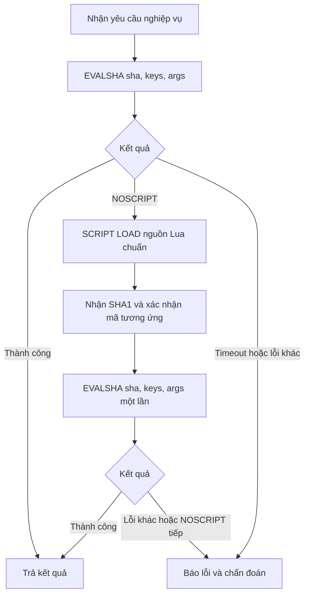

# Nạp script, dùng EVALSHA và xử lý cache script bị mất trong Spring Data Redis

## 1. Tình huống: Lua script chạy tốt rồi bất ngờ báo `NOSCRIPT`

Một dịch vụ dùng Redis để quản lý khóa tạm thời (*distributed lock*). Khi nhả khóa, ứng dụng cần kiểm tra token sở hữu khóa rồi mới xóa key. Hai lệnh riêng lẻ như `GET` và `DEL` tạo ra khoảng trống cho một client khác can thiệp, nên ứng dụng dùng Lua:

```lua
-- release-lock.lua
if redis.call('GET', KEYS[1]) == ARGV[1] then
    return redis.call('DEL', KEYS[1])
end
return 0
```

Lua script trên chạy phía Redis: kiểm tra và xóa nằm trong một lần thực thi nguyên tử. Ứng dụng có thể truyền **toàn bộ nội dung script** qua `EVAL`. Tuy nhiên, nếu chạy cùng một script hàng nghìn lần, phải gửi đi gửi lại các byte nguồn Lua là chi phí không cần thiết.

Redis cho phép **nạp script vào cache bằng `SCRIPT LOAD`**, nhận mã định danh SHA1 và **chạy script đã nạp bằng `EVALSHA`**. Lúc đó, những lần gọi sau chỉ cần truyền SHA1, số lượng key, danh sách key và đối số.

Vấn đề xuất hiện khi Redis restart, failover sang node khác hoặc script cache bị xóa:

```text
Ứng dụng giữ SHA1 của release-lock.lua
                |
                v
         EVALSHA <sha1> ...
                |
                v
 Redis node hiện tại không có script trong cache
                |
                v
 (error) NOSCRIPT No matching script. Please use EVAL.
```

**SHA1 vẫn đúng, nhưng server không còn nội dung Lua tương ứng.** Một ứng dụng đúng phải biết cách nạp lại hoặc thực thi lại **nguồn script**, đồng thời phân biệt lỗi mất cache với timeout, lỗi Lua và lỗi nghiệp vụ.

Sau bài này, bạn sẽ hiểu:

- Cách `EVAL`, `SCRIPT LOAD`, `SCRIPT EXISTS` và `EVALSHA` liên hệ với nhau.
- Vì sao cùng một SHA1 có thể chạy trên node này nhưng báo `NOSCRIPT` ở node khác.
- Cách xử lý `NOSCRIPT` an toàn khi gọi trực tiếp, trong pipeline/transaction và khi Redis Cluster failover.
- Cách Spring Data Redis dùng `RedisScript`, `DefaultRedisScript` và `ScriptExecutor` để tự fallback.
- Giới hạn về tính nguyên tử, key/argument, thời gian chạy, retry, logging và script cache.

## 2. Redis Lua script và tính nguyên tử

Redis hỗ trợ thực thi Lua script trên server qua `EVAL` và `EVALSHA`. Trong lúc một script đang thực thi, những lệnh Redis khác không được thực hiện xen vào giữa các bước của script trên cùng server.

Ví dụ tình huống check-and-delete:

```text
Client A                      Redis                       Client B
   |                            |                             |
   |  EVAL release-lock.lua     |                             |
   |--------------------------->|                             |
   |                            | GET lock:job:42              |
   |                            | so sánh token                |
   |                            | DEL lock:job:42              |
   |                            |                             |
   |<---------------------------| return 1                    |
   |                            |                             |
   |                            | xử lý lệnh kế tiếp           |
```

So với cách thực hiện `GET` rồi `DEL` bằng hai lần gọi từ Java, script giúp tránh trường hợp khóa đã hết hạn và được client khác tạo lại trong khoảng thời gian giữa hai lệnh. Trong script, `DEL` chỉ xảy ra khi giá trị vẫn khớp token đã được cung cấp.

Tính nguyên tử **không đồng nghĩa transaction SQL có rollback**. Nếu một Lua script đã ghi dữ liệu rồi gặp lỗi runtime ở bước sau, các thay đổi đã thực hiện có thể vẫn còn. Vì vậy, script phải ngắn, kiểm tra điều kiện trước khi ghi khi có thể, và tránh những bước gây lỗi sau khi đã sửa trạng thái.

Script cũng chạy trên Redis server nên không nên chứa vòng lặp vô hạn, quét khối lượng dữ liệu lớn hoặc công việc CPU tốn thời gian. Một script chặn server quá lâu sẽ làm tăng độ trễ của client khác.

## 3. Bốn lệnh cốt lõi của cơ chế script cache

| Lệnh | Đầu vào | Tác dụng | Có chạy logic Lua ngay không? |
|---|---|---|---|
| `EVAL` | **Nguồn Lua**, số key, key, argument | Thực thi script và đưa script vào cache | **Có** |
| `SCRIPT LOAD` | **Nguồn Lua** | Nạp/biên dịch và lưu script trong cache, trả SHA1 | **Không** |
| `EVALSHA` | **SHA1**, số key, key, argument | Chạy script **đã có trong cache** | **Có, nếu tồn tại** |
| `SCRIPT EXISTS` | Một hoặc nhiều SHA1 | Kiểm tra server hiện nhận ra những SHA1 nào | **Không** |
| `SCRIPT FLUSH` | Tùy chọn chế độ flush tùy phiên bản | Xóa script cache trên server | **Không** |

Hai lệnh `EVAL` và `EVALSHA` có cùng phần đầu vào về **số key và các tham số**, khác nhau ở việc gửi nguồn Lua hay SHA1. `SCRIPT LOAD` giúp tách giai đoạn nạp khỏi giai đoạn thực thi, phù hợp khi muốn chuẩn bị script trước khi gọi trong pipeline hoặc transaction.

### 3.1. `EVAL`: gửi cả source code

Ví dụ trong `redis-cli`:

```redis
EVAL "return redis.call('GET', KEYS[1])" 1 demo:greeting
```

Phân tích:

- `"return redis.call('GET', KEYS[1])"` là nguồn Lua.
- `1` cho biết script sẽ nhận **một tên key**.
- `demo:greeting` được đưa vào biến Lua `KEYS[1]`.
- Kết quả là giá trị của key, hoặc nil khi key không tồn tại.

Mỗi lần gửi `EVAL`, client đều gửi chuỗi Lua. Redis nhận diện script đã có và có thể sử dụng cache, nhưng payload request vẫn bao gồm **toàn bộ source**.

### 3.2. `SCRIPT LOAD`: nạp mà không thực thi

```redis
SCRIPT LOAD "return redis.call('GET', KEYS[1])"
```

Redis trả về một chuỗi hex SHA1 gồm 40 ký tự. Hãy **sao chép giá trị server thực sự trả về**, không tự đoán digest:

```text
> SCRIPT LOAD "return redis.call('GET', KEYS[1])"
"<SHA1-thực-tế-của-script>"
```

Lệnh `SCRIPT LOAD` **không đọc `demo:greeting`** và không làm thay đổi key nghiệp vụ. Nó nạp phần mã để các lần sau có thể chạy bằng SHA1.

Việc gọi `SCRIPT LOAD` lại với chính nguồn Lua đã nạp là hợp lệ: cùng bytes script sẽ nhận cùng SHA1. Tuy nhiên, **nạp lại trong mọi request** gây thêm lệnh không cần thiết; nên thiết kế load-on-demand hoặc cơ chế client tự fallback.

### 3.3. `EVALSHA`: thực thi theo digest

Sau khi có SHA1 trả về ở bước trên:

```redis
EVALSHA <SHA1-thực-tế-của-script> 1 demo:greeting
```

Trong ví dụ này, `<SHA1-thực-tế-của-script>` là **ký hiệu cần thay bằng SHA1 thực**, không phải chuỗi gõ nguyên văn. Redis tìm script trong cache của node đang xử lý yêu cầu và thực thi nó với `KEYS[1] = "demo:greeting"`.

Ưu điểm là ứng dụng không phải gửi lại hàng chục hoặc hàng trăm dòng Lua trong mọi request. Lợi ích này rõ hơn khi script dài và được gọi thường xuyên; với script cực ngắn, chi phí gửi source có thể không đáng kể so với chi phí khác.

### 3.4. `SCRIPT EXISTS`: kiểm tra cache

```redis
SCRIPT EXISTS <SHA1-thực-tế-của-script>
```

Kết quả `1` nghĩa là node đang hỏi hiện có script trong cache; `0` nghĩa là không có. Có thể truyền nhiều SHA1 để kiểm tra cùng lúc.

**Đừng coi `SCRIPT EXISTS` là một khóa giữ cache.** Giữa lúc kiểm tra và lúc gửi `EVALSHA`, server có thể restart, failover, bị flush cache hoặc request được chuyển sang node khác. Vì vậy, ngay cả khi đã nhận `1`, client vẫn phải sẵn sàng xử lý `NOSCRIPT`.

## 4. SHA1 là định danh của mã script, không phải trạng thái cache

Redis tính SHA1 từ **nội dung script được cung cấp**. Nếu source Lua thay đổi byte, digest cũng có thể thay đổi:

```lua
return redis.call('GET', KEYS[1])
```

và:

```lua
-- Đọc một giá trị
return redis.call('GET', KEYS[1])
```

là **hai nội dung script khác nhau** dù ý nghĩa của lệnh đọc giống nhau, nên có SHA1 khác nhau.

Những thay đổi có thể tạo digest khác:

- Thêm hoặc xóa chú thích.
- Đổi khoảng trắng hoặc ký tự xuống dòng.
- Đổi tên biến Lua.
- Chuyển cách xuống dòng CRLF/LF.
- Sửa điều kiện hoặc thứ tự các lệnh.

Vì vậy, trong ứng dụng Spring:

1. Lưu source Lua thành một file ổn định trong resources.
2. Dùng cùng nội dung script cho tất cả instance đang triển khai cùng phiên bản.
3. Truyền **dữ liệu thay đổi theo request bằng `KEYS` và `ARGV`**, thay vì chèn trực tiếp dữ liệu vào chuỗi source.
4. Coi SHA1 là **mã nhận diện nội dung**, không phải chứng nhận an toàn, token bí mật hoặc lời hứa server đã nạp script.

### 4.1. Không tạo một script mới cho mỗi request

Cách không nên làm:

```java
// Ý tưởng xấu: mỗi owner có một source Lua khác nhau.
String lua = "return redis.call('GET', 'lock:" + ownerId + "')";
```

Chèn ID trực tiếp vào source khiến mỗi request có thể tạo một SHA1 khác, làm cache tích lũy nhiều script và mất lợi ích của `EVALSHA`.

Cách đúng là để Lua cố định:

```lua
return redis.call('GET', KEYS[1])
```

rồi truyền `lock:42`, `lock:43`, ... như key riêng. Đồng thời, việc truyền tên key qua `KEYS` giúp Redis Cluster/driver định tuyến yêu cầu đúng theo hash slot.

Từ Redis 7.4, Redis có cơ chế loại bỏ theo mức độ sử dụng gần đây (*LRU*) đối với các script được nạp qua `EVAL`/`EVAL_RO` khi cache đạt giới hạn. Lệnh `SCRIPT LOAD` được tài liệu Redis mô tả là giữ script trong cache cho đến khi flush trong vòng đời server. Dù dùng cách nào, **ứng dụng vẫn phải dự kiến cache mất sau restart, failover hoặc thao tác quản trị**.

## 5. `NOSCRIPT` thực sự có ý nghĩa gì?

Khi gọi `EVALSHA` với digest không có trong cache của Redis server hiện tại:

```text
(error) NOSCRIPT No matching script. Please use EVAL.
```

Đây là lỗi **thiếu định nghĩa script trên server**, không phải khẳng định source Lua sai và cũng không có nghĩa key dữ liệu đã mất.

Ba trường hợp khác nhau:

| Trạng thái | `EVALSHA` | Cách xử lý phù hợp |
|---|---|---|
| SHA1 đã nạp và còn trong cache | Script được thực thi | Xử lý kết quả nghiệp vụ |
| SHA1 chưa nạp hoặc cache vừa mất | Báo `NOSCRIPT` | Nạp lại source bằng `SCRIPT LOAD` rồi `EVALSHA`, hoặc fallback `EVAL` |
| SHA1 có trong cache nhưng Lua/điều kiện thực thi lỗi | Có thể báo lỗi khác | Điều tra lỗi Lua, kiểu dữ liệu hoặc nghiệp vụ; không gộp thành `NOSCRIPT` |

Một chi tiết quan trọng: khi Redis trả `NOSCRIPT` cho một lời gọi `EVALSHA`, **script chưa được thực thi bởi lời gọi đó**. Vì vậy, có thể nạp và thực thi một lần sau thông báo `NOSCRIPT` mà không nhân đôi side effect từ lần gọi bị từ chối này.

Nhưng nếu client gặp **timeout/mất kết nối** thay vì nhận được `NOSCRIPT`, trạng thái khác hẳn: script **có thể đã chạy** nhưng phản hồi bị mất. Không được tự động chạy lại mọi script ghi dữ liệu trong trường hợp đó nếu chưa có idempotency hoặc cơ chế xác minh.

## 6. Tại sao cache script có thể biến mất?

Redis script cache là **trạng thái tạm thời của server**, không phải bản dữ liệu ứng dụng được cam kết lưu bền. Những tình huống phổ biến:

### 6.1. Restart Redis

```text
Trước restart:
  Redis process A
    script cache: SHA1-A, SHA1-B

Sau restart:
  Redis process B
    script cache: rỗng hoặc chưa có các script ứng dụng yêu cầu
```

Ngay cả khi các key nghiệp vụ được khôi phục từ RDB/AOF, không nên suy ra script cache cũng được giữ nguyên. Ứng dụng phải có source Lua để tải lại.

### 6.2. Failover

Trường hợp Redis Sentinel hoặc các mô hình có replica:

```text
Ứng dụng ---> primary cũ (có script SHA1-A)
                 |
                 | primary lỗi
                 v
Ứng dụng ---> primary mới (có thể thiếu SHA1-A)
```

Client có thể vẫn giữ SHA1 trong bộ nhớ Java, nhưng SHA1 đó không bảo đảm primary mới đã nạp nội dung script. Lần gọi `EVALSHA` đầu sau failover có thể nhận `NOSCRIPT` và cần fallback.

### 6.3. `SCRIPT FLUSH`

```redis
SCRIPT FLUSH
```

Lệnh này xóa cache script trên server. Nó thường phục vụ quản trị hoặc thử nghiệm cơ chế hồi phục; **không nên chạy trên Redis dùng chung hoặc production chỉ để kiểm tra ứng dụng**, vì nó ảnh hưởng các client khác đang sử dụng script.

### 6.4. Chuyển node và Redis Cluster

Trong Redis Cluster, key thuộc các hash slot khác nhau có thể đi đến các node khác nhau. Script đã được nạp vào node A **không mặc nhiên sẵn có trên node B**.

```text
Spring app -> EVALSHA sha1, key thuộc slot A -> node A: OK
Spring app -> EVALSHA sha1, key thuộc slot B -> node B: NOSCRIPT
```

Nếu key được chuyển slot hoặc node failover, tình huống thiếu script cũng có thể xảy ra. Cache phải được hiểu theo **node xử lý lệnh**, không phải một bản cache toàn cục do JVM quản lý.

### 6.5. Loại bỏ script trong phiên bản Redis mới

Redis 7.4 bổ sung cơ chế loại bỏ các script được nạp từ `EVAL`/`EVAL_RO` khi cần quản lý bộ nhớ cache. Ứng dụng tạo hàng loạt source khác nhau vì nhúng tham số vào Lua sẽ tăng nguy cơ churn. Có thể xem chỉ số `evicted_scripts` trong kết quả `INFO` trên phiên bản Redis hỗ trợ.

Tránh suy diễn rằng một digest đã từng chạy một lần sẽ luôn được `EVALSHA` nhận diện mãi mãi.

## 7. Cách xử lý `NOSCRIPT` trực tiếp bằng Redis commands

### 7.1. Quy trình nạp trước và thực thi

Ví dụ script tăng một counter theo số lượng được truyền:

```lua
-- increment-by.lua
local delta = tonumber(ARGV[1])
if not delta or delta < 1 then
    return redis.error_reply('delta must be a positive integer')
end
return redis.call('INCRBY', KEYS[1], delta)
```

Trình tự:

```text
1. SCRIPT LOAD "<toàn bộ-source-increment-by.lua>"
   -> nhận sha1

2. EVALSHA <sha1> 1 demo:counter 5
   -> Redis tăng demo:counter thêm 5

3. EVALSHA <sha1> 1 demo:counter 2
   -> Redis tăng demo:counter thêm 2
```

Ở đây `KEYS[1] = "demo:counter"` và `ARGV[1]` lần lượt là `"5"`, `"2"`. Vì cùng một source script, cả hai lệnh dùng cùng SHA1.

### 7.2. Khi script không còn trong cache

Một client tự quản lý script cache có thể dùng luồng:



Hoặc đơn giản hơn:

```text
EVALSHA sha ...
  -> NOSCRIPT
EVAL "<source Lua>" numkeys keys... args...
  -> script được thực thi và được đưa vào cache
```

**Hai phương án fallback:**

1. `SCRIPT LOAD` rồi `EVALSHA`: nạp trước, thực thi sau.
2. `EVAL` trực tiếp: thực thi source và điền cache trong cùng lệnh.

Khi chỉ có một request gặp `NOSCRIPT`, dùng `EVAL` thường đơn giản vì không phải gửi một lượt nạp riêng. Nếu chuẩn bị chạy nhiều lời gọi `EVALSHA` trong pipeline hoặc transaction, nạp trước có thể phù hợp hơn.

### 7.3. Đừng bắt mọi exception rồi chạy `EVAL`

Đây là một anti-pattern:

```text
try EVALSHA
catch any error:
    EVAL same script
```

Nếu lỗi thật là timeout sau khi script đã chạy, `EVAL` lặp lại có thể tạo **hai lần ghi**, ví dụ counter bị tăng hai lần. Nếu lỗi do `WRONGTYPE`, `CROSSSLOT`, thiếu quyền hoặc Lua runtime, nạp lại script không sửa được nguyên nhân.

Chỉ dùng nhánh khôi phục script cache khi lỗi được xác định **rõ ràng là `NOSCRIPT`**; những lỗi khác phải được xử lý theo hợp đồng nghiệp vụ, network và topology.

### 7.4. `SCRIPT EXISTS` không thay thế fallback

Có thể dùng:

```redis
SCRIPT EXISTS <sha1>
```

trước khi chạy. Tuy nhiên, cách:

```text
SCRIPT EXISTS -> 1
Redis failover hoặc cache bị flush
EVALSHA -> NOSCRIPT
```

vẫn có thể xảy ra. Vì vậy, precheck chỉ cung cấp thông tin ở một thời điểm; nó không giải quyết hoàn toàn sự thay đổi trạng thái giữa hai lệnh.

## 8. Spring Data Redis: dùng `RedisScript` thay vì quản lý SHA1 thủ công

Trong ứng dụng Spring Boot, thông thường nên để **Spring Data Redis ScriptExecutor** xử lý việc chọn lệnh và fallback.

Tài liệu Spring Data Redis mô tả cơ chế mặc định:

1. Tính/lấy SHA1 của script.
2. Thử chạy `EVALSHA` khi không ở trong trường hợp đặc biệt của pipeline/transaction.
3. Nếu Redis chưa có script trong cache, fallback sang `EVAL` để thực thi source.
4. Serialize key và argument rồi deserialize kết quả theo serializer của template.

Đây là điểm khác biệt giữa việc chỉ giữ một biến `String sha` trong Java và việc giữ một **đối tượng `RedisScript` có cả nội dung nguồn**: với source, framework có thể gửi `EVAL` khi cần, thay vì bị kẹt ở `NOSCRIPT`.

### 8.1. Tạo script resource cố định

Trong dự án Spring Boot, có thể đặt file tại:

```text
src/main/resources/
└── redis/
    └── release-lock.lua
```

Nội dung `src/main/resources/redis/release-lock.lua`:

```lua
-- Chỉ xóa lock nếu giá trị hiện tại trùng token của owner.
if redis.call('GET', KEYS[1]) == ARGV[1] then
    return redis.call('DEL', KEYS[1])
end
return 0
```

Script không chứa tên key hoặc token cố định. Do đó, mọi request đều sử dụng **cùng source và cùng SHA1**, còn dữ liệu thay đổi được chuyển thành `KEYS[1]` và `ARGV[1]`.

### 8.2. Khai báo bean `DefaultRedisScript<Long>`

```java
package com.example.demo.redis;

import org.springframework.context.annotation.Bean;
import org.springframework.context.annotation.Configuration;
import org.springframework.core.io.ClassPathResource;
import org.springframework.data.redis.core.script.DefaultRedisScript;
import org.springframework.data.redis.core.script.RedisScript;

@Configuration
public class RedisLuaConfig {

    @Bean
    public RedisScript<Long> releaseLockScript() {
        DefaultRedisScript<Long> script = new DefaultRedisScript<>();
        script.setLocation(new ClassPathResource("redis/release-lock.lua"));
        script.setResultType(Long.class);
        return script;
    }
}
```

`DefaultRedisScript` đọc source từ classpath và cung cấp SHA1 cho executor. Khai báo một bean dùng lại giúp tránh khởi tạo script object và tính digest không cần thiết trong mỗi request.

`Long.class` tương ứng với kết quả số nguyên của các lệnh `DEL` hoặc `return 0` trong Lua. Với script có kết quả khác, cần khai báo loại trả về phù hợp như `Boolean`, `List` hoặc kiểu được deserialize theo serializer. Không khai báo `String.class` theo cảm tính cho script thực tế trả số nguyên.

### 8.3. Service chạy script nguyên tử

```java
package com.example.demo.redis;

import java.util.Collections;
import java.util.Objects;

import org.springframework.data.redis.core.StringRedisTemplate;
import org.springframework.data.redis.core.script.RedisScript;
import org.springframework.stereotype.Service;

@Service
public class RedisLockReleaseService {

    private final StringRedisTemplate redis;
    private final RedisScript<Long> releaseLockScript;

    public RedisLockReleaseService(
            StringRedisTemplate redis,
            RedisScript<Long> releaseLockScript) {
        this.redis = redis;
        this.releaseLockScript = releaseLockScript;
    }

    public boolean releaseIfOwned(String lockKey, String token) {
        Objects.requireNonNull(lockKey, "lockKey");
        Objects.requireNonNull(token, "token");

        Long removed = redis.execute(
            releaseLockScript,
            Collections.singletonList(lockKey),
            token
        );

        return Long.valueOf(1L).equals(removed);
    }
}
```

Khi gọi:

```java
boolean removed =
    lockReleaseService.releaseIfOwned("locks:job:42", ownerToken);
```

- `locks:job:42` được serialize thành key theo `StringRedisTemplate` và truyền vào `KEYS[1]`.
- `ownerToken` được truyền thành `ARGV[1]`.
- Lua so sánh token rồi xóa key **trong một lần thực thi server-side**.
- Kết quả `1` nghĩa là xóa đúng key, `0` nghĩa là không xóa (ví dụ token không khớp hoặc lock đã không tồn tại).

Với distributed lock, token phải được tạo độc lập và khó đoán cho mỗi lần sở hữu, ví dụ UUID ngẫu nhiên; không sử dụng một giá trị cố định chung cho mọi client. Việc có script nhả khóa an toàn không thay thế các yêu cầu khác của thuật toán lock như timeout, renewal, fencing token trong môi trường cần bảo vệ tài nguyên bên ngoài Redis.

### 8.4. Tạo lock và giải phóng có chủ sở hữu

Ví dụ quy trình đơn giản:

```java
import java.time.Duration;
import java.util.UUID;

String token = UUID.randomUUID().toString();
String lockKey = "locks:job:42";

boolean acquired = Boolean.TRUE.equals(
    redis.opsForValue().setIfAbsent(
        lockKey, token, Duration.ofSeconds(30)
    )
);

if (!acquired) {
    // Không nhận được lock, xử lý theo nghiệp vụ.
    return;
}

try {
    // Chỉ thực hiện công việc khi đang sở hữu lock.
    doJob();
} finally {
    lockReleaseService.releaseIfOwned(lockKey, token);
}
```

Đây là ví dụ vòng đời một khóa có TTL. `SET NX` với expiration giúp tạo khóa cùng thời hạn; Lua bảo vệ thao tác nhả khóa khỏi xóa nhầm khóa của owner khác. Nếu `doJob()` chạy quá 30 giây, khóa có thể hết hạn trước khi công việc kết thúc, nên hệ thống phải thiết kế riêng cách xử lý trường hợp đó.

## 9. Vì sao Spring Data Redis tự fallback được?

Khi gọi:

```java
redis.execute(releaseLockScript, List.of(lockKey), token);
```

`RedisScript` chứa hoặc có thể đọc nội dung Lua và cung cấp digest. Vì vậy, ScriptExecutor mặc định có thể thực hiện:

```text
Lần đầu sau khi Redis restart:
  EVALSHA sha 1 lock-key token
    -> NOSCRIPT
  EVAL <source Lua> 1 lock-key token
    -> thực thi, cache được tái tạo

Các lần sau trên cùng node khi cache còn:
  EVALSHA sha 1 lock-key token
    -> thực thi từ cache
```

Điểm cần lưu ý:

- Ứng dụng **không cần tự gọi `SCRIPT LOAD` trước mỗi request** khi đang dùng executor mặc định như trên.
- Không nên bắt mọi exception ở tầng service rồi gửi lại `redis.execute(...)`, vì executor đã có xử lý riêng cho tình huống script thiếu trong cache.
- Nếu muốn chủ động preload để tránh fallback ở một số luồng đặc biệt, phải xác định node được load, thời điểm startup, quyền scripting và khả năng node đổi sau preload.
- Nếu custom `ScriptExecutor` hoặc native driver API, hành vi fallback có thể khác. Không mặc định cơ chế của `RedisTemplate.execute(RedisScript, ...)` áp dụng cho mọi lệnh `EVALSHA` do code tự viết.

### 9.1. Vai trò của serializer

Script nhận **byte values**. Spring Data Redis thường dùng key serializer để encode `KEYS` và value serializer cho `ARGV`.

Với `StringRedisTemplate`:

```text
Java String "locks:job:42" -> Redis key bytes
Java String token          -> ARGV[1] bytes
Lua redis.call('GET', ...)  -> chuỗi byte được so sánh với ARGV[1]
```

Nếu một nơi tạo lock bằng serializer JSON, còn script lại dùng `StringRedisTemplate`, giá trị lưu trong Redis có thể có biểu diễn byte khác với token truyền vào. Hậu quả là phép so sánh báo không khớp dù cả hai cùng "trông giống" một token trong code Java.

Do đó, thao tác tạo key, lưu token và thực thi script phải thống nhất serializer. Khi dùng `RedisTemplate<K,V>` cấu hình tùy chỉnh, có thể dùng overload `execute` nhận serializer tường minh cho arguments và kết quả.

### 9.2. Xử lý null hoặc exception

Kết quả `redis.execute(...)` có thể là `null` trong một số ngữ cảnh như pipeline/transaction hoặc do đặc tính result/serializer. Trong service trên, `Long.valueOf(1L).equals(removed)` trả `false` khi `removed == null`, thay vì gây `NullPointerException`.

Tuy vậy, với nghiệp vụ quan trọng, **không được coi mọi null là thất bại chắc chắn không có side effect**. Cần phân biệt kết quả script bình thường, thao tác đang được queue và lỗi giao tiếp mà framework/driver báo.

## 10. Thực hiện `SCRIPT LOAD` / `EVALSHA` mức thấp trong Spring Data Redis

Khi cần làm việc trực tiếp với lệnh Redis (ví dụ hệ thống quản lý script riêng hoặc công cụ vận hành), Spring Data Redis có API ở tầng kết nối:

| Redis command | API mức thấp của Spring Data Redis |
|---|---|
| `SCRIPT LOAD` | `connection.scriptingCommands().scriptLoad(scriptBytes)` |
| `SCRIPT EXISTS` | `connection.scriptingCommands().scriptExists(shas...)` |
| `EVALSHA` | `connection.scriptingCommands().evalSha(sha, returnType, numKeys, keysAndArgs...)` |
| `EVAL` | `connection.scriptingCommands().eval(scriptBytes, returnType, numKeys, keysAndArgs...)` |
| `SCRIPT FLUSH` | `connection.scriptingCommands().scriptFlush()` |

Ví dụ dưới đây chủ động nạp một script rồi chạy một lần, nhằm minh họa chính xác tầng API. Trong luồng nghiệp vụ thường xuyên, nạp script mỗi request là thừa:

```java
import java.nio.charset.StandardCharsets;
import org.springframework.data.redis.connection.ReturnType;
import org.springframework.data.redis.core.RedisCallback;
import org.springframework.data.redis.core.StringRedisTemplate;

public class RawLuaExample {

    private final StringRedisTemplate redis;

    public RawLuaExample(StringRedisTemplate redis) {
        this.redis = redis;
    }

    public Long incrementBy(String key, long delta) {
        byte[] lua = (
            "return redis.call('INCRBY', KEYS[1], ARGV[1])"
        ).getBytes(StandardCharsets.UTF_8);

        byte[] keyBytes = redis.getStringSerializer().serialize(key);
        byte[] deltaBytes = redis.getStringSerializer()
            .serialize(Long.toString(delta));

        return redis.execute((RedisCallback<Long>) connection -> {
            String sha = connection.scriptingCommands().scriptLoad(lua);
            return connection.scriptingCommands().evalSha(
                sha, ReturnType.INTEGER, 1, keyBytes, deltaBytes
            );
        });
    }
}
```

Đoạn này **cố ý dùng hai lệnh** trong một lời gọi Java để làm rõ:

1. `scriptLoad(lua)` trả SHA1 của source đã nạp.
2. `evalSha(sha, ReturnType.INTEGER, 1, ...)` dùng SHA1 đó để thực thi script.
3. `1` là số key, sau đó theo thứ tự là `keyBytes` và `deltaBytes`.
4. Kiểu kết quả là số nguyên và được nhận bằng `Long`.

Để tối ưu production, tránh load mỗi lần và ưu tiên `RedisScript` + `StringRedisTemplate.execute(...)`. Nếu tự quản lý SHA1 và raw command, code phải xử lý `NOSCRIPT` đúng cách khi node bị restart/failover. Trong callback pipeline/transaction, một số phương thức kết nối trả `null` trong giai đoạn queue; không đọc kết quả tức thời như một kết quả đã chạy.

## 11. `EVALSHA` trong pipeline và transaction: một ngoại lệ quan trọng

Khi gửi một pipeline, client xếp nhiều lệnh mà **chưa nhận phản hồi ngay**. Nếu lệnh `EVALSHA` trong đợt đó báo `NOSCRIPT`, client chỉ biết lỗi **sau khi các lệnh kế tiếp có thể đã được gửi**.

```text
Pipeline:
  SET demo:a 1
  EVALSHA sha 1 demo:b
  INCR demo:c
          |
          v
Phản hồi thu thập cuối đợt:
  OK
  NOSCRIPT
  1
```

Không có cơ hội đơn giản để chen ngay `SCRIPT LOAD` vào **đúng vị trí giữa pipeline** trước khi những lệnh sau được thực thi. Tương tự, nếu `EVALSHA` được queue trong `MULTI` rồi mới `EXEC`, việc xử lý `NOSCRIPT` sau `EXEC` không thể "quay lại thời điểm trước transaction" để đưa source vào.

Vì vậy, Spring Data Redis `DefaultScriptExecutor` có hành vi quan trọng: **không thử `EVALSHA` khi thực thi script trong pipeline hoặc transaction**, mà dùng `EVAL` để tránh lỗi cache thiếu.

Đây là khác biệt so với luồng thực thi thông thường:

| Ngữ cảnh | Chiến lược mặc định của Spring Data Redis ScriptExecutor |
|---|---|
| Gọi `RedisTemplate.execute(script, keys, args)` thông thường | Thử `EVALSHA`, fallback `EVAL` khi thiếu cache |
| Thực thi script trong pipeline | Dùng `EVAL` thay vì thử `EVALSHA` |
| Thực thi script trong transaction | Dùng `EVAL` thay vì thử `EVALSHA` |
| Gọi raw `EVALSHA` bằng `RedisConnection` | Tự chịu trách nhiệm về `NOSCRIPT` và lifecycle cache |

**Điều cần nhớ:** chiến lược gửi script trong pipeline/transaction là một phần của implementation Spring Data Redis; đừng tự áp dụng "luôn gửi `EVALSHA` để nhanh hơn" trong các bối cảnh không thể xử lý fallback ngay tại chỗ.

### 11.1. Có nên preload rồi dùng raw `EVALSHA` trong pipeline?

Có thể nếu bạn **hoàn toàn kiểm soát** quá trình preload và routing, nhưng vẫn phải xét:

- Node Redis có thể restart sau preload.
- Replica có thể trở thành primary mới.
- Cluster có thể chuyển key sang node chưa được preload.
- Script cache có thể bị flush.
- Pipeline không có cơ chế sửa lỗi cache thiếu ngay giữa đợt.

Vì vậy, khi ưu tiên độ tin cậy, việc dùng `RedisScript` với ScriptExecutor mặc định thường đơn giản hơn. Khi bắt buộc dùng raw `EVALSHA` trong pipeline, hãy thiết kế phản hồi lỗi, khả năng chạy lại và idempotency từ đầu.

## 12. Redis Cluster: nạp script ở đâu?

Trong Redis Cluster, dữ liệu chia theo **hash slot**. Script truy cập nhiều key phải nhận tất cả tên key qua `KEYS`, và các key liên quan thường phải thuộc **cùng hash slot** để một script nhiều key chạy được.

### 12.1. Ví dụ hai key khác slot

```lua
local a = tonumber(redis.call('GET', KEYS[1]) or '0')
local b = tonumber(redis.call('GET', KEYS[2]) or '0')
return a + b
```

Gọi:

```redis
EVAL "<source Lua>" 2 counter:a counter:b
```

Trên Redis Cluster, nếu `counter:a` và `counter:b` ở hai slot khác nhau, lệnh đa key có thể bị từ chối vì hạn chế cross-slot. Việc script đã được nạp thành công không làm thay đổi quy tắc phân vùng key.

### 12.2. Hash tag cho những key phải đi cùng nhau

```text
balance:{user-42}:available
balance:{user-42}:reserved
```

Phần `{user-42}` là hash tag. Hai key được hash theo cùng tag nên cùng slot, phù hợp với thao tác cần truy cập cả hai trong một script.

Không nên gom tất cả key của toàn hệ thống vào một hash tag chung. Điều đó dồn tải về một shard và làm giảm khả năng mở rộng Redis Cluster.

### 12.3. Script cache thuộc node, không thuộc hash slot toàn cục

Giả sử:

```text
Primary A: SHA1-A đã có
Primary B: SHA1-A chưa có
Primary C: SHA1-A chưa có
```

Một lời gọi `EVALSHA SHA1-A` đến A chạy thành công không chứng minh yêu cầu đến B/C cũng chạy được. Nếu tự dùng `SCRIPT LOAD` để warm-up, phải nạp vào **tất cả primary liên quan** bằng cơ chế nhận diện node phù hợp với driver/topology, hoặc để client có fallback trên node nhận yêu cầu.

Khi cluster re-shard hay failover, một node mới cũng có thể chưa có script. Vì vậy, preload giúp giảm xác suất cache miss ban đầu, **không thay thế cơ chế khôi phục runtime**.

## 13. Khi nào nên preload script?

Chạy `SCRIPT LOAD` trước có ích khi:

- Ứng dụng sắp chạy một loạt `EVALSHA` và muốn tránh `NOSCRIPT` trong đợt đầu.
- Tập script dùng thường xuyên đã biết trước.
- Môi trường yêu cầu kiểm tra quyền thực thi scripting trước khi nhận traffic.
- Một công cụ quản lý nội bộ cần biết chính xác digest đã load trên node nào.

Tuy nhiên, preload không phải lúc nào cũng cần:

- Với Spring Data Redis ScriptExecutor mặc định, fallback `EVAL` đã xử lý cache miss trong luồng thông thường.
- Lệnh `SCRIPT LOAD` riêng tạo thêm một round trip trước khi chạy lần đầu.
- Redis instance có thể đổi sau preload; client vẫn phải sẵn sàng xử lý mất cache.
- Preload nhiều script không dùng đến làm tăng quản lý triển khai và bộ nhớ.

### 13.1. Preload khi khởi động có giới hạn gì?

```text
Ứng dụng bắt đầu -> SCRIPT LOAD -> nhận SHA1
                  -> nhận request -> EVALSHA
```

Nếu Redis chưa sẵn sàng, ứng dụng có thể cần startup retry/backoff; nếu đang failover, nên để cơ chế fallback xử lý request sau khi kết nối hồi phục. Không nên tạo vòng lặp nạp script vô hạn với timeout quá ngắn, gây bão request lên Redis đang gặp sự cố.

Đặc biệt, việc lưu SHA1 vào biến static Java sau preload **không làm server cache bền vững**. SHA1 chỉ là định danh; cần giữ source script để nạp lại sau này.

### 13.2. Đặt bản quyền sở hữu script ở ứng dụng

Một quy ước thực hành:

```text
src/main/resources/redis/
  release-lock.lua
  update-cart-quantity.lua
  check-and-increment.lua
```

Các file được quản lý cùng version mã nguồn ứng dụng. Mỗi instance biết rõ source nào phù hợp với version của mình. Trong thời gian triển khai rolling update, hai phiên bản script khác nhau có thể cùng tồn tại với hai SHA1 khác nhau; đó là hành vi bình thường nếu semantic dữ liệu tương thích.

Hãy tránh lấy SHA1 làm tên version cố định rồi âm thầm thay nội dung Lua. Khi source thay đổi, digest thay đổi; hãy quan sát sự khác biệt ấy để dễ theo dõi rollout.

## 14. Quan sát và chẩn đoán lỗi script

### 14.1. Bảng phân biệt lỗi

| Hiện tượng | Khả năng liên quan | Hướng điều tra |
|---|---|---|
| `NOSCRIPT` khi `EVALSHA` | Cache thiếu SHA1 | Dùng source chuẩn để `SCRIPT LOAD`/`EVAL`; kiểm tra restart/failover |
| `CROSSSLOT` | Các key thuộc slot khác nhau trên Cluster | Kiểm tra `KEYS` và hash tag |
| `MOVED` / `ASK` | Routing/topology cluster thay đổi | Kiểm tra driver cluster-aware và cập nhật topology |
| `WRONGTYPE` | Script gọi lệnh trên key sai kiểu | Kiểm tra dữ liệu và giả định kiểu key |
| Lua error | Script sai cú pháp, kiểu Lua hoặc lệnh nội bộ lỗi | Xem lỗi cụ thể; sửa source và redeploy |
| `READONLY` | Gửi thao tác ghi tới replica/connection read-only | Kiểm tra routing và quyền ghi |
| Timeout/mất kết nối | Không biết chắc script đã chạy chưa | Kiểm tra trạng thái và idempotency, không auto replay mù |
| Script chạy lâu | Có vòng lặp/lệnh tốn CPU hoặc dữ liệu lớn | Giảm công việc, đo latency, xem giới hạn script |

Một `NOSCRIPT` đơn lẻ ngay sau failover thường có thể được cơ chế fallback xử lý. Ngược lại, `NOSCRIPT` liên tục sau mọi request có thể cho thấy code chỉ lưu SHA1 mà không còn source, có route giữa các node chưa preload hoặc logic nạp lại bị lỗi.

### 14.2. Các công cụ kiểm tra trong môi trường vận hành

```redis
SCRIPT EXISTS <sha1>
INFO commandstats
INFO stats
```

- `SCRIPT EXISTS` kiểm tra script đã có trên **node đang hỏi** hay chưa.
- `INFO commandstats` giúp quan sát số lần và chi phí tương đối của các lệnh như `EVAL`, `EVALSHA`, `SCRIPT LOAD`.
- `INFO stats` có thể cung cấp thông tin liên quan đến script cache/eviction tùy phiên bản Redis (ví dụ `evicted_scripts` từ Redis 7.4).

Đo ở phía Java:

- Tỷ lệ `NOSCRIPT` hoặc số lần fallback sau deploy/failover.
- Latency p50/p95/p99 của các thao tác dùng script.
- Số timeout và lần thực hiện lại do lỗi mạng.
- Số script được load theo node nếu dùng cơ chế warm-up riêng.
- Redis CPU, network và số lệnh Lua có nguy cơ chặn server.

Không dùng `SCRIPT FLUSH` trên production để "xem script có tự phục hồi không". Đó là lệnh quản trị tác động đến các client khác đang dùng chung Redis. Thử nghiệm mất cache nên thực hiện trên instance cô lập.

### 14.3. Đừng đưa token nhạy cảm vào log

Một số script xử lý token khóa, phiên đăng nhập hoặc giá trị nghiệp vụ nhạy cảm. Khi log lỗi `EVALSHA`, hãy ghi **tên script logic, SHA1, node/slot và loại lỗi** thay vì in toàn bộ `ARGV`.

SHA1 của source là thông tin định danh kỹ thuật, không phải mật khẩu. Ngược lại, `ARGV` có thể chứa token hoặc dữ liệu người dùng và cần được xử lý theo chính sách bảo mật ứng dụng.

## 15. Những quyết định quan trọng về retry

Phân biệt ba trường hợp:

### Trường hợp A: nhận đúng lỗi `NOSCRIPT`

```text
EVALSHA -> NOSCRIPT
EVAL source -> thành công
```

Lần `EVALSHA` bị từ chối chưa chạy logic, nên fallback có thể thực hiện cùng request. Đây là hành vi ScriptExecutor mặc định xử lý.

### Trường hợp B: timeout sau `EVALSHA`

```text
EVALSHA -> kết nối timeout
Không rõ server đã thực thi script hay chưa
```

Ví dụ script tăng counter 1 đơn vị. Nếu lần đầu đã chạy nhưng phản hồi mất, gửi lại sẽ tăng thành 2. Không thể chữa bằng nhánh "nếu lỗi thì `EVAL`" như với `NOSCRIPT`.

Khi cần an toàn trước retry, xem xét:

- Thiết kế thao tác idempotent với request ID.
- Lưu dấu đã xử lý request trong chính script, nếu mọi key nằm trong phạm vi atomicity phù hợp.
- Kiểm tra lại trạng thái Redis trước khi quyết định thử lại, khi nghiệp vụ cho phép.
- Chấp nhận kết quả "unknown" và đưa qua cơ chế đối soát thay vì đoán đã thất bại.

### Trường hợp C: lỗi Lua sau khi đã ghi một phần

Một script có thể thực hiện lệnh ghi đầu tiên rồi lỗi tại bước sau. Tính nguyên tử của script ngăn client khác xen vào trong lúc chạy, **nhưng không đồng nghĩa rollback các lệnh ghi thành công trước khi Lua báo lỗi**.

Do đó, trước khi viết script nhiều bước, nên xác định điều kiện cần kiểm tra, kiểu dữ liệu của các key, rủi ro lỗi runtime và cách biểu diễn trạng thái thất bại.

## 16. Bài thực hành: tái hiện và phục hồi cache miss

Thực hành trên Redis **riêng cho môi trường học**, vì sẽ sử dụng `SCRIPT FLUSH` để tạo tình huống mất cache.

### Bước 1: chuẩn bị key

```redis
SET demo:script:key hello
```

### Bước 2: nạp một script đọc key

```redis
SCRIPT LOAD "return redis.call('GET', KEYS[1])"
```

Ghi lại **SHA1 thật** mà Redis trả về.

### Bước 3: xác nhận script có trong cache và chạy

```redis
SCRIPT EXISTS <sha1-vua-nhan>
EVALSHA <sha1-vua-nhan> 1 demo:script:key
```

Kỳ vọng về mặt ý nghĩa:

```text
SCRIPT EXISTS -> 1
EVALSHA      -> "hello"
```

Thay `<sha1-vua-nhan>` bằng digest thực. Một số giao diện `redis-cli` cần gõ lệnh tương tác sau khi đã có SHA1, vì `redis-cli` không tự hiểu placeholder.

### Bước 4: xóa cache trong Redis test

```redis
SCRIPT FLUSH
SCRIPT EXISTS <sha1-vua-nhan>
EVALSHA <sha1-vua-nhan> 1 demo:script:key
```

Kết quả:

```text
SCRIPT EXISTS -> 0
EVALSHA      -> (error) NOSCRIPT ...
```

Key `demo:script:key` **vẫn còn**; `SCRIPT FLUSH` chỉ làm mất script cache, không xóa dữ liệu key/value.

### Bước 5: phục hồi bằng `EVAL` hoặc `SCRIPT LOAD`

Cách một:

```redis
EVAL "return redis.call('GET', KEYS[1])" 1 demo:script:key
```

Lệnh `EVAL` chạy source và nạp lại script. Sau đó thử:

```redis
SCRIPT EXISTS <sha1-vua-nhan>
EVALSHA <sha1-vua-nhan> 1 demo:script:key
```

Cách hai:

```redis
SCRIPT LOAD "return redis.call('GET', KEYS[1])"
EVALSHA <sha1-vua-nhan> 1 demo:script:key
```

Cả hai cách đều dùng **nguồn Lua chính xác như bước đầu**, vì SHA1 phụ thuộc nội dung source. Nếu thêm dấu cách hoặc comment, SHA1 có thể thay đổi và `SCRIPT EXISTS <sha1-cũ>` sẽ tiếp tục trả `0`.

### Bước 6: quan sát với Spring Data Redis

Trong ứng dụng Spring đã cấu hình `RedisScript<Long>` ở mục 8, thử quy trình:

1. Gọi `releaseIfOwned(...)` trên khóa có token đúng.
2. Tạo lại khóa thử với token khác.
3. Trong **Redis test riêng**, thực hiện `SCRIPT FLUSH`.
4. Gọi `releaseIfOwned(...)` lại, quan sát xem lời gọi `RedisTemplate.execute(script,...)` có tự fallback và trả kết quả đúng không.
5. Kiểm tra nội dung key sau khi script chạy để hiểu tác động nghiệp vụ.

Điểm cần học là **cơ chế thực thi script vẫn hoạt động khi cache bị xóa**, vì Spring Data Redis có source trong classpath và executor biết khi nào cần `EVAL`. Việc kiểm tra cache miss bằng `SCRIPT FLUSH` phải được giới hạn trong Redis test không chia sẻ với hệ thống khác.

## 17. Các hiểu nhầm thường gặp

| Hiểu nhầm | Cách hiểu đúng |
|---|---|
| "Có SHA1 trong Java nghĩa là Redis chắc chắn có script." | SHA1 chỉ nhận diện source; cache nằm ở Redis server và có thể mất. |
| "`SCRIPT LOAD` chạy nghiệp vụ ngay." | Nó chỉ nạp script, không thực thi logic Lua. |
| "`EVALSHA` không chạy được tức là Redis mất dữ liệu." | `NOSCRIPT` chỉ nói thiếu source Lua trong script cache. |
| "`SCRIPT EXISTS = 1` bảo đảm request sau chạy." | Cache hoặc node có thể thay đổi giữa hai lệnh. |
| "Mất cache phải khởi động lại ứng dụng." | Có thể fallback `EVAL` hoặc nạp lại bằng `SCRIPT LOAD` ngay trong runtime. |
| "Mọi lỗi `EVALSHA` đều retry bằng `EVAL`." | Chỉ xử lý riêng `NOSCRIPT`; timeout/logic error có semantics khác. |
| "Lua script atomic nên lỗi sẽ rollback toàn bộ." | Lỗi runtime sau khi ghi có thể để lại thay đổi đã thực hiện. |
| "Preload trên một node là đủ cho Redis Cluster." | Cache theo node; failover/slot migration vẫn có thể tạo cache miss. |
| "Script trong pipeline sẽ tự thử lại `EVALSHA` khi `NOSCRIPT`." | Spring Data Redis executor mặc định dùng `EVAL` trong pipeline/transaction. |
| "Nhúng ID vào source cho tiện." | Làm sinh nhiều SHA1 và gây churn script cache. Dùng `KEYS`/`ARGV`. |
| "`SCRIPT FLUSH` chỉ ảnh hưởng ứng dụng hiện tại." | Đây là thao tác ở Redis server, tác động mọi client dùng cache trên node đó. |
| "Lua không ảnh hưởng latency của client khác." | Script dài/chặn server có thể làm tăng độ trễ các thao tác khác. |

## 18. Khi nào cân nhắc Redis Functions?

Redis 7.0 giới thiệu **Redis Functions**, cho phép nạp thư viện hàm bằng `FUNCTION LOAD` và gọi bằng `FCALL`/`FCALL_RO`. Functions được quản lý như một phần trạng thái Redis bền vững hơn so với cache tạm của `EVAL` scripts.

Redis Functions đáng cân nhắc khi:

- Hệ thống có tập logic Lua dùng lâu dài, dùng chung giữa nhiều client.
- Muốn quản lý phiên bản và triển khai chức năng server-side có tổ chức.
- Không muốn phụ thuộc vào việc ứng dụng tự nạp lại một tập lớn ephemeral scripts sau failover.

Tuy vậy, việc chuyển từ script cache sang Functions là một **lựa chọn thiết kế và triển khai khác**, không phải bước khắc phục bắt buộc cho mọi `NOSCRIPT`. Nhiều ứng dụng Spring Data Redis vẫn hoạt động tốt với `RedisScript` và fallback tự động.

## 19. Kết luận: giữ source, hiểu node và xử lý đúng loại lỗi

Quy trình cần ghi nhớ:

```text
Source Lua cố định trong ứng dụng
            |
            v
ScriptExecutor / SCRIPT LOAD
            |
            v
SHA1 nhận diện script đã nạp
            |
            v
EVALSHA -> script có cache? ── Có ──> Thực thi
            |
           Không (NOSCRIPT)
            |
            v
EVAL source hoặc SCRIPT LOAD + EVALSHA
            |
            v
         Thực thi
```

`EVALSHA` là cách **giảm payload khi gọi lại cùng Lua script**, còn `SCRIPT LOAD` chuẩn bị nội dung trong cache. Cả hai không thay đổi ngữ nghĩa của script và không bảo đảm cache tồn tại qua restart, failover hay flush. Khi sử dụng Spring Data Redis, khai báo một `RedisScript` có source ổn định và gọi qua `RedisTemplate.execute(...)` giúp framework tự thử `EVALSHA` rồi fallback `EVAL` trong luồng thông thường.

Để vận hành an toàn, hãy luôn phân biệt **`NOSCRIPT`** với **timeout hoặc lỗi thực thi**, truyền mọi tên key qua `KEYS`, tránh tạo source động, giới hạn thời gian script và kiểm tra hành vi trên Redis Cluster. Quan trọng nhất, **không retry mù một script có side effect khi chưa biết lệnh trước đã thực thi hay chưa**.

## Tài liệu tham khảo

- [Redis — Introduction to Eval Scripts](https://redis.io/docs/latest/develop/programmability/eval-intro/)
- [Redis — EVAL](https://redis.io/docs/latest/commands/eval/)
- [Redis — EVALSHA](https://redis.io/docs/latest/commands/evalsha/)
- [Redis — SCRIPT LOAD](https://redis.io/docs/latest/commands/script-load/)
- [Redis — SCRIPT EXISTS](https://redis.io/docs/latest/commands/script-exists/)
- [Redis — SCRIPT FLUSH](https://redis.io/docs/latest/commands/script-flush/)
- [Redis — NOSCRIPT error](https://redis.io/docs/latest/develop/reference/errors/common/noscript/)
- [Redis — Functions](https://redis.io/docs/latest/develop/programmability/functions-intro/)
- [Spring Data Redis — Scripting](https://docs.spring.io/spring-data/redis/reference/3.5/redis/scripting.html)
- [Spring Data Redis 3.3 — RedisScriptingCommands API](https://docs.spring.io/spring-data/redis/docs/3.3.7/api/org/springframework/data/redis/connection/RedisScriptingCommands.html)
- [Spring Data Redis — DefaultScriptExecutor API](https://docs.spring.io/spring-data/redis/docs/current/api/org/springframework/data/redis/core/script/DefaultScriptExecutor.html)
