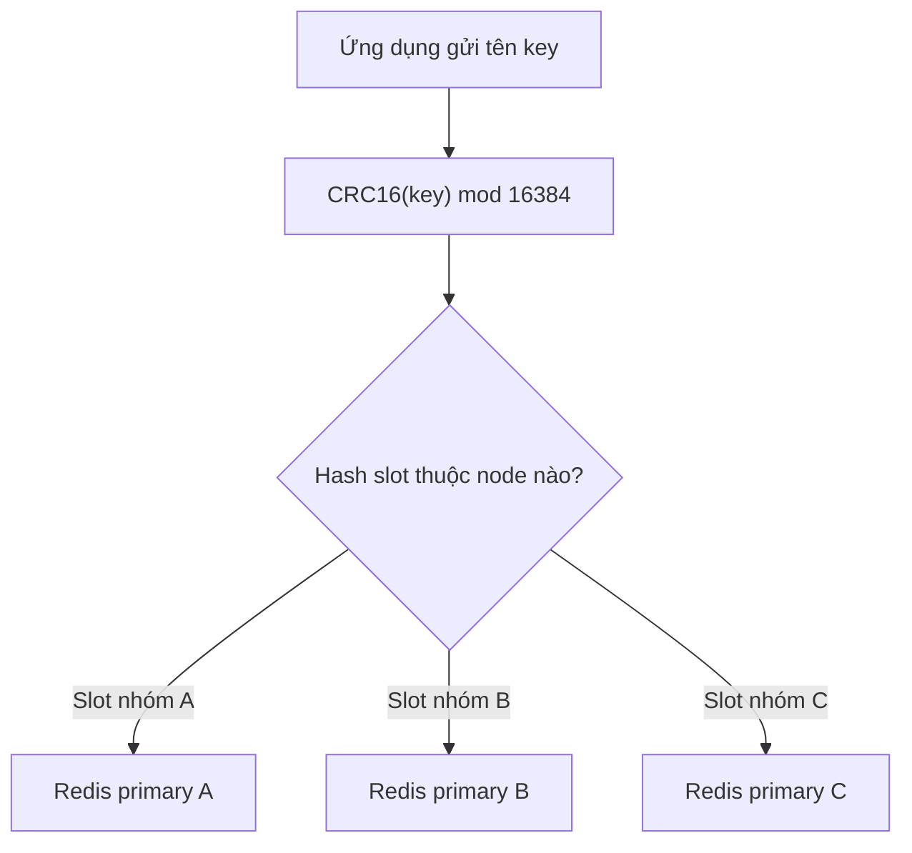

# Ràng buộc khóa của script trong Redis Cluster với Spring Data Redis

Lua script là một công cụ quan trọng khi ứng dụng Spring Data Redis cần **đọc, kiểm tra điều kiện và cập nhật dữ liệu trong một lần thực thi nguyên tử**. Khi Redis chạy ở chế độ standalone, một script có thể thao tác trên nhiều khóa thuộc cùng cơ sở dữ liệu. Nhưng khi chuyển sang **Redis Cluster**, các khóa được phân phối lên nhiều node theo *hash slot*. Điều đó dẫn tới một ràng buộc rất quan trọng: **các khóa mà script cần truy cập phải được khai báo trong danh sách key khi gọi script, và các khóa dùng chung trong một lượt thực thi phải thuộc cùng hash slot**.

Ví dụ, một script cần chuyển trạng thái đơn hàng đồng thời ghi thời điểm cập nhật vào hai Redis key. Nếu hai key được phân phối đến hai slot khác nhau, việc một lời gọi `EVAL` chứa cả hai key không thể tạo ra một giao dịch nguyên tử trải qua hai node Redis Cluster. Redis hoặc client có thể từ chối lời gọi với lỗi như `CROSSSLOT`. Nếu script còn tự xây một tên key khác ở trong Lua, nó có thể gặp lỗi truy cập key không thuộc node đang thực thi.

Trong bài này, chúng ta sẽ đi từ cấu trúc hash slot đến cách thiết kế tên key, sử dụng `KEYS` và `ARGV`, viết script Lua và gọi script bằng Spring Data Redis. Đồng thời, bài học giải thích việc resharding, retry, lỗi runtime và các cách thiết kế lại dữ liệu nếu nghiệp vụ thực sự cần cập nhật nhiều khóa ở những slot khác nhau.

## 1. Lua script đem lại tính nguyên tử như thế nào?

Redis cung cấp các lệnh như `EVAL` và `EVALSHA` để chạy Lua script trên server. Một script có thể gọi nhiều lệnh Redis, ví dụ:

```lua
local current = redis.call('GET', KEYS[1])
if current == ARGV[1] then
    redis.call('SET', KEYS[1], ARGV[2])
    return 1
end
return 0
```

Script này thực hiện phép *compare-and-set*:

1. Đọc giá trị của khóa được truyền qua `KEYS[1]`.
2. So sánh với giá trị mong đợi ở `ARGV[1]`.
3. Nếu bằng nhau, ghi giá trị mới ở `ARGV[2]` và trả `1`.
4. Nếu khác nhau, giữ nguyên dữ liệu và trả `0`.

Vì toàn bộ script được Redis thực thi liền mạch, các lệnh của client khác không chen vào giữa bước `GET` và `SET`. Cơ chế này giúp tránh race condition thường gặp với hai lời gọi Redis độc lập từ Java:

```java
String oldValue = redis.opsForValue().get(key);
if ("PENDING".equals(oldValue)) {
    redis.opsForValue().set(key, "PROCESSING");
}
```

Trong cách Java trên, hai worker có thể cùng nhìn thấy `PENDING` rồi cùng ghi `PROCESSING`. Chuyển điều kiện và thao tác cập nhật vào script là một cách thực hiện kiểm tra và thay đổi trong cùng một bước nguyên tử.

**Giới hạn cần nhớ:** tính nguyên tử của script áp dụng cho quá trình script được thực thi trên **một Redis node**. Nó không tự tạo transaction phân tán giữa nhiều node. Ngoài ra, Redis **không rollback** các lệnh đã thực hiện nếu script gặp lỗi runtime sau khi đã ghi dữ liệu.

## 2. Redis Cluster phân phối key bằng hash slot

Redis Cluster sử dụng **16.384 hash slot**, đánh số từ `0` đến `16383`. Mỗi slot được quản lý bởi một node primary tại một thời điểm. Các node có thể có replica phục vụ mục tiêu dự phòng, nhưng định tuyến thao tác ghi và thực thi script vẫn phải phù hợp với primary sở hữu slot.

Với một key thông thường, Redis tính slot theo công thức:

```text
HASH_SLOT = CRC16(key) mod 16384
```

Hai key có tên gần giống nhau **không có nghĩa** sẽ thuộc cùng slot:

```text
order:42:status
order:42:updatedAt
```

Dù cùng tiền tố `order:42:`, Redis vẫn tính hash từ toàn bộ tên từng key. Vì vậy các key này có thể thuộc những slot khác nhau, được phục vụ bởi những node khác nhau.

Có thể minh họa phân phối như sau:



Khi ứng dụng thực hiện lệnh đơn key như `GET order:42:status`, Redis Cluster client có thể xác định node chứa slot và gửi lệnh tới đúng nơi. Với thao tác gồm **nhiều key**, phải xét liệu một node duy nhất có thể thực hiện tất cả lệnh hay không.

### 2.1. Vì sao script nhiều key bị ràng buộc?

Giả sử script:

```lua
local status = redis.call('GET', KEYS[1])
redis.call('SET', KEYS[2], 'updated')
return status
```

Nếu `KEYS[1]` ở node A và `KEYS[2]` ở node B, một tiến trình Lua trên node A không thể tự biến thao tác ở node B thành một phần của lượt thực thi nguyên tử tại node A. Redis Cluster không có cơ chế tổng quát để thực thi một Lua script nguyên tử qua hai primary.

Vì vậy, **các key được truyền cho một lời gọi script phải thuộc cùng slot** trong mô hình sử dụng thông thường của `EVAL`, `EVALSHA` và Spring Data Redis.

### 2.2. Kiểm tra slot bằng Redis CLI

Redis cung cấp lệnh `CLUSTER KEYSLOT`:

```redis
CLUSTER KEYSLOT order:42:status
CLUSTER KEYSLOT order:42:updatedAt
```

Trong môi trường Cluster, hai lệnh trên trả về số slot tương ứng với mỗi key. Nếu hai slot khác nhau, không thể đưa hai key vào cùng một script cần tính nguyên tử trên một node như đang thiết kế.

Không nên dựa vào việc “trong môi trường thử nghiệm cả hai key đều đang nằm trên một máy vật lý”. **Cùng node ở thời điểm hiện tại nhưng khác slot không phải hợp đồng đúng** cho một script nhiều key. Khi cluster phân phối lại slot, giả định này càng dễ bị phá vỡ.

## 3. Hash tag: chủ động đưa các key liên quan vào cùng slot

Redis Cluster có cơ chế **hash tag**: khi tên key chứa một cặp ngoặc nhọn hợp lệ với phần nội dung không rỗng, Redis tính slot dựa trên phần nội dung trong cặp ngoặc nhọn đó.

Ví dụ:

```text
order:{42}:status
order:{42}:updatedAt
order:{42}:revision
```

Đối với ba key này, phần dùng để tính slot đều là `42`:

```text
CRC16("42") mod 16384
```

Do đó, cả ba key thuộc **cùng hash slot**, dù tên đầy đủ khác nhau.

| Key | Phần được hash | Cùng slot với `order:{42}:status`? |
|---|---|---|
| `order:{42}:status` | `42` | Có |
| `order:{42}:updatedAt` | `42` | Có |
| `invoice:{42}:link` | `42` | Có |
| `order:{43}:status` | `43` | Không được bảo đảm |
| `order:42:updatedAt` | Toàn bộ key | Không được bảo đảm |
| `{orders}:42:status` | `orders` | Không được bảo đảm |

Lưu ý, hai giá trị hash khác nhau **vẫn có khả năng tình cờ rơi vào cùng slot** vì chỉ có 16.384 slot. Khi thiết kế hệ thống, điều cần dựa vào là hash tag chung bảo đảm cùng slot; không dựa vào sự trùng slot tình cờ giữa hai tên key khác nhau.

### 3.1. Quy tắc đặt tên key cho một aggregate

Một quy ước phổ biến:

```text
<namespace>:{<aggregate-id>}:<field-or-purpose>
```

Ví dụ cho đơn hàng `42`:

```text
order:{42}:status
order:{42}:updatedAt
order:{42}:revision
order:{42}:auditFlag
```

Những khóa cùng đơn hàng được đặt cùng slot để có thể thao tác với nhau trong một script. Đơn hàng `43` dùng hash tag `{43}`, giúp dữ liệu của các aggregate khác nhau có cơ hội phân phối trên những slot khác nhau.

Hash tag nên được chọn dựa trên **ranh giới nguyên tử cần thiết**, không phải chỉ dựa trên tên module. Nếu tất cả key đều dùng `{orders}`, chúng có thể cùng dồn vào một slot, làm mất phần lớn lợi ích phân phối tải của Cluster.

### 3.2. Đừng dùng hash tag chung cho toàn hệ thống

Ví dụ không nên dùng đại trà:

```text
order:{all}:1:status
order:{all}:2:status
order:{all}:3:status
payment:{all}:4:state
```

Mọi key có `{all}` sẽ về cùng một slot. Nếu toàn bộ dữ liệu và lưu lượng nghiệp vụ tập trung ở đó, một primary dễ trở thành điểm nóng trong khi các node khác còn dư tài nguyên.

Nên dùng hash tag đủ hẹp:

```text
order:{1}:status
order:{2}:status
order:{3}:status
```

Điều này đồng nghĩa script cập nhật **hai đơn hàng khác ID** nói chung không thể nguyên tử với nhau trên Redis Cluster. Đó là một giới hạn của cách partition theo aggregate, phải được tính đến khi thiết kế nghiệp vụ.

### 3.3. Chú ý nội dung trong ngoặc nhọn

Redis xử lý hash tag theo quy tắc cú pháp tên key, không theo khái niệm ID của ứng dụng. Một tên key có ngoặc sai hoặc cặp ngoặc rỗng có thể không dùng phần tag như mong muốn.

Ví dụ:

```text
order:{42}:status   → tag "42"
order:{42}:audit    → tag "42"
order:{}:status     → không có tag không rỗng theo mẫu mong muốn
order:{42:status    → thiếu ngoặc đóng
```

Nếu ID được lấy từ input bên ngoài, cần có quy tắc tạo key an toàn và tránh đưa các ký tự `{` hoặc `}` bất ngờ vào phần hash tag. Một helper tạo key thống nhất sẽ dễ kiểm soát hơn việc ghép chuỗi thủ công ở nhiều nơi.

## 4. KEYS và ARGV trong EVAL: vai trò hoàn toàn khác nhau

Lệnh Redis `EVAL` có cấu trúc:

```text
EVAL <lua-script> <numkeys> <key1> ... <keyN> <arg1> ... <argM>
```

Ví dụ:

```redis
EVAL "return {KEYS[1], KEYS[2], ARGV[1]}" 2 order:{42}:status order:{42}:updatedAt PROCESSING
```

Ở đây:

- `2` là số lượng Redis key truyền cho script.
- `KEYS[1]` là `order:{42}:status`.
- `KEYS[2]` là `order:{42}:updatedAt`.
- `ARGV[1]` là chuỗi `PROCESSING`.

| Thành phần | Chứa gì? | Có tham gia hợp đồng định tuyến key? |
|---|---|---|
| `KEYS[1]`, `KEYS[2]`... | Tên những Redis key script sẽ truy cập | Có |
| `ARGV[1]`, `ARGV[2]`... | Giá trị, điều kiện, số lượng, timestamp, dữ liệu nghiệp vụ | Không |
| `numkeys` | Số phần tử đầu của danh sách tham số được coi là key | Có, phân tách key và argument |

**Quy tắc cốt lõi:** những key mà script truy cập cần được khai báo rõ thông qua phần key arguments khi gọi script. Không lấy `ARGV` làm nơi giấu tên key chỉ để vượt qua kiểm tra hash slot của client hoặc Redis.

### 4.1. Đúng: truyền đủ tên key vào KEYS

```lua
local state = redis.call('GET', KEYS[1])
if state ~= ARGV[1] then
    return 0
end

redis.call('SET', KEYS[1], ARGV[2])
redis.call('SET', KEYS[2], ARGV[3])
return 1
```

Ứng dụng phải truyền cả hai key qua `KEYS`. Nếu là Redis Cluster, cả hai key cần cùng slot.

### 4.2. Sai: xây key động từ ARGV trong Lua

Không nên viết:

```lua
-- Sai về hợp đồng khai báo key trong Redis Cluster:
local key = 'order:' .. ARGV[1] .. ':status'
return redis.call('GET', key)
```

Với lời gọi `EVAL ... 0 42`, Redis không được cung cấp key trong danh sách `KEYS` để client định tuyến tới slot tương ứng. Đôi khi code tình cờ hoạt động trong standalone hoặc một cấu hình kiểm thử cụ thể, nhưng không thể dựa vào đó khi triển khai Cluster.

Tương tự, cách viết sau cũng không đúng:

```lua
-- KEYS[2] không được khai báo trong EVAL:
local first = redis.call('GET', KEYS[1])
local second = redis.call('GET', KEYS[2])
return {first, second}
```

Nếu Java chỉ truyền một phần tử trong danh sách keys, `KEYS[2]` sẽ không tồn tại. Việc tự suy luận các key còn lại từ key đầu cũng vi phạm quy ước truyền tất cả tên key được truy cập.

### 4.3. Không lấy key name từ dữ liệu lưu trong Redis

Một tình huống khác:

```lua
local linkedKey = redis.call('GET', KEYS[1])
return redis.call('GET', linkedKey)
```

Ở đây script lấy **nội dung của key thứ nhất** rồi xem nội dung đó như tên một key khác. Kỹ thuật này khó định tuyến và có thể truy cập key không cùng slot hoặc không được khai báo. Trong Cluster, tránh thiết kế script khám phá tùy ý các key liên quan theo dữ liệu runtime.

Thay vào đó, ứng dụng nên biết trước các key cần thao tác, khai báo chúng trong `KEYS` và xác định mô hình dữ liệu để mọi key trong một lượt gọi cùng slot.

## 5. Ví dụ thực tế: đổi trạng thái đơn hàng và ghi thời điểm cập nhật

Yêu cầu:

> Chỉ chuyển đơn hàng từ `PENDING` sang `PROCESSING` nếu trạng thái hiện tại còn là `PENDING`; nếu chuyển thành công, cập nhật thêm thời điểm xử lý. Hai thay đổi phải thực hiện liền nhau trên Redis.

Chúng ta sử dụng hai key:

```text
order:{42}:status       = "PENDING"
order:{42}:updatedAt    = "2026-11-13T02:00:00Z"
```

Cả hai có chung hash tag `{42}`, vì vậy cùng slot.

### 5.1. Lua script

```lua
-- KEYS[1] = key trạng thái
-- KEYS[2] = key thời gian cập nhật
-- ARGV[1] = trạng thái hiện tại mong đợi
-- ARGV[2] = trạng thái mới
-- ARGV[3] = timestamp đã được ứng dụng chuẩn bị

local current = redis.call('GET', KEYS[1])
if current ~= ARGV[1] then
    return 0
end

redis.call('SET', KEYS[1], ARGV[2])
redis.call('SET', KEYS[2], ARGV[3])
return 1
```

Script đọc trạng thái và chỉ ghi cả hai key nếu điều kiện phù hợp. `SET` trong ví dụ không cần đọc giá trị timestamp trước đó. Kết quả trả `1` khi đã đổi trạng thái, `0` khi không khớp trạng thái mong đợi.

Ví dụ chạy trong Redis CLI:

```redis
SET order:{42}:status PENDING
SET order:{42}:updatedAt 2026-11-13T02:00:00Z
EVAL "local s=redis.call('GET',KEYS[1]); if s~=ARGV[1] then return 0 end; redis.call('SET',KEYS[1],ARGV[2]); redis.call('SET',KEYS[2],ARGV[3]); return 1" 2 order:{42}:status order:{42}:updatedAt PENDING PROCESSING 2026-11-13T02:30:00Z
```

Đọc lại:

```redis
GET order:{42}:status
GET order:{42}:updatedAt
```

Kết quả mong đợi khi không có lỗi và không có client khác sửa trạng thái trước đó:

```text
"PROCESSING"
"2026-11-13T02:30:00Z"
```

Nếu gọi script lần nữa vẫn mong đợi `PENDING`, script trả `0` và không ghi đè trạng thái `PROCESSING`.

### 5.2. Vì sao ví dụ chọn hai lệnh SET?

Ví dụ tập trung vào ràng buộc cùng slot và kiểm tra điều kiện trong Lua. Hai lệnh `SET` có tham số đã được chuẩn bị, giúp minh họa rõ quyền sở hữu key và thứ tự thực thi. Nếu ứng dụng cần giữ TTL hiện có, dùng các tùy chọn `SET` phù hợp với phiên bản Redis, chẳng hạn `KEEPTTL` (Redis 6.0 trở lên), hoặc thiết kế TTL trong cùng script theo chính sách đã định.

Đối với counter, tồn kho hay nghiệp vụ tiền tệ, script cần kiểm tra thêm kiểu dữ liệu, giới hạn số và điều kiện vượt ngưỡng. Một script Redis **có thể đã ghi một key rồi gặp lỗi trên key tiếp theo mà không tự rollback**. Vì vậy, kiểm tra các điều kiện có khả năng gây lỗi trước khi ghi là yêu cầu thiết kế riêng, bên cạnh điều kiện “cùng hash slot”.

## 6. Gọi Lua script bằng Spring Data Redis

Spring Data Redis cung cấp `RedisScript<T>` và `RedisTemplate.execute(...)`. Với `StringRedisTemplate`, các key và giá trị argument dạng chuỗi được mã hóa phù hợp khi chuyển tới Redis.

### 6.1. Khai báo RedisScript<Long>

```java
package com.example.redis.cluster;

import org.springframework.context.annotation.Bean;
import org.springframework.context.annotation.Configuration;
import org.springframework.data.redis.core.script.DefaultRedisScript;
import org.springframework.data.redis.core.script.RedisScript;

@Configuration
public class OrderScriptConfiguration {

    @Bean
    RedisScript<Long> transitionOrderScript() {
        String lua = """
                local current = redis.call('GET', KEYS[1])
                if current ~= ARGV[1] then
                    return 0
                end

                redis.call('SET', KEYS[1], ARGV[2])
                redis.call('SET', KEYS[2], ARGV[3])
                return 1
                """;

        DefaultRedisScript<Long> script = new DefaultRedisScript<>();
        script.setScriptText(lua);
        script.setResultType(Long.class);
        return script;
    }
}
```

Spring Data Redis có cơ chế chạy script bằng `EVALSHA` khi script đã được cache, và fallback qua `EVAL` khi cần. Cơ chế cache script liên quan đến node Redis đang nhận lời gọi; không nên xem việc script đã được load ở một node là bảo đảm nó đã có trên mọi node của Cluster.

### 6.2. Tạo key bằng hash tag và truyền đủ KEYS

```java
package com.example.redis.cluster;

import java.time.Instant;
import java.util.List;

import org.springframework.data.redis.core.StringRedisTemplate;
import org.springframework.data.redis.core.script.RedisScript;
import org.springframework.stereotype.Service;

@Service
public class OrderTransitionService {

    private final StringRedisTemplate redis;
    private final RedisScript<Long> transitionOrderScript;

    public OrderTransitionService(
            StringRedisTemplate redis,
            RedisScript<Long> transitionOrderScript) {
        this.redis = redis;
        this.transitionOrderScript = transitionOrderScript;
    }

    public boolean transition(
            String orderId,
            String expectedState,
            String nextState) {

        if (orderId == null
                || !orderId.matches("[A-Za-z0-9_-]+")) {
            throw new IllegalArgumentException("Invalid orderId");
        }
        if (expectedState == null || nextState == null) {
            throw new IllegalArgumentException(
                    "State must not be null");
        }

        // Cặp ngoặc nhọn tạo hash tag chung cho hai key.
        String tag = "{order-" + orderId + "}";
        String statusKey = "order:" + tag + ":status";
        String updatedAtKey = "order:" + tag + ":updatedAt";

        List<String> keys = List.of(statusKey, updatedAtKey);
        String timestamp = Instant.now().toString();

        Long result = redis.execute(
                transitionOrderScript,
                keys,
                expectedState,
                nextState,
                timestamp);

        return Long.valueOf(1L).equals(result);
    }
}
```

Giả sử `orderId = "42"`, danh sách key được truyền tới script là:

```text
KEYS[1] = order:{order-42}:status
KEYS[2] = order:{order-42}:updatedAt

ARGV[1] = expectedState
ARGV[2] = nextState
ARGV[3] = timestamp
```

Vì cả hai key chứa `{order-42}`, chúng được hash cùng một slot. Cả hai key phải được truyền vào danh sách `keys` của `execute(...)`. Ba tham số tiếp theo là **giá trị**, không phải tên key và không được dùng để điều khiển định tuyến.

### 6.3. Vì sao không đưa key thứ hai vào ARGV?

Một lỗi có thể gặp:

```java
// Sai về hợp đồng khai báo key cho Lua script trong Cluster.
redis.execute(
        transitionOrderScript,
        List.of(statusKey),  // Chỉ khai báo một key.
        expectedState,
        nextState,
        updatedAtKey);       // Lại giấu key thứ hai trong ARGV.
```

Nếu script sau đó sử dụng `ARGV[3]` làm tên Redis key để ghi dữ liệu, thư viện kết nối không có đủ thông tin để định tuyến script theo đúng tập key thực sự truy cập. Hơn nữa, `ARGV[3]` trong ví dụ đúng là **timestamp**, không phải một Redis key.

Phải truyền danh sách `keys` chứa mọi key cần thao tác rồi truyền những dữ liệu nghiệp vụ còn lại bằng argument.

### 6.4. Kết quả script và serializer

Với `DefaultRedisScript<Long>`, script trả số nguyên `0` hoặc `1` và Spring Data Redis chuyển thành `Long`. Dùng:

```java
Long result = redis.execute(script, keys, args);
boolean changed = Long.valueOf(1L).equals(result);
```

Hợp đồng này tránh ép kiểu thủ công từ `Object`. Khi script trả về chuỗi, list hoặc giá trị phức tạp, cần khai báo result type và serializer phù hợp với cách Spring Data Redis giải mã kết quả.

`StringRedisTemplate` cũng cần thống nhất serializer giữa lệnh ghi ban đầu và lệnh script. Nếu key được lưu bằng serializer nhị phân khác, tên key Java trông đúng vẫn có thể được mã hóa thành chuỗi byte không khớp với dữ liệu tồn tại.

## 7. Lỗi CROSSSLOT: nguyên nhân và cách sửa

Giả sử ứng dụng muốn thực thi một script cho hai key:

```text
inventory:sku-42:available
inventory:sku-42:reserved
```

Hai tên cùng tiền tố không bảo đảm cùng slot. Nếu lời gọi:

```redis
EVAL "return {redis.call('GET', KEYS[1]), redis.call('GET', KEYS[2])}" 2 inventory:sku-42:available inventory:sku-42:reserved
```

chứa key thuộc hai slot khác nhau, Redis Cluster hoặc client có thể từ chối với thông báo dạng:

```text
CROSSSLOT Keys in request don't hash to the same slot
```

Sửa bằng cách thống nhất một hash tag:

```text
inventory:{sku-42}:available
inventory:{sku-42}:reserved
```

Sau đó:

```redis
CLUSTER KEYSLOT inventory:{sku-42}:available
CLUSTER KEYSLOT inventory:{sku-42}:reserved
```

Hai lệnh phải trả **cùng một số slot**. Khi truyền vào `EVAL`, vẫn cần đúng `numkeys = 2`.

### 7.1. Không giải quyết CROSSSLOT bằng cách đổi driver một cách tùy tiện

Lettuce hoặc các Redis Cluster client khác có thể:

- Xác định slot dựa trên danh sách key.
- Chọn node sở hữu slot.
- Theo dõi thay đổi topology, chuyển hướng `MOVED`/`ASK` khi cần.
- Từ chối một thao tác không thể định tuyến đúng theo quy tắc Cluster.

Thay driver không tạo ra khả năng transaction Lua nguyên tử trải qua nhiều slot. Nguyên nhân nằm ở mô hình phân phối dữ liệu của Redis Cluster, nên cách sửa chủ yếu là **thiết kế key theo ranh giới nguyên tử phù hợp**.

### 7.2. Không giải quyết bằng cách truyền numkeys = 0

Một thủ thuật sai:

```redis
EVAL "return redis.call('GET', ARGV[1])" 0 order:42:status
```

Lệnh sử dụng argument như tên key, nhưng không khai báo key nào trong phần dùng để định tuyến. Nó vi phạm nguyên tắc khai báo các key được truy cập và không phù hợp để xây dựng code portable, đúng chuẩn Cluster.

Khi script thực sự không cần truy cập key nào, `numkeys = 0` có thể hợp lệ cho một logic tính toán thuần túy; đó là trường hợp hoàn toàn khác với việc giấu tên key trong `ARGV`.

## 8. Script truy cập key ngoài node có thể thất bại dù KEYS có vẻ đúng

Vấn đề không chỉ xuất hiện khi hai key được truyền qua `EVAL` có slot khác nhau. Script có thể truy cập một key **không được khai báo** hoặc được sinh động trong Lua:

```lua
local userId = ARGV[1]
local key = 'user:' .. userId .. ':balance'
return redis.call('GET', key)
```

Nếu key này nằm ở slot do node khác sở hữu, Redis có thể báo lỗi script truy cập **non-local key**. Kể cả khi key tình cờ cùng node, code vẫn phá vỡ hợp đồng khai báo key và có thể lỗi khi cluster reshard.

Một mẫu cần tránh khác:

```lua
local ids = redis.call('SMEMBERS', KEYS[1])
for _, id in ipairs(ids) do
    redis.call('GET', 'user:' .. id .. ':balance')
end
```

Script không thể giả định mọi key được suy ra từ nội dung Redis Set đều cùng slot và được khai báo. Nếu cần truy cập các key động, có thể:

1. Đọc ID bằng một bước riêng để ứng dụng biết tập key trước khi gọi script.
2. Chỉ gọi script với tập key đã xác định, cùng slot, truyền toàn bộ trong `KEYS`.
3. Nếu tập key phân tán qua nhiều slot, chia theo aggregate hoặc thiết kế lại mô hình dữ liệu.

Không có cách “gom mọi key tùy ý” vào một script nguyên tử toàn cluster khi chúng nằm trên các slot khác nhau.

## 9. Thiết kế lệnh chuyển tồn kho giữa hai khóa

Một trường hợp điển hình trong bài toán kho:

```text
inventory:{sku-42}:available
inventory:{sku-42}:reserved
```

Muốn chuyển một số lượng từ available sang reserved, cả hai key thuộc cùng hash tag `sku-42`. Lua có thể kiểm tra tồn kho, rồi cập nhật các bộ đếm trong cùng lượt thực thi trên node sở hữu slot.

Ví dụ minh họa:

```lua
-- KEYS[1] = available
-- KEYS[2] = reserved
-- ARGV[1] = quantity (số nguyên dương)

local quantity = tonumber(ARGV[1])
if not quantity or quantity <= 0 or quantity % 1 ~= 0 then
    return redis.error_reply('quantity must be a positive integer')
end

local availableRaw = redis.call('GET', KEYS[1])
local reservedRaw = redis.call('GET', KEYS[2])

local available = tonumber(availableRaw)
local reserved = tonumber(reservedRaw or '0')

if not available or not reserved then
    return redis.error_reply('invalid inventory counter')
end

if available < quantity then
    return 0
end

redis.call('DECRBY', KEYS[1], quantity)
redis.call('INCRBY', KEYS[2], quantity)
return 1
```

Ý nghĩa:

- Kiểm tra số lượng và giá trị hai counter trước khi ghi.
- Không chuyển hàng nếu available không đủ.
- Các thao tác ghi trong script thực thi liên tiếp, không bị client khác xen vào.
- Cả hai key phải cùng slot, ví dụ nhờ `{sku-42}`.

**Đây là mô hình học tập, chưa bao trùm mọi điều kiện an toàn của tồn kho sản xuất.** Redis dùng giới hạn số nguyên 64-bit cho `INCRBY`/`DECRBY`; script cần giới hạn dải giá trị và phòng tràn số trước khi chạy các lệnh nếu hệ thống có thể đạt giá trị cực lớn. Lua number cũng có giới hạn biểu diễn chính xác số nguyên lớn. Nếu `DECRBY` thành công rồi `INCRBY` thất bại do kiểu dữ liệu sai hoặc tràn, Redis **không tự rollback** thay đổi trước đó.

Với hệ thống cần độ chính xác cao, cân nhắc dùng một cấu trúc dữ liệu duy nhất với thao tác nguyên tử phù hợp, hoặc thiết kế script có kiểm tra đầy đủ điều kiện trước khi ghi, kiểm soát ownership dữ liệu và thử nghiệm các lỗi biên.

## 10. Có thể dùng một Redis Hash thay cho nhiều key không?

Đôi khi cách đơn giản nhất để tránh phụ thuộc vào multi-key là gom các giá trị liên quan thành **nhiều field của cùng một Redis Hash**:

```text
Redis key: inventory:{sku-42}

field       value
available   18
reserved     4
```

Một script thao tác Hash:

```lua
local available = tonumber(
    redis.call('HGET', KEYS[1], 'available'))

local reserved = tonumber(
    redis.call('HGET', KEYS[1], 'reserved') or '0')

local quantity = tonumber(ARGV[1])

if not available or not reserved or not quantity then
    return redis.error_reply('invalid inventory values')
end
if quantity <= 0 or quantity % 1 ~= 0 then
    return redis.error_reply('invalid quantity')
end
if available < quantity then
    return 0
end

redis.call('HINCRBY', KEYS[1], 'available', -quantity)
redis.call('HINCRBY', KEYS[1], 'reserved', quantity)
return 1
```

Ở đây chỉ có **một Redis key** (`KEYS[1]`), và cả hai thành phần được lưu thành các field của key đó. Cách này giảm nhu cầu truyền nhiều tên key, song vẫn cần kiểm tra định dạng số, overflow và yêu cầu của nghiệp vụ.

Các tiêu chí so sánh:

| Phương án | Ưu điểm | Cần lưu ý |
|---|---|---|
| Hai String key cùng hash tag | Cập nhật/TTL từng key linh hoạt | Phải giữ cùng slot; schema có nhiều key |
| Một Redis Hash chứa nhiều field | Chỉ cần một key; phù hợp aggregate nhỏ | TTL thường áp dụng cho toàn key; muốn hạn mức/TTL từng field cần thiết kế thêm |
| Nhiều key ở các slot khác nhau | Phân tán tải, linh hoạt partition | Không thể dùng một Lua script nguyên tử xuyên slot |

Thiết kế tốt thường đặt ranh giới nguyên tử theo **aggregate**: những field cần đổi cùng nhau nên có thể nằm trong một Hash hoặc nhóm key cùng tag; các aggregate độc lập được phân tán trên nhiều slot.

## 11. Nếu hai key thuộc hai slot khác nhau thì phải làm gì?

Giả sử có nghiệp vụ chuyển điểm giữa hai tài khoản:

```text
account:{alice}:balance
account:{bob}:balance
```

Hai hash tag khác nhau, nên hai key **không được bảo đảm cùng slot**. Không thể mặc định dùng một script Lua để trừ điểm Alice và cộng điểm Bob theo một giao dịch nguyên tử trên Redis Cluster.

Các hướng xử lý phụ thuộc yêu cầu nghiệp vụ:

### 11.1. Thiết kế lại ranh giới dữ liệu

Nếu hai giá trị luôn thuộc cùng một đối tượng nghiệp vụ, cân nhắc cùng hash tag, ví dụ theo `transferGroupId` hoặc một tài khoản tổng. Cách này phù hợp khi các key thật sự có chung ownership và cần cập nhật nguyên tử.

Không gom cả hệ thống vào một tag chỉ để xử lý một tác vụ hiếm gặp; đó có thể tạo hot slot và làm giảm khả năng mở rộng của Cluster.

### 11.2. Chia thành các tác vụ độc lập có bù trừ

Nếu hai key thực sự thuộc hai aggregate phân tán, ứng dụng có thể xây dựng quy trình nhiều bước:

```text
Ghi yêu cầu chuyển với operationId
        |
        v
Thực hiện bước 1 tại slot A
        |
        v
Thực hiện bước 2 tại slot B
        |
        v
Đánh dấu hoàn tất hoặc bù trừ khi thất bại
```

Đây là một workflow phân tán, **không có tính nguyên tử toàn cluster như một script đơn lẻ**. Phải xử lý retry, idempotency, trạng thái trung gian và cơ chế đối soát. Với nghiệp vụ tiền tệ, thông thường cần một nguồn dữ liệu có giao dịch và tính bền vững phù hợp làm nơi ghi nhận chính.

### 11.3. Chọn cơ chế lưu trữ khác

Nếu yêu cầu bắt buộc là giao dịch nhất quán trên nhiều đối tượng phân tán, database hỗ trợ transaction phù hợp có thể đáp ứng trực tiếp hơn. Redis vẫn có thể đóng vai trò cache, counter hoặc công cụ điều phối tốc độ cao nhưng không cần gánh những bảo đảm mà Cluster không cung cấp.

## 12. Resharding, failover và lỗi định tuyến script

Trong Redis Cluster, quản trị viên hoặc cơ chế tự động có thể di chuyển slot từ primary này sang primary khác. Client có thể gặp:

- `MOVED`: slot hiện thuộc node khác, cần cập nhật định tuyến.
- `ASK`: slot đang trong quá trình di chuyển, cần làm theo cơ chế chuyển hướng tạm thời.
- `TRYAGAIN`: thao tác tạm thời chưa thể hoàn tất trong một số trạng thái chuyển slot.
- `CROSSSLOT`: key của thao tác multi-key không có cùng hash slot.
- Lỗi script truy cập key không local: script cố dùng key ngoài node/phạm vi được định tuyến.

Driver hỗ trợ Cluster thường xử lý nhiều trường hợp chuyển hướng tự động. Tuy nhiên, một **script có side effect** sau khi timeout mạng có thể đã thực thi trên server trong khi client không nhận được kết quả. Không được retry một thao tác không idempotent vô hạn chỉ vì có lỗi kết nối.

Ví dụ, một script tăng counter:

```lua
return redis.call('INCR', KEYS[1])
```

Nếu Redis đã chạy `INCR` nhưng phản hồi bị mất, retry có thể làm tăng lần thứ hai. Với tác vụ cần “xử lý đúng một lần”, hãy thiết kế operation ID và thông tin đánh dấu đã xử lý **trong cùng slot**, để việc kiểm tra và cập nhật có thể nguyên tử trong một script.

### 12.1. Kỹ thuật idempotency theo operation ID

Có thể lưu:

```text
order:{42}:status
order:{42}:processed-ops
```

Vì hai key cùng `{42}`, script có thể kiểm tra operation ID đã tồn tại trong Set trước khi thay đổi trạng thái, rồi ghi lại ID trong cùng một lần chạy. Ví dụ khái niệm:

```lua
if redis.call('SISMEMBER', KEYS[2], ARGV[1]) == 1 then
    return 2  -- Đã xử lý operation này.
end

if redis.call('GET', KEYS[1]) ~= ARGV[2] then
    return 0  -- Trạng thái không cho phép.
end

redis.call('SET', KEYS[1], ARGV[3])
redis.call('SADD', KEYS[2], ARGV[1])
return 1
```

Ở đây:

- `KEYS[1]`: status key.
- `KEYS[2]`: Set chứa operation ID.
- `ARGV[1]`: operation ID.
- `ARGV[2]`: expected status.
- `ARGV[3]`: next status.

Quy tắc này giúp nhận biết việc gọi lại cùng một operation ID, **nếu thông tin đã xử lý còn được giữ**. Ứng dụng vẫn phải thiết kế TTL/retention của Set, trạng thái lỗi, giới hạn tăng trưởng bộ nhớ và xử lý các yêu cầu dùng lại operation ID sai mục đích. Vì Redis không rollback lỗi runtime trong script, các thao tác cũng cần được thiết kế để tránh lỗi sau khi ghi một phần.

## 13. Caching script và EVALSHA trong Cluster

Khi dùng `RedisScript`, Spring Data Redis có thể tính SHA1 của script rồi thử gọi `EVALSHA`. Nếu Redis trả `NOSCRIPT`, framework có thể gửi lại nội dung script bằng `EVAL` theo cơ chế triển khai tương ứng.

Trong Redis Cluster:

1. Script được thực thi trên node phù hợp với slot của các key.
2. Cache script thuộc về các server Redis riêng, không phải một registry duy nhất được bảo đảm sẵn có trên mọi node.
3. Sau failover, restart hoặc script cache bị xóa, node đích có thể không còn script trong cache.
4. Việc routing đổi node không có nghĩa script Java phải đổi nội dung; client/framework cần xử lý `NOSCRIPT` và nạp lại nếu hỗ trợ.

Không tự kết luận script đã được nạp ở toàn cluster chỉ vì một lần `SCRIPT LOAD` thành công trên một node. Ngoài ra, Redis 7.4 có chính sách loại bỏ script được nạp qua `EVAL`/`EVAL_RO` trong những điều kiện cache nhất định, nên code phải chấp nhận trường hợp cần gửi lại script.

Đối với script được dùng thường xuyên, khai báo nó thành một `RedisScript` tái sử dụng trong Spring Context giúp tránh tạo lại thông tin script liên tục. Điều đó chủ yếu cải thiện cách quản lý phía ứng dụng; **ràng buộc key cùng slot vẫn không thay đổi**.

## 14. Lua có thể gọi Redis command nào trong Cluster?

Từ trong Lua, `redis.call(...)` thực hiện các lệnh trên Redis server đang chạy script. Các giới hạn thông thường vẫn áp dụng:

- Lệnh truy cập key phải nằm trong phạm vi key được khai báo và khả dụng trên node đang chạy script.
- Với script nhiều key, các key phải tuân thủ ràng buộc cùng slot.
- Những lệnh không phù hợp với ngữ nghĩa script hoặc phạm vi Cluster có thể bị Redis từ chối.
- Các lệnh đọc/ghi phải tương thích với chế độ script và phiên bản Redis.
- Script chạy quá lâu có thể chặn khả năng xử lý lệnh khác trên node; cần giới hạn khối lượng xử lý.

Đặc biệt, không nên dùng Lua để quét toàn bộ keyspace bằng `KEYS *` hoặc xây dựng vòng lặp duyệt không giới hạn. Script chạy trong server, có thể kéo dài thời gian chiếm dụng Redis; pipeline hoặc job xử lý theo lô thường phù hợp hơn với khối lượng dữ liệu lớn.

### 14.1. Read-only script cũng cần quy tắc định tuyến

Redis có các cơ chế thực thi script chỉ đọc như `EVAL_RO` trong những phiên bản hỗ trợ. Một script không ghi vẫn cần truy cập đúng key trên đúng node. **Read-only không có nghĩa được tự do đọc khóa ở nhiều slot khác nhau** trong một lần thực thi Lua trên Cluster.

Khi dùng Spring Data Redis, cần chọn API/connection phù hợp nếu muốn tận dụng khả năng read-only của phiên bản Redis/driver đang dùng; `RedisTemplate.execute(RedisScript, ...)` thông thường không nên được diễn giải mặc nhiên là lời gọi `EVAL_RO`.

### 14.2. Redis Functions cũng không xóa giới hạn slot

Redis Functions cho phép đăng ký logic server-side bền vững hơn cách gọi script động trong một số trường hợp. Tuy nhiên, logic chạy trên từng Redis node vẫn phải tuân thủ mô hình key và định tuyến của Cluster. Chuyển từ `EVAL` sang `FCALL` không tạo ra transaction xuyên slot.

## 15. Các lỗi triển khai thường gặp với Spring Data Redis

### Lỗi 1: Đặt các key cùng tiền tố nhưng không cùng hash tag

```java
List<String> keys = List.of(
        "order:" + orderId + ":status",
        "order:" + orderId + ":updatedAt");
```

Hai key có thể thuộc slot khác nhau. Hãy dùng cùng tag:

```java
String tag = "{order-" + orderId + "}";
List<String> keys = List.of(
        "order:" + tag + ":status",
        "order:" + tag + ":updatedAt");
```

### Lỗi 2: Gửi tên key trong ARGV

```java
redis.execute(script, List.of(statusKey), updatedAtKey);
```

Nếu script dùng `updatedAtKey` như Redis key, đây là sai hợp đồng khai báo key. Hãy truyền:

```java
redis.execute(script, List.of(statusKey, updatedAtKey), timestamp);
```

### Lỗi 3: Sinh một key mới trong Lua

```lua
local nextKey = KEYS[1] .. ':metadata'
redis.call('SET', nextKey, ARGV[1])
```

Mặc dù key có thể tình cờ cùng slot nhờ hash tag, script vẫn không được cung cấp **toàn bộ key được truy cập** ở đầu vào. Nên tạo `nextKey` ở Java và truyền riêng qua `KEYS[2]`.

### Lỗi 4: Gộp tất cả key vào một hash tag cố định

```text
user:{global}:1:profile
user:{global}:2:profile
user:{global}:3:profile
```

Cách này khiến nhiều dữ liệu và nhiều thao tác dồn về cùng slot. Chọn tag theo aggregate hoặc một nhóm nhỏ thực sự cần tính nguyên tử.

### Lỗi 5: Dùng dữ liệu của Redis node này để tham chiếu key ở node khác

Script đọc ID hoặc key name từ Set/Hash rồi truy cập khóa được xây động không có bảo đảm cùng slot. Chuyển bước xác định key ra ngoài script và xác định rõ ranh giới dữ liệu.

### Lỗi 6: Tưởng script chạy nguyên tử nên luôn rollback

Script thực thi liên tiếp nhưng lỗi runtime sau một thao tác ghi **không hoàn tác** các thao tác đã thành công. Kiểm tra điều kiện, kiểu dữ liệu, giới hạn số và tính hợp lệ trước những thay đổi có thể gây lỗi sau đó.

### Lỗi 7: Dùng nhiều RedisTemplate với serializer không thống nhất

Nếu một template ghi key bằng serializer khác, script nhận key chuỗi từ `StringRedisTemplate` có thể truy cập khác dữ liệu mong đợi. Thống nhất key serializer và schema lưu trữ.

### Lỗi 8: Cho rằng WATCH hay MULTI có thể thay script xuyên slot

`MULTI/EXEC` và `WATCH` cũng chịu các ràng buộc phù hợp với Redis Cluster. Thay Lua bằng transaction thông thường không tự tạo cơ chế cập nhật nguyên tử trên nhiều primary khác slot.

### Lỗi 9: Bỏ qua resharding và trạng thái kết nối không chắc chắn

Trong lúc slot di chuyển, client có thể gặp chuyển hướng hoặc lỗi tạm thời. Với thao tác ghi, phải phân biệt retry an toàn với retry có nguy cơ lặp side effect.

### Lỗi 10: Tự xây tên key từ input chưa kiểm tra

Ghép trực tiếp ID tùy ý vào phần `{...}` có thể khiến dấu ngoặc trong input thay đổi cách Redis chọn hash tag. Dùng một helper và quy ước ID an toàn, có thể kiểm tra ký tự hợp lệ hoặc mã hóa ID theo chuẩn xác định.

## 16. Quy trình thiết kế script nhiều key trên Redis Cluster

Trước khi triển khai một script có nhiều `KEYS`, có thể làm tuần tự:

1. **Liệt kê toàn bộ Redis key mà script thực sự đọc hoặc ghi.** Không bỏ sót key được suy ra gián tiếp từ payload hay key khác.
2. **Xác định phạm vi dữ liệu cần nguyên tử.** Một order, một cart, một inventory SKU, một job hay nhiều aggregate độc lập?
3. **Chọn quy ước hash tag.** Mọi key cần chạy trong một script phải cùng tag; các aggregate khác nên có tag riêng để phân tán tải.
4. **Xây tên key ở phía ứng dụng.** Truyền tất cả qua `keys` của `RedisTemplate.execute(...)`.
5. **Đặt giá trị/điều kiện trong ARGV.** Bao gồm expected state, next state, quantity, timestamp hoặc operation ID.
6. **Kiểm tra slot.** Dùng `CLUSTER KEYSLOT` cho các key mẫu và nhớ rằng prefix chung không đủ.
7. **Thiết kế xử lý lỗi.** Phân biệt không thỏa điều kiện, `CROSSSLOT`, lỗi kiểu dữ liệu, Redis timeout, `NOSCRIPT`, slot migration và tình huống không biết server đã chạy hay chưa.
8. **Giới hạn thời gian và tài nguyên script.** Tránh loop không giới hạn, thao tác quá nhiều key hay phát sinh response lớn.
9. **Thiết kế idempotency khi cần retry.** Operation ID phải có vòng đời và phạm vi key cùng slot phù hợp.
10. **Đánh giá hot slot.** Hash tag chung có hỗ trợ nghiệp vụ nhưng có làm mất cân bằng tải của cluster không?

Với yêu cầu cập nhật xuyên nhiều aggregate độc lập ở các slot khác nhau, hãy xử lý ngay ở bước thiết kế: một script Lua không phải lời giải cho giao dịch phân tán.

## 17. Bài thực hành

### Bài 1 — Nhận diện key cùng slot

Cho các key:

```text
cart:{u-17}:items
cart:{u-17}:total
cart:{u-18}:items
cart:u-17:total
user:{u-17}:profile
```

Hãy xác định key nào chắc chắn cùng slot với `cart:{u-17}:items`. Đáp án: `cart:{u-17}:total` và `user:{u-17}:profile` vì cùng tag `{u-17}`. Các key còn lại không được bảo đảm cùng slot.

### Bài 2 — Sửa một script khai báo sai key

Script ban đầu:

```lua
local current = redis.call('GET', KEYS[1])
local auditKey = ARGV[1]
redis.call('SET', auditKey, current)
return 1
```

Yêu cầu sửa:

1. Tạo `auditKey` ở Java, truyền qua `KEYS[2]`.
2. Dùng hash tag chung cho key nguồn và key audit.
3. Chuyển những giá trị nghiệp vụ khác vào `ARGV`.
4. Giải thích tại sao sửa này giúp Redis Cluster định tuyến chính xác.

### Bài 3 — Gọi script với RedisScript<Long>

Tạo một script chỉ cập nhật `job:{jobId}:status` và `job:{jobId}:updatedAt` khi trạng thái cũ bằng giá trị mong đợi. Viết một `@Bean RedisScript<Long>` và gọi qua `StringRedisTemplate.execute(...)`, nhận `1L` hoặc `0L`.

Hãy thử:

- Lần đầu từ `PENDING` sang `RUNNING`: mong đợi `1`.
- Lần hai vẫn mong đợi `PENDING`: mong đợi `0`.
- Thay key thứ hai bằng một tên không có hash tag chung trên Cluster: quan sát lỗi hoặc hành vi định tuyến không hợp lệ.

### Bài 4 — Thiết kế lại bài toán chuyển điểm

Ban đầu:

```text
account:{alice}:points
account:{bob}:points
```

Hãy trình bày vì sao một script Lua không bảo đảm chuyển điểm nguyên tử xuyên hai account trên các slot khác nhau. Đề xuất một trong hai cách: đưa dữ liệu vào cùng một aggregate có ownership phù hợp hoặc xây dựng quy trình chuyển có operation ID, trạng thái và đối soát.

### Bài 5 — Khảo sát hot slot

So sánh:

```text
session:{all}:1001
session:{all}:1002
session:{all}:1003
```

với:

```text
session:{user-1}:1001
session:{user-2}:1002
session:{user-3}:1003
```

Hãy giải thích sự khác biệt về phân phối slot, chi phí truy cập cùng nhóm key và khả năng tạo điểm nóng khi lưu lượng tăng.

## 18. Những điểm cần ghi nhớ

| Câu hỏi | Quy tắc |
|---|---|
| Redis Cluster có bao nhiêu hash slot? | 16.384 slot, từ `0` đến `16383` |
| Hai key cùng prefix có chắc cùng slot không? | Không |
| Cách bảo đảm các key cùng slot? | Dùng chung hash tag, ví dụ `{order-42}` |
| Script chạy nguyên tử qua nhiều primary khác slot được không? | Không |
| Phải khai báo các key ở đâu? | Trong danh sách `KEYS` khi gọi `EVAL`/`RedisTemplate.execute(...)` |
| `ARGV` dùng cho gì? | Giá trị và tham số nghiệp vụ, không dùng để giấu tên key |
| Sửa lỗi `CROSSSLOT` bằng cách nào? | Thiết kế lại key để cùng slot, hoặc thay đổi ranh giới thao tác |
| Có thể gộp toàn bộ key vào một tag chung không? | Có thể về cú pháp nhưng dễ tạo hot slot, không nên làm bừa |
| Lua script lỗi runtime có tự rollback các lệnh đã chạy không? | Không |
| Làm sao biết slot của một key? | `CLUSTER KEYSLOT key` |
| Khi timeout có thể retry vô điều kiện không? | Không; thao tác có thể đã chạy, cần idempotency/đối soát |

Ràng buộc quan trọng nhất của Lua trong Redis Cluster là **mọi key cần truy cập phải được khai báo trước và thuộc phạm vi mà một node có thể xử lý, thông thường là cùng hash slot**. Ở Spring Data Redis, điều đó được hiện thực bằng cách **tạo đủ tên key ở Java, dùng cùng hash tag cho các key liên quan, truyền chúng trong tham số `keys` của `execute(...)` và chỉ dùng `ARGV` cho dữ liệu**.

Khi một nghiệp vụ đòi hỏi cập nhật nguyên tử những dữ liệu bắt buộc nằm ở nhiều slot khác nhau, giải pháp đúng là đánh giá lại ranh giới dữ liệu hoặc chọn một quy trình giao dịch phân tán phù hợp, thay vì cố lách quy tắc định tuyến của Cluster.

### Tài liệu tham khảo

- [Redis — Scripting with Lua](https://redis.io/docs/latest/develop/programmability/eval-intro/)
- [Redis — EVAL](https://redis.io/docs/latest/commands/eval/)
- [Redis — EVALSHA](https://redis.io/docs/latest/commands/evalsha/)
- [Redis — Redis Cluster specification](https://redis.io/docs/latest/operate/oss_and_stack/reference/cluster-spec/)
- [Redis — CLUSTER KEYSLOT](https://redis.io/docs/latest/commands/cluster-keyslot/)
- [Redis — Transactions](https://redis.io/docs/latest/develop/using-commands/transactions/)
- [Spring Data Redis — Scripting](https://docs.spring.io/spring-data/redis/reference/redis/scripting.html)
- [Spring Data Redis — RedisScript API](https://docs.spring.io/spring-data/redis/reference/api/java/org/springframework/data/redis/core/script/RedisScript.html)
