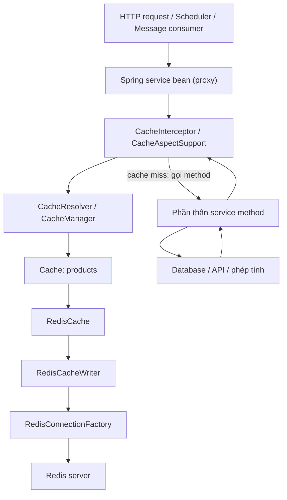
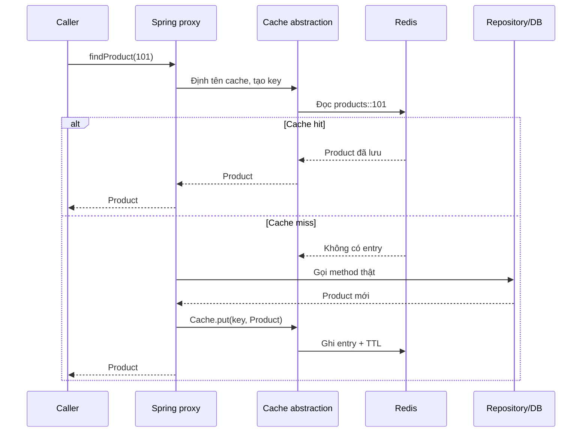
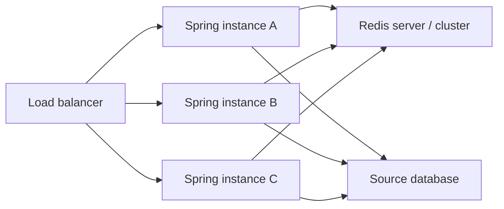

# Cơ chế Spring Cache abstraction và vị trí của Redis

> **Module:** Spring Data Redis  
> **Chương:** Spring Cache  
> **Mục tiêu:** Hiểu Spring Cache quản lý việc đọc/ghi cache qua annotation và các interface, vì sao Redis chỉ là một nhà cung cấp cache cụ thể, cũng như cách Spring Data Redis nối hai tầng với nhau trong ứng dụng Spring Boot.

## 1. Spring Cache abstraction giải quyết vấn đề gì?

Một ứng dụng thường phải đọc lại cùng dữ liệu nhiều lần: chi tiết sản phẩm, thông tin danh mục, bảng tỷ giá, cấu hình hiển thị, kết quả tính toán hoặc một truy vấn tổng hợp tốn thời gian. Nếu mỗi request đều thực hiện lại truy vấn cơ sở dữ liệu hoặc gọi HTTP tới dịch vụ khác, độ trễ và tải hệ thống sẽ tăng.

Cache cho phép lưu tạm **kết quả có thể dùng lại** dưới một khóa. Lần đầu ứng dụng tính toán hoặc tải dữ liệu; những lần sau có thể trả ngay kết quả cũ từ cache, miễn là kết quả còn hợp lệ theo chính sách của hệ thống.

Spring cung cấp **Spring Cache abstraction**, một lớp giao diện thống nhất cho thao tác cache:

- Lập trình viên đánh dấu những phương thức cần cache bằng `@Cacheable`, `@CachePut`, `@CacheEvict` và các annotation liên quan.
- Spring chặn lời gọi phương thức qua cơ chế advice/proxy và quyết định **có truy cập cache, gọi method thật, lưu hoặc xóa entry hay không**.
- Một `CacheManager` cung cấp các `Cache` tương ứng với tên vùng cache.
- Nhà cung cấp cache bên dưới thực hiện thao tác lưu trữ: có thể là cache trong RAM của JVM, Caffeine, Redis hoặc hệ thống khác.

**Redis không phải Spring Cache abstraction.** Redis là một Redis server có cấu trúc dữ liệu, lệnh, TTL, eviction và khả năng chia sẻ dữ liệu qua mạng. Spring Data Redis cung cấp triển khai giúp một `CacheManager` dùng Redis làm nơi lưu giá trị cache.

Điểm phân biệt quan trọng: việc dùng `@Cacheable` không bắt buộc phải dùng Redis; việc có `RedisTemplate` cũng không có nghĩa mọi phương thức của ứng dụng tự động được Spring cache.

### 1.1. Hình dung một lời gọi phương thức

Giả sử service có phương thức:

```java
@Cacheable(cacheNames = "products", key = "#id")
public Product findProduct(Long id) {
    return productRepository.findById(id).orElse(null);
}
```

Lần đầu gọi `findProduct(101L)`:

1. Spring tạo khóa cache từ đối số `id`.
2. Spring tìm cache tên `products`.
3. Cache chưa có entry cho khóa đó (*cache miss*).
4. Spring gọi phần thân `findProduct`, tải dữ liệu thực.
5. Spring lưu kết quả trả về vào cache theo cấu hình.
6. Người gọi nhận `Product`.

Lần thứ hai, nếu entry vẫn có hiệu lực:

1. Spring tìm cùng cache và cùng khóa.
2. Cache trả về entry đã lưu (*cache hit*).
3. Spring trả kết quả cho người gọi.
4. **Phần thân `findProduct` không được gọi**; truy vấn database được bỏ qua.

Với Redis làm backend, việc tra cứu cache là một hoặc một số lệnh gửi tới Redis qua mạng. Với cache local, việc này có thể chỉ là thao tác trong bộ nhớ tiến trình Java.

## 2. Kiến trúc: Spring Cache nằm ở đâu và Redis nằm ở đâu?



Sơ đồ biểu diễn những **trách nhiệm chính**, không nhằm mô tả mọi lớp nội bộ của một phiên bản Spring cụ thể.

### 2.1. Các thành phần trong Spring Cache

| Thành phần | Trách nhiệm | Có phụ thuộc trực tiếp Redis không? |
|---|---|---|
| `@Cacheable`, `@CachePut`, `@CacheEvict` | Mô tả hành vi cache ở phương thức | Không |
| `@EnableCaching` | Bật xử lý annotation và cache advice | Không |
| `CacheInterceptor` và hạ tầng advice | Kiểm tra cấu hình và chặn lời gọi phương thức | Không |
| `CacheManager` | Trả về vùng cache theo tên | Không |
| `Cache` | Giao diện `get`, `put`, `evict`, `clear`… | Không |
| `KeyGenerator` | Tạo khóa từ lời gọi và đối số | Không |
| `CacheResolver` | Quyết định dùng vùng cache nào | Không |
| `CacheErrorHandler` | Xử lý lỗi thao tác cache | Không |
| `RedisCacheManager` | Tạo/quản lý `RedisCache` | Có |
| `RedisCache` và `RedisCacheWriter` | Đọc, ghi, xóa entry trong Redis | Có |
| `RedisConnectionFactory` | Cung cấp kết nối Redis cho Spring Data Redis | Có |
| Redis server | Lưu trữ dữ liệu, TTL, eviction, memory, network | Là hệ thống bên ngoài |

Chính vì các tầng này tách biệt, cùng một service dùng `@Cacheable` có thể chạy với `ConcurrentMapCacheManager` khi thử nghiệm, Caffeine cho cache local hoặc `RedisCacheManager` khi triển khai nhiều instance, miễn là cấu hình và semantics đáp ứng được yêu cầu.

### 2.2. Hai tầng chính cần nắm

**Spring Cache abstraction** quyết định *khi nào* cache được dùng:

- Trước khi gọi method, có tra cứu cache hay không?
- Cache hit có bỏ qua việc gọi method không?
- Sau khi method trả kết quả, có lưu cache không?
- Khi cập nhật/xóa dữ liệu, entry nào phải bị xóa?

**Redis backend** quyết định *cách* dữ liệu cache được lưu và tồn tại:

- Key/value được serialize thành bytes ra sao?
- Redis key có TTL bao lâu?
- Redis đặt dữ liệu trong RAM, nhân bản, persist thế nào?
- Khi chạm `maxmemory`, entry nào có thể bị eviction?
- Nhiều instance ứng dụng cùng đọc/ghi cache như thế nào?

Không nên nhầm `@Cacheable` với lệnh `GET` của Redis; annotation có thể dẫn đến `GET` khi dùng Redis, nhưng annotation còn có logic gọi phương thức, tạo khóa, điều kiện, xử lý null và lỗi cache.

## 3. CacheManager và Cache: các interface tạo nên tính trừu tượng

Spring định nghĩa hợp đồng chính trong package `org.springframework.cache`.

### 3.1. Interface `CacheManager`

Ý tưởng cốt lõi:

```java
public interface CacheManager {
    Cache getCache(String name);
    Collection<String> getCacheNames();
}
```

Một implementation quản lý các vùng cache như `products`, `categories`, `exchangeRates`. Mỗi tên thường biểu diễn một tập dữ liệu hoặc chính sách cache.

- Với `ConcurrentMapCacheManager`, vùng cache có thể được giữ trong `ConcurrentMap` trong JVM.
- Với `CaffeineCacheManager`, vùng cache dựa trên Caffeine và có chính sách local.
- Với `RedisCacheManager`, vùng cache được triển khai thông qua Redis; các vùng thường sử dụng tiền tố key để tách tên.

Tên cache mang ý nghĩa ở **tầng Spring**. Redis không có khái niệm native tên `CacheManager` hay annotation `@Cacheable`.

### 3.2. Interface `Cache`

`Cache` cung cấp các thao tác như:

- `get(key)`: đọc một entry;
- `get(key, type)`: đọc với kiểu mong muốn;
- `get(key, Callable)`: đọc hoặc tính giá trị nếu chưa có, tùy support từ provider;
- `put(key, value)`: lưu entry;
- `evict(key)`: xóa một entry;
- `clear()`: xóa các entry thuộc vùng cache;
- các phương thức liên quan `putIfAbsent`, `evictIfPresent` hoặc `invalidate` tùy bản API và implementation.

`Cache` giao tiếp bằng đối tượng Java, còn Redis lưu bytes/kiểu dữ liệu riêng. `RedisCache` chịu trách nhiệm chuyển đổi giữa hợp đồng Spring Cache và thao tác Redis.

### 3.3. CacheManager được chọn lúc runtime

Ví dụ service:

```java
@Service
public class CatalogService {
    @Cacheable(cacheNames = "products", key = "#id")
    public Product findProduct(long id) {
        // Tải sản phẩm từ nguồn dữ liệu chuẩn.
    }
}
```

Source code của `CatalogService` không cần biết bean là `RedisCacheManager` hay `CaffeineCacheManager`. Spring lấy implementation `CacheManager` từ application context và dùng nó để phục vụ annotation. Nếu có nhiều cache manager, cần chỉ định bean hoặc thuộc tính `cacheManager`/`cacheResolver` tương ứng để tránh mơ hồ.

Tuy vậy, “thay provider mà không sửa service” không đồng nghĩa mọi behavior đều giống nhau: các provider khác nhau ở TTL, eviction, hỗ trợ null, tính nhất quán, serialization, locking và độ trễ.

## 4. Cơ chế advice/proxy khi `@Cacheable` hoạt động

### 4.1. Spring intercept method thế nào?

Ở chế độ mặc định, `@EnableCaching` dùng cơ chế **Spring AOP proxy**. Spring tạo proxy cho Spring bean có thao tác cache. Lời gọi từ bên ngoài đi qua proxy rồi tới CacheInterceptor; interceptor áp dụng cache behavior trước/sau khi quyết định gọi method thật.



Vì interceptor nằm trước method, việc một method có annotation không làm Redis tự hiểu phương thức Java. Redis chỉ nhìn thấy các thao tác đọc/ghi key từ adapter của Spring Data Redis.

### 4.2. Vấn đề self-invocation

Ví dụ:

```java
@Service
public class ProductService {

    @Cacheable(cacheNames = "products", key = "#id")
    public Product findProduct(long id) {
        return loadFromDatabase(id);
    }

    public Product findForHomepage(long id) {
        return this.findProduct(id); // Gọi nội bộ trong cùng object
    }
}
```

Lời gọi `this.findProduct(id)` không đi qua proxy bên ngoài của Spring. Trong chế độ proxy mặc định, advice của `@Cacheable` thường **không được áp dụng cho lời gọi nội bộ này**.

Cách thiết kế đơn giản là để phương thức có cache được gọi qua một Spring bean khác, hoặc tách nhiệm vụ cache thành một service riêng. Nếu sử dụng chế độ AspectJ weaving, cơ chế intercept sẽ khác; không nên coi mọi cấu hình đều có cùng giới hạn proxy.

Một số điểm liên quan:

- Method không được gọi qua Spring bean proxy sẽ không được cache advice xử lý.
- Gọi method từ constructor hoặc vòng đời initialization có thể không đi qua proxy như mong đợi.
- Việc intercept phụ thuộc visibility, loại proxy, `final` và cấu hình Spring AOP; dùng các public service methods được gọi qua Spring bean thường dễ dự đoán.
- Annotation là metadata; nó chỉ có hiệu lực khi `@EnableCaching` và hạ tầng phù hợp đã được kích hoạt.

## 5. Các annotation quan trọng

### 5.1. `@Cacheable`: đọc trước, chỉ tính khi miss

```java
@Cacheable(cacheNames = "products", key = "#id")
public Product getProduct(long id) {
    return repository.findById(id).orElse(null);
}
```

- **Hit:** trả giá trị đã lưu, thông thường không gọi method.
- **Miss:** gọi method rồi lưu kết quả nếu được phép.
- Nếu cache provider hoặc serializer gặp lỗi, behavior phụ thuộc `CacheErrorHandler` và cấu hình ứng dụng; mặc định thường đẩy exception lên caller.

Thuộc tính thường dùng:

| Thuộc tính | Ý nghĩa |
|---|---|
| `cacheNames` / `value` | Tên vùng cache |
| `key` | Biểu thức SpEL tạo key |
| `keyGenerator` | Bean custom tạo key khi không dùng `key` |
| `condition` | Điều kiện quyết định có áp dụng cache operation hay không, đánh giá trước method |
| `unless` | Điều kiện veto việc lưu kết quả, đánh giá sau khi method chạy |
| `sync` | Yêu cầu provider phối hợp để nhiều lần load cùng key tránh tính toán trùng, với các giới hạn cụ thể |
| `cacheManager` | Tên bean CacheManager được chỉ định cho operation |
| `cacheResolver` | Tên bean CacheResolver chọn cache cho operation |

Ví dụ:

```java
@Cacheable(
    cacheNames = "products",
    key = "#id",
    condition = "#id > 0",
    unless = "#result == null"
)
public Product getProduct(long id) {
    return repository.findById(id).orElse(null);
}
```

Trong ví dụ trên, id không hợp lệ không được cache; kết quả `null` không được lưu vì `unless`. `unless` chỉ có thể đánh giá kết quả sau khi method chạy, nên không ngăn việc method được gọi trên cache miss.

### 5.2. `@CachePut`: luôn gọi method rồi cập nhật cache

```java
@CachePut(cacheNames = "products", key = "#result.id")
public Product updateProduct(long id, ProductPatch patch) {
    Product product = repository.findById(id).orElseThrow();
    product.setName(patch.name());
    return repository.save(product);
}
```

`@CachePut` **không bỏ qua phần thân method khi cache đã có dữ liệu**. Nó chạy method và dùng giá trị trả về để cập nhật entry.

Điều này hữu ích khi logic cập nhật database trả về phiên bản dữ liệu mới. Tuy nhiên không nên kết hợp tùy tiện `@Cacheable` và `@CachePut` trên cùng method, vì một annotation muốn bỏ qua method khi hit, annotation kia muốn method luôn chạy.

Trong ví dụ, `Product` và `ProductPatch` là kiểu domain của ứng dụng, minh họa cách dùng annotation, không phải lớp có sẵn từ Spring.

### 5.3. `@CacheEvict`: xóa cache khi dữ liệu thay đổi

```java
@CacheEvict(cacheNames = "products", key = "#id")
public void deleteProduct(long id) {
    repository.deleteById(id);
}
```

Mặc định `beforeInvocation = false`: Spring thực hiện cache eviction **sau khi method kết thúc thành công**. Nếu method ném exception, eviction sau method thông thường sẽ không diễn ra.

Muốn xóa bất kể kết quả method, có tùy chọn `beforeInvocation = true`, nhưng phải hiểu rủi ro cache bị xóa trước khi công việc thực tế hoàn tất.

Xóa toàn bộ một vùng cache:

```java
@CacheEvict(cacheNames = "products", allEntries = true)
public void rebuildProductCatalog() {
    refreshSourceData();
}
```

Với Redis, `allEntries = true` có thể dẫn đến thao tác xóa nhiều key; cần đánh giá số lượng key, thuật toán quét và chi phí. Không dùng làm hành động định kỳ tùy tiện trên cache lớn.

### 5.4. `@Caching` và `@CacheConfig`

`@Caching` dùng khi một method cần nhiều thao tác cache:

```java
@Caching(evict = {
    @CacheEvict(cacheNames = "products", key = "#id"),
    @CacheEvict(cacheNames = "productSearch", allEntries = true)
})
public void deleteProductAndInvalidateSearch(long id) {
    repository.deleteById(id);
}
```

`@CacheConfig` đặt cấu hình chung ở cấp lớp:

```java
@CacheConfig(cacheNames = "products")
@Service
public class ProductQueryService {

    @Cacheable(key = "#id")
    public Product findById(long id) {
        return repository.findById(id).orElseThrow();
    }
}
```

`@CacheConfig` **không tự kích hoạt việc cache mọi method**. Annotation cấp method vẫn cần có operation như `@Cacheable` hoặc `@CacheEvict`.

## 6. Cache key: từ đối số Java đến Redis key

### 6.1. Key mặc định trong Spring Cache

Spring Cache có cơ chế tạo key mặc định, thường sử dụng `SimpleKeyGenerator`:

| Đối số method | Key logic mặc định |
|---|---|
| Không có đối số | `SimpleKey.EMPTY` |
| Một đối số khác `null` | Đối số đó |
| Nhiều đối số | `SimpleKey` chứa các đối số |

Ví dụ:

```java
@Cacheable("products")
public Product findById(long id) { ... }

@Cacheable("products")
public Product findByStoreAndId(String store, long id) { ... }
```

Khóa logic ở Spring là object. Khi dùng Redis, `RedisCache` còn phải **chuyển khóa thành biểu diễn chuỗi/bytes** theo cấu hình key conversion và serializer.

### 6.2. Vì sao nên tạo key tường minh?

Nếu một cache name được dùng bởi nhiều phương thức có cùng kiểu đối số nhưng nghĩa khác nhau, key có thể va chạm:

```java
@Cacheable("users")
public User findById(long id) { ... }

@Cacheable("users")
public User findOwnerByOrderId(long orderId) { ... }
```

Cả hai method có thể tạo key mặc định `123`; nhưng `userId = 123` và `orderId = 123` không phải cùng một đối tượng dữ liệu. Cách giải quyết là tách cache name hoặc định nghĩa key có ngữ cảnh:

```java
@Cacheable(cacheNames = "usersById", key = "#id")
public User findById(long id) { ... }

@Cacheable(cacheNames = "ownerByOrder", key = "#orderId")
public User findOwnerByOrderId(long orderId) { ... }
```

Cache name thường được RedisCacheManager đưa vào prefix. Với cấu hình mặc định, key có thể có hình thức:

```text
products::101
categories::5
ownerByOrder::9001
```

Đây là **quy ước mặc định phổ biến**, không phải cú pháp bắt buộc của Redis. Có thể cấu hình prefix/serialization khác.

### 6.3. Biểu thức SpEL

`@Cacheable` hỗ trợ SpEL:

```java
@Cacheable(
    cacheNames = "prices",
    key = "#region + ':' + #sku"
)
public Price findPrice(String region, String sku) { ... }
```

Nếu method bị cache, logical key phản ánh vùng và mã hàng. Nên giữ key ổn định, xác định và không chứa dữ liệu nhạy cảm không cần thiết. Các khóa quá dài có thể làm tăng bộ nhớ và chi phí quản lý.

Không dùng đối tượng mutable làm key nếu `equals/hashCode/toString` có thể thay đổi giữa các lần gọi. Không nên dựa vào `toString()` mặc định của object không ổn định để làm khóa Redis.

## 7. Redis được tích hợp bằng RedisCacheManager như thế nào?

Spring Data Redis cung cấp `RedisCacheManager` trong package:

```text
org.springframework.data.redis.cache.RedisCacheManager
```

Implementation này cung cấp các `RedisCache` theo tên, dùng `RedisCacheWriter` và `RedisConnectionFactory` để giao tiếp Redis. Mô hình hoạt động khái quát:

```text
@Cacheable("products")
       |
       v
CacheInterceptor
       |
       v
CacheManager.getCache("products")
       |
       v
RedisCache.get(logicalKey)
       |
       v
Chuyển key thành bytes (prefix + serializer)
       |
       v
Redis GET trên Redis key tương ứng
       |
       +-- hit --> Deserialize value --> trả kết quả
       |
       +-- miss --> gọi method --> Serialize --> Redis SET + TTL
```

Để dùng Redis như cache provider, ứng dụng cần có các thành phần:

- Kết nối tới Redis, thông thường qua `RedisConnectionFactory` (Lettuce hoặc Jedis).
- Một `RedisCacheManager` được cấu hình với factory tương ứng.
- `@EnableCaching` để Spring xử lý cache annotations.
- Domain methods được gọi qua Spring proxy.
- Một chiến lược TTL, serializer, key prefix và invalidation phù hợp.

**Không cần** định nghĩa Redis Repository chỉ để dùng Spring Cache. Redis Repository (`@RedisHash`, `CrudRepository`) là một API khác nhằm lưu entity thành Redis Hash.

### 7.1. Spring Boot starter và cấu hình cơ bản

Ví dụ dependencies cho Gradle Kotlin DSL:

```kotlin
dependencies {
    implementation("org.springframework.boot:spring-boot-starter-cache")
    implementation("org.springframework.boot:spring-boot-starter-data-redis")
}
```

Một ứng dụng Spring Boot có thể cấu hình:

```yaml
spring:
  data:
    redis:
      host: localhost
      port: 6379
      timeout: 2s

  cache:
    type: redis
    cache-names:
      - products
      - categories
    redis:
      time-to-live: 15m
      cache-null-values: false
      use-key-prefix: true
```

Thuộc tính `spring.cache.type: redis` yêu cầu Spring Boot dùng Redis cache provider khi hạ tầng tương ứng có mặt. `spring.cache.redis.time-to-live` là TTL mặc định do Spring Boot chuyển tới cấu hình cache Redis; nó **không** đặt TTL cho mọi key được viết qua `RedisTemplate` và cũng **không** điều chỉnh `maxmemory` ở Redis server.

`spring.cache.cache-names` định danh những vùng cache dự kiến. Tùy cấu hình CacheManager, việc cho phép tạo cache mới động và tập cache đã được định nghĩa có thể khác nhau.

Bật caching ở ứng dụng:

```java
import org.springframework.boot.SpringApplication;
import org.springframework.boot.autoconfigure.SpringBootApplication;
import org.springframework.cache.annotation.EnableCaching;

@SpringBootApplication
@EnableCaching
public class CatalogApplication {

    public static void main(String[] args) {
        SpringApplication.run(CatalogApplication.class, args);
    }
}
```

Với điều kiện Spring Boot tự cấu hình `RedisCacheManager` thành công, các lời gọi `@Cacheable` sẽ dùng Redis.

### 7.2. Cấu hình RedisCacheManager trực tiếp bằng Java

Khi cần nhiều cache có TTL khác nhau:

```java
import java.time.Duration;
import java.util.Map;

import org.springframework.cache.annotation.EnableCaching;
import org.springframework.context.annotation.Bean;
import org.springframework.context.annotation.Configuration;
import org.springframework.data.redis.cache.RedisCacheConfiguration;
import org.springframework.data.redis.cache.RedisCacheManager;
import org.springframework.data.redis.connection.RedisConnectionFactory;

@Configuration
@EnableCaching
public class CacheConfiguration {

    @Bean
    public RedisCacheManager cacheManager(
            RedisConnectionFactory connectionFactory) {

        RedisCacheConfiguration defaults =
                RedisCacheConfiguration.defaultCacheConfig()
                        .entryTtl(Duration.ofMinutes(15))
                        .disableCachingNullValues();

        RedisCacheConfiguration productCache =
                defaults.entryTtl(Duration.ofHours(2));

        RedisCacheConfiguration categoryCache =
                defaults.entryTtl(Duration.ofMinutes(30));

        return RedisCacheManager.builder(connectionFactory)
                .cacheDefaults(defaults)
                .withInitialCacheConfigurations(Map.of(
                        "products", productCache,
                        "categories", categoryCache))
                .build();
    }
}
```

Ví dụ này thể hiện:

- Những cache không có cấu hình riêng dùng TTL 15 phút.
- `products` có TTL 2 giờ.
- `categories` có TTL 30 phút.
- Không lưu `null` vào các vùng cache theo cấu hình này.
- TTL ở đây được áp vào **entry do Cache abstraction quản lý**.

Khi tự cung cấp `RedisCacheManager` bean, một số tùy chỉnh tự động từ `spring.cache.redis.*` của Spring Boot có thể không được áp dụng như khi Boot tạo bean. Vì vậy phải xác định rõ **nguồn cấu hình thực tế** là properties, customizer hay bean tự khai báo; không nên giả định chúng sẽ tự hợp nhất.

### 7.3. TTL mặc định nếu không cấu hình

`RedisCacheConfiguration.defaultCacheConfig()` mặc định thường:

- không đặt expiration cho entry (`eternal` theo nghĩa TTL không được tự gắn);
- cho phép cache giá trị `null` bằng cơ chế wrapper của cache;
- dùng tiền tố cache name cho Redis key;
- dùng String serialization cho key;
- dùng JDK serialization cho value.

Đây là **mặc định của Spring Data Redis configuration**, có thể bị thay đổi bởi Spring Boot properties hoặc custom configuration.

Nếu cache của hệ thống cần tự làm mới dữ liệu, nên xác định TTL rõ ràng. “Không TTL” không có nghĩa entry sẽ tồn tại chắc chắn mãi: Redis vẫn có thể loại key do eviction, xóa thủ công, restart hoặc mất dữ liệu tùy cấu hình persistence.

## 8. Serialization: value Java được cất trong Redis như thế nào?

### 8.1. Redis không trực tiếp lưu object Java

Redis làm việc với bytes và các kiểu Redis như String, Hash, List, Set. Với `RedisCache`, thông thường cache entry được ghi thành một **Redis String key/value**:

```text
Java Product object
        |
        v
RedisCacheConfiguration (serializer)
        |
        v
Byte array
        |
        v
Redis String value under "products::101"
```

Khi cache hit, RedisCache đọc value rồi deserializes thành object Java để trả về. Nếu serializer ghi và đọc không tương thích, có thể xuất hiện lỗi deserialization, sai kiểu hoặc cache miss logic do key khác định dạng.

### 8.2. Vì sao mặc định JDK serializer cần chú ý?

JDK serialization thuận tiện nếu kiểu object và cấu trúc tương thích, nhưng có những giới hạn:

- Value dạng nhị phân khó đọc bằng `redis-cli GET`.
- Dữ liệu đã serialize có thể không tương thích sau khi đổi Java class hoặc phiên bản ứng dụng.
- Có yêu cầu an toàn khi xử lý dữ liệu serialized không tin cậy.
- Không thuận tiện khi ứng dụng viết bằng ngôn ngữ khác cùng đọc Redis.

Trong các dự án thực tế, nhiều nhóm chuyển sang định dạng JSON với serializer được kiểm soát hoặc lưu DTO đơn giản. Việc chọn serializer không nên chỉ dựa vào mong muốn “dễ nhìn” mà phải xét versioning, bảo mật, hiệu năng, kích thước payload và tính tương thích với dữ liệu cũ.

### 8.3. Ví dụ tùy chỉnh value serializer

Với một hệ thống chọn JSON để trao đổi giá trị cache:

```java
import java.time.Duration;

import org.springframework.context.annotation.Bean;
import org.springframework.context.annotation.Configuration;
import org.springframework.data.redis.cache.RedisCacheConfiguration;
import org.springframework.data.redis.cache.RedisCacheManager;
import org.springframework.data.redis.connection.RedisConnectionFactory;
import org.springframework.data.redis.serializer.GenericJackson2JsonRedisSerializer;
import org.springframework.data.redis.serializer.RedisSerializationContext;

@Configuration
public class JsonCacheConfiguration {

    @Bean
    public RedisCacheManager cacheManager(
            RedisConnectionFactory connectionFactory) {

        var jsonSerializer = new GenericJackson2JsonRedisSerializer();

        RedisCacheConfiguration settings =
                RedisCacheConfiguration.defaultCacheConfig()
                        .entryTtl(Duration.ofMinutes(30))
                        .disableCachingNullValues()
                        .serializeValuesWith(
                                RedisSerializationContext.SerializationPair
                                        .fromSerializer(jsonSerializer));

        return RedisCacheManager.builder(connectionFactory)
                .cacheDefaults(settings)
                .build();
    }
}
```

Ví dụ này là **một phương án thay thế** cho bean CacheManager ở mục trước, không khai báo đồng thời cả hai bean cùng tên. `GenericJackson2JsonRedisSerializer` có thể sử dụng metadata kiểu để khôi phục object; cần chọn phiên bản thư viện, cơ chế polymorphic typing và lớp được phép deserialize phù hợp chính sách bảo mật của dự án.

Đối với API JSON mới hơn hoặc kiến trúc nhiều service, có thể chủ động thiết kế DTO, schema version, allowlist kiểu và serializer cụ thể. Đổi serializer khi Redis còn cache entry cũ cần kế hoạch xóa/migrate dữ liệu: một byte sequence JDK có thể không được JSON parser đọc được.

### 8.4. Cấu hình RedisTemplate có tự đổi serializer của RedisCacheManager?

**Không nên giả định như vậy.**

- `RedisTemplate` có `keySerializer`, `valueSerializer`, `hashKeySerializer` và `hashValueSerializer` riêng cho những thao tác dùng template đó.
- `RedisCacheManager` sử dụng `RedisCacheConfiguration` của từng cache với cách chuyển key/value thành bytes.
- `Redis Repository` sử dụng entity-to-Hash mapping và `RedisConverter`/index metadata.

Ba API có thể dùng chung `RedisConnectionFactory`, nhưng quy tắc serialization được cấu hình tại từng tầng. Thay `redisTemplate.setValueSerializer(...)` **không tự sửa** serializer của `RedisCacheManager` đã được cấu hình độc lập.

## 9. Cơ chế cache-aside và việc dữ liệu nguồn thay đổi

### 9.1. Spring Cache thường được dùng theo mô hình cache-aside

Một phương thức `@Cacheable` thực hiện kiểu **read-through ở tầng ứng dụng**, gần với mô hình cache-aside:

1. Ứng dụng tra cache trước.
2. Miss thì ứng dụng gọi phương thức lấy dữ liệu nguồn.
3. Ứng dụng lưu kết quả vào cache.
4. Lần sau ứng dụng dùng kết quả cache nếu còn.

Mô hình này hiệu quả khi dữ liệu đọc nhiều, cập nhật ít và chấp nhận dữ liệu có thể chậm hơn nguồn thật một khoảng nhất định.

Redis **không tự đồng bộ** khi database thay đổi. Nếu một công cụ ngoài Spring sửa record, Redis không tự biết `products::101` đã lỗi thời. Vì thế cần chiến lược invalidation hoặc thời gian sống được tính toán.

### 9.2. Ví dụ service đọc và xóa cache khi ghi

```java
import org.springframework.cache.annotation.CacheEvict;
import org.springframework.cache.annotation.Cacheable;
import org.springframework.stereotype.Service;
import org.springframework.transaction.annotation.Transactional;

@Service
public class CatalogService {

    private final ProductRepository repository;

    public CatalogService(ProductRepository repository) {
        this.repository = repository;
    }

    @Cacheable(cacheNames = "products", key = "#id",
               unless = "#result == null")
    public Product findById(long id) {
        return repository.findById(id).orElse(null);
    }

    @Transactional
    @CacheEvict(cacheNames = "products", key = "#id")
    public void renameProduct(long id, String newName) {
        Product product = repository.findById(id).orElseThrow();
        product.setName(newName);
        repository.save(product);
    }
}
```

`Product` và `ProductRepository` là kiểu domain/persistence của ứng dụng; ví dụ cho thấy vị trí của cache annotation.

Khi update thành công, eviction làm lần đọc kế tiếp đi tới database lấy dữ liệu mới. Tuy nhiên annotation `@CacheEvict` nằm cùng `@Transactional` **không đủ tự bảo đảm** eviction xảy ra sau khi database commit. Thứ tự advice, transaction manager và cấu hình cache transaction awareness có thể ảnh hưởng thời điểm thực tế.

### 9.3. Nhất quán với database transaction

Một nguy cơ:

```text
T1: Update product trong database transaction, chưa commit
T2: Spring evict cache products::101
T3: Request khác cache miss, đọc dữ liệu database cũ
T4: Request khác lưu dữ liệu cũ trở lại Redis
T5: Transaction commit giá trị mới
Kết quả: Redis có thể giữ bản cache cũ
```

Nếu cần giảm nguy cơ này, có thể dùng cache manager có khả năng **transaction-aware** để trì hoãn `put`/`evict`/`clear` tới sau commit của Spring-managed transaction, hoặc chủ động publish invalidation sau commit bằng application event/transaction synchronization.

Trong Spring Data Redis, builder của `RedisCacheManager` hỗ trợ chế độ `transactionAware()`:

```java
return RedisCacheManager.builder(connectionFactory)
        .cacheDefaults(settings)
        .transactionAware()
        .build();
```

Đây là minh họa đoạn builder để bổ sung vào cấu hình CacheManager; `settings` là `RedisCacheConfiguration` đã tạo. Nó **không** biến Redis và database thành một giao dịch ACID thống nhất. Các thao tác tức thời như `putIfAbsent` hay `evictIfPresent` có semantics riêng và không được trì hoãn giống mọi thao tác cache thông thường.

Ngay cả với eviction sau commit, race giữa reader và updater hoặc nhiều instance vẫn có thể tồn tại; cần cân nhắc versioned key, invalidation event, TTL hợp lý hoặc cache-aside protocol cẩn thận tùy yêu cầu nhất quán.

### 9.4. Cache data phải được xem là dữ liệu có thể mất

Với một phương thức `@Cacheable`, việc Redis xóa entry vì TTL, eviction, restart hoặc một đợt clear thông thường chỉ nên làm tăng số lần method thật được gọi.

Nếu ứng dụng **không thể tạo lại** dữ liệu khi Redis key biến mất, đó có thể không còn là cache theo đúng mô hình; cần xác định nguồn dữ liệu chuẩn và độ bền thích hợp.

Đừng đưa các quyết định không thể đảo ngược (ví dụ hoàn tất thanh toán) chỉ dựa vào sự hiện diện của một cache key. Cache có thể mất hoặc lỗi ngay cả khi kết nối Redis đang khỏe.

## 10. TTL và eviction: ai kiểm soát điều gì?

### 10.1. TTL được gắn khi ghi entry

`RedisCacheConfiguration.entryTtl(Duration.ofMinutes(15))` yêu cầu RedisCache ghi entry cùng thời gian sống phù hợp. TTL thường đếm từ lúc entry được **tạo hoặc cập nhật**, không mặc định tự làm mới chỉ vì có lần đọc.

Ví dụ:

```text
12:00:00  Cache miss -> lưu products::101 TTL 15 phút
12:05:00  Cache hit  -> TTL còn khoảng 10 phút
12:14:00  Cache hit  -> TTL còn khoảng 1 phút
12:15:00  Key hết hạn; lần đọc sau miss và tải lại
```

Một số phiên bản Spring Data Redis cung cấp cơ chế mô phỏng **time to idle (TTI)** thông qua `GETEX` khi bật `enableTimeToIdle()` trên cache configuration. Đây là cấu hình **riêng** và yêu cầu Redis hỗ trợ `GETEX`; không nên nhầm nó với TTL mặc định của Spring Cache.

### 10.2. Eviction của Redis server độc lập TTL

Redis có thể được cấu hình:

```conf
maxmemory 512mb
maxmemory-policy allkeys-lru
```

Khi vượt ngưỡng bộ nhớ, Redis có thể loại entry theo chính sách server. Một key cache có TTL 2 giờ vẫn có thể bị eviction sớm nếu Redis thiếu bộ nhớ.

Phân biệt:

| Cơ chế | Điều khiển ở đâu? | Tác động |
|---|---|---|
| `@Cacheable` | Spring method annotation | Quyết định đọc/cache kết quả phương thức |
| `entryTtl(...)` | `RedisCacheConfiguration` | TTL cho entry trong RedisCache |
| `@CacheEvict` | Spring Cache advice | Chủ động xóa entry hoặc vùng cache |
| `maxmemory` | Redis server | Ngưỡng bộ nhớ Redis dùng để áp dụng eviction |
| `maxmemory-policy` | Redis server | Quy tắc loại key khi có áp lực bộ nhớ |
| `EXPIRE`, `DEL` | Redis commands | Đặt TTL hoặc xóa key trực tiếp |

`@CacheEvict` của Spring Cache **không đồng nghĩa** `maxmemory eviction` của Redis. Chúng cùng dẫn tới việc key có thể biến mất nhưng nguyên nhân, thời điểm và cách giám sát khác nhau.

### 10.3. Chọn TTL như thế nào?

TTL phụ thuộc bản chất dữ liệu:

- Danh mục ít thay đổi: có thể cache dài hơn nhưng phải invalidation khi update.
- Giá hoặc tồn kho thay đổi liên tục: cần TTL ngắn hơn hoặc cơ chế đồng bộ rõ ràng.
- Dữ liệu bản quyền hoặc dữ liệu nhạy cảm: cần xét vòng đời, khả năng thu hồi và bảo vệ dữ liệu.
- Kết quả truy vấn rất đắt: TTL dài có lợi cho hiệu năng, nhưng tăng rủi ro dữ liệu cũ.

Cần phân biệt **độ mới chấp nhận được** (freshness requirement) với **thời gian tồn tại tối đa** (TTL). TTL không tự đảm bảo dữ liệu vẫn mới trong khoảng TTL; invalidation và versioning quyết định điều đó.

## 11. Tên cache, prefix và tránh đụng key

Một Redis server có thể đồng thời lưu:

```text
products::101             <-- Spring Cache
categories::2             <-- Spring Cache
session:auth:abc          <-- StringRedisTemplate
inventory:sku-42          <-- RedisTemplate / nghiệp vụ
users:100                 <-- Redis Repository Hash
```

Spring Data Redis có thể áp dụng prefix `cacheName::` cho RedisCache key. Prefix giúp tránh va chạm giữa `products` và `categories` có cùng logical key `101`.

Ví dụ cấu hình prefix:

```java
RedisCacheConfiguration config =
        RedisCacheConfiguration.defaultCacheConfig()
                .computePrefixWith(cacheName -> "catalog:v1:" + cacheName + "::");
```

Kết quả minh họa:

```text
catalog:v1:products::101
catalog:v1:categories::2
```

Prefix phiên bản như `catalog:v1` có thể giúp tránh đọc entry cũ khi schema value thay đổi. Tuy nhiên key cũ có thể tiếp tục chiếm bộ nhớ cho tới khi TTL hết hạn hoặc bị cleanup.

**Không dùng chung Redis key** cho hai API kỳ vọng hai Redis data type hoặc serializer khác nhau. Ví dụ nếu Redis Repository dùng `users:100` dưới dạng Redis Hash, một Spring Cache tên `users` tùy cấu hình prefix có thể gây xung đột nếu tự tắt prefix hoặc dựng key trùng.

`disableKeyPrefix()` làm tăng rủi ro va chạm giữa các vùng cache và có thể tạo phạm vi `clear()` khó kiểm soát; chỉ dùng khi hiểu rõ tác động.

## 12. So sánh Spring Cache với RedisTemplate và Redis Repository

### 12.1. Ba API, ba trách nhiệm

| Tiêu chí | Spring Cache + RedisCacheManager | RedisTemplate / StringRedisTemplate | Redis Repository |
|---|---|---|---|
| Đầu vào lập trình | Method result | Redis key/value và lệnh native | Entity, id, mapping |
| API chính | `@Cacheable`, `@CachePut`, `@CacheEvict` | `opsForValue`, `opsForHash`, `expire`, script… | `save`, `findById`, finder |
| Redis được dùng thế nào | Backend cho `Cache` | Data store Redis trực tiếp | Store entity thành Redis Hash |
| TTL | `RedisCacheConfiguration` | Lệnh `EXPIRE`/`SET EX`… | `@RedisHash(timeToLive)`, `@TimeToLive` |
| Serializer/mapping | RedisCacheConfiguration | RedisSerializer của từng template | RedisConverter, mapping context |
| Có thể bỏ qua gọi method khi hit? | Có, qua cache advice | Không tự động | Không tự động |
| Có tự index field domain? | Không | Không | Có thể có `@Indexed` |
| CacheManager bắt buộc? | Có | Không | Không |
| Spring AOP proxy cần cho annotations? | Có ở chế độ proxy mặc định | Không | Không cho thao tác repository CRUD |
| Có thể dùng cùng Redis server? | Có | Có | Có |

Ví dụ cùng đọc sản phẩm:

**Spring Cache:**

```java
@Cacheable(cacheNames = "products", key = "#id")
public Product load(long id) {
    return database.loadProduct(id);
}
```

**RedisTemplate:**

```java
String cacheKey = "product:" + id;
String json = stringRedisTemplate.opsForValue().get(cacheKey);
if (json == null) {
    Product product = database.loadProduct(id);
    json = objectMapper.writeValueAsString(product);
    stringRedisTemplate.opsForValue().set(
            cacheKey, json, Duration.ofMinutes(15));
}
```

Đoạn template chỉ minh họa ý tưởng; ứng dụng thực tế phải xử lý ngoại lệ JSON và các kiểu dữ liệu domain tương ứng. Với template, lập trình viên tự viết mọi nhánh hit/miss, serialization, TTL và fallback.

**Repository:**

```java
Optional<ProductRedisEntity> entity = productRepository.findById(id);
```

Repository trả entity đã lưu trong Redis, không tự tra database nguồn khi Redis miss. Nếu muốn cache-aside với repository, lập trình viên phải thiết kế thêm luồng tải dữ liệu gốc và lưu entity.

### 12.2. Khi nào nên dùng cái nào?

- **Spring Cache:** kết quả của một phương thức có thể tái tạo và nhu cầu chính là tránh tính lại/gọi lại.
- **RedisTemplate:** cần Redis data structures, atomic counter, sorted set, Lua, transaction, pipeline hoặc kiểm soát trực tiếp key/value.
- **Redis Repository:** cần CRUD entity trên Redis và mapping/index theo mô hình repository.

Một ứng dụng có thể dùng cả ba. Tuy nhiên hãy quy định **quyền sở hữu key**: tầng nào tạo, cập nhật, xóa và thay đổi TTL. Việc xóa/ghi trực tiếp bằng template vào Redis key do RedisCacheManager quản lý có thể phá vỡ cache semantics.

## 13. Redis là cache chia sẻ: lợi ích và đánh đổi

### 13.1. Một Redis cho nhiều instance ứng dụng



Cùng một Redis backend giúp các instance Spring nhìn thấy cùng một cache key/value theo cấu hình serializer và prefix tương thích. Một instance warm cache có thể làm instance khác hit ngay.

Với cache local (ví dụ Caffeine mỗi JVM), instance A và B thường có các bản sao cache riêng. Cập nhật và invalidation phải được thiết kế riêng nếu muốn đồng bộ nhiều instance.

### 13.2. Lợi ích thường gặp

- Giảm lượng truy vấn tới nguồn dữ liệu.
- Chia sẻ cache giữa nhiều pod/instance.
- TTL/eviction được quản lý tập trung.
- Tăng cache hit trong hệ thống nhiều instance.
- Dễ theo dõi thống kê Redis server.
- Không cần viết thủ công logic cache-aside cho từng method.

### 13.3. Chi phí và giới hạn

- Cache hit Redis vẫn cần mạng: có RTT, serialization và khả năng timeout.
- Redis trở thành dependency cần monitoring và capacity planning.
- Lưu object lớn khiến network, RAM và CPU serialize tăng.
- Redis không tự đảm bảo dữ liệu nhất quán với database.
- Redis có thể evict entry sớm hơn TTL.
- Cache clear hàng loạt có thể tạo tải lớn.
- Khả năng khôi phục sau Redis restart/failover phụ thuộc vận hành và thiết kế fallback.

Không nên kỳ vọng Redis luôn nhanh hơn Caffeine cho một single-JVM cache nhỏ: cache local tránh network. Nhưng local cache không chia sẻ entry giữa nhiều instance; nhu cầu phân tán thường là lý do chọn Redis.

## 14. Những vấn đề khó khi cache dữ liệu thực tế

### 14.1. Cache stampede: nhiều request cùng miss

Giả sử key `products::101` vừa hết TTL, có 200 request đến cùng thời điểm:

```text
200 requests
    |
    +--> Redis miss
    +--> Redis miss
    +--> Redis miss
    ...
    +--> 200 truy vấn database cùng key
```

Khi dùng `@Cacheable` thông thường, có thể xảy ra nhiều lần method thật chạy đồng thời trên cache miss. Một phương án là:

```java
@Cacheable(cacheNames = "products", key = "#id", sync = true)
public Product getProduct(long id) {
    return repository.findById(id).orElseThrow();
}
```

`sync = true` yêu cầu cache provider hỗ trợ cách load đồng bộ theo key. Có các hạn chế: không kết hợp tùy ý với `unless`, thường chỉ dùng một cache name và không dùng với những cache operation khác trên cùng method.

**Không suy ra `sync = true` là distributed lock bảo đảm chỉ một lần gọi database trên toàn bộ các node Spring.** Mức đồng bộ thực tế phụ thuộc `Cache` implementation, RedisCacheWriter và phiên bản. Với rủi ro tải lớn giữa nhiều pod, nên thiết kế thêm cơ chế giảm stampede (request coalescing, TTL jitter, distributed coordination phù hợp, prewarm hoặc stale-while-revalidate).

### 14.2. Cache penetration: key không tồn tại

Nếu client liên tục gọi id không có trong database:

```text
GET /products/999999
Redis miss
Database miss
Redis không lưu null
Request tiếp theo lặp lại
```

Nếu cấu hình `disableCachingNullValues()`, kết quả null không được lưu, nên các truy vấn thiếu dữ liệu có thể đánh database nhiều lần.

Một số ứng dụng cho phép cache kết quả “không tồn tại” trong TTL ngắn để giảm truy vấn lặp; cần cẩn thận vì sản phẩm có thể được tạo sau đó và negative cache sẽ che kết quả mới trong một khoảng thời gian.

### 14.3. Cache avalanche: nhiều key hết hạn cùng lúc

Nếu 100.000 key được tạo gần cùng một thời điểm và TTL cùng 30 phút, chúng có thể hết hạn gần nhau, dẫn tới tăng đồng thời cache miss và tải nguồn dữ liệu.

Giải pháp có thể là làm lệch thời điểm làm mới, TTL jitter, prewarm, rate limit, phân tầng cache và bảo vệ database. TTL của RedisCacheConfiguration thường được cấu hình theo cache name; nếu cần TTL theo entry hoặc cách tạo jitter, phải thiết kế phù hợp API/phiên bản Spring Data Redis đang dùng.

### 14.4. Cache staleness: dữ liệu cũ vẫn được phục vụ

Nếu một service thay đổi database nhưng không xóa/ghi lại cache, các service khác có thể tiếp tục đọc giá trị cũ cho tới hết TTL. Điều này là vấn đề **invalidation** hơn là hiệu năng Redis.

Đối với dữ liệu quan trọng, cần quy định ai là nguồn chuẩn, đường cập nhật và thời điểm invalidate. Với event-driven updates, hệ thống phải xét trường hợp event mất, gửi trùng hoặc đến sai thứ tự.

### 14.5. Vấn đề đổi phiên bản object

Khi deploy phiên bản mới, class `Product` có thể thêm/bớt field. Entry Redis cũ có thể không giải mã được bằng serializer mới, đặc biệt với JDK serializer hoặc JSON có polymorphic type metadata.

Các chiến lược gồm:

- Đặt version vào prefix key (ví dụ `catalog:v2:`).
- Dùng DTO cache có schema/version rõ.
- Thiết kế tương thích ngược khi deserialize.
- Chủ động xóa vùng cache cũ có kiểm soát.
- Đặt TTL hợp lý để dữ liệu cũ tự giảm dần.

Nếu lưu dữ liệu nhạy cảm, cần kiểm soát Redis ACL/TLS, quyền kết nối, log và chính sách lưu trữ; annotation `@Cacheable` không tự mã hóa value.

## 15. Redis failure và CacheErrorHandler

### 15.1. Cache là tối ưu hóa hay dependency bắt buộc?

Trong thiết kế cache-aside, Redis không có dữ liệu hoặc Redis tạm thời lỗi thường có thể được xử lý bằng cách gọi nguồn dữ liệu chuẩn. Nhưng Spring Cache **không tự động bỏ qua mọi lỗi Redis**: behavior khi cache operation lỗi phụ thuộc vào provider và `CacheErrorHandler`.

Mặc định, lỗi truy cập cache có thể làm lời gọi phương thức thất bại thay vì tự fallback. Nếu ứng dụng muốn Redis là cache “best effort”, cần cấu hình chính sách bỏ qua lỗi đọc/ghi phù hợp, cùng với cảnh báo để không che giấu sự cố kéo dài.

### 15.2. Ví dụ một CacheErrorHandler cho cache có thể tái tạo

```java
import org.springframework.cache.Cache;
import org.springframework.cache.interceptor.CacheErrorHandler;
import org.springframework.cache.interceptor.CachingConfigurer;
import org.springframework.context.annotation.Configuration;

@Configuration
public class CacheFailureConfiguration implements CachingConfigurer {

    @Override
    public CacheErrorHandler errorHandler() {
        return new CacheErrorHandler() {

            @Override
            public void handleCacheGetError(
                    RuntimeException exception, Cache cache, Object key) {
                // Log/metric thực tế nên được ghi ở đây.
                // Không ném exception: cache miss và gọi method nguồn.
            }

            @Override
            public void handleCachePutError(
                    RuntimeException exception, Cache cache,
                    Object key, Object value) {
                // Method đã tạo kết quả: lỗi put được ghi nhận.
            }

            @Override
            public void handleCacheEvictError(
                    RuntimeException exception, Cache cache, Object key) {
                // Không được âm thầm bỏ qua trong use case cần consistency.
            }

            @Override
            public void handleCacheClearError(
                    RuntimeException exception, Cache cache) {
                // Phải cảnh báo khi không clear được cache.
            }
        };
    }
}
```

Đây là **mẫu minh họa chính sách fail-open** cho dữ liệu có thể tái tạo, không phải khuyến nghị dùng nguyên xi trong mọi hệ thống. Nếu bỏ qua lỗi `evict`, Redis có thể tiếp tục giữ giá trị **cũ**. Vì vậy cần đánh giá riêng rủi ro của `get`, `put`, `evict` và `clear`; với dữ liệu yêu cầu tính mới chặt chẽ, có thể phải fail-closed hoặc retry/invalidate bằng cơ chế khác.

Một handler không ném lỗi cũng không làm Redis phục hồi hay đảm bảo fallback luôn đúng. Fallback chỉ an toàn nếu phương thức nguồn có thể chạy và trả kết quả hợp lệ.

## 16. Quan sát và đo hiệu quả Spring Cache + Redis

### 16.1. Chỉ số ở tầng ứng dụng

Những điều nên đo:

- Số lượng cache hit, miss và put/evict theo cache name.
- Thời gian xử lý method khi cache miss so với hit.
- Số truy vấn database/API nguồn phát sinh.
- Redis command latency và timeout.
- Tỷ lệ lỗi deserialize, connection và permission.
- Số lần cache invalidation và tác động tới tải nguồn.

Không phải mọi RedisCache implementation đều cung cấp thống kê hit/miss nội bộ theo mặc định; Spring Data Redis có khả năng bật thống kê cache cục bộ ở CacheManager builder, ví dụ:

```java
RedisCacheManager cacheManager = RedisCacheManager
        .builder(connectionFactory)
        .cacheDefaults(settings)
        .enableStatistics()
        .build();
```

Các số liệu thống kê cache của Spring Data Redis là **local đối với ứng dụng/CacheManager**, không tự động là tổng toàn Redis Cluster hay toàn bộ pod. Nếu cần số liệu toàn hệ thống, tổng hợp metrics từ các instance và Redis server qua monitoring thích hợp.

### 16.2. Chỉ số tại Redis server

```bash
redis-cli INFO stats
redis-cli INFO memory
redis-cli INFO keyspace
redis-cli CONFIG GET maxmemory
redis-cli CONFIG GET maxmemory-policy
```

Những chỉ số đáng chú ý:

| Chỉ số Redis | Ý nghĩa |
|---|---|
| `keyspace_hits` | Số lượt tra cứu key thành công trên Redis |
| `keyspace_misses` | Số lượt tra cứu không tìm thấy key |
| `expired_keys` | Key bị xóa vì hết hạn |
| `evicted_keys` | Key bị loại bỏ do áp lực bộ nhớ |
| `used_memory` | Bộ nhớ theo thống kê Redis |
| `used_memory_rss` | Bộ nhớ tiến trình trong RAM hệ điều hành |
| `maxmemory` | Ngưỡng bộ nhớ áp cho eviction |
| `connected_clients` | Số client đang kết nối |
| `instantaneous_ops_per_sec` | Mức hoạt động Redis xấp xỉ tại thời điểm đo |

**Chú ý:** `keyspace_hits`/`keyspace_misses` phản ánh mọi thao tác tra cứu tương ứng trong Redis, không chỉ lời gọi `@Cacheable` của một ứng dụng. Không thể lấy tổng của Redis rồi coi đó là tỷ lệ hit riêng của cache `products` khi instance còn phục vụ RedisTemplate, Repository hoặc service khác.

### 16.3. Công thức đánh giá cache hit ratio

Trên cùng khoảng thời gian đo, có thể dùng:

```text
hit_ratio = hits / (hits + misses)
```

Khi đọc bộ đếm Redis tích lũy, dùng **delta giữa hai thời điểm**, không chia trực tiếp tổng lifetime nếu mục tiêu là đánh giá một cửa sổ thời gian.

Hit ratio cao không luôn đồng nghĩa cache hiệu quả: một cache entry khổng lồ có thể gây tăng RAM và network; cache hit dù nhiều vẫn có thể tốn thời gian deserialize; hoặc entry cũ có thể gây sai nghiệp vụ. Cần kết hợp hit ratio với latency, memory, freshness và tải nguồn dữ liệu.

## 17. Thử nghiệm và chẩn đoán annotation không hoạt động

### 17.1. Một ví dụ hành vi mong đợi

Giả sử phương thức:

```java
@Cacheable(cacheNames = "products", key = "#id")
public Product load(long id) {
    System.out.println("Load product from source: " + id);
    return repository.findById(id).orElseThrow();
}
```

Khi gọi **qua Spring bean proxy** hai lần với cùng id:

```text
Lần 1: load(101) -> cache miss -> in log -> đọc database -> lưu Redis
Lần 2: load(101) -> cache hit  -> không in log của method -> trả cache
```

Nếu một lần gọi trực tiếp từ `this.load(101)` bên trong cùng object, hành vi có thể khác do self-invocation.

### 17.2. Các lỗi cấu hình thường gặp

| Triệu chứng | Nguyên nhân đáng kiểm tra | Hướng xử lý |
|---|---|---|
| Method luôn chạy dù đã có `@Cacheable` | Quên `@EnableCaching`; lời gọi không qua proxy | Bật cache và gọi qua Spring bean |
| Cache dùng RAM thay vì Redis | `CacheManager` thực tế không phải RedisCacheManager | Kiểm tra auto-configuration, bean names, `spring.cache.type` |
| Không có bean `CacheManager` | Thiếu starter/cấu hình hoặc nhiều bean mơ hồ | Xem dependencies, điều kiện Boot, `@Primary`/qualifier |
| Không tìm thấy cache name | CacheManager không tạo cache động hoặc tên cache chưa được khai báo | Kiểm tra `cache-names` và CacheManager |
| Nhiều method trả nhầm dữ liệu cache | Trùng key/cache name | Tách cache, tạo key tường minh |
| Redis key nhìn thấy nhưng không đọc được | Serializer khác giữa các phiên bản hoặc ứng dụng | Kiểm tra key/value serialization và schema |
| Redis key không hết hạn | Cấu hình TTL không áp vào CacheManager đang chạy | Kiểm tra `RedisCacheConfiguration` và `TTL` |
| Cache miss quá nhiều | TTL ngắn, eviction mạnh, key không ổn định | Đo hit ratio, `expired_keys`, `evicted_keys` |
| Có dữ liệu cũ sau update | Thiếu eviction, race với DB transaction | Thiết kế invalidation và after-commit |
| Redis lỗi khiến API lỗi | Default cache error behavior đẩy exception | Quy định fail-open/fail-closed và giám sát |
| Xóa cache chậm | `allEntries = true` trên vùng cache lớn | Điều chỉnh batch strategy, hạn chế clear toàn vùng |
| Chỉ một pod có cache mới | Có thể đang dùng cache local | Kiểm tra mọi pod cùng RedisCacheManager và Redis endpoint |

### 17.3. Quan sát key trực tiếp

Trong Redis thử nghiệm có quyền truy cập:

```bash
redis-cli PING
redis-cli SCAN 0 MATCH 'products::*' COUNT 100
redis-cli TYPE 'products::101'
redis-cli TTL 'products::101'
redis-cli EXISTS 'products::101'
```

Kết quả `SCAN` là một cursor và danh sách key từng đợt; gọi tiếp cho tới cursor 0 mới duyệt hết. Không dùng `KEYS *` bừa bãi trên Redis production với keyspace lớn.

Nếu value sử dụng JDK serialization hoặc định dạng JSON có type metadata, `redis-cli GET` không nhất thiết hiển thị dữ liệu dưới dạng dễ đọc. Với entity/cache có serializer đặc thù, cần công cụ hoặc code giải mã tương ứng.

## 18. Một mô hình triển khai đầy đủ

Giả sử hệ thống có:

- PostgreSQL là nguồn chuẩn của `Product`.
- Ba instance Spring Boot chạy sau load balancer.
- Một Redis instance/cluster làm cache chia sẻ.
- `CatalogService` có các method đọc và cập nhật.

### 18.1. Phần cấu hình

```yaml
spring:
  data:
    redis:
      host: redis.internal
      port: 6379
  cache:
    type: redis
    redis:
      time-to-live: 20m
      cache-null-values: false
```

Địa chỉ `redis.internal` là tên minh họa. Môi trường thực tế cần dùng hostname, TLS, ACL/credentials và cấu hình cluster từ hạ tầng.

### 18.2. Luồng đọc sản phẩm

```text
Client -> Pod A -> @Cacheable("products", id=101)
                    |
                    v
                Redis GET
                    |
       +------------+-------------+
       |                          |
      HIT                        MISS
       |                          |
       v                          v
 Trả Product                   PostgreSQL
                                  |
                                  v
                              Redis SET
                                  |
                                  v
                              Trả Product
```

Nếu lần sau request vào Pod B, Pod B có thể đọc cùng key Redis và hit nếu cấu hình prefix/serializer của Pod A và Pod B tương thích.

### 18.3. Luồng cập nhật sản phẩm

```text
Client -> Pod C -> Update Product trong DB
                         |
                         v
                   Commit thành công
                         |
                         v
                   Invalidate cache key
                         |
                         v
             Lần đọc tiếp theo tải dữ liệu mới
```

Sơ đồ mô tả mục tiêu **invalidation sau commit**. Muốn đảm bảo thứ tự này, ứng dụng phải cấu hình transaction-aware cache hoặc một cơ chế after-commit thích hợp. Chỉ thêm `@Transactional` bên cạnh `@CacheEvict` chưa chứng minh thời điểm eviction.

### 18.4. Luồng khi Redis không khả dụng

```text
Request -> Cache GET bị timeout
              |
              v
      CacheErrorHandler?
        /           \
   Fail-open      Fail-closed
      |               |
  Gọi nguồn       Trả lỗi / retry
      |
  Trả kết quả nếu nguồn hoạt động
```

Chọn chính sách theo mục tiêu nghiệp vụ. Với cache có thể tạo lại, fail-open có thể hữu ích nhưng làm tăng tải PostgreSQL; phải có giới hạn lưu lượng và quan sát. Với dữ liệu không được phép dùng stale hoặc bỏ qua lỗi eviction, cần thiết kế khác.

## 19. Các câu hỏi thường gặp

**Câu 1. Redis có phải là thành phần bắt buộc của Spring Cache không?**

Không. Spring Cache abstraction có thể hoạt động với cache manager khác. Redis là một trong những backend được hỗ trợ qua Spring Data Redis.

**Câu 2. Nếu đã cấu hình `StringRedisTemplate`, `@Cacheable` tự sử dụng template đó không?**

Không. `@Cacheable` dùng `CacheManager`/`CacheResolver`. Một bean StringRedisTemplate riêng không tự trở thành cache manager.

**Câu 3. Có cần `@RedisHash` để cache một đối tượng Java bằng `@Cacheable` không?**

Không. `@RedisHash` dành cho Redis Repository mapping. Spring Cache với RedisCacheManager có serializer riêng để lưu kết quả phương thức.

**Câu 4. Cache hit có chắc chắn không gọi method thật không?**

Thông thường với `@Cacheable` và lời gọi qua proxy, hit làm Spring trả cache và không gọi method thật. Những điều kiện `condition`, `unless`, sync, cấu hình CacheResolver và các tình huống interception có thể ảnh hưởng behavior.

**Câu 5. Vì sao chạy hai lần vẫn thấy log trong method?**

Có thể không có `@EnableCaching`, gọi self-invocation, key khác nhau, cache miss vì TTL/eviction, method bị gọi qua object không quản lý bởi Spring hoặc RedisCacheManager chưa được sử dụng.

**Câu 6. Có thể dùng một RedisCacheManager cho nhiều vùng cache với TTL khác nhau không?**

Có. `withInitialCacheConfigurations(...)` có thể cấu hình từng cache name; các vùng không được chỉ định dùng defaults.

**Câu 7. Nếu database đổi, Redis có tự cập nhật không?**

Không. Cache layer cần chính sách invalidate/update do ứng dụng hoặc hệ thống tích hợp thực hiện.

**Câu 8. `@CachePut` có giúp tránh gọi method khi cache hit không?**

Không. `@CachePut` chủ động gọi method và ghi kết quả; đó là khác biệt cốt lõi với `@Cacheable`.

**Câu 9. Redis có giữ cache entry ít nhất tới hết TTL không?**

Không đảm bảo. Key có thể bị evicted trước hạn hoặc bị xóa do thao tác khác. TTL là hạn hết hiệu lực theo thời gian, không phải cam kết lưu giữ.

**Câu 10. Có thể dùng `@CacheEvict(allEntries = true)` để xóa toàn bộ dữ liệu Redis không?**

Mục tiêu của annotation là xóa **các entry thuộc vùng cache** được chọn, không phải lệnh `FLUSHALL` cho toàn Redis. Tuy nhiên với prefix/clear strategy cấu hình không phù hợp, thao tác có thể tác động số key lớn hoặc ảnh hưởng namespace rộng; phải kiểm soát phạm vi.

**Câu 11. `@Cacheable(sync = true)` có phải distributed lock chắc chắn giữa mọi pod không?**

Không nên giả định. Nó yêu cầu provider hỗ trợ đồng bộ thao tác load; đảm bảo giữa nhiều JVM/Redis cluster phụ thuộc implementation và cấu hình.

**Câu 12. Vì sao cache Redis có thể chậm hơn cache local?**

Redis cần round trip mạng và serialization. Cache local tránh mạng nhưng không chia sẻ dữ liệu giữa các instance; lựa chọn phụ thuộc yêu cầu phân tán và hiệu năng thực đo.

## 20. Checklist thiết kế Spring Cache với Redis

Khi đưa một phương thức vào cache, hãy trả lời rõ:

1. **Nguồn chuẩn là gì?** Nếu entry biến mất, có thể tái tạo từ database/API/phép tính không?
2. **Khóa là gì?** Có ổn định, không va chạm và có đủ mọi tham số ảnh hưởng kết quả không?
3. **Phạm vi cache name?** Các kiểu dữ liệu và các method dùng chung vùng cache có tương thích không?
4. **TTL bao lâu?** Dữ liệu cũ được phép tồn tại trong bao lâu và liệu có cần invalidation khi write?
5. **Serialization nào?** Dữ liệu cache có tương thích qua các phiên bản ứng dụng không?
6. **Null/negative caching?** Có muốn cache kết quả “không tồn tại” không, trong thời gian bao lâu?
7. **Khi Redis lỗi?** Hệ thống fail-open hay fail-closed? Tải nguồn có chịu nổi không?
8. **Khi cập nhật DB?** Eviction sau commit được bảo đảm bằng cách nào?
9. **Nhiều pod cùng miss?** Cần `sync`, lock, prewarm, TTL jitter hay rate limit?
10. **Giám sát gì?** Cache hit/miss, latencies, key expiration, eviction, lỗi connection và tải database?

Trong hệ thống thực tế, đáp án cho mười câu hỏi này thường quan trọng hơn việc thêm annotation `@Cacheable` nhanh tới đâu.

## 21. Tổng kết

**Spring Cache là lớp điều phối cache ở cấp phương thức; Redis là một backend lưu trữ mà Spring Cache có thể sử dụng.** `@EnableCaching` bật interceptor; `@Cacheable`, `@CachePut` và `@CacheEvict` chỉ đạo luồng sử dụng cache; `CacheManager` và `Cache` tạo hợp đồng trung gian; `RedisCacheManager` cùng `RedisCache`/`RedisCacheWriter` chuyển thao tác ấy thành lệnh Redis qua `RedisConnectionFactory`.

Khi dùng Redis, hãy phân biệt rõ ba nhóm cấu hình: **caching semantics** ở Spring annotations, **TTL/serializer/key prefix** ở `RedisCacheConfiguration` và **memory/eviction/persistence/cluster** ở Redis server. Redis giúp nhiều instance chia sẻ cache nhưng không tự giải quyết data consistency, proxy self-invocation, transaction ordering, cache stampede hay lỗi mạng. Thiết kế đúng cần xác định nguồn dữ liệu chuẩn, key, TTL, invalidation, monitoring và hành vi khi cache mất dữ liệu.

## Tài liệu tham khảo

- Spring Framework — [Cache Abstraction](https://docs.spring.io/spring-framework/reference/integration/cache.html): cơ chế `@EnableCaching`, `@Cacheable`, `@CachePut`, `@CacheEvict`, key generation và proxy.
- Spring Data Redis — [Redis Cache](https://docs.spring.io/spring-data/redis/reference/redis/redis-cache.html): `RedisCacheManager`, `RedisCacheConfiguration`, TTL, serializer, prefixes, writer và statistics.
- Spring Boot — [Caching](https://docs.spring.io/spring-boot/reference/io/caching.html): cache provider auto-configuration, Redis cache properties và các cache manager.
- Spring Framework — [CacheManager API](https://docs.spring.io/spring-framework/docs/current/javadoc-api/org/springframework/cache/CacheManager.html): hợp đồng CacheManager.
- Spring Framework — [Cache API](https://docs.spring.io/spring-framework/docs/current/javadoc-api/org/springframework/cache/Cache.html): get/put/evict/clear và các thao tác cache.
- Redis — [Key eviction](https://redis.io/docs/latest/reference/eviction/): `maxmemory`, eviction policies, expiration và memory pressure.
- Redis — [EXPIRE command](https://redis.io/docs/latest/commands/expire/): TTL server-side của một Redis key.
