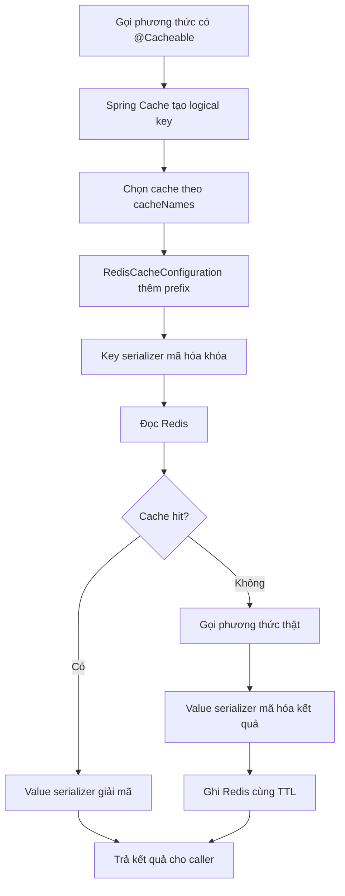
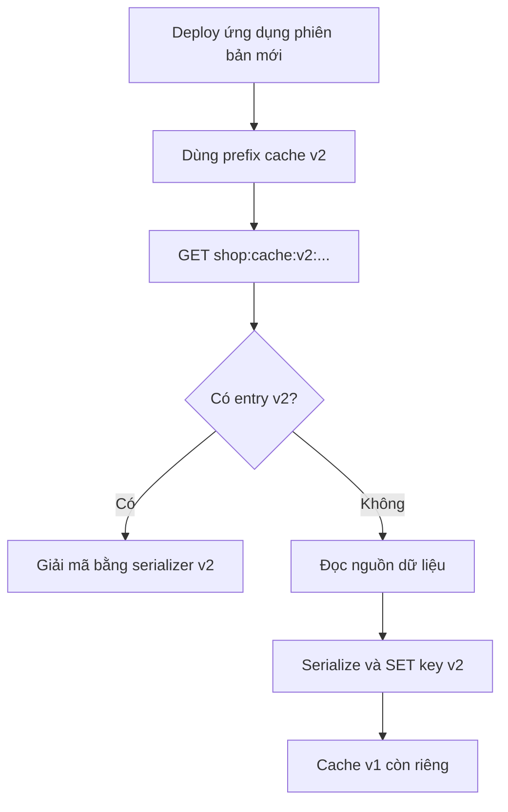

# Cấu hình serializer và tiền tố khóa cache trong Spring Data Redis

Khi sử dụng Spring Cache với Redis, nhiều ứng dụng chỉ cần đặt `@Cacheable` lên phương thức và dữ liệu sẽ được lưu vào Redis. Cách dùng này đơn giản, nhưng **định dạng của khóa Redis và byte của giá trị cache không được quyết định chỉ bởi annotation**. Hai thành phần đó phụ thuộc vào `RedisCacheManager`, `RedisCacheConfiguration`, serializer và quy tắc tạo khóa của Spring Cache.

Ví dụ, phương thức đọc sản phẩm:

```java
@Cacheable(cacheNames = "productDetail", key = "#id")
public ProductDto findById(String id) {
    return productClient.load(id);
}
```

Khi gọi `findById("p-42")`, ứng dụng cần biết:

- Redis key thực tế có phải `productDetail::p-42` hay có thêm tiền tố môi trường, phiên bản schema?
- Giá trị `ProductDto` được lưu dưới dạng JDK serialization, JSON hay định dạng khác?
- Khi triển khai phiên bản mới, liệu cache cũ còn giải mã được không?
- Nếu hai dịch vụ có cùng tên cache và ID, chúng có vô tình dùng chung một Redis key?
- Xóa toàn bộ một cache có ảnh hưởng những khóa không thuộc cache đó không?

Bài học này giải thích cách cấu hình **serializer và tiền tố khóa cache** ở tầng Spring Cache của Spring Data Redis, cách chúng phối hợp với `@Cacheable`, `@CachePut` và `@CacheEvict`, cùng một thiết kế cấu hình dùng được cho nhiều cache có TTL khác nhau.

## 1. Spring Cache và RedisCacheManager đứng ở đâu?

Spring Cache là abstraction cung cấp các annotation như `@Cacheable`, `@CachePut` và `@CacheEvict`. Nó không bắt buộc dùng Redis. Khi chọn Redis làm cache provider, Spring Data Redis cung cấp các thành phần tương ứng:

| Thành phần | Trách nhiệm chính |
|---|---|
| `@Cacheable` / `@CachePut` / `@CacheEvict` | Xác định khi nào đọc, ghi và xóa cache theo lời gọi phương thức |
| `CacheManager` | Tìm hoặc tạo cache theo tên |
| `RedisCacheManager` | Quản lý các cache Redis, cấu hình mặc định và cấu hình riêng từng cache |
| `RedisCacheConfiguration` | Xác định TTL, prefix, serializer và một số quy tắc chuyển đổi khóa/giá trị |
| `RedisCache` | Triển khai các thao tác cache trên Redis |
| `RedisCacheWriter` | Thực hiện các thao tác Redis cấp thấp để đọc/ghi/xóa dữ liệu cache |
| `RedisSerializer` | Biến Java object thành byte và đọc byte thành Java object |

Luồng cơ bản của một cache hit:



Điểm tách biệt cần hiểu: **Spring Cache tạo một logical key từ tham số phương thức**, sau đó **RedisCacheConfiguration biến cache name và logical key thành Redis key vật lý**, và cuối cùng **serializer mã hóa key/value thành byte**.

## 2. Các mặc định quan trọng của RedisCacheConfiguration

Với `RedisCacheConfiguration.defaultCacheConfig()` trong các phiên bản Spring Data Redis 3.x thông dụng:

| Thiết lập | Mặc định |
|---|---|
| Prefix của khóa | Có, theo tên cache |
| Hình thức prefix mặc định | `<cacheName>::` |
| Key serializer | `StringRedisSerializer` |
| Value serializer | `JdkSerializationRedisSerializer` |
| TTL | Không tự hết hạn (`eternal`) |
| Cache giá trị `null` | Cho phép |
| Chuyển logical key thành chuỗi | Dựa trên conversion service mặc định của Redis Cache |

Ví dụ:

```java
RedisCacheConfiguration defaults =
        RedisCacheConfiguration.defaultCacheConfig();
```

Đây là mặc định của cấu hình Spring Data Redis, **không có nghĩa mọi ứng dụng Spring Boot luôn đang chạy đúng các giá trị này**. Spring Boot có thể áp thuộc tính cấu hình, `RedisCacheConfiguration` bean tùy chỉnh, `RedisCacheManager` tự khai báo hoặc `CacheManager` khác. Khi điều tra một ứng dụng thật, cần xác định **CacheManager thực tế được kích hoạt**.

Đặc biệt, nếu không đặt TTL, cache có thể tồn tại cho đến khi bị evict, bị xóa, Redis áp chính sách loại bỏ do thiếu bộ nhớ, hoặc quản trị viên xóa dữ liệu. Một cache không có TTL không đồng nghĩa với dữ liệu nghiệp vụ luôn còn hợp lệ.

## 3. Ba khái niệm tên khóa dễ bị nhầm

Xét phương thức:

```java
@Cacheable(cacheNames = "productDetail", key = "#id")
public ProductDto findById(String id) { ... }
```

Khi tham số `id` là `"p-42"`, chúng ta có ba lớp:

1. **Cache name:** `productDetail`, do `cacheNames` hoặc `value` trong annotation xác định.
2. **Logical cache key:** `p-42`, do biểu thức `key = "#id"` xác định.
3. **Physical Redis key:** ví dụ `productDetail::p-42` nếu dùng prefix mặc định.

```text
cacheNames = "productDetail"
        +
key = "#id"  ->  "p-42"
        |
        v
prefix mặc định: "productDetail::"
        +
logical key: "p-42"
        |
        v
StringRedisSerializer
        |
        v
Redis key: productDetail::p-42
```

Nếu đổi prefix thành `shop:cache:v1:productDetail::`, **logical key vẫn là `p-42`**. Thao tác này đổi namespace vật lý trong Redis mà không thay đổi cách annotation chọn cache key.

### 3.1. Cache name không phải toàn bộ tên Redis key

`@Cacheable("productDetail")` chỉ đặt tên cache. Spring Cache vẫn phải tạo key từ tham số phương thức và Redis Cache phải thêm prefix theo cấu hình.

### 3.2. Thuộc tính key của annotation không phải key serializer

`key = "#id"` là biểu thức SpEL để chọn key logic. `StringRedisSerializer` là quy tắc mã hóa key sau khi đã biến nó thành chuỗi để lưu Redis. Hai thành phần giải quyết hai vấn đề khác nhau.

### 3.3. Prefix của cache không phải prefix do RedisTemplate đặt

`RedisTemplate` và `RedisCacheManager` có thể sử dụng cùng `RedisConnectionFactory` nhưng có **cấu hình serialization riêng**. Thay `redisTemplate.setKeySerializer(...)` không tự thay đổi prefix hoặc serializer của cache do `RedisCacheManager` quản lý.

## 4. Spring Cache tạo logical key như thế nào?

Nếu không chỉ định `key` hoặc `keyGenerator`, Spring Cache thường dùng `SimpleKeyGenerator`:

| Tham số phương thức | Key logic mặc định |
|---|---|
| Không có tham số | `SimpleKey.EMPTY` |
| Một tham số khác `null` | Chính đối tượng tham số đó |
| Nhiều tham số | Một `SimpleKey` chứa các tham số |

Ví dụ:

```java
@Cacheable("productDetail")
public ProductDto findById(String id) { ... }

@Cacheable("priceQuote")
public Quote quote(String sku, String currency) { ... }
```

Với phương thức đầu, key logic thường là chuỗi `"p-42"`. Với phương thức thứ hai, key logic có dạng `SimpleKey[sku, currency]` theo cơ chế mặc định. Redis Cache cần chuyển nó thành chuỗi trước khi gọi key serializer.

Trong ứng dụng cần một hợp đồng khóa ổn định, nên khai báo rõ:

```java
@Cacheable(cacheNames = "priceQuote",
           key = "#sku + ':' + #currency")
public Quote quote(String sku, String currency) { ... }
```

Tuy nhiên, ghép chuỗi bằng dấu `:` cũng có thể gây trùng nếu tham số chứa dấu đó. Với dữ liệu bên ngoài, hãy chọn cách encode có quy tắc rõ ràng, chẳng hạn một key generator chung dùng độ dài trường hoặc encoding không nhập nhằng.

**Tránh dùng trực tiếp `toString()` của một DTO phức tạp làm hợp đồng khóa** nếu hình thức chuỗi có thể đổi khi refactor, thay thứ tự field, hoặc có giá trị nhạy cảm. Khi khóa thay đổi, cache cũ sẽ không còn được tìm thấy; khi chứa dữ liệu nhạy cảm, tên khóa còn có thể xuất hiện trong log và công cụ quản trị Redis.

## 5. Cấu hình tiền tố khóa cache

Spring Data Redis cung cấp các cách tùy chỉnh tiền tố trong `RedisCacheConfiguration`.

### 5.1. Sử dụng prefix mặc định

```java
RedisCacheConfiguration config =
        RedisCacheConfiguration.defaultCacheConfig();
```

Khi tên cache là `productDetail` và logical key là `p-42`, key vật lý có dạng:

```text
productDetail::p-42
```

Spring Cache dùng prefix để tránh các cache khác nhau vô tình ghi đè lên cùng một Redis key.

### 5.2. Thêm tiền tố ứng dụng bằng prefixCacheNameWith

```java
RedisCacheConfiguration config =
        RedisCacheConfiguration.defaultCacheConfig()
                .prefixCacheNameWith("shop:cache:v1:");
```

Với cache `productDetail` và key `p-42`:

```text
shop:cache:v1:productDetail::p-42
```

Phương thức `prefixCacheNameWith(...)` thêm phần tiền tố ở trước cache name, đồng thời giữ cơ chế phân tách cache name và logical key của cấu hình mặc định.

Đây là lựa chọn thuận tiện khi toàn bộ cache của cùng một ứng dụng cần namespace chung, chẳng hạn:

```text
shop:cache:v1:productDetail::p-42
shop:cache:v1:productStock::p-42
shop:cache:v1:customerProfile::c-18
```

### 5.3. Tự tính prefix bằng computePrefixWith

Khi cần kiểm soát toàn bộ cách tạo prefix:

```java
RedisCacheConfiguration config =
        RedisCacheConfiguration.defaultCacheConfig()
                .computePrefixWith(
                        cacheName -> "shop:cache:v2:" + cacheName + "::");
```

Với `computePrefixWith(...)`, callback trả về **chuỗi prefix hoàn chỉnh**. Ứng dụng phải tự đưa dấu phân tách phù hợp vào giá trị trả về; nếu quên, cache name và logical key có thể bị nối liền khó phân biệt.

Ví dụ sai về thiết kế:

```java
// "shop:cache:v2:productDetail" + "p-42"
// -> "shop:cache:v2:productDetailp-42" (khó tách ranh giới)
.computePrefixWith(cacheName -> "shop:cache:v2:" + cacheName)
```

Ví dụ đúng:

```java
.computePrefixWith(cacheName -> "shop:cache:v2:" + cacheName + "::")
```

Nếu tiền tố cần phản ánh môi trường, hãy dùng cấu hình deploy đáng tin cậy như `dev`, `staging` hoặc `prod`, thay vì đưa thông tin request động vào một singleton `CacheManager` mà không có cơ chế kiểm soát ranh giới.

### 5.4. Vì sao nên giữ prefix bật?

`RedisCacheConfiguration.disableKeyPrefix()` tắt prefix, khiến logical key có thể được dùng trực tiếp làm Redis key:

```java
RedisCacheConfiguration dangerous =
        RedisCacheConfiguration.defaultCacheConfig()
                .disableKeyPrefix();
```

Với hai cache `productDetail` và `customerProfile` cùng key logic `"42"`, cả hai có thể đụng một Redis key `42`. Ngoài ra, thao tác xóa toàn bộ một cache không còn namespace đủ rõ để khoanh vùng; Spring Data Redis cảnh báo rằng **tắt prefix có thể khiến việc clear cache xóa các khóa khác trong database**.

Vì vậy nên giữ prefix mặc định hoặc dùng prefix riêng đủ phân biệt ứng dụng, môi trường và cache.

## 6. Key serializer và value serializer khác nhau

Trong Redis, cả tên khóa và giá trị đều được truyền dưới dạng byte. Spring Data Redis cung cấp `RedisSerializationContext.SerializationPair` để cấu hình serialization theo từng loại dữ liệu cache.

```java
RedisCacheConfiguration config =
        RedisCacheConfiguration.defaultCacheConfig()
                .serializeKeysWith(
                        RedisSerializationContext.SerializationPair
                                .fromSerializer(new StringRedisSerializer()))
                .serializeValuesWith(
                        RedisSerializationContext.SerializationPair
                                .fromSerializer(
                                        new GenericJackson2JsonRedisSerializer()));
```

| Thiết lập | Tác động | Quy tắc thường dùng |
|---|---|---|
| `serializeKeysWith(...)` | Byte của key vật lý trong Redis | Chuỗi UTF-8 để có thể quan sát và quét theo prefix |
| `serializeValuesWith(...)` | Byte của object được cache | JSON/JDK/binary theo hợp đồng dữ liệu |
| `computePrefixWith(...)` | Chuỗi đứng trước logical key | Namespace ứng dụng, phiên bản, cache name |
| `entryTtl(...)` | Thời gian sống của mỗi entry | Phụ thuộc tính mới của dữ liệu và yêu cầu nghiệp vụ |
| `disableCachingNullValues()` | Không lưu null | Kết hợp `unless` phù hợp ở annotation |

Ở đây, **prefix là chuỗi tạo key, còn serializer là quy tắc chuyển key/value thành byte**. Không nên xem việc chọn JSON value serializer là một cách sửa tên key, hoặc xem prefix là quy tắc mã hóa object.

## 7. Lựa chọn value serializer

### 7.1. JdkSerializationRedisSerializer

Một cấu hình theo mặc định Spring Data Redis:

```java
RedisCacheConfiguration config =
        RedisCacheConfiguration.defaultCacheConfig()
                .serializeValuesWith(
                        RedisSerializationContext.SerializationPair
                                .fromSerializer(
                                        new JdkSerializationRedisSerializer()));
```

Đặc điểm:

- Lưu dữ liệu dưới định dạng Java native serialization, khó đọc trực tiếp bằng Redis CLI.
- Object thường phải triển khai `Serializable` khi sử dụng Java serialization.
- Cache có thể phụ thuộc tên class, cấu trúc class, `serialVersionUID` và khả năng tương thích giữa các bản deploy.
- Không phù hợp làm hợp đồng dữ liệu chia sẻ tự do giữa Java, Node.js, Python hoặc các ngôn ngữ khác.
- Java deserialization có rủi ro an ninh nếu byte đầu vào bị kiểm soát bởi nguồn không tin cậy.

Do đó, dùng serializer này chỉ khi môi trường tin cậy và ứng dụng thực sự có lý do dựa vào Java serialization. Với hệ thống muốn quan sát dữ liệu hoặc chia sẻ cache theo định dạng rõ ràng, JSON thường dễ vận hành hơn.

### 7.2. GenericJackson2JsonRedisSerializer

```java
GenericJackson2JsonRedisSerializer jsonSerializer =
        new GenericJackson2JsonRedisSerializer();
```

Serializer này có thể lưu nhiều kiểu object khác nhau dưới dạng JSON cùng thông tin kiểu cần thiết để dựng lại object tương ứng. Nó thuận tiện khi một `RedisCacheManager` quản lý nhiều cache với nhiều kiểu return value:

```java
@Cacheable("productDetail")
ProductDto findProduct(String id) { ... }

@Cacheable("customerProfile")
CustomerDto findCustomer(String id) { ... }
```

Nhưng cần hiểu rõ:

1. Dữ liệu JSON có thể chứa metadata kiểu Java; định dạng này không nhất thiết là JSON API độc lập với Java.
2. Đổi package/class hoặc refactor model có thể khiến entry cũ không giải mã được.
3. Cấu hình Jackson, module hỗ trợ Java time/record và chiến lược polymorphism ảnh hưởng kết quả.
4. Redis phải được coi là nguồn dữ liệu đáng tin cậy trước khi cho phép deserialization dựa trên type metadata. Tránh mở rộng khả năng giải mã subtype tùy ý từ dữ liệu do bên không tin cậy kiểm soát.
5. Giá trị `null` có thể được Spring Cache biểu diễn bằng một đối tượng sentinel. Nếu tùy chỉnh `ObjectMapper`, phải bảo đảm cấu hình tương thích với cơ chế null-value của serializer hoặc tắt cache null theo hợp đồng đã thiết kế.

Không phải mọi JSON serializer đều có thể đọc các byte mà `GenericJackson2JsonRedisSerializer` đã ghi. Đừng đổi qua một serializer khác mà chưa có kế hoạch chuyển đổi hoặc làm mới dữ liệu cache.

### 7.3. Jackson2JsonRedisSerializer<T>

Khi cache chỉ chứa một kiểu dữ liệu xác định, có thể cân nhắc một serializer hướng tới kiểu cụ thể như `Jackson2JsonRedisSerializer<ProductDto>`. Cách này hữu ích khi muốn JSON không phụ thuộc type metadata động trong mọi entry.

Tuy nhiên, **một serializer gắn với `ProductDto` không thích hợp cho mọi cache** nếu cache khác lưu `CustomerDto` hoặc `List<OrderDto>`. Khi đó cần thiết kế cấu hình riêng từng cache hoặc chọn serializer đa kiểu với hợp đồng an toàn phù hợp.

Kiểu cụ thể và cách tạo constructor của serializer Jackson có thể thay đổi giữa các phiên bản Spring Data Redis; cần dùng API tương ứng với phiên bản dependency của dự án. Trong bài này, cấu hình đầy đủ bên dưới dùng `GenericJackson2JsonRedisSerializer` để thể hiện một RedisCacheManager quản lý nhiều kiểu giá trị.

### 7.4. Các lựa chọn khác

Một ứng dụng có thể dùng:

- `StringRedisSerializer` cho **giá trị cache thực sự là chuỗi**.
- Serializer nhị phân tùy chỉnh như protobuf/Avro khi đã có hợp đồng schema và version.
- JSON typed serializer theo từng cache cho DTO ổn định.
- Một serializer chuyên biệt gói thêm version header hoặc envelope nhằm hỗ trợ migration.

Việc chọn serializer không chỉ dựa vào kích thước byte. Cần cân nhắc tính tương thích giữa lần deploy, loại object, hiệu năng, khả năng debug, rủi ro khi deserialization và nhu cầu chia sẻ dữ liệu giữa các dịch vụ.

## 8. Cấu hình đầy đủ RedisCacheManager cho nhiều cache

Ví dụ dưới đây dùng Spring Boot 3.x và Spring Data Redis 3.x, với Spring Cache được kích hoạt và Redis connection đã được cấu hình. Mục tiêu:

- Mọi cache dùng namespace `shop:cache:v2:`.
- Key được serialize thành chuỗi.
- Value dùng JSON serializer hỗ trợ nhiều loại DTO.
- Mặc định TTL 10 phút.
- Cache `productDetail` có TTL 20 phút.
- Cache `productStock` có TTL 15 giây.
- Không cache kết quả `null`.

```java
package com.example.shop.cache;

import java.time.Duration;
import java.util.Map;

import org.springframework.cache.annotation.EnableCaching;
import org.springframework.context.annotation.Bean;
import org.springframework.context.annotation.Configuration;
import org.springframework.data.redis.cache.RedisCacheConfiguration;
import org.springframework.data.redis.cache.RedisCacheManager;
import org.springframework.data.redis.connection.RedisConnectionFactory;
import org.springframework.data.redis.serializer.GenericJackson2JsonRedisSerializer;
import org.springframework.data.redis.serializer.RedisSerializationContext;
import org.springframework.data.redis.serializer.StringRedisSerializer;

@Configuration
@EnableCaching
public class RedisCacheConfig {

    @Bean
    public RedisCacheManager cacheManager(
            RedisConnectionFactory connectionFactory) {

        RedisCacheConfiguration defaults =
                RedisCacheConfiguration.defaultCacheConfig()
                        .computePrefixWith(
                                cacheName ->
                                        "shop:cache:v2:" + cacheName + "::")
                        .serializeKeysWith(
                                RedisSerializationContext.SerializationPair
                                        .fromSerializer(
                                                new StringRedisSerializer()))
                        .serializeValuesWith(
                                RedisSerializationContext.SerializationPair
                                        .fromSerializer(
                                                new GenericJackson2JsonRedisSerializer()))
                        .disableCachingNullValues()
                        .entryTtl(Duration.ofMinutes(10));

        Map<String, RedisCacheConfiguration> perCache = Map.of(
                "productDetail",
                defaults.entryTtl(Duration.ofMinutes(20)),
                "productStock",
                defaults.entryTtl(Duration.ofSeconds(15))
        );

        return RedisCacheManager.builder(connectionFactory)
                .cacheDefaults(defaults)
                .withInitialCacheConfigurations(perCache)
                .build();
    }
}
```

Giải thích cấu hình:

| Dòng cấu hình | Kết quả |
|---|---|
| `@EnableCaching` | Kích hoạt interception cho annotation cache trong Spring |
| `@Bean RedisCacheManager` | Tạo CacheManager Redis mà ứng dụng sẽ dùng |
| `computePrefixWith(...)` | Đặt namespace và cache name vào Redis key |
| `serializeKeysWith(StringRedisSerializer)` | Đảm bảo key được lưu dạng chuỗi |
| `serializeValuesWith(GenericJackson2JsonRedisSerializer)` | Ghi giá trị cache thành JSON phù hợp với serializer |
| `disableCachingNullValues()` | Không lưu entry cho giá trị null |
| `entryTtl(Duration.ofMinutes(10))` | TTL mặc định |
| `withInitialCacheConfigurations(...)` | Ghi đè cấu hình cho hai cache cụ thể |

Các phương thức cấu hình của `RedisCacheConfiguration` tạo phiên bản cấu hình mới theo kiểu immutable. Vì vậy, `defaults.entryTtl(Duration.ofSeconds(15))` dùng làm cấu hình riêng cho `productStock` mà không sửa thời gian sống của các cache khác.

**Lưu ý về Spring Boot auto-configuration:** khi tự khai báo bean `RedisCacheManager`, cấu hình của bạn là nguồn quyết định cho manager đó. Không được giả định các thuộc tính `spring.cache.redis.*` của Boot sẽ tiếp tục tự áp toàn bộ lên bean tự xây dựng. Nếu dự án muốn cấu hình chủ yếu từ properties, hãy để Boot dựng manager hoặc dùng các extension point phù hợp, thay vì cùng lúc duy trì hai nguồn cấu hình mâu thuẫn.

## 9. Cách sử dụng với @Cacheable, @CachePut và @CacheEvict

Giả sử ứng dụng có DTO:

```java
package com.example.shop.product;

public record ProductDto(
        String id,
        String name,
        long priceCents
) {}
```

Service đọc và thay đổi sản phẩm:

```java
package com.example.shop.product;

import org.springframework.cache.annotation.CacheEvict;
import org.springframework.cache.annotation.CachePut;
import org.springframework.cache.annotation.Cacheable;
import org.springframework.stereotype.Service;

@Service
public class ProductService {

    private final ProductGateway gateway;

    public ProductService(ProductGateway gateway) {
        this.gateway = gateway;
    }

    @Cacheable(
            cacheNames = "productDetail",
            key = "#id",
            unless = "#result == null")
    public ProductDto findById(String id) {
        return gateway.load(id);
    }

    @CachePut(
            cacheNames = "productDetail",
            key = "#result.id",
            unless = "#result == null")
    public ProductDto update(ProductDto product) {
        return gateway.save(product);
    }

    @CacheEvict(
            cacheNames = "productDetail",
            key = "#id")
    public void delete(String id) {
        gateway.delete(id);
    }
}
```

`ProductGateway` là interface phụ thuộc ứng dụng, dùng để minh họa nguồn dữ liệu thực tế. Phương thức `findById` có thể trả null nếu không tìm thấy; `unless = "#result == null"` tránh lưu null khi cấu hình đã gọi `disableCachingNullValues()`.

Với `findById("p-42")`:

```text
cacheName        productDetail
logical key      p-42
prefix           shop:cache:v2:productDetail::
physical key     shop:cache:v2:productDetail::p-42
value serializer JSON
TTL              20 phút
```

Khi gọi lần đầu nếu chưa có entry, service đọc dữ liệu rồi ghi Redis. Nếu gọi lại trước khi TTL hết hạn và dữ liệu chưa bị evict, Spring Cache có thể trả giá trị đã giải mã mà không gọi `gateway.load`.

Khi `update(...)` thực hiện thành công, `@CachePut` gọi phương thức thật rồi cập nhật cache bằng giá trị kết quả. `key = "#result.id"` biểu thị ID từ DTO trả về. Nếu phương thức có thể trả null, biểu thức key dựa trên `#result` cần được thiết kế cẩn thận; đối với API có kết quả có thể null, thường nên dùng `#product.id` làm key từ tham số đầu vào để tránh lỗi truy cập thuộc tính của kết quả null.

Khi `delete(...)` chạy thành công, `@CacheEvict` xóa entry tương ứng. Cần hiểu rằng các annotation cache hoạt động thông qua Spring proxy/interceptor; **một lời gọi nội bộ từ phương thức khác của cùng instance đến `this.findById(...)` có thể không đi qua cache interceptor** trong mô hình proxy mặc định.

### 9.1. Ví dụ với @CachePut dùng key từ tham số

Nếu muốn hạn chế phụ thuộc vào result:

```java
@CachePut(
        cacheNames = "productDetail",
        key = "#product.id",
        unless = "#result == null")
public ProductDto update(ProductDto product) {
    return gateway.save(product);
}
```

Key từ input giúp nhìn rõ quy tắc, nhưng cần bảo đảm `gateway.save(...)` không đổi ID. Nếu kết quả có ID khác input, cần một hợp đồng nghiệp vụ xác định khóa nào sẽ được làm mới hoặc xóa.

## 10. Cache name, prefix và key: những ví dụ đối chiếu

Giả sử cấu hình:

```java
.computePrefixWith(
        cacheName -> "shop:cache:v2:" + cacheName + "::")
```

Và các method:

```java
@Cacheable(cacheNames = "productDetail", key = "#id")
ProductDto findProduct(String id) { ... }

@Cacheable(cacheNames = "productStock", key = "#sku")
Integer stock(String sku) { ... }

@Cacheable(cacheNames = "customerProfile", key = "#customerId")
CustomerDto profile(String customerId) { ... }
```

Redis key vật lý:

| Cache | Logical key | Redis key |
|---|---|---|
| `productDetail` | `p-42` | `shop:cache:v2:productDetail::p-42` |
| `productStock` | `p-42` | `shop:cache:v2:productStock::p-42` |
| `customerProfile` | `c-17` | `shop:cache:v2:customerProfile::c-17` |

Hai cache cùng logical key `p-42` nhưng **không trùng Redis key** vì khác cache name.

Nếu cùng Redis database được dùng bởi nhiều ứng dụng, nên tách thêm namespace:

```text
shop:cache:v2:productDetail::p-42
billing:cache:v1:productDetail::p-42
```

Nếu môi trường staging và production dùng chung hạ tầng Redis, cần có quy tắc cách ly nghiêm ngặt theo database/cluster hoặc namespace. Prefix là một biện pháp tránh va chạm tên; nó **không phải cơ chế phân quyền hoặc bảo mật dữ liệu**.

## 11. Cache null: lựa chọn ảnh hưởng trực tiếp đến serializer

Một phương thức:

```java
@Cacheable(cacheNames = "productDetail", key = "#id")
public ProductDto findById(String id) {
    return gateway.load(id); // Có thể trả null.
}
```

Nếu cho phép cache null, Spring Cache có thể lưu đại diện nội bộ cho `null` thay vì một JSON `null` thuần túy. Serializer phải xử lý được representation này. Với một serializer Jackson có cấu hình tùy chỉnh, đây có thể là nguồn lỗi deserialize nếu không giữ tương thích với cơ chế `NullValue` của Spring Cache.

Trong cấu hình ví dụ:

```java
.disableCachingNullValues()
```

và annotation:

```java
@Cacheable(
        cacheNames = "productDetail",
        key = "#id",
        unless = "#result == null")
```

thì một lần đọc không tìm thấy sản phẩm không tạo entry cache. Các lần gọi sau vẫn cần kiểm tra nguồn dữ liệu cho đến khi tồn tại sản phẩm hoặc có cơ chế xử lý kết quả âm khác.

Một số ứng dụng cần **negative caching** để giảm tải khi ID không tồn tại thường xuyên. Khi đó có thể thiết kế một sentinel DTO tường minh với TTL ngắn, hoặc giữ cơ chế cache null có serializer hỗ trợ đúng. Không nên bật/tắt cache null tùy tiện mà không xét số lượng lần miss và tính đúng của dữ liệu.

**Phân biệt `condition` và `unless`:** `condition` đánh giá trước khi gọi phương thức, còn `unless` đánh giá sau khi có kết quả và cho phép bỏ qua việc lưu kết quả, rất thích hợp cho trường hợp `#result == null`.

## 12. TTL và tiền tố cache hỗ trợ nhau thế nào?

TTL là thời gian entry được Redis giữ trước khi hết hạn, độc lập với tên prefix. Ví dụ:

```java
RedisCacheConfiguration config =
        RedisCacheConfiguration.defaultCacheConfig()
                .entryTtl(Duration.ofMinutes(20))
                .prefixCacheNameWith("shop:cache:v2:");
```

Redis key có dạng:

```text
shop:cache:v2:productDetail::p-42
```

và sẽ có TTL tương ứng khi entry được ghi qua cache, tùy thời điểm quan sát và chính sách ghi.

Các vấn đề cần hiểu:

- TTL thường được tính từ lần ghi cache; đọc cache thông thường **không tự gia hạn TTL** như một sliding expiration.
- `@CachePut` hay lần cache miss ghi lại entry có thể bắt đầu TTL mới.
- `@CacheEvict` xóa entry theo key, không chờ TTL.
- Khi đổi prefix từ `v1` sang `v2`, key `v1` không được tự đổi tên hoặc tự xóa; nó còn tồn tại đến khi TTL hết hạn, bị evict riêng hoặc được dọn theo quy trình quản trị.
- Cache không có TTL có thể giữ dữ liệu cũ lâu dài, nên khi đổi schema hoặc prefix cần xác định chính sách dọn dẹp.

TTL ngắn giúp giới hạn tuổi của dữ liệu cache, nhưng **không tạo tính nhất quán tuyệt đối** với database nguồn. Khi dữ liệu gốc thay đổi, ứng dụng vẫn cần cập nhật/evict cache phù hợp nếu không thể chờ đến khi TTL hết hạn.

## 13. Cấu hình riêng từng cache bằng withInitialCacheConfigurations

Nhiều hệ thống có các nhóm dữ liệu khác nhau:

- Chi tiết sản phẩm tương đối ít đổi.
- Số lượng tồn kho thay đổi thường xuyên.
- Hồ sơ khách hàng có chính sách bảo mật và vòng đời riêng.

Không nhất thiết áp cùng một TTL và value serializer cho mọi cache.

Ví dụ:

```java
RedisCacheConfiguration base =
        RedisCacheConfiguration.defaultCacheConfig()
                .computePrefixWith(
                        name -> "shop:cache:v3:" + name + "::")
                .serializeValuesWith(
                        RedisSerializationContext.SerializationPair
                                .fromSerializer(
                                        new GenericJackson2JsonRedisSerializer()))
                .entryTtl(Duration.ofMinutes(10));

Map<String, RedisCacheConfiguration> configs = Map.of(
        "productDetail", base.entryTtl(Duration.ofMinutes(30)),
        "productStock", base.entryTtl(Duration.ofSeconds(10)),
        "customerProfile", base.entryTtl(Duration.ofMinutes(2)));

RedisCacheManager manager = RedisCacheManager
        .builder(connectionFactory)
        .cacheDefaults(base)
        .withInitialCacheConfigurations(configs)
        .build();
```

Khi tạo cấu hình riêng, giữ **quy tắc prefix chung có thể dự đoán** trừ khi có lý do rõ ràng để chia namespace. Nếu cache được cùng một method truy cập ở nhiều version ứng dụng, thay đổi serializer hoặc prefix của riêng cache đó là thay đổi hợp đồng lưu trữ.

### 13.1. Tách serializer cho cache chuyên biệt

Ví dụ một cache chỉ chứa String:

```java
RedisCacheConfiguration stringValues =
        base.serializeValuesWith(
                RedisSerializationContext.SerializationPair
                        .fromSerializer(new StringRedisSerializer()));
```

Sau đó có thể gắn `stringValues` vào một cache chỉ lưu chuỗi. Tuy nhiên, nếu một method của cache đó bắt đầu trả DTO, serializer chuỗi có thể không chấp nhận giá trị mới. **Mỗi cache nên có hợp đồng kiểu dữ liệu ổn định**, không chỉ có tên cache.

### 13.2. Tránh hai method cùng tên cache nhưng kiểu kết quả không tương thích

```java
@Cacheable(cacheNames = "shared", key = "#id")
ProductDto findProduct(String id) { ... }

@Cacheable(cacheNames = "shared", key = "#id")
CustomerDto findCustomer(String id) { ... }
```

Nếu cả hai cùng gọi với `"42"`, chúng có thể dùng chung Redis key `shared::42`. Kết quả sẽ là sai kiểu nghiệp vụ dù serializer JSON vẫn giải mã được một object Java.

Hãy dùng cache name riêng hoặc đưa một namespace logic đủ rõ vào key. Cache name chính là một phần của hợp đồng phân chia dữ liệu.

## 14. Spring Boot properties và cấu hình bằng Java

Spring Boot có thể auto-configure Redis cache khi:

1. Spring Cache được bật.
2. Dependency và cấu hình Redis phù hợp.
3. Cache provider Redis được lựa chọn hoặc được Boot phát hiện theo cơ chế auto-configuration.
4. Không có bean CacheManager tùy chỉnh khác thay thế.

Ví dụ cấu hình thuộc tính:

```yaml
spring:
  cache:
    type: redis
    cache-names:
      - productDetail
      - productStock
    redis:
      time-to-live: 10m
      key-prefix: "shop:cache:v2:"
      use-key-prefix: true
      cache-null-values: false
```

Với cấu hình Boot mặc định tương ứng, `key-prefix` là phần đứng trước cache name; Spring Data Redis vẫn đảm nhiệm logic prefix và key conversion. Cách biểu diễn chính xác của key cần được xác nhận theo phiên bản Boot/Spring Data Redis được triển khai.

**Quan trọng:** cấu hình Boot property nêu trên **không tự chuyển value serializer sang JSON**. Thông thường cần khai báo bean `RedisCacheConfiguration`, `RedisCacheManagerBuilderCustomizer` hoặc bean manager tùy chỉnh nếu muốn sử dụng serializer khác mặc định.

Ví dụ cách cung cấp cấu hình Redis cache cho auto-configuration khi dự án muốn giữ việc tạo manager cho Spring Boot:

```java
@Configuration
public class RedisCacheSerializationConfig {

    @Bean
    RedisCacheConfiguration redisCacheConfiguration() {
        return RedisCacheConfiguration.defaultCacheConfig()
                .computePrefixWith(
                        name -> "shop:cache:v2:" + name + "::")
                .serializeValuesWith(
                        RedisSerializationContext.SerializationPair
                                .fromSerializer(
                                        new GenericJackson2JsonRedisSerializer()))
                .disableCachingNullValues()
                .entryTtl(Duration.ofMinutes(10));
    }
}
```

Bean này có thể được Boot sử dụng khi tạo RedisCacheManager theo đường auto-configuration phù hợp. **Đừng đồng thời cấu hình cùng một thuộc tính ở nhiều nơi rồi giả định tất cả giá trị đều được cộng dồn**; thứ tự áp dụng phụ thuộc cơ chế Boot và các bean đã tồn tại.

Nếu cần TTL khác nhau cho từng cache, `RedisCacheManagerBuilderCustomizer` hoặc một manager bean rõ ràng như ví dụ ở mục 8 thường dễ thể hiện ý định hơn.

## 15. Kiểm tra key và serializer trong Redis

Sau khi gọi một phương thức có `@Cacheable`, hãy quan sát Redis để biết hệ thống đang ghi gì.

### 15.1. Duyệt key theo prefix bằng SCAN

```redis
SCAN 0 MATCH shop:cache:v2:productDetail::* COUNT 100
```

Redis trả con trỏ và danh sách key. Nếu con trỏ chưa trở về `0`, tiếp tục gọi `SCAN` với giá trị con trỏ mới. `COUNT` chỉ là gợi ý; một lần gọi có thể trả ít hơn 100, nhiều hơn 100 hoặc không có key khớp nào.

Không nên dùng `KEYS *` trong môi trường sản xuất có keyspace lớn chỉ để tìm cache key, vì lệnh có thể ảnh hưởng thời gian xử lý của Redis.

### 15.2. Xem loại Redis key và TTL

```redis
TYPE shop:cache:v2:productDetail::p-42
TTL shop:cache:v2:productDetail::p-42
PTTL shop:cache:v2:productDetail::p-42
```

Với Spring Cache Redis thông thường, mỗi entry là một Redis String key chứa byte serialized value. `TTL` trả số giây còn lại, `PTTL` trả milliseconds; Redis có các giá trị đặc biệt như `-1` khi key tồn tại nhưng không có thời gian hết hạn và `-2` khi key không tồn tại.

### 15.3. Xem giá trị đã lưu

```redis
GET shop:cache:v2:productDetail::p-42
```

Nếu value serializer là JSON, kết quả có thể đọc được ở dạng JSON text, nhưng có thể bao gồm metadata class/type. Nếu là JDK serialization hoặc nhị phân tùy chỉnh, output có thể khó đọc hoặc chứa byte không hiển thị đẹp ở terminal.

Việc nhìn thấy JSON **không bảo đảm** mọi phiên bản Java đều có thể deserialize thành DTO tương thích; cần xem cả metadata, schema và cấu hình Jackson.

### 15.4. Phân biệt lệnh GET từ template và cache

Ví dụ:

```java
redisTemplate.opsForValue()
        .get("shop:cache:v2:productDetail::p-42");
```

Nếu `redisTemplate` dùng serializer khác RedisCacheManager, kết quả có thể sai kiểu hoặc gây lỗi deserialization. Khi kiểm tra từ Java, nên dùng **cùng serializer với cache** hoặc đọc byte raw bằng connection API/Redis CLI khi phù hợp. Không kết luận cache hỏng chỉ vì một template được cấu hình khác không đọc được.

## 16. @CacheEvict(allEntries = true) và prefix

`@CacheEvict(cacheNames = "productDetail", allEntries = true)` yêu cầu xóa toàn bộ entry của một cache:

```java
@CacheEvict(cacheNames = "productDetail", allEntries = true)
public void invalidateAllProductDetails() {
    // Trigger cache invalidation.
}
```

Redis không có một lệnh riêng gọi là “clear Spring cache”. `RedisCacheWriter` phải xác định các key thuộc namespace của cache rồi xóa chúng. Prefix là yếu tố quan trọng để giới hạn tập key cần xóa.

Đối với các phiên bản Spring Data Redis thông dụng, thao tác clear có thể dùng cách duyệt `KEYS` theo mặc định. Trên keyspace lớn, điều này có thể tạo tải đáng kể; RedisCacheWriter còn hỗ trợ chiến lược batch dựa trên `SCAN` trong các cấu hình phù hợp.

Ví dụ cấu hình writer sử dụng SCAN:

```java
import org.springframework.data.redis.cache.BatchStrategies;
import org.springframework.data.redis.cache.RedisCacheManager;
import org.springframework.data.redis.cache.RedisCacheWriter;

RedisCacheWriter writer =
        RedisCacheWriter.nonLockingRedisCacheWriter(
                connectionFactory,
                BatchStrategies.scan(1000));

RedisCacheManager manager = RedisCacheManager.builder(writer)
        .cacheDefaults(redisCacheConfiguration)
        .build();
```

Con số `1000` là gợi ý kích thước mỗi batch, không phải cam kết mỗi lệnh Redis trả đúng 1000 key. Khi Redis chạy Cluster, hiệu quả và phạm vi quét bằng `SCAN` còn phụ thuộc driver và khả năng duyệt các node; cần chọn cấu hình phù hợp với phiên bản driver đang dùng.

**Không tắt cache prefix để “đơn giản hóa” tên key**: thao tác clear có thể ảnh hưởng những dữ liệu Redis không thuộc cache. Với cache có nhiều entry, nên thiết kế phương thức invalidation hạn chế phạm vi, phân vùng dữ liệu hoặc dùng phiên bản namespace khi cần loại bỏ toàn bộ dữ liệu cũ.

## 17. Version hóa prefix để tránh lỗi sau khi đổi serializer

Một trong các tình huống khó nhất là ứng dụng đang dùng serializer A rồi chuyển sang serializer B trong lúc Redis vẫn có hàng triệu entry cũ.

Ví dụ:

**Phiên bản 1:**

```text
shop:cache:v1:productDetail::p-42
value = byte theo JDK serialization
```

**Phiên bản 2:**

```text
shop:cache:v2:productDetail::p-42
value = JSON
```

Nếu đổi serializer nhưng giữ nguyên prefix cũ, ứng dụng mới có thể đọc dữ liệu JDK như JSON và ném lỗi. Đổi prefix sang `v2` giúp cache phiên bản mới bỏ qua entry `v1`, tạo lại dữ liệu từ nguồn và ghi bằng định dạng mới.



Điều cần thiết kế khi chuyển version:

1. **Cache miss tăng tạm thời.** Entry `v2` chưa được warm, nên nguồn dữ liệu gốc có thể nhận nhiều request hơn.
2. **Dung lượng tăng trong giai đoạn chuyển tiếp.** Hai bộ cache `v1` và `v2` cùng tồn tại cho đến khi dữ liệu cũ hết TTL hoặc được dọn.
3. **Rolling deployment.** Instance cũ vẫn ghi/đọc `v1`, instance mới dùng `v2`, tránh cùng một key có hai định dạng serializer.
4. **TTL của cache cũ.** Nếu `v1` không có TTL, cần có kế hoạch dọn dẹp có kiểm soát.
5. **Thời điểm xóa.** Không dọn `v1` sớm khi vẫn còn instance cũ sử dụng nếu điều đó gây tăng tải hoặc lỗi nghiệp vụ.

Phiên bản prefix là một cách **cách ly định dạng cache**; nó không thay thế versioning và migration của database nguồn.

## 18. Đa tenant và phân quyền: prefix có đủ không?

Giả sử ứng dụng nhiều tenant sử dụng cùng Redis:

```java
@Cacheable(cacheNames = "accountBalance", key = "#accountId")
BalanceDto balance(String accountId) { ... }
```

Nếu hai tenant đều có account ID `42`, logical key trùng nhau và cache name cũng trùng. Prefix tĩnh `app:cache:accountBalance::` sẽ dẫn đến **cùng Redis key**, có thể khiến tenant này nhận giá trị cache của tenant khác.

Hợp đồng key cần chứa tenant:

```java
@Cacheable(
        cacheNames = "accountBalance",
        key = "#tenantId + ':' + #accountId")
public BalanceDto balance(String tenantId, String accountId) { ... }
```

Với các ID có thể chứa dấu phân tách, hãy dùng key generator hoặc encoding ổn định không gây nhập nhằng; đừng chỉ ghép chuỗi một cách ngẫu nhiên.

Hai lớp cần phân biệt:

- **Prefix cấp cache**: định danh ứng dụng, môi trường, cache name, phiên bản định dạng.
- **Logical key cấp request**: định danh object cụ thể, bao gồm tenant hoặc phạm vi nghiệp vụ khi cần.

Một singleton `RedisCacheManager` với prefix tĩnh không thể tự phân biệt tenant trên từng request nếu logical key bỏ qua tenant ID. Bên cạnh đó, namespace key không phải cơ chế authorization; service vẫn phải kiểm tra quyền truy cập ở tầng nghiệp vụ.

## 19. Redis Cluster: prefix có phải hash tag không?

Redis Cluster phân phối key theo hash slot. Một prefix như:

```text
shop:cache:v2:productDetail::p-42
shop:cache:v2:productDetail::p-43
```

không khiến các key nằm cùng slot, vì slot được tính từ tên key thực tế (hoặc phần hash tag `{...}` nếu có). Trong nhiều ứng dụng cache, phân tán entry của các ID khác nhau lên nhiều slot là **điều mong muốn**.

Đôi khi ứng dụng cần nhiều key liên quan cùng slot để thực hiện một script multi-key. Có thể dùng hash tag, ví dụ:

```text
shop:cache:product:{p-42}:detail
shop:cache:product:{p-42}:inventory
```

Hai key chia sẻ `{p-42}` nên được hash cùng slot. Tuy nhiên, Spring Cache thông thường hoạt động trên từng entry; không nên ép toàn bộ cache dùng cùng một tag như `{all-cache}`, vì điều đó có thể tạo **hot slot**.

Nếu muốn đưa hash tag vào key do Spring Cache sinh ra, phải xây dựng quy tắc prefix/key sao cho **tên vật lý cuối cùng** chứa đúng tag cho từng aggregate. Một prefix tĩnh chứa cùng tag cho mọi entry có thể làm giảm khả năng phân phối tải của Redis Cluster.

## 20. Những lỗi cấu hình thường gặp

### Lỗi 1: Thay RedisTemplate serializer rồi kỳ vọng Spring Cache đổi theo

```java
redisTemplate.setValueSerializer(
        new GenericJackson2JsonRedisSerializer());
```

Lời gọi này áp vào RedisTemplate được cấu hình, **không tự thay value serializer của RedisCacheManager**. Cần dùng `RedisCacheConfiguration.serializeValuesWith(...)` cho cache.

### Lỗi 2: Tắt prefix để có key ngắn

```java
.disableKeyPrefix()
```

Điều này có thể gây xung đột giữa cache và làm thao tác clear không còn phạm vi an toàn. Giữ namespace rõ ràng.

### Lỗi 3: Cho rằng JSON nào cũng giải mã được DTO

`GenericJackson2JsonRedisSerializer` có thể dùng type metadata. Nếu đổi package/class hoặc dùng mapper khác để đọc giá trị cũ, ứng dụng có thể không dựng được đúng object. Cần hợp đồng schema và chiến lược migration.

### Lỗi 4: Dùng serializer chuỗi cho cache trả object

`StringRedisSerializer` phù hợp với value là String; một DTO Java không được đảm bảo tự chuyển thành chuỗi JSON chỉ vì cache dùng Spring. Cần serializer đúng loại.

### Lỗi 5: Đổi prefix nhưng quên cache cũ

Key `v1` vẫn có thể nằm trong Redis sau khi app chuyển sang `v2`. Không có cơ chế tự động xóa mọi key của phiên bản cũ chỉ vì app tạo prefix mới.

### Lỗi 6: Ghi dữ liệu null khi đã disableCachingNullValues

Nếu vẫn để `@Cacheable` ghi kết quả null, cache có thể từ chối thao tác put null theo cấu hình. Dùng `unless = "#result == null"` hoặc thiết kế kiểu đại diện absence phù hợp.

### Lỗi 7: Cache name dùng chung nhưng key thiếu domain

`@Cacheable(cacheNames = "lookup", key = "#id")` ở hai method cho hai domain khác nhau có thể va chạm. Cache name phải đủ nghĩa hoặc logical key phải phân biệt domain.

### Lỗi 8: Dùng SimpleKey của object có toString không ổn định

Một object khóa phức tạp có thể sinh chuỗi khác nhau giữa lần deploy hoặc bị ảnh hưởng bởi format `toString()`. Dùng key ổn định cho những cache muốn chia sẻ giữa các phiên bản.

### Lỗi 9: Dùng prefix làm biện pháp bảo vệ dữ liệu tenant

Một prefix tĩnh không thay thế việc đưa tenant vào key và kiểm tra authorization. Hai tenant có cùng object ID vẫn có nguy cơ dùng chung cache nếu logical key không phân biệt tenant.

### Lỗi 10: Gọi @CacheEvict(allEntries = true) trên keyspace lớn mà không đo

Việc xóa một cache có thể phải duyệt rất nhiều key. Cần hiểu `RedisCacheWriter` đang dùng `KEYS` hay `SCAN` và tải tác vụ lên Redis.

### Lỗi 11: Mong TTL tự gia hạn mỗi lần cache hit

TTL thông thường của Redis Cache không phải sliding expiration trên mỗi lần đọc. Nếu yêu cầu gia hạn khi truy cập, cần thiết kế và cấu hình một cơ chế riêng phù hợp.

### Lỗi 12: Xem serializer là vấn đề nội bộ không cần version

Định dạng Redis cache sống qua nhiều lần triển khai ứng dụng. Thay serializer mà không đổi prefix, migrate hoặc flush có kiểm soát dễ gây lỗi deserialize ngay ở request đầu tiên sau deploy.

## 21. Quy trình thiết kế cache key và serializer

Để một cache hoạt động ổn định, có thể thực hiện theo thứ tự:

1. **Chọn cache name theo domain.** Ví dụ `productDetail`, `productStock`, `customerProfile`; tránh tên quá chung như `data` hay `lookup`.
2. **Chọn logical key.** Dùng ID hoặc tổ hợp tham số ổn định; thêm tenant, locale hoặc version nghiệp vụ khi ảnh hưởng kết quả.
3. **Đặt prefix Redis.** Bao gồm ứng dụng, môi trường khi cần, phiên bản schema và cache name; giữ dấu phân tách rõ ràng.
4. **Chọn key serializer.** Với key dựa trên chuỗi, `StringRedisSerializer` thường dễ quan sát và tương thích Redis CLI.
5. **Chọn value serializer.** Dựa trên loại object, khả năng round-trip, tính tương thích sau refactor và yêu cầu bảo mật.
6. **Quy định null.** Cache null hay bỏ qua? Nếu bỏ qua, cấu hình annotation tương thích.
7. **Quy định TTL.** Theo mức chấp nhận dữ liệu cũ của từng cache, không nhất thiết cùng một giá trị cho toàn hệ thống.
8. **Định nghĩa invalidation.** Cần evict theo key, update qua `@CachePut`, hay clear cả cache? Tác vụ clear có an toàn với keyspace lớn không?
9. **Lập kế hoạch thay đổi schema.** Khi thay serializer hoặc DTO, có cần đổi prefix version, dọn cache cũ hay warm dữ liệu?
10. **Quan sát thực tế.** Kiểm tra prefix bằng `SCAN`, TTL bằng `PTTL`, value qua Redis CLI hoặc serializer phù hợp, và xác nhận app đang dùng đúng CacheManager.

Đây là chuỗi quyết định thiết kế; không chỉ đơn giản chọn JSON hay JDK serialization vì một serializer “đẹp” hơn.

## 22. Bài thực hành

### Bài 1 — Tính Redis key vật lý

Cho:

```java
.computePrefixWith(name -> "learning:cache:v1:" + name + "::")
```

Và:

```java
@Cacheable(cacheNames = "courseDetail", key = "#courseId")
CourseDto loadCourse(String courseId) { ... }
```

Với `courseId = "java-101"`, Redis key dự kiến là:

```text
learning:cache:v1:courseDetail::java-101
```

Hãy giải thích phần nào đến từ cache name, phần nào đến từ logical key và phần nào do custom prefix tạo ra.

### Bài 2 — So sánh JSON với JDK serialization

Tạo một DTO `CourseDto` gồm `id`, `title` và `durationMinutes`. Ghi dữ liệu bằng một cache dùng JDK serialization và một cache dùng JSON. Dùng Redis CLI quan sát byte, so sánh khả năng đọc và thảo luận điều gì xảy ra khi class đổi tên package.

### Bài 3 — Cấu hình TTL riêng

Tạo:

- Cache `courseDetail` có TTL 30 phút.
- Cache `courseAvailability` có TTL 10 giây.
- Cache `coursePreview` có TTL 2 phút.

Dùng `RedisCacheManager.withInitialCacheConfigurations(...)` và một prefix chung. Gọi các method rồi dùng `TTL`/`PTTL` để quan sát.

### Bài 4 — Sửa va chạm key đa tenant

Ban đầu:

```java
@Cacheable(cacheNames = "studentProfile", key = "#studentId")
StudentDto getProfile(String tenantId, String studentId) { ... }
```

Hai tenant có cùng `studentId = "42"`. Sửa logical key sao cho dữ liệu không xung đột, đồng thời kiểm tra quy tắc encode khi tenant ID chứa dấu phân tách.

### Bài 5 — Thử đổi schema

Phiên bản đầu lưu `CourseDto` bằng JDK serializer với prefix `v1`. Phiên bản mới chuyển sang JSON và prefix `v2`. Hãy dự đoán số lần cache miss ngay sau deploy, cách các instance cũ/mới cùng chạy và kế hoạch dọn dữ liệu cũ.

### Bài 6 — Kiểm tra cache clear

Dùng hai cache `courseDetail` và `courseAvailability` cùng Redis database. Thực hiện `@CacheEvict(allEntries = true)` cho `courseDetail` rồi kiểm tra `courseAvailability` vẫn còn entry. Sau đó giải thích vì sao việc tắt prefix làm bài toán clear trở nên rủi ro.

## 23. Những điểm cần ghi nhớ

| Câu hỏi | Câu trả lời |
|---|---|
| Ai xác định tên cache? | `cacheNames` / `value` trên annotation |
| Ai xác định logical key? | `key`, `keyGenerator` hoặc `SimpleKeyGenerator` mặc định |
| Ai tạo prefix Redis key? | `RedisCacheConfiguration` |
| Prefix mặc định có dạng gì? | `<cacheName>::` |
| Key serializer mặc định thông dụng là gì? | `StringRedisSerializer` |
| Value serializer mặc định thông dụng là gì? | `JdkSerializationRedisSerializer` |
| Làm sao dùng JSON cho Redis Cache? | `serializeValuesWith(...)` và serializer phù hợp, chẳng hạn `GenericJackson2JsonRedisSerializer` |
| Đổi serializer của RedisTemplate có tự đổi Redis Cache không? | Không |
| Vì sao cần prefix? | Tránh va chạm namespace và giúp giới hạn thao tác clear cache |
| Có nên tắt prefix? | Thường không; tăng nguy cơ xung đột và xóa ngoài phạm vi |
| Làm sao có TTL khác nhau cho từng cache? | `withInitialCacheConfigurations(...)` |
| Đổi prefix có xóa cache cũ không? | Không; key cũ vẫn tồn tại đến khi hết TTL hoặc được dọn |
| Khi đổi serializer/DTO, nên làm gì? | Thiết kế tính tương thích hoặc phiên bản hóa namespace cache |

Trong Spring Data Redis, **cấu hình cache tốt bắt đầu từ hợp đồng key và dữ liệu được lưu**. Hãy phân biệt cache name, logical key và Redis key vật lý; giữ prefix có namespace rõ ràng; chọn serializer tương thích với kiểu giá trị và mức độ tin cậy của dữ liệu; đặt TTL và chính sách invalidation phù hợp. Khi thay đổi định dạng cache sau deploy, cần coi đó là thay đổi schema có vòng đời, không chỉ là một dòng cấu hình Java.

### Tài liệu tham khảo

- [Spring Data Redis — Redis Cache](https://docs.spring.io/spring-data/redis/reference/redis/redis-cache.html)
- [Spring Data Redis — RedisCacheConfiguration API](https://docs.spring.io/spring-data/redis/reference/api/java/org/springframework/data/redis/cache/RedisCacheConfiguration.html)
- [Spring Data Redis — RedisCacheManager API](https://docs.spring.io/spring-data/redis/reference/api/java/org/springframework/data/redis/cache/RedisCacheManager.html)
- [Spring Data Redis — Serialization](https://docs.spring.io/spring-data/redis/reference/redis/template.html)
- [Spring Framework — Cache Abstraction](https://docs.spring.io/spring-framework/reference/integration/cache.html)
- [Spring Boot — Caching](https://docs.spring.io/spring-boot/reference/io/caching.html)
- [Redis — TTL](https://redis.io/docs/latest/commands/ttl/)
- [Redis — SCAN](https://redis.io/docs/latest/commands/scan/)
