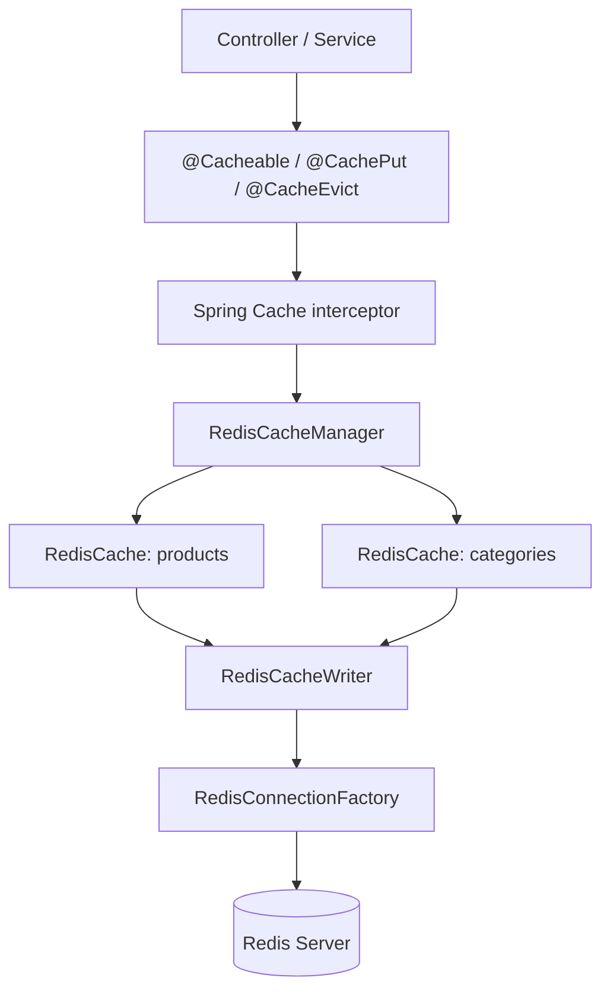
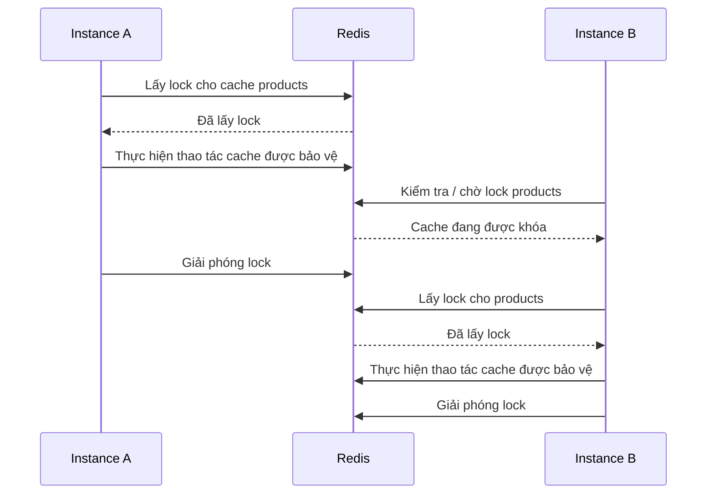
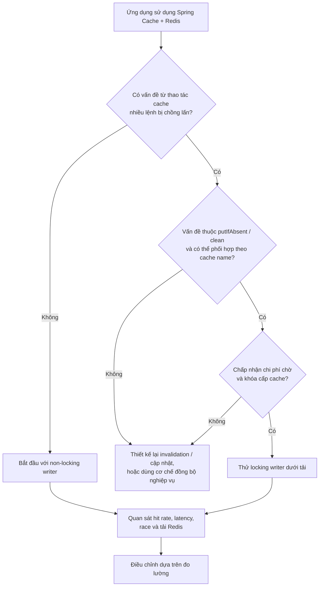

# Chọn RedisCacheWriter có khóa hoặc không khóa

Trong **Spring Cache sử dụng Spring Data Redis**, `RedisCacheWriter` là thành phần trực tiếp thực hiện các thao tác đọc, ghi và xóa dữ liệu cache qua kết nối Redis. Khi tạo `RedisCacheManager`, ứng dụng có thể chọn **writer không khóa** (*non-locking*) hoặc **writer có khóa** (*locking*). Lựa chọn này tác động đến cách các thao tác cache nhiều bước được phối hợp khi có các request đồng thời, từ đó ảnh hưởng đến độ trễ, thông lượng và tính nhất quán quan sát được của cache.

Điểm quan trọng nhất là **khóa của locking `RedisCacheWriter` áp dụng ở phạm vi một cache (cache name), không phải một khóa dữ liệu riêng lẻ**. Nó không biến Redis Cache thành giao dịch cơ sở dữ liệu, không khóa toàn bộ Redis và không tự bảo đảm rằng phương thức nghiệp vụ chỉ được tính toán đúng một lần.

Bài học trình bày cách writer hoạt động, cách cấu hình trong Spring Boot, những tình huống nên dùng từng lựa chọn và cách kiểm soát tác động khi nhiều ứng dụng cùng sử dụng một cache.

## 1. RedisCacheWriter nằm ở đâu trong Spring Cache?

Trong Spring Framework, các annotation như `@Cacheable`, `@CachePut` và `@CacheEvict` làm việc với abstraction `Cache`. Với backend Redis, `RedisCacheManager` quản lý các `RedisCache`; mỗi `RedisCache` dùng một `RedisCacheWriter` để thực hiện lệnh Redis.



Các trách nhiệm cần phân biệt:

| Thành phần | Trách nhiệm |
| --- | --- |
| Spring Cache abstraction | Quyết định khi nào đọc, ghi, xóa cache theo lời gọi phương thức |
| `RedisCacheManager` | Tạo, quản lý các cache theo tên; cấu hình cache mặc định và theo từng tên |
| `RedisCacheConfiguration` | Quy định TTL, key prefix, serializer, chính sách cache `null` và các đặc tính của một cache |
| `RedisCacheWriter` | Thực hiện các thao tác cache ở tầng Redis; lựa chọn có khóa hay không khóa |
| `RedisConnectionFactory` | Cung cấp kết nối Redis qua driver đã cấu hình |

`RedisCacheWriter` là một thành phần hạ tầng của Spring Data Redis. Trong ứng dụng thường ngày, ta không cần gọi nó trực tiếp: code nghiệp vụ tiếp tục dùng `@Cacheable`, còn lựa chọn writer được thực hiện ở lúc cấu hình `RedisCacheManager`.

## 2. Writer không khóa: lựa chọn mặc định

Spring Data Redis sử dụng **non-locking `RedisCacheWriter` theo mặc định**. Ta có thể tạo tường minh:

```java
RedisCacheWriter writer =
        RedisCacheWriter.nonLockingRedisCacheWriter(connectionFactory);
```

Writer này **không đặt lock key** để chặn các thao tác cache đồng thời. Những lệnh Redis độc lập được thực thi bình thường; Redis vẫn cung cấp tính nguyên tử vốn có của **từng lệnh đơn lẻ**.

Tuy nhiên, một số phương thức cache có thể bao gồm **nhiều lệnh**. Tài liệu Spring Data Redis nêu `putIfAbsent` và thao tác dọn toàn bộ cache (`clean`, tương ứng với `Cache.clear()`) là những trường hợp có khả năng các lệnh của hai thao tác xen kẽ nhau khi dùng writer không khóa.

Ví dụ khái niệm:

```text
Writer A: bắt đầu clear cache products
Writer A: tìm các key thuộc products
Writer B: cập nhật products::42
Writer A: xóa các key đã tìm thấy
Writer B: cho rằng mình vừa cập nhật cache
```

Tùy thứ tự lệnh thực tế, cập nhật của B có thể bị xóa bởi quá trình clear của A. Đây là đặc điểm cần quan tâm với một chuỗi thao tác cache không được bảo vệ bằng lock; không nhất thiết là lỗi của Redis.

**Ưu điểm:** không phát sinh các vòng kiểm tra lock key và thời gian chờ khóa. Nhờ vậy, writer này thường có độ trễ thấp hơn và phù hợp khi hệ thống ưu tiên thông lượng, có thể chịu được những sai lệch ngắn hạn của cache.

**Giới hạn:** không cung cấp sự phối hợp bổ sung giữa các thao tác nhiều bước. Khi hai instance cùng thao tác trên một cache, kết quả phụ thuộc vào thứ tự thực thi của các lệnh Redis và logic ở phía ứng dụng.

## 3. Writer có khóa: phối hợp thao tác ở mức cache

Spring Data Redis cũng cung cấp:

```java
RedisCacheWriter writer =
        RedisCacheWriter.lockingRedisCacheWriter(connectionFactory);
```

Writer có khóa sử dụng **một lock key riêng** để phối hợp các thao tác cần bảo vệ. Trước khi thực hiện thao tác có cơ chế lock, writer cần lấy lock; những writer khác theo cùng quy ước khóa phải đợi cho đến khi lock được giải phóng.



Sơ đồ là mô hình khái niệm. Số lệnh và cách thăm dò khóa phụ thuộc phiên bản thư viện và tùy chọn của `RedisCacheWriter`.

Điểm đáng chú ý:

- Lock **gắn với tên cache**, ví dụ `products`, không gắn riêng với `products::42`.
- Hai thao tác phải chờ nhau dù liên quan đến **hai entry khác nhau** trong cùng cache, nếu cả hai đang đi qua phần thao tác writer cần khóa.
- Một cache khác, chẳng hạn `categories`, có phạm vi lock riêng.
- Chỉ những thao tác tuân thủ cơ chế locking writer tương ứng mới được phối hợp. Lệnh Redis do một ứng dụng khác tự gửi, hoặc một client ghi trực tiếp vào các key cache, **không tự động tôn trọng lock**.
- Locking writer hướng tới việc tránh chồng lấn một số thao tác nhiều bước của cache, **không phải khóa nghiệp vụ**, cơ chế giao dịch phân tán hay bảo đảm tính tuyến tính tuyệt đối cho mọi thao tác.

**Đánh đổi:** để tránh chồng lấn, writer có thể phải gửi thêm lệnh kiểm tra lock và đợi. Khi cache đông request hoặc thường xuyên gọi `clear()`, độ trễ có thể tăng và thông lượng giảm đáng kể.

## 4. Vì sao phạm vi khóa là yếu tố quyết định?

Giả sử có ba phương thức:

```java
@Cacheable(cacheNames = "products", key = "#id")
public Product getProduct(String id) { ... }

@CachePut(cacheNames = "products", key = "#product.id")
public Product updateProduct(Product product) { ... }

@CacheEvict(cacheNames = "products", allEntries = true)
public void invalidateAllProducts() { ... }
```

Các entry có thể là:

```text
products::p-101
products::p-102
products::p-103
```

Locking writer quản lý khóa theo **cache `products`**, nên sự phối hợp các thao tác được bảo vệ có thể ảnh hưởng đến nhiều key thuộc cache đó. Không thể suy ra rằng `p-101` và `p-102` luôn được xử lý độc lập chỉ vì chúng có key khác nhau.

Ngược lại, không nên kết luận mọi `get`/`put` của locking writer luôn tuần tự hóa hoàn toàn. Phạm vi locking của các phương thức writer thay đổi theo hợp đồng triển khai, và lựa chọn này chủ yếu giải quyết vấn đề chồng lấn được Spring Data Redis mô tả cho những thao tác nhiều lệnh như `putIfAbsent` và `clean`.

Ví dụ hai cache được khai báo:

```text
products    -> product detail, giá và số lượng hiển thị
categories  -> danh mục sản phẩm
```

Một đợt dọn `products` không có lý do phải khóa `categories`. Đó là lợi ích của việc lock ở phạm vi cache; tuy vậy, một cache rất lớn hoặc bị cập nhật dồn dập có thể tạo vùng tranh chấp rộng.

## 5. So sánh locking và non-locking

| Tiêu chí | Non-locking writer | Locking writer |
| --- | --- | --- |
| Mặc định trong Spring Data Redis | **Có** | Không |
| Cách tạo | `nonLockingRedisCacheWriter(...)` | `lockingRedisCacheWriter(...)` |
| Lock key bổ sung | Không | Có, khi cần bảo vệ thao tác |
| Phạm vi lock | Không có lock cấp writer | **Theo cache name**, không theo từng entry |
| Độ trễ khi tranh chấp | Thường thấp hơn | Có thể tăng vì đợi và kiểm tra lock |
| Thông lượng | Thường tốt hơn với tải đồng thời | Có thể giảm ở cache nóng |
| Chuỗi lệnh `putIfAbsent`/`clean` có thể xen kẽ | Có | Được phối hợp bằng cơ chế lock của writer |
| Bảo vệ các client ghi Redis trực tiếp | Không | **Không** |
| Bảo đảm hàm `@Cacheable` chỉ tính một lần trên toàn cluster | Không | **Không phải hợp đồng của writer** |
| Thay thế giao dịch nghiệp vụ | Không | Không |
| Phù hợp | Cache best-effort, tải lớn, chi phí miss thấp | Cần giảm chồng lấn các thao tác cache được bảo vệ, chấp nhận độ trễ lock |

Không nên quyết định chỉ dựa trên chữ “locking” nghe có vẻ an toàn hơn. Spring Cache là một lớp tối ưu truy cập dữ liệu; dữ liệu đúng cho nghiệp vụ vẫn phải được bảo vệ tại nguồn dữ liệu và tầng giao dịch thích hợp.

## 6. Cấu hình writer không khóa trong Spring Boot

Giả sử ứng dụng dùng Spring Boot 3.x và Spring Data Redis, khai báo các dependency cần thiết:

```groovy
// build.gradle
dependencies {
    implementation 'org.springframework.boot:spring-boot-starter-cache'
    implementation 'org.springframework.boot:spring-boot-starter-data-redis'
}
```

Cấu hình kết nối:

```yaml
# src/main/resources/application.yml
spring:
  data:
    redis:
      host: localhost
      port: 6379
```

Bật Spring Cache:

```java
package com.example.shop;

import org.springframework.boot.SpringApplication;
import org.springframework.boot.autoconfigure.SpringBootApplication;
import org.springframework.cache.annotation.EnableCaching;

@SpringBootApplication
@EnableCaching
public class ShopApplication {

    public static void main(String[] args) {
        SpringApplication.run(ShopApplication.class, args);
    }
}
```

Spring Boot có thể tự tạo `RedisCacheManager` với non-locking writer khi điều kiện auto-configuration thỏa mãn. Nếu ứng dụng muốn **chỉ rõ loại writer** và chính sách cache trong code, có thể khai báo bean `RedisCacheManager`:

```java
package com.example.shop.config;

import java.time.Duration;

import org.springframework.cache.CacheManager;
import org.springframework.context.annotation.Bean;
import org.springframework.context.annotation.Configuration;
import org.springframework.data.redis.cache.RedisCacheConfiguration;
import org.springframework.data.redis.cache.RedisCacheManager;
import org.springframework.data.redis.cache.RedisCacheWriter;
import org.springframework.data.redis.connection.RedisConnectionFactory;

@Configuration
public class CacheConfig {

    @Bean
    public CacheManager cacheManager(RedisConnectionFactory connectionFactory) {
        RedisCacheWriter writer =
                RedisCacheWriter.nonLockingRedisCacheWriter(connectionFactory);

        RedisCacheConfiguration defaults =
                RedisCacheConfiguration.defaultCacheConfig()
                        .entryTtl(Duration.ofMinutes(10))
                        .disableCachingNullValues();

        return RedisCacheManager.builder(writer)
                .cacheDefaults(defaults)
                .build();
    }
}
```

`RedisConnectionFactory` do Spring Boot cung cấp khi kết nối Redis đã được cấu hình. `entryTtl(Duration.ofMinutes(10))` đặt hạn sống mặc định **10 phút** cho cache entry. `disableCachingNullValues()` không lưu giá trị `null` vào cache.

Khi tự khai báo bean `CacheManager` như trên, hãy nhớ rằng cấu hình tự động của Boot có thể nhường chỗ cho bean tùy chỉnh. Những thuộc tính `spring.cache.redis.*` mà trước đó Boot tự áp dụng sẽ **không tự nhiên được chuyển đầy đủ** vào `RedisCacheConfiguration` mới nếu bạn không cấu hình tương ứng. Nên tập trung chính sách cache tại một nguồn cấu hình rõ ràng.

## 7. Chuyển sang writer có khóa

Để sử dụng locking writer, thay duy nhất phần tạo writer trong cấu hình trên:

```java
RedisCacheWriter writer =
        RedisCacheWriter.lockingRedisCacheWriter(connectionFactory);
```

Phần còn lại vẫn là:

```java
return RedisCacheManager.builder(writer)
        .cacheDefaults(defaults)
        .build();
```

**Không đăng ký đồng thời hai bean `CacheManager` cùng phục vụ một nhóm `@Cacheable` mà không có cơ chế chọn rõ ràng.** Trong ví dụ chỉ dùng **một** bean `CacheManager`, và chọn đúng một loại writer tại điểm khởi tạo.

Một cấu hình đầy đủ dùng locking writer:

```java
package com.example.shop.config;

import java.time.Duration;
import org.springframework.cache.CacheManager;
import org.springframework.context.annotation.Bean;
import org.springframework.context.annotation.Configuration;
import org.springframework.data.redis.cache.RedisCacheConfiguration;
import org.springframework.data.redis.cache.RedisCacheManager;
import org.springframework.data.redis.cache.RedisCacheWriter;
import org.springframework.data.redis.connection.RedisConnectionFactory;

@Configuration
public class LockingCacheConfig {

    @Bean
    public CacheManager cacheManager(RedisConnectionFactory connectionFactory) {
        RedisCacheWriter writer =
                RedisCacheWriter.lockingRedisCacheWriter(connectionFactory);

        RedisCacheConfiguration defaults =
                RedisCacheConfiguration.defaultCacheConfig()
                        .entryTtl(Duration.ofMinutes(10))
                        .disableCachingNullValues();

        return RedisCacheManager.builder(writer)
                .cacheDefaults(defaults)
                .build();
    }
}
```

**Lưu ý:** hai class `CacheConfig` và `LockingCacheConfig` trên là **hai phương án độc lập**, không đưa cả hai vào cùng một ứng dụng với cùng bean name `cacheManager`. Chọn một class hoặc một cách cấu hình.

## 8. Áp dụng trong service dùng @Cacheable

Giả sử ta đọc chi tiết sản phẩm từ cơ sở dữ liệu:

```java
package com.example.shop.service;

import org.springframework.cache.annotation.CacheEvict;
import org.springframework.cache.annotation.CachePut;
import org.springframework.cache.annotation.Cacheable;
import org.springframework.stereotype.Service;

@Service
public class ProductService {

    private final ProductRepository products;

    public ProductService(ProductRepository products) {
        this.products = products;
    }

    @Cacheable(cacheNames = "products", key = "#id")
    public Product find(String id) {
        return products.findById(id).orElseThrow();
    }

    @CachePut(cacheNames = "products", key = "#result.id")
    public Product update(Product product) {
        return products.save(product);
    }

    @CacheEvict(cacheNames = "products", key = "#id")
    public void evictOne(String id) {
        // Method body có thể chứa logic nghiệp vụ phù hợp.
    }

    @CacheEvict(cacheNames = "products", allEntries = true)
    public void evictAll() {
        // Xóa toàn bộ entries của cache products.
    }
}
```

Ví dụ giả định dự án đã có `Product` và `ProductRepository` thuộc persistence layer. Phần code tập trung vào Spring Cache; không yêu cầu `Product` phải được lưu bằng Redis Repository. Cơ sở dữ liệu chứa sản phẩm có thể là PostgreSQL hoặc một nguồn dữ liệu khác, còn Redis chỉ là tầng cache.

Khi `find("p-101")` được gọi lần đầu, cache miss dẫn đến truy vấn nguồn dữ liệu và lưu kết quả. Các lời gọi sau có thể lấy dữ liệu từ cache, tùy TTL và chính sách invalidation.

Việc chọn locking writer **không có nghĩa** mọi lời gọi `find("p-101")` đồng thời sẽ tự động chỉ khiến `ProductRepository.findById` chạy một lần. Hai request có thể cùng miss trước khi dữ liệu được ghi. Cần phân biệt **khóa của writer đối với thao tác cache** với **đồng bộ tải dữ liệu (cache stampede control)**.

## 9. Phân biệt locking writer với @Cacheable(sync = true)

`@Cacheable(sync = true)` cho phép Spring Cache yêu cầu cache provider đồng bộ quá trình tính toán khi nhiều luồng cùng miss một key:

```java
@Cacheable(cacheNames = "products", key = "#id", sync = true)
public Product find(String id) {
    return products.findById(id).orElseThrow();
}
```

Hai khái niệm liên quan nhưng có mục tiêu khác nhau:

| Cơ chế | Mục tiêu |
| --- | --- |
| `RedisCacheWriter.lockingRedisCacheWriter(...)` | Phối hợp những thao tác cache nhiều bước mà writer hỗ trợ bảo vệ, dùng lock theo **tên cache** |
| `@Cacheable(sync = true)` | Đề nghị cache implementation đồng bộ quá trình tính toán giá trị khi cùng cache miss |
| Distributed lock nghiệp vụ | Bảo vệ một tài nguyên/quy trình nghiệp vụ, với định danh, thời gian giữ khóa và xử lý thất bại riêng |

`sync = true` có giới hạn của Spring Cache abstraction và từng provider. Không được mặc định rằng annotation này tạo một **distributed mutex chính xác một lần** xuyên qua mọi process, restart và tình huống lỗi mạng. Cần kiểm tra hợp đồng thực thi của phiên bản Spring Data Redis đang dùng nếu nghiệp vụ phụ thuộc vào một bảo đảm concurrency cụ thể.

Nếu vấn đề là “hai request cùng thực hiện thao tác thanh toán”, không giải quyết bằng cách đổi `RedisCacheWriter`; cần thiết kế idempotency và giao dịch ở nơi ghi dữ liệu thật.

## 10. Những thao tác nào nên chú ý nhất?

### 10.1. putIfAbsent

API cấp cache có thao tác:

```java
Cache cache = cacheManager.getCache("products");

if (cache != null) {
    cache.putIfAbsent("p-101", product);
}
```

`putIfAbsent` có ý nghĩa “chỉ ghi khi entry chưa tồn tại”. Theo tài liệu Spring Data Redis, việc hiện thực thao tác này ở tầng writer có thể bao gồm nhiều lệnh Redis và có nguy cơ chồng lấn khi non-locking.

Locking writer phối hợp các thao tác theo cache để giảm chồng lấn đó. Tuy nhiên, **đừng dùng `Cache.putIfAbsent` như một công cụ cấp quyền sở hữu distributed lock nghiệp vụ**: nó không thay thế cơ chế lock có token/lease/fencing và không có hợp đồng chống lỗi commit không xác định giữa các hệ thống.

### 10.2. clear / clean

`@CacheEvict(allEntries = true)` hoặc `Cache.clear()` làm sạch **toàn bộ cache**. Đây là thao tác có thể cần:

1. Tìm các Redis key có tiền tố của cache.
2. Xóa nhóm key đó theo chiến lược batch.

Khi tiến trình khác liên tục ghi cache, quét key và xóa key có thể xen kẽ với ghi. Non-locking cho phép các thao tác này tiến hành mà không chờ khóa cache. Locking writer cung cấp cơ chế phối hợp trong phạm vi các thao tác writer có sử dụng lock tương ứng.

Dù sử dụng locking writer, đừng coi `clear()` là một snapshot hoặc giao dịch nguyên tử cho toàn bộ ứng dụng: một client khác ghi trực tiếp vào Redis hoặc một hệ thống không dùng cùng quy ước lock vẫn có thể thay đổi dữ liệu.

### 10.3. get, put, evict một key

Đa số đọc/ghi/xóa đơn lẻ không cần lock cấp cache bổ sung để tận dụng nguyên tử của từng lệnh Redis. Locking writer không tự động biến mọi truy cập thành phép “đọc-sửa-ghi” có điều kiện. Nếu cần kiểu “chỉ cập nhật khi version còn nguyên”, hãy dùng lệnh Redis nguyên tử, Lua hoặc optimistic locking phù hợp với dữ liệu nguồn, thay vì suy luận từ tên loại writer.

## 11. Chọn writer theo đặc điểm hệ thống

### Nên chọn non-locking khi

- Cache phục vụ đọc nhanh với lưu lượng lớn và giá trị có thể tái tạo từ nguồn dữ liệu.
- Cache miss hoặc một đợt invalidation không hoàn toàn đồng bộ có thể được ứng dụng chấp nhận.
- Phần lớn thao tác là `get`, `put`, `evict` cho một entry; ít `clear()` toàn cache.
- Ưu tiên latency thấp và throughput cao hơn việc phối hợp chặt các thao tác cache nhiều bước.
- Hệ thống đã có cơ chế bảo vệ dữ liệu quan trọng tại persistence layer.

### Cân nhắc locking khi

- Công việc có các thao tác `putIfAbsent` hoặc dọn cache đồng thời và muốn giảm chồng lấn trong các thao tác mà writer hỗ trợ.
- Tần suất thao tác bảo vệ không quá lớn, vùng tranh chấp theo tên cache có thể chấp nhận.
- Có thể chịu thêm network round trips và thời gian chờ để lấy lock.
- Các instance cùng dùng cấu hình tên cache, prefix và cơ chế writer tương thích.
- Nhóm vận hành có cách quan sát lock contention và xử lý lock key tồn đọng khi xảy ra sự cố.

### Khi cả hai lựa chọn đều chưa giải quyết bài toán

- Cần cập nhật bản ghi nguồn chính xác khi nhiều request tranh chấp.
- Cần chỉ một worker xử lý một job hoặc thanh toán một lần.
- Cần tránh cache stampede xuyên nhiều instance với cơ chế lease/idempotency chuyên biệt.
- Cần giao dịch bao trùm Redis và SQL.
- Cần khóa theo **từng business key** nhưng không muốn chặn cả cache name.

Những trường hợp này cần thiết kế cơ chế đồng bộ nghiệp vụ riêng và không nên dựa vào locking `RedisCacheWriter` như một giải pháp tổng quát.

## 12. Chi phí của lock cấp cache

Giả sử cache `products` có 50.000 entry, hai request thao tác trên hai sản phẩm hoàn toàn khác nhau. Nếu chúng chạm vào các thao tác writer cần khóa, chúng vẫn có thể phải **xếp hàng theo cùng cache lock**.

```text
T0  Instance A bắt đầu thao tác có lock trên products
T1  Instance B muốn thao tác có lock trên products
T2  B chờ hoặc thăm dò lock key
T3  A giải phóng lock
T4  B tiếp tục
```

Chi phí gồm:

- **Round trips bổ sung:** lấy lock, kiểm tra trạng thái và giải phóng lock.
- **Waiting time:** request phải đợi thao tác khác cùng cache hoàn tất.
- **Contention:** một thao tác `clear()` tốn thời gian có thể tạo hàng đợi của các thao tác được bảo vệ.
- **Rủi ro sự cố:** nếu tiến trình chết hoặc mất kết nối trong lúc giữ lock, khả năng tự giải phóng phụ thuộc vào cơ chế expiration và cấu hình của phiên bản writer.

Không nên giả định lock key luôn có TTL bảo vệ mặc định giống nhau ở mọi phiên bản Spring Data Redis. Khi có yêu cầu vận hành nghiêm ngặt, phải xem API/cấu hình khóa của phiên bản đang chạy và có phương án phát hiện lock bị giữ bất thường.

## 13. BatchStrategy và thao tác xóa toàn bộ cache

Lựa chọn khóa là **một chiều cấu hình**; cách lấy và xóa các key khi `clear()` là **chiều cấu hình khác**.

Spring Data Redis có các `BatchStrategy` thường được dùng với writer:

```java
import org.springframework.data.redis.cache.BatchStrategies;
import org.springframework.data.redis.cache.RedisCacheWriter;

RedisCacheWriter writer = RedisCacheWriter.nonLockingRedisCacheWriter(
        connectionFactory,
        BatchStrategies.scan(1000)
);
```

`SCAN` duyệt theo đợt, thường phù hợp hơn `KEYS` khi cache rất lớn, nhưng cần hiểu giới hạn của Redis `SCAN`: không phải snapshot; có thể thấy key lặp, key mới hoặc key biến mất khi quét. Con số `1000` là gợi ý batch size, không phải cam kết mỗi lần Redis trả đúng 1000 khóa.

Chiến lược `KEYS` có thể làm Redis tốn nhiều công việc trên một lệnh khi keyspace lớn. Với `SCAN`, lượng công việc được trải trên nhiều lệnh nhưng phải kiểm tra tính tương thích của driver và topology Redis (đặc biệt Redis Cluster). Ở một số tổ hợp driver/cluster, hỗ trợ `SCAN` khi clear cache có hạn chế.

**Quan trọng:** chọn locking writer **không tự thay thế** chiến lược `KEYS` bằng `SCAN`, cũng không làm `SCAN` trở thành một giao dịch nhất quán tại một thời điểm. Cần cân nhắc độc lập tác động của `clear()` và mức tranh chấp lock.

## 14. TTL và serialization không phụ thuộc trực tiếp vào lựa chọn lock

`RedisCacheConfiguration` quyết định expiration và cách mã hóa dữ liệu; ví dụ:

```java
RedisCacheConfiguration defaults =
        RedisCacheConfiguration.defaultCacheConfig()
                .entryTtl(Duration.ofMinutes(15))
                .disableCachingNullValues()
                .computePrefixWith(cacheName -> "shop:" + cacheName + "::");
```

Cache entry được đặt TTL 15 phút bất kể writer đang locking hay non-locking. Cấu hình prefix ví dụ tạo các key kiểu:

```text
shop:products::p-101
shop:products::p-102
shop:categories::c-1
```

Đừng nhầm **TTL của entry cache** với **thời hạn giữ lock key** của locking writer. Đây là hai thứ khác nhau:

| Thành phần | Chức năng |
| --- | --- |
| TTL cache entry | Quyết định sản phẩm đã cache còn hợp lệ bao lâu |
| Lock key của writer | Điều phối các thao tác cache được bảo vệ |
| Key prefix | Phân vùng tên key theo cache, module hoặc môi trường |
| Serializer | Chuyển key/value giữa object Java và Redis bytes |

Thay đổi TTL của entry không có nghĩa thay đổi thời gian chờ lock. Đổi serializer cũng không biến writer thành locking; tuy nhiên khi nhiều instance dùng chung Redis, chúng phải thống nhất serializer và key prefix để không đọc nhầm hoặc ghi đè dữ liệu của nhau.

## 15. Cẩn thận khi nhiều ứng dụng dùng cùng Redis

Giả sử có hai instance của cùng dịch vụ:

```text
shop-api-1 --> RedisCacheManager --> RedisCacheWriter --> Redis
shop-api-2 --> RedisCacheManager --> RedisCacheWriter --> Redis
```

Nếu cả hai dùng locking writer, cùng tên cache và cùng Redis namespace, chúng có thể phối hợp thông qua lock key của writer cho những thao tác được hỗ trợ. Nhưng phải tránh các giả định sau:

1. **“Có một instance dùng locking là đủ.”** Không đúng; một instance dùng non-locking hoặc ghi Redis trực tiếp có thể bỏ qua cơ chế lock của instance còn lại.
2. **“Lock bảo vệ từng SKU.”** Không đúng; phạm vi lock là tên cache, nên tính cạnh tranh giữa các entry có thể rộng hơn yêu cầu nghiệp vụ.
3. **“Cache lock giữ dữ liệu SQL nhất quán.”** Không đúng; thay đổi ở SQL vẫn cần giao dịch và chiến lược invalidation phù hợp.
4. **“Mọi môi trường cùng tên cache đều phải chia sẻ dữ liệu.”** Không đúng; nên phân vùng Redis database, key prefix hoặc hạ tầng theo môi trường để tránh ghi đè và tranh chấp không mong muốn.
5. **“Locking bảo đảm không bao giờ có stale read.”** Không đúng; cache có thể cũ so với nguồn dữ liệu, nhất là khi cập nhật nguồn và invalidation không đồng thời.

Nếu cần tách cache của nhiều môi trường, nên cấu hình tên hoặc prefix rõ ràng; đồng thời xem xét cách writer xây dựng lock key theo tên cache trong phiên bản hiện hành. Chỉ đổi prefix của entry mà giữ cấu hình lock chung không nên được mặc định là tạo ra các namespace lock hoàn toàn độc lập.

## 16. Quan sát và so sánh dưới tải

Khi quyết định chuyển sang locking writer, việc đo hiệu quả quan trọng hơn suy đoán. Có thể tổ chức bài thử với hai cấu hình nhưng **cùng số instance, cùng bộ key, TTL, serializer, connection pool và tải yêu cầu**.

Một số tình huống cần đo:

| Bài thử | Quan sát |
| --- | --- |
| `@Cacheable` nhiều key khác nhau | Latency p50/p95/p99 và throughput |
| Nhiều request cùng cache miss một key | Số lần gọi nguồn dữ liệu và độ trễ |
| `Cache.putIfAbsent` đồng thời | Kết quả khi các writer cùng thực hiện thao tác |
| `@CacheEvict(allEntries=true)` giữa tải ghi | Thời gian clear, các giá trị cache sau clear |
| Nhiều instance dùng cùng cache | Thời gian chờ lock và số thao tác thất bại |
| Cache lớn với batch clear | CPU Redis, số lệnh Redis, tác động `KEYS`/`SCAN` |

Các tín hiệu vận hành nên thu thập: latency của API, cache hit/miss, số lần gọi database, Redis command latency, CPU, network, pool exhaustion, số timeout và tỷ lệ lỗi. Nếu thư viện/driver hiện tại cho phép, theo dõi lock wait hoặc command metrics riêng; còn không, đo ở tầng phương thức liên quan tới `clear()` và `putIfAbsent`.

Nếu locking làm p99 tăng rõ rệt nhưng mức chồng lấn `putIfAbsent`/`clear` hiếm khi xảy ra và ứng dụng chịu được, non-locking có thể hợp lý hơn. Nếu một race condition ở các thao tác cache gây ảnh hưởng vận hành và locking xử lý đúng phạm vi đó với chi phí chấp nhận được, có thể cân nhắc locking.

## 17. Các lỗi cấu hình và hiểu nhầm thường gặp

### 17.1. Tìm một thuộc tính YAML để bật locking writer

Spring Boot có các thuộc tính cấu hình Redis Cache như TTL và key prefix, nhưng không nên giả định có một thuộc tính `spring.cache.redis.locking=true` được hỗ trợ để đổi loại writer. Cách rõ ràng là tự tạo `RedisCacheWriter` phù hợp và dùng `RedisCacheManager.builder(writer)`.

### 17.2. Có @EnableCaching nhưng ứng dụng vẫn dùng cache khác

`@EnableCaching` chỉ bật annotation-driven caching. Nếu classpath hoặc cấu hình có nhiều cache provider, hãy xác nhận `CacheManager` đang được inject thực sự là `RedisCacheManager`. Khi khai báo bean thủ công, phải kiểm soát bean type và lựa chọn `CacheManager` nếu có nhiều manager.

### 17.3. Tưởng locking xử lý được cache stampede tự động

Locking writer không phải bảo đảm “một truy vấn database duy nhất cho cùng một key”. Khi cần chống stampede, cân nhắc `@Cacheable(sync = true)` theo khả năng provider, prewarming, TTL jitter, stale-while-revalidate hoặc cơ chế single-flight/distributed lock riêng có thiết kế cho nghiệp vụ đó.

### 17.4. Dọn toàn bộ cache trên cache name rất lớn

`allEntries = true` có thể khiến hệ thống phải quét/xóa nhiều key. Nếu dùng locking, thao tác đó còn có thể tạo chờ đợi trong phạm vi cache; nếu dùng non-locking, có nguy cơ các lệnh clear và ghi xen kẽ. Cần cân nhắc invalidation theo key, chia cache name phù hợp và hạn chế clear toàn cục.

### 17.5. Tưởng cache writer là khóa của repository

`RedisCacheWriter` thuộc **Spring Cache**, khác với **Spring Data Redis Repository** dùng `@RedisHash`, `CrudRepository` và `RedisKeyValueTemplate`. Bật locking writer không tự tạo optimistic locking cho entity Redis Repository.

### 17.6. Không tính đến kết nối Redis hoặc sự cố mạng

Locking writer tạo thêm thao tác Redis. Khi Redis timeout, pool cạn hoặc network gián đoạn, request có thể chờ lâu hơn. Cần timeout phù hợp, chính sách lỗi cache rõ ràng và cơ chế giám sát; không nuốt mọi lỗi cache để trả dữ liệu tưởng là chính xác.

### 17.7. Dùng cache để bảo vệ hành động có side effect

Nếu thao tác phải được thực hiện đúng một lần, ví dụ tạo đơn hàng hoặc gửi thanh toán, đừng dựa trên cache `putIfAbsent` hoặc writer locking. Cần idempotency key, ràng buộc duy nhất ở nơi lưu dữ liệu, giao dịch phù hợp và phục hồi sau lỗi.

## 18. Quy trình ra quyết định



Có thể dùng các câu hỏi thực tế sau:

1. Cache này có thể tạo lại dữ liệu từ nguồn chính không?
2. Bao nhiêu phần trăm thao tác là `get`/`put`/`evict` đơn lẻ, bao nhiêu là `putIfAbsent` hoặc `clear`?
3. Có bao nhiêu instance cùng cập nhật một tên cache?
4. Nếu `clear()` gặp ghi đồng thời, ứng dụng có bị ảnh hưởng nghiêm trọng không?
5. Lock cấp cache có tạo tắc nghẽn trên những entry vốn không liên quan nhau không?
6. Đã có metric để chứng minh việc đổi writer cải thiện kết quả chưa?

## 19. Tổng kết

`RedisCacheWriter.nonLockingRedisCacheWriter(...)` là lựa chọn mặc định trong Spring Data Redis: ít chi phí phối hợp, phù hợp các cache có thể tái tạo và tải đồng thời lớn, nhưng các thao tác nhiều lệnh như `putIfAbsent` và `clean` có nguy cơ xen kẽ với thao tác khác.

`RedisCacheWriter.lockingRedisCacheWriter(...)` dùng cơ chế lock theo **tên cache** để phối hợp những thao tác được writer bảo vệ. Nó có thể giảm chồng lấn nhưng làm tăng số lệnh Redis và thời gian chờ, đặc biệt khi nhiều thao tác cùng dùng một cache. Phạm vi này **không phải lock theo key**, **không tạo giao dịch nghiệp vụ** và **không bảo đảm xử lý đúng một lần**.

Hãy bắt đầu từ yêu cầu nhất quán thực tế của cache, chọn writer phù hợp, rồi đo latency, cache hit/miss và thời gian clear dưới tải đồng thời. TTL, serializer, batch strategy và cơ chế chống cache stampede cần được thiết kế riêng, vì chúng giải quyết các vấn đề khác với lựa chọn locking/non-locking writer.

### Tài liệu tham khảo

- [Spring Data Redis — Redis Cache](https://docs.spring.io/spring-data/redis/reference/redis/redis-cache.html): locking và non-locking RedisCacheWriter, các thao tác nhiều lệnh và batch strategy.
- [Spring Data Redis — RedisCacheWriter API](https://docs.spring.io/spring-data/redis/reference/api/java/org/springframework/data/redis/cache/RedisCacheWriter.html): các factory method tạo locking và non-locking writer.
- [Spring Data Redis — RedisCacheManager API](https://docs.spring.io/spring-data/redis/reference/api/java/org/springframework/data/redis/cache/RedisCacheManager.html): cấu hình RedisCacheManager và builder.
- [Spring Framework — Declarative Annotation-based Caching](https://docs.spring.io/spring-framework/reference/integration/cache/annotations.html): `@Cacheable`, `@CachePut`, `@CacheEvict`, `sync=true`.
- [Redis — SCAN](https://redis.io/docs/latest/commands/scan/): cơ chế duyệt keyspace theo cursor và các giới hạn khi quét.
