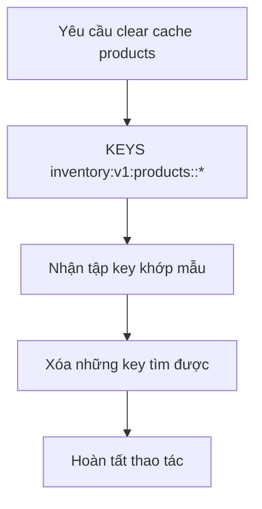
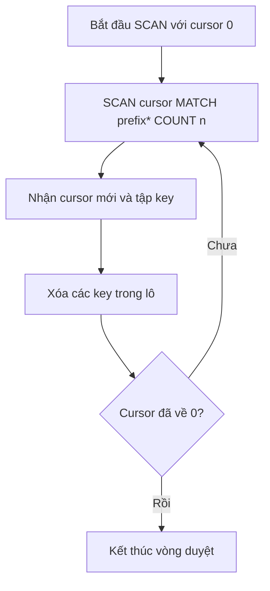

# Chiến lược xóa cache bằng KEYS hoặc SCAN và giới hạn trình điều khiển trong Spring Data Redis

## 1. Vì sao cách xóa toàn bộ cache lại quan trọng?

Spring Cache cho phép ứng dụng Java cache kết quả phương thức thông qua các annotation như `@Cacheable`, `@CachePut` và `@CacheEvict`. Khi dùng **Spring Data Redis** làm nơi lưu cache, một cache có thể chứa hàng nghìn hoặc hàng triệu Redis key. Việc xóa một entry đã biết key thường đơn giản; việc **xóa toàn bộ entry của một cache** phức tạp hơn vì Redis không có lệnh xóa trực tiếp một “thư mục cache” theo tên.

Giả sử ứng dụng quản lý sản phẩm có hai vùng cache:

```text
inventory:v1:products::SKU-1001
inventory:v1:products::SKU-1002
inventory:v1:products::SKU-1003
inventory:v1:product-prices::SKU-1001
inventory:v1:product-prices::SKU-1002
```

Yêu cầu có thể là:

- Khi cập nhật một sản phẩm, xóa riêng entry `products::SKU-1001`.
- Khi nhập lại toàn bộ danh mục, xóa **tất cả** entry của cache `products`.
- Không chạm vào cache `product-prices` hoặc những key Redis không do Spring Cache quản lý.

Spring Data Redis thực hiện việc dọn toàn bộ cache thông qua `RedisCacheWriter`. Thành phần này hỗ trợ các chiến lược xử lý hàng loạt (**batch strategies**), đáng chú ý là **`KEYS`** và **`SCAN`**.

Sự khác biệt ảnh hưởng trực tiếp tới độ trễ Redis, khối lượng bộ nhớ tạm, tốc độ dọn và khả năng hoạt động với các Redis client/driver như Lettuce hoặc Jedis, đặc biệt trong Redis Cluster.

## 2. Phân biệt xóa một entry và xóa cả cache

Trong Spring Cache, hai thao tác dưới đây có ý nghĩa khác nhau.

**Xóa entry có key cụ thể:**

```java
@CacheEvict(cacheNames = "products", key = "#p0")
public void evictProduct(String sku) {
}
```

Với một key đã xác định, cache provider có thể xóa trực tiếp key Redis tương ứng. Không cần duyệt tất cả các key để tìm những entry khác.

**Xóa mọi entry của vùng cache:**

```java
@CacheEvict(cacheNames = "products", allEntries = true)
public void evictAllProducts() {
}
```

Ở đây, Spring Cache yêu cầu xóa toàn bộ vùng `products`. Khi Redis lưu mỗi entry thành một key riêng, `RedisCacheWriter` phải **tìm những key thuộc vùng cache**, sau đó xóa chúng. Đó là nơi `KEYS` và `SCAN` phát huy vai trò.

Có thể gọi qua API trực tiếp:

```java
Cache cache = cacheManager.getCache("products");

if (cache != null) {
    cache.clear();
}
```

Lời gọi `Cache.clear()` cũng có thể dẫn đến thao tác dọn nhóm key của cache Redis. Nó không nhất thiết có khả năng xóa toàn bộ cache như một hành động nguyên tử trong lúc các request khác tiếp tục ghi.

### So sánh ba tình huống

| Tình huống | Phạm vi | Có cần chiến lược duyệt key? |
|---|---|---|
| `@CacheEvict(key = "...")` | Một entry đã xác định | Thông thường không |
| `@CacheEvict(allEntries = true)` | Tất cả entry trong cache đã đặt tên | Có, nếu backend cần tìm các key theo prefix |
| Redis tự hết hạn theo TTL | Từng key tới thời điểm hết hạn | Không cần quét toàn bộ cache theo yêu cầu của ứng dụng |

**Mấu chốt:** cấu hình `BatchStrategies.scan(...)` chủ yếu giải quyết cách dọn **những entry có cùng prefix**, không biến mọi lệnh `@CacheEvict` thành thao tác quét Redis.

## 3. RedisCacheWriter xác định những key thuộc cache như thế nào?

`RedisCacheManager` quản lý những vùng cache Redis. Mỗi `RedisCache` dùng `RedisCacheConfiguration` để quyết định cách ghép key, serializer, TTL và prefix. Khi xóa một vùng, cache writer dùng thông tin prefix của vùng đó để lựa chọn các Redis key liên quan.

Thông thường, Redis Cache gắn tiền tố theo tên cache. Ví dụ:

```text
Cache name: products
Cache key : SKU-1001

Redis key : products::SKU-1001
```

Nếu ứng dụng cấu hình một prefix riêng:

```text
Redis prefix: inventory:v1:products::
Redis key   : inventory:v1:products::SKU-1001
```

thì quá trình xóa toàn bộ cache `products` sẽ tìm và loại bỏ các key thuộc prefix tương ứng.

**Prefix chỉ là quy ước đặt tên Redis key.** Nó cần đủ cụ thể để các cache và ứng dụng khác không dùng trùng vùng dữ liệu.

### Hậu quả khi tắt prefix

Spring Data Redis cho phép tùy chỉnh hoặc tắt prefix. Nếu tắt prefix, tên cache có thể không còn được phản ánh trong Redis key. Khi hai cache dùng key giống nhau, chúng có nguy cơ ghi đè hoặc xóa nhầm dữ liệu.

Đặc biệt, `allEntries = true` trở nên khó bảo đảm phạm vi an toàn nếu tên cache không còn một ranh giới prefix rõ ràng. Vì vậy, trong ứng dụng dùng Redis chung giữa nhiều cache, nên duy trì prefix và có quy ước namespace ở mức ứng dụng/môi trường.

## 4. Chiến lược KEYS: dễ hiểu nhưng có chi phí lớn trên keyspace lớn

Lệnh Redis:

```redis
KEYS inventory:v1:products::*
```

tìm các key khớp mẫu. Nếu nhận được một danh sách key, ứng dụng có thể gửi lệnh xóa những key đó.

Luồng khái niệm:



Trong Spring Data Redis, `BatchStrategies.keys()` biểu diễn chiến lược sử dụng `KEYS` khi dọn cache.

### Vì sao KEYS có thể gây vấn đề?

`KEYS` có độ phức tạp **O(N)** theo số key trong Redis keyspace được xét. Nó thực hiện việc tìm kiếm trong một lệnh Redis và có thể tạo ra kết quả lớn.

Khi Redis đang phục vụ request với độ trễ thấp:

- Một lệnh `KEYS` trên keyspace lớn có thể chiếm nhiều thời gian xử lý của Redis, gây ảnh hưởng tới những request khác.
- Tập tên key trả về có thể lớn, tạo chi phí truyền mạng và cấp phát bộ nhớ phía client.
- Lệnh xóa theo sau cũng có thể gây tải lớn, nhất là khi một lượng lớn key hoặc cấu trúc dữ liệu lớn được xử lý cùng lúc.
- Một cache nhỏ vẫn có thể nằm trong Redis database có **rất nhiều key của những cache khác**; chi phí quét không phụ thuộc riêng số key cuối cùng khớp mẫu.

Ví dụ, database có 10 triệu key nhưng chỉ 3.000 key thuộc cache `products`: `KEYS products::*` vẫn phải duyệt keyspace mà Redis quản lý để xác định những key phù hợp.

### Khi nào KEYS có thể chấp nhận được?

`KEYS` đơn giản và thường phù hợp khi:

- Redis chỉ chứa số key nhỏ, đã biết và được kiểm soát.
- Môi trường phát triển/thử nghiệm cho phép chẩn đoán bằng key pattern.
- Công việc bảo trì được thực hiện có chủ đích trên dữ liệu giới hạn.
- Hạ tầng và phiên bản driver không hỗ trợ chiến lược thay thế cần thiết.

Trên Redis production có keyspace lớn hoặc nhiều traffic, cần cân nhắc chiến lược `SCAN` và các phương án tránh xóa toàn bộ vùng cache đồng thời.

## 5. Chiến lược SCAN: duyệt theo từng lượt

Redis cung cấp lệnh `SCAN`, cho phép client duyệt keyspace bằng cursor:

```redis
SCAN 0 MATCH inventory:v1:products::* COUNT 500
```

Redis trả về hai phần:

1. **Cursor cho lượt kế tiếp**.
2. **Danh sách key tìm thấy trong lượt hiện tại**.

Client gửi tiếp:

```text
SCAN <cursor-duoc-tra-ve> MATCH inventory:v1:products::* COUNT 500
```

và lặp đến khi cursor trả về `0`.

Luồng:



Trong Spring Data Redis, `BatchStrategies.scan(batchSize)` chọn chiến lược dọn bằng `SCAN`. Ví dụ `BatchStrategies.scan(500)` cung cấp một kích thước lô/gợi ý khi quét; nó **không** giới hạn tổng số key sẽ bị xóa còn 500.

### SCAN có ưu điểm gì?

Khác với việc yêu cầu Redis trả toàn bộ key bằng một lệnh `KEYS`, `SCAN` chia công việc duyệt thành nhiều lượt. Redis có thể xử lý các yêu cầu khác giữa các lượt quét.

Lợi ích thường thấy:

- Hạn chế một lệnh Redis chạy quá dài để tìm mọi key.
- Tránh phải nhận toàn bộ danh sách key trong một phản hồi khổng lồ.
- Có thể điều chỉnh lượng công việc mỗi lượt.
- Phù hợp hơn cho keyspace lớn và hệ thống đang có tải, nếu driver và topology hỗ trợ.

Tuy nhiên, `SCAN` không miễn phí: một vòng duyệt đầy đủ vẫn có độ phức tạp gắn với tổng số key trong vùng được quét. Nó có thể cần rất nhiều lượt mạng và làm thao tác `clear` kéo dài, nhất là khi chỉ một phần rất nhỏ key khớp pattern.

### Các quy tắc của SCAN dễ bị hiểu sai

- `COUNT` là **gợi ý lượng công việc**, không cam kết chính xác bao nhiêu key được trả về mỗi lần.
- Một lượt `SCAN` có thể trả danh sách rỗng nhưng cursor vẫn khác `0`; chưa được kết thúc vòng lặp.
- Trong một vòng quét, cùng một key có thể xuất hiện hơn một lần. Việc xóa key đã xóa cần được xử lý an toàn.
- Khi có tiến trình ghi/xóa đồng thời, tập key quan sát được không phải một snapshot bất biến: key mới có thể được thấy hoặc không.
- Muốn quét hết phải theo cursor tới `0`; đừng dừng chỉ vì thấy một lượt rỗng.
- `MATCH` dùng cú pháp glob, vì vậy chuỗi prefix hoặc pattern phải được kiểm soát để không mở rộng ngoài phạm vi dự kiến.

Đối với xóa cache, điểm quan trọng nhất là **clear bằng SCAN không bảo đảm vùng cache sẽ rỗng hoàn toàn tại thời điểm kết thúc nếu writer khác vẫn liên tục thêm key**.

## 6. KEYS và SCAN: so sánh đúng vấn đề

| Tiêu chí | KEYS | SCAN |
|---|---|---|
| Cách tìm key | Một lệnh trả tập key khớp mẫu | Nhiều lượt dùng cursor |
| Độ phức tạp quét tổng | O(N) | O(N) cho vòng duyệt đầy đủ |
| Độ trễ một lượt | Có thể rất cao khi keyspace lớn | Có thể phân bổ thành các lượt nhỏ hơn |
| Khả năng xử lý keyspace lớn | Hạn chế do tính chặn và kết quả lớn | Thường phù hợp hơn |
| Bộ nhớ tạm phía client | Có thể cần chứa danh sách lớn | Có thể xử lý theo lô |
| Số round trip | Ít hơn cho bước tìm key | Nhiều hơn, phụ thuộc cursor và COUNT |
| Dữ liệu thay đổi khi quét | Một lệnh tìm trong thời điểm thực thi | Không có ảnh chụp nhất quán trong toàn vòng |
| Trùng/khuyết khi quét | Không phải đặc điểm cursor | Có thể trùng, có thể không thấy key biến động |
| Giới hạn driver | `BatchStrategies.keys()` được hỗ trợ rộng | `BatchStrategies.scan(...)` phụ thuộc driver và chế độ Redis |
| Dùng cho Spring Cache clear | Đơn giản, thường là mặc định | Cần chọn tường minh nếu muốn dùng |

**SCAN giảm mức độ chặn của từng lượt**, nhưng không biến việc dọn hàng triệu key thành tác vụ O(1), không giải quyết mọi tình huống ghi đồng thời và không thay đổi phạm vi key mà cache writer muốn xóa.

## 7. Cấu hình KEYS hoặc SCAN trong RedisCacheManager

Spring Data Redis cấu hình chiến lược dọn cache thông qua `RedisCacheWriter`, sau đó đưa writer vào `RedisCacheManager`.

Ví dụ một dự án Spring Boot dùng Redis Cache. Dependency Gradle:

```kotlin
dependencies {
    implementation("org.springframework.boot:spring-boot-starter-data-redis")
    implementation("org.springframework.boot:spring-boot-starter-cache")
}
```

Cấu hình kết nối đơn giản trong `application.yml`:

```yaml
spring:
  data:
    redis:
      host: localhost
      port: 6379
```

Đối với hệ thống thật, host, port, xác thực, TLS và topology phải khớp với hạ tầng Redis đang triển khai.

### 7.1. Chọn SCAN và prefix riêng cho cache

**File `RedisCacheConfig.java`:**

```java
package com.example.inventory.config;

import java.time.Duration;

import org.springframework.cache.annotation.EnableCaching;
import org.springframework.context.annotation.Bean;
import org.springframework.context.annotation.Configuration;
import org.springframework.data.redis.cache.BatchStrategies;
import org.springframework.data.redis.cache.RedisCacheConfiguration;
import org.springframework.data.redis.cache.RedisCacheManager;
import org.springframework.data.redis.cache.RedisCacheWriter;
import org.springframework.data.redis.connection.RedisConnectionFactory;

@Configuration
@EnableCaching
public class RedisCacheConfig {

    @Bean
    public RedisCacheManager cacheManager(
            RedisConnectionFactory connectionFactory
    ) {
        RedisCacheWriter writer =
                RedisCacheWriter.nonLockingRedisCacheWriter(
                        connectionFactory,
                        BatchStrategies.scan(500)
                );

        RedisCacheConfiguration config =
                RedisCacheConfiguration.defaultCacheConfig()
                        .entryTtl(Duration.ofMinutes(15))
                        .computePrefixWith(
                                name -> "inventory:v1:" + name + "::"
                        )
                        .disableCachingNullValues();

        return RedisCacheManager.builder(writer)
                .cacheDefaults(config)
                .build();
    }
}
```

Cấu hình trên thể hiện các quyết định riêng biệt:

- `RedisCacheWriter.nonLockingRedisCacheWriter(...)` tạo writer không dùng khóa cache-level để đồng bộ mọi thao tác.
- `BatchStrategies.scan(500)` yêu cầu writer dùng chiến lược `SCAN` khi cần xóa một nhóm key.
- `entryTtl(Duration.ofMinutes(15))` đặt TTL mặc định cho **entry** của cache, độc lập với chiến lược tìm key khi `clear`.
- `computePrefixWith(...)` đưa tên môi trường/ứng dụng và tên cache vào key để phân chia namespace.
- `disableCachingNullValues()` tránh lưu giá trị null, là lựa chọn của ví dụ, không phải điều kiện của `SCAN`.
- `RedisCacheManager.builder(writer)` sử dụng writer đã cấu hình cho các vùng cache mà manager quản lý.

Với tên cache `products` và khóa logic `SKU-1001`, Redis key dự kiến có prefix:

```text
inventory:v1:products::SKU-1001
```

Định dạng đuôi key thực tế còn phụ thuộc key generator và key serializer. Ví dụ ở trên sử dụng kiểu key chuỗi mặc định, phù hợp với minh họa.

### 7.2. Chọn KEYS khi thực sự phù hợp

Nếu muốn cấu hình tường minh chiến lược `KEYS`, phần tạo writer có thể đổi thành:

```java
RedisCacheWriter writer =
        RedisCacheWriter.nonLockingRedisCacheWriter(
                connectionFactory,
                BatchStrategies.keys()
        );
```

Trong cấu hình Redis Cache thông thường, `KEYS` là batch strategy mặc định của RedisCacheWriter khi chưa chọn một chiến lược khác. Việc viết tường minh giúp dễ theo dõi chính sách vận hành của ứng dụng.

**Điều kiện cốt lõi:** chọn `BatchStrategies.scan(...)` tại nơi cấu hình `RedisCacheWriter`. Thêm `@CacheEvict(allEntries = true)` mà không thay cấu hình writer không đủ để chuyển thuật toán clear sang `SCAN`.

### 7.3. Nếu Spring Boot đã tạo sẵn CacheManager

Khi ứng dụng tự khai báo bean `RedisCacheManager` như trên, bean đó thường được dùng thay cho CacheManager Redis do Spring Boot tự cấu hình theo điều kiện. Nếu dự án đang có nhiều cache manager hoặc customizer riêng, phải xác định rõ bean nào được Spring Cache chọn.

Không tạo thêm một `RedisCacheManager` thứ hai chỉ để thử `SCAN` mà không cấu hình tên bean/`@Primary`/`@CacheConfig` hoặc `cacheManager` của annotation phù hợp. Nếu annotation tiếp tục dùng manager cũ, thao tác clear vẫn có thể đi theo chiến lược khác dự kiến.

## 8. Sử dụng @Cacheable và @CacheEvict với cấu hình trên

Ví dụ service đọc sản phẩm:

**`ProductQueryService.java`:**

```java
package com.example.inventory.service;

import org.springframework.cache.annotation.Cacheable;
import org.springframework.stereotype.Service;

@Service
public class ProductQueryService {

    private final ProductGateway gateway;

    public ProductQueryService(ProductGateway gateway) {
        this.gateway = gateway;
    }

    @Cacheable(cacheNames = "products", key = "#p0")
    public ProductView findProduct(String sku) {
        return gateway.loadProduct(sku);
    }
}
```

`ProductGateway` là abstraction truy cập nguồn dữ liệu thật; `ProductView` là kiểu dữ liệu sản phẩm của ứng dụng. Chúng được nhắc đến để mô tả service, không phải lớp do Spring Data Redis cung cấp.

Sau lần gọi đầu:

```java
productQueryService.findProduct("SKU-1001");
```

kết quả có thể được lưu vào Redis Cache `products`. Lần gọi kế tiếp với cùng SKU được lấy từ cache, miễn cache entry còn hiệu lực và điều kiện caching phù hợp.

Service phụ trách xóa:

**`ProductCacheMaintenance.java`:**

```java
package com.example.inventory.service;

import org.springframework.cache.annotation.CacheEvict;
import org.springframework.stereotype.Service;

@Service
public class ProductCacheMaintenance {

    // Xóa một entry đúng SKU, không cần duyệt toàn vùng cache.
    @CacheEvict(cacheNames = "products", key = "#p0")
    public void evictOne(String sku) {
    }

    // Xóa mọi entry thuộc cache "products".
    @CacheEvict(cacheNames = "products", allEntries = true)
    public void evictAllProducts() {
    }
}
```

Hai phương thức được Spring Cache xử lý khi chúng được gọi **qua Spring bean proxy**. Không nên gọi chúng nội bộ qua `this.evictAllProducts()` rồi mặc định annotation vẫn được intercept theo proxy mode thông thường.

`@CacheEvict` mặc định thực hiện việc evict **sau khi** phương thức hoàn tất thành công. Nếu một tác vụ quản trị yêu cầu xóa cache trước khi chạy phần thân, có thể chọn `beforeInvocation = true` theo ngữ nghĩa nghiệp vụ:

```java
@CacheEvict(
        cacheNames = "products",
        allEntries = true,
        beforeInvocation = true
)
public void prepareFullReload() {
    // Công việc nghiệp vụ.
}
```

Đổi thời điểm evict không đổi bản chất thao tác dọn nhiều key: thuật toán vẫn phụ thuộc `RedisCacheWriter`. Ngoài ra, `allEntries = true` được áp dụng cho **cả cache được đặt tên**, không chỉ nhóm có SKU hoặc tenant trùng tham số phương thức.

## 9. Giới hạn trình điều khiển: Lettuce và Jedis

Không phải driver nào cũng thực thi chiến lược `SCAN` giống nhau ở mọi topology Redis. Spring Data Redis nêu sự khác biệt cần lưu ý khi chọn batch strategy:

| Redis driver | Redis standalone / non-clustered | Redis Cluster | Ghi chú |
|---|---|---|---|
| **Lettuce** | `KEYS` và `SCAN` | Hỗ trợ `KEYS` và `SCAN` theo khả năng RedisCacheWriter/Spring Data Redis | Lựa chọn phù hợp khi cần chiến lược SCAN trên cluster |
| **Jedis** | `KEYS` và `SCAN` | `KEYS` được hỗ trợ; `SCAN` trong batch strategy **không được hỗ trợ đầy đủ** theo giới hạn được tài liệu Spring Data Redis nêu | Cần xác nhận phiên bản driver/Spring Data Redis trước khi bật SCAN trên cluster |

Theo hướng dẫn Spring Data Redis về Redis Cache, chiến lược `KEYS` được hỗ trợ trên các driver và các kiểu triển khai Redis phổ biến. Với `SCAN`, **Lettuce được hỗ trợ đầy đủ**, còn **Jedis chỉ hỗ trợ SCAN trong chế độ không phải cluster** ở phạm vi mô tả của tài liệu.

Các phiên bản thư viện phát triển theo thời gian; cần đối chiếu bộ phiên bản Spring Data Redis, Lettuce/Jedis và topology thực tế của ứng dụng. Không nên mặc định chỉ cần có lệnh Redis `SCAN` trên server là RedisCacheWriter với driver đang dùng sẽ hỗ trợ dọn cache bằng SCAN trong Redis Cluster.

### Vì sao Redis Cluster làm vấn đề phức tạp hơn?

Redis Cluster chia keyspace cho nhiều primary node dựa trên hash slot. `SCAN` trên một node không mặc nhiên đại diện cho toàn bộ keyspace của cluster. Một batch strategy cấp cache phải sử dụng khả năng của driver và connection abstraction để duyệt những node liên quan.

Trong mô hình cluster:

- Redis key của cache có thể nằm ở nhiều hash slot và nhiều node.
- Duyệt key của một node không chứng minh cache đã rỗng ở các node còn lại.
- Thay đổi topology, failover hoặc resharding trong lúc dọn cần được tính đến.
- Những lệnh xóa nhiều key khác slot có thể phải được driver phân phối hoặc xử lý theo batch phù hợp; gửi một lệnh đa key không tương thích cluster có thể dẫn tới lỗi `CROSSSLOT`.
- Driver hỗ trợ một lệnh `SCAN` cơ bản không đồng nghĩa hỗ trợ đầy đủ quy trình dọn cache trên nhiều node.

Nếu đang triển khai Redis Cluster bằng Jedis, nên kiểm tra trước chiến lược được Spring Data Redis và phiên bản client hỗ trợ. Có thể cần dùng `KEYS` trong phạm vi vận hành chấp nhận được, chuyển sang Lettuce, hoặc thiết kế cách dọn cache khác.

### Xác định driver đang thực sự sử dụng

Spring Boot thường dùng Lettuce khi sử dụng starter Redis theo cấu hình mặc định, nhưng dự án có thể thay đổi dependency hoặc tạo `RedisConnectionFactory` riêng. Vì thế, không quyết định batch strategy chỉ dựa trên tên starter trong build file.

Nên kiểm tra cấu hình connection factory, phiên bản driver và chế độ Redis thực tế: standalone, Sentinel hay Cluster. Redis Sentinel phục vụ cơ chế failover tới một primary, khác với Redis Cluster phân tán keyspace theo slot.

## 10. Điều chỉnh batchSize khi dùng SCAN

`BatchStrategies.scan(500)` và `BatchStrategies.scan(1000)` đều là ví dụ cấu hình hợp lệ. **Không có một số duy nhất tốt nhất cho mọi ứng dụng.**

Về mặt Redis, `SCAN ... COUNT n` sử dụng `COUNT` như gợi ý lượng công việc, không hứa trả về chính xác n key. Về phía cache writer, batch size ảnh hưởng cách chiến lược tổ chức việc quét và xóa key theo từng phần, nhưng không biến lời gọi clear thành thao tác có giới hạn tổng số entry.

Gợi ý suy nghĩ khi chọn:

| Batch size nhỏ hơn | Batch size lớn hơn |
|---|---|
| Mỗi lượt thường có khối lượng công việc nhỏ hơn | Có thể ít lượt round trip hơn |
| Thường dễ kiểm soát độ trễ đỉnh của một lượt | Có thể tạo những đợt xử lý tập trung lớn hơn |
| Tổng thời gian dọn có thể tăng vì nhiều lượt hơn | Có thể cải thiện thông lượng tùy Redis và mạng |
| Phù hợp khi hệ thống nhạy với latency | Cần đánh giá tác động tới CPU, mạng và tải xóa |

Có thể bắt đầu từ vài trăm đến khoảng một nghìn như **mốc khảo sát**, sau đó điều chỉnh dựa trên khối lượng key, kích thước value, network latency, số node, QPS và SLO. Đây là khoảng để thử nghiệm, không phải bảo đảm hiệu năng.

### Chi phí thường bị bỏ qua

Ngay cả với `SCAN`:

1. Redis vẫn phải quét tập key đủ rộng để tìm mẫu khớp.
2. Các key tìm được vẫn cần lệnh xóa.
3. Xóa số lượng lớn có thể làm tăng latency và tác động tới bộ nhớ.
4. Lời gọi `Cache.clear()` ở tầng ứng dụng vẫn có thể mất nhiều thời gian để hoàn tất toàn bộ vòng duyệt, mặc dù từng lệnh `SCAN` không chặn lâu như `KEYS`.

Do đó, tránh gọi `@CacheEvict(allEntries = true)` liên tục từ luồng HTTP có độ trễ nghiêm ngặt nếu vùng cache lớn.

## 11. Hệ quả khi có request ghi cache đồng thời với clear

Giả sử hai luồng hoạt động:

```text
Luồng A: clear cache "products" bằng SCAN
Luồng B: người dùng gọi findProduct("SKU-9001")
```

Một trình tự có thể xảy ra:

```text
A: bắt đầu SCAN những key hiện tại
A: quét qua phần keyspace tương ứng
B: tạo cache entry mới cho SKU-9001
A: tiếp tục những lượt SCAN còn lại
A: kết thúc
```

Entry được B tạo có thể vẫn tồn tại sau khi A hoàn tất. Một vòng `SCAN` không cung cấp snapshot khóa lúc bắt đầu và không có “khóa toàn namespace” mặc định để ngăn ghi.

Điều tương tự có thể xảy ra khi sử dụng `KEYS`: giữa thời điểm lấy danh sách key và thời điểm xóa, request khác vẫn có thể ghi entry mới. Vì thế **xóa theo prefix không có nghĩa hệ thống được đóng băng mọi ghi cache trong suốt thao tác**.

### Non-locking và locking RedisCacheWriter

`RedisCacheWriter.nonLockingRedisCacheWriter(...)` thường được sử dụng để tránh overhead lock ở cấp cache. Một số thao tác gồm nhiều lệnh Redis có thể bị xen kẽ khi có nhiều client.

Spring Data Redis cũng có **locking RedisCacheWriter** nhằm giảm khả năng những thao tác nhiều lệnh của cache writer chồng lấn, nhưng phải trả chi phí điều phối khóa và thời gian chờ. Khóa kiểu này liên quan tới phạm vi cache và cách writer thực hiện thao tác, không phải giao dịch phân tán đảm bảo toàn bộ writer của mọi dịch vụ tuân theo cùng một protocol.

Dùng locking writer không tự biến một vòng `SCAN` thành snapshot nguyên tử của keyspace và không thay thế việc phối hợp giữa mọi bên ghi dữ liệu.

### Nếu cần “xóa sạch thế hệ cache cũ”

Một phương án khác là **đổi namespace theo phiên bản**:

```text
inventory:v1:products::*  ← cache cũ
inventory:v2:products::*  ← cache mới
```

Ứng dụng chuyển các request đọc/ghi sang namespace phiên bản mới; cache cũ được dọn sau hoặc để TTL tự hết hạn. Với cách này, cần bảo đảm tất cả instance ứng dụng đã chuyển sang phiên bản mới và không còn tiến trình ghi theo prefix cũ trước khi dọn.

Chiến lược namespace phiên bản giúp tránh việc gọi clear lớn trong đường request chính, nhưng vẫn cần quản lý vòng đời những key cũ và quá trình rollout nhiều instance.

## 12. Cache theo tenant: allEntries có thể xóa rộng hơn dự kiến

Một lỗi thiết kế thường gặp là đưa tenant vào **cache key**, nhưng vẫn dùng chung **cache name**:

```java
@Cacheable(
        cacheNames = "products",
        key = "#tenantId + ':' + #sku"
)
public ProductView getProduct(String tenantId, String sku) {
    // ...
}
```

Redis có thể có:

```text
inventory:v1:products::tenantA:SKU-1001
inventory:v1:products::tenantB:SKU-1001
```

Nếu gọi:

```java
@CacheEvict(cacheNames = "products", allEntries = true)
public void evictTenantProducts(String tenantId) {
}
```

thì `allEntries = true` vẫn yêu cầu xóa **toàn bộ vùng cache `products`**, bao gồm cả tenantA và tenantB. Tham số `tenantId` trong method không tự giới hạn phạm vi của thao tác clear.

Khi chỉ muốn xóa cache của một tenant, phải thiết kế cách phân vùng phù hợp: cache name/manager riêng, versioned namespace theo tenant, tập chỉ mục key hoặc cơ chế dọn namespace có kiểm soát. RedisCacheWriter batch strategy không tự hiểu tenant nằm giữa tên cache và phần còn lại của key.

Với nhiều tenant, quy tắc phân quyền và chống nhầm prefix quan trọng tương đương lựa chọn `KEYS` hay `SCAN`.

## 13. Quan sát thao tác xóa trên Redis

Trong môi trường thử nghiệm, trước hết gọi API dùng `@Cacheable` với vài SKU để tạo entry.

Dùng Redis CLI quan sát bằng `SCAN`:

```redis
SCAN 0 MATCH inventory:v1:products::* COUNT 100
```

Tiếp tục dùng cursor mà Redis trả về cho đến khi nhận cursor `0`. Danh sách mỗi lượt có thể rỗng ngay cả khi chưa kết thúc; thứ tự key không cố định.

Có thể xem TTL của một key cụ thể:

```redis
TTL inventory:v1:products::SKU-1001
```

Sau đó gọi phương thức `evictOne("SKU-1001")`. Kiểm tra lại key cụ thể:

```redis
EXISTS inventory:v1:products::SKU-1001
```

Với `evictAllProducts()`, kiểm tra lại các key nằm trong prefix `products` và xác nhận cache `product-prices` không bị ảnh hưởng. Trong môi trường có request cập nhật cache đồng thời, kết quả quan sát có thể thay đổi sau khi clear; đây là giới hạn của mô hình cache, không nhất thiết là lỗi driver.

### Tại sao không kiểm tra bằng KEYS trên production?

`KEYS` là lệnh dễ dùng để nhìn toàn bộ kết quả nhưng có thể gây chậm Redis khi keyspace lớn. Khi cần khảo sát dữ liệu production, ưu tiên công cụ và thao tác duyệt tăng dần phù hợp với quyền vận hành. `SCAN` vẫn tạo tải và cần được sử dụng có kiểm soát.

Ngoài ra, dữ liệu cache có thể dùng key serializer khác chuỗi, khiến kết quả Redis CLI khó đọc. Nếu muốn tự đối chiếu prefix, cần biết `RedisCacheConfiguration`, key serializer và key generator đang áp dụng.

## 14. Một số tình huống gây lỗi và hướng xử lý

| Triệu chứng | Nguyên nhân có thể | Hướng xử lý |
|---|---|---|
| `@CacheEvict(allEntries = true)` gây tăng độ trễ Redis | Writer dùng `KEYS` trên keyspace lớn | Cân nhắc `BatchStrategies.scan(...)` nếu driver/topology hỗ trợ |
| Đã cấu hình SCAN nhưng vẫn thấy KEYS | Annotation dùng CacheManager khác hoặc writer chưa được thay | Xác định bean CacheManager và nơi tạo RedisCacheWriter |
| SCAN không hoạt động trong Redis Cluster dùng Jedis | Giới hạn hỗ trợ batch strategy theo driver | Kiểm tra tài liệu cho phiên bản đang dùng; cân nhắc Lettuce hoặc phương án khác |
| Clear kết thúc nhưng vẫn có entry cùng cache | Request khác tạo key khi vòng quét đang chạy | Thiết kế phối hợp ghi hoặc đổi namespace/version |
| Clear xóa cả dữ liệu không thuộc mục tiêu | Prefix quá rộng, tắt prefix hoặc nhiều cache dùng chung keyspace | Bật prefix và đặt quy ước namespace rõ |
| Clear theo tenant xóa cả tenant khác | Dùng `allEntries=true` trên cùng cache name | Thiết kế vùng cache/namespace riêng cho từng tenant |
| Batch size 500 nhưng tổng key bị xóa lớn hơn 500 | Nhầm `COUNT` với giới hạn tổng | Hiểu SCAN lặp đến hết cursor; batch size chỉ điều chỉnh mỗi lượt |
| Kết quả SCAN có key trùng hoặc lượt rỗng | Đặc tính của cursor SCAN | Không dừng khi lượt rỗng, xóa theo cách chịu được key trùng |
| Dọn cache quá lâu dù dùng SCAN | Tổng keyspace lớn, mạng nhiều round trip và nhiều lệnh xóa | Đo tổng chi phí; tối ưu phạm vi, TTL hoặc chiến lược versioning |
| Lỗi quyền truy cập khi dọn | ACL không cho dùng `KEYS`, `SCAN` hoặc lệnh xóa | Kiểm tra quyền Redis phù hợp với chiến lược |
| Xóa bằng Redis CLI nhưng cache vẫn trả kết quả lạ | Đọc nhầm Redis instance, DB, prefix hoặc serializer | Xác định connection factory, RedisCacheManager và key format |
| Cache eviction không chạy khi gọi method cùng class | Self-invocation bỏ qua Spring AOP proxy | Tách bean hoặc gọi qua đúng proxy |
| Cache bị ghi lại ngay sau evict | Request tiếp theo gọi `@Cacheable` và nạp lại | Đây có thể là cache warming hợp lệ; kiểm tra nguồn dữ liệu |

### Logging và quan sát tải

Khi có thao tác clear lớn, nên quan sát:

- Độ trễ lệnh Redis và request của ứng dụng.
- Số lượng key, CPU, memory và lưu lượng mạng của Redis.
- Tốc độ dọn và khoảng thời gian phương thức clear hoàn tất.
- Số lần clear cache; có hay không những thao tác lặp lại bất thường.
- Tác động tới các cache khác đang dùng cùng Redis instance.

Không gửi mẫu `KEYS` trên production chỉ để đếm trước rồi mới quyết định có chạy `SCAN`; thao tác “đếm trước” đó đã có thể gây tác động mà ta đang muốn tránh.

## 15. Các phương án ngoài xóa toàn bộ cache theo prefix

Chọn `SCAN` có thể cải thiện cách thực thi clear, nhưng đôi khi câu hỏi chính phải là **có thật cần clear toàn bộ cache hay không?**

### Xóa chính xác entry đã thay đổi

Khi một SKU được sửa, xóa đúng một key:

```java
@CacheEvict(cacheNames = "products", key = "#p0")
public void invalidateProduct(String sku) {
}
```

Phạm vi thao tác nhỏ, không cần duyệt những SKU khác. Nếu hệ thống có thể xác định chính xác các key liên quan, cách này thường tiết kiệm hơn clear toàn bộ.

### TTL cho entry

Ví dụ:

```java
RedisCacheConfiguration.defaultCacheConfig()
        .entryTtl(Duration.ofMinutes(15));
```

Entry tự hết hạn theo Redis TTL. TTL không cung cấp tức thời bảo đảm dữ liệu cập nhật ngay sau khi nguồn thay đổi, nhưng có thể hạn chế dữ liệu cũ và giảm nhu cầu chạy các đợt clear khổng lồ.

### Versioned prefix

Thay vì tìm hàng triệu key cũ ngay trong đường request, chuyển sang prefix mới và dọn prefix cũ sau. Cần kiểm soát rollout và tránh việc instance cũ tiếp tục ghi.

### Phân tách cache theo domain

Tách `products`, `product-prices`, `inventory-status` thành các vùng cache có prefix riêng. Một thao tác clear sẽ chỉ ảnh hưởng tới tập dữ liệu mà nghiệp vụ thực sự muốn vô hiệu hóa.

### Cache entry có chỉ số phiên bản

Có thể đặt phiên bản dữ liệu trong cache key hoặc kiểm tra version nguồn để tránh dùng cache cũ sau khi dữ liệu thay đổi. Phương án này làm tăng yêu cầu quản lý key và không tự dọn những phiên bản cũ, nên thường kết hợp TTL.

## 16. Lựa chọn chiến lược trong các môi trường triển khai

| Bối cảnh | Lựa chọn thường đáng cân nhắc | Điều kiện bổ sung |
|---|---|---|
| Redis local ít key, học tập | Mặc định `KEYS` có thể đủ | Tránh đem giả định về hiệu năng sang production |
| Redis production keyspace lớn, standalone | `SCAN` với Lettuce/Jedis trong chế độ được hỗ trợ | Đo tải Redis và thời gian clear |
| Redis Sentinel với một primary hoạt động | `SCAN` nếu client/connection abstraction hỗ trợ chế độ sử dụng | Cân nhắc failover và các thao tác dang dở |
| Redis Cluster dùng Lettuce | `SCAN` theo hỗ trợ của Spring Data Redis | Quan sát topology, resharding và thời gian dọn |
| Redis Cluster dùng Jedis | Không mặc định `SCAN` batch strategy hoạt động | Kiểm tra giới hạn phiên bản; thay đổi driver hoặc thiết kế |
| Chỉ xóa một SKU | `@CacheEvict(key = ...)` | Không cần clear mọi key |
| Cần reset cache rất lớn mà vẫn phục vụ request | Đổi prefix/version, kết hợp TTL và dọn nền | Điều phối tất cả instance chuyển namespace |
| Xóa riêng dữ liệu một tenant | Vùng cache có phạm vi tenant rõ ràng | `allEntries` của cache chung không tự hiểu tenant |

Bảng này là hướng lựa chọn kiến trúc. Driver, thư viện, bộ serializer, kiểu Redis và giới hạn vận hành thực tế quyết định cấu hình cụ thể.

## 17. Câu hỏi luyện tập

**Tình huống 1.** Ứng dụng Redis có một triệu key, chỉ 2.000 key thuộc cache `products`. Vì sao `KEYS products::*` vẫn có thể ảnh hưởng độ trễ?

**Giải thích:** `KEYS` phải tìm kiếm trên keyspace, không chỉ duyệt sẵn 2.000 key có tên cache. Nó có thể chạy lâu trong một lệnh và làm Redis chậm các request khác.

**Tình huống 2.** Đặt `BatchStrategies.scan(1000)` và có 50.000 entry thuộc cache. Có phải chỉ 1.000 entry bị xóa?

**Giải thích:** không. Con số 1.000 liên quan lượng quét/xử lý theo lượt, không giới hạn tổng số key. Chiến lược tiếp tục duyệt tới khi kết thúc.

**Tình huống 3.** Spring Boot dùng Redis Cluster với Jedis. Có thể mặc định đổi sang `BatchStrategies.scan(500)` và tin rằng hoạt động đúng?

**Giải thích:** không. Tài liệu Spring Data Redis chỉ mô tả Jedis hỗ trợ chiến lược SCAN trong chế độ không phải cluster; cần xác nhận phiên bản và triển khai thực tế.

**Tình huống 4.** Một service lưu key `tenantA:SKU-01` và `tenantB:SKU-01` trong cùng cache `products`. Gọi `@CacheEvict(allEntries = true)` với tham số tenantA có chỉ xóa tenantA không?

**Giải thích:** không. `allEntries = true` xóa mọi entry trong vùng cache đã đặt tên, không tự lấy tham số method làm prefix lọc.

**Tình huống 5.** Sau khi clear bằng `SCAN`, ứng dụng vẫn thấy một key cùng prefix được tạo vài mili giây trước. Có phải RedisCacheWriter đã thực hiện sai?

**Giải thích:** chưa chắc. Request khác có thể tạo key trong lúc cursor đang duyệt hoặc ngay sau lúc clear. SCAN không tạo một thời điểm “đóng băng” toàn bộ vùng cache.

**Tình huống 6.** Một API thay đổi giá đúng một SKU nhưng gọi clear toàn bộ vùng `products` mỗi lần. Chỉ đổi KEYS sang SCAN có giải quyết được tải lớn không?

**Giải thích:** nó chỉ cải thiện cách duyệt khi clear; phạm vi xóa vẫn quá rộng. Khi có thể, nên evict chính xác key SKU bị thay đổi.

## 18. Tổng kết kiến thức

Trong **Spring Data Redis Cache**, `RedisCacheWriter` là nơi lựa chọn chiến lược xử lý khi cần xóa nhiều key thuộc một cache:

```java
// Cách dọn mặc định/đơn giản:
BatchStrategies.keys();

// Duyệt theo lô:
BatchStrategies.scan(500);
```

`KEYS` phù hợp khi dữ liệu nhỏ hoặc đã kiểm soát, nhưng có nguy cơ chặn Redis trên keyspace lớn. `SCAN` phân bổ lượt quét và thường phù hợp hơn cho môi trường có tải, song vẫn cần quét tổng thể và không bảo đảm xóa nguyên tử khi các bên ghi đồng thời.

**Giới hạn driver phải được xem cùng topology:** Spring Data Redis mô tả Lettuce hỗ trợ chiến lược SCAN đầy đủ, trong khi Jedis chỉ hỗ trợ SCAN ở chế độ không phải Redis Cluster. Ngoài driver, muốn dọn đúng cache cần giữ **prefix an toàn**, chọn đúng `RedisCacheManager`, tránh lạm dụng `allEntries = true` và cân nhắc TTL, evict từng key hoặc đổi namespace khi phạm vi dọn quá lớn.

### Tài liệu tham khảo

- [Spring Data Redis — Redis Cache](https://docs.spring.io/spring-data/redis/reference/redis/redis-cache.html)
- [Spring Data Redis — RedisCacheWriter API](https://docs.spring.io/spring-data/redis/reference/api/java/org/springframework/data/redis/cache/RedisCacheWriter.html)
- [Spring Data Redis — BatchStrategies API](https://docs.spring.io/spring-data/redis/reference/api/java/org/springframework/data/redis/cache/BatchStrategies.html)
- [Spring Framework — Cache Abstraction](https://docs.spring.io/spring-framework/reference/integration/cache.html)
- [Spring Framework — @CacheEvict](https://docs.spring.io/spring-framework/reference/integration/cache/annotations.html)
- [Redis — KEYS](https://redis.io/docs/latest/commands/keys/)
- [Redis — SCAN](https://redis.io/docs/latest/commands/scan/)
- [Redis — Redis Cluster Specification](https://redis.io/docs/latest/operate/oss_and_stack/reference/cluster-spec/)
