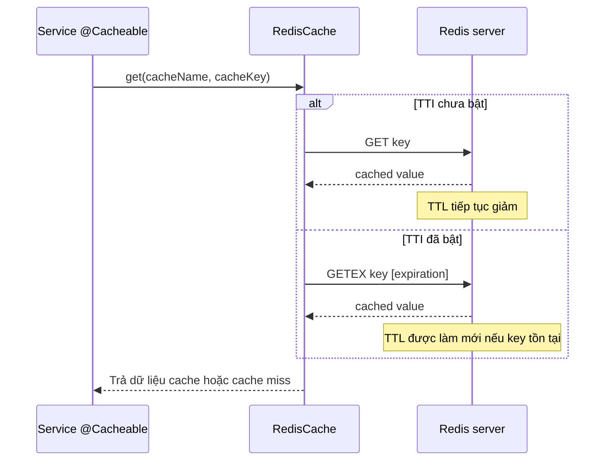

# TTL và time-to-idle: điều kiện hỗ trợ theo phiên bản trong Spring Data Redis

## 1. TTL và time-to-idle giải quyết hai bài toán khác nhau

**Spring Cache** là abstraction cung cấp các thao tác lưu, đọc và loại bỏ dữ liệu cache. Với Spring Data Redis, `RedisCacheManager` và `RedisCache` dùng Redis làm nơi lưu các entry.

Một cache entry có thể hết hạn theo hai chính sách thường gặp:

- **Time to live (TTL)**: một entry hết hạn sau một khoảng thời gian kể từ lần ghi hoặc lần làm mới TTL gần nhất. Đọc entry thông thường không làm thay đổi thời hạn.
- **Time to idle (TTI)**: entry hết hạn nếu không được truy cập trong một khoảng thời gian. Mỗi lần đọc hợp lệ làm mới thời hạn, tạo cơ chế *sliding expiration*.

Ví dụ cùng cấu hình 10 phút:

```text
TTL thông thường:
10:00  Cache PUT product:42     -> hết hạn dự kiến 10:10
10:04  Cache GET product:42     -> vẫn hết hạn dự kiến 10:10
10:08  Cache GET product:42     -> vẫn hết hạn dự kiến 10:10
10:10  Redis có thể xóa key hết hạn

TTI:
10:00  Cache PUT product:42     -> hết hạn dự kiến 10:10
10:04  Cache GET product:42     -> gia hạn đến 10:14
10:08  Cache GET product:42     -> gia hạn đến 10:18
10:18  Nếu không có lượt truy cập mới, key đủ điều kiện hết hạn
```

Mốc thời gian trên mô tả thời hạn logic. Redis có thể xóa key qua cơ chế expiration chủ động hoặc khi key được truy cập, nên thông báo expired hoặc số liệu key count không bắt buộc xuất hiện chính xác tại cùng mili giây với deadline.

Redis hỗ trợ **TTL ở cấp key** từ lâu. Nhưng Redis không tự thiết lập “đọc key nào cũng làm mới TTL” trên toàn server. Để có TTI, lớp ứng dụng hoặc câu lệnh Redis cụ thể phải **đọc đồng thời gia hạn thời gian hết hạn**.

Đó là lý do điều kiện về **phiên bản Spring Data Redis** và **phiên bản Redis server** đều quan trọng khi bật TTI trong Spring Cache.

## 2. Bảng phiên bản: khi nào dùng được TTI trong Redis Cache?

Spring Data Redis bổ sung hỗ trợ mô phỏng TTI cho `RedisCache` từ **Spring Data Redis 3.2** thông qua cấu hình `RedisCacheConfiguration.enableTimeToIdle()`.

Cơ chế này dùng câu lệnh Redis **`GETEX`**, xuất hiện từ **Redis 6.2**: đọc giá trị và cập nhật thời gian hết hạn của key trong cùng một câu lệnh.

| Thành phần | Phiên bản / điều kiện | TTL thông thường | TTI qua `enableTimeToIdle()` |
| --- | --- | --- | --- |
| Spring Data Redis 3.1.x trở về trước | Chưa có API `enableTimeToIdle()` cho Redis Cache | Có | Không có hỗ trợ tích hợp theo API này |
| Spring Data Redis 3.2 trở lên | Có API `enableTimeToIdle()` | Có | Có, nếu Redis hỗ trợ `GETEX` |
| Redis server trước 6.2 | Chưa có `GETEX` | Có | Không thể dùng cơ chế `GETEX` do Spring Data Redis 3.2+ yêu cầu |
| Redis server 6.2 trở lên | Có `GETEX` | Có | Có thể hỗ trợ khi phối hợp Spring Data Redis tương ứng |
| Spring Boot dùng BOM quản lý Spring Data Redis 3.2+ | Phụ thuộc bộ dependency thực tế | Có | Có thể cấu hình TTI nếu Redis server đạt yêu cầu |

**Hai điều kiện tối thiểu cho cơ chế TTI tích hợp** là:

1. Spring Data Redis có `RedisCacheConfiguration.enableTimeToIdle()`: từ 3.2.
2. Redis server có lệnh `GETEX`: từ 6.2.

Ngoài hai điều kiện trên, client, proxy Redis hoặc dịch vụ Redis-compatible phải cho phép thực thi `GETEX`, kết nối phải hướng đến node ghi được và Redis ACL phải có quyền chạy lệnh đó.

### Spring Boot ảnh hưởng như thế nào?

Spring Boot thường quản lý phiên bản Spring Data qua dependency management. Ví dụ theo các dòng release phổ biến:

| Spring Boot | Spring Data Redis thường đi kèm theo BOM | Kết luận với TTI |
| --- | --- | --- |
| Spring Boot 3.1.x | Spring Data Redis 3.1.x | Chưa có `enableTimeToIdle()` |
| Spring Boot 3.2.x | Spring Data Redis 3.2.x | Có API TTI, cần Redis 6.2+ |
| Spring Boot 3.3.x | Spring Data Redis 3.3.x | Có API TTI, cần Redis 6.2+ |
| Các dòng Boot mới hơn dùng Spring Data Redis 3.2+ | Xác định theo dependency thực tế | Có thể dùng nếu server đáp ứng `GETEX` |

Bảng trên giả định dự án dùng phiên bản dependency mặc định từ BOM, không override `spring-data-redis` riêng. Dự án có thể chủ động override hoặc dùng dependency khác; khi đó **phiên bản thực sự trên classpath** mới quyết định API có tồn tại hay không.

Không nên kết luận “đã lên Spring Boot mới là TTI chạy được” nếu Redis đang là 6.0, 6.1 hoặc dùng proxy không hỗ trợ `GETEX`. Cũng không nên dựa vào việc một Redis server mới có `GETEX` để suy ra thư viện Spring Data Redis cũ tự gọi `GETEX` khi `@Cacheable` đọc cache.

## 3. Cơ chế kỹ thuật: `GET` và `GETEX` khác nhau thế nào?

### TTL thông thường: `GET` chỉ đọc giá trị

Với cache entry có TTL 600 giây:

```redis
SET catalog::sku-42 "{...cached-value...}" EX 600
TTL catalog::sku-42
GET catalog::sku-42
TTL catalog::sku-42
```

Sau `GET`, TTL tiếp tục giảm theo thời gian đã trôi qua. Một lượt cache hit không tự kéo dài thời hạn.

`GET` được Redis xử lý như lệnh đọc. Khi chỉ cần lấy giá trị, nó không phải chỉnh sửa metadata expiration của key.

### TTI mô phỏng bằng `GETEX`

Cú pháp Redis:

```redis
GETEX catalog::sku-42 EX 600
```

Lệnh này:

1. Lấy giá trị hiện tại của key.
2. Đồng thời đặt lại thời gian hết hạn của key thành 600 giây tính từ lệnh.

Khi key tồn tại, giá trị trả về tương tự `GET`, nhưng TTL được làm mới. Nếu key không tồn tại, kết quả là nil và không có giá trị cần gia hạn.

Redis cũng có các lựa chọn cho `GETEX` như `PX` để chỉ định milliseconds; Spring Data Redis thực hiện mã hóa expiration phù hợp với cấu hình thời lượng.

Cơ chế trong Spring Cache khi bật TTI có thể mô tả:



Với `GETEX`, thao tác “đọc rồi đặt lại TTL” nằm trong **một lệnh Redis nguyên tử**. Nếu tự tách `GET` và `EXPIRE` thành hai lệnh từ client, key có thể bị thay đổi hoặc xóa giữa hai lệnh, tạo điều kiện tranh chấp.

**Spring Data Redis gọi đây là TTI được mô phỏng (*TTI emulation*)** vì Redis chưa có cài đặt “mọi lệnh đọc ở bất cứ client nào đều tự gia hạn TTL” ở cấp server. Chỉ những đường đọc sử dụng `GETEX` mới thực sự reset idle timer.

## 4. Cấu hình TTL bằng `RedisCacheConfiguration`

Với Spring Data Redis có Redis Cache, cấu hình TTL cơ bản:

```java
import java.time.Duration;
import org.springframework.cache.CacheManager;
import org.springframework.context.annotation.Bean;
import org.springframework.context.annotation.Configuration;
import org.springframework.cache.annotation.EnableCaching;
import org.springframework.data.redis.cache.RedisCacheConfiguration;
import org.springframework.data.redis.cache.RedisCacheManager;
import org.springframework.data.redis.connection.RedisConnectionFactory;

@Configuration
@EnableCaching
public class CacheConfiguration {

    @Bean
    public CacheManager cacheManager(
            RedisConnectionFactory connectionFactory) {

        RedisCacheConfiguration defaults =
                RedisCacheConfiguration.defaultCacheConfig()
                        .entryTtl(Duration.ofMinutes(10));

        return RedisCacheManager.builder(connectionFactory)
                .cacheDefaults(defaults)
                .build();
    }
}
```

Đây là **TTL thông thường**: cache entry được ghi với thời hạn khoảng 10 phút; đọc cache không chủ động gia hạn thời hạn. Spring Data Redis có thể dùng Redis `SET` kèm expiration khi ghi cache.

Ví dụ service:

```java
import org.springframework.cache.annotation.Cacheable;
import org.springframework.stereotype.Service;

@Service
public class CatalogService {

    @Cacheable(cacheNames = "catalog", key = "#sku")
    public ProductView findProduct(String sku) {
        return loadProductFromDatabase(sku);
    }

    private ProductView loadProductFromDatabase(String sku) {
        // Ví dụ: truy vấn database và tạo đối tượng trả về.
        throw new UnsupportedOperationException("Triển khai theo ứng dụng");
    }
}
```

Giả sử `catalog` dùng thời hạn 10 phút:

- Lần gọi đầu chưa có entry: method được thực thi, kết quả được ghi cache kèm TTL.
- Lần gọi tiếp theo có entry: Spring Cache trả giá trị cache; TTL vẫn đếm ngược.
- Sau khi entry hết hạn: lần truy cập tiếp sẽ bị cache miss và tính lại dữ liệu.

Một cấu hình qua Spring Boot cũng thường gặp:

```yaml
spring:
  cache:
    type: redis
    redis:
      time-to-live: 10m
      cache-null-values: false
```

`spring.cache.redis.time-to-live` cấu hình **TTL** cho Redis cache do auto-configuration quản lý; nó **không tự biến mọi cache hit thành TTI**. Cần bật hỗ trợ time-to-idle ở phần cấu hình Redis Cache phù hợp nếu muốn sliding expiration.

Không đặt đồng thời bean `CacheManager` tự cấu hình và kỳ vọng mọi thuộc tính `spring.cache.redis.*` vẫn được auto-configuration áp dụng y nguyên. Khi tự tạo bean, ứng dụng phải bảo đảm các lựa chọn TTL, key prefix và serializer được thiết lập đầy đủ theo nhu cầu.

## 5. Bật time-to-idle từ Spring Data Redis 3.2

Khi sử dụng Spring Data Redis 3.2+ cùng Redis 6.2+, cấu hình:

```java
@Configuration
@EnableCaching
public class CacheConfiguration {

    @Bean
    public CacheManager cacheManager(
            RedisConnectionFactory connectionFactory) {

        RedisCacheConfiguration defaults =
                RedisCacheConfiguration.defaultCacheConfig()
                        .entryTtl(Duration.ofMinutes(10))
                        .enableTimeToIdle();

        return RedisCacheManager.builder(connectionFactory)
                .cacheDefaults(defaults)
                .build();
    }
}
```

Hai lời gọi phục vụ hai mục đích:

- `entryTtl(Duration.ofMinutes(10))` xác định cửa sổ thời gian hết hạn cho entry.
- `enableTimeToIdle()` làm các lượt đọc thông qua `RedisCache` sử dụng `GETEX` và đặt lại thời hạn này.

Khi `@Cacheable` gặp một cache hit, gọi qua Spring Cache sẽ cập nhật TTL của key. Khi cache miss, method thực thi và giá trị mới được ghi kèm thời hạn. Đây là hành vi gia hạn trên cache hit, không phải tác động lên thời hạn TTL của những key Redis khác không thuộc cache đó.

### Cấu hình khác nhau cho từng cache

Có thể để cache sản phẩm sống 10 phút theo TTI, còn cache tỷ giá chỉ dùng TTL 1 phút:

```java
@Bean
public CacheManager cacheManager(RedisConnectionFactory factory) {
    RedisCacheConfiguration base =
            RedisCacheConfiguration.defaultCacheConfig();

    RedisCacheConfiguration catalogTti =
            base.entryTtl(Duration.ofMinutes(10))
                .enableTimeToIdle();

    RedisCacheConfiguration exchangeRateTtl =
            base.entryTtl(Duration.ofMinutes(1));
                // Không gọi enableTimeToIdle()

    return RedisCacheManager.builder(factory)
            .withCacheConfiguration("catalog", catalogTti)
            .withCacheConfiguration("exchangeRate", exchangeRateTtl)
            .cacheDefaults(base.entryTtl(Duration.ofMinutes(5)))
            .build();
}
```

Vì `RedisCacheConfiguration` là một cấu hình bất biến theo cách sử dụng builder, việc tạo `catalogTti` không tự bật TTI cho `exchangeRateTtl`.

Nếu cấu hình nhiều cache, cần chắc chắn tên trong `@Cacheable(cacheNames = "...")` khớp tên đăng ký. Nếu không, một cache có thể dùng cấu hình mặc định khác với dự định.

### TTL phải có ý nghĩa thì TTI mới có ý nghĩa

Nếu cache entry được ghi **không có expiration** (thời hạn vô hạn), thì không có “10 phút nhàn rỗi” để làm mới. Muốn TTI có ý nghĩa, hãy cấu hình một thời hạn dương cho entry.

Không coi `enableTimeToIdle()` là cách tự tạo TTL cho mọi key bất kể chúng được cấu hình ra sao. Cần phối hợp nó với `entryTtl(...)` hoặc cơ chế tính TTL được hỗ trợ theo phiên bản.

## 6. TTI chỉ có tác dụng với các đường đọc hỗ trợ gia hạn TTL

Đây là giới hạn quan trọng nhất.

Giả sử `catalog::sku-42` là key do `RedisCache` lưu với expiration 10 phút:

| Đường truy cập | Có gia hạn TTI mặc định khi cache bật `enableTimeToIdle()`? | Giải thích |
| --- | --- | --- |
| `@Cacheable` cache hit qua `RedisCacheManager` | Có | Spring Cache gọi đường đọc của `RedisCache` sử dụng `GETEX`. |
| `cacheManager.getCache("catalog").get("sku-42")` | Có | Truy cập qua cùng abstraction Redis Cache. |
| `StringRedisTemplate.opsForValue().get(key)` | Không | Gọi Redis `GET` thông thường, không dùng chính sách TTI của Redis Cache. |
| `redis-cli GET catalog::sku-42` | Không | Redis `GET` không reset expiration. |
| Client khác gọi `GET` | Không | Server không tự biết “TTI cache” là gì. |
| Client gọi `GETEX key EX 600` hợp lệ | Có, do lệnh `GETEX` | Gia hạn trực tiếp tại Redis, kể cả ngoài Spring Cache. |
| `TTL key` / `PTTL key` | Không | Chỉ quan sát thời hạn còn lại. |

**Một cache có nhiều đường đọc chỉ đạt TTI nhất quán khi các đường đọc có khả năng gia hạn TTL cùng tuân thủ cơ chế TTI.** Nếu một phần hệ thống đọc qua `RedisCache` còn một phần khác đọc bằng `GET`, những lần đọc thứ hai không được tính là hoạt động khi quyết định hết hạn.

Điều này rất dễ xuất hiện khi một hệ thống:

- Vừa dùng `@Cacheable`, vừa có controller truy xuất trực tiếp Redis.
- Có nhiều microservice dùng chung namespace nhưng không dùng cùng thư viện.
- Sử dụng công cụ CLI hoặc worker đọc entry cache trực tiếp.
- Đọc cache trên read replica bằng Redis GET nhưng ghi và cache refresh ở primary.

Không đồng nhất các kiểu đọc này. Nếu TTI là yêu cầu nghiệp vụ, cần quy định rõ đường truy cập và thỏa thuận sử dụng `GETEX` trên mọi client cần được tính là “activity”.

### TTI trong Spring Cache không phải TTL của Redis Repository

Spring Data Redis có thêm Redis Repository với `@RedisHash(timeToLive = ...)` và `@TimeToLive`. Đó là cơ chế hết hạn **entity** và Hash do repository quản lý, khác đường lưu Redis Cache.

Bật `RedisCacheConfiguration.enableTimeToIdle()` không tự gia hạn TTL của một entity được đọc bằng `CrudRepository.findById(...)`. Không suy luận rằng mọi hoạt động đọc Redis trong ứng dụng đều hưởng chế độ TTI của CacheManager.

## 7. Khi Redis server chưa hỗ trợ `GETEX`

Một ứng dụng biên dịch thành công với Spring Data Redis 3.2+ vẫn có thể gặp lỗi khi chạy nếu Redis server chỉ là 6.0 hoặc 6.1.

Ví dụ:

```text
Spring Data Redis 3.2+: enableTimeToIdle()
Redis server 6.0: GETEX chưa tồn tại

Khi cache hit:
  Spring Data Redis cố thực thi GETEX.
  Redis trả lỗi unknown command / command unsupported.
  Ứng dụng có thể nhận RedisSystemException hoặc
  một DataAccessException tương ứng.
```

Loại exception thực tế phụ thuộc driver, cấu hình và lớp chuyển đổi exception của Spring Data Redis. Do đó không nên giả định lỗi chỉ xuất hiện lúc khởi động. Khi có cache hit, đường đọc mới có thể thực sự chạm lệnh `GETEX`.

### Các lựa chọn tương thích

**Lựa chọn 1: chỉ dùng TTL thông thường.** Bỏ `enableTimeToIdle()` và giữ `entryTtl(Duration)`. Hành vi này tương thích với Redis cũ có các lệnh expiration cơ bản.

**Lựa chọn 2: nâng cấp Redis server lên 6.2+ hoặc nền tảng Redis-compatible xác nhận hỗ trợ `GETEX`.** Đồng thời kiểm tra ACL, routing và driver.

**Lựa chọn 3: tự thiết kế đường truy cập “đọc và gia hạn” ở phiên bản cũ.** Ví dụ có thể dùng Lua script đọc và `EXPIRE` khi key còn tồn tại:

```lua
-- KEYS[1]: key cần đọc
-- ARGV[1]: TTL tính theo giây, là số nguyên dương
local value = redis.call('GET', KEYS[1])
if value then
    redis.call('EXPIRE', KEYS[1], tonumber(ARGV[1]))
end
return value
```

Script này mô phỏng hành vi đọc rồi gia hạn trên Redis cũ và tránh khoảng đua giữa `GET` và `EXPIRE` vì Lua chạy nguyên tử tại Redis. Tuy nhiên đây là **giải pháp tùy biến**, không phải tính năng `enableTimeToIdle()` của Spring Cache bản cũ. Đưa nó vào `RedisCache` hoặc toàn bộ call path cần triển khai và thử nghiệm riêng. Script cũng cần validate TTL, tránh không chủ ý gia hạn khóa được dùng chung và bảo đảm dữ liệu/serializer phù hợp.

Không chỉ thay `GETEX` bằng `GET` rồi `EXPIRE` từ hai lời gọi Java mà cho rằng kết quả tương đương nguyên tử; key có thể hết hạn hoặc được writer khác sửa ở giữa.

## 8. Quyền Redis ACL và read replica: `GETEX` không phải lệnh đọc thuần

Dù trả về giá trị, `GETEX` **thay đổi metadata expiration** của key. Vì vậy nó có đặc điểm của một lệnh ghi tại Redis.

### Phân quyền ACL

Một tài khoản chỉ được cấp lệnh `GET` có thể đọc TTL cache thông thường, nhưng khi bật TTI sẽ cần được cho phép chạy `GETEX` đối với namespace cache tương ứng.

Ví dụ nguyên tắc:

```text
Chỉ cho phép những lệnh cần dùng:
+get +set +getex +del +expire ...

Giới hạn key:
~catalog::*
```

Đây là phác thảo quyền, không phải file ACL triển khai hoàn chỉnh. Hãy cân nhắc lệnh thực sự dùng khi cache put/get/evict, serializer, các thao tác batch và tình huống clear cache. Không cấp `+@all` hoặc toàn bộ quyền quản trị chỉ để cho `GETEX` hoạt động.

### Routing tới replica

Redis read replica thông thường không chấp nhận các lệnh sửa dữ liệu/expiration như `GETEX`. Nếu client được thiết lập `readFrom(REPLICA)` hoặc ứng dụng chỉ kết nối read-only endpoint, đường đọc TTI có thể thất bại vì nó là một lệnh có side effect.

Vì vậy cần đảm bảo:

- TTI cache lookup gửi `GETEX` tới primary hoặc endpoint có khả năng ghi.
- ACL cho phép `GETEX` tại đích.
- Driver, proxy và cluster routing không cố điều hướng `GETEX` tới replica chỉ vì nó có phần “get”.
- Chi phí ghi metadata TTL, replication và persistence được tính trong tải thực tế.

Một hệ thống muốn tận dụng replica cho lượng đọc rất lớn cần đánh giá lại trước khi bật TTI cho mọi cache. Việc gia hạn TTL trên mỗi cache hit có thể làm tăng tải của primary.

## 9. Hiệu năng và hành vi expiration cần cân nhắc

So sánh:

| Thuộc tính | TTL thông thường | TTI mô phỏng bằng `GETEX` |
| --- | --- | --- |
| Cache hit | `GET` | `GETEX` kèm expiration |
| Gia hạn TTL lúc đọc | Không | Có |
| Có thể kéo dài tuổi thọ khi truy cập liên tục | Không, nếu không có thao tác ghi/gia hạn khác | Có |
| Redis command có side effect khi đọc | Không | Có |
| Phù hợp read-only replica | Có thể, tùy kiến trúc replication | Thường không, vì `GETEX` làm thay đổi expiration |
| Tác động lên tải ghi/replication | Không phát sinh thêm từ cache hit | Có thể tăng vì nhiều lần cập nhật TTL |
| Nguy cơ giữ dữ liệu cũ quá lâu nếu truy cập thường xuyên | Giới hạn theo TTL đã ghi | Có nếu không có invalidation hoặc max lifetime riêng |

### Cache nóng có thể tồn tại rất lâu

Với TTL 10 phút, một key được đọc 1 phút/lần có thể **không bao giờ hết hạn vì không idle đủ 10 phút**. Đây là hành vi đúng của TTI.

Nếu dữ liệu phía nguồn có thể thay đổi và ứng dụng chỉ dựa vào expiration để làm mới cache, TTI có thể làm dữ liệu cũ tồn tại vô hạn theo thời gian. Các giải pháp phổ biến:

- Kết hợp với `@CacheEvict` hoặc cơ chế invalidation khi dữ liệu thay đổi.
- Thiết kế giới hạn tuổi thọ tối đa (*absolute maximum age*) bằng metadata bổ sung hoặc key version, độc lập với idle timeout.
- Dùng TTL cố định thay vì TTI nếu mục tiêu chính là buộc cache refresh định kỳ.
- Chỉ bật TTI cho cache có semantics thực sự phù hợp, chẳng hạn dữ liệu tính toán tốn kém nhưng ít thay đổi hoặc dữ liệu phiên có quy tắc riêng.

Không nên bật TTI chỉ vì muốn giảm cache miss: nó thay đổi hợp đồng thời gian sống của dữ liệu.

### Chi phí tài nguyên

`GETEX` vẫn là một lệnh truy cập theo khóa, nhưng nó yêu cầu cập nhật thời hạn. Với cache rất nóng, mỗi hit có thể phát sinh thao tác ghi metadata và ảnh hưởng đến replication/AOF (tùy cấu hình Redis).

Cần đo ít nhất:

- Cache hit/miss rate trước và sau bật TTI.
- Số lệnh `GET`/`GETEX` bằng `INFO commandstats` trên Redis.
- CPU, latency, memory, network, replication backlog và độ trễ của primary.
- Số key tồn tại, tỷ lệ eviction, thời gian sống thực tế và mức dữ liệu stale.
- Thời gian truy cập read-only endpoint có bị chuyển sang primary hay không.

TTI có thể giảm cache miss vì giữ key nóng lâu hơn, nhưng không phải lúc nào cũng giúp tổng hiệu năng tốt hơn.

## 10. TTL động và `TtlFunction` trong Spring Data Redis 3.2+

Ngoài `entryTtl(Duration)` cố định, từ Spring Data Redis 3.2 có API dùng `RedisCacheWriter.TtlFunction` để tính thời gian sống cho entry dựa trên dữ liệu liên quan:

```java
RedisCacheConfiguration configuration =
        RedisCacheConfiguration.defaultCacheConfig()
                .entryTtl((key, value) -> Duration.ofMinutes(5));
```

Đoạn trên sử dụng lambda nhưng luôn trả 5 phút, để minh họa dạng API. TTL thực tế có thể được tính động theo key hoặc value tại thời điểm ghi.

Với **TTI**, ứng dụng cần biết phải gia hạn thêm bao lâu ở lần đọc. Khi TTL được tính từ value ở lúc ghi, lần đọc không nhất thiết có đầy đủ ngữ cảnh giống lần ghi trước khi `GETEX` thực thi. Vì vậy cần kiểm tra rõ semantics của phiên bản Spring Data Redis đang dùng và cách `TtlFunction` được gọi trên đường đọc với TTI.

Không mặc nhiên giả định “TTL được tính theo value khi ghi” sẽ luôn được giữ nguyên đúng công thức đó ở mọi lần gia hạn. Nếu cần TTI ổn định, cấu hình TTL cố định theo cache thường dễ dự đoán; nếu cần TTL động và TTI đồng thời, hãy xây bài thử tích hợp xác định thời hạn sau cache hit với những value khác nhau.

Ngoài ra, cấu hình TTL động không giải quyết yêu cầu “hết hạn tuyệt đối ở một mốc cố định”: một lệnh `GETEX` có thể làm mới time-to-idle vượt qua mốc hết hạn tối đa nếu không có ràng buộc bổ sung.

## 11. Cấu hình Spring Cache ở cấp phương thức

Ví dụ hai phương thức cùng dùng Redis Cache:

```java
@Service
public class ProductService {

    @Cacheable(cacheNames = "catalog", key = "#sku")
    public ProductView findBySku(String sku) {
        return loadFromSource(sku);
    }

    @CachePut(cacheNames = "catalog", key = "#result.sku")
    public ProductView refresh(ProductView request) {
        return updateAndReturn(request);
    }

    @CacheEvict(cacheNames = "catalog", key = "#sku")
    public void invalidate(String sku) {
        invalidateSourceIfNeeded(sku);
    }

    // Các hàm ứng dụng bên dưới minh họa logic nghiệp vụ.
}
```

Ý nghĩa khi cache `catalog` bật TTI:

- `@Cacheable` ở cache hit: đọc cache bằng đường TTI và reset thời hạn.
- `@Cacheable` ở cache miss: chạy method rồi ghi value với TTL đã cấu hình.
- `@CachePut`: luôn chạy method rồi cập nhật cache; thao tác ghi bắt đầu lại hạn dùng theo cấu hình.
- `@CacheEvict`: xóa cache entry; không có việc gia hạn TTL.
- Một method không gọi qua Spring caching proxy hoặc có điều kiện caching không thỏa có thể không truy cập cache, vì vậy cũng không reset idle timer.

**Tính năng của Spring Cache chỉ có hiệu lực khi lời gọi thực sự đi qua cache interceptor.** Self-invocation giữa các method cùng class có thể bỏ qua proxy theo cấu hình AOP thông thường; khi đó method có `@Cacheable` có thể không tạo cache hit như kỳ vọng.

### Cần chú ý các thao tác không qua Spring Cache

Nếu một đoạn code gọi trực tiếp:

```java
stringRedisTemplate.opsForValue().get("catalog::sku-42");
```

thì nó chỉ thực hiện Redis `GET` thông thường. Cấu hình TTI của `RedisCacheConfiguration` không “bắt” lời gọi này để thay thành `GETEX`.

Muốn chủ động đọc và gia hạn một Redis key ngoài Spring Cache ở phiên bản API có hỗ trợ, có thể cân nhắc:

```java
String value = stringRedisTemplate.opsForValue()
        .getAndExpire("catalog::sku-42", Duration.ofMinutes(10));
```

`ValueOperations.getAndExpire(...)` sử dụng semantics đọc và thiết lập lại expiration. Khi dùng với key thực sự thuộc quyền quản lý Spring Cache, vẫn phải thống nhất serializer và key encoding; tránh truy cập trực tiếp cùng key nếu không biết rõ định dạng value mà CacheManager lưu.

## 12. Kiểm chứng trong môi trường thử nghiệm

Mục tiêu thực hành là xác nhận cấu hình **TTL có/không có TTI**, đúng phiên bản Redis, và đường đọc cache thực sự cập nhật expiration.

### Chuẩn bị

- Spring Data Redis 3.2+.
- Redis server 6.2+; có thể dùng Redis 7.x trên môi trường thử nghiệm.
- `spring-boot-starter-cache` và `spring-boot-starter-data-redis` nếu dùng Spring Boot.
- Bean `RedisCacheManager` với cấu hình cố định `entryTtl(Duration.ofSeconds(30))`.
- Hai cache thử nghiệm có namespace riêng: `demoTtl` không bật TTI; `demoTti` bật `enableTimeToIdle()`.

Dùng thời hạn 30 giây giúp dễ quan sát. Tránh dựa vào thời gian sleep chính xác tuyệt đối: TTL/expiration và độ trễ tác vụ có thể làm kết quả lệch vài giây.

### Trường hợp A: chỉ TTL

1. Ghi một entry vào `demoTtl` bằng `Cache.put(...)`.
2. Quan sát Redis `TTL demoTtl::key1`.
3. Đọc lại qua `cache.get("key1")` sau một khoảng thời gian.
4. Quan sát `TTL` tiếp.

Ví dụ:

```text
Sau khi PUT:     TTL ≈ 30
Sau 8 giây:      TTL ≈ 22
Ngay sau GET:    TTL vẫn ≈ 22
```

### Trường hợp B: TTI

1. Ghi entry vào `demoTti`.
2. Sau khoảng 8 giây, đọc qua `Cache.get(...)`.
3. Quan sát TTL ngay sau lượt đọc.

```text
Sau khi PUT:      TTL ≈ 30
Sau 8 giây:       TTL ≈ 22
Ngay sau GET:     TTL ≈ 30
```

Có thể dùng Redis CLI để quan sát:

```redis
TTL demoTti::key1
PTTL demoTti::key1
```

Chú ý: **không dùng `redis-cli GET` để tạo lần truy cập mà bạn kỳ vọng gia hạn TTI**. Redis CLI `GET` không gia hạn; lần đọc phải đi qua `RedisCache.get(...)` hoặc một lệnh `GETEX` rõ ràng.

### Trường hợp C: đọc trực tiếp không gia hạn

Giữ cấu hình TTI, sau đó đọc bằng:

```redis
GET demoTti::key1
TTL demoTti::key1
```

TTL tiếp tục giảm. Đổi sang lệnh:

```redis
GETEX demoTti::key1 EX 30
TTL demoTti::key1
```

Lần đọc bằng `GETEX` sẽ gia hạn, nếu key còn tồn tại và Redis chấp nhận lệnh.

### Trường hợp D: không tương thích phiên bản

Trên Redis **trước 6.2** ở môi trường thử nghiệm, bật `enableTimeToIdle()` rồi chạy một cache hit. Ghi nhận lỗi thực tế từ driver/server; cấu hình chỉ TTL hoạt động bình thường. Không thực hiện thử nghiệm trên Redis production vì sẽ tạo lỗi cho đường đọc cache.

### Trường hợp E: kiểm soát proxy/caching

Gọi cùng một method `@Cacheable` nhiều lần qua Spring bean proxy và quan sát TTL, sau đó so sánh với self-invocation hoặc lời gọi không đi qua caching interceptor. Điều này giúp phân biệt lỗi cấu hình Redis với trường hợp thực tế không có cache hit.

## 13. Các lỗi thường gặp khi cấu hình TTI

| Triệu chứng | Nguyên nhân có thể gặp | Hướng xử lý |
| --- | --- | --- |
| Java không nhận ra `enableTimeToIdle()` khi biên dịch | Spring Data Redis dưới 3.2 hoặc dependency đang override phiên bản | Kiểm tra dependency thực tế; nâng thư viện phù hợp hoặc chỉ dùng TTL |
| Redis báo `ERR unknown command 'GETEX'` khi cache hit | Redis trước 6.2 hoặc dịch vụ tương thích chưa hỗ trợ | Nâng Redis/endpoint hoặc tắt TTI |
| `NOPERM` khi đọc cache | Redis ACL thiếu quyền `GETEX` hoặc phạm vi key | Cấp đúng lệnh và namespace cần thiết |
| Lỗi `READONLY` từ Redis | `GETEX` bị gửi tới replica/read-only endpoint | Định tuyến cache TTI tới primary |
| TTL không được gia hạn dù cấu hình đã bật | Đọc trực tiếp bằng `GET`; cache khác tên; không đi qua Spring Cache; key đã hết hạn | Xác định cache instance và lệnh thực thi |
| Entry vẫn không bao giờ hết hạn | Dữ liệu được truy cập thường xuyên và luôn được refresh idle timer | Xác định có cần max lifetime hoặc invalidation không |
| Cache không bao giờ hết hạn ngay cả khi idle | TTL cấu hình không dương/entry không có expiration | Thiết lập TTL có ý nghĩa cho cache |
| Latency hoặc tải primary tăng sau khi bật TTI | Cache hit phát sinh `GETEX` thường xuyên | Đo commandstats, hit rate, CPU, replication; chỉ bật cho cache phù hợp |
| TTL sau hit không như kỳ vọng với TTL động | Chính sách tính TTL theo entry và cách rearm lúc đọc khác giả định | Kiểm thử cách `TtlFunction` hoạt động trên phiên bản thực tế |
| Có Redis 7 nhưng không thấy TTI | Spring Data Redis cũ hoặc chưa bật `enableTimeToIdle()` | Kiểm tra đồng thời library, config và Redis command |

Đối với ứng dụng dùng nhiều `CacheManager`, cần xác minh bean nào đang phục vụ annotation `@Cacheable`. Dù một bean bật TTI, một bean khác dùng TTL thường vẫn không có hành vi gia hạn.

## 14. Quy tắc nâng cấp và chuyển đổi cấu hình

### Từ Spring Data Redis 3.1 sang 3.2+

Khi nâng thư viện:

1. Xác định phiên bản Redis server và driver thực tế, đặc biệt nơi dùng managed Redis và proxy.
2. Giữ cấu hình TTL hiện tại; chỉ bật `enableTimeToIdle()` cho những cache thật sự cần sliding expiration.
3. Kiểm tra ACL và routing vì `GETEX` có side effect.
4. Thử cache hit, cache miss, expiration và kết quả TTL qua Redis CLI trên môi trường thử nghiệm.
5. Theo dõi sự khác biệt về độ bền của entry, lưu lượng `GETEX`, tải primary và tỷ lệ dữ liệu stale.

**Nâng phiên bản thư viện không tự động bật TTI.** Phải cấu hình rõ `enableTimeToIdle()` trong `RedisCacheConfiguration` được sử dụng.

### Từ TTL sang TTI

Các key đang tồn tại vẫn mang TTL đã được lưu từ trước. Khi triển khai phiên bản ứng dụng bật TTI, những lần đọc cache hit về sau bằng `GETEX` có thể gia hạn các key hiện còn; các key đã hết hạn thì không được khôi phục chỉ nhờ bật tính năng.

Trong triển khai nhiều instance ứng dụng:

- Instance mới bật TTI có thể reset TTL trên cache hit.
- Instance cũ chỉ dùng `GET` không reset TTL.
- Kết quả thời gian hết hạn phụ thuộc những lượt đọc đi qua instance nào.

Vì vậy cần hiểu giai đoạn chạy song song phiên bản cũ/mới. TTI không tự nhất quán khi không phải mọi consumer của cùng namespace đều tuân theo chính sách.

### Từ TTI quay lại TTL

Khi bỏ `enableTimeToIdle()`:

- Lượt đọc sau đó không refresh TTL nữa.
- Key đang tồn tại giữ expiration đã được đặt ở lần ghi hoặc lần `GETEX` cuối cùng.
- Không có thao tác “đổi hàng loạt deadline về mốc TTL gốc” tự động.

Không cần xóa toàn bộ Redis để chuyển cấu hình. Nếu muốn thay đổi namespace hoặc invalidation hàng loạt, phải có kế hoạch riêng cho tác động bộ nhớ, dữ liệu và tải Redis.

## 15. Quyết định dùng TTL hay TTI

| Nhu cầu | Chọn TTL | Chọn TTI |
| --- | --- | --- |
| Buộc dữ liệu cache được tính lại tối đa sau một khoảng kể từ lần ghi | Phù hợp | Không đủ nếu cache luôn được truy cập |
| Giữ các đối tượng thường dùng, loại bỏ những đối tượng lâu không truy cập | Có thể nhưng kém sát yêu cầu | Phù hợp |
| Có nhiều client đọc trực tiếp bằng `GET` | Dễ giữ hành vi nhất quán | Cần thống nhất mọi đường đọc |
| Chỉ có Redis dưới 6.2 | Hỗ trợ | TTI tích hợp qua `GETEX` không dùng được |
| Chỉ dùng Spring Data Redis dưới 3.2 | Hỗ trợ | Không có `enableTimeToIdle()` tích hợp |
| Muốn đọc từ read-only replica | Phù hợp hơn | Phải xét routing vì `GETEX` thay đổi expiration |
| Cần giới hạn tuổi thọ tuyệt đối của session/token | Có thể dùng TTL cố định | Cần thêm giới hạn tuyệt đối nếu cũng muốn idle timeout |
| Cache hit cực cao và primary đã gần giới hạn tải | Chi phí thấp hơn khi chỉ đọc | Phải đo chi phí cập nhật TTL trên mỗi hit |

Trong các hệ thống yêu cầu vừa **không được idle quá 10 phút** vừa **không được tồn tại quá 24 giờ**, TTI đơn lẻ không đủ. Cần lưu một mốc hết hạn tuyệt đối hoặc metadata độc lập, và không gia hạn vượt quá mốc đó. Đừng sử dụng TTI của cache như thay thế cho cơ chế bảo mật session có policy hết hạn tuyệt đối.

## 16. Câu hỏi tự kiểm tra

1. Vì sao gọi `GET` sau khi lưu cache với TTL 10 phút không làm tăng TTL, còn `GETEX ... EX 600` thì có?
2. Điều kiện tối thiểu về **Spring Data Redis** và **Redis server** để sử dụng `enableTimeToIdle()` là gì?
3. Một ứng dụng dùng Spring Boot 3.2 nhưng Redis 6.0 có thể biên dịch cấu hình TTI không? Lỗi có thể xuất hiện vào lúc nào?
4. Vì sao một `@Cacheable` cache hit có thể gia hạn TTL nhưng lời gọi `StringRedisTemplate.opsForValue().get(...)` lại không?
5. Khi bật TTI, vì sao user Redis cần quyền `GETEX` và vì sao read-only replica không phải điểm đọc phù hợp?
6. Cache được đọc mỗi phút và có TTI 10 phút sẽ tự được refresh từ database sau 10 phút không? Cần thêm cơ chế nào nếu muốn giới hạn độ cũ dữ liệu?
7. Thay đổi từ TTL sang TTI trong hệ thống chạy nhiều phiên bản ứng dụng song song gây khác biệt thời gian hết hạn như thế nào?
8. `entryTtl(Duration)`, `entryTtl(TtlFunction)` và `enableTimeToIdle()` giữ những vai trò khác nhau ra sao?

**Ghi nhớ:** TTL thông thường chỉ cần cơ chế expiration của Redis. TTI tích hợp trong **Spring Data Redis Cache từ phiên bản 3.2** được mô phỏng bằng **Redis `GETEX` (Redis 6.2+)**, nên chỉ những lượt đọc thực thi cơ chế gia hạn mới reset thời hạn. Để dùng đúng, phải xét đồng thời phiên bản thư viện, phiên bản server, ACL, routing đến primary và tất cả đường truy cập cache.

## Tài liệu tham khảo

- [Spring Data Redis — Redis Cache](https://docs.spring.io/spring-data/redis/reference/redis/redis-cache.html): cấu hình Redis Cache, TTL, TTI, `enableTimeToIdle()` và yêu cầu `GETEX`.
- [Spring Data Redis — RedisCacheConfiguration API](https://docs.spring.io/spring-data/redis/reference/api/java/org/springframework/data/redis/cache/RedisCacheConfiguration.html): `entryTtl(...)`, `enableTimeToIdle()` và các tùy chọn cache.
- [Spring Data Redis — RedisCacheWriter.TtlFunction API](https://docs.spring.io/spring-data/redis/reference/api/java/org/springframework/data/redis/cache/RedisCacheWriter.TtlFunction.html): hợp đồng tính TTL theo entry.
- [Redis — GETEX](https://redis.io/docs/latest/commands/getex/): cú pháp, phiên bản hỗ trợ và semantics đọc kết hợp cập nhật expiration.
- [Redis — EXPIRE](https://redis.io/docs/latest/commands/expire/): cách quản lý TTL của Redis key.
- [Spring Framework — Cache Abstraction](https://docs.spring.io/spring-framework/reference/integration/cache.html): `@Cacheable`, `@CachePut`, `@CacheEvict` và điều kiện gọi cache qua proxy.
