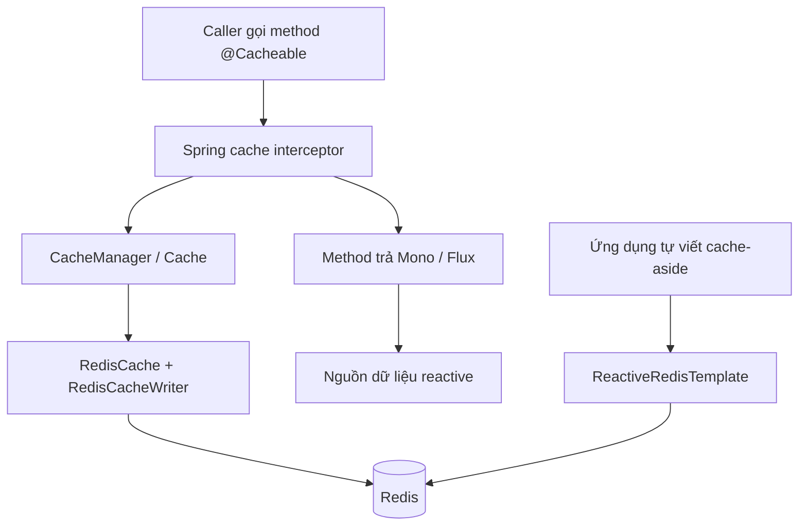
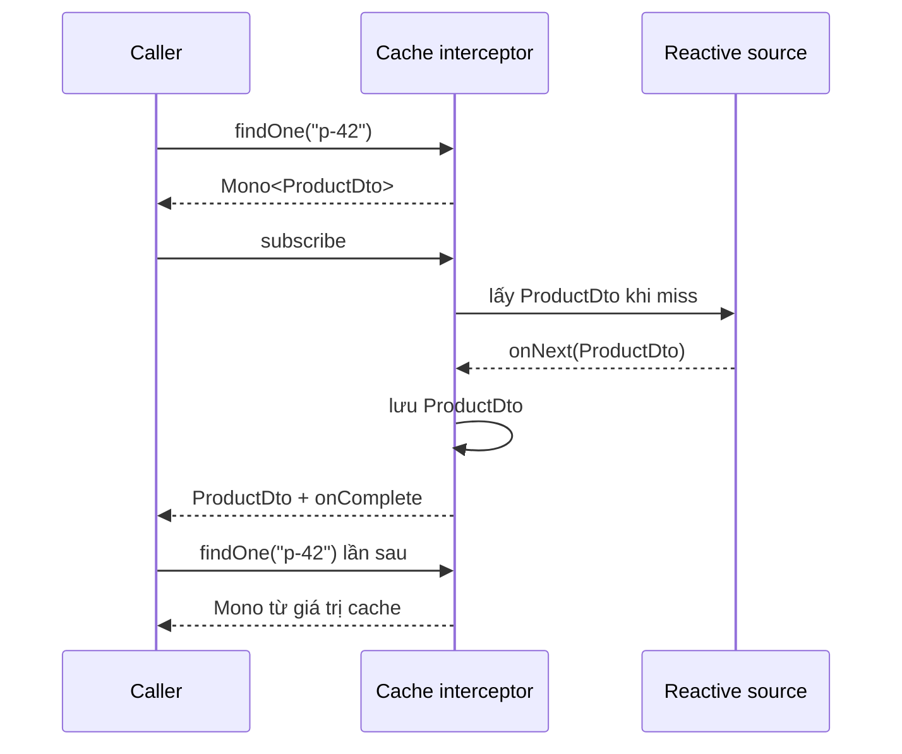
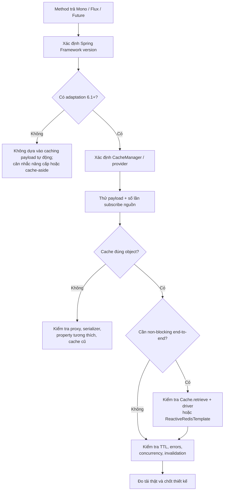

# Kiểm tra cơ chế cache kiểu trả về phản ứng theo phiên bản Spring

## 1. Vấn đề cần kiểm tra

Giả sử một ứng dụng Spring WebFlux dùng `@Cacheable` để cache sản phẩm trong Redis:

```java
@Cacheable(cacheNames = "products", key = "#p0")
public Mono<ProductDto> findProduct(String id) {
    return productRepository.findById(id).map(this::toDto);
}
```

Câu hỏi không chỉ là Redis có lưu một key hay không, mà còn là **Spring đã lưu đối tượng nào**. Với method trả về `Mono<ProductDto>`, có hai cách xử lý khác nhau:

- Cache chính **Publisher `Mono`**. Nếu Publisher là cold, khi subscribe lại nó vẫn có thể chạy lại truy vấn nguồn, dù cache hit ở tầng Java.
- Cache **giá trị `ProductDto` mà Publisher phát ra**. Cache hit về sau được thích nghi lại thành `Mono<ProductDto>`, và nguồn có thể được bỏ qua.

Sự khác biệt này là trọng tâm của thay đổi trong **Spring Framework 6.1**. Từ phiên bản này, Spring Cache hỗ trợ thích nghi với `Mono`, `Flux` và `CompletableFuture`. Tuy vậy, **cache đúng payload** và **truy cập Redis không chặn thread** là hai yêu cầu khác nhau, cần kiểm tra riêng.

Mục tiêu bài học:

1. Phân biệt hành vi caching theo các dòng Spring Framework trước và sau 6.1.
2. Hiểu chính xác `@Cacheable` lưu gì khi method trả `Mono`, `Flux` hoặc `CompletableFuture`.
3. Kiểm tra `RedisCacheManager`, serializer và API `Cache.retrieve(...)` của Spring Data Redis.
4. Thiết kế bài kiểm tra cache hit/miss, subscription, TTL, lỗi, dữ liệu rỗng và đồng thời.
5. Chọn giữa Spring Cache annotation và `ReactiveRedisTemplate` theo yêu cầu streaming/backpressure.

## 2. Ba lớp trong một ứng dụng reactive dùng Redis

| Thành phần | API tiêu biểu | Trách nhiệm |
|---|---|---|
| Spring Cache | `@Cacheable`, `@CachePut`, `@CacheEvict`, `CacheManager` | Can thiệp qua Spring AOP, tạo key, tra cache và lưu kết quả method |
| Spring Data Redis Cache | `RedisCacheManager`, `RedisCache`, `RedisCacheWriter` | Cung cấp cache backed by Redis cho Spring Cache abstraction |
| Spring Data Redis reactive | `ReactiveRedisTemplate`, `ReactiveRedisOperations` | Gửi các thao tác Redis theo Reactor API, dùng để tự thiết kế luồng truy cập bất đồng bộ |



**Lưu ý:** Spring WebFlux có mặt trong classpath không làm cho mọi `RedisCache` trở thành một reactive cache. Một ứng dụng có thể sử dụng `ReactiveRedisTemplate` cho tác vụ riêng nhưng `@Cacheable` vẫn dùng `RedisCacheManager` cùng những hợp đồng khác.

Vì vậy, cần trả lời hai câu độc lập:

- **Cái gì được cache?** Publisher wrapper, một object `T`, hay một `List<T>`?
- **Cách truy cập cache là gì?** Đồng bộ, bất đồng bộ qua `CompletableFuture`, hay hoàn toàn dùng Reactor Redis operations?

## 3. Các mốc phiên bản quan trọng

| Version | Cơ chế cache với kiểu reactive | Điều cần xác minh |
|---|---|---|
| Spring Framework 6.0 và trước đó | Cache abstraction chưa mặc định chuyển Publisher thành giá trị phát ra theo cơ chế mới | Có thể cache chính `Mono`/`Flux`; Redis serialization và cold subscriptions dễ gây sai |
| Spring Framework **6.1+** | Hỗ trợ cache giá trị hoàn tất từ `CompletableFuture`; giá trị `Mono`; danh sách hoàn tất của `Flux` | Kiểm tra object lưu trữ thực tế, lần source subscribe lại và cache provider |
| Spring Framework **6.1.3+** | Có system property cho phép khôi phục cách xử lý Publisher như giá trị thông thường trong một số trường hợp | Kiểm tra flag tương thích nếu hành vi vẫn giống 6.0 |
| Spring Data Redis **3.2+** | Có API retrieval bất đồng bộ ở `RedisCacheWriter` | Writer/driver có thật sự hỗ trợ `supportsAsyncRetrieve()` không? |

Những dòng Spring Boot thường gặp:

| Spring Boot | Spring Framework thường đi kèm |
|---|---|
| 3.0–3.1 | 6.0.x |
| 3.2–3.3 | 6.1.x |
| 3.4–3.5 | 6.2.x |
| 4.x | 7.x |

Đây là ánh xạ theo các dòng phát hành thông thường; ứng dụng dùng BOM, dependency override hoặc thư viện nội bộ có thể có version khác. Kết luận cuối cùng phải dựa vào **dependency runtime đã resolve**.

### 3.1. Cách xác định đúng phiên bản

Trong Java:

```java
import org.springframework.core.SpringVersion;
import org.springframework.boot.SpringBootVersion;

System.out.println("Framework: " + SpringVersion.getVersion());
System.out.println("Boot: " + SpringBootVersion.getVersion());
```

Với dự án Gradle:

```text
./gradlew dependencyInsight --dependency spring-context --configuration runtimeClasspath
./gradlew dependencyInsight --dependency spring-data-redis --configuration runtimeClasspath
```

Với Maven, dùng `mvn dependency:tree` để xác định tương ứng. Các công cụ này giúp kiểm tra **version thực tế**, thay vì chỉ nhìn số version trong một tài liệu dự án.

## 4. Spring Framework 6.1 xử lý `Mono<T>` như thế nào?

Xét:

```java
@Cacheable(cacheNames = "catalog:one", key = "#p0")
public Mono<ProductDto> findOne(String id) {
    return gateway.fetchProduct(id);
}
```

Khi cache miss, method tạo Publisher; Spring ghi cache khi Publisher phát ra `ProductDto` theo cơ chế hỗ trợ của phiên bản 6.1+. Khi cache hit, Spring trả lại `Mono<ProductDto>` được tạo từ giá trị cache.



Giá trị cache có dạng khái niệm:

```text
cacheName = catalog:one
key       = p-42
value     = ProductDto(id="p-42", name="Keyboard")
```

Điểm này khác với việc cache trực tiếp `Mono`. Một `Mono` có thể chỉ là lời mô tả công việc sẽ làm khi subscribe; lưu chính wrapper không đảm bảo chặn việc truy cập backend lần sau.

### 4.1. Phân biệt gọi method với thực hiện nguồn

```java
public Mono<ProductDto> fetchProduct(String id) {
    return Mono.defer(() -> {
        System.out.println("Backend request for " + id);
        return Mono.just(new ProductDto(id, "Keyboard"));
    });
}
```

Gọi `fetchProduct("p-42")` **chỉ tạo Publisher**. Công việc trong `Mono.defer` diễn ra khi có subscription. Vì vậy, test phải sử dụng `StepVerifier` hoặc subscribe đủ để nhận kết quả, chứ không đơn thuần gọi method rồi đo thời gian tạo Publisher.

Một cách đo sai là chỉ đếm số lần method Java được gọi. Trong Spring Framework 6.0, cache wrapper có thể khiến method không bị gọi lại nhưng cùng cold Publisher vẫn phát sinh I/O mỗi lần subscribe.

### 4.2. Khi Publisher không phát giá trị

Trường hợp `Mono.empty()` khác với `Mono.just(value)`: không có object business được phát ra. Cơ chế cache null/empty có thể phụ thuộc vào provider, cache configuration và phiên bản. Nếu nghiệp vụ cần **negative caching** (cache tình huống không tìm thấy), hãy có một test riêng kiểm tra hành vi thay vì tự suy diễn.

Tương tự, `Mono.error(...)` là completion lỗi, không nên được xem là một kết quả business thành công để cache. Sau lỗi, cần kiểm tra lần gọi tiếp theo có thể thử lại nguồn một cách hợp lý.

## 5. `Flux<T>`: từ chuỗi phần tử thành một danh sách cache

Xét:

```java
@Cacheable(cacheNames = "catalog:categories", key = "#p0")
public Flux<ProductDto> findByCategory(String category) {
    return gateway.findByCategory(category);
}
```

Từ Spring Framework 6.1, các phần tử mà `Flux` phát ra được **thu thập thành `List<T>`**, và danh sách được cache sau khi Publisher hoàn tất. Khi cache hit, Spring trả một `Flux<T>` phát lại các phần tử trong List.

```text
Flux: Product A -> Product B -> Product C -> complete
                              |
                              v
Cached value: List[Product A, Product B, Product C]
                              |
                              v
Cache hit: Flux<ProductDto> được khôi phục từ List
```

Giữ nguyên kiểu trả về `Flux` cho caller **không có nghĩa cache vẫn hoạt động theo từng phần tử**.

### 5.1. Giới hạn về streaming và backpressure

Nếu `Flux` là stream vô hạn, luồng không bao giờ có danh sách hoàn chỉnh để lưu. Nếu `Flux` phát hàng triệu phần tử, việc gom vào một List có thể làm tăng memory, latency và kích thước value trong Redis, đồng thời không còn phù hợp với mục tiêu streaming.

Những luồng có event liên tục, cursor dài, window hoặc backpressure tinh vi nên cache theo **từng phần tử, page hoặc window**, bằng cơ chế chuyên biệt thay vì `@Cacheable` cho toàn bộ Flux.

### 5.2. `unless` nhận kết quả kiểu gì?

Khi dùng `@Cacheable` với `Flux` trong cơ chế Spring 6.1+, biểu thức `unless` nhìn thấy `#result` là **List được thu thập**, chứ không phải đối tượng `Flux`.

Ví dụ không cache danh sách rỗng:

```java
@Cacheable(
    cacheNames = "catalog:categories",
    key = "#p0",
    unless = "#result == null || #result.isEmpty()"
)
public Flux<ProductDto> findByCategory(String category) {
    return gateway.findByCategory(category);
}
```

Không đưa biểu thức được thiết kế cho `List` sang ứng dụng Spring 6.0 và mặc định nó có cùng kết quả. Hợp đồng kiểu giá trị của cache annotation chính là thứ cần kiểm tra khi nâng cấp.

## 6. `CompletableFuture<T>` cũng được thích nghi

```java
@Cacheable(cacheNames = "profiles", key = "#p0")
public CompletableFuture<ProfileDto> findProfile(String userId) {
    return profileGateway.loadAsync(userId);
}
```

Từ Spring 6.1, cache abstraction có thể lưu **`ProfileDto`** khi future hoàn tất thành công, rồi trả future phù hợp khi hit. Không được coi việc nhận được một future chưa hoàn tất là bằng chứng cache value đã được ghi.

| Kiểu method | Đối tượng business được cache | Kiểu method trả lại |
|---|---|---|
| `Mono<T>` | `T` sau khi phát thành công | `Mono<T>` |
| `Flux<T>` | `List<T>` sau khi hoàn tất | `Flux<T>` |
| `CompletableFuture<T>` | `T` sau khi hoàn tất thành công | `CompletableFuture<T>` |

Khi dùng future hoặc reactive Publisher, lỗi, empty và cancellation cần được kiểm tra tách biệt theo provider/configuration. Hành vi thông thường không nhằm biến một exception thành một cache value thành công.

## 7. Cấu hình Spring Cache để test được

Ví dụ dependency cho ứng dụng Spring Boot 3.x:

```groovy
dependencies {
    implementation 'org.springframework.boot:spring-boot-starter-cache'
    implementation 'org.springframework.boot:spring-boot-starter-data-redis'
    implementation 'org.springframework.boot:spring-boot-starter-webflux'
}
```

Bật cache annotation:

```java
import org.springframework.cache.annotation.EnableCaching;
import org.springframework.context.annotation.Configuration;

@Configuration
@EnableCaching
public class CacheConfig {
}
```

Cấu hình Redis local để thực hành:

```yaml
spring:
  cache:
    type: redis
  data:
    redis:
      host: localhost
      port: 6379
```

Đây là môi trường minh họa. Hệ thống thật có thể dùng Redis managed service, TLS, Sentinel hoặc Cluster và các chính sách kết nối riêng.

### 7.1. Kiểm tra CacheManager đang dùng

```java
import org.springframework.cache.CacheManager;
import org.springframework.stereotype.Component;

@Component
public class CacheInspector {

    public CacheInspector(CacheManager cacheManager) {
        System.out.println(
            "CacheManager = " + cacheManager.getClass().getName()
        );
    }
}
```

Nếu nhận `ConcurrentMapCacheManager`, cache đang nằm trong JVM chứ không phải Redis. Một bài test chỉ chạy với cache memory **không chứng minh Redis serializer, connection hoặc TTL hoạt động**.

### 7.2. Chú ý Spring AOP proxy

Cache annotation thường chỉ được áp dụng khi gọi public method **qua Spring proxy**. Ví dụ:

```java
@Service
public class ProductService {

    public Mono<ProductDto> search(String id) {
        // Self-invocation; lời gọi nội bộ không đi qua cache advice mặc định.
        return findOne(id);
    }

    @Cacheable(cacheNames = "products", key = "#p0")
    public Mono<ProductDto> findOne(String id) {
        return gateway.fetchProduct(id);
    }
}
```

Khi `search()` gọi `this.findOne()` trong cùng object, proxy cache mặc định không intercept lời gọi nội bộ này. Khi kiểm tra, hãy gọi method được cache qua **bean được Spring inject từ nơi khác**, không tạo đối tượng bằng `new ProductService()` và không chỉ gọi self-invocation.

## 8. Cấu hình Redis Cache với TTL

Ví dụ cấu hình một `RedisCacheManager` có TTL mặc định 10 phút:

```java
import java.time.Duration;
import org.springframework.context.annotation.Bean;
import org.springframework.context.annotation.Configuration;
import org.springframework.data.redis.cache.RedisCacheConfiguration;
import org.springframework.data.redis.cache.RedisCacheManager;
import org.springframework.data.redis.connection.RedisConnectionFactory;

@Configuration
public class RedisCacheConfig {

    @Bean
    RedisCacheManager cacheManager(RedisConnectionFactory connectionFactory) {
        RedisCacheConfiguration defaults =
            RedisCacheConfiguration.defaultCacheConfig()
                .entryTtl(Duration.ofMinutes(10));

        return RedisCacheManager.builder(connectionFactory)
            .cacheDefaults(defaults)
            .build();
    }
}
```

Trong Spring Data Redis Cache, các giá trị mặc định thường gặp:

| Thuộc tính | Mặc định |
|---|---|
| TTL entry | Không có expiration nếu chưa cấu hình |
| Redis key prefix | Tên cache, thường theo mẫu `cacheName::key` |
| Key serializer | `StringRedisSerializer` |
| Value serializer | `JdkSerializationRedisSerializer` |
| RedisCacheWriter | Non-locking writer |

Khi dùng JDK serializer, DTO cần hỗ trợ Java serialization. Ví dụ:

```java
import java.io.Serializable;

public record ProductDto(String id, String name) implements Serializable {
    private static final long serialVersionUID = 1L;
}
```

Trong hệ thống thực, có thể chọn một serializer khác và version hóa định dạng phù hợp; cần đặc biệt chú ý dữ liệu cache từ phiên bản cũ đã nằm trong Redis. Không nên thử đọc value JDK-serialized bằng `GET` rồi mong thấy JSON dễ đọc.

**Redis Cache entry không đồng nhất Redis Repository entity.** Redis Cache thường lưu serialized value của cache ở key `products::p-42`. Redis Repository `@RedisHash("products")` có keyspace riêng, dữ liệu Hash và có thể có secondary indexes.

## 9. Viết phép thử dựa vào lần subscribe của nguồn

Một phép thử hữu ích phải đo **nguồn thật sự chạy bao nhiêu lần**, không chỉ Java method được gọi bao nhiêu lần.

```java
import java.util.concurrent.atomic.AtomicInteger;
import org.springframework.cache.annotation.Cacheable;
import org.springframework.stereotype.Service;
import reactor.core.publisher.Mono;

@Service
public class ProductProbeService {

    private final AtomicInteger sourceSubscriptions = new AtomicInteger();

    @Cacheable(cacheNames = "probe:products", key = "#p0")
    public Mono<ProductDto> find(String id) {
        return Mono.defer(() -> {
            int revision = sourceSubscriptions.incrementAndGet();
            return Mono.just(
                new ProductDto(id, "Version-" + revision)
            );
        });
    }

    public int sourceSubscriptions() {
        return sourceSubscriptions.get();
    }
}
```

Gọi qua bean được Spring inject:

```java
ProductDto first = probe.find("p-42").block();
ProductDto second = probe.find("p-42").block();

System.out.println(first);
System.out.println(second);
System.out.println(probe.sourceSubscriptions());
```

Với Spring Framework 6.1+ và cache provider phù hợp, kỳ vọng:

```text
first  = ProductDto[id=p-42, name=Version-1]
second = ProductDto[id=p-42, name=Version-1]
sourceSubscriptions = 1
```

Kết quả này cần giả định cache entry ban đầu chưa tồn tại và **lần gọi thứ nhất đã hoàn tất cùng cache put** trước khi bắt đầu lần thứ hai. Với yêu cầu kiểm tra đồng thời, phải dùng một phép thử khác.

Trong Spring 6.0, nếu provider cache một cold `Mono` wrapper, method có thể không chạy lại nhưng `sourceSubscriptions` vẫn tăng khi subscribe. Với Redis serializer, việc cache Publisher có thể thất bại từ trước vì object không tương thích serialization. Đừng đưa một kết quả lỗi duy nhất thành quy luật cho mọi cache provider.

### 9.1. Kiểm tra cả object được lưu trong cache

```java
import org.springframework.cache.Cache;
import org.springframework.cache.CacheManager;

Cache cache = cacheManager.getCache("probe:products");
if (cache == null) {
    throw new IllegalStateException("Missing cache");
}

Cache.ValueWrapper wrapper = cache.get("p-42");
Object cached = wrapper == null ? null : wrapper.get();

System.out.println(
    cached == null ? "CACHE_MISS" : cached.getClass().getName()
);
```

Ở Spring 6.1+, sau khi Publisher hoàn tất và entry đã được lưu, giá trị nên là object business tương thích `ProductDto`. Khi xem Redis trực tiếp, payload còn được serialize thành bytes; muốn nhận diện class phải đọc qua đúng `CacheManager` hoặc serializer.

Không chỉ kiểm tra `service.find(...)` có trả một `Mono`: kiểu trả về Java vốn đã là Mono ở cả phiên bản cũ và mới. Điều cần chứng minh là **nội dung cache**, **lượng công việc backend** và **khả năng lấy lại dữ liệu**.

## 10. Test tích hợp minh họa

Một test JUnit dùng Spring context có thể kiểm tra adaptation mới:

```java
import static org.assertj.core.api.Assertions.assertThat;

import org.junit.jupiter.api.Test;
import org.springframework.beans.factory.annotation.Autowired;
import org.springframework.boot.test.context.SpringBootTest;
import org.springframework.cache.Cache;
import org.springframework.cache.CacheManager;

@SpringBootTest
class ReactiveCacheBehaviorTest {

    @Autowired
    private ProductProbeService probe;

    @Autowired
    private CacheManager cacheManager;

    @Test
    void cachesMonoPayloadAfterCompletion() {
        Cache cache = cacheManager.getCache("probe:products");
        assertThat(cache).isNotNull();

        String id = "behavior-check-p-42";
        cache.evict(id);
        int before = probe.sourceSubscriptions();

        ProductDto first = probe.find(id).block();
        ProductDto second = probe.find(id).block();

        assertThat(first).isEqualTo(second);
        assertThat(probe.sourceSubscriptions() - before).isEqualTo(1);

        Cache.ValueWrapper stored = cache.get(id);
        assertThat(stored).isNotNull();
        assertThat(stored.get()).isInstanceOf(ProductDto.class);
    }
}
```

Ví dụ này là **mẫu kiểm tra hành vi**. Để chạy với RedisCache thật, cần có Redis test riêng, serializer tương thích và cấu hình `CacheManager` rõ ràng. `block()` phù hợp để đồng bộ kết quả trong bài test này; không đưa `block()` vào request xử lý production WebFlux.

### 10.1. Tách test Framework khỏi test Redis

Khi muốn kiểm tra chỉ khả năng xử lý reactive return type của Framework, dùng cache in-memory trước:

```java
import org.springframework.cache.CacheManager;
import org.springframework.cache.annotation.EnableCaching;
import org.springframework.cache.concurrent.ConcurrentMapCacheManager;
import org.springframework.context.annotation.Bean;
import org.springframework.context.annotation.Configuration;

@Configuration
@EnableCaching
class MemoryCacheTestConfig {

    @Bean
    CacheManager cacheManager() {
        return new ConcurrentMapCacheManager("probe:products");
    }
}
```

Sau đó chạy cùng phép thử với `RedisCacheManager` để kiểm tra thêm Redis connection, serialization và TTL. Đây là **hai test context độc lập**, không nên đưa hai cache manager vào cùng test mà không xác định bean nào được chọn.

## 11. Kiểm tra một `Flux<T>` có thực sự cache danh sách

```java
import java.util.concurrent.atomic.AtomicInteger;
import org.springframework.cache.annotation.Cacheable;
import org.springframework.stereotype.Service;
import reactor.core.publisher.Flux;

@Service
public class ProductListProbeService {

    private final AtomicInteger sourceSubscriptions = new AtomicInteger();

    @Cacheable(cacheNames = "probe:product-lists", key = "#p0")
    public Flux<ProductDto> byCategory(String category) {
        return Flux.defer(() -> {
            int revision = sourceSubscriptions.incrementAndGet();
            return Flux.just(
                new ProductDto("p-1", category + "-" + revision),
                new ProductDto("p-2", category + "-" + revision)
            );
        });
    }

    public int sourceSubscriptions() {
        return sourceSubscriptions.get();
    }
}
```

Kiểm thử:

```java
List<ProductDto> first = service.byCategory("keyboard")
    .collectList()
    .block();

List<ProductDto> second = service.byCategory("keyboard")
    .collectList()
    .block();
```

Ở Spring Framework 6.1+, khi cache miss lần đầu và dữ liệu được phát hết, lần sau kỳ vọng có cùng danh sách mà nguồn không phải chạy lại. Payload trong cache là `List<ProductDto>`, không phải một `Flux<ProductDto>`.

Những trường hợp cần kiểm tra riêng gồm: `Flux.empty()`, `Flux.error(...)`, luồng vô hạn, stream rất lớn, và caller hủy subscription trước lúc nguồn hoàn tất.

## 12. Khả năng truy xuất cache bất đồng bộ: `Cache.retrieve`

Spring Framework 6.1 hỗ trợ API cache theo `CompletableFuture`, nhưng Redis cache writer còn phải đáp ứng khả năng đó.

Spring Data Redis 3.2+ có API:

```java
boolean supportsAsyncRetrieve();
CompletableFuture<byte[]> retrieve(String cacheName, byte[] key);
```

Trong `RedisCacheWriter`, `supportsAsyncRetrieve()` **mặc định trả false** nếu implementation không hỗ trợ. Khả năng này phụ thuộc driver Redis và cấu hình kết nối. Do đó, việc nhìn thấy method `retrieve` trong Javadoc chưa chứng minh writer đang dùng có thể thực hiện bất đồng bộ.

### 12.1. Kiểm tra writer trên Spring Data Redis 3.3

```java
import org.springframework.cache.Cache;
import org.springframework.cache.CacheManager;
import org.springframework.data.redis.cache.RedisCache;

Cache cache = cacheManager.getCache("probe:products");

if (cache instanceof RedisCache redisCache) {
    boolean supported = redisCache.getNativeCache()
        .supportsAsyncRetrieve();
    System.out.println("Async retrieve supported: " + supported);
}
```

Tùy version, API chi tiết có thể thay đổi; ví dụ minh họa hợp đồng Spring Data Redis 3.3.

Nếu `supported = false`, gọi:

```java
Cache cache = cacheManager.getCache("probe:products");
CompletableFuture<Cache.ValueWrapper> future =
    cache.retrieve("p-42");
```

có thể dẫn đến `UnsupportedOperationException`. Không nên kết luận `RedisCache.retrieve(...)` sẽ thành công trên mọi provider hoặc mọi driver.

### 12.2. Adapter reactive và Redis I/O non-blocking là hai vấn đề riêng

Ngay khi `@Cacheable` đã cache đúng `ProductDto` ở Spring 6.1+, đường lookup Redis có thể còn sử dụng lời gọi synchronous, tùy cache provider và cách cache advice dùng API. Vì vậy:

- `Mono<T>` ở method **không tự bảo đảm** cache hit không block event-loop.
- `Cache.retrieve(...)` được hỗ trợ là điều kiện cần ở những kịch bản cần truy xuất bất đồng bộ, đặc biệt khi dùng `sync=true`.
- Cần kiểm tra latency, thread thực thi, Redis driver và hành vi khi Redis chậm hoặc mất kết nối.

Nếu hệ thống yêu cầu non-blocking end-to-end nghiêm ngặt, cân nhắc tự xây cache-aside bằng `ReactiveRedisTemplate` hoặc `ReactiveRedisOperations` và kiểm thử thật theo Reactor.

## 13. `sync=true` không phải bảo đảm khóa phân tán

Spring Cache có tùy chọn:

```java
@Cacheable(cacheNames = "products", key = "#p0", sync = true)
public Mono<ProductDto> findOne(String id) {
    return gateway.fetchProduct(id);
}
```

Mục tiêu của `sync=true` là giúp phối hợp cache miss cùng key, tránh nhiều caller đều tính lại kết quả. Với các kiểu bất đồng bộ, cache provider cần hỗ trợ retrieval dạng future phù hợp.

**Không mặc định** rằng `sync=true` sẽ bảo đảm toàn bộ các instance trong một cluster chỉ tải nguồn đúng một lần. Semantics phụ thuộc provider. RedisCacheWriter có chiến lược locking và non-locking khác nhau, và locking Redis cache có thể áp dụng ở mức cache chứ không phải lock riêng cho mỗi entry.

Trước khi bật `sync=true`, hãy kiểm tra:

1. Provider có thực thi `Cache.retrieve(key, valueLoader)` hay không.
2. Hai caller đồng thời cùng key có thực sự chỉ subscribe nguồn một lần trong phạm vi yêu cầu không.
3. Có hiện tượng block thread hoặc `UnsupportedOperationException` không.
4. Khi nguồn lỗi, request khác có thể phục hồi và thử lại không.

### 13.1. So sánh với Caffeine async

Nếu cache provider là Caffeine, Spring Framework hỗ trợ async cache mode:

```java
import org.springframework.cache.CacheManager;
import org.springframework.cache.caffeine.CaffeineCacheManager;
import org.springframework.context.annotation.Bean;

@Bean
CacheManager caffeineCacheManager() {
    CaffeineCacheManager manager = new CaffeineCacheManager();
    manager.setAsyncCacheMode(true);
    return manager;
}
```

Việc Caffeine hỗ trợ async retrieval **không suy ra RedisCacheWriter cũng hỗ trợ**. Test một provider in-memory và một provider Redis là hai bằng chứng khác nhau.

## 14. Kiểm tra TTL, Redis key và serializer thật

Khi dùng cache `products` với key `p-42` và Redis key prefix mặc định, key có thể là:

```text
products::p-42
```

Sau khi Publisher phát kết quả và cache entry đã được ghi, trên Redis test có thể kiểm tra:

```redis
TYPE products::p-42
EXISTS products::p-42
TTL products::p-42
PTTL products::p-42
```

Với cấu hình TTL 10 phút, `TTL` ngay sau khi ghi dự kiến gần 600 giây. Giá trị có thể giảm theo thời gian:

- `TTL >= 0`: còn thời gian sống.
- `TTL = -1`: key tồn tại nhưng không có TTL.
- `TTL = -2`: key không tồn tại.

Thông thường Redis Cache lưu value dạng serialized String key/value, nên `TYPE` thường là `string`. **Không dùng `HGETALL` như thể đây là một entity Redis Repository `@RedisHash`.**

Nếu Redis serializer dùng JDK serialization, `GET` trả bytes nhị phân; để kiểm tra kiểu object, dùng `cache.get(key)` của Spring Cache.

### 14.1. Lỗi thường gặp khi nâng version

| Triệu chứng | Nguyên nhân có thể |
|---|---|
| `NotSerializableException` | Object bị cache không serializable; ở version cũ có thể là wrapper Reactor |
| `ClassCastException` sau nâng cấp | Cache entry cũ lưu kiểu khác với kiểu payload phiên bản mới |
| `SerializationException` | Định dạng bytes cũ khác serializer hiện tại |
| Key không xuất hiện trong Redis | Đang dùng cache memory, chưa subscribe, hoặc cache put chưa xong |
| Cache hit vẫn tải nguồn | Cold Publisher cũ được cache, key khác, TTL hết, hoặc proxy cache không chạy |
| Cache key trả dữ liệu của tenant khác | Key không bao gồm yếu tố quyết định dữ liệu như tenant/user/locale |

Khi thay đổi cách cache từ wrapper sang payload hoặc đổi serializer, hãy cân nhắc đổi tên cache/prefix, xóa namespace cache cũ trong phạm vi kiểm soát hoặc tái tạo cache theo dữ liệu nguồn. Cache không phải nguồn dữ liệu chính.

## 15. Flag tương thích ngược trong Spring 6.1.3+

Từ Spring Framework 6.1.3 có **JVM system property** cho phép bỏ qua cơ chế nhận diện Reactive Streams Publishers trong cache interceptor:

```text
-Dspring.cache.ignore-reactivestreams=true
```

Khi bật, Framework có thể xử lý `Mono`/`Flux` như các return object thông thường theo kiểu cũ của Spring 6.0. Đây là **cơ chế tương thích có phạm vi giới hạn**; tài liệu Spring không khuyến nghị dùng cho các trường hợp phổ biến. Một số ứng dụng đặc biệt chủ động cache Publisher đã có `Mono.cache()`/`Flux.cache()` mới có thể liên quan.

Nếu ứng dụng nâng cấp lên 6.1 mà kết quả kiểm tra vẫn cho thấy wrapper được cache, hãy xác minh:

- Phiên bản Spring Framework thực tế.
- System property tương thích ngược đã được bật từ lúc khởi động hay không.
- Custom `CacheInterceptor` / `CacheManager` có can thiệp khác mặc định không.
- Cache entry cũ còn sót từ phiên bản trước không.

Đây là **system property**, không được mặc định xem như một thuộc tính cấu hình của `RedisCacheConfiguration`. Tên hằng public để đối chiếu trong Javadoc là `CacheAspectSupport.IGNORE_REACTIVESTREAMS_PROPERTY_NAME`.

## 16. `@CachePut` và `@CacheEvict` với kiểu reactive

Không chỉ `@Cacheable`. Trong các version hỗ trợ adaptation:

### 16.1. `@CachePut`

```java
@CachePut(cacheNames = "products", key = "#p0")
public Mono<ProductDto> update(String id, UpdateRequest request) {
    return productRepository.update(id, request).map(this::toDto);
}
```

`@CachePut` thực thi method và ghi giá trị mới vào cache khi có kết quả được phát. Không cần thêm `@Cacheable` vào cùng method nếu mục tiêu là cập nhật cache sau xử lý.

### 16.2. `@CacheEvict`

```java
@CacheEvict(cacheNames = "products", key = "#p0")
public Mono<Void> remove(String id) {
    return productRepository.deleteById(id);
}
```

Với eviction sau invocation (mặc định), thời điểm xóa liên quan đến việc method reactive hoàn tất. Nếu dùng `beforeInvocation = true`, evict diễn ra trước khi chạy method. Hai chính sách khác nhau trong trường hợp nguồn xóa lỗi; hãy chọn đúng yêu cầu nghiệp vụ.

Với `Flux` và các biểu thức dựa trên kết quả, việc thu thập thành `List` có thể làm tăng memory tương tự `@Cacheable`.

## 17. Cache key phải bao gồm mọi yếu tố quyết định kết quả

Đặc biệt với WebFlux, dữ liệu có thể phụ thuộc vào Reactor Context:

```java
@Cacheable(cacheNames = "prices", key = "#p0")
public Mono<PriceDto> priceFor(String productId) {
    return Mono.deferContextual(context ->
        priceGateway.find(
            context.get("tenantId"),
            productId
        )
    );
}
```

Nếu cùng `productId` nhưng khác tenant có giá hoặc quyền truy cập khác nhau, key chỉ có `productId` có thể trả sai dữ liệu giữa tenant. Cache hit thường bỏ qua nguồn nên kiểm tra quyền ở backend không còn được chạy.

Một phương án rõ ràng hơn là đưa tenant thành tham số:

```java
@Cacheable(cacheNames = "prices", key = "#p0 + ':' + #p1")
public Mono<PriceDto> priceFor(String tenantId, String productId) {
    return priceGateway.find(tenantId, productId);
}
```

Không mặc định Spring Cache tự nhận mọi giá trị từ Reactor Context để đưa vào cache key. Đây là yêu cầu **tính đúng và cách ly dữ liệu**, không chỉ hiệu năng.

## 18. Khi cần non-blocking end-to-end: cache-aside reactive

Nếu cần thao tác Redis rõ ràng theo Reactor, có thể dùng `ReactiveRedisOperations<String, ProductDto>` thay cho Spring Cache annotation. Ví dụ dưới đây giả định đã cấu hình serializer để đọc/ghi `ProductDto`:

```java
import java.time.Duration;

import org.springframework.data.redis.core.ReactiveRedisOperations;
import org.springframework.stereotype.Service;

import reactor.core.publisher.Mono;

@Service
public class ReactiveProductCache {

    private final ReactiveRedisOperations<String, ProductDto> redis;
    private final ProductGateway gateway;

    public ReactiveProductCache(
            ReactiveRedisOperations<String, ProductDto> redis,
            ProductGateway gateway) {
        this.redis = redis;
        this.gateway = gateway;
    }

    public Mono<ProductDto> find(String id) {
        String key = "catalog:product:" + id;

        return redis.opsForValue()
            .get(key)
            .switchIfEmpty(Mono.defer(() ->
                gateway.fetchProduct(id)
                    .flatMap(value ->
                        redis.opsForValue()
                            .set(key, value, Duration.ofMinutes(5))
                            .thenReturn(value)
                    )
            ));
    }
}
```

Luồng:

```text
GET cache bằng ReactiveRedisOperations
   ├── HIT  -> trả ProductDto
   └── MISS -> lấy nguồn bằng Mono
               -> SET cache với TTL
               -> trả ProductDto
```

Ví dụ này dùng API reactive thật sự của Spring Data Redis; thường cần Lettuce reactive connection. Nó **không tự chống cache stampede** nếu nhiều request cùng miss, không cache `Mono.empty()` và không tự bảo đảm atomicity giữa nguồn dữ liệu và Redis. Sản phẩm thực tế cần thêm timeout, error handling, chính sách fail-open/fail-closed và invalidation.

Chọn lựa:

| Yêu cầu | Lựa chọn thường phù hợp |
|---|---|
| Một `Mono<T>` đơn giản, cache theo tham số | `@Cacheable` trên Spring 6.1+ với provider đã kiểm tra |
| `Flux<T>` hữu hạn, ít phần tử | `@Cacheable` nếu chấp nhận cache toàn bộ List |
| Luồng dài/vô hạn hoặc cache từng phần tử | `ReactiveRedisTemplate` / `ReactiveRedisOperations` |
| Cần chứng minh Redis I/O non-blocking | Kiểm tra `Cache.retrieve` thật hoặc thiết kế cache-aside reactive |
| Cần kiểm soát concurrent miss/idempotency | Test provider, `sync=true` hoặc cơ chế phối hợp riêng |

## 19. Bài kiểm tra tương thích khi nâng cấp

Khi nâng Spring Framework, chạy cùng một tập tình huống ở trước và sau nâng cấp:

| Tình huống | Cách quan sát | Điều muốn xác nhận |
|---|---|---|
| `Mono.just(value)` | Cache.get sau khi hoàn tất | Cache business value hay Publisher |
| `Mono.defer(...)` | Đếm số subscription nguồn | Cache hit có bỏ qua backend không |
| `Mono.empty()` | Gọi nhiều lần cùng key | Hành vi negative caching |
| `Mono.error(...)` | Gọi lại sau lỗi | Không coi exception là kết quả thành công |
| `Flux.just(a,b)` | Xem value Cache.get | Có lưu `List<T>` và trả đúng thứ tự không |
| `Flux.empty()` | Kiểm tra value rỗng | Có nhầm cache miss không |
| `Flux.never()` | Giới hạn thời gian test | Không kỳ vọng cache trước completion |
| Nhiều caller cùng key | Subscribe đồng thời | Có duplicate load không |
| `sync=true` | Kiểm tra capability provider | `retrieve` có hỗ trợ và có lỗi không |
| Redis restart | Đọc lại với cùng key | Cache miss có fallback về nguồn không |
| TTL hết hạn | Đọc sau deadline | Có tải lại dữ liệu và ghi cache mới không |
| Redis chậm | Đo thread/latency | Cache path có blocking event-loop không |
| Serializer/key prefix đổi | Đọc cache cũ | Có lỗi type hoặc deserialization không |

### 19.1. Đo blocking không chỉ qua kiểu trả về

Để đánh giá cách Redis I/O ảnh hưởng WebFlux:

1. Xác định `CacheManager` thật.
2. Kiểm tra `supportsAsyncRetrieve()` và khả năng `Cache.retrieve(...)`.
3. Đo thời gian cache hit/miss khi Redis đáp ứng chậm.
4. Quan sát thread thực thi và event-loop; có thể dùng công cụ phát hiện blocking trong test.
5. Đo p95/p99 latency khi nhiều request cùng key hoặc khi Redis có lỗi.

Một method trả `Mono` nhưng truy cập Redis bằng lời gọi synchronous **vẫn có thể block**. Mục tiêu của test là kiểm tra luồng thực thi, không dừng ở việc thấy annotation và kiểu trả về.

## 20. Các lỗi suy luận thường gặp

### "Spring Boot 3.x nào cũng có cùng cơ chế cache Mono"

Không. Boot 3.1 và 3.2 thường dùng hai dòng Framework khác nhau: 6.0 và 6.1. Bản runtime đã resolve mới quyết định behavior.

### "Cache Mono nghĩa là backend không chạy lại"

Nếu cache chính cold Publisher wrapper, subscribe lại vẫn có thể thực hiện nguồn. Cần đo subscription thực tế.

### "Flux được cache từng event"

Không theo cơ chế `@Cacheable` mặc định từ Spring 6.1: kết quả được thu thập thành List khi hoàn tất.

### "Có RedisCache.retrieve nghĩa là chắc chắn không block"

Hỗ trợ retrieval bất đồng bộ phụ thuộc implementation và driver; `supportsAsyncRetrieve()` mặc định có thể false.

### "`sync=true` luôn bảo đảm một load duy nhất trên toàn cluster"

Không được cam kết như vậy từ annotation. Cần kiểm tra provider, locking semantics và contention thực tế.

### "Không thấy Redis key ngay sau khi gọi method nghĩa là cache hỏng"

Publisher có thể chưa subscribe hoặc chưa phát kết quả. Test phải chờ đủ completion.

### "Có ReactiveRedisTemplate thì @Cacheable tự dùng nó"

Không. Spring Cache và reactive Redis API là hai cơ chế riêng. Việc tạo template không tự thay `RedisCacheManager`.

### "Cache key chỉ cần ID; tenant/role đã được xử lý ở backend"

Cache hit có thể bỏ qua backend, nên cache key phải bao gồm mọi yếu tố ảnh hưởng đến kết quả và phạm vi truy cập.

### "Nâng Framework sẽ tự chuyển đổi entry Redis cũ"

Không. Dữ liệu cache đã serialize từ phiên bản trước có thể có kiểu khác hoặc không tương thích. Cần chiến lược xóa cache, đổi prefix hoặc tái tạo dữ liệu.

## 21. Quy trình kiểm tra tổng thể



Điểm cần nhớ khi kiểm tra cache reactive là **phân biệt ngữ nghĩa lưu dữ liệu với cách truy cập Redis**. Spring Framework 6.1 giúp cache những giá trị mà `Mono`/`Flux` phát ra; điều đó không tự loại bỏ các rủi ro serializer, TTL, proxy, concurrent miss, blocking I/O hoặc kết quả phụ thuộc Reactor Context. Hãy xác nhận từng lớp bằng phép thử có thể lặp lại trước khi kết luận một ứng dụng WebFlux đã cache đúng và hoạt động hoàn toàn bất đồng bộ.

## Tài liệu tham khảo

- [Spring Framework — Declarative Annotation-based Caching](https://docs.spring.io/spring-framework/reference/integration/cache/annotations.html), mục *Caching with CompletableFuture and Reactive Return Types*.
- [Spring Framework 6.1.3 — CacheAspectSupport API](https://docs.spring.io/spring-framework/docs/6.1.3/javadoc-api/org/springframework/cache/interceptor/CacheAspectSupport.html), system property tương thích ngược.
- [Spring Framework 6.1 — CaffeineCacheManager API](https://docs.spring.io/spring-framework/docs/6.1.12/javadoc-api/org/springframework/cache/caffeine/CaffeineCacheManager.html), async cache mode.
- [Spring Data Redis — Redis Cache](https://docs.spring.io/spring-data/redis/reference/redis/redis-cache.html), cache manager, TTL, prefix và serializer.
- [Spring Data Redis 3.3.7 — RedisCache API](https://docs.spring.io/spring-data/redis/docs/3.3.7/api/org/springframework/data/redis/cache/RedisCache.html), `retrieve`.
- [Spring Data Redis 3.3.7 — RedisCacheWriter API](https://docs.spring.io/spring-data/redis/docs/3.3.7/api/org/springframework/data/redis/cache/RedisCacheWriter.html), `supportsAsyncRetrieve()`.
- [Spring Data Redis — Reactive Redis Support](https://docs.spring.io/spring-data/redis/reference/redis/reactive.html).
- [Spring Boot — Caching](https://docs.spring.io/spring-boot/reference/io/caching.html).
