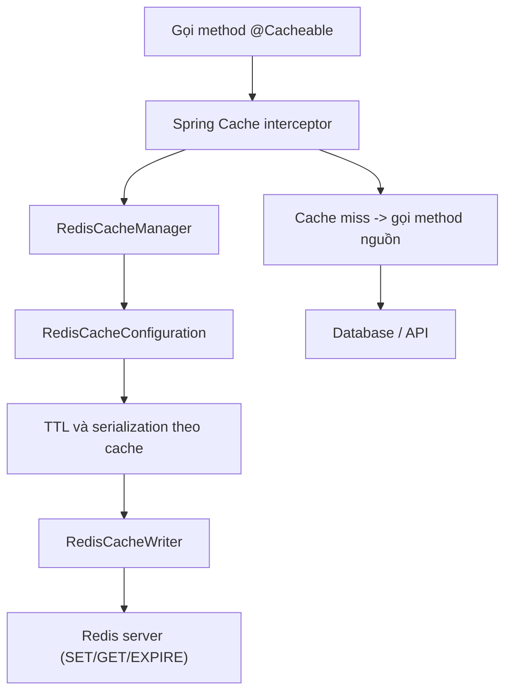

# Chọn TTL theo yêu cầu độ mới và tần suất cập nhật

> **Module:** Spring Data Redis  
> **Chương:** Chiến lược cache  
> **Trọng tâm:** Cách xác định Time To Live (TTL) cho cache dựa trên mức độ cũ của dữ liệu mà nghiệp vụ chấp nhận (*freshness/staleness*), nhịp thay đổi dữ liệu nguồn, tần suất đọc, chi phí tải lại và khả năng đồng bộ cache khi có cập nhật.

## 1. Vì sao không nên chọn TTL chỉ theo cảm tính?

Giả sử một ứng dụng Spring Boot dùng Redis để cache các dữ liệu:

- Danh sách tỉnh/thành hầu như không đổi.
- Chi tiết sản phẩm được cập nhật vài lần mỗi ngày.
- Giá khuyến mại thay đổi theo chiến dịch.
- Tồn kho được ghi liên tục khi nhiều khách cùng đặt hàng.
- Thống kê lượt xem được cập nhật nhiều lần mỗi giây.

Nếu gắn TTL 30 phút cho tất cả, kết quả rất khác nhau:

- Dữ liệu địa giới hoặc danh mục tĩnh bị đọc lại từ nguồn quá thường xuyên mà chưa chắc có lợi.
- Thông tin sản phẩm có thể vẫn đủ mới cho một trang giới thiệu, nhưng có nguy cơ sai khi vừa thay đổi mô tả.
- Giá khuyến mại hoặc tồn kho có thể bị hiển thị sai rất lâu so với yêu cầu nghiệp vụ.
- Bộ đếm thay đổi liên tục có thể gần như lúc nào cũng cũ.

Vì vậy, câu hỏi đúng không phải chỉ là **“Dữ liệu này cập nhật mấy lần mỗi ngày?”** mà là:

1. **Người dùng chấp nhận dữ liệu cũ tối đa bao lâu?**
2. **Dữ liệu nguồn thay đổi với tần suất và mô hình như thế nào?**
3. **Khi cache miss, chi phí đọc nguồn lớn đến đâu?**
4. **Có cách chủ động xóa hoặc cập nhật cache khi dữ liệu nguồn thay đổi không?**
5. **Nếu dữ liệu cũ được dùng, hậu quả chỉ là trải nghiệm kém hay là sai nghiệp vụ?**

TTL là một công cụ cân bằng giữa **độ mới** và **hiệu năng**; nó không thay thế cơ chế kiểm soát tính đúng đắn của dữ liệu.

## 2. Nắm rõ TTL và độ mới là hai khái niệm khác nhau

### 2.1. TTL của một cache entry

TTL (*Time To Live*) là khoảng thời gian Redis cho phép một key tiếp tục tồn tại trước khi hết hạn theo thời gian. Ví dụ:

```redis
SET cache:product:101 '{"name":"Desk"}' EX 300
TTL cache:product:101
```

`EX 300` đặt hạn 300 giây, tức 5 phút. Nếu key không bị xóa hay ghi đè trước đó, Redis xem key hết hạn sau khoảng thời gian này.

Kết quả của lệnh `TTL`:

- Số dương: số giây còn lại tới khi hết hạn.
- `-1`: key đang tồn tại nhưng không có TTL.
- `-2`: key không còn tồn tại.

Một key có thể biến mất **trước hạn TTL** do Redis eviction khi thiếu bộ nhớ, lệnh xóa từ ứng dụng, restart hoặc các thay đổi dữ liệu khác. TTL chỉ điều khiển quy tắc hết hạn, không bảo đảm key được giữ tối thiểu tới thời điểm đó.

### 2.2. Freshness: dữ liệu cache có còn phản ánh nguồn thật không?

Giả sử một bản ghi giá sản phẩm trong database:

```text
10:00:00  Giá nguồn: 100.000
10:00:01  Spring cache kết quả trong Redis với TTL 10 phút
10:02:00  Giá nguồn đổi thành 90.000
10:05:00  Khách đọc cache: vẫn thấy 100.000
10:10:01  Cache đã hết hạn; lần đọc tiếp theo tải giá mới
```

Key vẫn **hợp lệ theo TTL** tại 10:05, nhưng **đã cũ so với dữ liệu nguồn** từ 10:02. Đó là sự khác nhau giữa:

- **TTL validity:** key chưa hết thời gian sống.
- **Data freshness:** giá trị có phản ánh cập nhật gần nhất từ nguồn không.
- **Business validity:** giá trị có còn được phép sử dụng cho nghiệp vụ cụ thể không.

Một giá cũ có thể được chấp nhận ở trang khám phá sản phẩm nhưng **không được dùng để quyết định số tiền thanh toán cuối cùng**. Hai luồng dùng cùng dữ liệu có thể cần chính sách khác nhau.

### 2.3. Độ cũ (*staleness*) đo thế nào?

Một cách mô tả là:

```text
staleness_age = thời điểm hiện tại - thời điểm bản dữ liệu nguồn
                được phản ánh trong cache
```

Tuy nhiên, có nhiều cách đo thực tế:

- **Tuổi của entry:** đã bao lâu từ khi cache được tạo.
- **Tuổi kể từ cập nhật nguồn:** đã bao lâu kể từ khi nguồn thay đổi mà cache chưa phản ánh.
- **Độ lệch phiên bản:** cache đang ở version N, nguồn đã ở version N+1.
- **Độ lệch giá trị:** cache trả 100, nguồn là 105; quan trọng khi tính toán/số liệu.
- **Tỷ lệ stale reads:** phần trăm lần đọc trả giá trị khác trạng thái nguồn tại thời điểm đọc.

Đối với một hệ thống nghiệp vụ, yêu cầu “dữ liệu mới trong vòng 30 giây” cần được định nghĩa rõ: đó là độ cũ tối đa, độ trễ đồng bộ 95% trường hợp, hay một tỉ lệ stale read chấp nhận được? Mỗi định nghĩa dẫn tới cách chọn TTL khác nhau.

## 3. Ba yếu tố nền tảng để xác định TTL

### 3.1. Yêu cầu độ mới (*freshness requirement*)

Đây thường là ràng buộc **quan trọng nhất**. Ví dụ:

| Dữ liệu | Độ cũ nghiệp vụ có thể chấp nhận | Hệ quả khi chọn TTL |
|---|---|---|
| Danh sách quốc gia dùng trong biểu mẫu | Vài giờ hoặc một ngày | TTL dài thường hợp lý |
| Bài viết/ảnh mô tả ít đổi | Vài phút tới vài giờ | TTL trung bình hoặc dài, kết hợp invalidation |
| Giá khuyến mại hiển thị | Vài giây tới vài chục giây tùy cam kết | TTL ngắn hoặc cập nhật/xóa cache theo sự kiện |
| Tồn kho hiển thị gần đúng | Có thể chấp nhận một độ trễ ngắn đã công bố | Cache rất ngắn; xác nhận lại khi đặt hàng |
| Số dư tài khoản dùng để cho phép chuyển tiền | Không chấp nhận quyết định trên dữ liệu cũ | Đọc nguồn chuẩn và bảo đảm nhất quán; không dựa vào TTL cache |

Các giá trị là **ví dụ thiết kế**, không phải TTL chuẩn ngành. Nghiệp vụ và hợp đồng dịch vụ quyết định ngưỡng thực tế.

Nếu có ràng buộc cứng “không được cũ hơn 60 giây”, thì TTL cố định đặt lên một snapshot từ nguồn cập nhật chính xác không nên vượt 60 giây khi chưa có cơ chế khác. Cần chừa chỗ cho độ trễ lấy dữ liệu, replication, network và sai lệch đồng hồ nếu mô hình độ mới yêu cầu.

Nếu dữ liệu **bắt buộc luôn đúng ngay khi nguồn thay đổi**, chọn một TTL 1 giây vẫn không tự tạo bảo đảm mạnh: cập nhật có thể xảy ra ngay sau khi cache được ghi. Trường hợp này phải thay đổi thiết kế, chẳng hạn xác minh tại nguồn chuẩn hoặc dùng kiểm soát version/transaction phù hợp.

### 3.2. Tần suất cập nhật dữ liệu nguồn (*write/change rate*)

Cùng TTL 30 phút có ý nghĩa khác nhau với hai loại dữ liệu:

- Key A thay đổi một lần mỗi tháng: xác suất cache sai trong một khoảng ngắn khá thấp.
- Key B thay đổi 100 lần mỗi phút: ngay sau khi cache được ghi, giá trị rất có thể đã lỗi thời.

Tuy nhiên, **tần suất trung bình chưa đủ**. Cần xem:

- Thay đổi đều theo thời gian hay dồn vào một đợt, ví dụ cập nhật giá lúc 00:00.
- Mỗi lần thay đổi là toàn bộ dataset hay chỉ một phần key.
- Có các thời điểm nóng như flash sale, booking giờ cao điểm.
- Có tính theo từng key hay chỉ đếm tổng số write của cả bảng.
- Có cách phát hiện cập nhật để invalidate cache hay không.

Ví dụ 10.000 update/ngày trên bảng sản phẩm không có nghĩa **mỗi sản phẩm** thay đổi 10.000 lần/ngày. TTL phải được cân nhắc ở độ hạt key, nhóm dữ liệu hoặc business segment tương ứng.

### 3.3. Tần suất đọc và chi phí tải lại (*read rate / miss cost*)

TTL càng ngắn thì entry thường hết hạn nhanh hơn, tăng cache miss và số lần gọi nguồn. Chi phí miss gồm:

- Thời gian query database hoặc tính toán.
- Network request tới API bên ngoài.
- CPU của ứng dụng/nguồn và giới hạn rate.
- Tải đồng thời khi hàng nghìn key hết hạn gần nhau.
- Nguy cơ database bị quá tải khi Redis tạm thời không sẵn sàng.

Ví dụ cùng TTL 60 giây:

- Một key được đọc 100 lần/giây tạo ra nhiều cache hits giữa hai lần load.
- Một key được đọc mỗi 5 phút rất có thể hết hạn trước khi có lượt truy cập kế tiếp, nên cache ít mang lại lợi ích.

Điều này cho thấy phải kết hợp **tần suất đọc** và **tần suất cập nhật**, thay vì chọn TTL chỉ dựa trên số lượng yêu cầu HTTP tổng của cả ứng dụng.

## 4. Hiểu quan hệ TTL – thay đổi nguồn bằng mô hình đơn giản

Đây là mô hình hỗ trợ tư duy, không phải công thức thay thế đo đạc production.

### 4.1. Xác suất nguồn thay đổi trong một khoảng TTL

Giả sử cập nhật một key tuân theo quá trình Poisson độc lập, với tần suất trung bình `λ` lần cập nhật trên một đơn vị thời gian. Xác suất có **ít nhất một thay đổi** trong khoảng `T` là:

\[
P(\text{ít nhất một cập nhật trong } T) = 1 - e^{-\lambda T}
\]

Trong công thức, `λ` và `T` phải cùng đơn vị (ví dụ `λ` là lần/giờ và `T` là giờ).

Ví dụ một giá trị trung bình thay đổi **4 lần/ngày**, tức mỗi 6 giờ, và cache giữ tối đa 30 phút:

\[
\lambda T = 4 \times \frac{0.5}{24} \approx 0.0833
\]

\[
P(\text{có cập nhật trong cửa sổ 30 phút})
\approx 1-e^{-0.0833}\approx 8\%
\]

Nếu đặt TTL 5 phút với cùng giả định:

\[
\lambda T = 4 \times \frac{5}{24\times 60}\approx 0.0139
\]

\[
P(\text{có cập nhật trong cửa sổ 5 phút})\approx 1.4\%
\]

Đây là xác suất **có cập nhật trong cửa sổ sống của entry**, **không phải** trực tiếp là xác suất một request trả dữ liệu cũ. Tỷ lệ stale read còn phụ thuộc thời điểm request, cách invalidation, thời điểm cache được tạo và phân phối truy cập.

Điều kiện Poisson thường không phù hợp với dữ liệu cập nhật theo lịch (ví dụ giá đổi đúng 00:00) hoặc theo đợt (flash sale). Khi có lịch, cách đáng tin cậy hơn là đồng bộ invalidation hoặc giới hạn TTL sao cho không vượt thời điểm thay đổi đã biết.

### 4.2. Xác định TTL từ mục tiêu xác suất thay đổi

Nếu chấp nhận tối đa xác suất `p` có cập nhật trong khoảng giữ cache theo mô hình trên, có thể giải:

\[
T \leq \frac{-\ln(1-p)}{\lambda}
\]

Ví dụ mục tiêu `p=5\%`, cập nhật trung bình `2 lần/giờ`:

\[
T \leq \frac{-\ln(0.95)}{2} \text{ giờ} \approx 1.54\text{ phút}
\]

Đây là một **ngưỡng tham khảo thống kê**. Nếu doanh nghiệp yêu cầu dữ liệu không được cũ quá 10 giây, giới hạn 10 giây vẫn quan trọng hơn ngưỡng 1,54 phút. Nếu cập nhật bị dồn vào một thời điểm ngắn, cần áp dụng chiến lược khác.

### 4.3. Ước lượng cache hit theo nhịp đọc

Giả sử yêu cầu đọc một key tuân theo Poisson với tốc độ `r` lần/giây, TTL cố định `T` giây được đặt lại **chỉ khi cache miss và load dữ liệu**, không refresh trên cache hit, và không có eviction hay invalidation sớm.

Số lượt hit kỳ vọng giữa hai lần load xấp xỉ `rT`. Tỷ lệ miss dài hạn có thể ước lượng:

\[
\text{miss ratio} \approx \frac{1}{1+rT}
\]

Ví dụ `r = 1` request/giây và `T = 60` giây:

\[
\text{miss ratio} \approx \frac{1}{61} \approx 1.6\%
\]

Nhưng với key lạnh có `r = 1/300` request/giây (trung bình 5 phút mới đọc một lần) và TTL 30 giây:

\[
\text{miss ratio} \approx \frac{1}{1 + 30/300}\approx 90.9\%
\]

Bởi vậy **TTL ngắn cho mọi key** có thể khiến cache hoạt động kém hiệu quả với các key lạnh. Công thức là heuristic trong điều kiện đơn giản; các yếu tố như traffic bùng nổ, nhiều request đồng thời, Redis eviction hoặc TTI sẽ làm kết quả thực tế khác.

### 4.4. Hai mục tiêu có thể xung đột

Với cùng một key:

- Tăng `T`: thường tăng cache hit, giảm tải nguồn, nhưng tăng nguy cơ trả giá trị cũ.
- Giảm `T`: thường giảm thời gian sai lệch, nhưng tăng số lần tải lại.
- Thêm invalidation theo sự kiện: có thể giữ TTL dài để tăng hit nhưng giảm độ trễ cập nhật nếu sự kiện đáng tin cậy.
- Thêm refresh chủ động: có thể giảm cache miss sau expiration, nhưng tăng chi phí làm mới nền và cần xử lý lỗi nguồn.

Không nên tìm một “TTL lý tưởng duy nhất” mà quên các mục tiêu này.

## 5. Quy trình thực tế để chọn TTL

### Bước 1. Phân loại dữ liệu theo tác động của stale read

Đầu tiên xác định nghiệp vụ dùng dữ liệu để:

1. **Hiển thị tham khảo:** sai lệch ngắn có thể chấp nhận.
2. **Đưa ra gợi ý/ưu tiên:** sai lệch có thể làm giảm trải nghiệm hoặc hiệu quả.
3. **Quyết định nghiệp vụ quan trọng:** sai lệch có thể gây mất tiền, cấp quyền sai, bán vượt tồn kho hoặc vi phạm quy định.

Đối với loại 3, nên tách đường quyết định quan trọng để đọc **nguồn chuẩn hoặc cơ chế kiểm tra nguyên tử**; cache chỉ nên hỗ trợ hiển thị hoặc tiền xử lý khi phù hợp.

### Bước 2. Chốt freshness budget

Viết rõ yêu cầu, ví dụ:

```text
Danh mục:
  Nội dung thay đổi có thể trễ tối đa 1 giờ.

Giá trên trang sản phẩm:
  95% cập nhật hiển thị trong 20 giây;
  giá tại bước thanh toán phải xác nhận từ nguồn chuẩn.

Tồn kho hiển thị:
  Có thể trễ tới vài giây;
  không dùng kết quả cache để trừ tồn kho.
```

Mỗi yêu cầu dẫn đến chiến lược khác nhau:

- **Giới hạn cứng:** TTL và cơ chế đọc/ghi phải bảo vệ giới hạn đó kể cả khi event delay hoặc lỗi.
- **SLO xác suất (95%, 99%):** có thể kết hợp thống kê, metrics và invalidation.
- **Best effort:** có thể TTL dài hơn nếu chi phí stale nhỏ và hiệu năng quan trọng.

Nếu chưa có freshness budget, người chọn TTL không biết nên ưu tiên giảm stale hay giảm cache miss.

### Bước 3. Đo tần suất cập nhật **theo từng nhóm key**

Nên thu thập:

- Số lần dữ liệu của một key được thay đổi trong ngày/giờ.
- Khoảng cách `p50`/`p95`/`p99` giữa hai thay đổi.
- Thời điểm cập nhật theo lịch hay theo sự kiện.
- Tỷ lệ key không thay đổi trong một ngày/tuần.
- Thời gian từ commit nguồn đến khi hệ thống phát event/invalidation.
- Độ trễ replication nếu cache đọc từ một replica hoặc được rebuild từ read replica.

Không lấy một tỷ lệ write trung bình toàn hệ thống để gán cho từng key nếu có “hot keys” và “cold keys” rất khác nhau.

### Bước 4. Đo nhịp đọc và chi phí miss

Theo dõi:

- Số request/giây theo cache name, và theo nhóm key nếu có thể.
- Cache hit/miss ratio theo từng cửa sổ thời gian.
- Latency trung bình và `p95`/`p99` của method khi cache miss.
- CPU và connection pool của database/API nguồn.
- Mức tăng tải khi cache vừa bị clear hoặc toàn bộ key hết TTL.
- Kích thước entry, bộ nhớ Redis, `expired_keys` và `evicted_keys`.

Nếu một truy vấn nguồn tốn 500 ms nhưng cache hit chỉ vài ms, cache rất có giá trị. Ngược lại, một key nhỏ, hiếm đọc, dễ query có thể không cần cache.

### Bước 5. Xác định chiến lược đồng bộ khi update

Nếu có quyền kiểm soát tất cả đường ghi, có thể:

- Chủ động **evict** entry khi database cập nhật thành công.
- Cập nhật cache bằng giá trị mới qua `@CachePut` hoặc write-through.
- Phát sự kiện invalidation từ hệ thống sở hữu dữ liệu.
- Dùng outbox/CDC hoặc cơ chế đồng bộ có retry nếu update từ nhiều hệ thống.

Khi invalidation đáng tin cậy, TTL có thể dài hơn và đóng vai trò **safety net** khi một event bị trễ/mất. Khi không có invalidation và freshness cần chặt chẽ, TTL phải được chọn thận trọng hơn.

### Bước 6. Chọn TTL ban đầu và đo lại

Dùng freshness budget làm giới hạn trên, sau đó xét:

- Tăng TTL có tiết kiệm nguồn đáng kể không?
- TTL đó có gây stale reads vượt ngưỡng không?
- Có đủ RAM Redis và policy eviction không?
- Key có bị xóa hàng loạt vào cùng thời điểm không?
- Có cần chia các cache thành nhiều nhóm theo mức độ biến động?

TTL là cấu hình cần **đo – quan sát – điều chỉnh**, không phải một hằng số cố định cho mọi service mãi mãi.

## 6. Ma trận gợi ý TTL theo tính chất dữ liệu

Bảng dưới đây chỉ là điểm khởi đầu để thảo luận; không thay thế SLA nghiệp vụ hay thống kê production.

| Nhóm dữ liệu | Mẫu thay đổi | Độ cũ thường có thể chấp nhận | TTL khởi điểm để thử | Cơ chế bổ sung |
|---|---|---|---|---|
| Mã quốc gia, danh mục chuẩn ít đổi | Theo tháng/quý | Giờ hoặc ngày | 6–24 giờ | Evict khi publish bộ danh mục mới |
| Cấu hình hiển thị ít đổi | Vài lần/ngày | Vài phút | 5–30 phút | Invalidation sau commit |
| Chi tiết sản phẩm | Theo người quản trị, vài lần/ngày | Vài phút | 5–15 phút | `@CacheEvict`/event khi sửa sản phẩm |
| Giá khuyến mại cho mục đích hiển thị | Theo chiến dịch hoặc burst | Giây tới phút | 10–60 giây | Event cập nhật, kiểm tra giá thật khi checkout |
| Tồn kho hiển thị gần đúng | Nhiều lần/phút | Giây | 1–10 giây nếu cần cache | Đọc nguồn chuẩn khi xác nhận đơn |
| Kết quả thống kê dashboard | Theo batch hoặc liên tục | Phụ thuộc dashboard | 15 giây–5 phút | Refresh theo lịch, lưu timestamp |
| Kết quả tìm kiếm nặng | Theo thay đổi catalog | Vài phút | 1–10 phút | Version index hoặc invalidate khi index mới |
| Quyền truy cập trong quyết định bảo mật | Có thể thay đổi bất kỳ lúc nào | Thường yêu cầu rất chặt | Không có TTL đơn lẻ nào đủ bảo đảm | Kiểm tra nguồn chuẩn/version theo mô hình bảo mật |

Các con số không phải “best practice mặc định”. Nếu một cache phục vụ dữ liệu phân quyền, số dư, thanh toán hoặc các quyết định có hệ quả lớn, kiến trúc phải đáp ứng tính nhất quán của nghiệp vụ; TTL không thay cho xác nhận trạng thái.

### 6.1. Hai sản phẩm cùng loại vẫn có thể cần TTL khác

Ví dụ:

- Sản phẩm A là hàng trưng bày, gần như không thay đổi giá hay tồn kho.
- Sản phẩm B đang flash sale, giá và stock đổi theo phút.

Nếu cả hai nằm trong cache `products` với TTL 15 phút, B có thể bị stale quá lâu. Có thể:

1. Tách các cache name: `productDetails`, `flashSaleOffers`, `inventoryView`.
2. Chọn TTL khác nhau theo cache hoặc theo entry nếu framework hỗ trợ.
3. Invalidate key khi các bản ghi thuộc từng nhóm thay đổi.
4. Tránh dùng một cached aggregate chứa tất cả field với freshness budget khác nhau nếu có thể tách chúng.

Tách dữ liệu theo đặc tính đổi mới thường quan trọng hơn việc chọn một TTL toàn cục rất nhỏ.

## 7. TTL cố định, TTL theo entry và Time To Idle (TTI)

### 7.1. TTL cố định từ thời điểm ghi

Với TTL cố định 10 phút:

```text
10:00  Cache miss -> ghi key, TTL=10 phút
10:04  Cache hit  -> TTL còn ~6 phút
10:09  Cache hit  -> TTL còn ~1 phút
10:10  Cache hết hạn
10:11  Lần đọc kế tiếp miss -> refresh từ nguồn
```

Truy cập cache không tự làm mới TTL trong mô hình mặc định này.

Ưu điểm:

- Đơn giản, dễ dự đoán giới hạn tuổi entry.
- Giảm rủi ro một bản cache quá cũ tồn tại vô hạn vì có nhiều lượt đọc.
- Dễ suy luận về freshness budget khi cache chỉ được tạo từ nguồn đáng tin cậy.

Nhược điểm:

- Key rất nóng vẫn hết hạn đúng lịch và có thể tạo đồng thời nhiều cache misses.
- Độ tuổi entry không nhất thiết phản ánh thời điểm nguồn thay đổi.
- Các key được tạo cùng lúc có thể hết hạn cùng lúc.

### 7.2. TTL động theo key, value hoặc nhóm dữ liệu

Trong nhiều hệ thống, TTL của một sản phẩm VIP và một bản ghi preview không giống nhau. Có thể xác định TTL theo:

- Tên cache.
- Loại dữ liệu.
- Mức độ biến động dự báo.
- Thời điểm kết thúc một chiến dịch.
- Giá trị/metadata của entity.
- Yêu cầu SLA của từng endpoint.

Khi các nhóm dữ liệu được biết trước, cấu hình theo **cache name** thường đơn giản, ổn định và dễ quan sát hơn chính sách tự động quá phức tạp.

Với phiên bản Spring Data Redis phù hợp, `RedisCacheConfiguration.entryTtl(RedisCacheWriter.TtlFunction)` hỗ trợ TTL tùy theo key/value. Cần kiểm tra API theo phiên bản dự án (hỗ trợ TTL function được đưa vào Spring Data Redis 3.2).

**Điểm thiết kế:** TTL động phải có ranh giới min/max và nguyên tắc rõ. Không nên tự tính TTL từ một field có thể thiếu hoặc thay đổi khiến cache giữ bản dữ liệu nhạy cảm quá lâu.

### 7.3. TTI: gia hạn khi có truy cập

*Time To Idle (TTI)* là khoảng thời gian tối đa **không có truy cập** trước khi entry hết hạn.

Ví dụ TTI 10 phút:

```text
10:00  Tạo cache
10:09  Đọc cache -> làm mới thời gian sống thêm 10 phút
10:18  Đọc cache -> làm mới thêm 10 phút
10:27  Đọc cache -> làm mới thêm 10 phút
...
```

Nếu key được đọc liên tục, nó có thể tồn tại rất lâu dù nguồn thay đổi. Do đó, **TTI thuần túy không phù hợp nếu yêu cầu một giới hạn cứng về độ mới**.

Spring Data Redis có khả năng mô phỏng TTI thông qua `RedisCacheConfiguration.enableTimeToIdle()` và Redis `GETEX` trong các phiên bản hỗ trợ; Redis `GETEX` yêu cầu Redis 6.2 trở lên. Mọi code path đọc key phải tuân thủ cùng semantics gia hạn TTL; nếu có chỗ đọc bằng `RedisTemplate`/`GET` thông thường, behavior TTI có thể không thống nhất.

Khi cần cả cache nóng lâu sống và độ mới tối đa cố định, hãy thiết kế **hard TTL** độc lập, version check hoặc cơ chế refresh/invalidation bổ sung. Đừng dùng TTI thay cho freshness policy.

## 8. Vị trí của TTL trong Spring Data Redis và Spring Cache

Trong ứng dụng Spring Boot dùng Redis làm cache backend:



Có ba tầng cấu hình riêng:

1. **Spring Cache abstraction:** quyết định khi nào đọc/ghi/xóa cache dựa vào `@Cacheable`, `@CachePut`, `@CacheEvict`.
2. **Spring Data Redis Cache:** quyết định TTL, key prefix, serialization và phương thức giao tiếp Redis qua `RedisCacheManager` và `RedisCacheConfiguration`.
3. **Redis server:** quyết định expiration, `maxmemory-policy`, memory, replication và persistence.

Không thể chỉ thêm `@Cacheable` rồi xem TTL là do annotation tự chọn. `@Cacheable` không có thuộc tính chuẩn `ttl`. TTL được gắn bởi cache provider và cấu hình RedisCache tương ứng.

### 8.1. Cấu hình TTL mặc định từ Spring Boot

Ví dụ `application.yml`:

```yaml
spring:
  data:
    redis:
      host: localhost
      port: 6379
      timeout: 2s

  cache:
    type: redis
    cache-names:
      - productDetails
      - categories
      - inventoryView
    redis:
      time-to-live: 5m
      cache-null-values: false
      use-key-prefix: true
```

Trong một dự án Spring Boot có starter Spring Cache/Redis và `@EnableCaching`, `spring.cache.redis.time-to-live` đặt **TTL mặc định** cho cache entries do RedisCacheManager auto-configured quản lý.

Cấu hình này:

- Không tự áp TTL cho key tạo qua `StringRedisTemplate` hoặc `RedisTemplate` thông thường.
- Không đặt TTL cho Redis Repository entity có `@RedisHash`.
- Không thay `maxmemory` hay eviction policy của Redis server.
- Không tự cập nhật cache khi database thay đổi.
- Không quy định riêng TTL cho từng cache name chỉ bằng giá trị này.

Nếu ứng dụng tự tạo `RedisCacheManager` bean riêng, cần kiểm tra cấu hình Java thực tế vì các Redis cache properties của Spring Boot có thể không được tự gộp vào bean do bạn tự định nghĩa.

### 8.2. Cấu hình TTL theo từng cache

Ví dụ Spring Data Redis:

```java
import java.time.Duration;
import java.util.Map;

import org.springframework.cache.annotation.EnableCaching;
import org.springframework.context.annotation.Bean;
import org.springframework.context.annotation.Configuration;
import org.springframework.data.redis.cache.RedisCacheConfiguration;
import org.springframework.data.redis.cache.RedisCacheManager;
import org.springframework.data.redis.connection.RedisConnectionFactory;

@Configuration
@EnableCaching
public class RedisCachingConfiguration {

    @Bean
    public RedisCacheManager cacheManager(
            RedisConnectionFactory connectionFactory) {

        RedisCacheConfiguration defaults =
                RedisCacheConfiguration.defaultCacheConfig()
                        .entryTtl(Duration.ofMinutes(5))
                        .disableCachingNullValues();

        RedisCacheConfiguration productDetails =
                defaults.entryTtl(Duration.ofMinutes(10));

        RedisCacheConfiguration categories =
                defaults.entryTtl(Duration.ofHours(12));

        RedisCacheConfiguration inventoryView =
                defaults.entryTtl(Duration.ofSeconds(5));

        return RedisCacheManager.builder(connectionFactory)
                .cacheDefaults(defaults)
                .withInitialCacheConfigurations(Map.of(
                        "productDetails", productDetails,
                        "categories", categories,
                        "inventoryView", inventoryView))
                .build();
    }
}
```

Cấu hình có ý nghĩa:

| Cache name | TTL | Tư duy |
|---|---|---|
| `productDetails` | 10 phút | Chi tiết thay đổi ít hơn tồn kho |
| `categories` | 12 giờ | Danh mục ít cập nhật |
| `inventoryView` | 5 giây | Hiển thị gần đúng, không quyết định trừ kho |
| Cache khác dùng defaults | 5 phút | Giá trị dự phòng |

Đây chỉ là **TTL khởi điểm minh họa**; production phải chọn theo freshness budget và tần suất cập nhật của từng loại dữ liệu.

### 8.3. Sử dụng annotation trong service

```java
import org.springframework.cache.annotation.CacheEvict;
import org.springframework.cache.annotation.CachePut;
import org.springframework.cache.annotation.Cacheable;
import org.springframework.stereotype.Service;

@Service
public class CatalogService {

    private final ProductRepository repository;

    public CatalogService(ProductRepository repository) {
        this.repository = repository;
    }

    @Cacheable(cacheNames = "productDetails", key = "#id",
               unless = "#result == null")
    public Product findProduct(long id) {
        return repository.findById(id).orElse(null);
    }

    @CachePut(cacheNames = "productDetails", key = "#result.id")
    public Product updateProduct(long id, String name) {
        Product product = repository.findById(id).orElseThrow();
        product.setName(name);
        return repository.save(product);
    }

    @CacheEvict(cacheNames = "productDetails", key = "#id")
    public void deleteProduct(long id) {
        repository.deleteById(id);
    }
}
```

`Product` và `ProductRepository` là kiểu domain của ứng dụng, được minh họa để diễn giải cache lifecycle.

- `@Cacheable`: khi hit, method thường không được gọi; khi miss, method được gọi và kết quả có thể được lưu.
- `@CachePut`: method luôn chạy, sau đó cập nhật cache bằng kết quả trả về.
- `@CacheEvict`: xóa entry; lần đọc tiếp theo sẽ tải lại từ nguồn.
- TTL do `RedisCacheConfiguration` áp dụng khi entry được ghi.
- Nếu service được gọi nội bộ bằng `this.findProduct(...)` trong cùng bean, lời gọi có thể bỏ qua Spring AOP proxy, khiến annotation không chạy như dự kiến.

### 8.4. TTL theo entry trong các phiên bản hỗ trợ

Khi cần TTL phụ thuộc loại key thay vì mỗi cache name, có thể dùng `TtlFunction` nếu Spring Data Redis của dự án hỗ trợ:

```java
import java.time.Duration;
import org.springframework.data.redis.cache.RedisCacheConfiguration;
import org.springframework.data.redis.cache.RedisCacheWriter;

RedisCacheWriter.TtlFunction policy = (key, value) -> {
    String k = String.valueOf(key);

    if (k.startsWith("fast:")) {
        return Duration.ofSeconds(10);
    }

    return Duration.ofMinutes(5);
};

RedisCacheConfiguration dynamicTtl =
        RedisCacheConfiguration.defaultCacheConfig()
                .entryTtl(policy);
```

Đây là đoạn cấu hình minh họa cho version hỗ trợ `RedisCacheWriter.TtlFunction` (Spring Data Redis 3.2+). Nó có thể được đưa vào một cache name cụ thể trong `withInitialCacheConfigurations(...)`. Trong ứng dụng thật, cần xác nhận dạng key thực tế trước khi kiểm tra prefix, vì SpEL key, `SimpleKey` và conversion ở Spring có thể khiến kiểu key không giống giả định.

**Không dùng TTL động để che giấu việc thiếu invalidation.** Độ mới cần được kiểm soát bằng yêu cầu rõ ràng, nhất là với key có thể đổi giá trị đột ngột sau khi cache vừa được ghi.

## 9. RedisTemplate: đặt TTL cho cache do ứng dụng quản lý thủ công

Nếu không sử dụng Spring Cache abstraction, ứng dụng có thể tự thực hiện cache-aside qua `StringRedisTemplate`:

```java
import java.time.Duration;

import org.springframework.data.redis.core.StringRedisTemplate;
import org.springframework.stereotype.Service;

@Service
public class ExchangeRateCache {

    private static final Duration TTL = Duration.ofMinutes(2);

    private final StringRedisTemplate redis;
    private final ExchangeRateClient rateClient;

    public ExchangeRateCache(
            StringRedisTemplate redis,
            ExchangeRateClient rateClient) {
        this.redis = redis;
        this.rateClient = rateClient;
    }

    public String getRate(String pair) {
        String key = "fx:rate:" + pair;
        String cached = redis.opsForValue().get(key);

        if (cached != null) {
            return cached;
        }

        String fresh = rateClient.fetch(pair);
        redis.opsForValue().set(key, fresh, TTL);
        return fresh;
    }
}
```

`ExchangeRateClient` là interface/domain service của ứng dụng.

Cách viết này giúp thấy rõ “đọc trước, miss thì tải nguồn, sau đó ghi Redis có TTL”, nhưng chưa giải quyết tình huống nhiều request cùng miss và cùng gọi nguồn (cache stampede). Nếu Redis GET/SET thất bại, code cũng chưa có fallback/retry. Trong hệ thống lớn, Spring Cache abstraction có thể giúp chuẩn hóa logic, còn RedisTemplate phù hợp khi cần lệnh Redis chuyên biệt.

Lưu ý tránh viết:

```java
redis.opsForValue().set(key, fresh);
redis.expire(key, TTL);
```

nếu có thể dùng `set(key, fresh, TTL)` trong một thao tác hỗ trợ TTL. Hai lệnh riêng có khoảng trống: nếu mất kết nối sau `SET`, key có thể không được gắn TTL như dự kiến.

## 10. TTL và invalidation: hai công cụ bổ sung

### 10.1. Chỉ dùng TTL

```text
Đọc -> cache miss -> đọc database -> cache TTL=10 phút
Nguồn thay đổi sau 2 phút
Cache tiếp tục trả kết quả cũ tới khi hết hạn
```

Ưu điểm: đơn giản, không phải theo dõi mọi điểm ghi.

Nhược điểm: độ trễ cập nhật tối đa có thể xấp xỉ TTL, hoặc thậm chí khác nếu cache nạp từ nguồn còn chậm cập nhật. TTL càng ngắn, tải nguồn thường càng tăng.

### 10.2. Chủ động xóa cache khi nguồn thay đổi

```text
Đọc -> cache miss -> cache TTL=30 phút
Nguồn thay đổi -> xóa cache entry tương ứng
Đọc tiếp theo -> cache miss -> tải dữ liệu mới
```

Ưu điểm: có thể giữ TTL dài cho cache hit cao mà vẫn phản ánh cập nhật nhanh.

Nhược điểm: mọi đường ghi phải thông báo hoặc xóa đúng key. Nếu một event bị mất, key có thể cũ cho tới khi TTL hết hạn. Vì thế TTL vẫn có vai trò giới hạn thời gian tồn tại của một cache entry bị bỏ lỡ invalidation.

### 10.3. Cập nhật cache sau ghi

`@CachePut` hoặc thao tác `SET` sau khi commit nguồn có thể ghi phiên bản mới vào Redis. Cách này hữu ích khi ứng dụng biết ngay giá trị mới, nhưng cần cân nhắc thứ tự ghi và race:

```text
Worker A: tải phiên bản cũ v1
Worker B: cập nhật database sang v2 và ghi cache v2
Worker A: lưu v1 vào cache sau khi B đã ghi v2
Kết quả: cache bị ghi lùi về v1
```

Để bảo vệ tính mới khi nhiều luồng cập nhật, có thể áp dụng versioned key, so sánh version khi ghi, locking phù hợp hoặc mô hình invalidation sau commit. Không nên giả định chỉ cần `@CachePut` là đủ đảm bảo mọi thao tác ghi đến Redis đúng thứ tự theo database.

### 10.4. Chú ý thời điểm database commit

Ví dụ:

```java
@Transactional
@CacheEvict(cacheNames = "productDetails", key = "#id")
public void updateProduct(long id, String title) {
    // Cập nhật database
}
```

Chỉ đặt `@Transactional` cạnh `@CacheEvict` **không đảm bảo** eviction luôn xảy ra sau database commit; thứ tự advice có thể khác nhau. Nếu cần nhất quán tốt hơn, cân nhắc:

- `RedisCacheManager.builder(...).transactionAware()` khi thích hợp;
- transaction synchronization chạy invalidation sau commit;
- transactional outbox/event với retry khi cần độ tin cậy xuyên service.

Không có cơ chế nào biến Redis Cache và database thành một transaction ACID duy nhất chỉ bằng một annotation. TTL vẫn cần đóng vai trò bảo hiểm khi invalidation trễ hoặc không tới.

## 11. TTL và lịch cập nhật đã biết trước

Không phải mọi nguồn cập nhật đều ngẫu nhiên. Ví dụ một chương trình khuyến mại bắt đầu lúc 12:00 và kết thúc lúc 14:00.

Nếu cache được tạo lúc 11:58 với TTL 30 phút, lúc 12:00 có thể vẫn hiển thị giá trước khuyến mại. Với lịch cập nhật rõ ràng, một chiến lược tốt hơn là:

1. **Ràng buộc TTL không vượt tới mốc thay đổi đã biết**.
2. Invalidate/prewarm key khi chiến dịch bắt đầu hoặc kết thúc.
3. Đọc giá nguồn chuẩn ở bước xác nhận giao dịch.
4. Gắn version chiến dịch vào key để tránh sử dụng snapshot của chiến dịch trước.

Ví dụ nguyên tắc TTL:

```text
ttl = min(
    ttl_theo_freshness_budget,
    duration_until_next_scheduled_change
)
```

Nếu còn 90 giây tới lúc đổi giá, TTL 15 phút theo cấu hình mặc định không còn hợp lý. Khi TTL chỉ còn vài giây, cân nhắc tránh cache hoặc dùng cache có version chứ không cố tạo một entry sống quá ngắn liên tục.

Với những mốc thời gian tuyệt đối, cần thống nhất timezone, đồng hồ và nguồn xác định thời điểm. Một vài giây chênh lệch tại ranh giới chiến dịch có thể mang ý nghĩa nghiệp vụ lớn.

## 12. Chọn TTL theo từng key hay theo từng vùng cache?

### 12.1. TTL theo cache name

Phù hợp khi mọi key trong một vùng có cùng đặc tính:

```text
cacheName: "categories"       -> 12 giờ
cacheName: "productDetails"   -> 10 phút
cacheName: "inventoryView"    -> 5 giây
```

Ưu điểm:

- Dễ cấu hình, quan sát và giải thích.
- Chính sách nhất quán theo nhóm dữ liệu.
- Dễ chọn TTL bằng `RedisCacheConfiguration.entryTtl(...)`.
- Giúp đội vận hành thấy rõ nguồn tạo key và độ cũ kỳ vọng.

### 12.2. TTL theo từng entry

Phù hợp khi trong một cache có key nóng/lạnh hoặc mức biến động khác nhau đáng kể.

Ví dụ:

- Giá sản phẩm trong flash sale: 10 giây.
- Giá sản phẩm thông thường: 2 phút.
- Giá theo hợp đồng dài hạn: 1 giờ.

Để cấu hình TTL theo entry, có thể dùng `TtlFunction` với Spring Data Redis hỗ trợ hoặc một lớp cache tùy chỉnh. Tuy nhiên cần rõ **độ tươi của chính sách tính TTL**. Nếu metadata xác định loại giá đã thay đổi mà Redis vẫn dùng logic cũ, một entry có thể nhận TTL quá dài.

Nếu tính TTL theo tần suất đọc thì cũng cần cẩn thận: key rất nóng thường đáng cache hơn, nhưng key nóng không nhất thiết **được phép stale lâu hơn**. Mức độ quan trọng nghiệp vụ là ràng buộc ưu tiên.

### 12.3. Khi nào nên tách cache thay vì TTL động?

Nếu hai nhóm khác nhau cả về serializer, ownership, quyền truy cập, freshness và invalidation, tách cache name hoặc namespace thường rõ ràng hơn.

Ví dụ:

```text
productDetails::123        TTL 10 phút
productPrices::123         TTL 30 giây
productInventoryView::123  TTL 5 giây
```

Khi giá thay đổi, chỉ cần invalidate `productPrices::123`. Nếu toàn bộ thông tin gộp trong `products::123`, một thay đổi nhỏ của stock có thể buộc load lại cả mô tả, ảnh, category dù các field đó ít biến động.

## 13. Kỹ thuật chống cache stampede và expiration đồng loạt

### 13.1. Cache stampede khi key nóng hết hạn

Giả sử key `productDetails::101` có 1.000 request/giây. Nếu TTL hết vào 12:00:00, nhiều request có thể cùng miss và truy vấn database trước khi request đầu tiên nạp lại cache.

```text
12:00:00 -> key expired
    |---- Request A -> database
    |---- Request B -> database
    |---- Request C -> database
    |---- ...
    \---- Request N -> database
```

Spring Cache có `@Cacheable(sync = true)` ở một số implementation để phối hợp cache loading, nhưng mức bảo đảm phụ thuộc cache provider và không được mặc định xem như distributed lock chắc chắn trên mọi instance.

Các biện pháp bổ sung:

- Coalesce những request đồng thời theo key ở tầng ứng dụng.
- Prewarm hoặc chủ động refresh key nóng.
- Giữ timeout, connection pool và concurrency giới hạn để bảo vệ database.
- Dùng distributed coordination phù hợp nếu cần duy nhất một loader trong cụm.
- Xem xét stale-while-revalidate khi nghiệp vụ cho phép.

### 13.2. TTL jitter để tránh cache avalanche

Nếu 100.000 key được nạp cùng lúc và cùng TTL 10 phút, chúng có thể hết hạn cùng thời điểm. Một cách giảm đỉnh tải là tạo TTL có **độ lệch nhỏ**:

```text
TTL mục tiêu: khoảng 5 phút
TTL từng key: 4 phút 30 giây đến 5 phút
```

Jitter có thể được tính theo key hoặc ngẫu nhiên có giới hạn. Cần đặc biệt chú ý: nếu freshness budget cứng là 5 phút, **không để jitter cộng thêm vượt 5 phút**.

Ví dụ cho Spring Data Redis hỗ trợ `TtlFunction`:

```java
RedisCacheWriter.TtlFunction ttlWithJitter = (key, value) -> {
    int offset = Math.floorMod(String.valueOf(key).hashCode(), 31);
    return Duration.ofSeconds(270 + offset); // 270..300 giây
};
```

Ở đây TTL mỗi entry nằm trong khoảng 270–300 giây. Dùng hash theo key tạo độ lệch nhất quán khi nhiều instance xử lý cùng key. Với tải thật, việc key hết hạn được phân tán còn phụ thuộc thời gian tạo entry và phân phối key. Độ lệch cụ thể phải phù hợp freshness budget.

### 13.3. Refresh chủ động và stale-while-revalidate

Đối với các key rất nóng, có thể chủ động làm mới **trước khi hết TTL**:

```text
t=0      Cache tạo, hard TTL = 10 phút
t=8 phút Chạy background refresh (nếu nguồn sẵn sàng)
t=8:05   Ghi bản mới vào cache
t=10     Không có đợt miss đồng loạt do key cũ hết hạn
```

Nếu nguồn cập nhật chậm hoặc gặp lỗi, có thể áp dụng **stale-while-revalidate (SWR)**: trả bản dữ liệu cũ trong một “stale window” có giới hạn, đồng thời một worker nạp dữ liệu mới.

Điểm quan trọng:

- Spring `@Cacheable` + `RedisCacheManager` thông thường **không tự triển khai đầy đủ SWR** chỉ bằng một TTL.
- SWR cần logic quản lý thời điểm fresh/stale, refresh, lock hoặc request coalescing và fallback.
- SWR làm **tăng khả năng phục vụ stale data có chủ đích**; không phù hợp dữ liệu đòi tính đúng tuyệt đối.
- Nếu không làm mới thành công trước hard deadline, phải quyết định trả lỗi, đọc nguồn trực tiếp hay tiếp tục phục vụ stale theo chính sách nghiệp vụ.

## 14. TTL không đồng nghĩa dữ liệu sẽ được giữ đủ lâu

Redis có hai cơ chế độc lập:

- **Expiration:** loại key khi TTL hết.
- **Eviction:** loại key sớm hơn nếu Redis chịu áp lực bộ nhớ và chính sách cho phép.

Ví dụ server cấu hình:

```conf
maxmemory 1gb
maxmemory-policy allkeys-lru
```

Một cache entry có TTL 12 giờ vẫn có thể bị loại sau vài phút vì `allkeys-lru` ưu tiên giải phóng bộ nhớ. Do đó:

- Tăng TTL không chắc tăng hit ratio nếu Redis đang evict nhiều.
- TTL dài hơn có thể làm working set lớn và tạo áp lực bộ nhớ.
- Khi `evicted_keys` tăng cao, cần đánh giá capacity hoặc policy trước khi tăng TTL.
- Với `volatile-*`, chỉ key có TTL là ứng viên eviction; nếu nhiều key không TTL, Redis có thể thiếu ứng viên và trả OOM khi ghi.
- `noeviction` không giúp cache “chắc chắn không lỗi”; khi đầy bộ nhớ Redis có thể từ chối lệnh ghi.

TTL là yếu tố **vòng đời thời gian**; `maxmemory-policy` là yếu tố **quản lý RAM**. Cả hai phải được cân nhắc trong chiến lược cache.

## 15. Quan sát hiệu quả TTL trong production

### 15.1. Chỉ số cần có ở hai tầng

**Tại Spring application/cache abstraction:**

- Cache hit/miss theo cache name và theo nhóm key.
- Số lần chạy method nguồn vì cache miss.
- Latency của hit và miss.
- Tỷ lệ stale response đo được bằng đối chiếu version/timestamp.
- Cache put/evict, số sự kiện invalidation thất bại.
- Số lần refresh chạy, refresh fail, lock timeout.
- Tải database/API nguồn khi hết hạn hàng loạt.

**Tại Redis:**

- `keyspace_hits` / `keyspace_misses`.
- `expired_keys` / `evicted_keys`.
- `used_memory`, `maxmemory`, `used_memory_rss`.
- Latency và command throughput.
- Connection timeout/error rate.
- Phân bố TTL còn lại của một mẫu key.

### 15.2. Lệnh Redis hữu ích

```bash
redis-cli INFO stats
redis-cli INFO memory
redis-cli INFO keyspace

redis-cli TTL 'productDetails::101'
redis-cli PTTL 'inventoryView::101'

redis-cli CONFIG GET maxmemory
redis-cli CONFIG GET maxmemory-policy
```

Một số dịch vụ managed Redis hạn chế `CONFIG GET`. Khi đó tham khảo cấu hình server qua control plane của nhà cung cấp.

`PTTL` trả mili giây, `TTL` trả giây. Giá trị `-1` cho biết key không có expiry, `-2` cho biết key không tồn tại. Trên môi trường RedisCache với serializer tùy chỉnh, tên Redis key có thể khác chuỗi dễ đọc trong ví dụ.

**Không dùng `KEYS *` hoặc quét toàn bộ keyspace liên tục** chỉ để đo TTL của production. Thu thập metrics phía ứng dụng, Redis monitoring và lấy mẫu `SCAN` có giới hạn khi cần.

### 15.3. Phân biệt miss do TTL và miss do bộ nhớ

Nếu tăng TTL từ 5 phút lên 30 phút mà hit ratio không tăng:

- Có thể key không được truy cập lại trong 30 phút.
- Có thể Redis evict key sớm do RAM thiếu.
- Có thể key được tạo không ổn định hoặc thay đổi theo request.
- Có thể invalidation xảy ra quá thường xuyên.
- Có thể nhầm nhiều cache name hoặc sai Redis serializer/prefix.
- Có thể chính nguồn dữ liệu được cập nhật quá thường xuyên khiến cache bị xóa liên tục.

Cần đo `expired_keys` và `evicted_keys`, hit/miss theo cache name và thời gian sống thực của các entry trước khi kết luận TTL dài hơn không hữu ích.

### 15.4. Thử nghiệm thay đổi TTL theo nhóm

Một thí nghiệm có ý nghĩa:

1. Chọn một cache name có hành vi rõ.
2. Đo đường cơ sở: hit ratio, source QPS, P95 latency, stale read rate, Redis memory.
3. Chọn hai cấu hình TTL tương ứng freshness budget.
4. Triển khai có kiểm soát/đánh giá dưới tải tương đương.
5. Theo dõi cả dữ liệu stale lẫn hiệu năng.
6. Chốt TTL mới nếu các mục tiêu đều đáp ứng.

Không lấy hit ratio làm mục tiêu duy nhất: TTL rất dài thường dễ tạo hit nhưng có thể âm thầm tăng tỷ lệ dữ liệu cũ.

## 16. Cách triển khai để kiểm soát độ mới chặt hơn TTL đơn lẻ

### 16.1. Versioned cache keys

Thay vì chỉ dùng:

```text
productDetails::101
```

có thể gắn version:

```text
productDetails:v17::101
```

Sau khi thay đổi dữ liệu nguồn, version tăng, các lần đọc mới dùng key mới. Entry version cũ tự hết hạn sau TTL. Cách này hữu ích khi có cách lấy version đáng tin cậy và hiệu quả.

**Lưu ý:** Nếu việc xác định version mỗi request bắt buộc gọi database rất tốn kém, lợi ích cache có thể giảm đáng kể. Version cũng cần đồng bộ giữa các instance, không thể chỉ là biến nhớ trong một pod.

### 16.2. Invalidate bằng sự kiện miền (*domain event*)

Ví dụ khi service sản phẩm cập nhật giá:

```text
Database commit product price v18
    -> Publish ProductPriceChanged(id=101, version=18)
    -> Consumer của cache invalidates productPrices::101
    -> Lần đọc tiếp theo nạp lại v18
```

Nếu thông điệp đi qua queue/outbox có retry, khả năng invalidation được cải thiện so với fire-and-forget. Vẫn cần thiết kế khi event đến sai thứ tự hoặc bị xử lý nhiều lần.

Khi mọi update đều qua service sở hữu dữ liệu, phối hợp invalidation sau commit với TTL dự phòng có thể hiệu quả hơn việc đặt TTL cực ngắn cho mọi key.

### 16.3. Refresh có lịch theo thời điểm nguồn công bố

Nếu số liệu dashboard chỉ được cập nhật sau khi batch ETL hoàn tất, cache có thể được invalidate hoặc prewarm theo **mốc hoàn tất batch** thay vì TTL tùy ý. Đặt TTL dài như một khoảng an toàn dự phòng; vẫn phải phát hiện tình trạng ETL chưa hoàn tất để tránh trả nhầm dữ liệu cũ dưới nhãn “mới”.

### 16.4. Khi không được dùng stale data

Với các quyết định cần tính nhất quán chặt:

- Đọc/kiểm tra tại nguồn chuẩn trước khi commit.
- Dùng transaction, optimistic locking hoặc atomic update phù hợp hệ lưu trữ.
- Không quyết định chỉ dựa vào bản snapshot ở Redis.
- Có thể cache để tăng tốc UI nhưng xác nhận lại tại thao tác quan trọng.

TTL 1 giây **không đảm bảo luôn đúng** tại thời điểm một giao dịch khác vừa cập nhật nguồn.

## 17. Những tình huống dễ chọn TTL sai

### 17.1. Chọn TTL bằng chu kỳ update trung bình

Nguồn cập nhật trung bình một lần/giờ nhưng có thể thay đổi 10 lần trong 1 phút khi cao điểm. TTL 30 phút dựa trên “mỗi giờ một lần” sẽ không thích hợp cho giai đoạn cao điểm. Cần nhìn **phân phối**, burst và lịch update.

### 17.2. Dùng TTL quá dài vì muốn cache hit 100%

Hit ratio cao nhưng dữ liệu lỗi thời khiến người dùng hành động sai không phải một thành công. Cần đo cả stale read rate và tác động nghiệp vụ.

### 17.3. Dùng TTL quá ngắn cho mọi key

TTL 1 giây trên hàng triệu key có thể làm Redis/cache layer và database chịu tải lớn mà không tạo khác biệt đáng kể cho dữ liệu tĩnh. Nên phân nhóm theo nhu cầu độ mới.

### 17.4. Tưởng TTI luôn giúp dữ liệu mới hơn

TTI gia hạn theo lần truy cập; key rất nóng có thể tồn tại rất lâu. Với một entry được tạo một lần và nguồn đã đổi, TTI có thể **kéo dài việc trả dữ liệu cũ** nếu không có hard TTL/invalidation.

### 17.5. Tưởng `@CacheEvict` luôn chạy sau commit

Tương tác Spring AOP/transaction có thể khiến thời điểm eviction khác mong đợi. Cần cấu hình after-commit rõ ràng khi có yêu cầu nhất quán.

### 17.6. Tưởng đổi RedisTemplate serializer sẽ đổi TTL RedisCache

`RedisTemplate`, `RedisCacheManager` và Redis Repository có cấu hình riêng. TTL của một cache name thuộc `RedisCacheConfiguration`; đổi `StringRedisTemplate` bean không tự đổi cấu hình CacheManager.

### 17.7. Lấy TTL cache cho cùng một entity rồi dùng ở mọi quyết định

Một key giá sản phẩm có thể hợp lệ để hiển thị, nhưng không đủ làm chứng cứ tính tiền. Cache policy phải gắn với **use case**, không chỉ với tên entity.

### 17.8. Gia hạn TTL vô điều kiện khi cache hit

Nếu không có cơ chế kiểm tra phiên bản nguồn, một key được đọc liên tục có thể sống lâu vô hạn. Phải phân biệt TTI với yêu cầu độ mới tối đa.

### 17.9. Giảm TTL để sửa lỗi eviction

Nếu Redis đã evict nhiều key vì RAM quá nhỏ, giảm TTL có thể giúp giảm working set nhưng cũng có thể làm tăng misses. Cần xét memory, working set và `maxmemory-policy`; không phải mọi vấn đề đều giải bằng TTL.

### 17.10. Bỏ qua thời điểm cập nhật theo lịch

Với giá khuyến mại bắt đầu lúc 12:00, một key ghi lúc 11:59 với TTL 1 giờ có thể phục vụ giá cũ qua thời điểm kích hoạt. Hãy ràng buộc TTL vào deadline hoặc invalidate theo sự kiện thay đổi lịch.

## 18. Tình huống thiết kế hoàn chỉnh

### Tình huống A — Thông tin danh mục

- Nguồn cập nhật một vài lần mỗi tháng.
- Khách chấp nhận cập nhật chậm vài giờ.
- Đọc rất nhiều và query nguồn có chi phí thấp.

**Đề xuất ban đầu:** cache `categories` TTL 6–24 giờ; invalidate khi nhập phiên bản danh mục mới; dùng version trong prefix nếu có đợt chuyển đổi lớn.

Mục tiêu: giảm lượt đọc không cần thiết mà không ảnh hưởng trải nghiệm đáng kể.

### Tình huống B — Chi tiết sản phẩm

- Mô tả thay đổi vài lần/ngày.
- Trang hiển thị cho phép dữ liệu cũ trong vài phút.
- Read QPS cao hơn write QPS nhiều lần.

**Đề xuất ban đầu:** TTL 5–15 phút; invalidation sau khi admin cập nhật; tách cache `productDetails` và `productPrices` nếu freshness khác nhau.

Mục tiêu: hit ratio tốt nhưng thời gian trả mô tả cũ được giới hạn.

### Tình huống C — Giá trong flash sale

- Giá thay đổi theo lịch và có thể thay đổi đột ngột.
- Người dùng phải thấy giá mới tương đối nhanh.
- Giá tại checkout phải chuẩn xác.

**Đề xuất ban đầu:** hiển thị cache 10–30 giây hoặc phiên bản giá, invalidate/prewarm theo lịch và event; xác minh giá tại bước thanh toán với nguồn chuẩn.

Mục tiêu: đảm bảo đúng nghiệp vụ ngay cả khi UI có độ trễ nhỏ.

### Tình huống D — Tồn kho

- Hàng hóa có thể thay đổi mỗi giây.
- Lượt đọc lớn trong giờ cao điểm.
- Không được bán vượt tồn kho.

**Đề xuất ban đầu:** cache hiển thị gần đúng trong vài giây nếu cần; mọi thao tác xác nhận và trừ tồn kho dùng giao thức/transaction chuẩn ở nguồn nghiệp vụ.

Mục tiêu: Redis có thể giúp giảm tải hiển thị, nhưng không tạo ra quyết định tồn kho sai.

### Tình huống E — Báo cáo chỉ cập nhật theo batch

- ETL chạy mỗi 30 phút.
- Người dùng chấp nhận dữ liệu trễ theo lịch batch.
- Tính toán lại báo cáo rất nặng.

**Đề xuất ban đầu:** cache 30 phút hoặc lâu hơn khi gắn với batch version; invalidate và prewarm khi batch mới hoàn tất; hiển thị `lastUpdatedAt` để người dùng biết thời điểm dữ liệu được tổng hợp.

Mục tiêu: tránh cache thải ra giữa chu kỳ khi chưa có dữ liệu mới và tránh “nhãn mới” sai khi batch chạy lỗi.

## 19. Câu hỏi thường gặp

**Câu 1. Có công thức luôn đúng để chọn TTL không?**

Không. Các mô hình xác suất giúp ước lượng nhưng freshness SLA, hậu quả stale data, pattern cập nhật và tải nguồn vẫn quyết định. Nên chọn TTL theo nhóm, đo rồi điều chỉnh.

**Câu 2. Một key cập nhật 10 phút/lần có bắt buộc TTL dưới 10 phút không?**

Không có quy tắc tuyệt đối. Nếu dữ liệu được chủ động invalidate ngay khi cập nhật, TTL có thể dài hơn như fallback. Nếu không có invalidation và không được cũ quá 30 giây, TTL 10 phút lại quá dài.

**Câu 3. TTL dài có chắc tăng hit ratio không?**

Không. Redis có thể evict key trước hạn; key lạnh ít truy cập lại; cache name/key có thể thay đổi; hoặc invalidation xảy ra thường xuyên.

**Câu 4. TTL của Spring Cache đặt ở `@Cacheable` được không?**

Spring Cache annotation chuẩn không có thuộc tính `ttl`. Với Redis backend, đặt TTL ở `RedisCacheConfiguration`, cấu hình Spring Boot hoặc chính sách entry TTL phù hợp.

**Câu 5. Có nên dùng TTI khi muốn dữ liệu luôn mới trong 5 phút không?**

Không nếu chỉ dùng TTI và entry được đọc liên tục: thời hạn có thể gia hạn liên tục. Cần hard TTL hoặc invalidation/version check để giới hạn độ cũ tối đa.

**Câu 6. Có thể áp TTL khác nhau cho từng cache name không?**

Có. `RedisCacheManager` có thể nhận cấu hình riêng cho từng tên cache qua `withInitialCacheConfigurations(...)`.

**Câu 7. Có thể áp TTL khác nhau theo key trong cùng một cache không?**

Có ở các phiên bản Spring Data Redis hỗ trợ `RedisCacheWriter.TtlFunction` (từ 3.2), hoặc dùng cơ chế cache riêng; cần kiểm tra API theo phiên bản và giữ giới hạn TTL hợp lý.

**Câu 8. Nếu xóa cache khi update, còn cần TTL không?**

Thông thường vẫn hữu ích. TTL là bảo hiểm khi invalidation bị trễ/mất, là cơ chế kiểm soát vòng đời key cũ và giảm dữ liệu không còn dùng.

**Câu 9. Khi key Redis hết TTL, Spring có tự chạy method gốc để refresh không?**

Không chỉ vì Redis key vừa expired. Method được gọi lại khi **có request đi qua Spring cache proxy và xảy ra cache miss**, hoặc khi ứng dụng chủ động chạy job refresh.

**Câu 10. TTL có giúp cache luôn được đồng bộ với database không?**

Không. TTL chỉ giới hạn thời gian tồn tại của entry. Để đồng bộ nhanh và tin cậy hơn, cần invalidation, update cache, versioning hoặc đọc nguồn chuẩn khi cần.

## 20. Ghi nhớ khi thiết kế TTL

Có thể dùng một bảng quyết định ngắn cho mỗi cache name:

| Câu hỏi | Cần ghi rõ |
|---|---|
| Dữ liệu cache là gì? | Ví dụ `productPrices`, `categories` |
| Nguồn chuẩn nằm ở đâu? | Database, service khác, batch data |
| Tần suất thay đổi theo từng key? | Trung bình và p95/p99, có burst không |
| Độ cũ tối đa được chấp nhận? | Hard limit hoặc SLO xác suất |
| Tần suất đọc và chi phí miss? | QPS/key, latency, source load |
| TTL dự kiến? | Giá trị, lý do, phạm vi cache/key |
| Invalidation khi update? | Ai phát, sau commit, retry thế nào |
| Khi Redis lỗi/evict thì sao? | Fallback, bảo vệ nguồn |
| Kiểm tra bằng metric nào? | Hit/miss, stale reads, DB QPS, memory |
| Khi nào xét lại TTL? | Sau tăng trưởng traffic, đổi schema/SLA, chiến dịch mới |

Trong Spring Data Redis, nên đặt TTL ngay trong cấu hình `RedisCacheManager` có thể đọc và kiểm soát, ghi rõ những cache name có freshness budget khác nhau, và dùng invalidation ở đường ghi phù hợp. Khi cần độ mới tuyệt đối cho quyết định nghiệp vụ, cache không được là nguồn xác nhận cuối cùng.

## Tài liệu tham khảo

- Spring Data Redis — [Redis Cache](https://docs.spring.io/spring-data/redis/reference/redis/redis-cache.html): TTL theo cache, TTL function, time-to-idle, serializers và statistics.
- Spring Framework — [Cache Abstraction](https://docs.spring.io/spring-framework/reference/integration/cache.html): `@Cacheable`, `@CachePut`, `@CacheEvict`, key generation và cache semantics.
- Spring Boot — [Caching](https://docs.spring.io/spring-boot/reference/io/caching.html): Redis cache auto-configuration và `spring.cache.redis.time-to-live`.
- Redis — [EXPIRE](https://redis.io/docs/latest/commands/expire/): expiration của một key, `TTL`, `PTTL`.
- Redis — [GETEX](https://redis.io/docs/latest/commands/getex/): đọc và thay đổi expiration trong cùng một command.
- Redis — [Key eviction](https://redis.io/docs/latest/reference/eviction/): `maxmemory`, expired/evicted key, memory behavior.
