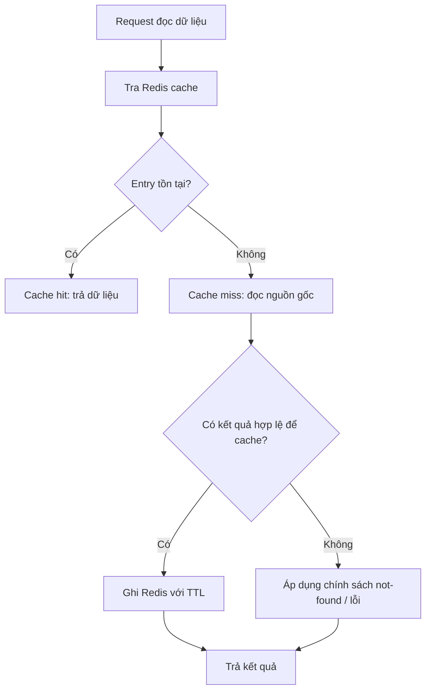
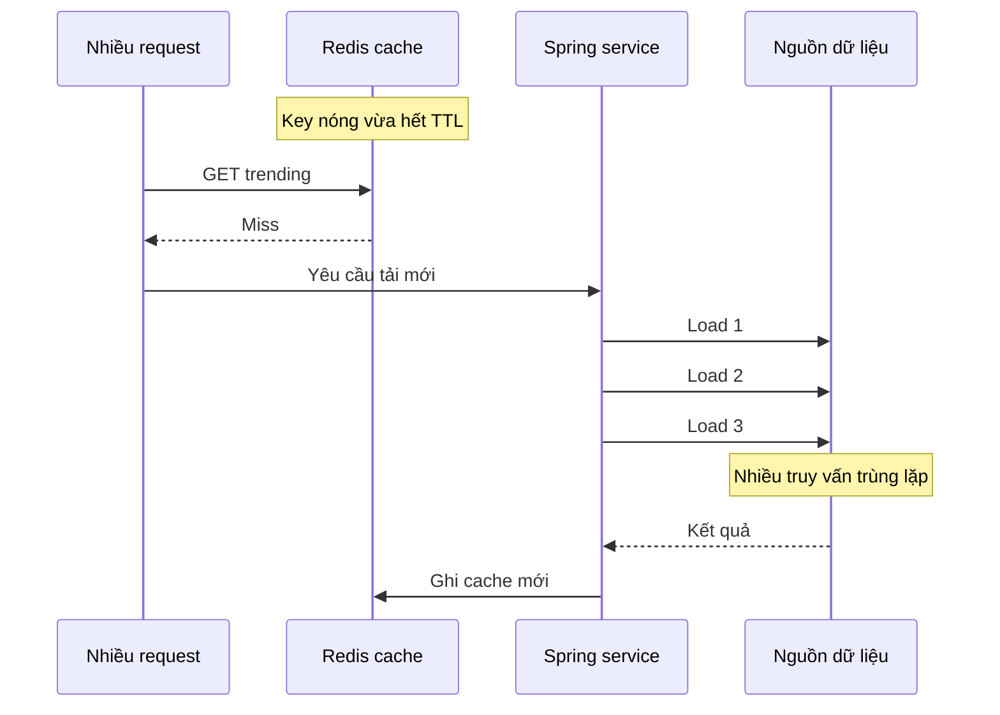
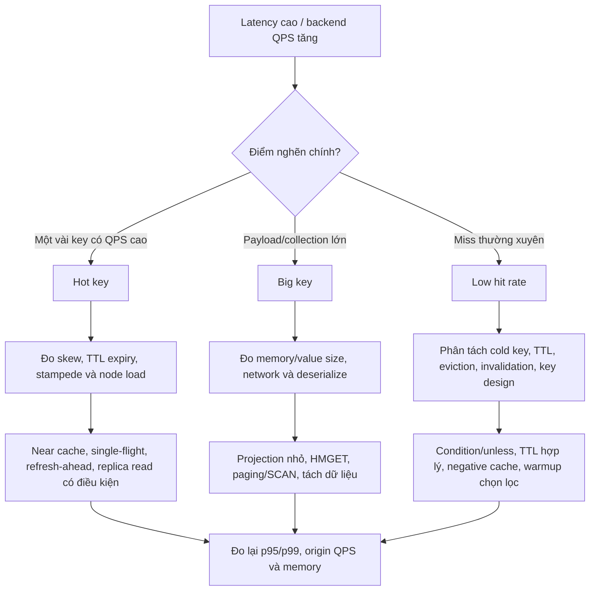

# Xử lý khóa nóng, dữ liệu lớn và tỷ lệ cache hit thấp trong Spring Data Redis

## 1. Ba vấn đề thường bị nhầm với nhau

Redis thường được dùng làm cache vì truy cập theo key nhanh và các thao tác trên dữ liệu trong bộ nhớ có độ trễ thấp. Tuy vậy, tăng số lượng máy chủ hoặc thêm `@Cacheable` không tự giải quyết mọi điểm nghẽn. Trong thực tế cần phân biệt ba hiện tượng:

- **Khóa nóng (hot key):** một hoặc một nhóm rất nhỏ key nhận tỷ lệ truy cập cao vượt trội. Dù giá trị nhỏ, lượng request tập trung có thể làm quá tải Redis node, network hoặc chính backend khi key hết hạn.
- **Dữ liệu lớn (big key / large value):** một key giữ payload lớn hoặc một collection có rất nhiều phần tử. Một lần đọc, serialize, truyền mạng hoặc xóa dữ liệu có thể tốn tài nguyên đáng kể.
- **Tỷ lệ cache hit thấp:** ứng dụng thường xuyên không tìm thấy entry trong cache và vẫn phải gọi nguồn dữ liệu gốc. Cache có thể tiêu tốn tài nguyên mà tiết kiệm rất ít chi phí đọc.

Ba vấn đề có thể xuất hiện riêng lẻ hoặc kết hợp. Ví dụ một JSON hồ sơ 5 MB được đọc hàng nghìn lần mỗi giây vừa là **big key** vừa là **hot key**. Ngược lại, một triệu key được hỏi đúng một lần có thể tạo tỷ lệ hit rất thấp dù không key nào nóng hoặc lớn.

| Hiện tượng | Dấu hiệu chủ yếu | Điều cần tối ưu |
|---|---|---|
| Hot key | Lượng request tập trung vào một key, latency tăng tại một node | Phân phối tải, giảm số lượt đọc cùng key, chống stampede |
| Big key | Payload lớn, command đọc/ghi nặng, mạng và bộ nhớ tăng | Kích thước dữ liệu, độ hạt truy xuất, cách serialize |
| Low hit rate | Miss liên tục, backend vẫn chịu nhiều read, nhiều key lạnh | Chọn dữ liệu đáng cache, TTL, key design, warmup và eviction |

Cả ba thuộc **chiến lược cache**: muốn giải quyết đúng, cần đo khối lượng và hình dạng truy cập trước khi chỉnh sửa code Spring hoặc thông số Redis.

## 2. Mô hình Spring Cache và RedisTemplate

Trong ứng dụng Spring Boot có hai đường dùng Redis phổ biến:

1. **Spring Cache abstraction:** `@Cacheable`, `@CachePut`, `@CacheEvict`, `CacheManager`, trong đó `RedisCacheManager` lưu cache entry trên Redis.
2. **Template:** `StringRedisTemplate`, `RedisTemplate` hoặc `ReactiveRedisTemplate` để kiểm soát key, cấu trúc dữ liệu, TTL, và từng Redis command.

Ví dụ Spring Cache:

```java
@Cacheable(cacheNames = "productSummary", key = "#p0")
public ProductSummary getSummary(String productId) {
    return productRepository.loadSummary(productId);
}
```

Với cache hit, Spring có thể trả về dữ liệu từ Redis mà không gọi `productRepository`. Với cache miss, Spring gọi phương thức, sau đó lưu kết quả theo cấu hình cache và serializer. Mức nhất quán khi có nhiều request và cách tính toán cache miss phụ thuộc `Cache` implementation và tùy chọn được sử dụng.

Ví dụ Template:

```java
String cacheKey = "cache:product:summary:" + productId;
String payload = stringRedisTemplate.opsForValue().get(cacheKey);
```

Template giúp kiểm soát trực tiếp key và command, nhưng ứng dụng tự chịu trách nhiệm cache-aside, serialize, invalidation, TTL, tránh stampede và xử lý lỗi. Nếu dùng cả hai đường trên cùng một vùng dữ liệu, phải thống nhất keyspace và serializer; key Spring Cache có thể có prefix như `productSummary::P100`, khác với key do Template tự đặt.

### Vòng đời một cache miss



Khi một key rất nóng hết hạn, nhiều request có thể đồng thời đi xuống bước **đọc nguồn gốc**. Đây là vấn đề *cache stampede* hay *thundering herd*, thường đi kèm hot key nhưng không đồng nghĩa với hot key.

## 3. Đo lường trước khi đưa ra giải pháp

### 3.1. Tỷ lệ hit ở tầng ứng dụng

Một cách biểu diễn thông dụng:

\[
\text{Hit rate} = \frac{\text{cache hits}}{\text{cache hits} + \text{cache misses}} \times 100\%
\]

Trong phép đo này, **cache hit** là lần đọc cache trả entry hợp lệ và **cache miss** là lần lookup không có entry. Những request cố tình bỏ qua cache (`condition=false`, bypass khi lỗi hoặc tắt cache) cần được theo dõi riêng, không mặc nhiên tính là miss.

Ví dụ giả định trong năm phút, vùng `productSummary` có 80.000 hit và 20.000 miss:

\[
\text{Hit rate} = \frac{80.000}{80.000+20.000}=80\%
\]

Tuy nhiên, 80% không tự nói cache tốt hay xấu. Nếu 20% miss dồn vào truy vấn database rất đắt đỏ, backend vẫn có thể bị quá tải. Ngược lại, hit rate 40% vẫn có giá trị khi mỗi hit tiết kiệm một truy vấn remote đắt tiền và số cache entry nhỏ.

Nên đo thêm:

- **Origin QPS:** số request thực sự tới database/API nguồn sau khi qua cache.
- **Latency theo phân vị:** p50, p95, p99 của cache lookup, deserialize, origin load và request tổng.
- **Miss theo nguyên nhân:** key chưa từng được cache, hết TTL, bị evict do áp lực bộ nhớ, bị invalidation, hoặc cố tình không cache.
- **Phân phối truy cập:** key nào hoặc nhóm key nào chiếm phần lớn lưu lượng; tránh log nguyên văn key nhạy cảm.
- **Bộ nhớ:** số lượng key, kích thước value, fragmentation, evictions, network output và CPU của Redis.
- **Tỷ lệ error/timeout:** một Redis chậm có thể khiến ứng dụng fallback xuống backend và làm hit rate quan sát được suy giảm.

Một tỷ lệ hit toàn cục có thể che khuất từng cache region. Ví dụ `homePage` đạt 99% nhưng `searchQuery` chỉ 2%; cần quyết định riêng theo từng loại dữ liệu.

### 3.2. Metric của Redis server khác hit rate của Spring Cache

Redis cung cấp các số liệu như `keyspace_hits`, `keyspace_misses` trong `INFO stats`. Chúng mô tả hoạt động lookup key của **toàn Redis instance**, bao gồm cả các consumer không liên quan đến Spring Cache.

```redis
INFO stats
INFO memory
INFO commandstats
SLOWLOG GET 20
LATENCY LATEST
```

Vì Redis có thể lưu session, queue, counter và cache của nhiều ứng dụng, không nên dùng `keyspace_hits / (keyspace_hits + keyspace_misses)` ở cấp server như thể đó là tỷ lệ hit của riêng method `@Cacheable`. Hãy đo **application cache hit/miss theo cache name** khi backend/metrics binder hỗ trợ, hoặc bổ sung đo lường ở adapter với định nghĩa rõ ràng.

`INFO stats` còn có `evicted_keys` và `expired_keys`. Tốc độ tăng của `evicted_keys` có thể gợi ý `maxmemory` gây cache churn. Trong khi đó `expired_keys` tăng không mặc nhiên là lỗi: TTL khiến key hết hạn theo thiết kế.

### 3.3. Tìm key lớn và key có lưu lượng cao

Trên môi trường có quyền truy cập và kế hoạch vận hành phù hợp:

```redis
TYPE cache:product:P100
MEMORY USAGE cache:product:P100
STRLEN cache:product:P100
HLEN cache:product:P100
SCARD cache:product:tags:P100
ZCARD leaderboard:daily
```

Chỉ chạy command phù hợp với **kiểu dữ liệu thực tế**. `MEMORY USAGE` trả thông tin ước lượng bộ nhớ của key; với collection lớn, cách lấy mẫu các phần tử và chi phí đo ảnh hưởng kết quả. Đừng lặp dày đặc thao tác đo trên production hot key.

`redis-cli --bigkeys` có thể hỗ trợ điều tra kích thước key bằng cách duyệt keyspace. Nó vẫn tạo tải quét và không thay thế phân tích bộ nhớ từng kiểu value; cần giới hạn thời điểm và tần suất. `SCAN` được ưu tiên hơn `KEYS *` cho công việc duyệt theo từng batch, nhưng **SCAN không miễn phí** và không tạo một snapshot nhất quán nếu keyspace thay đổi trong lúc quét.

Không phải Redis phiên bản nào cũng có công cụ hot-key sampling như nhau. Lệnh `redis-cli --hotkeys` trong môi trường hỗ trợ dựa vào thông tin LFU và yêu cầu chính sách eviction tương thích. Khi không có bằng chứng ở Redis, có thể instrument tại ứng dụng để đếm **theo nhóm key hoặc key đã hash/sample**, tránh tạo metric label riêng cho hàng triệu key.

## 4. Khóa nóng: nguyên nhân và hậu quả

### 4.1. Đặc điểm của hot key

Ví dụ một endpoint trả danh sách sự kiện nổi bật:

```text
cache:homepage:trending -> một payload nhỏ
  1.000 request/giây từ nhiều instance ứng dụng
```

Dù payload chỉ vài KB, một key vẫn có thể là điểm tập trung của lưu lượng. Trong Redis Cluster, key thuộc **một hash slot** và slot đó có owner node; tự động bổ sung nhiều shard không chia một key thành nhiều key. Vì vậy tốc độ đọc/ghi của hot key có thể bị giới hạn bởi node sở hữu slot, network hoặc driver.

Có hai kiểu nóng thường gặp:

- **Read-hot:** một key được đọc rất nhiều; dữ liệu thay đổi ít hoặc theo đợt.
- **Write-hot:** một key được cập nhật liên tục (ví dụ global counter, leaderboard hoặc shared state). Với một counter, lệnh `INCR` là atomic trên Redis, nhưng tất cả lệnh vẫn tập trung vào cùng key/node.

Hot key còn có thể làm tăng p99 latency, queue ở connection pool, network bandwidth và chi phí deserialize/copy ở application, dù mỗi command riêng lẻ nhanh.

### 4.2. Hot key + TTL ngắn gây cache stampede

Giả sử có 50 instance ứng dụng, tất cả đọc cùng key `homepage:trending`. Khi TTL của key hết hạn, nhiều instance cùng nhận miss và truy vấn nguồn dữ liệu. Nếu nguồn phải tính một truy vấn tổng hợp nặng, một đợt miss có thể tạo hàng chục hoặc hàng trăm phép tính trùng lặp.



Việc đổi TTL từ 10 giây lên 60 giây có thể giảm số lần hết hạn, nhưng không loại trừ hiện tượng đồng thời tại lần miss. Cần chọn công cụ theo yêu cầu nhất quán và độ trễ.

## 5. Giảm tải hot key bằng các chiến lược đọc

### 5.1. Near cache / cache cục bộ thời gian ngắn

Đối với dữ liệu ít thay đổi và được đọc cực nhiều, một cache nhỏ ngay trong mỗi instance (ví dụ Caffeine) có thể đứng trước Redis:

```text
HTTP request
    |
    v
Local cache trong Spring instance (TTL 1–3 giây)
    |
    +-- hit --> trả dữ liệu, không gọi Redis
    |
    +-- miss --> Redis cache
                     |
                     +-- miss --> Origin
```

Nếu 100 request trong một instance cùng đọc key nóng trong một giây, nhiều request có thể được trả từ local cache thay vì Redis. Nhưng hệ thống sẽ có **nhiều bản sao của giá trị**, với hạn dùng và vòng đời độc lập. Cần chấp nhận stale ngắn hạn hoặc thiết kế invalidation thích hợp.

Đối với dữ liệu quyền truy cập, số dư, trạng thái giao dịch hoặc yêu cầu read-after-write nghiêm ngặt, local cache có thể không phù hợp. Redis Pub/Sub có thể hỗ trợ phát thông báo invalidation, nhưng thông báo Pub/Sub **không bền vững**: instance mất kết nối có thể bỏ lỡ sự kiện. Nếu invalidation bắt buộc chính xác, cần cơ chế version/checkpoint hoặc TTL tự giới hạn thời gian stale.

### 5.2. Chia sẻ một lần load cho nhiều request (single-flight)

Một số thư viện cache hoặc cơ chế đồng bộ trong ứng dụng có khả năng **gộp các request đang cùng chờ một key** để một instance chỉ gọi origin một lần khi miss.

Spring Cache có tùy chọn:

```java
@Cacheable(
    cacheNames = "homepageTrending",
    key = "'v1'",
    sync = true
)
public TrendingView loadTrending() {
    return trendingRepository.calculateTrending();
}
```

`sync=true` yêu cầu cache provider đồng bộ việc tính toán cho cùng key **nếu implementation hỗ trợ**. Trong Spring Cache, `sync=true` có giới hạn như chỉ một cache name cho operation và không hỗ trợ `unless`. Nó **không phải bảo đảm một distributed lock toàn cluster ứng dụng**. Với nhiều Spring instance, vẫn phải kiểm tra thực tế RedisCache/driver có thực hiện coalescing giữa các instance hay không.

Một cách khác là dùng cơ chế single-flight cục bộ theo key, giới hạn số request đang chờ và chia sẻ cùng một `Future`/kết quả. Nó giảm fan-out từ một instance nhưng không loại trừ các instance khác cùng miss. Không giữ một global mutex cho mọi key vì sẽ làm các cache miss độc lập chờ nhau.

### 5.3. Refresh-ahead và stale-while-revalidate

Với dữ liệu có thể cũ trong một khoảng nhỏ, có thể lưu thêm **thời hạn logic**:

```text
Cached payload:
  value           = bảng xếp hạng đã tính
  refreshAfter    = thời điểm bắt đầu làm mới nền
  serveStaleUntil = thời điểm cuối còn được trả dữ liệu cũ
```

Quy trình:

1. Khi chưa đến `refreshAfter`, trả cache như bình thường.
2. Sau `refreshAfter`, vẫn trả phiên bản cũ và chỉ chọn một worker làm mới.
3. Khi load thành công, thay phiên bản mới theo rule tránh ghi đè dữ liệu mới hơn.
4. Khi load thất bại, chỉ tiếp tục trả stale tới giới hạn `serveStaleUntil`.
5. Hết hạn stale tối đa thì áp dụng chính sách lỗi/đọc bắt buộc theo SLA.

Đây là **một mẫu kiến trúc**, không phải tự động bật lên chỉ bằng `@Cacheable`. Phải thiết kế cách lưu hai mốc thời gian, phân quyền refresh, thông báo lỗi và cập nhật đồng thời.

Nếu dữ liệu cần chính xác ngay lập tức (ví dụ tổng số tiền đã thanh toán), không được tùy tiện dùng stale-while-revalidate. Nên chọn dữ liệu tham chiếu, gợi ý, dashboard hoặc danh sách tổng hợp có quy định độ trễ cho phép.

### 5.4. Replica reads chỉ khi chấp nhận độ trễ đồng bộ

Ở Redis triển khai có replica, một phần read traffic có thể được phân sang replica khi driver và cấu hình đọc hỗ trợ, ví dụ Lettuce cung cấp các read preference. Điều này có thể tăng khả năng đáp ứng đọc, nhưng replication thường **bất đồng bộ** nên replica có thể trả dữ liệu cũ.

Những điểm phải đánh giá:

- Read-after-write có cần thấy giá trị ngay không?
- Cache update và invalidation có thể đến replica trễ bao lâu?
- Khi failover, topology và latency thay đổi thế nào?
- Driver có thực sự gửi GET theo policy mong muốn không?

Replica không giải quyết hot **write key**, và không thay thế việc thiết kế kích thước payload, TTL hoặc stampede.

## 6. TTL jitter: tránh nhiều key hết hạn cùng lúc

Khi hàng chục nghìn key được ghi trong cùng một lần deploy hoặc batch import và đều dùng TTL 300 giây, chúng có thể cùng hết hạn vào một khoảng thời gian rất hẹp. Điều này tạo **expiration burst**, làm tăng cache miss và QPS trên origin.

**TTL jitter** thêm một khoảng ngẫu nhiên có giới hạn vào TTL:

\[
TTL_{effective}=TTL_{base}+U(0,J)
\]

Với `TTL_base = 300s`, `J = 60s`, các key có TTL từ 300 đến 360 giây; thời điểm hết hạn được phân tán hơn.

### 6.1. Ví dụ StringRedisTemplate với TTL jitter

```java
package com.example.cache;

import java.time.Duration;
import java.util.concurrent.ThreadLocalRandom;
import org.springframework.data.redis.core.StringRedisTemplate;
import org.springframework.stereotype.Service;

@Service
public class JitteredStringCache {

    private static final long BASE_TTL_SECONDS = 300;
    private static final long MAX_JITTER_SECONDS = 60;

    private final StringRedisTemplate redis;

    public JitteredStringCache(StringRedisTemplate redis) {
        this.redis = redis;
    }

    public void put(String productId, String serializedSummary) {
        if (productId == null || productId.isBlank()) {
            throw new IllegalArgumentException("productId is required");
        }
        if (serializedSummary == null) {
            throw new IllegalArgumentException("payload is required");
        }

        long ttlSeconds = BASE_TTL_SECONDS
                + ThreadLocalRandom.current()
                        .nextLong(MAX_JITTER_SECONDS + 1);

        String key = "cache:summary:v1:" + productId;

        redis.opsForValue().set(
                key,
                serializedSummary,
                Duration.ofSeconds(ttlSeconds)
        );
    }

    public String get(String productId) {
        return redis.opsForValue().get(
                "cache:summary:v1:" + productId
        );
    }
}
```

`opsForValue().set(key, value, Duration)` đưa value và TTL vào **một lệnh Redis** theo cách template hỗ trợ, tránh rủi ro ghi giá trị thành công nhưng quên `EXPIRE` ở lệnh riêng.

Ví dụ này dùng namespace riêng do `StringRedisTemplate` quản lý. Đừng trộn `cache:summary:v1:` với một vùng `RedisCacheManager` nếu chưa thống nhất định dạng và serializer.

### 6.2. TTL jitter có giải quyết một hot key không?

**Không hoàn toàn.** Jitter đặc biệt hữu ích khi **nhiều key** có lịch hết hạn đồng bộ. Một **key nóng duy nhất** vẫn có thể tạo hàng nghìn miss tại thời điểm hết hạn, dù thời điểm đó được dịch đi ngẫu nhiên. Với hot key đơn lẻ, cần kết hợp single-flight, refresh-ahead, local cache hoặc một chiến lược đọc khác.

Spring Cache với `RedisCacheConfiguration.entryTtl(Duration)` thường cấu hình TTL cố định cho cache region. Các phiên bản Spring Data Redis có khả năng TTL động qua `RedisCacheWriter.TtlFunction`; nếu muốn jitter theo từng lần ghi ở Spring Cache, cần đối chiếu API và version mà dự án sử dụng. Không giả định mẫu Java Template ở trên tự áp dụng cho entry của `@Cacheable`.

## 7. Hot write key: khi một counter hoặc tập hợp bị cập nhật quá nhiều

Ví dụ `metrics:views:total` được `INCR` ở mọi request. Lệnh `INCR` atomic, nhưng toàn bộ write vẫn vào cùng key/slot.

Một hướng là **sharded counter**:

```text
metrics:views:total:shard:0
metrics:views:total:shard:1
metrics:views:total:shard:2
metrics:views:total:shard:3
...
```

Mỗi writer chọn một shard theo quy tắc ổn định hoặc phân phối tải rồi `INCR`. Khi cần tổng, đọc và cộng các shard.

Đánh đổi:

- Các cập nhật phân tán trên nhiều key/slot có thể giảm điểm nóng.
- Tổng không còn là một lần đọc atomic toàn cục; phép đọc nhiều shard có thể thấy snapshot lệch thời điểm.
- Tăng số key, chi phí đọc/aggregate và cần kế hoạch thay đổi số shard.
- Trong Redis Cluster, phải chủ ý thiết kế hash slot. Nếu tất cả shard dùng **cùng hash tag**, chúng vẫn dồn về một slot và không giúp phân tán tải giữa node.

Giải pháp này phù hợp cho metrics có thể chấp nhận sai lệch thời điểm ngắn. Không tùy tiện áp dụng với số dư tài chính, tồn kho yêu cầu strict consistency hoặc invariant đòi hỏi một bộ đếm duy nhất.

## 8. Big key: tại sao dữ liệu lớn làm cache chậm?

Một key có thể lớn theo hai nghĩa:

1. **Một value rất lớn**: chẳng hạn String JSON hàng MB hoặc blob được serialize thành một String.
2. **Một collection có rất nhiều phần tử**: Redis Hash, List, Set hoặc Sorted Set chứa hàng trăm nghìn/millions phần tử.

Không có ngưỡng MB hay số phần tử cố định được xem là "big" cho mọi deployment. Một payload 200 KB có thể lớn với endpoint 10.000 request/giây, trong khi payload 5 MB ít truy cập có thể chấp nhận được trong ứng dụng nội bộ.

Các vấn đề thường gặp:

- **Network:** mỗi lần đọc toàn bộ value làm tăng băng thông, có thể tạo tail latency.
- **Serialize/deserialize:** chuyển JSON/object quá lớn tiêu tốn CPU và cấp phát bộ nhớ tại Java.
- **Redis command cost:** một số lệnh duyệt/xuất toàn bộ collection phải xử lý lượng lớn dữ liệu.
- **Eviction granularity:** một key lớn bị evict gây mất cả dữ liệu, có thể tạo đợt tái nạp nặng.
- **Mutation/copy:** cập nhật một phần nội dung của blob JSON có thể buộc ghi lại toàn bộ String.
- **Replication/persistence:** ghi payload lớn làm tăng lưu lượng đồng bộ và tác động vận hành theo cấu hình.

### 8.1. Không đọc toàn bộ collection khi chỉ cần một phần

Ví dụ Redis Hash lưu hồ sơ nhiều trường. Nếu API chỉ cần `name` và `status`, thay vì:

```java
Map<Object, Object> all =
        stringRedisTemplate.opsForHash()
                .entries("profile:42");
```

có thể chỉ đọc các trường cần thiết:

```java
Object name = stringRedisTemplate.opsForHash()
        .get("profile:42", "name");

Object status = stringRedisTemplate.opsForHash()
        .get("profile:42", "status");
```

Hai lệnh đọc field vẫn có round trip; với phiên bản và API hỗ trợ, có thể dùng `multiGet` để đọc nhiều field:

```java
List<Object> fields = stringRedisTemplate.opsForHash()
        .multiGet(
                "profile:42",
                List.of("name", "status")
        );
```

Tương ứng ý tưởng Redis `HMGET profile:42 name status`. Điều này giảm lượng dữ liệu trả về so với `HGETALL` khi Hash có nhiều field.

Đối với danh sách dài, hạn chế:

```redis
LRANGE activity:42 0 -1
SMEMBERS huge:set
ZRANGE leaderboard 0 -1 WITHSCORES
HGETALL giant:hash
```

Các lệnh đọc toàn bộ dữ liệu có thể tạo payload rất lớn. Khi ứng dụng chỉ cần trang đầu, dùng phạm vi:

```redis
LRANGE activity:42 0 99
ZRANGE leaderboard 0 99 WITHSCORES
```

Lưu ý `LRANGE` dùng chỉ số phần tử, còn `ZRANGE` có các dạng theo rank/score tùy cú pháp. Cần chọn cách phân trang phù hợp tính chất sắp xếp của dữ liệu.

### 8.2. Quét collection theo batch

Khi thực sự cần duyệt Hash/Set/Sorted Set lớn, Redis có `HSCAN`, `SSCAN`, `ZSCAN` để truy xuất tuần tự với cursor. Trong Spring Data Redis, `HashOperations.scan(..., ScanOptions)` có thể hỗ trợ:

```java
import java.util.Map;
import org.springframework.data.redis.core.Cursor;
import org.springframework.data.redis.core.ScanOptions;

try (Cursor<Map.Entry<Object, Object>> cursor =
        stringRedisTemplate.opsForHash().scan(
                "profile:large:42",
                ScanOptions.scanOptions().count(200).build()
        )) {

    while (cursor.hasNext()) {
        Map.Entry<Object, Object> entry = cursor.next();
        // Xử lý mỗi entry; tránh gom tất cả vào RAM.
    }
}
```

`COUNT 200` là **gợi ý công việc mỗi lần quét**, không phải cam kết chính xác 200 phần tử mỗi response. `SCAN` có thể trả phần tử lặp, và khi collection thay đổi trong quá trình duyệt, kết quả không phải snapshot giao dịch. Với thao tác cần duyệt toàn bộ chính xác một lần, cần có thiết kế nhất quán/version hoặc nguồn dữ liệu phù hợp.

Không dùng `SCAN` chỉ để "thay thế" một truy vấn nghiệp vụ thường xuyên theo field; nó vẫn phải duyệt dữ liệu. Nếu cần truy vấn theo nhiều điều kiện, cân nhắc secondary index, search engine hoặc database phù hợp.

### 8.3. Chia dữ liệu theo nhu cầu truy cập

Thay vì lưu một JSON lớn có thông tin ít khi được sử dụng:

```text
product:42 -> JSON gồm mô tả, ảnh, review, stock, price, metadata...
```

Có thể tách dữ liệu theo đơn vị truy cập:

```text
product:42:summary    -> vài trường dùng ở trang danh sách
product:42:details    -> thông tin trang chi tiết
product:42:stock      -> trạng thái tồn kho, TTL/nguồn riêng
product:42:reviews:0  -> trang review đầu tiên
product:42:reviews:1  -> trang review tiếp theo
```

Lợi ích là giảm payload cho request phổ biến, cho phép TTL và invalidation riêng theo nhóm dữ liệu. Đánh đổi: tăng số key, số lookup, công việc cập nhật nhất quán và khả năng thiếu đồng bộ giữa các phần. Chỉ nên chia khi pattern đọc/ghi chứng minh rằng phần lớn request không cần toàn bộ blob.

Nếu giá trị lớn nhưng ít khi thay đổi, có thể cân nhắc nén payload, song phải đo chi phí CPU nén/giải nén và băng thông. Nén không giải quyết việc mỗi lần vẫn phải tải và parse toàn bộ dữ liệu, cũng không phù hợp với mọi serializer.

## 9. Tỷ lệ cache hit thấp: tìm nguyên nhân trước khi tăng TTL

Hit rate thấp có nhiều nguồn gốc.

| Nguyên nhân | Dấu hiệu | Hướng xử lý |
|---|---|---|
| **High cardinality:** key gần như luôn mới | Nhiều key một lần dùng, miss lặp ít | Không cache loại request này, hoặc đổi cấp độ cache |
| **TTL quá ngắn** so với chu kỳ truy cập | Key thường vừa hết hạn trước lần truy cập lại | Đo reuse interval, điều chỉnh TTL và invalidation |
| **Eviction do thiếu bộ nhớ** | `evicted_keys` tăng, cache churn | Đo working set, giới hạn cache pollution, chỉnh dung lượng/policy phù hợp |
| **Key không ổn định** | Cùng dữ liệu nhưng mỗi request tạo key khác | Chuẩn hóa tham số/key/version/locale có chủ đích |
| **Sai serializer/namespace** | Entry được ghi nhưng đọc ở prefix hoặc kiểu byte khác | Thống nhất serializer và keyspace |
| **Cache bị xóa quá nhiều** | Sau mọi ghi nhỏ đều `allEntries=true` hoặc xóa toàn vùng | Evict theo key, tách region nếu phù hợp |
| **Cold start/deploy** | Hit rate rơi theo chu kỳ restart hoặc xóa cache | Warmup có chọn lọc, giữ cache dùng chung và hạn chế flush |
| **Miss do not-found** | Nhiều ID không tồn tại | Negative caching ngắn hạn hoặc lọc request không hợp lệ |
| **Load không được cache** | `unless` thường xuyên từ chối hoặc value bị lỗi serialize | Xác định policy đúng thay vì mặc định tăng TTL |
| **Redis timeout và fallback** | Redis error tăng song song origin QPS | Xử lý kết nối, pool, latency, overload |

### 9.1. High cardinality không thể chữa bằng cách tăng bộ nhớ vô hạn

Ví dụ API tìm kiếm nhận chuỗi ngẫu nhiên từ người dùng:

```text
GET /search?q=red+shoes&sort=price&page=1
GET /search?q=blue+shoes&sort=price&page=2
GET /search?q=some-new-query-834&page=1
...
```

Nếu cache key chứa toàn bộ chuỗi tìm kiếm và phần lớn query chỉ xuất hiện một lần, tăng TTL lên một ngày có thể làm Redis giữ vô số kết quả lạnh. Chúng còn có thể đẩy những entry thực sự nóng ra khỏi bộ nhớ.

Giải pháp có thể là chỉ cache truy vấn phổ biến hoặc kết quả được dùng lặp lại, đặt giới hạn kích thước và TTL riêng cho nhóm search, hoặc cache một lớp dữ liệu tái sử dụng cao hơn (ví dụ metadata sản phẩm theo ID). Khi cần search theo nhiều tiêu chí, lựa chọn search engine/index chuyên biệt có thể quan trọng hơn cache kết quả truy vấn ngẫu nhiên.

### 9.2. Thiết kế cache key nhất quán

Với dữ liệu phụ thuộc tenant/locale/version:

```text
cache:product:summary:v2:tenant-17:vi:P100
```

Key phải phân biệt các biến thể tạo ra **giá trị khác nhau**, nhưng tránh đưa vào những trường thay đổi mà không ảnh hưởng kết quả (timestamp request, trace ID, nonce). Nếu mỗi request có request ID trong cache key, tỷ lệ hit gần bằng 0 cho dữ liệu vốn có thể tái sử dụng.

Ngược lại, bỏ tenant hoặc quyền truy cập khỏi key khi response phụ thuộc tenant/user có thể gây **rò dữ liệu** qua cache hit. Tối ưu hit rate không được đánh đổi correctness và phân quyền.

## 10. Lọc lời gọi không đáng cache bằng Spring Cache condition/unless

Với Spring Cache, `condition` quyết định có dùng cache cho lời gọi dựa trên dữ liệu **trước khi method chạy**. `unless` quyết định không lưu một kết quả sau khi method chạy.

Ví dụ:

```java
package com.example.catalog;

import org.springframework.cache.annotation.Cacheable;
import org.springframework.stereotype.Service;

@Service
public class ProductQueryService {

    private final ProductReader productReader;

    public ProductQueryService(ProductReader productReader) {
        this.productReader = productReader;
    }

    @Cacheable(
        cacheNames = "productSummary",
        key = "#p0",
        condition = "#p0 != null && #p1",
        unless = "#result == null"
    )
    public ProductSummary getSummary(String productId, boolean cacheEligible) {
        return productReader.loadSummary(productId);
    }
}
```

`ProductReader` và `ProductSummary` là các kiểu ứng dụng tự định nghĩa. Tham số `cacheEligible` có thể được tính ở tầng gọi theo quy tắc nghiệp vụ (ví dụ nhóm sản phẩm phổ biến), nhưng phải thống nhất chính sách của hệ thống: dùng `condition` nhằm kiểm soát **chi phí/cache value**, không dùng để bỏ qua validation hay authorization.

- `#p0`: tham số `productId`.
- `#p1`: tham số boolean `cacheEligible`.
- `condition=false`: bỏ qua cả tra cứu cache và ghi cache cho lời gọi đó.
- `unless="#result == null"`: không lưu kết quả không tồn tại sau khi method đã được gọi do cache miss.

`unless` không được dùng để lọc lại entry trên cache hit; nó chỉ veto kết quả mới được đưa vào cache. Nếu product đã bị cập nhật, cần eviction/versioning/TTL phù hợp, không dựa vào `unless` để tự nhận biết entry cũ.

### 10.1. Bật cache Redis trong Spring Boot

Dependency:

```groovy
dependencies {
    implementation 'org.springframework.boot:spring-boot-starter-cache'
    implementation 'org.springframework.boot:spring-boot-starter-data-redis'
}
```

Cấu hình mẫu:

```yaml
spring:
  cache:
    type: redis
  data:
    redis:
      host: localhost
      port: 6379
```

Bật Spring Cache annotation:

```java
import org.springframework.cache.annotation.EnableCaching;
import org.springframework.context.annotation.Configuration;

@Configuration
@EnableCaching
public class CacheInfrastructureConfiguration {
}
```

Với cấu hình auto-configuration phù hợp, Spring Boot cung cấp `RedisCacheManager`. `@Cacheable` phải được gọi qua Spring proxy/interceptor; **self-invocation** trong cùng bean có thể bỏ qua caching.

### 10.2. Dùng TTL riêng cho từng cache region

Một vùng cache cho dữ liệu truy cập nóng có TTL khác vùng chứa dữ liệu truy cập một lần:

```java
package com.example.catalog;

import java.time.Duration;
import org.springframework.boot.autoconfigure.cache.RedisCacheManagerBuilderCustomizer;
import org.springframework.context.annotation.Bean;
import org.springframework.context.annotation.Configuration;
import org.springframework.data.redis.cache.RedisCacheConfiguration;

@Configuration
public class ProductCacheConfiguration {

    @Bean
    public RedisCacheManagerBuilderCustomizer customizeRedisCaches() {
        return builder -> builder
            .withCacheConfiguration(
                "productSummary",
                RedisCacheConfiguration.defaultCacheConfig()
                    .entryTtl(Duration.ofMinutes(5))
                    .disableCachingNullValues()
            )
            .withCacheConfiguration(
                "productNotFound",
                RedisCacheConfiguration.defaultCacheConfig()
                    .entryTtl(Duration.ofSeconds(15))
            );
    }
}
```

`productSummary` không lưu giá trị `null`; `productNotFound` là vùng có TTL ngắn hơn và mặc định cho phép cache `null` nếu Spring Data Redis configuration không bị thay đổi ở nơi khác. Đây là **các region có chính sách khác nhau**; ứng dụng phải chủ ý đưa dữ liệu vào đúng region. Chỉ khai báo hai region không tự tạo routing "hit/non-hit" dựa trên giá trị result.

Trong dự án đã tự khai báo một `RedisCacheManager` Bean, cần kết hợp cấu hình vào manager đang được sử dụng thay vì mặc định rằng Boot customizer sẽ chỉnh một manager khác.

## 11. Cache not-found khi miss chiếm tỷ lệ lớn

Nếu rất nhiều request hỏi ID không tồn tại, mỗi miss có thể gọi database. Một entry biểu thị "không tìm thấy" (negative cache) với TTL ngắn có thể giảm tải.

Nhưng phải phân biệt:

- **Không tìm thấy thật:** nguồn dữ liệu trả kết quả vắng mặt hợp lệ.
- **Lỗi nguồn dữ liệu:** timeout, connection error, dependency unavailable.
- **Không có quyền:** người gọi không được truy cập dữ liệu.

Không biến lỗi upstream thành `null` rồi cache như "not-found". Đối với dữ liệu có thể được tạo ngay, negative cache cần TTL ngắn và eviction khi create/update, tránh trả stale "không tồn tại" sau khi dữ liệu đã có.

Spring Data Redis có thể lưu `null` logic dưới dạng marker do cache abstraction quản lý, nhưng Redis bản thân không có một kiểu value "Java null" riêng. `RedisCacheConfiguration.disableCachingNullValues()` từ chối lưu null ở backend; `unless="#result == null"` ngăn ghi tại tầng annotation. Hai lựa chọn này cần nhất quán.

### 11.1. Bộ lọc xác suất cho key chắc chắn không tồn tại

Với workload miss rất lớn, một Bloom filter được đồng bộ từ tập ID hợp lệ có thể loại bớt các truy vấn **chắc chắn không thuộc tập** trước khi truy cập backend. Nó có thể trả *false positive* (cho rằng có thể tồn tại nhưng thực tế không), nhưng không được có *false negative* nếu triển khai và đồng bộ đúng.

Rủi ro nằm ở **tính đầy đủ và độ mới của bộ lọc**. Nếu một ID mới được tạo nhưng filter chưa được cập nhật, ứng dụng có thể từ chối một bản ghi đang tồn tại. Vì vậy filter không phù hợp với mọi bài toán và phải có chính sách cập nhật, rebuild và fallback. Nó cũng không thay thế authorization, và có chi phí bộ nhớ/phục hồi riêng.

## 12. Cache-aside với RedisTemplate: kiểm soát TTL và đường ghi

Một cache-aside đơn giản:

```java
package com.example.catalog;

import java.time.Duration;
import java.util.function.Supplier;
import org.springframework.data.redis.core.StringRedisTemplate;
import org.springframework.stereotype.Service;

@Service
public class ProductTextCache {

    private final StringRedisTemplate redis;

    public ProductTextCache(StringRedisTemplate redis) {
        this.redis = redis;
    }

    public String getOrLoad(
            String productId,
            Supplier<String> loadSerializedSummary) {

        String key = "cache:product:text:v1:" + productId;
        String cached = redis.opsForValue().get(key);

        if (cached != null) {
            return cached;
        }

        String loaded = loadSerializedSummary.get();
        if (loaded != null) {
            redis.opsForValue().set(
                    key,
                    loaded,
                    Duration.ofMinutes(5)
            );
        }

        return loaded;
    }

    public void evict(String productId) {
        redis.delete("cache:product:text:v1:" + productId);
    }
}
```

Đoạn này cố ý ngắn để làm rõ logic:

1. Đọc cache theo key.
2. Nếu hit, trả value.
3. Nếu miss, gọi loader.
4. Ghi value mới với TTL và trả kết quả.

Nó **chưa chống cache stampede**: hai request có thể cùng miss và cùng gọi `loadSerializedSummary`. Nếu cả hai load ra hai version khác nhau, kết quả ghi cuối có thể cũ hơn. Để dùng cho dữ liệu thay đổi đồng thời, cần thiết kế version, compare-and-set, single-flight, ownership của writer hoặc eviction thích hợp.

Cũng không được truyền supplier có side effect không idempotent rồi mặc định nó chỉ chạy một lần; cache miss và retry có thể gọi loader nhiều lần.

## 13. Chiến lược khi Redis bị quá tải hoặc không sẵn sàng

Một cache là lớp tối ưu; với nhiều hệ thống, dữ liệu gốc vẫn nằm ở database hoặc API nguồn. Khi Redis chậm/hỏng, ứng dụng cần tránh biến tất cả request thành một cơn bão xuống origin.

Các biện pháp:

- **Timeout có giới hạn:** tránh chặn request vô hạn khi Redis không phản hồi.
- **Circuit breaker/bulkhead:** khi lỗi Redis tăng, giới hạn số request cùng thử cache hoặc cùng fallback xuống origin.
- **Rate limit và request coalescing:** giảm số lượt load cho một key nóng, tránh đẩy nghẽn sang database.
- **Stale có kiểm soát:** nếu nghiệp vụ cho phép, phục vụ bản sao stale trong khoảng giới hạn.
- **Degrade tính năng:** trả một phần thông tin, dữ liệu mặc định an toàn hoặc thông báo tạm thời khi origin không đủ khả năng đáp ứng.
- **Warmup sau hồi phục:** ưu tiên một nhóm key được đọc nhiều, tránh nạp toàn bộ cache một cách ồ ạt.

Không nên catch mọi `RedisConnectionFailureException` rồi cho mọi request truy vấn database không giới hạn. Khi Redis sập, hành vi như vậy có thể khiến database sập theo (*cascading failure*).

Nếu Redis là **nguồn dữ liệu chính** chứ không phải cache có thể tái tạo, không thể mặc định fallback xuống database. Quy tắc phục hồi phải tuân theo nơi lưu dữ liệu chuẩn của hệ thống.

## 14. Cache warming và cache pollution

**Cache warming** chủ động nạp một nhóm dữ liệu trước hoặc ngay sau khi nhận lưu lượng. Nó hữu ích nếu tập key nóng tương đối ổn định, ví dụ danh sách danh mục sản phẩm, thông tin cấu hình công khai hoặc top-items theo vùng.

Quy trình vận hành hợp lý:

1. Xác định key có nhiều request và lợi ích cache cao dựa trên quan sát.
2. Chỉ warmup tập key nhỏ có xác suất tái sử dụng lớn.
3. Giới hạn concurrency/rate khi load để bảo vệ nguồn.
4. Phân tán thời gian làm mới, dùng TTL hoặc version hợp lý.
5. Đo sau warmup: hit rate, origin QPS, Redis memory và latency.

Không tự động warmup toàn bộ hàng triệu bản ghi; thao tác này có thể đưa dữ liệu lạnh vào Redis, đẩy key nóng ra khỏi bộ nhớ và tạo tải nguồn lớn. Đó là **cache pollution**, đôi khi khiến tỷ lệ hit thấp hơn dù số entry tăng.

Tương tự, một eviction policy như `allkeys-lru` hoặc `allkeys-lfu` (nếu được cấu hình) là công cụ quản lý dung lượng, không thay thế việc chọn key đáng cache. Redis eviction policy là quyết định vận hành cần xét đến các key không phải cache đang dùng chung instance; tránh tùy tiện thay cấu hình trên server có session, queue hoặc dữ liệu chính.

## 15. Tình huống tổng hợp: catalog sản phẩm có hot key, big key và hit rate thấp

Giả sử một cửa hàng có ba endpoint:

| Endpoint | Pattern | Vấn đề |
|---|---|---|
| `GET /homepage/trending` | Rất nhiều request cùng đọc một kết quả tổng hợp | Read-hot key và stampede khi TTL hết |
| `GET /products/{id}/details` | Một số product JSON rất lớn, chứa reviews và lịch sử | Big value, bandwidth và deserialize nặng |
| `GET /search?q=...` | Query string đa dạng, ít query lặp | Low hit rate, cache pollution |

Cách xử lý nên khác nhau.

### 15.1. Homepage trending

- Cache kết quả tổng hợp theo một key/region rõ ràng.
- Đặt TTL phù hợp mức độ stale được phép.
- Với fan-out cao, cân nhắc local cache ngắn hạn để giảm Redis QPS.
- Dùng refresh-ahead hoặc single-flight để tránh đồng thời tính toán origin.
- Theo dõi hot key QPS, p95/p99 và số lần tính lại kết quả.

Nếu yêu cầu danh sách mới ngay từng giây, cần quyết định chi phí tính toán và source of truth; không nên đặt TTL dài chỉ để đạt một hit rate đẹp.

### 15.2. Product details

- Tách một `summary` nhỏ cho danh sách sản phẩm khỏi `details` lớn cho trang chi tiết.
- Chỉ đọc phần cần thiết; reviews nên được phân trang theo ID/điểm.
- Cân nhắc nén nếu network là điểm nghẽn và có đủ CPU.
- TTL và invalidation của giá, tồn kho và mô tả có thể khác nhau.
- Tránh serialize toàn bộ graph object với nhiều quan hệ không cần thiết.

### 15.3. Search query

- Đo số lần truy cập lặp theo normalized query.
- Chỉ cache các truy vấn phổ biến hoặc bộ dữ liệu phụ trợ được tái dùng.
- Bỏ cache cho các query quá đặc thù nếu chi phí cache lớn hơn lợi ích.
- Dùng search engine/index phù hợp cho tìm kiếm phức tạp; cache không thay thế query planner/index.
- Theo dõi hit rate riêng cho `searchQuery`, không trộn với `homepageTrending` vốn có hit rate rất cao.

## 16. Quy trình xử lý sự cố theo triệu chứng



Một trình tự điều tra cụ thể:

1. **Xác định độ trễ nằm ở đâu:** Redis network, Redis processing, Java deserialize, origin query hay request queue.
2. **Phân loại truy cập theo cache region và operation:** đừng bắt đầu bằng một hit rate toàn cục.
3. **Đo lưu lượng theo key/nhóm key an toàn:** xem độ lệch phân phối và thời điểm TTL hết hạn.
4. **Quan sát kích thước payload và collection:** tìm những thao tác đọc toàn bộ key lớn.
5. **Đối chiếu Redis evictions và memory pressure:** xem cache có đang tự đẩy key nóng ra không.
6. **Đề xuất thay đổi nhỏ có thể đo được:** TTL jitter, giới hạn payload, cache eligibility, local cache ngắn hạn, hoặc single-flight.
7. **Đánh giá lại cả độ đúng của dữ liệu:** stale window, invalidation, phân quyền, key version và consistency.
8. **Đo kết quả theo tải thực:** QPS backend, p95/p99, memory Redis, số entry, độ trễ cập nhật và error rate.

### Ma trận chọn giải pháp

| Biện pháp | Hot key | Big key | Low hit | Đánh đổi quan trọng |
|---|---|---|---|---|
| Local near cache | Giảm QPS Redis cho read-hot | Không thu nhỏ payload gốc | Tăng hit ở local nếu reuse nhiều | Stale, bộ nhớ mỗi instance, invalidation |
| Single-flight | Giảm origin load khi đồng thời miss | Không giảm byte của value | Giảm lặp miss đắt đỏ | Lock/coordination và timeout |
| TTL jitter | Giảm expiry đồng loạt nhiều key | Không | Có thể giảm miss burst | Không chữa một hot key duy nhất |
| Refresh-ahead/SWR | Hữu ích cho read-hot | Không trực tiếp | Giữ hit khi làm mới | Stale budget và refresh ownership |
| Replica reads | Giảm tải đọc node primary | Vẫn truyền payload | Không tăng hit tự thân | Replication lag |
| Sharded counter | Phân tán write-hot | Không | Không | Tổng đọc không atomic, phức tạp |
| Chia key/projection | Có thể giảm byte đọc hot | Rất hữu ích | Có thể tăng reuse của phần nhỏ | Nhiều key và tính nhất quán |
| Cache eligibility `condition` | Tùy workload | Có thể bỏ cache value quá nặng | Tránh cache pollution | Cần quy tắc chọn lọc |
| Negative caching | Giảm repeated missing lookup | Không | Cải thiện hit cho not-found | Stale khi dữ liệu mới xuất hiện |
| Selective warmup | Giảm miss ở key nóng | Cần giới hạn kích thước | Tăng hit khi biết trước key nóng | Nạp dữ liệu lạnh, spike load |
| Tăng Redis memory | Có thể giảm eviction | Có thêm chỗ cho big key | Tăng hit nếu working set vượt giới hạn | Chi phí và có thể che thiết kế sai |

## 17. Những nhầm lẫn thường gặp

**"Redis nhanh nên một hot key không thể thành bottleneck."** Một key vẫn bị định tuyến về một slot/node trong Redis Cluster. QPS, network, serializer và thời điểm TTL hết hạn có thể khiến nó thành điểm tập trung tải.

**"Cache hit rate càng cao thì ứng dụng càng nhanh."** Hit rate cần đi cùng độ trễ, kích thước value, chi phí origin và tỷ lệ lỗi. Một entry lớn được cache nhưng deserialize mỗi lần rất tốn CPU vẫn có thể làm endpoint chậm.

**"Tăng TTL luôn giải quyết cache miss."** Tăng TTL có thể tăng reuse nhưng cũng tăng độ stale và giữ dữ liệu lạnh lâu hơn. Nếu hầu hết key chỉ được hỏi một lần, TTL dài gần như không giúp gì.

**"TTL jitter ngăn mọi cache stampede."** Jitter giảm việc nhiều key hết hạn đồng thời. Khi chỉ một key nóng hết hạn, nhiều request vẫn có thể miss cùng lúc.

**"`@Cacheable(sync=true)` tạo distributed lock bảo vệ mọi instance."** Spring Cache chỉ yêu cầu cache provider hỗ trợ đồng bộ việc tính; không được mặc định có lock phân tán toàn hệ thống.

**"Chỉ cần tăng số Redis Cluster node là hot key được chia tải."** Một key/slot không tự bị tách thành nhiều nơi. Phải thay đổi mô hình key, đường đọc hoặc chiến lược phân phối khi thật sự cần.

**"SCAN không có chi phí và trả snapshot đầy đủ."** `SCAN` xử lý theo lượt nhưng vẫn tốn tài nguyên, có thể trả phần tử lặp hoặc bị ảnh hưởng bởi thay đổi đồng thời.

**"Một big JSON có thể dùng cho mọi API mà không sao."** Payload lớn làm tăng băng thông, thời gian parse và cấp phát. Cần thiết kế projection/field đúng nhu cầu.

**"Cache null luôn là tốt để tăng hit."** Negative caching chỉ hữu ích khi kết quả vắng mặt đáng tin cậy và stale ngắn hạn được chấp nhận; không cache lỗi hạ tầng như một kết quả "không tìm thấy".

**"Một lần warmup toàn bộ dữ liệu sẽ giải quyết cold start."** Warmup quá nhiều key lạnh có thể làm cache eviction mạnh hơn và tăng tải vào nguồn.

## 18. Kết luận

Để xử lý hiệu quả **khóa nóng, dữ liệu lớn và tỷ lệ cache hit thấp** trong Spring Data Redis, trước tiên cần tách ba vấn đề và đo chúng bằng số liệu riêng. Với hot key, trọng tâm là giảm lượt truy cập trùng, phân tán tải đọc hợp lý và kiểm soát stampede. Với big key, cần giảm lượng dữ liệu truyền/serialize và chỉ tải phần thực sự cần. Với hit rate thấp, hãy xác định tại sao key không được tái dùng, chọn TTL và chính sách eviction hợp lý, rồi chỉ cache những truy vấn thực sự có lợi.

`RedisTemplate` cung cấp quyền điều khiển trực tiếp các lệnh và TTL; `RedisCacheManager` cùng `@Cacheable`, `condition`, `unless` giúp cấu hình chính sách cache ở tầng Spring. Dù dùng API nào, chiến lược tốt vẫn phải cân bằng **độ trễ, tải nguồn, bộ nhớ Redis, độ mới dữ liệu và khả năng phục hồi khi cache gặp sự cố**. Không có một tham số TTL hay một annotation duy nhất thay thế được việc thiết kế theo pattern truy cập thực tế.
