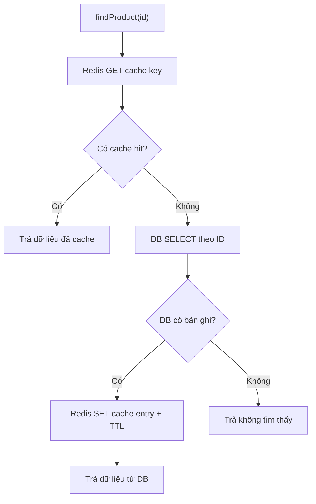
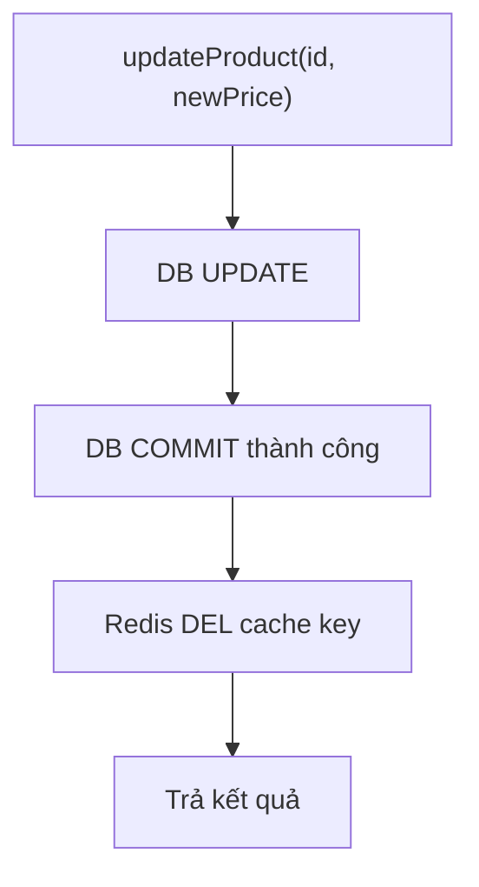
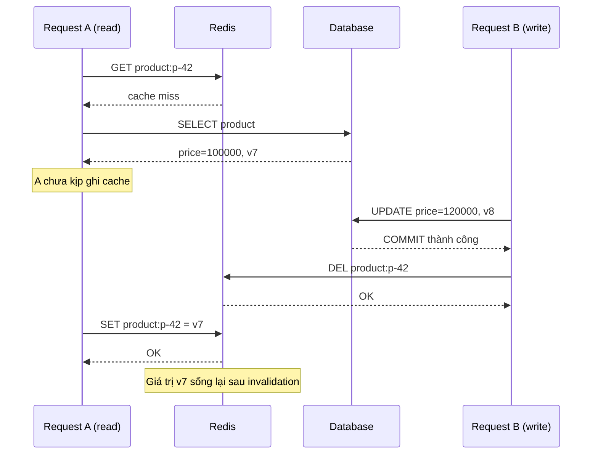
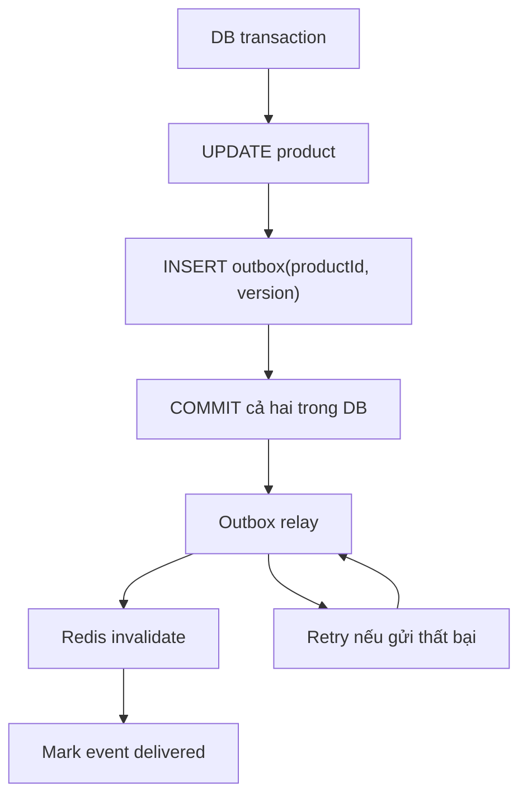

# Race condition giữa đọc cache, ghi dữ liệu và xóa cache trong Spring Data Redis

Trong chiến lược **cache-aside**, ứng dụng thường đọc Redis trước, chỉ truy cập cơ sở dữ liệu (database, viết tắt DB) khi cache miss; sau một lần cập nhật DB, ứng dụng xóa cache để lần đọc sau nạp giá trị mới. Công thức này có vẻ đơn giản:

```text
Read:   cache GET -> miss -> DB SELECT -> cache SET
Write:  DB UPDATE -> cache DEL
```

Tuy nhiên, giữa các lệnh `GET`, `SELECT`, `UPDATE`, `SET` và `DEL` có những khoảng thời gian mà các request khác có thể chạy xen vào. Khi nhiều request hoặc nhiều instance cùng truy cập một bản ghi, **đúng thứ tự trong từng request riêng lẻ chưa chắc tạo ra kết quả đúng cho toàn hệ thống**. Một request đọc có thể dùng ảnh chụp DB cũ rồi ghi ngược giá trị đó vào cache sau khi request ghi đã xóa cache. Đây là một race condition kinh điển.

Bài học tập trung vào ba thao tác **đọc cache, ghi dữ liệu nguồn và xóa cache** trong ngữ cảnh Spring Cache/Spring Data Redis. Chúng ta sẽ xây dựng lịch thực thi cụ thể, phân tích các kiểu lỗi, giới hạn của `@Cacheable`/`@CacheEvict`/`@CachePut` và `@Transactional`, rồi xem xét các chiến lược từ TTL, invalidation sau commit đến version fencing và outbox.

## 1. Mô hình và thuật ngữ

Giả sử hệ thống bán hàng lưu giá sản phẩm trong PostgreSQL và dùng Redis để tăng tốc đọc:

```text
Database:
    Product(id = "p-42", priceCents = 100_000, version = 7)

Redis cache:
    cache:product:p-42 -> { priceCents: 100000, version: 7 }
```

Sau đó một request đổi giá thành `120_000` và tăng phiên bản DB lên `8`.

Những thành phần liên quan:

| Khái niệm | Ý nghĩa |
|---|---|
| **Source of truth** | Nguồn dữ liệu có thẩm quyền; trong ví dụ là PostgreSQL |
| **Cache entry** | Bản sao dữ liệu dùng để tăng tốc truy cập, không phải nguồn dữ liệu gốc |
| **Cache hit** | Redis đang có entry được coi là hợp lệ theo chính sách cache |
| **Cache miss** | Redis chưa có entry; ứng dụng cần đọc nguồn rồi có thể điền cache |
| **Cache fill / populate** | Ghi dữ liệu vừa đọc từ DB vào cache sau cache miss |
| **Invalidation / eviction** | Làm mất hiệu lực entry, thường bằng `DEL` hoặc `Cache.evict(...)` |
| **Stale value** | Giá trị cache không phản ánh phiên bản dữ liệu nguồn mà yêu cầu nghiệp vụ cần |
| **Race condition** | Kết quả phụ thuộc thứ tự xen kẽ giữa những thao tác chạy đồng thời |
| **Version** | Số phiên bản tăng đơn điệu của bản ghi DB để so sánh dữ liệu mới/cũ |

Ở đây, `version` chỉ để giải thích thứ tự thay đổi. Không phải mọi hệ thống đều có cột version; khi không có version, việc nhận biết một cache fill cũ càng khó hơn.

### 1.1. Hai đường xử lý điển hình

Đường đọc cache-aside:



Đường ghi DB rồi xóa cache:



Đây là mô hình mục tiêu. Trong ứng dụng thật, thứ tự `COMMIT` và `DEL` cần được thiết kế rõ; chỉ dùng một annotation cache bên cạnh `@Transactional` chưa chắc tạo ra thứ tự trên.

### 1.2. Cache hit không có nghĩa dữ liệu đúng tuyệt đối

Redis chỉ biết entry đang tồn tại và chưa hết hạn. Redis không tự so sánh cache entry với trạng thái DB. Một `GET` thành công cho biết dữ liệu **có mặt trong cache**, không chứng minh đó là phiên bản mới nhất của DB.

Mọi chiến lược cần xác định yêu cầu nhất quán:

- **Chấp nhận dữ liệu cũ trong vài giây:** cache thông thường với TTL ngắn và invalidation có thể phù hợp.
- **Đọc phải thấy thay đổi sau khi thao tác ghi hoàn tất:** cần ràng buộc mạnh hơn, thậm chí bỏ qua cache trong một số luồng.
- **Không được dùng giá trị cũ để quyết định thanh toán, cấp quyền, trừ tồn kho:** quyết định quan trọng phải được xác nhận bằng thao tác nguyên tử/transaction tại hệ thống có thẩm quyền.

Không có một thiết lập Redis Cache duy nhất khiến mọi trường hợp đạt strong consistency giữa DB và Redis.

## 2. Race nghiêm trọng nhất: cache miss đọc DB cũ, rồi điền cache sau khi bị xóa

Đây là tình huống **stale cache resurrection**: một entry đã bị invalidation nhưng lại được tái tạo bằng dữ liệu cũ.

Ban đầu:

```text
DB version = 7, price = 100000
Cache = missing
```

Hai request chạy đồng thời:

| Thời điểm | Request A: đọc sản phẩm | Request B: cập nhật sản phẩm |
|---|---|---|
| T1 | `GET cache` → miss | |
| T2 | `SELECT DB` → đọc version 7 | |
| T3 | Tạm dừng trước khi ghi Redis | |
| T4 | | `UPDATE DB` thành version 8 |
| T5 | | `COMMIT` thành công |
| T6 | | `DEL cache` |
| T7 | `SET cache = version 7` | |
| T8 | | Request B kết thúc |
| T9 | Request C gọi `GET` → cache hit version 7 | |



Vấn đề không phải Redis thực hiện sai thứ tự. Redis đã xử lý đúng `DEL` trước `SET`. **Nguồn của lỗi là request A đã giữ dữ liệu từ DB phiên bản cũ trong bộ nhớ**, rồi thực hiện thao tác cache fill quá muộn.

Nếu TTL của cache là 30 phút, giá trị cũ có thể được phục vụ trong tối đa thời gian đó, hoặc cho đến khi có invalidation khác. Với cache không có TTL, entry cũ có thể tồn tại vô thời hạn theo chính sách cache.

**Kết luận:** ngay cả chiến lược `DB COMMIT -> DEL cache` cũng không tuyệt đối ngăn stale cache nếu có read miss đang chạy đồng thời.

## 3. Xóa cache trước khi ghi DB: cửa sổ đọc ngược giá trị cũ

Một thứ tự thường được đề xuất là:

```text
Redis DEL -> DB UPDATE -> DB COMMIT
```

Thứ tự này có nguy cơ rõ ràng:

| Thời điểm | Request A: cập nhật | Request B: đọc |
|---|---|---|
| T1 | `DEL cache` | |
| T2 | | `GET cache` → miss |
| T3 | | `SELECT DB` → version 7 |
| T4 | | `SET cache = version 7` |
| T5 | `UPDATE DB` → version 8 | |
| T6 | `COMMIT` | |

Kết quả: DB mới là version 8 nhưng Redis giữ version 7. Nếu không có lần xóa nữa, cache đã bị tái tạo bằng dữ liệu cũ.

Ngay cả khi request cập nhật ném exception sau khi xóa cache nhưng trước khi cập nhật DB, tuy không làm dữ liệu nguồn sai, thao tác evict cũng gây cache miss không cần thiết và có thể tạo tải tăng đột biến.

Vì vậy, với cache-aside thông thường, **ưu tiên invalidate sau khi thay đổi DB đã commit** hơn là evict trước khi bắt đầu ghi. Đó là một cải thiện quan trọng, nhưng như phần 2 đã chỉ ra, vẫn chưa đủ để bảo đảm tính nhất quán tuyệt đối.

## 4. Ghi DB rồi xóa cache: có cửa sổ stale read và lỗi mất invalidation

Thứ tự:

```text
DB UPDATE -> DB COMMIT -> Redis DEL
```

thường dễ kiểm soát hơn. Nhưng giữa commit và delete, cache vẫn chứa phiên bản cũ:

```text
T1  DB COMMIT version 8
T2  Request khác GET cache version 7 -> cache hit cũ
T3  Redis DEL cache
T4  Request tiếp theo GET -> miss -> nạp version 8
```

Đây là một **cửa sổ stale read có giới hạn bởi độ trễ invalidation**, nếu lệnh xóa diễn ra thành công. Trong nhiều hệ thống phục vụ nội dung, cửa sổ ngắn như vậy có thể chấp nhận được. Trong nghiệp vụ đòi hỏi đọc ngay trạng thái mới, đó lại là vi phạm yêu cầu.

Lỗi khác nguy hiểm hơn:

```text
DB COMMIT version 8 -> ứng dụng crash -> Redis DEL chưa được gửi
```

DB giữ dữ liệu mới nhưng Redis vẫn giữ cache cũ. Hai hệ thống không nằm trong một transaction phân tán tự động. Việc xử lý lỗi giữa commit DB và invalidation phải được đưa vào thiết kế, không chỉ được xử lý bằng `try/catch` để ghi log.

**Một lần gọi API thành công không tự bảo đảm DB và Redis cùng cập nhật nguyên tử.** Nếu ứng dụng trả thành công sau DB commit nhưng trước khi xóa cache, client khác vẫn có thể đọc dữ liệu cũ.

## 5. Hai request ghi đồng thời cũng có thể làm cache sai

Không chỉ đường đọc gây race. Xét hai request cùng cập nhật một sản phẩm và ứng dụng dùng kiểu **write-through bằng `@CachePut`**:

```text
Request A: DB update thành v8; chuẩn bị PUT cache v8
Request B: DB update thành v9; PUT cache v9
Request A: PUT cache v8 muộn hơn
```

Timeline:

| Thời điểm | Request A | Request B |
|---|---|---|
| T1 | DB ghi version 8 | |
| T2 | Tạm dừng trước cache put | |
| T3 | | DB ghi version 9 |
| T4 | | `SET cache v9` |
| T5 | `SET cache v8` | |

Nếu hai DB write hợp lệ và version 9 thực sự là phiên bản mới nhất, Redis bây giờ chứa phiên bản 8. Cơ chế cache put không mặc định áp dụng điều kiện “chỉ ghi nếu version lớn hơn cache hiện tại”.

Với `@CacheEvict`, thứ tự giữa hai request cũng tạo ra cache miss và các khoảng giá trị cũ khác nhau, dù bản thân `DEL` không ghi ngược payload cũ. Nếu có cả `@CachePut` và `@CacheEvict` từ nhiều đường ghi, cần xác định đường nào là chủ sở hữu chính sách cập nhật cache.

Từ ví dụ này rút ra hai câu hỏi thiết kế:

1. **Có thể biết thứ tự phiên bản của dữ liệu nguồn không?** `@Version` trong database hoặc một revision tăng đơn điệu rất hữu ích.
2. **Cache có cơ chế từ chối ghi một phiên bản cũ hơn không?** Nếu không, request hoàn thành muộn có thể ghi đè cache mới.

Không nên dùng đồng hồ của máy chủ ứng dụng như một thứ tự tuyệt đối giữa các lần ghi trên nhiều instance; độ lệch đồng hồ và thời gian phản hồi không bảo đảm thứ tự commit DB.

## 6. Một đoạn Spring Cache đơn giản và race tồn tại trong đó

Spring Data Redis tích hợp Spring Cache qua `RedisCacheManager`. Với cấu hình cache thông thường, ứng dụng có thể viết:

```java
package com.example.catalog;

import org.springframework.cache.annotation.CacheEvict;
import org.springframework.cache.annotation.Cacheable;
import org.springframework.stereotype.Service;
import org.springframework.transaction.annotation.Transactional;

@Service
public class ProductService {

    private final ProductRepository repository;

    public ProductService(ProductRepository repository) {
        this.repository = repository;
    }

    @Cacheable(cacheNames = "productById", key = "#id")
    @Transactional(readOnly = true)
    public ProductDto findById(String id) {
        ProductEntity product = repository.findById(id)
                .orElseThrow();
        return new ProductDto(
                product.getId(),
                product.getPriceCents());
    }

    @CacheEvict(cacheNames = "productById", key = "#id")
    @Transactional
    public void updatePrice(String id, long priceCents) {
        ProductEntity product = repository.findById(id)
                .orElseThrow();
        product.setPriceCents(priceCents);
        repository.save(product);
    }
}
```

`ProductRepository`, `ProductEntity` và `ProductDto` là các thành phần mẫu của tầng dữ liệu và model; ví dụ tập trung vào cache annotation. Ở đây:

- `@Cacheable` tìm trong cache trước và chỉ gọi method thật khi miss.
- `@CacheEvict` mặc định thực hiện eviction **sau khi method thực thi bình thường**, khác với `beforeInvocation = true`.
- `@Transactional` tham gia quản lý transaction của database.

**Điểm không được giả định:** “`@CacheEvict` chạy sau khi thân method hoàn tất” **không nhất thiết đồng nghĩa “chạy sau khi DB commit”**. Cả cache advice và transaction advice đều dùng cơ chế interception/proxy; thời điểm thực tế phụ thuộc thứ tự advice và cấu hình transaction. Nếu eviction xảy ra trước commit, một request đọc đồng thời có thể gặp tình huống ở phần 3.

Ngay cả khi cấu hình advice đảm bảo evict sau DB commit, race stale fill ở phần 2 vẫn tồn tại.

### 6.1. @CachePut không phải giải pháp tự động

Ví dụ:

```java
@CachePut(cacheNames = "productById", key = "#result.id")
@Transactional
public ProductDto update(ProductDto input) {
    return writeToDatabase(input);
}
```

`@CachePut` yêu cầu method thật chạy rồi cập nhật cache bằng kết quả. Nó có thể rút ngắn thời gian cache miss và tránh phải nạp lại từ DB ở đường thông thường, nhưng **không làm hai hệ thống commit nguyên tử**, cũng không tự ngăn request ghi phiên bản cũ hoàn thành muộn hơn request mới.

Nếu `#result` có thể null, còn cần xử lý biểu thức key và chính sách cache null phù hợp. Với dữ liệu cần kiểm soát thứ tự, cache put phải đi cùng cơ chế version-aware hoặc ranh giới đồng bộ phù hợp.

## 7. Đừng nhầm transaction database với transaction Redis

Giả sử service được đánh:

```java
@Transactional
public void updatePrice(...) {
    repository.save(...);
    redisTemplate.delete(...);
}
```

Annotation `@Transactional` thông thường được cấu hình với transaction manager của database quan hệ. Nó không biến `repository.save(...)` và `redisTemplate.delete(...)` thành một transaction ACID trải qua PostgreSQL và Redis.

Ngay cả khi bật transaction support của `RedisTemplate` hoặc sử dụng `MULTI/EXEC`, vấn đề cross-system vẫn còn: transaction của Redis và transaction của DB là hai phạm vi riêng. Một bên có thể commit và bên kia thất bại.

Một bảng dễ nhớ:

| Cơ chế | Bảo đảm chính | Không tự bảo đảm |
|---|---|---|
| `@Transactional` với DB transaction manager | Transaction đối với DB tương ứng | Commit nguyên tử cùng Redis |
| Redis `MULTI/EXEC` | Thực thi lệnh Redis đã queue theo thứ tự, không chen lệnh client khác | Rollback như DB hoặc transaction DB+Redis |
| Redis Lua script | Kiểm tra/cập nhật Redis trong một lượt thực thi trên server | Đưa DB transaction vào cùng script |
| `@CacheEvict` | Yêu cầu xóa cache entry theo chính sách interceptor | Chặn cache fill cũ từ request khác |
| TTL | Giới hạn tuổi tối đa của một entry mới ghi, nếu entry hết hạn đúng như cấu hình | Dữ liệu không bao giờ cũ trước khi hết TTL |
| Outbox | Lưu ý định invalidation bền cùng DB transaction | Kết quả cache mạnh tức thời nếu delivery bất đồng bộ |

Vì vậy, yêu cầu “DB commit thành công thì cache không còn phiên bản cũ” phải được giải thành một **bài toán giao thức giữa nguồn dữ liệu và cache**, không chỉ thêm annotation.

## 8. Eviction sau commit bằng @TransactionalEventListener

Một cách cải thiện phổ biến là phát sự kiện khi cập nhật DB và chỉ xóa Redis **sau khi transaction DB commit thành công**.

### 8.1. Sự kiện thay đổi sản phẩm

```java
package com.example.catalog;

public record ProductChangedEvent(String productId) {}
```

### 8.2. Service ghi DB và phát sự kiện

```java
package com.example.catalog;

import org.springframework.context.ApplicationEventPublisher;
import org.springframework.stereotype.Service;
import org.springframework.transaction.annotation.Transactional;

@Service
public class ProductCommandService {

    private final ProductRepository repository;
    private final ApplicationEventPublisher publisher;

    public ProductCommandService(
            ProductRepository repository,
            ApplicationEventPublisher publisher) {
        this.repository = repository;
        this.publisher = publisher;
    }

    @Transactional
    public void changePrice(String id, long priceCents) {
        if (priceCents < 0) {
            throw new IllegalArgumentException("Negative price");
        }

        ProductEntity product = repository.findById(id)
                .orElseThrow();

        product.setPriceCents(priceCents);
        repository.save(product);

        // Sự kiện được phát khi transaction đang mở;
        // listener dưới đây chờ đến AFTER_COMMIT.
        publisher.publishEvent(new ProductChangedEvent(id));
    }
}
```

### 8.3. Listener xóa cache sau commit

```java
package com.example.catalog;

import org.springframework.cache.Cache;
import org.springframework.cache.CacheManager;
import org.springframework.stereotype.Component;
import org.springframework.transaction.event.TransactionPhase;
import org.springframework.transaction.event.TransactionalEventListener;

@Component
public class ProductCacheInvalidator {

    private final CacheManager cacheManager;

    public ProductCacheInvalidator(CacheManager cacheManager) {
        this.cacheManager = cacheManager;
    }

    @TransactionalEventListener(
            phase = TransactionPhase.AFTER_COMMIT)
    public void invalidate(ProductChangedEvent event) {
        Cache cache = cacheManager.getCache("productById");
        if (cache == null) {
            throw new IllegalStateException(
                    "Missing cache: productById");
        }
        cache.evict(event.productId());
    }
}
```

Trong luồng này:

1. DB được cập nhật trong transaction.
2. Service phát `ProductChangedEvent`.
3. Nếu DB **rollback**, listener `AFTER_COMMIT` không được gọi cho lần commit thất bại đó.
4. Khi DB **commit thành công**, listener gọi `Cache.evict(id)`.

Điểm mạnh là tránh việc xóa cache trước khi dữ liệu mới trở nên visible qua DB transaction.

### 8.4. Giới hạn của listener sau commit

Giải pháp này **không phải bảo đảm nhất quán tuyệt đối**, vì:

- Ứng dụng vẫn có thể crash sau DB commit nhưng trước hoặc trong lúc listener chạy.
- Redis có thể bị lỗi mạng đúng lúc evict.
- Một request đọc đã lấy version cũ có thể ghi cache trở lại **sau** listener evict.
- Listener thông thường chạy trong tiến trình hiện tại; nó không tự tạo một hàng đợi bền để retry sau restart.
- `@TransactionalEventListener` mặc định cần ngữ cảnh transaction phù hợp. Nếu phát event ngoài transaction, listener có thể không chạy trừ khi dùng `fallbackExecution` theo thiết kế; bật fallback phải được cân nhắc vì thay đổi semantics.

Do đó, listener sau commit phù hợp như một cải thiện cho **thứ tự commit–evict**. Khi cần giao hàng invalidation đáng tin cậy, thêm outbox; khi cần chống stale fill, thêm cơ chế phát hiện phiên bản hoặc đồng bộ đường đọc–ghi.

## 9. Transaction-aware cache manager và giới hạn của nó

Spring Data Redis có khả năng tạo `RedisCacheManager` hỗ trợ transaction awareness:

```java
import org.springframework.data.redis.cache.RedisCacheManager;

RedisCacheManager manager = RedisCacheManager
        .builder(redisConnectionFactory)
        .cacheDefaults(redisCacheConfiguration)
        .transactionAware()
        .build();
```

Khi có Spring transaction đang hoạt động và cơ chế transaction awareness được sử dụng, một số thao tác cache như `put`, `evict` hoặc `clear` có thể được **hoãn đến sau commit thành công**.

Điều này hỗ trợ tránh việc xóa/ghi cache quá sớm khi transaction DB vẫn chưa commit. Tuy nhiên:

- Nó không ghép DB và Redis thành một transaction phân tán nguyên tử.
- Nếu tiến trình lỗi sau DB commit trước khi hoàn tất cache action, vẫn có khoảng mất invalidation.
- Nó không tự giải quyết stale fill của request đọc đã lấy dữ liệu DB cũ trước commit.
- Không nên giả định mọi biến thể API như thao tác cần kết quả ngay lập tức đều có thể được hoãn theo cùng cách; kiểm tra contract của `putIfAbsent`, `evictIfPresent` và phiên bản framework.
- Nếu ứng dụng có nhiều `CacheManager` hoặc custom cache interceptor, cần xác định chính xác manager nào đang phục vụ annotation.

Đây là **cơ chế sắp xếp thời điểm thực hiện thao tác cache**, không phải chứng minh mọi race condition đã biến mất.

## 10. Double delete: vì sao “xóa hai lần” chỉ giảm xác suất

Một kỹ thuật đôi khi được đề xuất là:

```text
DEL cache
UPDATE DB
COMMIT DB
sleep vài trăm milliseconds
DEL cache lần nữa
```

Ý tưởng: lần xóa thứ hai dọn entry cũ có thể được một request đọc nạp vào cache trong lúc cập nhật DB.

Tuy nhiên, kỹ thuật này **không cung cấp bảo đảm đúng trong mọi lịch thực thi**:

```text
T1   Request A cache miss, SELECT DB -> version 7
T2   Request A bị treo 2 giây trước cache SET
T3   Request B DEL cache lần 1
T4   Request B UPDATE + COMMIT version 8
T5   Request B chờ 200 ms rồi DEL cache lần 2
T6   Request A thức dậy, SET cache version 7
```

Cache cũ vẫn sống lại. Không có một thời gian sleep cố định nào có thể chặn mọi độ trễ do GC pause, scheduler, network hoặc request đọc DB kéo dài.

Ngoài ra:

- Sleep trong request ghi làm tăng latency.
- Lần xóa thứ hai có thể thất bại.
- Nếu hai writer chạy đồng thời, lịch thực thi phức tạp hơn.
- Xóa lặp có thể tăng tải Redis và tỷ lệ cache miss.

Double delete có thể được sử dụng như một biện pháp **giảm xác suất stale** khi hiểu rõ giới hạn, nhưng không nên mô tả nó như lời giải bảo đảm tính nhất quán.

## 11. TTL: một chốt an toàn để giới hạn độ cũ

Trong Spring Data Redis Cache, có thể đặt TTL:

```java
import java.time.Duration;
import org.springframework.data.redis.cache.RedisCacheConfiguration;

RedisCacheConfiguration config =
        RedisCacheConfiguration.defaultCacheConfig()
                .entryTtl(Duration.ofMinutes(2));
```

Khi cache entry cũ bị ghi lại sau invalidation, TTL làm nó tự hết hạn sau một thời gian. Điều này **giảm thời gian tối đa entry sai tồn tại trong cache** trong điều kiện không có lần gia hạn/ghi đè kéo dài.

Nhưng TTL không bảo đảm:

- Mọi cache hit trong 2 phút đều là dữ liệu mới.
- Một read miss không ghi lại snapshot cũ.
- Các response được tạo trước khi cache hết hạn là hợp lệ khi client dùng chúng.
- Cache sẽ hết hạn chính xác tại một thời điểm do ứng dụng có thể quan sát tức thì trong mọi tình huống tải/cluster.

TTL nên được chọn theo **ngân sách độ cũ** mà nghiệp vụ chấp nhận. Dữ liệu sản phẩm ít đổi có thể dùng TTL dài; trạng thái phiên đăng nhập, quyền truy cập, hạn mức hoặc tồn kho cần chính sách thận trọng hơn.

### 11.1. TTL không phải invalidation

Một hệ thống chỉ có TTL là hệ thống chấp nhận cache có thể cũ cho đến lúc entry hết hạn. Một hệ thống có cả TTL và invalidation thường giảm độ cũ sau update, nhưng vẫn cần tính đến lỗi invalidation và các race ở trên.

### 11.2. TTL cho cache null

Cache kết quả “không tìm thấy” cũng có rủi ro: request A đọc DB thấy chưa có sản phẩm, rồi ghi negative cache; request B tạo sản phẩm và evict; request A có thể ghi lại kết quả “không tồn tại” sau khi evict.

Vì vậy, **negative cache cũng là dữ liệu cần version/invalidation**, không chỉ các DTO khác null. Nếu chấp nhận negative caching, nên dùng TTL ngắn và quy tắc cập nhật phù hợp với tần suất tạo mới.

## 12. @Cacheable(sync = true) xử lý vấn đề gì?

Spring Cache hỗ trợ:

```java
@Cacheable(
        cacheNames = "productById",
        key = "#id",
        sync = true)
public ProductDto findById(String id) {
    return loadFromDatabase(id);
}
```

Mục tiêu của `sync = true` là yêu cầu cache provider đồng bộ việc tính giá trị cho **cùng một key** khi nhiều thread đồng thời cache miss, để hạn chế nhiều lần gọi nguồn dữ liệu. Đây là một hướng giảm **cache stampede**.

Tuy nhiên cần phân biệt:

| Vấn đề | sync = true có tự giải quyết? |
|---|---|
| Nhiều request cùng miss rồi tải DB trùng lặp | Có thể hỗ trợ tùy khả năng cache provider |
| Một update DB commit khi request khác đang load cache | Không tự bảo đảm |
| Một request đã đọc version cũ trước khi invalidation | Không tự loại bỏ snapshot cũ |
| Các instance chạy trên nhiều máy cần khóa chung | Không được tự suy ra từ annotation |
| DB commit và Redis DEL nguyên tử | Không |

Spring Data Redis có các chế độ `RedisCacheWriter` locking/non-locking. Nhưng các lock đó phục vụ ngữ nghĩa thao tác cache writer và có phạm vi riêng; **không phải một transaction lock bao trùm DB SELECT, DB UPDATE, DB COMMIT và cache eviction**.

Vì thế, tránh kết luận rằng thêm `sync = true` hoặc đổi sang locking cache writer thì race ở phần 2 đã biến mất.

## 13. Khóa đồng bộ theo key: hữu ích nhưng cần đúng phạm vi

Một cách tiếp cận là buộc các luồng **read miss -> DB load -> cache fill** và **DB update -> commit -> invalidate** không chạy xen nhau trên cùng một ID.

Trong một JVM, có thể tưởng tượng một mutex theo key:

```text
lock(productId)
    readMiss:
        nếu cache miss -> DB SELECT -> Redis SET

lock(productId)
    write:
        DB UPDATE -> COMMIT -> Redis DEL
unlock(productId)
```

Nếu mọi thao tác thực sự đi qua cùng một mutex và lock được giữ tới sau commit, lịch thực thi sẽ bớt khả năng tái tạo cache cũ. Tuy nhiên:

- Một `synchronized` hoặc `ReentrantLock` trong JVM **chỉ đồng bộ các thread của một instance**, không đồng bộ nhiều pod/service.
- Một distributed lock Redis phải có owner token, TTL, cơ chế release an toàn và quy tắc khi lock hết hạn trong lúc tác vụ chưa xong.
- Khi lock timeout, worker cũ có thể tiếp tục ghi (stale writer). Hệ thống cần fencing token hoặc kiểm tra version tại nguồn/đích để bảo vệ.
- Mọi writer, kể cả job nền và service khác, phải tham gia giao thức; một writer bỏ qua lock có thể phá vỡ bảo đảm.
- Giữ lock trong suốt DB transaction có thể làm tăng độ trễ và nguy cơ contention.

Lock là một công cụ điều phối, không tự giải quyết sai lệch do mất kết nối, failure sau commit hoặc người ghi không tuân theo giao thức.

## 14. Chống cache fill cũ bằng dữ liệu có version

Một hướng mạnh hơn chỉ dựa vào thời điểm là **so sánh version của dữ liệu**. Đầu tiên DB phải có một version được thay đổi **trong cùng transaction** với bản ghi, và version phải có quan hệ thứ tự đáng tin cậy cho mỗi ID.

Ví dụ với JPA:

```java
import jakarta.persistence.Entity;
import jakarta.persistence.Id;
import jakarta.persistence.Version;

@Entity
public class ProductEntity {
    @Id
    private String id;

    @Version
    private long version;

    private long priceCents;

    // constructor, getters, setters...
}
```

`@Version` giúp JPA thực hiện optimistic locking đối với entity được quản lý đúng cách. Nó bảo vệ một lớp race tại DB, nhưng **không tự khiến Redis cache biết version hiện tại**. Phải truyền version đó cùng cache payload và thiết kế logic ghi cache có điều kiện.

### 14.1. Nguyên tắc monotonic cache write

Thay vì:

```text
SET cacheKey = candidateValue
```

để bất kỳ request nào cũng ghi được, dùng quy tắc:

```text
Chỉ nhận candidate nếu
    candidateVersion >= currentCacheVersion
và candidateVersion >= minimumAllowedVersion
```

Khi một request khác đã điền cache version 9, request giữ version 8 không được ghi ngược. Khi một invalidation đã thông báo DB tối thiểu là version 9, request đang giữ version 8 cũng không được ghi cache dù entry hiện tại đã bị xóa.

Điểm thứ hai dẫn tới ý tưởng **version fence** hoặc **generation marker**.

### 14.2. Vì sao chỉ so với version đang có trong cache chưa đủ?

Xét:

```text
A: đọc DB version 7, tạm dừng
B: commit DB version 8, DEL cache
A: kiểm tra cache hiện không có entry
A: SET version 7
```

Nếu chỉ so sánh với version đang có trong cache, tại thời điểm A ghi **cache rỗng**, nên A vẫn được phép ghi version 7. Cần một dấu vết “đã từng invalidated tới version 8” tồn tại độc lập với cache payload.

### 14.3. Hai Redis key cùng hash slot

Một thiết kế nâng cao dùng:

```text
product:{p-42}:cached    -> Redis Hash chứa version + payload
product:{p-42}:floor     -> Redis String chứa minimum allowed version
```

Hai key cùng hash tag `{p-42}`, cho phép một Lua script trên Redis Cluster kiểm tra và ghi chúng nguyên tử trong **một slot**.

Đây là **một cache tự thiết kế bằng RedisTemplate**, không phải định dạng Redis String mặc định của Spring Cache Redis. Không được lấy script cho Hash này rồi dùng trực tiếp với `@Cacheable` mà không xây custom cache adapter tương ứng.

## 15. Ví dụ Lua: từ chối ghi cache nếu snapshot DB đã quá cũ

Script ghi cache nhận:

- `KEYS[1]`: cache Hash của sản phẩm.
- `KEYS[2]`: floor version key.
- `ARGV[1]`: candidate version do DB trả về.
- `ARGV[2]`: JSON payload đã serialize theo schema ổn định.
- `ARGV[3]`: TTL tính bằng giây, số nguyên dương.

```lua
-- KEYS[1] = product:{id}:cached (Redis Hash)
-- KEYS[2] = product:{id}:floor  (Redis String)
-- ARGV[1] = candidateVersion
-- ARGV[2] = payloadJson
-- ARGV[3] = ttlSeconds

local candidateVersion = tonumber(ARGV[1])
local ttl = tonumber(ARGV[3])

if not candidateVersion or not ttl or ttl <= 0 then
    return redis.error_reply('invalid version or ttl')
end

local floor = tonumber(redis.call('GET', KEYS[2]) or '-1')
local cachedVersion = tonumber(
    redis.call('HGET', KEYS[1], 'version') or '-1')

if not floor or not cachedVersion then
    return redis.error_reply('invalid cached version metadata')
end

if candidateVersion < floor then
    return 0 -- Reader giữ snapshot đã bị invalidation.
end

if candidateVersion < cachedVersion then
    return 0 -- Cache đã có bản mới hơn.
end

redis.call('HSET', KEYS[1],
    'version', ARGV[1],
    'payload', ARGV[2])
redis.call('EXPIRE', KEYS[1], ttl)
return 1
```

Script trả `1` khi nhận cache fill và `0` khi từ chối. Một request bị từ chối không nên tiếp tục giả định “cache đã chứa bản mình vừa ghi”; caller có thể đọc lại cache, tải lại DB hoặc trả dữ liệu cho request hiện tại tùy chính sách độ mới.

### 15.1. Script invalidation sau commit

Khi DB commit version mới, ví dụ version `8`, cần tăng floor và loại cache cũ một cách nguyên tử:

```lua
-- KEYS[1] = product:{id}:cached
-- KEYS[2] = product:{id}:floor
-- ARGV[1] = committedVersion

local committedVersion = tonumber(ARGV[1])
if not committedVersion then
    return redis.error_reply('invalid committed version')
end

local oldFloor = tonumber(redis.call('GET', KEYS[2]) or '-1')
if not oldFloor then
    return redis.error_reply('invalid floor metadata')
end

if committedVersion > oldFloor then
    redis.call('SET', KEYS[2], ARGV[1])
end

local cachedVersion = tonumber(
    redis.call('HGET', KEYS[1], 'version') or '-1')
if not cachedVersion then
    return redis.error_reply('invalid cache metadata')
end

if cachedVersion < committedVersion then
    redis.call('DEL', KEYS[1])
end

return 1
```

Khi A đã đọc version 7, B commit version 8 và script invalidation chạy trước lúc A fill:

```text
floor = 8
A attempts cache fill version 7
7 < floor 8 -> reject
```

Nếu A fill version 7 **trước** invalidation, script invalidation của B sẽ xóa version 7. Nếu đã có cache version 9, một invalidation version 8 đến muộn sẽ không xóa bản version 9.

### 15.2. Ràng buộc và giới hạn của version fencing

Thiết kế nâng cao này có nhiều điều kiện không được bỏ qua:

1. **Version DB phải đáng tin.** Dữ liệu của cùng ID phải có revision tăng theo thứ tự commit, hoặc có một cơ chế so sánh tương đương. Không dùng timestamp từ các máy tùy ý thay cho version nếu cần thứ tự chặt.
2. **Mọi cache fill và invalidation phải đi qua giao thức này.** Một lệnh `SET`/`DEL` thủ công bỏ qua Lua có thể phá vỡ bảo đảm.
3. **Floor cần vòng đời phù hợp.** Nếu floor hết hạn khi vẫn còn reader rất cũ có thể ghi, stale fill lại có cơ hội xuất hiện. Giữ floor mãi cũng tốn bộ nhớ; retention phải gắn với thời gian tối đa request có thể in-flight và quy tắc cấp phát version.
4. **Thông báo commit phải đến được Redis.** Nếu DB commit version 8 nhưng sự kiện invalidation bị mất, floor vẫn là 7; script không biết DB đã có version 8. Outbox/retry giúp cải thiện khả năng giao sự kiện.
5. **Có cửa sổ trước khi Redis nhận invalidation.** Trong khoảng DB đã commit nhưng floor chưa tăng, đọc cache cũ vẫn có thể xảy ra. Fencing ngăn stale fill sau khi version mới đã được ghi nhận ở Redis, chứ không biến DB+Redis thành cùng một transaction.
6. **TTL, key type và serializer phải nhất quán.** Ví dụ dùng Redis Hash cho cache và Redis String cho floor; đọc cache phải theo đúng schema ấy.
7. **Phải xử lý bản ghi bị xóa.** Với delete DB, hãy phát một tombstone/version đủ mới; tránh cho request cũ tái tạo lại bản ghi đã xóa. Nếu ID có thể được tái sử dụng, cần version/generation phù hợp.
8. **Số version lớn.** `tonumber` của Lua có giới hạn biểu diễn chính xác; không nên giả định mọi số nguyên 64-bit đều so sánh chính xác dưới dạng Lua number trong mọi phiên bản môi trường. Cần quy tắc số phiên bản phù hợp hoặc so sánh có kiểm soát.
9. **Script lỗi runtime không rollback.** Kiểm tra kiểu dữ liệu và các giá trị có nguy cơ lỗi trước khi ghi; việc kiểm tra chỉ một số trường không bảo đảm an toàn tuyệt đối với dữ liệu Redis hỏng.

Version fencing là kỹ thuật giúp cải thiện tính đúng trong môi trường cạnh tranh, nhưng cần xem nó như **một giao thức cache riêng**, không chỉ “một đoạn Lua bổ sung” vào hệ thống annotation.

## 16. Dùng Spring Data Redis gọi Lua script kiểm soát version

Spring Data Redis cung cấp `RedisScript<T>` và `StringRedisTemplate.execute(...)`. Khi sử dụng cache Hash/floor tự quản lý ở phần trước, ứng dụng có thể khai báo script thành bean:

```java
import org.springframework.context.annotation.Bean;
import org.springframework.context.annotation.Configuration;
import org.springframework.data.redis.core.script.DefaultRedisScript;
import org.springframework.data.redis.core.script.RedisScript;

@Configuration
public class VersionedCacheScriptConfig {

    @Bean
    RedisScript<Long> cacheFillScript() {
        DefaultRedisScript<Long> script = new DefaultRedisScript<>();
        script.setScriptText("""
                local candidate = tonumber(ARGV[1])
                local ttl = tonumber(ARGV[3])
                if not candidate or not ttl or ttl <= 0 then
                    return redis.error_reply('invalid argument')
                end
                local floor = tonumber(
                    redis.call('GET', KEYS[2]) or '-1')
                local current = tonumber(
                    redis.call('HGET', KEYS[1], 'version') or '-1')
                if not floor or not current then
                    return redis.error_reply('invalid metadata')
                end
                if candidate < floor or candidate < current then
                    return 0
                end
                redis.call('HSET', KEYS[1],
                    'version', ARGV[1], 'payload', ARGV[2])
                redis.call('EXPIRE', KEYS[1], ttl)
                return 1
                """);
        script.setResultType(Long.class);
        return script;
    }
}
```

Gọi script:

```java
import java.time.Duration;
import java.util.List;

import org.springframework.data.redis.core.StringRedisTemplate;
import org.springframework.data.redis.core.script.RedisScript;

public class VersionedProductCacheWriter {

    private final StringRedisTemplate redis;
    private final RedisScript<Long> cacheFillScript;

    public VersionedProductCacheWriter(
            StringRedisTemplate redis,
            RedisScript<Long> cacheFillScript) {
        this.redis = redis;
        this.cacheFillScript = cacheFillScript;
    }

    public boolean tryFill(
            String productId,
            long version,
            String payloadJson,
            Duration ttl) {

        if (productId == null
                || !productId.matches("[A-Za-z0-9_-]+")) {
            throw new IllegalArgumentException("Invalid productId");
        }
        if (version < 0 || ttl.isZero() || ttl.isNegative()) {
            throw new IllegalArgumentException("Invalid version or TTL");
        }

        String tag = "{product-" + productId + "}";
        String cacheKey = "product:" + tag + ":cached";
        String floorKey = "product:" + tag + ":floor";

        Long applied = redis.execute(
                cacheFillScript,
                List.of(cacheKey, floorKey),
                Long.toString(version),
                payloadJson,
                Long.toString(ttl.getSeconds()));

        return Long.valueOf(1L).equals(applied);
    }
}
```

Trong ví dụ, `KEYS[1]` và `KEYS[2]` dùng chung hash tag, giúp script phù hợp với ràng buộc multi-key trong Redis Cluster. Dữ liệu JSON là chuỗi được ứng dụng tự serialize theo schema đã chọn; bài học không giả định `StringRedisTemplate` tự chuyển DTO thành JSON.

Đây là ví dụ **riêng cho đường cache fill**. Hệ thống còn cần triển khai script invalidation sau commit tương ứng, xử lý cache read và giải mã JSON, thiết kế floor retention, phân biệt miss với tombstone và bảo đảm mọi đường ghi tuân thủ quy tắc. Nó không tự thay thế `RedisCacheManager` mặc định.

## 17. Durable invalidation bằng transactional outbox

`@TransactionalEventListener(AFTER_COMMIT)` giúp sắp xếp đúng thời điểm eviction, nhưng event nội bộ tiến trình có thể mất nếu ứng dụng crash. **Transactional outbox** giải quyết một phần vấn đề độ bền của thông báo:

1. Trong cùng DB transaction, cập nhật sản phẩm và thêm một hàng vào bảng `outbox_event`.
2. Commit DB đồng thời lưu dữ liệu mới và ý định invalidation.
3. Một worker/relay đọc outbox chưa xử lý và gửi yêu cầu xóa cache.
4. Khi xử lý thành công, worker đánh dấu hoặc xóa event theo chính sách.
5. Nếu worker crash, event vẫn nằm trong DB để thử lại.



Outbox chuyển vấn đề “crash sau commit làm mất invalidation” thành “có event bền để xử lý lại”. Nhưng:

- Event thường được gửi theo ngữ nghĩa **at-least-once**; eviction cần idempotent.
- Event có thể đến trễ, trong khi request vẫn đọc cache cũ.
- Event của cùng ID có thể đến sai thứ tự nếu relay/worker song song; version giúp phát hiện event cũ.
- Một read miss đã lấy snapshot cũ vẫn có thể fill cache sau khi evict nếu không có cơ chế fencing.
- Worker cần quan sát backlog, retry, dead-letter và thời gian trễ so với commit.

Vì vậy, outbox chủ yếu giúp **delivery đáng tin cậy**. Để chống stale fill, có thể kết hợp với version marker hoặc mô hình cache khác.

## 18. Cache-aside, write-through, write-behind: race khác nhau

| Chiến lược | Đường ghi tiêu biểu | Race cần đặc biệt chú ý |
|---|---|---|
| Cache-aside + invalidate | DB write → evict cache | Read miss cũ fill sau evict; mất invalidation |
| Cache-aside + cache put | DB write → cập nhật cache | Writer cũ hoàn thành muộn ghi đè writer mới |
| Read-through | Cache/provider tự load khi miss | Loader đang chạy đồng thời với writer/invalidation |
| Write-through | Ghi cache và nguồn theo giao thức cố định | Không có cross-system atomicity nếu hai nguồn độc lập |
| Write-behind / write-back | Ghi cache/queue trước, DB cập nhật về sau | Queue mất dữ liệu, đọc nguồn chưa đồng bộ, reordering, retry |

Write-behind có thể cải thiện throughput nhưng làm Redis/cache trở thành một phần của đường ghi dữ liệu; nó đòi hỏi thiết kế độ bền, recovery và thứ tự cập nhật khác hẳn cache-aside. Không nên áp dụng chỉ để tránh một race nếu nghiệp vụ không chấp nhận dữ liệu nguồn cập nhật chậm.

Với đa số ứng dụng CRUD có DB làm nguồn dữ liệu chính, **cache-aside + invalidate sau commit + TTL + cơ chế delivery đáng tin cậy** là nền tảng thực dụng. Khi yêu cầu mạnh hơn, thêm version fence, khóa hoặc chuyển truy vấn quan trọng về nguồn dữ liệu có thẩm quyền.

## 19. Replica lag và transaction isolation có thể làm cache cũ trở lại

Ngay cả khi evict đã chạy đúng, việc nạp lại cache không chắc đọc được DB mới nhất nếu:

- Ứng dụng đọc từ **read replica** đang chậm hơn primary.
- Một transaction đọc có snapshot cũ theo mức isolation của DB.
- Nguồn dữ liệu phía sau là một service có consistency cuối cùng.
- Cache loader khác đã giữ object được đọc trước commit.

Ví dụ:

```text
T1 DB primary commit v8
T2 Redis DEL sau commit
T3 Reader cache miss
T4 Reader SELECT từ read replica còn v7
T5 Reader SET cache v7
T6 Replica sau đó mới nhận v8
```

Ở đây không có lỗi thứ tự event listener: loader vẫn đọc version 7 từ nguồn đọc chậm. Cần xác định **consistency của đường DB read dùng để fill cache**. Với dữ liệu cần read-after-write, có thể đọc primary, pin request vào nguồn nhất quán phù hợp hoặc dùng version fence chặn snapshot cũ khi commit version đã được thông báo.

Nếu ứng dụng cache toàn bộ entity từ một transaction có snapshot cũ kéo dài, TTL ngắn chỉ giảm tuổi của giá trị được ghi vào Redis; không thay đổi tính cũ của snapshot ban đầu.

## 20. Nhiều tầng cache khiến invalidation khó hơn

Một số ứng dụng có:

```text
Request
   |
   v
Local in-memory cache (Caffeine)
   |
   v
Distributed cache (Redis)
   |
   v
Database
```

Giả sử request ghi đã xóa Redis nhưng instance A vẫn giữ local cache version 7. Instance B đọc Redis miss và nạp version 8, còn instance A tiếp tục trả version 7 từ bộ nhớ.

Vì vậy, **xóa Redis không đồng nghĩa xóa mọi cache layer**.

Nếu dùng hai tầng cache, cần:

- Xác định thứ tự kiểm tra và điền cache ở từng tầng.
- Có TTL riêng cho local cache.
- Có cơ chế phát invalidation đến các instance nếu cần.
- Không giả định Redis Pub/Sub là event log bền có thể replay sau mất kết nối.
- Quy định version/sequence nếu nhận nhiều event có thể sai thứ tự.
- Kiểm tra đường update có làm mất hiệu lực cả Redis lẫn local cache hay không.

Một hệ thống đa tầng có thể dùng event để giảm thời gian stale, nhưng vẫn cần chiến lược khi instance không nhận được event (restart, network partition, queue backlog).

## 21. Nhầm khóa Redis vật lý với logical key trong Spring Cache

Với:

```java
@Cacheable(cacheNames = "productById", key = "#id")
public ProductDto findById(String id) { ... }
```

Redis Cache có thể tạo tên key vật lý dạng:

```text
productById::p-42
```

hoặc có thêm namespace ứng dụng/phiên bản theo `RedisCacheConfiguration`.

Điều này rất quan trọng khi viết đường invalidation thủ công:

```java
// Không được mặc định đúng với Spring Cache:
stringRedisTemplate.delete("p-42");
```

Nếu key vật lý là `productById::p-42`, lời gọi trên **không xóa cache entry cần xóa**. Kết quả nhìn như race, nhưng thực tế là chọn sai key.

Để nhất quán với Cache abstraction, dùng:

```java
Cache cache = cacheManager.getCache("productById");
if (cache != null) {
    cache.evict("p-42");
}
```

Hoặc dùng `@CacheEvict(cacheNames = "productById", key = "#id")` khi thời điểm thực thi phù hợp.

Nếu ứng dụng tự thiết kế cache với `RedisTemplate`, hãy nhất quán về key builder, prefix, serializer và TTL. Không trộn `@Cacheable` với thao tác Redis thủ công trên namespace mà không có một hợp đồng rõ ràng về physical key.

## 22. Redis Cluster và các thao tác nguyên tử nhiều key

Khi dùng Redis Cluster, những Lua script thao tác nhiều key cần các key **cùng hash slot**. Ví dụ cache version fencing:

```text
product:{p-42}:cached
product:{p-42}:floor
```

Hai key chung hash tag `{p-42}`, nên được định tuyến tới cùng slot. Không thể tùy ý chạy một script Redis nguyên tử với cache key ở node A và version marker ở node B.

Với nhiều sản phẩm, hãy dùng tag theo từng aggregate thay vì tag cố định cho toàn bộ dữ liệu:

```text
product:{p-42}:cached
product:{p-43}:cached
```

Điều này giúp phân phối key tốt hơn. Cùng slot cho mọi sản phẩm có thể tạo hot slot, làm giảm hiệu quả của Redis Cluster.

Lua có thể làm **kiểm tra/cập nhật Redis nguyên tử trong slot**, nhưng nó không truy cập transaction DB của PostgreSQL. Vấn đề commit DB rồi thông báo Redis vẫn là vấn đề cross-system.

## 23. Một ma trận lựa chọn theo yêu cầu nhất quán

| Yêu cầu | Cách tiếp cận thường phù hợp | Giới hạn |
|---|---|---|
| Dữ liệu có thể cũ vài phút | TTL, cache-aside cơ bản | Có stale trong thời gian TTL |
| Muốn cập nhật sớm sau DB commit | Evict sau commit | Còn stale-fill race và failure gap |
| Không muốn mất thông báo invalidation khi process crash | Transactional outbox + retry | Event có thể đến trễ |
| Muốn chặn cache fill có version cũ sau event | Version fence + Lua | Cần version DB, metadata và mọi writer tuân thủ |
| Muốn hạn chế nhiều loader cùng key | `@Cacheable(sync=true)` hoặc single-flight phù hợp | Không tự đồng bộ với writer/commit |
| Muốn read-after-write mạnh cho thao tác quan trọng | Đọc DB primary hoặc cơ chế authoritative read | Đổi latency để lấy độ mới |
| Muốn đồng bộ toàn bộ DB và cache như một transaction | Xem xét lại kiến trúc hoặc chọn nguồn transaction duy nhất | Spring Cache + Redis không tự cung cấp distributed ACID |
| Muốn ghi thay đổi trên nhiều key Redis một cách nguyên tử | Lua / Redis transaction cùng slot theo yêu cầu | Không bao trùm DB hoặc nhiều cluster slot |

**Khuyến nghị thiết kế:** bắt đầu bằng việc viết rõ mức độ nhất quán cần đạt và phạm vi lỗi có thể chấp nhận. Sau đó mới chọn cơ chế, thay vì thêm khóa, Lua, outbox và double delete theo cảm tính.

## 24. Kiểm thử concurrency: phải điều khiển lịch thực thi

Race condition thường khó tái hiện nếu chỉ chạy endpoint bằng tay. Một cách tiếp cận tốt là dùng barrier/latch để cố tình dừng request đúng lúc.

### 24.1. Kịch bản stale fill

Giả mã:

```text
DB = version 7
Cache = missing

Thread A:
    GET cache -> miss
    SELECT DB -> version 7
    signal "oldSnapshotRead"
    await "writerEvicted"
    SET cache -> version 7

Thread B:
    await "oldSnapshotRead"
    UPDATE DB -> version 8
    COMMIT
    DEL cache
    signal "writerEvicted"

Assert:
    DB version == 8
    Cache version == 7
```

Đây là kết quả có thể xuất hiện ở cache-aside cơ bản, không phải kỳ vọng của một hệ thống đã triển khai version fence.

### 24.2. Kịch bản xóa trước commit

```text
Thread B:
    DEL cache
    signal "evicted"
    await "readerFilled"
    UPDATE DB -> version 8
    COMMIT

Thread A:
    await "evicted"
    GET cache -> miss
    SELECT DB -> version 7
    SET cache version 7
    signal "readerFilled"
```

Mô hình này minh họa lý do eviction trước commit có thể tạo dữ liệu cache cũ.

### 24.3. Kịch bản kiểm tra sau khi thêm fence

Khi dùng version fence:

```text
Reader đã đọc DB version 7
Writer commit DB version 8
Invalidation script đặt floor = 8
Reader cố fill version 7

Expected: cache fill script trả 0; cache không nhận version 7.
```

Ngoài concurrency test, cần kịch bản lỗi:

- Redis không sẵn sàng khi DB commit.
- Event outbox được gửi hai lần.
- Hai invalidation event của một ID đến sai thứ tự.
- Reader bị pause lâu hơn TTL.
- Một instance còn giữ local cache cũ.
- DB read replica chưa bắt kịp primary.
- Xóa entity rồi tạo lại cùng ID.
- Ứng dụng restart sau commit nhưng trước eviction.

Các tình huống này giúp phân biệt cơ chế giảm xác suất stale với cơ chế thực sự có ràng buộc về version/ownership.

## 25. Theo dõi và điều tra stale cache trong sản xuất

Cache hit ratio cao không tự chứng minh dữ liệu cache đúng. Khi debug race, điều hữu ích hơn là biết **đường đọc nào đã fill entry nào, vào thời điểm nào và với version bao nhiêu**.

Các thông tin nên quan sát:

| Tín hiệu | Tại sao hữu ích |
|---|---|
| Cache key và cache name | Kiểm tra đúng namespace/invalidation |
| Operation ID / correlation ID | Nối request đọc, request ghi, event và retry |
| DB row version lúc đọc | Biết snapshot loader đã lấy |
| DB committed version của write | Biết thứ tự thay đổi nguồn |
| Cache version lúc GET và trước SET | Nhận diện ghi đè dữ liệu mới |
| Thời gian DB commit → Redis evict | Đo cửa sổ stale do event trễ |
| Outbox backlog và retry count | Phát hiện invalidation chưa tới Redis |
| Cache TTL còn lại | Xác định thời gian entry cũ có thể tồn tại |
| Tỷ lệ cache fill bị version fence từ chối | Đo số reader chậm/race thực tế |
| Số lượng cache miss đồng thời theo key | Phát hiện stampede |

Không ghi payload nhạy cảm hoặc toàn bộ dữ liệu cá nhân vào log chỉ để debug. Thông tin key và ID cũng cần chính sách bảo vệ phù hợp.

### 25.1. Kiểm tra Redis bằng CLI

Với cache sử dụng key chuỗi:

```redis
TYPE productById::p-42
TTL productById::p-42
PTTL productById::p-42
GET productById::p-42
```

Nếu `RedisCacheManager` dùng serializer nhị phân, kết quả `GET` có thể không đọc được bằng mắt thường; cần công cụ giải mã phù hợp. Với custom cache Hash ở phần version fencing:

```redis
HGETALL product:{p-42}:cached
GET product:{p-42}:floor
TTL product:{p-42}:cached
```

Không được giả định Spring Cache Redis luôn lưu entity dưới dạng Hash: Redis Cache abstraction thông thường lưu **một Redis String value cho mỗi cache entry**. Ví dụ Hash ở đây chỉ dành cho giải pháp custom versioned cache.

## 26. Những lỗi suy luận thường gặp

### Lỗi 1: “DB update xong, DEL cache xong thì chắc chắn không còn dữ liệu cũ”

Sai: một request đọc đã lấy snapshot DB cũ có thể SET sau DEL.

### Lỗi 2: “@CacheEvict sau method nghĩa là sau DB commit”

Không mặc định đúng: interceptor cache và interceptor transaction có thứ tự thực thi cần được cấu hình. Hơn nữa, sau commit vẫn còn stale-fill race.

### Lỗi 3: “Chỉ cần sleep và DEL lần thứ hai”

Double delete có thể giảm xác suất nhưng không chặn reader bị pause lâu hơn khoảng sleep.

### Lỗi 4: “TTL ngắn bảo đảm dữ liệu luôn mới”

TTL chỉ giới hạn thời gian tồn tại entry theo chính sách; trong khoảng trước khi hết hạn, cache có thể cũ.

### Lỗi 5: “@Cacheable(sync = true) biến DB read và Redis put thành transaction với writer”

Sai: đồng bộ cache load không tự bao trùm commit DB hoặc các writer từ service khác.

### Lỗi 6: “Một distributed lock đơn giản giải quyết mọi vấn đề”

Lock có TTL và ownership; tác vụ hết hạn lock có thể tiếp tục ghi. Cần xét fencing, phạm vi tham gia và lỗi giữa các hệ thống.

### Lỗi 7: “@CachePut luôn mới hơn DEL”

Không: request giữ version cũ có thể ghi muộn. Cần version-aware cache write hoặc chiến lược chỉ invalidation phù hợp.

### Lỗi 8: “CacheManager và RedisTemplate tự dùng cùng physical key”

Không: Redis Cache có prefix, key conversion và serializer riêng. Xóa key `"p-42"` không chắc xóa entry `productById::p-42`.

### Lỗi 9: “Redis transaction làm DB và cache atomic”

Redis MULTI/EXEC hoặc Lua chỉ có phạm vi Redis. Không tự commit cùng DB.

### Lỗi 10: “Pub/Sub gửi event là đủ để bảo đảm xóa cache”

Redis Pub/Sub không phải một outbox bền. Subscriber offline có thể bỏ lỡ sự kiện; cần cơ chế retry/replay nếu yêu cầu độ bền.

### Lỗi 11: “Redis primary đã có dữ liệu mới, mọi cache fill sau đó đều mới”

Nếu loader dùng DB replica lag, snapshot cũ hoặc local cache, nó vẫn có thể nạp phiên bản cũ.

### Lỗi 12: “Nếu script trả success thì DB và Redis đã nhất quán”

Lua chỉ biết Redis key và argument được truyền. Nó không thể tự xác minh trạng thái DB transaction đang commit nếu không có giao thức phiên bản/delivery được thiết kế.

## 27. Bài tập thực hành

### Bài 1 — Vẽ lịch thực thi khiến cache cũ sống lại

Ban đầu DB có price `100`, cache miss. Một reader lấy price `100` từ DB và tạm dừng. Một writer commit price `120` rồi evict cache. Reader tiếp tục SET `100` vào cache. Hãy vẽ sequence diagram và giải thích tại sao `DEL` thực hiện thành công vẫn không đủ.

### Bài 2 — Phân biệt hai thứ tự eviction

So sánh:

```text
A. DEL cache -> UPDATE DB -> COMMIT
B. UPDATE DB -> COMMIT -> DEL cache
```

Với mỗi cách, hãy nêu một lịch thực thi có thể gây stale value. Xác định vì sao cách B thường thuận lợi hơn nhưng vẫn không mạnh tuyệt đối.

### Bài 3 — Tạo event listener sau commit

Xây dựng `ProductChangedEvent`, publish trong service `@Transactional` và xử lý bằng `@TransactionalEventListener(phase = AFTER_COMMIT)` để evict `productById` qua `CacheManager`. Sau đó giải thích trường hợp ứng dụng crash sau commit nhưng trước callback.

### Bài 4 — Chứng minh hạn chế của double delete

Chọn delay xóa lần hai là 200 ms. Dựng một reader bị pause 500 ms sau khi đọc DB cũ. Hãy xác định thứ tự khiến reader ghi lại dữ liệu cũ **sau cả hai lần xóa**.

### Bài 5 — Thiết kế version fence

DB record có version `11`. Reader A giữ snapshot version `10`. Writer B commit version `11` và cập nhật floor = `11`. Hãy xác định điều kiện cache fill cần kiểm tra để từ chối A, kể cả khi cache entry hiện đang rỗng.

### Bài 6 — Outbox và event sai thứ tự

Một bản ghi được cập nhật từ version 11 → 12 → 13. Hai event invalidation đến theo thứ tự `13` rồi `12`. Hãy thiết kế quy tắc xử lý để event 12 không xóa cache version 13 hoặc hạ floor xuống 12.

### Bài 7 — Đánh giá ngân sách dữ liệu cũ

Với một trang danh mục sản phẩm, SLA cho phép dữ liệu cache cũ tối đa 60 giây. Với một lệnh trừ tồn kho, thao tác phải ngăn oversell. Hãy đề xuất hai đường đọc khác nhau và giải thích tại sao không nên dùng cùng một chính sách cache chỉ vì cả hai là dữ liệu sản phẩm.

## 28. Tổng kết

Race condition giữa **đọc cache, ghi DB và xóa cache** xuất phát từ việc các lệnh thuộc nhiều request và nhiều hệ thống **không có một ranh giới nguyên tử chung**. Hai bài học cốt lõi:

1. **Evict sau commit tốt hơn evict trước commit, nhưng chưa đủ.** Reader có thể đã đọc dữ liệu cũ và ghi cache sau khi writer evict; hoặc invalidation có thể bị mất sau DB commit.
2. **Bảo đảm mạnh đòi hỏi giao thức rõ ràng.** TTL giới hạn tuổi dữ liệu; outbox bảo đảm ý định invalidation có thể retry; version fence từ chối snapshot cũ; lock cần xử lý hết hạn và fencing; những thao tác quan trọng có thể phải đọc nguồn dữ liệu có thẩm quyền.

Với Spring Data Redis, hãy phân biệt **logical cache key** và **physical Redis key**, hiểu đúng thời điểm của cache advice so với database transaction, và không coi `@Cacheable`, `@CacheEvict`, `@CachePut` hoặc Redis Lua là giải pháp giao dịch phân tán tự động.

### Tài liệu tham khảo

- [Spring Framework — Cache Abstraction](https://docs.spring.io/spring-framework/reference/integration/cache.html)
- [Spring Framework — Transaction-bound Events](https://docs.spring.io/spring-framework/reference/data-access/transaction/event.html)
- [Spring Data Redis — Redis Cache](https://docs.spring.io/spring-data/redis/reference/redis/redis-cache.html)
- [Spring Data Redis — Redis Transactions](https://docs.spring.io/spring-data/redis/reference/redis/transactions.html)
- [Spring Data Redis — Scripting](https://docs.spring.io/spring-data/redis/reference/redis/scripting.html)
- [Redis — Transactions](https://redis.io/docs/latest/develop/using-commands/transactions/)
- [Redis — EVAL](https://redis.io/docs/latest/commands/eval/)
- [Redis — EXPIRE](https://redis.io/docs/latest/commands/expire/)
- [Redis — Cache patterns](https://redis.io/learn/howtos/solutions/caching-architecture)
