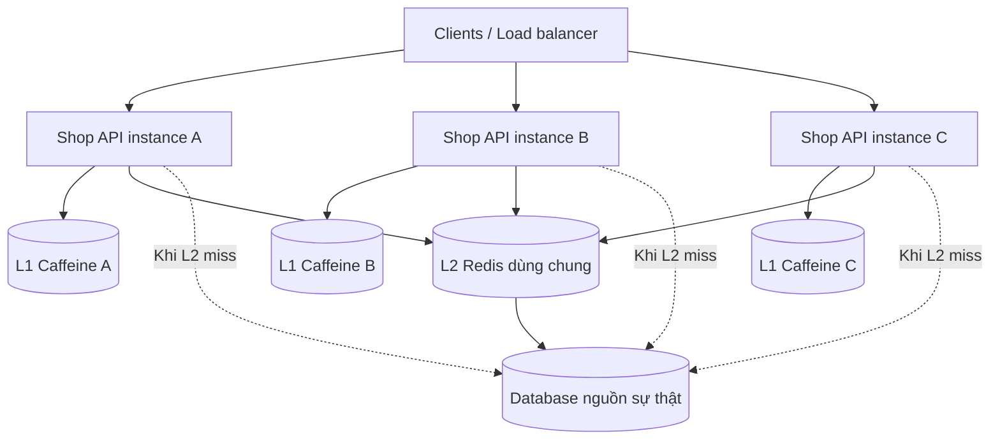
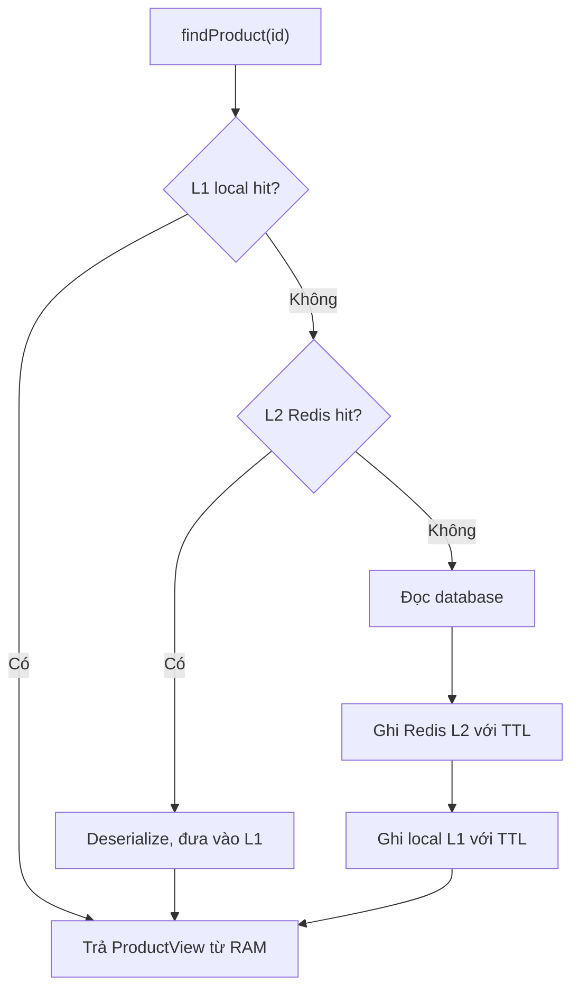
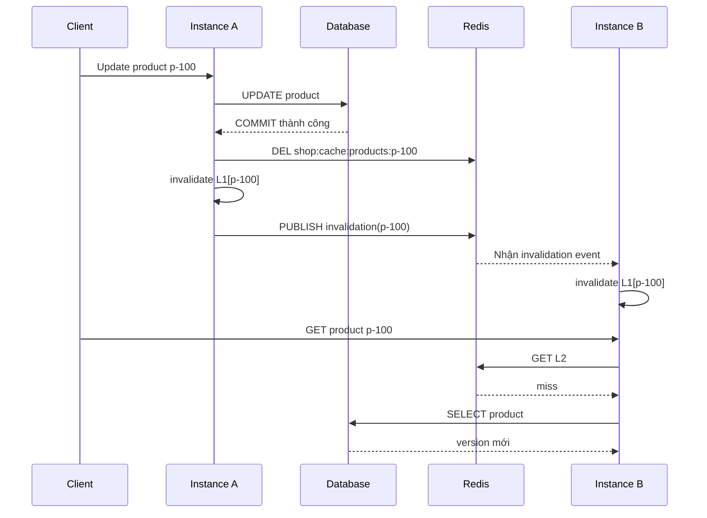

# Phối hợp cache cục bộ với Redis và vô hiệu hóa giữa các bản sao

Một ứng dụng Spring Boot có thể triển khai nhiều bản sao (instance) sau load balancer. Mỗi instance có bộ nhớ riêng, nhưng các instance cùng truy cập Redis và cùng cơ sở dữ liệu nghiệp vụ. Để giảm độ trễ đọc, ta có thể kết hợp **cache cục bộ L1** (ví dụ Caffeine trong JVM) với **cache dùng chung L2** (Redis thông qua Spring Data Redis).

Kiến trúc này giúp phần lớn các lần đọc nóng không phải gọi mạng, nhưng đặt ra một câu hỏi quan trọng: **khi một instance thay đổi dữ liệu, làm sao các instance khác biết rằng bản sao L1 của chúng đã cũ?** Redis dùng chung không tự xóa được những đối tượng đang nằm trong bộ nhớ riêng của mỗi JVM. Cần thiết kế luồng vô hiệu hóa (*invalidation*), cơ chế phục hồi khi bỏ lỡ sự kiện và giới hạn thời gian dữ liệu có thể cũ.

Bài học tập trung vào chiến lược phối hợp L1/L2 trong Spring Data Redis, ví dụ triển khai cache-aside với Caffeine và Redis Pub/Sub, các tình huống đua tranh giữa đọc/ghi, cùng cách lựa chọn mức nhất quán phù hợp.

## 1. Mô hình cache hai tầng

Xét dịch vụ đọc thông tin sản phẩm đang chạy ba instance:



Ở đây:

| Tầng | Vị trí | Đặc điểm | Khi nào mất dữ liệu? |
| --- | --- | --- | --- |
| **L1 — local cache** | Heap/bộ nhớ của mỗi JVM | Truy xuất rất nhanh, không cần network hop; **mỗi instance có nội dung riêng** | Khi instance restart, entry bị evict hoặc TTL kết thúc |
| **L2 — Redis cache** | Redis Server/Cluster dùng chung | Các instance đọc cùng một kho cache; có RTT mạng và chi phí serialization | Khi entry hết TTL, bị xóa, bị evict hoặc Redis mất dữ liệu tùy cấu hình |
| **Nguồn dữ liệu** | Cơ sở dữ liệu hoặc dịch vụ nghiệp vụ | Nơi quyết định dữ liệu đúng | Phụ thuộc giao dịch và độ bền của hệ thống nguồn |

L1 và L2 thông thường chỉ lưu dữ liệu có thể tái tạo. Không nên coi local cache hay Redis cache là nơi duy nhất giữ thông tin đơn hàng, quyền truy cập hoặc số dư cần tính chính xác.

**Hai quy tắc quan trọng:** cache hit ở L1 không đồng nghĩa Redis vẫn chứa giá trị đó; ngược lại, Redis vừa được cập nhật cũng không có nghĩa tất cả JVM đã bỏ entry cũ trong L1.

## 2. Luồng đọc cache-aside: L1 → L2 → nguồn dữ liệu

Mô hình dễ kiểm soát nhất là **cache-aside** (lazy loading). Khi một request tìm sản phẩm theo ID:

1. Đọc **L1** của instance hiện tại. Có thì trả ngay.
2. Nếu L1 miss, đọc **L2 Redis**. Có thì giải mã, có thể đưa vào L1 rồi trả.
3. Nếu L2 cũng miss, đọc **database**.
4. Đưa kết quả vào Redis với TTL L2, đồng thời đưa vào L1 với TTL cục bộ ngắn hơn.
5. Trả kết quả cho caller.



Ví dụ lựa chọn TTL ban đầu cho danh mục sản phẩm:

| Tầng | TTL minh họa | Mục tiêu |
| --- | --- | --- |
| L1 Caffeine | 20 giây | Tận dụng truy cập cục bộ, hạn chế thời gian giữ dữ liệu khi lỡ thông báo |
| L2 Redis | 5 phút | Giảm số truy vấn database giữa các instance |
| Database | Không dùng TTL cache | Lưu bản ghi nghiệp vụ gốc |

Đây là **thông số minh họa**, không phải công thức cố định. Với dữ liệu thay đổi rất thường xuyên hoặc đòi hỏi freshness cao, TTL L1 có thể chỉ vài giây. Với dữ liệu gần như bất biến, TTL có thể dài hơn. Đặt TTL L1 ngắn hơn L2 là lựa chọn thường gặp để giảm tuổi dữ liệu trong RAM, nhưng **TTL ngắn không giải quyết được dữ liệu Redis bị lỗi thời** nếu bước invalidation L2 thất bại.

### 2.1. Vì sao nên lưu dữ liệu dạng DTO?

Một `ProductView` dùng cho cache nên chứa những trường thực sự cần phục vụ read API, ví dụ ID, tên, giá và `version`. Không nên cache nguyên object JPA đang gắn với persistence context hay entity chứa lazy proxy; việc serialize/deserialze và thay đổi schema dễ gây lỗi.

Một DTO/record bất biến giúp cache dễ dùng hơn:

```java
package com.example.shop.cache;

public record ProductView(
        String id,
        String name,
        long priceCents,
        long version) {
}
```

`version` là phiên bản nghiệp vụ tăng khi sản phẩm thay đổi, không phải TTL. Nó sẽ hữu ích khi cần phát hiện sự kiện invalidation đến trễ hoặc tránh bản ghi cũ ghi đè bản mới.

## 3. Vấn đề khi chỉ có L1 và Redis nhưng không truyền invalidation

Giả sử cả hai instance A và B đã đọc `product:p-100`:

```text
Thời điểm     Instance A           Redis              Instance B
---------     ----------           -----              ----------
T0            L1[p-100] = v1       p-100 = v1         L1[p-100] = v1
T1            Cập nhật DB -> v2    p-100 = v1         L1[p-100] = v1
T2            Xóa Redis cache     p-100: missing     L1[p-100] = v1
T3            L1 A đã xóa          p-100: missing     Trả v1 từ L1 B
T4            B hết TTL L1         Đọc DB/L2 -> v2    B mới thấy v2
```

Xóa key Redis **chỉ xóa dữ liệu tại Redis**. Instance B vẫn có thể phục vụ bản cũ từ bộ nhớ local tới khi entry hết TTL, bị evict hoặc có cơ chế gửi invalidation cho B.

Do đó, để các instance phản ứng sớm, sau khi cập nhật nguồn dữ liệu và xóa Redis cache, ứng dụng có thể phát một **sự kiện invalidation** để mọi instance bỏ entry L1 tương ứng.

## 4. Thiết kế luồng ghi và vô hiệu hóa

Với dữ liệu sản phẩm do database làm nguồn sự thật, một quy trình cơ bản là:

1. Ghi thay đổi vào database trong transaction nghiệp vụ.
2. Chỉ sau khi database **commit thành công**, xóa cache entry tương ứng ở Redis.
3. Xóa entry L1 trên instance đang xử lý request.
4. Phát sự kiện invalidation chứa cache name và key tới các instance khác.
5. Mỗi instance nhận sự kiện sẽ xóa entry tương ứng trong L1 của chính nó.
6. Request tiếp theo gặp miss và tự nạp dữ liệu mới.



Sơ đồ diễn tả **ý định điều phối**, không phải một giao dịch nguyên tử giữa database, Redis và bộ nhớ của các JVM. Vẫn có khoảng thời gian ngắn giữa lúc commit và lúc các instance nhận event. Nếu publish thất bại, bị bỏ lỡ hoặc có request đọc đang chạy, dữ liệu cũ có thể xuất hiện thêm một khoảng thời gian.

**Không nên invalidation trước khi database commit** rồi coi như hoàn tất. Một request khác có thể gặp cache miss, đọc dữ liệu cũ chưa commit và nạp lại cache; nếu transaction sau đó rollback, event invalidation cũng đã được gửi không đúng thực tế. Với Spring transaction, có thể dùng `@TransactionalEventListener(phase = AFTER_COMMIT)` làm điểm móc cơ bản sau commit.

## 5. Chọn cơ chế truyền invalidation giữa các instance

Có ba hướng thường gặp:

| Cơ chế | Cách dùng | Lợi ích | Giới hạn |
| --- | --- | --- | --- |
| **Redis Pub/Sub** | Publish `cache-key-invalidated` lên channel; tất cả instance đang subscribe nhận | Dễ triển khai, độ trễ nhỏ, phù hợp cache best-effort | **Không lưu sự kiện**; instance offline/mất kết nối có thể bỏ lỡ |
| **Redis Streams / event log** | Ghi sự kiện vào stream; instance đọc từ offset/cursor riêng | Có thể lưu và phát lại khi kết nối trở lại | Phải quản lý offset, retention, trùng lặp và fan-out |
| **Version/generation hoặc kiểm tra nguồn** | So sánh phiên bản mới nhất trước khi phục vụ/ghi vào cache | Hỗ trợ phát hiện dữ liệu cũ dù event sai thứ tự | Tăng chi phí metadata/read, cần nguồn version đáng tin cậy |

Một số thư viện Redis client có cơ chế *client-side caching* dựa vào server-assisted invalidation (`CLIENT TRACKING`) nếu client và phiên bản Redis hỗ trợ. Tuy nhiên **không nên mặc định rằng Spring Data Redis + Caffeine tự bật cơ chế đó**. Khi dùng cache hai tầng do ứng dụng tự triển khai, cần xây dựng luồng invalidation rõ ràng.

### 5.1. Redis Pub/Sub phù hợp khi nào?

Phù hợp khi cache chỉ là lớp tăng tốc, một lần trả về dữ liệu cũ trong thời gian ngắn có thể chấp nhận được và TTL là lớp bảo vệ bổ sung.

Pub/Sub gửi thông báo tới **những subscriber đang kết nối tại thời điểm phát**. Không có durable queue hoặc replay mặc định. `PUBLISH` thành công không chứng minh **mọi instance đã nhận và xóa L1**; nó chỉ cho biết Redis đã tiếp nhận thao tác phát và có thể trả số subscriber nhận trên tầng server, không phải acknowledgment xử lý của từng JVM.

### 5.2. Dùng Redis Streams khi cần bù sự kiện bị lỡ

Redis Streams giữ sự kiện để consumer có thể đọc lại từ ID/offset. Nhưng với bài toán **broadcast invalidation đến tất cả instance**, không nên đặt toàn bộ instance trong **một consumer group duy nhất rồi kỳ vọng mỗi instance đều thấy mọi event**: trong cùng một group, các message được phân công giữa các consumer.

Có thể thiết kế mỗi instance hoặc một nhóm nhận broadcast độc lập có cursor riêng, hoặc dùng một dịch vụ phân phối sự kiện phù hợp. Phải quản lý retention, offset bền vững, xử lý trùng, cấp phát ID instance và việc tạo/xóa consumer khi autoscale. Trường hợp instance quay lại sau khi sự kiện đã bị trim khỏi stream vẫn cần cơ chế đồng bộ toàn bộ hoặc làm rỗng L1.

Nếu thông tin invalidation có ý nghĩa nghiệp vụ cần bảo đảm phát sau commit, kết hợp **transactional outbox** ở database và một worker chuyển sự kiện tới stream/broker sẽ đáng tin hơn việc phát Pub/Sub trực tiếp sau commit.

## 6. Chuẩn bị Spring Boot, Caffeine và Redis

Ví dụ dùng Spring Boot 3.x với `StringRedisTemplate`, Caffeine và Jackson JSON. `StringRedisTemplate` lưu chuỗi JSON ở Redis để quy ước key và serialization dễ quan sát.

```groovy
// build.gradle
dependencies {
    implementation 'org.springframework.boot:spring-boot-starter-data-redis'
    implementation 'com.github.ben-manes.caffeine:caffeine'
    implementation 'com.fasterxml.jackson.core:jackson-databind'
}
```

Kết nối Redis minh họa:

```yaml
# application.yml
spring:
  data:
    redis:
      host: localhost
      port: 6379
```

Ví dụ giả định đã có thành phần truy cập database của ứng dụng. Để giữ bài tập trung vào chiến lược cache, ta biểu diễn thành phần đó bằng interface:

```java
package com.example.shop.cache;

public interface ProductSource {
    // Lấy DTO hiện tại từ cơ sở dữ liệu nguồn; ném lỗi nếu không có.
    ProductView loadRequired(String id);

    // Cập nhật nguồn dữ liệu; adapter triển khai tại persistence layer.
    void rename(String id, String newName);
}
```

Ứng dụng cần triển khai `ProductSource` qua repository/JDBC/JPA tương ứng. Redis không thay thế phương thức ghi vào nguồn dữ liệu này.

## 7. Ví dụ service đọc hai tầng L1 Caffeine + L2 Redis

```java
package com.example.shop.cache;

import com.fasterxml.jackson.core.JsonProcessingException;
import com.fasterxml.jackson.databind.ObjectMapper;
import com.github.benmanes.caffeine.cache.Cache;
import com.github.benmanes.caffeine.cache.Caffeine;
import java.time.Duration;
import org.springframework.data.redis.core.StringRedisTemplate;
import org.springframework.stereotype.Service;

@Service
public class ProductCacheService {

    public static final String INVALIDATION_CHANNEL =
            "shop:events:cache:products:invalidate";

    private static final Duration L1_TTL = Duration.ofSeconds(20);
    private static final Duration L2_TTL = Duration.ofMinutes(5);

    private final Cache<String, ProductView> local;
    private final StringRedisTemplate redis;
    private final ProductSource source;
    private final ObjectMapper json;

    public ProductCacheService(
            StringRedisTemplate redis,
            ProductSource source,
            ObjectMapper json) {
        this.redis = redis;
        this.source = source;
        this.json = json;
        this.local = Caffeine.newBuilder()
                .maximumSize(10_000)
                .expireAfterWrite(L1_TTL)
                .build();
    }

    public ProductView find(String id) {
        if (id == null || id.isBlank()) {
            throw new IllegalArgumentException("id must not be blank");
        }

        // L1: đọc bộ nhớ cục bộ của instance hiện tại.
        ProductView inMemory = local.getIfPresent(id);
        if (inMemory != null) {
            return inMemory;
        }

        // L2: cache chia sẻ giữa các instance.
        String cachedJson = redis.opsForValue().get(redisKey(id));
        if (cachedJson != null) {
            ProductView fromRedis = decode(cachedJson);
            local.put(id, fromRedis);
            return fromRedis;
        }

        // L2 miss: đọc nguồn dữ liệu thật rồi nạp cache.
        ProductView fromSource = source.loadRequired(id);
        redis.opsForValue().set(redisKey(id), encode(fromSource), L2_TTL);
        local.put(id, fromSource);
        return fromSource;
    }

    public void invalidateLocal(String id) {
        local.invalidate(id);
    }

    public void invalidateAllLocal() {
        local.invalidateAll();
    }

    // Chỉ gọi khi transaction cập nhật dữ liệu nguồn đã commit.
    public void invalidateAfterCommit(String id) {
        // Không phụ thuộc subscriber để xóa L1 của chính instance này.
        local.invalidate(id);

        // Xóa bản chia sẻ trước khi thông báo L1 của instance khác.
        redis.delete(redisKey(id));
        redis.convertAndSend(INVALIDATION_CHANNEL, id);
    }

    private static String redisKey(String id) {
        return "shop:cache:products:" + id;
    }

    private String encode(ProductView value) {
        try {
            return json.writeValueAsString(value);
        } catch (JsonProcessingException e) {
            throw new IllegalStateException("Cannot encode ProductView", e);
        }
    }

    private ProductView decode(String value) {
        try {
            return json.readValue(value, ProductView.class);
        } catch (JsonProcessingException e) {
            throw new IllegalStateException("Invalid cached ProductView JSON", e);
        }
    }
}
```

Luồng `find()` được triển khai đúng thứ tự L1 → L2 → database. Dữ liệu được nạp lại sau cache miss; `invalidateAfterCommit` xóa cả L1 của instance đang ghi và L2 dùng chung trước khi phát thông báo.

**Những giới hạn có chủ đích của ví dụ:**

- Đây là triển khai cache-aside **best-effort**, không cung cấp snapshot nguyên tử khi đọc và ghi đồng thời. Một request đang load dữ liệu cũ có thể ghi nó vào cache sau khi một request khác đã invalidation.
- Chưa xử lý cache stampede: nhiều request đồng thời miss cùng ID có thể cùng gọi `ProductSource.loadRequired`. Có thể bổ sung single-flight trong JVM, nhưng cơ chế đó không tự đồng bộ giữa các instance.
- `StringRedisTemplate` và `ObjectMapper` phải dùng cùng định dạng/phiên bản dữ liệu giữa tất cả instance; khi đổi schema DTO cần quy ước version hóa payload hoặc migration.
- Đoạn code giả định Redis truy cập được. Khi Redis không hoạt động, `find` và `invalidateAfterCommit` có thể ném lỗi; chính sách fallback sang database và cách báo lỗi invalidation cần được xác định cho ứng dụng thật.
- `invalidateAfterCommit` không tạo transaction xuyên database, Redis và Pub/Sub. Nếu Redis delete thành công nhưng publish thất bại, những instance khác có thể vẫn giữ L1 cũ tới lúc TTL hết hoặc cơ chế đối soát can thiệp.

## 8. Subscribe invalidation bằng RedisMessageListenerContainer

Mỗi instance Spring Boot tạo một `RedisMessageListenerContainer` đăng ký nghe cùng channel. Khi instance A publish ID sản phẩm, mọi instance đang subscribe nhận thông báo và xóa entry L1 có ID tương ứng.

```java
package com.example.shop.cache;

import java.nio.charset.StandardCharsets;
import org.springframework.context.annotation.Bean;
import org.springframework.context.annotation.Configuration;
import org.springframework.data.redis.connection.RedisConnectionFactory;
import org.springframework.data.redis.listener.ChannelTopic;
import org.springframework.data.redis.listener.RedisMessageListenerContainer;

@Configuration
public class ProductInvalidationConfiguration {

    @Bean
    public RedisMessageListenerContainer productInvalidationContainer(
            RedisConnectionFactory connectionFactory,
            ProductCacheService cacheService) {

        RedisMessageListenerContainer container =
                new RedisMessageListenerContainer();
        container.setConnectionFactory(connectionFactory);

        container.addMessageListener((message, pattern) -> {
            String productId = new String(
                    message.getBody(), StandardCharsets.UTF_8);
            cacheService.invalidateLocal(productId);
        }, new ChannelTopic(ProductCacheService.INVALIDATION_CHANNEL));

        return container;
    }
}
```

`RedisMessageListenerContainer` quản lý subscription và chuyển thông báo tới callback. `Cache.invalidate(id)` của Caffeine an toàn khi được gọi từ luồng listener trong JVM. Khi instance phát sự kiện tự nhận lại ID ấy, xóa L1 thêm lần nữa là thao tác idempotent.

**Lưu ý về thời điểm khởi động:** instance chỉ nhận các sự kiện phát **sau khi subscribe có hiệu lực**. Khi Redis kết nối lại, container có thể thiết lập subscription mới, nhưng những event phát trong lúc mất kết nối **không tự được phát lại**. Để tránh giữ local cache cũ sau một lần disconnect dài, cần cơ chế xóa toàn bộ L1 khi xác nhận tái kết nối hoặc dùng đường đối soát/replay riêng; không thể coi việc khôi phục subscription là đồng nghĩa với đã đồng bộ dữ liệu.

Trong ví dụ này, payload chỉ gồm ID để dễ theo dõi. Ở hệ thống lớn, event nên mang namespace, cache name, ID, version/generation và event ID nhằm phân biệt tenant, service và sự kiện trùng.

## 9. Chỉ vô hiệu hóa sau khi dữ liệu nguồn đã commit

Khi cập nhật bằng transaction của Spring, có thể phát một **domain event** trong transaction rồi lắng nghe ở thời điểm `AFTER_COMMIT`:

```java
package com.example.shop.cache;

public record ProductChanged(String productId) {
}
```

```java
package com.example.shop.cache;

import org.springframework.context.ApplicationEventPublisher;
import org.springframework.stereotype.Service;
import org.springframework.transaction.annotation.Transactional;

@Service
public class ProductCommandService {

    private final ProductSource source;
    private final ApplicationEventPublisher events;

    public ProductCommandService(
            ProductSource source,
            ApplicationEventPublisher events) {
        this.source = source;
        this.events = events;
    }

    @Transactional
    public void renameProduct(String id, String newName) {
        source.rename(id, newName);
        events.publishEvent(new ProductChanged(id));
    }
}
```

```java
package com.example.shop.cache;

import org.springframework.stereotype.Component;
import org.springframework.transaction.event.TransactionPhase;
import org.springframework.transaction.event.TransactionalEventListener;

@Component
public class ProductChangedHandler {

    private final ProductCacheService cache;

    public ProductChangedHandler(ProductCacheService cache) {
        this.cache = cache;
    }

    @TransactionalEventListener(phase = TransactionPhase.AFTER_COMMIT)
    public void afterCommit(ProductChanged event) {
        cache.invalidateAfterCommit(event.productId());
    }
}
```

Ví dụ giả định đã có **transaction manager** của database nguồn và `ProductSource.rename` ghi trong transaction đó. Nếu không có transaction Spring hoạt động, listener `@TransactionalEventListener` mặc định không được gọi theo kiểu `AFTER_COMMIT`; cần kiểm soát đúng ranh giới transaction của ứng dụng.

Tại sao phát sự kiện sau commit? Nếu cập nhật database thất bại hoặc rollback thì không có phiên bản mới để invalidation. Nếu phát trước commit, request khác có thể nạp lại giá trị cũ từ database rồi cache tiếp.

Tuy nhiên, `AFTER_COMMIT` không bảo đảm phát Redis event bền vững:

- Database đã commit **trước** khi handler gọi Redis. Nếu JVM chết hoặc Redis lỗi đúng thời điểm đó, invalidation có thể chưa xảy ra.
- Nếu `redis.delete` thành công rồi `convertAndSend` lỗi, L2 trống nhưng các instance khác vẫn có L1 cũ.
- Một exception sau commit không thể “rollback lại” transaction database đã hoàn tất. Cần logging/monitoring và chính sách retry có kiểm soát, tránh trả cho client trạng thái gây hiểu nhầm rằng dữ liệu nguồn chưa được cập nhật.

Khi dữ liệu đòi hỏi invalidation đáng tin cậy, ghi **outbox event cùng transaction database**, sau đó một worker publish/retry và đánh dấu đã chuyển thành công. Đối với Pub/Sub vẫn có nguy cơ subscriber bỏ lỡ; để phục hồi đầy đủ cần event log bền vững, version check hoặc flush L1 sau reconnect.

## 10. Race condition: invalidation xong nhưng dữ liệu cũ lại được cache

Ngay cả khi tất cả instance nhận event, **in-flight request** có thể nạp lại dữ liệu cũ sau invalidation.

Ví dụ:

```text
T0  Instance B: L1 miss, L2 miss; bắt đầu SELECT product version 7
T1  Instance A: UPDATE product -> version 8, COMMIT
T2  Instance A: DEL Redis cache, publish INVALIDATE(product)
T3  Instance B: nhận INVALIDATE, xóa L1 (đang trống)
T4  Instance B: SELECT từ T0 trả về version 7
T5  Instance B: SET Redis = version 7, PUT L1 = version 7
T6  Request mới lại thấy dữ liệu cũ dù invalidation đã chạy
```

Đây là **stale repopulation**. Chỉ thay `PUBLISH` hoặc rút ngắn TTL không thể loại bỏ hoàn toàn race này.

### 10.1. Các phương án giảm hoặc chặn stale repopulation

**Phiên bản tăng đơn điệu:** lưu `version` trong DTO và tăng trên mỗi cập nhật nghiệp vụ. Khi ghi lại cache, không cho một phiên bản cũ ghi đè phiên bản mới bằng cách dùng cơ chế **compare-and-set nguyên tử** ở Redis (ví dụ Lua script kiểm tra version trước khi SET). So sánh `GET` rồi `SET` bằng hai lệnh riêng vẫn có race; cần ranh giới nguyên tử.

**Generation/epoch key:** lưu một generation cho mỗi nhóm hoặc ID, tăng khi dữ liệu đổi. Reader gắn generation với cache key (`products:p-100:g42`) hoặc xác nhận generation lúc bắt đầu và lúc hoàn tất load. Nếu generation đổi, không ghi kết quả vào namespace cũ đang được các reader hiện tại dùng. Khi sử dụng generation, phải xác định điểm cập nhật generation sao cho tương thích với thời điểm database commit.

**Bảo vệ fill L1:** nếu một instance nhận invalidation trong lúc request load dữ liệu, request đó không nên tự ý đưa dữ liệu của generation cũ vào L1 sau event. Có thể dùng token/generation local cùng phép kiểm tra và ghi cache được đồng bộ theo key; chỉ kiểm tra token một lần trước `local.put` mà không đồng bộ điểm ghi vẫn có cửa sổ race.

**Read-through theo phiên bản nguồn:** nếu hệ thống đã có version đáng tin cậy và cần freshness nghiêm ngặt hơn, reader so sánh version cache với nguồn trước khi trả. Phương án này tăng round-trip và có thể làm giảm lợi ích của cache.

**TTL ngắn và refresh định kỳ:** không loại bỏ race, nhưng có thể giới hạn thời gian giữ dữ liệu sai trong hệ thống best-effort, miễn là L2 cũng được dọn hoặc kiểm tra đúng.

Không có thiết kế “Pub/Sub + `local.invalidate(id)`” đơn giản nào đảm bảo linearizable read sau update trên toàn bộ instance khi database, Redis và bộ nhớ cục bộ là ba hệ thống độc lập.

## 11. Sự kiện đến trễ, đến trùng hoặc đến sai thứ tự

Giả sử sản phẩm thay đổi từ version 10 sang 11 rồi 12, nhưng sự kiện version 11 đến sau event version 12 do mạng hoặc các nguồn publish khác nhau.

Nếu event chỉ có ID, hành động xóa L1 luôn idempotent, và xóa lần nữa thường chỉ gây cache miss. Nhưng nếu event mang **payload để update trực tiếp cache** thì việc xử lý sai thứ tự có thể ghi ngược version 11 lên version 12.

Vì vậy:

- Với **invalidation-only**, consumer nên xóa theo ID và chịu được event trùng.
- Với **update-in-place**, consumer phải so sánh `version`/`generation`, chỉ chấp nhận phiên bản mới hơn. Không dùng timestamp của đồng hồ các JVM như một thứ tự tuyệt đối nếu đồng hồ không đồng bộ.
- Gắn event ID để xử lý retry/dedup khi dùng stream hay broker có thể giao ít nhất một lần.
- Nếu cache chứa nhiều tenant, key/event phải bao gồm tenant hoặc namespace; không phát ID trần khiến các tenant khác nhau cùng bị ảnh hưởng ngoài ý muốn.

Ví dụ payload JSON có ngữ nghĩa rõ ràng:

```json
{
  "eventId": "evt-9f3b",
  "cache": "products",
  "tenant": "shop-a",
  "id": "p-100",
  "version": 12,
  "operation": "INVALIDATE"
}
```

Payload ở phần code Pub/Sub trước đó chỉ gửi ID; muốn dùng schema trên cần serializer, publisher và listener cùng cập nhật để mã hóa/giải mã JSON và kiểm tra namespace.

## 12. Cache stampede: nhiều request cùng miss

Sau một invalidation, nhiều request trên các instance có thể đồng thời gọi database:

```text
            DEL Redis p-100
                 |
     +-----------+-----------+
     |           |           |
Instance A   Instance B   Instance C
L1 miss      L1 miss      L1 miss
L2 miss      L2 miss      L2 miss
DB SELECT    DB SELECT    DB SELECT
```

Một số cách giảm tải:

1. **Single-flight trong mỗi JVM:** gộp những lần load cùng key đang diễn ra bằng cơ chế `Caffeine Cache.get(key, mappingFunction)` hoặc một map `CompletableFuture`. Chỉ giải quyết trong phạm vi một instance.
2. **Distributed loading coordination:** một instance chịu trách nhiệm nạp, các instance khác chờ kết quả trong thời gian giới hạn; cần lock token, TTL, xử lý lỗi và fallback. Không coi lock đơn giản là lời giải duy nhất cho vấn đề dữ liệu cũ.
3. **TTL jitter:** thêm độ lệch ngẫu nhiên để nhiều entry không đồng loạt hết hạn cùng lúc.
4. **Prewarming hoặc refresh chủ động:** với tập key nóng, nạp lại có kiểm soát sau update hoặc trước khi TTL hết.
5. **Rate limiting/fallback:** bảo vệ database khi Redis bị sự cố hoặc toàn bộ cache đồng loạt miss.

Khi chọn single-flight, cần tách **đồng bộ tải dữ liệu** khỏi **tính nhất quán khi invalidation**. Một phép load được gộp vẫn có thể nạp phiên bản cũ nếu nó bắt đầu trước transaction cập nhật.

## 13. Vì sao CompositeCacheManager không tự tạo cache hai tầng?

Spring Cache có `CompositeCacheManager`, cho phép thử lần lượt nhiều `CacheManager`. Điều này dễ bị nhầm với “L1 miss thì tự hỏi L2 rồi điền lại L1”.

Thực tế, `CompositeCacheManager` chủ yếu chọn `Cache` **theo tên cache** từ một manager có thể cung cấp tên đó. Khi cache đã được chọn, Spring không tự xây dựng thuật toán đọc L1 rồi đọc L2 cho từng entry.

Ví dụ:

```java
new CompositeCacheManager(caffeineCacheManager, redisCacheManager);
```

Nếu Caffeine manager trả về cache tên `products`, lời gọi cache cho `products` sẽ được xử lý bởi cache ấy; không có bảo đảm rằng một miss ở Caffeine sẽ tự động được hỏi tiếp Redis.

Tương tự, khai báo `@Cacheable(cacheNames = {"localProducts", "redisProducts"})` không tự thay thế yêu cầu về invalidation đồng bộ giữa các instance, thứ tự ghi và xử lý cache miss theo một hợp đồng hai tầng rõ ràng.

Nếu muốn tiếp tục dùng trực tiếp annotation Spring Cache, có thể viết **một `Cache` implementation phối hợp L1/L2** và đưa nó vào `CacheManager` tùy chỉnh. Implementation đó phải xử lý `get`, `put`, `putIfAbsent`, `evict`, `clear`, `get(key, Callable)`, TTL, serialization và sự kiện invalidation theo đúng hợp đồng `Cache`. Với nhu cầu đơn giản, một service cache-aside tường minh như ví dụ trên dễ hiểu và kiểm soát hơn.

`@Cacheable(sync = true)` có thể yêu cầu provider đồng bộ việc tính giá trị khi cache miss, nhưng không nên suy luận rằng nó tự tạo distributed single-flight xuyên mọi instance hay tự invalidation local cache của các JVM khác.

## 14. Redis Keyspace Notifications có thay thế event nghiệp vụ được không?

Redis có thể phát các sự kiện như `del`, `expired` qua **keyspace notifications** khi được bật ở Redis Server. Tuy nhiên:

- Keyspace notifications là cơ chế Pub/Sub, không cung cấp lịch sử bền vững để replay.
- Subscriber có thể bỏ lỡ event khi mất kết nối.
- Một thao tác cập nhật database nhưng chưa xóa Redis không phát ra sự kiện xóa key Redis.
- Event cấp Redis thường chỉ cho biết key và loại thao tác Redis, không có `version` và ý nghĩa nghiệp vụ như “sản phẩm đã đổi giá”.
- Không nên mặc định notifications được bật; tùy môi trường Redis, việc cấu hình `notify-keyspace-events` còn chịu hạn chế quyền `CONFIG`.

Do đó, với dữ liệu nguồn nằm trong database, **event invalidation do ứng dụng phát sau commit** thường rõ ràng hơn. Keyspace notifications có thể hữu ích cho một số bài toán riêng nhưng không tự thay thế được sự kiện thay đổi dữ liệu nghiệp vụ đáng tin cậy.

## 15. Xử lý restart, reconnect và mất Redis

### 15.1. Instance restart

L1 tự mất hết dữ liệu vì nằm trong RAM của JVM. Khi instance khởi động lại, nó sẽ cache miss và nạp từ L2 hoặc database. Đây là một lợi điểm: instance mới không mang theo dữ liệu cũ từ lần chạy trước.

### 15.2. Listener mất kết nối rồi kết nối lại

Trong thời gian subscriber không nhận Pub/Sub, một số invalidation có thể bị mất. Khi kết nối lại, instance vẫn có thể giữ các entry cũ nếu JVM chưa restart. Các lựa chọn:

- **Invalidate toàn bộ L1** khi cơ chế giám sát kết nối xác nhận có giai đoạn subscription bị gián đoạn; sau đó cho phép nạp lại.
- Dùng **TTL L1 ngắn** như lớp giới hạn tuổi dữ liệu trong RAM.
- So sánh **generation/version** với Redis hoặc nguồn dữ liệu trong các luồng đòi hỏi freshness cao.
- Chuyển sang event log bền vững khi cần phục hồi chính xác các sự kiện thay đổi.

Không chỉ dựa vào thông báo “subscription reconnect thành công”; nó không nói được những key nào đã thay đổi trong khoảng mất kết nối.

### 15.3. Redis không khả dụng

Cần quy định **fail-open hay fail-closed**:

| Tình huống | Chiến lược có thể cân nhắc |
| --- | --- |
| Trang danh mục không quá nhạy freshness | Cho phép fallback đọc database nếu Redis lỗi; giới hạn tải |
| Dữ liệu giá/tồn kho cần quyết định chính xác | Bỏ qua cache không đáng tin, đọc nguồn thật hoặc từ chối thao tác nếu nguồn không xác định |
| Không thể xóa L2 sau database commit | Ghi nhận invalidation thất bại và retry qua hàng đợi/outbox; TTL L2 là lớp dự phòng |
| Không thể publish sự kiện sau commit | Xem mọi L1 khác có nguy cơ stale, kích hoạt chiến lược version/reconciliation nếu có |

Đoạn Java minh họa ở phần trên **chưa triển khai các nhánh fallback**. Việc fallback phải dựa trên SLA và yêu cầu dữ liệu, đặc biệt tránh gây bão truy vấn database khi hàng nghìn request cùng thấy Redis lỗi.

## 16. TTL, eviction và bộ nhớ local

Caffeine không chỉ cần TTL mà còn cần **giới hạn số entry/bộ nhớ**. Một instance với `maximumSize(10_000)` có thể giữ tối đa xấp xỉ số entry được cấu hình, nhưng kích thước heap thực tế còn tùy object và overhead. Trong ứng dụng lớn, nên đo memory pressure và cân nhắc weight-based eviction khi giá trị có kích thước rất khác nhau.

Các yếu tố khác:

- `expireAfterWrite`: mỗi entry hết hạn một khoảng thời gian sau khi được ghi vào L1; đọc nhiều lần **không tự kéo dài** TTL theo loại này.
- `expireAfterAccess`: thời gian hết hạn dựa trên lần truy cập cuối; dữ liệu nóng có thể được giữ lâu hơn, nên không nên dùng một mình nếu muốn freshness được giới hạn theo thời gian từ lúc ghi.
- `refreshAfterWrite`: có thể phục vụ dữ liệu cũ trong khi refresh bất đồng bộ, tùy cách dùng; cần tính tới version/race khi nguồn thay đổi.
- Redis `SET` có expiration giúp L2 tự xóa entry theo TTL. Giải pháp invalidation vẫn cần thiết nếu muốn cập nhật sớm hơn thời điểm hết TTL.
- Nếu Redis L2 vẫn chứa dữ liệu stale do không nhận được thao tác xóa, việc L1 hết hạn chỉ khiến nó nạp **lại dữ liệu stale từ Redis**.

Vì vậy, **TTL L1 = 20 giây không có nghĩa dữ liệu sẽ không thể cũ quá 20 giây**. Điều đó chỉ đúng với giả định L2/nguồn đã được cập nhật hoặc có cơ chế kiểm tra version phù hợp.

## 17. Chọn phạm vi invalidation: từng key, nhóm key hay toàn cache

| Phạm vi | Ví dụ | Ưu điểm | Hạn chế |
| --- | --- | --- | --- |
| **Theo ID** | `products:p-100` | Ít cache miss và ít tải Redis/database | Phải biết chính xác những key bị ảnh hưởng |
| **Theo nhóm** | Mọi sản phẩm thuộc một danh mục | Hữu ích khi một cập nhật ảnh hưởng nhiều kết quả | Cần index quan hệ giữa danh mục và các cache key |
| **Theo cache name** | `products:*` | Dễ xử lý thay đổi lớn hoặc schema migration | Gây nhiều cache miss; xóa Redis trên nhiều key có thể tốn tài nguyên |
| **Theo generation** | Tăng `products:generation` | Tránh phải xóa đồng thời hàng triệu key cũ | Key cũ còn chiếm Redis tới khi TTL/dọn dẹp; cần đồng bộ đọc generation |

Với kết quả tìm kiếm, ngoài cache `products:p-100` có thể có cache `products:search:...`, `category:...` hoặc thống kê tổng hợp. Khi một sản phẩm thay đổi, chỉ xóa cache theo ID **không đủ** nếu còn danh sách tìm kiếm chứa sản phẩm cũ. Cần mô hình dependency, invalidation nhóm, TTL ngắn hoặc thiết kế generation phù hợp.

**Không dùng `KEYS products:*` tùy tiện trên Redis lớn để dọn toàn bộ cache trong request**. Nếu cần quét và xóa theo tiền tố, xem xét `SCAN` theo đợt, tác vụ nền và giới hạn tải. Nhưng `SCAN` không cho snapshot đồng thời với writer khác; chiến lược version/generation thường phù hợp hơn khi cần đổi toàn bộ namespace một cách có kiểm soát.

## 18. Quy ước key, serialization và phân vùng dữ liệu

Nên xây dựng quy ước thống nhất giữa các instance:

```text
<environment>:<service>:cache:<cache-name>:<tenant>:<id>

prod:shop:cache:products:tenant-a:p-100
prod:shop:cache:products:tenant-b:p-100
```

Event invalidation phải nhận diện cùng namespace đó:

```text
channel = prod:shop:events:cache:products:invalidate
payload = { tenant: "tenant-a", id: "p-100", version: 12 }
```

Không gộp key của nhiều tenant chỉ vì ID trùng nhau. Khi deploy song song nhiều phiên bản ứng dụng có schema cache khác nhau, nên version hóa định dạng hoặc namespace, ví dụ `shop:v2:cache:products:...` để tránh deserialization lỗi. Nếu các instance cùng đọc L2 Redis, chúng phải thống nhất serializer, key prefix, TTL policy và quy tắc invalidation.

Không đưa dữ liệu nhạy cảm vào channel hoặc payload chỉ vì Redis Pub/Sub được dùng nội bộ; quyền publish/subscribe và khả năng truy cập log/monitor cần được kiểm soát theo hệ thống.

## 19. Quan sát tính hiệu quả và mức độ nhất quán

Một mô hình hai tầng cần đo cả hiệu năng lẫn khả năng invalidation:

| Metric | Điều cần biết |
| --- | --- |
| `cache_l1_hits`, `cache_l1_misses` | Bao nhiêu request được phục vụ ngay trong JVM? |
| `cache_l2_hits`, `cache_l2_misses` | Redis giảm bao nhiêu truy vấn database? |
| `cache_source_loads` | Số lần thực sự gọi database khi cả hai cache miss |
| `cache_invalidations_published` | Đã cố gắng phát bao nhiêu event? |
| `cache_invalidations_received` | Mỗi instance nhận bao nhiêu thông báo? |
| `cache_invalidation_failures` | Những lần xóa Redis hoặc publish thất bại |
| `cache_l1_evictions` | Entry bị loại do TTL/kích thước |
| `cache_stale_version_detected` | Có bao nhiêu lần phát hiện version cache thấp hơn nguồn? |
| `redis_command_latency` | Độ trễ Redis và ảnh hưởng tới request |
| `cache_reconnect_flushes` | Số lần phải làm trống L1 sau gián đoạn subscription |

Không nên dùng riêng hit rate để quyết định hệ thống đã tốt. Một L1 hit rate rất cao có thể đi cùng tỷ lệ trả dữ liệu cũ cao nếu invalidation sai. Với hệ thống có version trong DB, có thể lấy mẫu một tỷ lệ nhỏ request để so sánh version quan sát ở cache với nguồn và ước tính mức stale.

Theo dõi **thời gian từ database commit tới khi các instance bỏ L1** nếu ứng dụng có yêu cầu freshness cụ thể. Redis Pub/Sub không cho acknowledgment xử lý của tất cả instance; muốn có số đo chính xác cần instrumentation hoặc protocol bổ sung ở các subscriber.

## 20. Chọn chiến lược theo yêu cầu nghiệp vụ

| Mức yêu cầu | Gợi ý kiến trúc |
| --- | --- |
| Dữ liệu ít đổi, có thể cũ vài chục giây | Caffeine L1 TTL ngắn + Redis L2 TTL dài hơn; invalidation Pub/Sub để cập nhật sớm |
| Dữ liệu thay đổi thường xuyên, nhiều instance | Invalidation theo ID, quan sát chậm sự kiện, đối soát version và chống stale repopulation |
| Mất sự kiện là vấn đề lớn | Event log/Streams có replay, offset riêng cho từng nhóm nhận, đối soát khi reconnect |
| Hệ thống nhiều cache phụ thuộc một đối tượng | Mapping dependency hoặc generation theo nhóm để invalidation đầy đủ |
| Cần dữ liệu đúng tuyệt đối ở lúc quyết định nghiệp vụ | Đọc/ghi qua nguồn dữ liệu có hợp đồng transaction/version; không coi L1/L2 là nguồn sự thật |
| Lưu lượng cao và nguy cơ cache stampede | Single-flight local, load coordination giới hạn, TTL jitter và kiểm soát tải nguồn |

Một chiến lược thực dụng là bắt đầu với cache-aside, L1 ngắn, L2 dùng chung, invalidation theo ID và metric rõ ràng. Khi quan sát thấy sự kiện bị lỡ hoặc dữ liệu cũ không còn chấp nhận được, bổ sung version check và cơ chế replay/durable events thay vì chỉ kéo dài thời gian sống của cache.

## 21. Tình huống thực hành

### Tình huống A: Cập nhật một sản phẩm khi cả ba instance đều có L1

```text
1. A cập nhật p-100 ở database, commit version 12.
2. A xóa Redis cache cho p-100 và L1 A.
3. A publish event invalidate p-100.
4. B và C nhận event, xóa L1 tương ứng.
5. Request tới B/C gặp miss, lấy version 12 từ Redis hoặc database.
```

Nếu cả B và C đang subscribe và không có stale in-flight load, kết quả mới sẽ được thấy khi entry được nạp lại. Đây là hành vi mong muốn của kiến trúc best-effort.

### Tình huống B: Instance C bị mất kết nối Pub/Sub

```text
1. C có L1[p-100] = version 11.
2. C mất Redis subscription nhưng vẫn phục vụ request bằng L1.
3. A cập nhật version 12, xóa L2 và phát Pub/Sub.
4. B nhận event; C không nhận.
5. C tiếp tục trả version 11 đến khi TTL L1 hết hoặc L1 được flush.
```

Khi C kết nối lại, Pub/Sub không replay event đã mất. Nếu C chưa hết TTL L1, cần chính sách làm trống L1 lúc reconnect hoặc so sánh generation. Nếu C tự nạp lại từ L2 nhưng Redis xóa đã thành công, lúc đó có thể lấy version 12; nếu xóa L2 cũng lỗi, freshness không được bảo đảm chỉ bằng TTL L1.

### Tình huống C: Hai request cùng nạp dữ liệu trong khi có update

```text
1. B bắt đầu đọc version 11 từ database.
2. A commit version 12 và invalidation.
3. B hoàn tất đọc version 11 và đưa lại vào Redis/L1.
4. Một request sau đó thấy version 11.
```

Để tránh lỗi này trong hệ thống cần độ tin cậy cao, kết hợp version tăng đơn điệu, kiểm tra generation ở lúc fill cache và thao tác cập nhật Redis có điều kiện nguyên tử. Pub/Sub chỉ là tín hiệu thúc đẩy invalidation, không phải cơ chế khóa mọi request đọc.

### Tình huống D: Redis down khi có hàng nghìn cache miss

Nếu mọi instance fallback trực tiếp tới database không giới hạn, tải DB có thể tăng đột ngột. Cần dùng rate limit, timeout ngắn, circuit breaker, single-flight và chính sách trả lỗi hoặc dữ liệu cũ đã được cho phép rõ ràng. Đừng tự mặc định “Redis lỗi thì cứ gọi DB” sẽ luôn an toàn dưới tải lớn.

## 22. Ghi nhớ

Kết hợp **Caffeine L1** và **Redis L2** giúp giảm truy cập mạng và chia sẻ cache giữa nhiều instance Spring Boot. Đường đọc phổ biến là **L1 → Redis → database**; đường ghi thường là **commit database → xóa Redis L2 → vô hiệu hóa L1 trên các instance**.

Redis Pub/Sub thuận tiện để phát invalidation sớm nhưng **không bền vững và không replay**. Một instance mất kết nối vẫn có thể trả dữ liệu cũ từ RAM. TTL L1 ngắn và việc flush khi reconnect giúp hạn chế rủi ro, trong khi version/generation và event log bền vững phù hợp khi yêu cầu nhất quán cao hơn.

Quan trọng hơn, một invalidation đã phát vẫn có thể bị một lần load đang chạy **ghi đè bằng dữ liệu cũ**. Để bảo vệ luồng quan trọng, cần thiết kế chống stale repopulation và giữ database làm nguồn sự thật. `CompositeCacheManager` cũng không tự biến hai cache manager thành một cache L1/L2 theo từng key; phải có logic phối hợp hoặc `Cache` implementation rõ ràng.

### Tài liệu tham khảo

- [Spring Data Redis — Redis Pub/Sub](https://docs.spring.io/spring-data/redis/reference/redis/pubsub.html): `RedisMessageListenerContainer` và cơ chế publish/subscribe.
- [Spring Data Redis — Redis Cache](https://docs.spring.io/spring-data/redis/reference/redis/redis-cache.html): `RedisCacheManager`, TTL và thao tác cache.
- [Spring Framework — Cache Abstraction](https://docs.spring.io/spring-framework/reference/integration/cache.html): `CacheManager`, `@Cacheable` và hợp đồng cache.
- [Caffeine — Wiki](https://github.com/ben-manes/caffeine/wiki): chính sách eviction, TTL và đồng bộ cache trong JVM.
- [Redis — Pub/Sub](https://redis.io/docs/latest/develop/pubsub/): ngữ nghĩa gửi thông báo, tính chất at-most-once và giới hạn khi client offline.
- [Redis — Streams](https://redis.io/docs/latest/develop/data-types/streams/): lưu event, consumer groups, offset và replay.
- [Redis — Client-side caching](https://redis.io/docs/latest/develop/reference/client-side-caching/): cơ chế invalidation do Redis hỗ trợ cho client có khả năng tracking.
