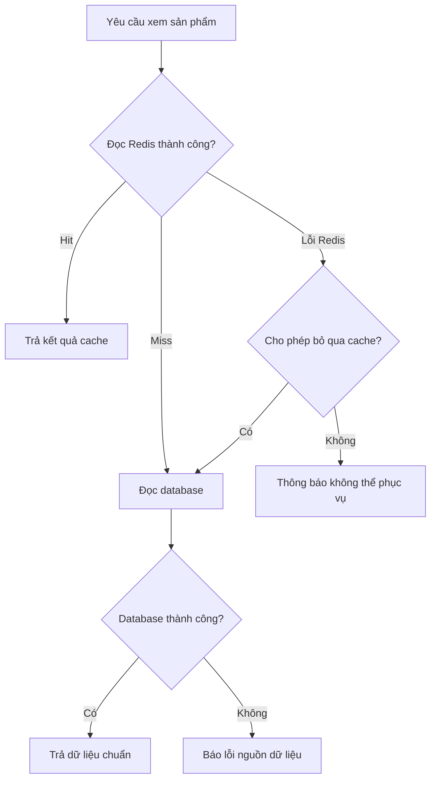
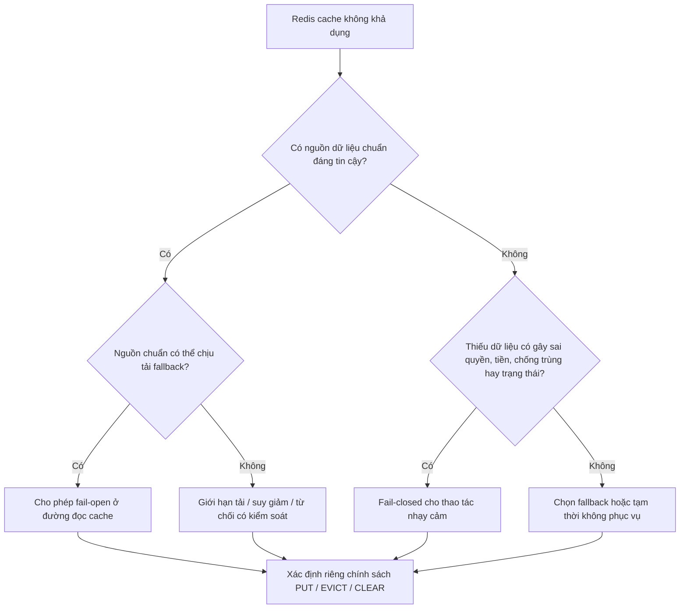

# Chọn fail-open hay fail-closed theo tác động nghiệp vụ trong Spring Data Redis

## 1. Khi Redis Cache gặp lỗi, ứng dụng nên làm gì?

Một ứng dụng Spring Boot dùng Redis để giảm tải cơ sở dữ liệu thường có luồng đọc:

```text
HTTP request
    |
    v
Service (@Cacheable)
    |
    +--> Redis cache hit  --> Trả kết quả
    |
    +--> Redis cache miss --> Đọc nguồn dữ liệu chính
                              |
                              +--> Lưu kết quả vào Redis
                              |
                              +--> Trả kết quả
```

Khi Redis hoạt động, hai luồng trên dễ hiểu. Nhưng nếu Redis **mất kết nối, timeout, từ chối lệnh hoặc cạn tài nguyên** thì phải quyết định liệu nghiệp vụ có được tiếp tục hay không.

Có hai chiến lược cơ bản:

- **Fail-open:** khi tầng cache không hoạt động, ứng dụng bỏ qua lỗi cache trong phạm vi cho phép rồi thực hiện đường xử lý nghiệp vụ còn đáng tin cậy, chẳng hạn đọc dữ liệu sản phẩm trực tiếp từ cơ sở dữ liệu chính.
- **Fail-closed:** nếu không thể xác minh một điều kiện bắt buộc bằng nguồn đáng tin cậy, ứng dụng từ chối hoặc tạm dừng thao tác, không tự suy đoán rằng thao tác được phép.

Trong hệ thống cache, **fail-open không có nghĩa “mở mọi quyền truy cập”**. Nó có nghĩa lỗi **bộ tăng tốc cache** không chặn một thao tác mà ứng dụng vẫn có thể hoàn thành an toàn bằng nguồn dữ liệu chuẩn. Ngược lại, fail-closed không nhất thiết phải làm toàn bộ ứng dụng ngừng chạy; chỉ các thao tác không còn điều kiện an toàn cần bị từ chối.

Điểm quyết định là **tác động nghiệp vụ của dữ liệu không có, dữ liệu cũ hoặc thao tác cache thất bại**. Không nên áp dụng duy nhất một chính sách cho tất cả cache trong hệ thống.

## 2. Phân biệt lỗi cache với cache miss

Redis trả về *cache miss* khi không tìm thấy key hợp lệ, ví dụ key chưa tồn tại hoặc đã hết TTL. Đây thường là trạng thái bình thường.

Lỗi cache là tình huống thao tác truy cập Redis thất bại vì một nguyên nhân kỹ thuật:

```text
Cache miss:
  GET product:1001 -> không có giá trị
  Ứng dụng tải dữ liệu từ nguồn chính

Cache error:
  GET product:1001 -> timeout / connection refused / lỗi Redis
  Ứng dụng cần quyết định fail-open hoặc fail-closed
```

Một `@Cacheable` thông thường xử lý cache miss bằng cách chạy phương thức nguồn rồi có thể lưu kết quả vào cache. Nhưng khi có exception trong thao tác cache, hành vi phụ thuộc cơ chế xử lý lỗi của Spring Cache.

Theo mặc định, Spring Cache sử dụng `SimpleCacheErrorHandler`, thường **ném lại ngoại lệ** phát sinh từ các thao tác `get`, `put`, `evict` và `clear`. Điều đó có thể khiến lỗi Redis lan lên luồng HTTP, dù cơ sở dữ liệu chính vẫn khỏe.

Ta có thể thay đổi hành vi bằng `CacheErrorHandler` để quyết định thao tác nào được phép bỏ qua lỗi cache và thao tác nào phải báo lỗi.

### Ba trường hợp phải phân biệt

| Trạng thái | Kết quả cache | Hành động thường mong muốn |
|---|---|---|
| Hit | Có dữ liệu phù hợp, còn hiệu lực | Dùng dữ liệu cache theo chính sách nhất quán |
| Miss | Không có entry | Chạy phương thức đọc nguồn chính, có thể ghi cache |
| Error | Không thể xác định/ghi/xóa entry do lỗi kỹ thuật | Áp dụng chính sách fail-open hoặc fail-closed theo nghiệp vụ |

Một lỗi Redis được bỏ qua ở **đường đọc** có thể được đối xử gần như cache miss: nguồn dữ liệu chính được dùng để phục vụ request. Nhưng một lỗi Redis được bỏ qua ở **đường xóa** có thể để lại dữ liệu cũ, nên rủi ro khác hoàn toàn.

## 3. Chọn chính sách theo ý nghĩa của dữ liệu

Không nên hỏi “Redis có quan trọng không?” một cách chung chung. Thay vào đó hãy hỏi:

1. Redis đang lưu **bản sao có thể tái tạo** hay **trạng thái duy nhất** cần để quyết định nghiệp vụ?
2. Nếu không đọc được cache, có nguồn dữ liệu chính đáng tin cậy để truy vấn không?
3. Nếu xóa cache thất bại, người dùng có thể nhận **dữ liệu lỗi thời** gây hậu quả gì?
4. Nếu bỏ qua cache, nguồn chính có chịu nổi lượng request tăng đột biến không?
5. Nếu thiếu dữ liệu kiểm soát quyền, hạn mức hoặc chống trùng, ứng dụng có thể tiếp tục an toàn không?
6. Có cơ chế kiểm tra lại, retry, invalidation hoặc phục hồi trạng thái sau khi Redis hoạt động không?

Ví dụ:

| Loại dữ liệu | Khi Redis đọc lỗi | Chính sách thường phù hợp | Điều kiện quan trọng |
|---|---|---|---|
| Danh mục sản phẩm chỉ để hiển thị | Đọc trực tiếp từ database/API chuẩn | Fail-open | Nguồn chuẩn còn hoạt động và được giới hạn tải |
| Ảnh đại diện, gợi ý nội dung | Dùng nội dung mặc định hoặc bỏ phần không bắt buộc | Fail-open | Thiếu gợi ý không làm sai nghiệp vụ |
| Dữ liệu dashboard ít nhạy với độ trễ | Đọc nguồn chính hoặc hiện trạng thái tạm thời | Tùy mức độ | Gắn nhãn khi dữ liệu có thể cũ |
| Giá cuối cùng trước thanh toán | Kiểm tra lại giá từ nguồn chuẩn | Fail-open với cache; fail-closed nếu không xác minh được giá | Không sử dụng giá cache không thể xác minh để chốt thanh toán |
| Quyền truy cập hoặc trạng thái tài khoản bị khóa | Xác minh bằng nguồn phân quyền đáng tin cậy | Fail-closed nếu không thể xác minh | Không mặc định cho phép khi cache lỗi |
| Bộ đếm giới hạn yêu cầu cho chức năng nhạy cảm | Tạm dừng hoặc dùng cơ chế giới hạn thay thế | Thường fail-closed | Phụ thuộc mô hình đe dọa và chi phí từ chối |
| Khóa chống xử lý trùng của thanh toán | Không tiếp tục khi thiếu bảo đảm idempotency | Fail-closed hoặc chuyển sang nguồn bền vững có unique constraint | Redis lock/counter không tự thay thế được trạng thái giao dịch bền vững |
| Giỏ hàng tạm có nguồn phục hồi | Đọc dữ liệu gốc nếu có | Tùy kiến trúc | Không được làm mất thay đổi người dùng chưa lưu |
| Cache trạng thái vận chuyển chỉ để hiển thị | Đọc API nguồn hoặc tạm báo chưa có dữ liệu | Fail-open có giới hạn | Không biến dữ liệu tạm thành quyết định nghiệp vụ cuối cùng |

Đây là **hướng dẫn phân loại**, không phải luật cố định. Cùng tên “cache sản phẩm” nhưng cache dùng để hiển thị danh sách và cache dùng để chốt giá thanh toán có yêu cầu rất khác nhau.

## 4. Xác định nguồn sự thật trước khi chọn fail-open

Giả sử cơ sở dữ liệu quan hệ là nguồn chuẩn của thông tin sản phẩm:



Fail-open hợp lý nếu:

- Redis chỉ là bản sao nhằm tăng tốc.
- Phương thức được cache **không có tác dụng phụ**, chẳng hạn đọc catalog.
- Truy vấn nguồn chuẩn đủ tin cậy để cung cấp kết quả đúng.
- Hệ thống có giới hạn để không làm database quá tải khi tất cả request bỏ qua Redis.

Nếu ứng dụng không có nguồn dữ liệu khác vì Redis **là kho duy nhất** của session hoặc trạng thái xử lý, việc nuốt lỗi Redis không thể tạo ra dữ liệu đáng tin cậy. Khi đó “fail-open” không giải quyết được tính đúng đắn, và một số thao tác phải fail-closed hoặc sử dụng nguồn dự phòng đã được thiết kế.

### Phân biệt hai lớp quyết định

Nhiều hệ thống cần **fail-open ở cache** nhưng **fail-closed ở nghiệp vụ**.

Ví dụ API checkout:

```text
Redis price cache lỗi
    -> Bỏ qua cache, đọc giá mới nhất từ nguồn chuẩn (fail-open tại cache).
    -> Nếu nguồn chuẩn trả giá hợp lệ, tiếp tục.
    -> Nếu không xác minh được giá cuối cùng, dừng thanh toán (fail-closed tại nghiệp vụ).
```

Vì vậy, hai chính sách không nhất thiết đối lập trên toàn hành trình xử lý; mỗi lớp có thể có tiêu chí riêng.

## 5. Spring Cache xử lý lỗi ở đâu?

Với Spring Data Redis, Spring Cache abstraction thường được kết nối với Redis bằng các thành phần:

```text
@Cacheable / @CachePut / @CacheEvict
           |
           v
Spring Cache interceptor
           |
           v
CacheManager (ví dụ RedisCacheManager)
           |
           v
Cache (ví dụ RedisCache)
           |
           v
RedisCacheWriter
           |
           v
RedisConnectionFactory / Redis driver
           |
           v
Redis
```

Spring Framework định nghĩa `CacheErrorHandler` để ứng dụng xử lý lỗi của các thao tác cache mà interceptor thực hiện:

```java
void handleCacheGetError(
        RuntimeException exception,
        Cache cache,
        Object key
);

void handleCachePutError(
        RuntimeException exception,
        Cache cache,
        Object key,
        Object value
);

void handleCacheEvictError(
        RuntimeException exception,
        Cache cache,
        Object key
);

void handleCacheClearError(
        RuntimeException exception,
        Cache cache
);
```

Bốn callback này quan trọng vì hành vi fail-open không nên giống nhau cho mọi loại thao tác.

| Callback | Lỗi xảy ra ở đâu? | Bỏ qua lỗi sẽ dẫn tới điều gì? |
|---|---|---|
| `handleCacheGetError` | Đọc entry | Cache có thể được coi như không có giá trị; phương thức nguồn được gọi |
| `handleCachePutError` | Ghi entry sau tính toán hoặc `@CachePut` | Kết quả nghiệp vụ có thể vẫn được trả về, nhưng entry chưa được cache |
| `handleCacheEvictError` | Xóa một entry | Entry cũ có thể vẫn tồn tại, dẫn tới dữ liệu stale |
| `handleCacheClearError` | Xóa toàn bộ cache | Nhiều entry cũ có thể vẫn tồn tại; không biết đã xóa được bao nhiêu nếu lỗi giữa chừng |

**Hành vi mặc định** của `SimpleCacheErrorHandler` là ném lại exception. Nếu muốn fail-open có chọn lọc, ta định nghĩa handler riêng và chỉ bỏ qua những lỗi mà nghiệp vụ cho phép.

`CacheErrorHandler` chủ yếu áp dụng cho các thao tác cache đi qua **Spring Cache abstraction**. Lỗi từ lời gọi `RedisTemplate` trực tiếp, những hoạt động khởi tạo bean, cache key generation, serialization ngoài ranh giới callback hoặc các API đặc biệt có thể đi qua đường xử lý khác. Đừng xem handler này là lớp bảo vệ mọi tương tác Redis trong ứng dụng.

## 6. Cấu hình CacheErrorHandler theo tên cache và loại thao tác

Ta dùng hai vùng cache với ý nghĩa khác nhau:

- `productView`: dữ liệu sản phẩm chỉ để hiển thị, có thể lấy lại từ database. Với lỗi đọc/ghi cache, cho phép **fail-open**.
- `accessDecision`: dữ liệu quyết định quyền truy cập. Với lỗi cache, cần đi theo quy tắc bảo mật, **không âm thầm cho phép**. Ví dụ dưới đây cho exception nổi lên để tầng nghiệp vụ hoặc API trả về lỗi phù hợp.

Việc **xóa hoặc clear** cache được xử lý thận trọng: handler báo lỗi vì bỏ qua thao tác vô hiệu hóa có thể khiến người dùng tiếp tục nhận dữ liệu cũ sau khi nguồn chính đã thay đổi.

### 6.1. Cài đặt handler

**File: `PolicyAwareCacheErrorHandler.java`**

```java
package com.example.cache;

import org.slf4j.Logger;
import org.slf4j.LoggerFactory;
import org.springframework.cache.Cache;
import org.springframework.cache.interceptor.CacheErrorHandler;

public final class PolicyAwareCacheErrorHandler
        implements CacheErrorHandler {

    private static final Logger log =
            LoggerFactory.getLogger(PolicyAwareCacheErrorHandler.class);

    private boolean isOptionalReadCache(Cache cache) {
        return "productView".equals(cache.getName());
    }

    @Override
    public void handleCacheGetError(
            RuntimeException exception,
            Cache cache,
            Object key
    ) {
        if (isOptionalReadCache(cache)) {
            log.warn(
                    "Cache read unavailable; bypassing cache={}",
                    cache.getName(),
                    exception
            );
            return; // Spring Cache có thể chạy phương thức nguồn.
        }

        throw exception; // Không bỏ qua lỗi cache nhạy cảm.
    }

    @Override
    public void handleCachePutError(
            RuntimeException exception,
            Cache cache,
            Object key,
            Object value
    ) {
        if (isOptionalReadCache(cache)) {
            log.warn(
                    "Cache write failed; response remains uncached, cache={}",
                    cache.getName(),
                    exception
            );
            return; // Kết quả nghiệp vụ đã tính vẫn có thể được dùng.
        }

        throw exception;
    }

    @Override
    public void handleCacheEvictError(
            RuntimeException exception,
            Cache cache,
            Object key
    ) {
        log.error(
                "Cache invalidation failed for cache={}",
                cache.getName(),
                exception
        );
        throw exception;
    }

    @Override
    public void handleCacheClearError(
            RuntimeException exception,
            Cache cache
    ) {
        log.error(
                "Cache clear failed for cache={}",
                cache.getName(),
                exception
        );
        throw exception;
    }
}
```

Handler này **cố ý không nuốt lỗi evict/clear**, kể cả cache `productView`. Lý do: đọc thiếu cache có thể lấy dữ liệu mới từ nguồn chính, nhưng xóa thất bại có thể giữ lại một giá trị cũ và làm các request tiếp theo đọc lại dữ liệu stale.

Tuy nhiên, việc ném lại lỗi evict **không có nghĩa đã rollback thành công thay đổi nghiệp vụ**. Phần sau sẽ giải thích điều này.

### 6.2. Đăng ký với Spring Cache

**File: `CacheFailurePolicyConfig.java`**

```java
package com.example.cache;

import org.springframework.cache.annotation.CachingConfigurer;
import org.springframework.cache.annotation.EnableCaching;
import org.springframework.cache.interceptor.CacheErrorHandler;
import org.springframework.context.annotation.Configuration;

@Configuration
@EnableCaching
public class CacheFailurePolicyConfig implements CachingConfigurer {

    @Override
    public CacheErrorHandler errorHandler() {
        return new PolicyAwareCacheErrorHandler();
    }
}
```

`CachingConfigurer#errorHandler()` cho phép cung cấp handler dùng bởi cơ chế cache annotation của Spring. Nếu dự án đã có một `CachingConfigurer`, hãy hợp nhất cấu hình tại đó để không có nhiều nguồn cấu hình mâu thuẫn.

Trong Spring Boot với `spring-boot-starter-cache` và `spring-boot-starter-data-redis`, cần bảo đảm ứng dụng đang dùng đúng `CacheManager` và vùng cache tương ứng với Redis. `CacheErrorHandler` là cơ chế của Spring Cache nói chung; dù ví dụ dùng Redis, nó cũng có thể nhận lỗi từ những loại cache khác mà cùng interceptor quản lý. Do đó, phân loại theo tên cache, loại thao tác hoặc cấu hình cụ thể thay vì mặc định mọi `Cache` đều là Redis.

**Lưu ý:** Dùng một callback tùy biến với `return` để bỏ qua exception là quyết định chính sách. Không phải mọi loại exception đều nên bị bỏ qua: lỗi cấu hình serializer, schema, key generator hoặc dữ liệu bị hỏng có thể là lỗi lập trình cần được phát hiện sớm. Một handler production nên có chính sách phân loại nguyên nhân đủ hẹp; ví dụ này nhấn mạnh cơ chế chọn fail-open/fail-closed theo nghiệp vụ.

## 7. Ví dụ fail-open an toàn với @Cacheable

Giả sử có một cổng đọc sản phẩm từ database:

```java
package com.example.catalog;

public interface ProductGateway {
    ProductView loadBySku(String sku);
}
```

Kiểu dữ liệu:

```java
package com.example.catalog;

public record ProductView(
        String sku,
        String name,
        long priceInCents
) {
}
```

Service:

**`ProductQueryService.java`**

```java
package com.example.catalog;

import org.springframework.cache.annotation.Cacheable;
import org.springframework.stereotype.Service;

@Service
public class ProductQueryService {

    private final ProductGateway productGateway;

    public ProductQueryService(ProductGateway productGateway) {
        this.productGateway = productGateway;
    }

    @Cacheable(cacheNames = "productView", key = "#p0")
    public ProductView findBySku(String sku) {
        return productGateway.loadBySku(sku);
    }
}
```

`ProductGateway` là abstraction ví dụ; ứng dụng cần cung cấp implementation truy vấn database/API chuẩn của mình.

Luồng xử lý:

1. Spring Cache kiểm tra key tương ứng với `sku` trong cache `productView`.
2. Nếu có hit, trả dữ liệu đã cache.
3. Nếu miss, gọi `ProductGateway.loadBySku`, sau đó cố ghi cache.
4. Nếu Redis `GET` bị lỗi và handler chọn fail-open, Spring Cache tiếp tục như khi cache không cung cấp kết quả: gọi phương thức nguồn.
5. Nếu database đọc thành công nhưng ghi Redis thất bại, callback `handleCachePutError` bỏ qua lỗi đối với cache này; người dùng vẫn có thể nhận sản phẩm.

Đây là hành vi hợp lý cho **dữ liệu chỉ để hiển thị**, khi nguồn chính có thể phục vụ request.

### Fail-open có giới hạn

Nếu Redis bị ngắt hoàn toàn, trước đây 1.000 request có thể có 900 cache hit, còn bây giờ cả 1.000 request đều vào database. Mặc dù handler đã bỏ qua lỗi cache, hệ thống có thể quá tải ở tầng nguồn chính.

Do đó fail-open cần đi cùng bảo vệ tải:

- Giới hạn số request đồng thời tới nguồn chính.
- Cấu hình timeout truy cập Redis phù hợp thay vì chờ quá lâu cho mỗi request.
- Dùng circuit breaker hoặc cơ chế tạm thời bypass Redis khi lỗi lặp lại.
- Có rate limit, bulkhead và kết quả dự phòng khi nguồn chính không chịu được tải.
- Theo dõi số cache hit, miss, error và lượng truy vấn database tăng.

**Bỏ qua exception không đồng nghĩa hệ thống đã có khả năng chống sự cố Redis một cách hoàn chỉnh.**

## 8. Fail-closed với dữ liệu phân quyền và kiểm soát rủi ro

Hãy xét API xem thông tin tài khoản khách hàng. Redis có thể cache một quyết định `ALLOW`/`DENY` để giảm số lần truy vấn hệ thống phân quyền.

Một lỗi thường gặp là:

```java
try {
    return permissionsCache.get(userId);
} catch (RuntimeException ex) {
    return true; // NGUY HIỂM: Redis lỗi thì mặc định cho phép.
}
```

Đây là **fail-open ở lớp an ninh**, có thể tạo lỗ hổng: khi không xác minh được người dùng có quyền hay không thì hệ thống lại cho phép.

Cách tiếp cận an toàn hơn:

```text
Cache quyền truy cập lỗi
    |
    +--> Có nguồn phân quyền chuẩn khả dụng?
    |        |
    |        +--> Có: kiểm tra quyền từ nguồn chuẩn
    |        |        |
    |        |        +--> Được phép: tiếp tục
    |        |        +--> Từ chối: chặn
    |        |
    |        +--> Không: từ chối/tạm dừng thao tác nhạy cảm
    |
    +--> Ghi nhận sự cố, không mặc định ALLOW
```

Nếu dùng `@Cacheable(cacheNames = "accessDecision")` với handler ở phần trước, lỗi đọc cache này được ném lại. Tầng service hoặc một bộ phận phân quyền chuyên trách phải định nghĩa cách xác minh từ nguồn chuẩn hay trả về lỗi tạm thời. Không nên gọi `CacheErrorHandler` là lớp kiểm soát quyền đầy đủ.

### Ví dụ service có kiểm tra nguồn chuẩn

```java
package com.example.security;

import org.springframework.stereotype.Service;

@Service
public class ProtectedActionService {

    private final AuthorizationSource authorizationSource;

    public ProtectedActionService(
            AuthorizationSource authorizationSource
    ) {
        this.authorizationSource = authorizationSource;
    }

    public void execute(String userId, String resourceId) {
        boolean allowed =
                authorizationSource.canModify(userId, resourceId);

        if (!allowed) {
            throw new SecurityException("Access denied");
        }

        performAuthorizedChange(resourceId);
    }

    private void performAuthorizedChange(String resourceId) {
        // Thực thi thao tác đã được cấp quyền.
    }
}
```

`AuthorizationSource` đại diện cho hệ thống phân quyền đáng tin cậy, không phải class có sẵn của Spring. Trong thực tế, nếu nguồn đó không thể trả về một quyết định đáng tin cậy, thao tác phải kết thúc theo chính sách fail-closed. Ví dụ chỉ tập trung vào việc **không quyết định cho phép dựa trên lỗi cache**.

**Phân biệt mã trạng thái HTTP:** người dùng được xác định rõ không có quyền có thể nhận `403 Forbidden`. Khi hệ thống không thể xác minh do nguồn phân quyền bị lỗi, `503 Service Unavailable` có thể diễn tả sự cố tạm thời chính xác hơn `403`. Dù chọn cách hiển thị nào, hành động nhạy cảm không được thực thi khi điều kiện cho phép chưa được xác nhận.

## 9. Lỗi GET, PUT, EVICT và CLEAR có mức rủi ro khác nhau

Chính sách chỉ dựa trên tên cache chưa đủ. Phải xét **giai đoạn lỗi**.

### 9.1. GET: đọc cache thất bại

Nếu dữ liệu có nguồn chính có thể truy cập, bỏ qua lỗi GET và đọc nguồn là lựa chọn hợp lý. Bỏ qua lỗi GET vẫn có thể ảnh hưởng hiệu năng và độ trễ, nhưng thường không làm dữ liệu bị sửa sai.

Với dữ liệu nhạy cảm, đừng tự giả định giá trị khi không thể đọc được cache. Lấy quyết định từ nguồn tin cậy, nếu không có thì chặn thao tác.

### 9.2. PUT: ghi cache thất bại

Với `@Cacheable`:

```text
Cache miss / lỗi GET được bỏ qua
    -> Chạy phương thức đọc nguồn
    -> Nhận kết quả
    -> Redis PUT thất bại
    -> Nếu cho phép fail-open: trả kết quả, không cache
```

Ở đây, bỏ qua lỗi ghi thường chấp nhận được nếu cache là một **bản sao có thể tái tạo**.

Với `@CachePut`, phương thức nghiệp vụ luôn được gọi theo cơ chế của annotation; ghi cache sau đó có thể lỗi. Nếu nghiệp vụ đã cập nhật thành công nhưng cache put thất bại, việc trả lỗi cho client cũng có thể khiến client retry và thực hiện nghiệp vụ lặp lại. Cần tính đến idempotency và semantics của phương thức.

### 9.3. EVICT: không xóa được dữ liệu cũ

Giả sử cache giữ sản phẩm có giá 100.000 đồng. Database vừa đổi giá thành 120.000 đồng. Nếu Redis evict thất bại, cache có thể tiếp tục trả giá 100.000 đồng.

```text
Database: 120.000
Redis cache: 100.000 (chưa được xóa)
Client: nhận dữ liệu cũ từ cache
```

Với dữ liệu hiển thị ít quan trọng, chấp nhận stale trong một khoảng TTL có thể được phép. Với checkout, phân quyền hoặc trạng thái khóa tài khoản, đó có thể là sai lệch nghiêm trọng.

Vì vậy, chính sách lỗi **evict/clear** cần được thiết kế riêng, thường nghiêm ngặt hơn lỗi GET/PUT.

### 9.4. CLEAR: xóa cả vùng cache thất bại

`Cache.clear()` hoặc `@CacheEvict(allEntries = true)` có thể thực hiện nhiều lệnh Redis để tìm và xóa key. Một lỗi giữa chừng có thể tạo trạng thái **đã xóa một phần**, không phải nguyên vẹn hoặc xóa hết.

Không nên giả định rằng exception từ `clear` chứng minh “chưa key nào bị xóa” hoặc “cache đã rỗng”. Các chiến lược `KEYS`/`SCAN` trong RedisCacheWriter có cách quét và giới hạn riêng; với Redis keyspace lớn, thao tác clear không phải một giao dịch nguyên tử.

## 10. Cẩn trọng với @CacheEvict: ném lỗi chưa chắc đã rollback nghiệp vụ

Một đoạn mã đơn giản:

```java
@CacheEvict(cacheNames = "productView", key = "#p0")
public void changeProduct(String sku, ProductUpdate update) {
    productRepository.update(sku, update);
}
```

Theo mặc định, `@CacheEvict` chạy **sau khi phương thức hoàn tất thành công**. Nếu database đã được cập nhật rồi Redis evict thất bại, chuyện sau có thể xảy ra:

```text
1. Database update thành công.
2. Spring Cache cố xóa entry cũ.
3. Redis timeout.
4. CacheErrorHandler ném exception.
5. Client nhận lỗi, nhưng database có thể đã thay đổi.
6. Redis cache vẫn có thể chứa dữ liệu cũ.
```

Đây là điểm cực kỳ quan trọng: **“fail-closed khi evict” bằng cách ném exception không bảo đảm đảo ngược thao tác nghiệp vụ trước đó**. Kể cả method có `@Transactional`, còn phải xét thời điểm interceptor cache và transaction chạy, loại transaction manager, commit thật sự và khả năng rollback của những tài nguyên liên quan.

Nếu client retry một request ghi sau khi nhận lỗi, hệ thống còn có thể tạo thêm lỗi lặp nghiệp vụ nếu endpoint không idempotent.

### beforeInvocation = true có giải quyết được không?

`@CacheEvict(beforeInvocation = true)` yêu cầu evict **trước khi** method được gọi:

```java
@CacheEvict(
        cacheNames = "productView",
        key = "#p0",
        beforeInvocation = true
)
public void changeProduct(String sku, ProductUpdate update) {
    productRepository.update(sku, update);
}
```

Nếu Redis lỗi và handler ném exception, phương thức nghiệp vụ có thể chưa được thực thi. Nhưng cách này cũng có mặt trái:

- Nếu xóa cache thành công rồi database update thất bại, entry cũ đã biến mất; thường chỉ gây cache miss, nhưng có chi phí.
- Nếu giữa lúc evict và lúc database commit có request đọc từ nguồn cũ, cache có thể được nạp lại bằng dữ liệu cũ.
- Evict trước method không tự tạo một giao dịch nguyên tử giữa Redis và database.

Do vậy, đổi `beforeInvocation` chỉ giải quyết **thời điểm gọi evict**, không thay thế thiết kế nhất quán dữ liệu.

## 11. Cách duy trì nhất quán khi invalidation thất bại

Nếu ứng dụng chỉ dùng Redis làm cache cho database, có thể chọn một trong các thiết kế dưới đây tùy mức độ yêu cầu.

### 11.1. Chấp nhận stale tạm thời có TTL

Với catalog hiển thị ít rủi ro, có thể chấp nhận cache cũ trong một khoảng ngắn, ví dụ 1–5 phút. Khi evict thất bại, cache tự hết TTL rồi được nạp lại.

**Điều kiện:** giới hạn mức độ stale được thỏa thuận ở nghiệp vụ. TTL ngắn cũng tăng tải về nguồn chính khi cache miss thường xuyên.

### 11.2. Invalidate sau commit, có retry

Đối với các thay đổi dữ liệu chuẩn:

```text
Giao dịch database thành công
     |
     v
Yêu cầu invalidate cache
     |
     +--> Thành công: kết thúc
     |
     +--> Thất bại: ghi trạng thái để retry
                         |
                         v
                    Retry có backoff
```

Cần tránh việc chỉ log lỗi rồi mất hoàn toàn yêu cầu invalidation. Nếu cần **không bỏ sót yêu cầu**, một thông điệp nằm trong bộ nhớ tiến trình không đủ bền vững.

### 11.3. Transactional outbox

Khi dữ liệu nghiệp vụ nằm ở SQL và yêu cầu xóa cache phải **được thực hiện cuối cùng dù Redis đang lỗi**, có thể ghi sự kiện vào outbox trong cùng transaction với thay đổi SQL.

Ví dụ:

```text
SQL transaction:
  UPDATE products SET price = ... WHERE sku = ...
  INSERT INTO outbox(type, entity_id) VALUES ('PRODUCT_CHANGED', sku)
  COMMIT

Worker sau commit:
  Đọc outbox
  -> Xóa Redis cache key tương ứng
  -> Ghi nhận đã xử lý
  -> Retry nếu Redis lỗi
```

Đây là cơ chế *eventual consistency* có thể khôi phục. Nó không đảm bảo Redis được cập nhật cùng thời điểm SQL commit, nhưng tránh việc mất vĩnh viễn yêu cầu invalidation chỉ vì Redis tạm thời không truy cập được.

### 11.4. Key version hoặc epoch

Với cache rộng hoặc dữ liệu cần chuyển thế hệ, có thể đưa version của nguồn dữ liệu vào cache key:

```text
productView:v1:SKU-1001
productView:v2:SKU-1001
```

Khi version thay đổi, request mới đọc namespace mới; những key cũ được dọn sau theo TTL. Phải bảo đảm mọi instance sử dụng version hiện hành từ nguồn đáng tin cậy, nếu không phiên bản cũ vẫn có thể được phục vụ.

Khi yêu cầu “không bao giờ trả giá cũ lúc checkout”, có thể buộc đường checkout đọc giá từ nguồn chuẩn; chỉ đổi cache key của trang danh mục không thay thế bước xác minh cuối cùng đó.

## 12. Cấu hình Redis Cache cùng với chính sách lỗi

Một cấu hình cơ bản cho Spring Boot có thể gồm các starter:

**Gradle:**

```kotlin
dependencies {
    implementation("org.springframework.boot:spring-boot-starter-cache")
    implementation("org.springframework.boot:spring-boot-starter-data-redis")
}
```

Kết nối Redis ví dụ:

```yaml
spring:
  data:
    redis:
      host: localhost
      port: 6379
      timeout: 300ms
      connect-timeout: 300ms
```

Các timeout này **chỉ để minh họa**; giá trị thích hợp phải được đo theo độ trễ mạng, thời gian đáp ứng của Redis và ngân sách timeout của request. Thời gian chờ quá dài khiến mọi request fail-open phải chờ Redis thất bại trước khi được đọc database; quá ngắn có thể biến dao động bình thường thành lỗi không cần thiết.

Ví dụ CacheManager chỉ cho cache `productView`:

```java
package com.example.cache;

import java.time.Duration;

import org.springframework.cache.annotation.EnableCaching;
import org.springframework.context.annotation.Bean;
import org.springframework.context.annotation.Configuration;
import org.springframework.data.redis.cache.RedisCacheConfiguration;
import org.springframework.data.redis.cache.RedisCacheManager;
import org.springframework.data.redis.connection.RedisConnectionFactory;

@Configuration
@EnableCaching
public class RedisCacheConfig {

    @Bean
    public RedisCacheManager cacheManager(
            RedisConnectionFactory connectionFactory
    ) {
        RedisCacheConfiguration config =
                RedisCacheConfiguration.defaultCacheConfig()
                        .entryTtl(Duration.ofMinutes(5))
                        .computePrefixWith(
                                cacheName -> "shop:v1:" + cacheName + "::"
                        )
                        .disableCachingNullValues();

        return RedisCacheManager.builder(connectionFactory)
                .cacheDefaults(config)
                .build();
    }
}
```

Ở đây:

- `entryTtl` giúp giới hạn thời gian dữ liệu hiển thị có thể cũ.
- Prefix giúp phân tách vùng dữ liệu; thao tác xóa cache có phạm vi tên rõ ràng.
- `disableCachingNullValues()` là lựa chọn mô hình; không tự ngăn tất cả lỗi dữ liệu thiếu.
- `CacheErrorHandler` điều khiển cách phản ứng khi cache lỗi; `RedisCacheConfiguration` điều khiển TTL, prefix và serialization. Chúng giải quyết các vấn đề khác nhau.

Nếu dự án đã có `RedisCacheManager` hoặc `CachingConfigurer`, nên tích hợp chính sách vào cấu hình hiện hữu để tránh tạo bean trùng hoặc làm annotation sử dụng sai CacheManager.

### Lưu ý về cache đã lỗi và nguồn chính

CacheManager không phải cơ chế circuit breaker; nó không tự giới hạn tỷ lệ truy vấn database khi Redis bị sập. Để fail-open an toàn ở quy mô lớn, cần thêm chính sách bảo vệ nguồn chính ở tầng service hoặc hạ tầng.

## 13. Phân loại lỗi kỹ thuật trước khi bỏ qua

Không phải mọi `RuntimeException` từ tầng cache đều đáng được nuốt.

Những nguyên nhân thường gặp:

| Nhóm lỗi | Ví dụ | Hành động nên cân nhắc |
|---|---|---|
| Lỗi khả dụng tạm thời | Timeout, mất kết nối, failover Redis | Có thể fail-open cho cache tùy chọn; cảnh báo và giảm tải |
| Redis từ chối do quyền | ACL sai, sai xác thực | Cần điều tra cấu hình/quyền; tránh che giấu vô thời hạn |
| Sai serializer/schema | Không giải mã được dữ liệu cũ | Có thể cần migration, vô hiệu hóa key lỗi hoặc thay đổi model |
| Key không đúng kiểu Redis | `WRONGTYPE` do service khác ghi đè | Sửa phân vùng keyspace; không chỉ bỏ qua |
| Cạn tài nguyên | Redis maxmemory, lỗi ghi | Cân nhắc cho phép đọc nguồn nhưng ghi cache không thành; theo dõi memory |
| Lỗi cấu hình ứng dụng | Bean/cache name/key generator sai | Đưa ra lỗi rõ; handler không thay thế việc sửa bug |
| Redis Cluster chuyển node | Redirect, failover, topology chưa cập nhật | Driver và retry phù hợp; giới hạn thời gian chờ |

Trong mã minh họa, handler cho `productView` bỏ qua mọi `RuntimeException` của `GET` và `PUT` để minh họa fail-open theo cache. **Trong production**, chính sách nên xem xét thêm loại lỗi và mức độ nghiêm trọng, có thể chỉ bỏ qua lỗi mất khả dụng được cho phép, đồng thời phát cảnh báo rõ ràng cho lỗi mapping.

Đừng ghi trực tiếp object key hoặc value vào log nếu chúng có thể chứa thông tin nhạy cảm. Ghi tên cache, loại thao tác, nhóm exception, thời lượng và mã tương quan request thường đủ phục vụ quan sát.

## 14. Bảo vệ database khi Redis bị mất khả dụng

Một sự cố Redis có thể tạo ra hiệu ứng *cache stampede*: nhiều request đồng thời không còn nhận cache hit và cùng truy vấn nguồn dữ liệu chính.

Ví dụ:

```text
Bình thường:
  10.000 req/s -> Redis hit 9.500 -> Database chỉ xử lý 500

Khi Redis lỗi:
  10.000 req/s -> Redis không đáp ứng -> Database có thể nhận 10.000
```

Những con số chỉ minh họa độ thay đổi tải. Nếu database được thiết kế cho 500 req/s, việc “fail-open” không giới hạn có thể chuyển sự cố Redis thành sự cố toàn bộ hệ thống.

Các cách giảm tải:

**Giới hạn đồng thời (*bulkhead*).** Chỉ cho một số lượng truy vấn nguồn chính nhất định chạy đồng thời; request còn lại nhận lỗi tạm thời hoặc phương án suy giảm có kiểm soát.

**Rate limit và backpressure.** Bảo vệ service trước lưu lượng cao bất thường. Với chức năng bắt buộc phải xử lý, có thể chuyển sang hàng đợi thay vì tạo quá nhiều truy vấn đồng thời.

**Circuit breaker.** Sau một ngưỡng lỗi, tạm ngừng gọi Redis để tránh mỗi request phải đợi timeout. Khi Redis hồi phục, cho phép một số lượt thử dò trạng thái và đóng circuit trở lại.

**Coalescing và single-flight.** Với những key hay bị truy vấn, giới hạn số lần tải đồng thời từ database nếu dữ liệu nguồn hỗ trợ chia sẻ kết quả.

**Fallback mức nghiệp vụ.** Chẳng hạn đề xuất sản phẩm có thể biến mất tạm thời; danh mục có thể hiển thị phần thông tin tối thiểu; nhưng checkout không được bỏ qua kiểm tra giá hoặc quyền.

**Lưu ý:** `@Cacheable(sync = true)` nhằm đồng bộ việc nạp cache trong những điều kiện hỗ trợ tương ứng, nhưng cách gọi qua `Cache.get(key, Callable)` có đường thực thi riêng. Không được giả định handler `get/put` ở ví dụ bao phủ mọi hành vi của chế độ `sync = true` hay thay thế kiểm soát tải. Nếu ứng dụng dùng chế độ đặc biệt, cần thiết kế policy và cơ chế xử lý lỗi theo đúng API thực tế.

## 15. Fail-open/fail-closed cho những chức năng dễ nhầm với cache

Redis thường được dùng cho nhiều mục đích **khác cache**: lock, rate limiter, idempotency key, session store, queue hoặc trạng thái workflow. Những thành phần này có hậu quả khi Redis lỗi rất khác so với `@Cacheable`.

### 15.1. Rate limiting

Nếu Redis giữ bộ đếm request để bảo vệ API công khai, bỏ qua lỗi bộ đếm có thể mở đường cho spam hoặc DDoS. Nếu là chức năng ít rủi ro, có thể dùng giới hạn thay thế tại gateway/instance để duy trì dịch vụ.

Chọn policy tùy endpoint:

```text
Đọc trang công khai:
  Redis limiter lỗi -> gateway local limiter / kiểm soát tải thay thế

Thử mật khẩu, OTP, thanh toán nhạy cảm:
  Redis limiter lỗi -> không cho thực hiện nếu không có kiểm soát đáng tin cậy
```

Không nên gọi một bộ đếm rate-limit là “cache tùy chọn” rồi áp dụng fail-open như cache catalog.

### 15.2. Distributed lock

Khi một tác vụ giữ lock trong Redis để ngăn hai worker chạy song song, lỗi Redis có thể khiến ứng dụng không biết mình có quyền thực thi duy nhất hay không.

Nếu không còn bảo đảm độc quyền, nên dừng thao tác cần bảo vệ hoặc dựa vào một cơ chế khác như fencing token/unique constraint/trạng thái bền vững. Bỏ qua lỗi lock để chạy tiếp có thể dẫn đến ghi trùng hoặc mất dữ liệu.

### 15.3. Session và đăng nhập

Nếu Redis là session store duy nhất, mất Redis có thể làm mất khả năng xác thực phiên hiện tại. Không nên cấp quyền chỉ vì không đọc được session. Có thể yêu cầu đăng nhập lại hoặc trả lỗi tạm thời.

Nếu hệ thống có token tự xác thực hợp lệ và không phụ thuộc session Redis, hành vi khác đi; nhưng vẫn phải xét danh sách thu hồi token, quyền truy cập và chính sách đăng xuất trước khi quyết định tiếp tục.

### 15.4. Idempotency của giao dịch quan trọng

Idempotency token dùng để bảo đảm một lệnh thanh toán/đặt chỗ không bị xử lý hai lần. Nếu Redis đang là nơi kiểm tra token và mất kết nối, bỏ qua lỗi kiểm tra có thể gây thực hiện trùng.

Với thao tác này, fail-closed thường phù hợp trừ khi có cơ chế bền vững thay thế bảo đảm xử lý đúng, chẳng hạn unique constraint hoặc trạng thái giao dịch trong database chuẩn.

## 16. Thiết kế policy theo mức độ rủi ro và operation

Có thể xây dựng ma trận quyết định ngay trong tài liệu kiến trúc của ứng dụng:

| Cache/nhóm chức năng | GET lỗi | PUT lỗi | EVICT/CLEAR lỗi | Điều kiện cho phép tiếp tục |
|---|---|---|---|---|
| `productView` (hiển thị) | Bỏ qua cache, đọc DB | Bỏ qua ghi cache | Cảnh báo; retry/invalidate hoặc chấp nhận stale theo TTL | DB khỏe; dữ liệu cũ không gây thiệt hại lớn |
| `recommendation` | Dùng fallback | Bỏ qua | Có thể ghi nhận và bỏ qua nếu việc stale chấp nhận được | Thiếu gợi ý không cản trở tác vụ chính |
| `checkoutPrice` | Đọc giá chuẩn | Không phụ thuộc cache | Phải bảo đảm checkout đọc lại giá chuẩn | Không chốt giá từ bản cache không xác minh |
| `accessDecision` | Chuyển sang nguồn phân quyền hoặc dừng | Không ảnh hưởng quyết định chuẩn | Phải duy trì quyền cập nhật/thu hồi đúng | Không cấp quyền nếu không xác minh được |
| `fraudSignal` | Dừng hoặc cơ chế kiểm soát dự phòng | Không bỏ qua nếu tín hiệu bắt buộc | Không dùng dữ liệu phân tích cũ để cho phép rủi ro | Chính sách rủi ro của tổ chức |
| `analyticsWidget` | Fallback hoặc trả lỗi nhẹ | Bỏ qua | Có thể trì hoãn | Không dùng kết quả làm quyết định bắt buộc |

**Không định nghĩa policy chỉ bằng một boolean `failOpen=true` áp dụng cho cả GET, PUT và EVICT.** Cùng cache nhưng lỗi xóa có thể nguy hiểm hơn lỗi đọc.

Nếu nhiều dịch vụ cùng dùng Redis, phải thống nhất chính sách tại cấp luồng nghiệp vụ, không chỉ trong lớp cấu hình từng service. Ví dụ service đọc cache giá không thể tự quyết rằng cache giá luôn đáng tin nếu service cập nhật giá đang bỏ qua lỗi invalidation.

## 17. Fail-closed đúng cách: trả lỗi có chủ đích, tránh gây trùng thao tác

Khi quyết định từ chối một thao tác vì không thể xác minh trạng thái bắt buộc, ứng dụng nên:

1. Dừng trước điểm gây tác động không thể đảo ngược nếu có thể.
2. Trả lỗi rõ là **không thể xử lý an toàn**, thay vì tự coi người dùng đã thực hiện thành công.
3. Giữ khả năng client retry khi lỗi tạm thời và bảo đảm retry không gây thực hiện hai lần.
4. Ghi log/metrics và tạo cảnh báo để đội vận hành biết vì sao yêu cầu bị từ chối.
5. Nếu đã bắt đầu một thao tác, dùng trạng thái nghiệp vụ bền vững để xác định kết quả trước khi cho phép thử lại.

Đối với thay đổi SQL rồi evict cache, việc Redis evict thất bại có thể đến **sau** khi SQL đã commit. Nếu trả HTTP 500 và client retry toàn bộ thao tác, ứng dụng phải có idempotency key hoặc cơ chế phát hiện thao tác đã hoàn tất. Chỉ ném exception từ `CacheErrorHandler` không tự đảm bảo điều kiện đó.

### Phân biệt lỗi chặn nghiệp vụ và lỗi che giấu

- **Chặn nghiệp vụ:** vì thiếu điều kiện an toàn thật sự, ví dụ không thể xác minh quyền.
- **Không cho cache cản nghiệp vụ:** vì nguồn chuẩn đủ an toàn, ví dụ lấy mô tả sản phẩm từ database.
- **Báo lỗi nhưng đã có side effect:** tình huống nguy hiểm cần điều tra/truy vết, không thể gọi đơn giản là “rollback” hoặc “không làm gì”.

Phân loại đúng ba trường hợp giúp thiết kế API, retry và cảnh báo chính xác.

## 18. Một quy trình ra quyết định có thể áp dụng

Khi thêm cache mới, nên đi từ kết quả nghiệp vụ đến cách xử lý lỗi:



Sau khi phân loại, cần ghi lại các tiêu chí cụ thể:

| Câu hỏi thiết kế | Kết quả cần có |
|---|---|
| Dữ liệu cache thuộc nghiệp vụ nào? | Tên cache và chủ sở hữu nghiệp vụ |
| Dữ liệu chuẩn nằm ở đâu? | Database/API/service được tin cậy |
| Cho phép stale bao lâu? | TTL và mức chấp nhận dữ liệu cũ |
| Redis GET lỗi thì sao? | Fallback hoặc từ chối |
| Redis PUT lỗi thì sao? | Có cần báo lỗi cho người dùng không? |
| Redis EVICT/CLEAR lỗi thì sao? | Retry, outbox, TTL hoặc fail-closed tại điểm ghi |
| Redis lỗi toàn bộ thì lưu lượng đi đâu? | Giới hạn tải, timeout, circuit breaker |
| Cần kết quả đúng tuyệt đối không? | Quy tắc xác minh nguồn chuẩn/điều kiện ghi |
| Làm sao quan sát failover? | Metrics, logs, alert, dashboard |

Không có câu trả lời đúng chỉ dựa vào việc Redis chạy standalone, Sentinel hay Cluster. Topology quyết định khả năng hoạt động của cache; tác động nghiệp vụ mới quyết định fail-open hay fail-closed.

## 19. Quan sát lỗi và thử nghiệm tình huống suy giảm

Một chính sách fail-open dễ khiến hệ thống “trông như vẫn ổn” trong khi Redis liên tục lỗi. Nếu không có giám sát, khả năng phục hồi trở thành một cách che giấu sự cố.

Các chỉ số hữu ích:

- Số lần lỗi cache theo `cacheName` và operation `GET/PUT/EVICT/CLEAR`.
- Tỷ lệ request phải fallback sang database.
- Tỷ lệ cache hit/miss và độ trễ tải nguồn chuẩn.
- Số request bị từ chối do không xác minh được điều kiện bắt buộc.
- Số tác vụ invalidation đang chờ retry và thời gian tồn đọng.
- Số lần circuit breaker mở, thời gian phục hồi và số lần mở lại.
- Tải CPU, connection pool, query latency của database khi Redis gặp sự cố.

Không log toàn bộ key/value khi chúng có thể chứa token, email, dữ liệu cá nhân hoặc thông tin nghiệp vụ nhạy cảm. Có thể gắn nhãn theo tên cache, operation, nhóm lỗi và trace ID.

### Kịch bản kiểm tra chức năng

Khi xây dựng hệ thống production, có thể kiểm tra các tình huống dưới đây trong môi trường thử nghiệm:

**Kịch bản A — cache catalog mất kết nối:**

```text
Redis bị ngắt
GET productView:SKU-1 -> exception
CacheErrorHandler bỏ qua lỗi đọc
ProductGateway đọc database -> có sản phẩm
API trả dữ liệu đúng, metrics ghi nhận fallback
```

**Kịch bản B — nguồn chính cũng hỏng:**

```text
Redis GET lỗi
Handler bỏ qua
Database/API chuẩn cũng timeout
API trả lỗi có kiểm soát
```

Fail-open cache không có nghĩa bỏ qua lỗi của nguồn chính hoặc tạo dữ liệu giả.

**Kịch bản C — dữ liệu phân quyền không thể xác minh:**

```text
Redis accessDecision lỗi
Nguồn phân quyền chuẩn cũng không khả dụng
Ứng dụng từ chối thao tác được bảo vệ
```

**Kịch bản D — xóa cache thất bại sau cập nhật DB:**

```text
SQL update đã commit
Redis EVICT timeout
Log và metrics ghi nhận lỗi invalidation
Yêu cầu retry invalidation được lưu/điều phối theo thiết kế
Đường nghiệp vụ nhạy cảm không chốt từ entry chưa được xác minh
```

**Kịch bản E — lỗi Redis kéo dài:**

```text
Nhiều GET cache lỗi
Circuit breaker mở hoặc cơ chế bypass kích hoạt
Lưu lượng tới DB được giới hạn
Ứng dụng tiếp tục một phần tính năng an toàn
Khi Redis phục hồi, cache được làm nóng lại có kiểm soát
```

Trong giai đoạn tích hợp, cần đảm bảo thiết kế logging/observability đủ phân biệt **cache miss bình thường** và **lỗi cache đã được nuốt**; nếu không, biểu đồ cache miss có thể che khuất nguyên nhân tải database tăng bất thường.

## 20. Những sai lầm thường gặp

| Sai lầm | Hậu quả | Cách sửa |
|---|---|---|
| Áp dụng fail-open cho mọi cache | Có thể bỏ qua quyết định quyền/giới hạn bắt buộc | Phân loại từng nghiệp vụ, cache và operation |
| Khi Redis lỗi thì tự trả `ALLOW` | Có thể cấp quyền trái phép | Kiểm tra nguồn quyền chuẩn hoặc fail-closed |
| Cho mọi exception từ cache đi qua rồi bỏ qua | Che lỗi serializer, schema và cấu hình | Phân loại nguyên nhân; log/alert phù hợp |
| Nuốt lỗi `EVICT` giống lỗi `GET` | Dữ liệu stale có thể tồn tại sau khi nguồn thay đổi | Tách chính sách invalidation, TTL và retry |
| Ném exception từ `@CacheEvict` và tin rằng SQL rollback | SQL có thể đã commit trước khi Redis evict lỗi | Thiết kế sau commit/outbox và idempotency |
| Không giới hạn tải fallback | Redis lỗi kéo sập database | Timeout, circuit breaker, bulkhead và rate limit |
| Dựa vào Redis TTL để đảm bảo mọi thao tác đều an toàn | Cache vẫn có thể stale trong thời gian TTL | Kiểm tra dữ liệu chuẩn ở quyết định cuối |
| Chỉ xử lý CacheErrorHandler nhưng service còn dùng RedisTemplate trực tiếp | Lỗi ngoài Spring Cache không đi qua handler | Phân biệt đường truy cập; xử lý tương ứng |
| Dùng chung một keyspace cho các dữ liệu có rủi ro khác nhau | Khó áp dụng chính sách đúng và khó quan sát lỗi | Đặt tên cache/namespace rõ ràng |
| Coi miss và error như nhau trong báo cáo | Không nhìn thấy sự cố Redis | Theo dõi counter riêng cho lỗi và fallback |
| Không lưu yêu cầu xóa cache thất bại | Stale có thể tồn tại tới TTL hoặc lâu hơn | Retry có trạng thái bền vững khi cần |
| Thêm @Cacheable vào thao tác có side effect | Khi cache hit, method nguồn bị bỏ qua | Chỉ cache phương thức đọc phù hợp; tách lệnh ghi |

## 21. Tình huống luyện tập

**Tình huống 1.** Redis mất kết nối, API danh mục vẫn có thể đọc database và dữ liệu không phải điều kiện phê duyệt giao dịch. Nên chọn gì?

**Phân tích:** fail-open ở thao tác đọc cache là phù hợp, nhưng cần giới hạn tải truy vấn database và đo tỷ lệ fallback.

**Tình huống 2.** Redis giữ kết quả cache kiểm tra tài khoản bị khóa. Redis và nguồn xác minh chuẩn đều không khả dụng. Có thể xem đây là lỗi cache vô hại?

**Phân tích:** không. Trạng thái khóa tài khoản là điều kiện kiểm soát quyền. Nếu không xác minh được, không nên cho thao tác nhạy cảm tiếp tục.

**Tình huống 3.** Database cập nhật giá thành công, `@CacheEvict` chạy sau method và gặp lỗi. Handler ném exception. Có thể khẳng định database đã rollback?

**Phân tích:** không. Cần xác định trạng thái transaction đã commit và thiết kế cập nhật/invalidate có thể retry; không suy ra rollback chỉ từ exception cache.

**Tình huống 4.** Một service chỉ cache kết quả tính toán gợi ý. Redis `PUT` lỗi nhưng tính toán đã có kết quả. Có cần trả HTTP 500?

**Phân tích:** thông thường không. Nếu tính toán hợp lệ và cache không phải nguồn chuẩn, có thể trả kết quả rồi ghi nhận lỗi cache.

**Tình huống 5.** Redis dùng làm bộ đếm chống thử mật khẩu liên tục. Redis lỗi nhưng hệ thống tự bỏ qua kiểm tra giới hạn. Có phải fail-open cache tốt?

**Phân tích:** không. Đây là điều khiển an ninh. Cần cơ chế giới hạn thay thế đủ tin cậy hoặc từ chối thao tác nhạy cảm trong thời gian không thể kiểm soát.

**Tình huống 6.** Handler nuốt mọi lỗi GET nhưng database bị tăng từ 200 lên 8.000 truy vấn mỗi giây. Chuyện gì đã xảy ra?

**Phân tích:** lưu lượng trước đây được Redis hấp thụ đã đi thẳng tới nguồn chuẩn. Cần giới hạn fallback, đặt timeout và dùng circuit breaker/bulkhead.

**Tình huống 7.** Redis GET lỗi được handler bỏ qua, nhưng một method khác của ứng dụng gọi `redisTemplate.opsForValue().get(...)` trực tiếp và vẫn ném exception. Tại sao?

**Phân tích:** `CacheErrorHandler` xử lý đường Spring Cache abstraction, không phải bộ bắt lỗi toàn cục cho mọi thao tác `RedisTemplate`.

**Tình huống 8.** Một cache dùng để hiển thị sản phẩm và checkout dùng lại cache đó làm nguồn giá cuối cùng. Có nên chọn một chính sách fail-open chung?

**Phân tích:** không. Luồng hiển thị có thể fallback khi Redis lỗi; luồng checkout cần xác minh giá từ nguồn chuẩn trước khi chốt giao dịch, dù cache có hit hay không.

## 22. Ghi nhớ để áp dụng

Trong Spring Data Redis, việc chọn fail-open hay fail-closed phải dựa trên **vai trò nghiệp vụ của dữ liệu và hậu quả của từng loại lỗi**, không chỉ dựa vào việc Redis có phải là cache hay không.

- **Đọc cache tùy chọn thất bại:** có thể fail-open bằng `CacheErrorHandler` và đọc nguồn dữ liệu chuẩn.
- **Ghi cache tùy chọn thất bại:** có thể trả kết quả nghiệp vụ hợp lệ mà không cache, nếu được phép.
- **Xóa cache thất bại:** phải xét nguy cơ dữ liệu cũ; ném exception không tự rollback thao tác đã thực hiện.
- **Quyết định bảo mật, chống trùng hoặc tài chính không thể xác minh:** fail-closed tại điểm ra quyết định, trừ khi có cơ chế thay thế đáng tin cậy.
- **Redis mất khả dụng trên diện rộng:** fail-open phải đi kèm timeout, giám sát, giới hạn tải và kế hoạch khôi phục.
- **Dữ liệu cần nhất quán sau khi nguồn thay đổi:** dùng TTL theo mức stale cho phép, invalidation có retry, hoặc outbox nếu không được bỏ sót yêu cầu.

Một thiết kế tốt thường kết hợp hai tầng: **không để lỗi cache tùy chọn làm ngừng chức năng an toàn**, nhưng **không để thiếu dữ liệu đáng tin cậy trở thành lý do chấp nhận thao tác nguy hiểm**.

### Tài liệu tham khảo

- [Spring Framework — Cache Abstraction](https://docs.spring.io/spring-framework/reference/integration/cache.html)
- [Spring Framework — CacheErrorHandler API](https://docs.spring.io/spring-framework/docs/current/javadoc-api/org/springframework/cache/interceptor/CacheErrorHandler.html)
- [Spring Framework — CachingConfigurer API](https://docs.spring.io/spring-framework/docs/current/javadoc-api/org/springframework/cache/annotation/CachingConfigurer.html)
- [Spring Framework — Cache Annotations](https://docs.spring.io/spring-framework/reference/integration/cache/annotations.html)
- [Spring Data Redis — Redis Cache](https://docs.spring.io/spring-data/redis/reference/redis/redis-cache.html)
- [Spring Data Redis — RedisCacheManager API](https://docs.spring.io/spring-data/redis/reference/api/java/org/springframework/data/redis/cache/RedisCacheManager.html)
- [Redis — Key Expiration](https://redis.io/docs/latest/develop/use/keyspace/)
