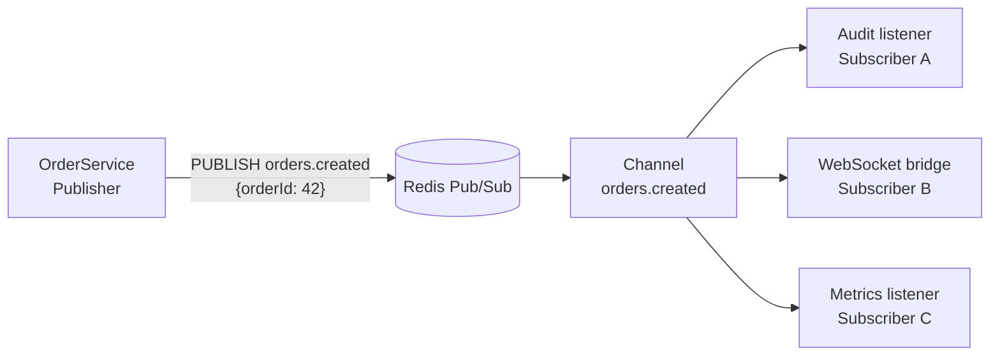
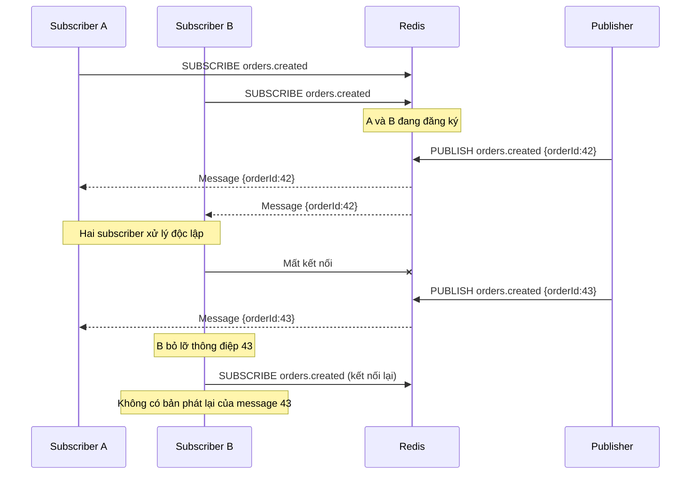

# Mô hình publisher, channel và subscriber trong Spring Data Redis Pub/Sub

## 1. Redis Pub/Sub giải quyết bài toán gì?

**Publish/Subscribe (Pub/Sub)** là mô hình trao đổi thông điệp theo chủ đề. Một thành phần **publisher** phát thông điệp lên một **channel**; Redis chuyển thông điệp đó đến các **subscriber** đang đăng ký nhận channel tại thời điểm phát. Publisher không cần biết địa chỉ, số lượng hoặc mã nguồn của subscriber.

Trong ứng dụng Spring Data Redis, mô hình này phù hợp để phát tín hiệu sự kiện nhẹ, ví dụ:

- Một dịch vụ phát `orders.created` sau khi tạo đơn hàng, các thành phần giám sát hoặc cập nhật giao diện nhận thông báo.
- Một instance thông báo cho các instance khác rằng cấu hình cục bộ vừa thay đổi.
- Hệ thống thông báo trạng thái kết nối, tiến trình hoặc tín hiệu vô hiệu hóa cache.
- Một dịch vụ phát cập nhật thời gian thực để các subscriber đang online phản ứng nhanh.

Ví dụ trực quan:



Trong ví dụ, **một lần `PUBLISH` có thể được chuyển đến nhiều subscriber**. Các subscriber có thể nằm trong cùng ứng dụng, ở các instance khác nhau hoặc trong những dịch vụ riêng.

Điểm phải nhớ ngay từ đầu: **Redis Pub/Sub là cơ chế phát trực tiếp, không phải hàng đợi bền vững**. Nếu subscriber không kết nối lúc thông điệp được phát, Redis không giữ lại thông điệp để subscriber đó nhận sau.

## 2. Ba vai trò cốt lõi

| Thành phần | Trách nhiệm | Ví dụ trong Spring Data Redis |
| --- | --- | --- |
| **Publisher** | Tạo nội dung thông điệp và phát lên channel | `StringRedisTemplate.convertAndSend(channel, message)` |
| **Channel** | Tên chủ đề logic để định tuyến thông điệp tới subscriber | `orders.created` hoặc `inventory.changed` |
| **Subscriber** | Đăng ký channel và xử lý các thông điệp nhận được | `MessageListener` qua `RedisMessageListenerContainer` |

### Publisher

Publisher tạo payload, chọn channel và phát thông điệp bằng lệnh Redis `PUBLISH`:

```redis
PUBLISH orders.created "{\"orderId\":\"42\",\"eventType\":\"OrderCreated\"}"
```

Redis định tuyến thông điệp đến các subscriber đang đăng ký `orders.created`. Publisher không cần gọi trực tiếp method của subscriber và cũng không cần biết subscriber nào đang hoạt động.

Một publisher có thể phát lên nhiều channel. Nhiều publisher cũng có thể phát lên cùng một channel.

### Channel

Channel chỉ là **tên định tuyến** của thông điệp, ví dụ:

```text
orders.created
orders.cancelled
inventory.changed
notifications.user.42
```

Channel **không phải Redis key chứa dữ liệu**:

- Không cần chạy `SET` hay tạo channel trước khi phát.
- Không dùng `GET`, `EXPIRE` hoặc `TTL` để đọc/thay đổi một channel.
- Không có TTL lưu giữ thông điệp theo tên channel trong Pub/Sub thông thường.
- Không tự sinh lịch sử thông điệp khi subscriber mới đăng ký.

Một channel vẫn có thể được sử dụng để `PUBLISH` khi không có subscriber nào. Trong trường hợp đó thông điệp không có người nhận và bị bỏ qua.

### Subscriber

Subscriber đăng ký nhận một hoặc nhiều channel. Redis đẩy thông điệp đến subscriber khi có publisher phát, nên subscriber không phải liên tục gọi `GET` để kiểm tra.

Subscriber đang kết nối và đăng ký `orders.created` sẽ nhận thông điệp phát đến channel này. Subscriber mới kết nối sau thời điểm phát **không nhận lại lịch sử**.

Không có giới hạn “chỉ một subscriber xử lý một thông điệp” giống mô hình hàng đợi công việc thông thường. Nếu có năm subscriber độc lập cùng đăng ký một channel, Redis có thể chuyển cùng thông điệp đến cả năm.

## 3. Dòng thời gian của một thông điệp

Giả sử có hai subscriber A và B cùng quan tâm tới `orders.created`:



Diễn biến này cho thấy hai tính chất của Pub/Sub:

1. **Fan-out/broadcast:** thông điệp được gửi tới những subscriber đang quan tâm.
2. **Không lưu giữ để phát lại:** đăng ký lại sau khi ngắt kết nối không tự lấy lại thông điệp đã mất.

Đây là khác biệt chính so với Redis Streams, nơi bản ghi được lưu trong một stream cho đến khi bị xóa hoặc trim theo chính sách, và consumer có thể đọc theo ID, dùng consumer group và cơ chế xác nhận xử lý.

## 4. Bắt đầu với Redis CLI để quan sát mô hình

Có thể quan sát Pub/Sub bằng hai cửa sổ terminal kết nối tới **cùng Redis instance** trong môi trường thử nghiệm.

**Terminal A — subscriber:**

```redis
SUBSCRIBE demo:orders.created
```

Lệnh này đưa kết nối vào chế độ nhận thông điệp. Khi publisher phát, terminal A sẽ thấy phản hồi có channel và payload.

**Terminal B — publisher:**

```redis
PUBLISH demo:orders.created "Order 42 created"
```

Terminal A sẽ nhận thông điệp như:

```text
message
demo:orders.created
Order 42 created
```

Nếu terminal A ngừng subscribe hoặc mất kết nối, rồi terminal B `PUBLISH` lần nữa, thông điệp ấy không được Redis lưu lại để terminal A nhận khi kết nối trở lại.

Thử thêm terminal C:

```redis
SUBSCRIBE demo:orders.created
```

Sau khi cả A và C đã subscribe, một lần PUBLISH mới có thể xuất hiện ở cả hai terminal. Số subscriber tăng không biến thông điệp thành nhiệm vụ được chia đều.

Kết quả số nguyên từ `PUBLISH` biểu diễn **số client subscription được Redis tính là nhận thông điệp**, không phải số nghiệp vụ xử lý thành công. Trong Redis Cluster, phép đếm đối với Pub/Sub thông thường có các giới hạn theo node, vì vậy không nên biến giá trị này thành cam kết về số người nhận toàn cụm.

## 5. Publisher trong Spring Data Redis

Spring Data Redis cung cấp `RedisTemplate.convertAndSend(String channel, Object message)`. Với nội dung message là chuỗi, `StringRedisTemplate` đơn giản và dễ đồng bộ định dạng giữa publisher/subscriber.

### 5.1. Ví dụ publisher phát thông điệp JSON

Định nghĩa hợp đồng thông điệp:

```java
package com.example.messaging;

public record OrderCreatedEvent(
        String eventId,
        String orderId,
        String occurredAt,
        int schemaVersion
) {
}
```

Ví dụ component phát sự kiện:

```java
package com.example.messaging;

import java.time.Instant;
import java.util.UUID;

import com.fasterxml.jackson.core.JsonProcessingException;
import com.fasterxml.jackson.databind.ObjectMapper;
import org.springframework.data.redis.core.StringRedisTemplate;
import org.springframework.stereotype.Component;

@Component
public class OrderEventPublisher {

    public static final String CHANNEL = "orders.created";

    private final StringRedisTemplate redis;
    private final ObjectMapper json;

    public OrderEventPublisher(
            StringRedisTemplate redis,
            ObjectMapper json) {
        this.redis = redis;
        this.json = json;
    }

    public void publishCreated(String orderId) {
        OrderCreatedEvent event = new OrderCreatedEvent(
                UUID.randomUUID().toString(),
                orderId,
                Instant.now().toString(),
                1
        );

        try {
            String payload = json.writeValueAsString(event);
            Long subscribers = redis.convertAndSend(CHANNEL, payload);

            // subscribers chỉ là thống kê từ Redis tại thời điểm PUBLISH.
            // Không thể dùng nó để kết luận event đã xử lý xong.
        } catch (JsonProcessingException exception) {
            throw new IllegalStateException(
                    "Không thể serialize OrderCreatedEvent",
                    exception
            );
        }
    }
}
```

Ở đây `ObjectMapper` biến event thành JSON text. `StringRedisTemplate` gửi text qua Redis bằng serializer chuỗi. Cách làm này giúp subscriber Java hoặc client ngôn ngữ khác có thể giải mã cùng hợp đồng JSON.

Với message mẫu:

```json
{
  "eventId": "evt-001",
  "orderId": "42",
  "occurredAt": "2026-11-13T02:00:00Z",
  "schemaVersion": 1
}
```

Spring Boot thường có `StringRedisTemplate` khi cấu hình Redis phù hợp. Nếu dự án chỉ dùng `RedisTemplate<String, Object>` với JDK serialization hoặc serializer khác, payload có thể là dạng nhị phân mà subscriber đang kỳ vọng JSON không thể đọc trực tiếp. **Publisher và subscriber phải thống nhất serialization.**

### 5.2. Ý nghĩa giá trị trả về của `convertAndSend`

Phương thức `convertAndSend(...)` trả một `Long` tương ứng với kết quả `PUBLISH`. Không nên diễn giải:

- `0` là “Redis thất bại”: có thể chỉ là không có subscriber phù hợp tại thời điểm phát.
- Số dương là “mọi handler hoàn thành”: Redis không chờ logic xử lý nghiệp vụ của subscriber.
- Số dương là “đã lưu để retry”: Pub/Sub không lưu bản ghi chờ subscriber xử lý.

Nếu nghiệp vụ cần biết một tác vụ đã được thực hiện, phải thiết kế cơ chế acknowledgment, trạng thái xử lý hoặc kho sự kiện bền vững ở cấp ứng dụng.

## 6. Subscriber trong Spring Data Redis

Spring Data Redis có hai khối phổ biến:

- `MessageListener`: interface nhận message dạng byte và channel.
- `RedisMessageListenerContainer`: quản lý kết nối đăng ký Pub/Sub, các listener và việc phân phối message đến chúng.

### 6.1. Viết subscriber bằng `MessageListener`

```java
package com.example.messaging;

import java.nio.charset.StandardCharsets;

import com.fasterxml.jackson.databind.ObjectMapper;
import org.slf4j.Logger;
import org.slf4j.LoggerFactory;
import org.springframework.data.redis.connection.Message;
import org.springframework.data.redis.connection.MessageListener;
import org.springframework.stereotype.Component;

@Component
public class OrderCreatedListener implements MessageListener {

    private static final Logger log =
            LoggerFactory.getLogger(OrderCreatedListener.class);

    private final ObjectMapper json;

    public OrderCreatedListener(ObjectMapper json) {
        this.json = json;
    }

    @Override
    public void onMessage(Message message, byte[] pattern) {
        String channel = new String(
                message.getChannel(), StandardCharsets.UTF_8);
        String body = new String(
                message.getBody(), StandardCharsets.UTF_8);

        try {
            OrderCreatedEvent event =
                    json.readValue(body, OrderCreatedEvent.class);

            log.info("Received {}: eventId={}, orderId={}",
                    channel, event.eventId(), event.orderId());

            // Gọi xử lý nghiệp vụ ngắn, không chặn luồng quá lâu.
        } catch (Exception exception) {
            log.warn("Cannot process message from channel {}",
                    channel, exception);
        }
    }
}
```

`message.getChannel()` và `message.getBody()` là byte array. Trong ví dụ này, chúng được chuyển về UTF-8 vì publisher dùng `StringRedisTemplate`. Nếu hệ thống truyền Protobuf, Avro hay serializer nhị phân khác, subscriber phải giải mã đúng giao thức đã thống nhất.

Đối số `pattern` chứa thông tin về pattern subscription khi message đến qua `PSUBSCRIBE`; với direct subscription thông thường có thể là `null`. Nếu muốn xử lý nhiều channel hoặc pattern trong một listener, kiểm tra `message.getChannel()` để biết tên channel thực tế.

### 6.2. Đăng ký listener bằng `RedisMessageListenerContainer`

```java
package com.example.messaging;

import org.springframework.context.annotation.Bean;
import org.springframework.context.annotation.Configuration;
import org.springframework.data.redis.connection.RedisConnectionFactory;
import org.springframework.data.redis.listener.ChannelTopic;
import org.springframework.data.redis.listener.RedisMessageListenerContainer;

@Configuration
public class RedisSubscriberConfiguration {

    @Bean
    public RedisMessageListenerContainer redisMessageListenerContainer(
            RedisConnectionFactory connectionFactory,
            OrderCreatedListener orderCreatedListener) {

        RedisMessageListenerContainer container =
                new RedisMessageListenerContainer();

        container.setConnectionFactory(connectionFactory);
        container.addMessageListener(
                orderCreatedListener,
                new ChannelTopic(OrderEventPublisher.CHANNEL)
        );

        return container;
    }
}
```

`RedisMessageListenerContainer` là thành phần quản lý vòng đời subscription trong ứng dụng Spring. Khi bean/container hoạt động, nó thực hiện việc đăng ký với Redis, nhận message và gọi `onMessage(...)` của listener đã gắn với topic.

**Không cần tự viết vòng lặp gọi `SUBSCRIBE` trong controller hoặc một request thread.** Kết nối Pub/Sub là kết nối sống lâu và có hành vi khác kết nối gọi `GET`/`SET` thông thường. Container giúp quản lý lifecycle, subscription và phân phối callback.

### 6.3. Vì sao không dùng trực tiếp `RedisConnection.subscribe(...)` trong service?

Low-level API `RedisConnection.subscribe(...)` có thể chặn luồng gọi và đặt kết nối vào trạng thái đăng ký nhận message. Cách dùng này đòi hỏi ứng dụng tự quản lý luồng, kết nối, lỗi, khởi động lại và hủy đăng ký.

Đối với ứng dụng Spring thông thường, `RedisMessageListenerContainer` được thiết kế để xử lý nhu cầu này. Nó có thể dùng chung một kết nối Pub/Sub để quản lý nhiều listener và điều phối callback qua executor.

Nếu callback xử lý chậm, cần cân nhắc luồng xử lý và hàng đợi tác vụ nội bộ; không để một subscriber chặn toàn bộ tiến trình nhận message.

## 7. Exact channel và pattern channel

Redis hỗ trợ hai hình thức đăng ký:

- `SUBSCRIBE channel`: nhận thông điệp gửi tới **chính xác tên channel**.
- `PSUBSCRIBE pattern`: nhận thông điệp từ các channel có tên phù hợp pattern dạng glob.

Spring Data Redis ánh xạ tương ứng:

| Redis | Spring Data Redis | Ví dụ |
| --- | --- | --- |
| `SUBSCRIBE orders.created` | `new ChannelTopic("orders.created")` | Chỉ nhận `orders.created` |
| `PSUBSCRIBE orders.*` | `new PatternTopic("orders.*")` | Nhận `orders.created`, `orders.cancelled`... |

Cấu hình PatternTopic:

```java
container.addMessageListener(
        orderEventListener,
        new PatternTopic("orders.*")
);
```

Khi publisher gọi:

```redis
PUBLISH orders.created "created:42"
PUBLISH orders.cancelled "cancelled:43"
PUBLISH inventory.changed "sku-1"
```

Listener đăng ký `orders.*` nhận hai message đầu, nhưng không nhận `inventory.changed`.

**Pattern chỉ là bộ lọc tên channel, không phải biểu thức kiểm tra nội dung payload.** `orders.*` không tự lọc JSON theo `eventType`. Nếu nhiều loại thông điệp dùng chung pattern, subscriber phải xác định channel hoặc event type trước khi deserialize và xử lý.

Cần kiểm soát phạm vi pattern: một pattern quá rộng, ví dụ `*`, có thể khiến subscriber nhận khối lượng lớn dữ liệu không liên quan.

### Trường hợp subscriber đăng ký chồng lấn

Nếu cùng một Redis client đăng ký trực tiếp `orders.created` và đồng thời đăng ký pattern `orders.*`, một thông điệp phát tới `orders.created` có thể tạo nhiều thông báo phù hợp subscription trên client đó. Listener cần xử lý trùng theo ngữ cảnh, hoặc tránh đăng ký chồng lấn không cần thiết.

Đừng dựa vào Pub/Sub để bảo đảm “mỗi message chỉ tới ứng dụng đúng một lần” trong mọi trường hợp.

## 8. Một channel có nhiều subscriber khác gì work queue?

Đây là quyết định kiến trúc quan trọng khi triển khai nhiều instance.

Giả sử ba instance Spring Boot đều có:

```java
new ChannelTopic("orders.created")
```

Mỗi instance tạo subscription riêng tới Redis. Khi có một publisher phát message:

```text
                  PUBLISH orders.created
                           |
                          Redis
                   /        |        \
             Instance A Instance B Instance C
                 |          |          |
              xử lý A    xử lý B     xử lý C
```

**Cả ba instance đều có thể nhận cùng một thông điệp.** Đây là mô hình *broadcast*, không phải chia đều workload.

Nếu handler là “làm mới local cache” thì broadcast có thể đúng: mỗi instance cần vô hiệu hóa cache cục bộ.

Nếu handler là “gửi email xác nhận đơn hàng” thì broadcast đến ba instance có thể làm gửi ba email, trừ khi có cơ chế chỉ một worker được thực thi. Trong trường hợp xử lý công việc theo nhóm, nên cân nhắc hàng đợi/stream có consumer group, idempotency và trạng thái xử lý.

| Câu hỏi | Redis Pub/Sub | Hàng đợi công việc/Redis Streams consumer group |
| --- | --- | --- |
| Khi nhiều subscriber cùng lắng nghe | Mỗi subscriber nhận thông điệp được phát đến subscription của mình | Có thể phân phối công việc giữa các consumer trong group |
| Subscriber tạm offline | Bỏ lỡ message phát trong thời gian offline | Có thể đọc bản ghi được giữ lại theo chính sách stream |
| Xác nhận xử lý | Không có ACK nghiệp vụ mặc định | Có cơ chế xác nhận/pending entries khi dùng consumer group |
| Phát lại sự kiện cũ | Không hỗ trợ lịch sử | Có thể đọc theo ID nếu bản ghi còn |
| Trường hợp phù hợp | Tín hiệu trực tiếp, thông báo, invalidation | Xử lý bất đồng bộ cần theo dõi và retry |

Không phải mọi thông điệp đều cần một broker bền vững; nhưng nếu nghiệp vụ có yêu cầu không mất tác vụ, Pub/Sub đơn lẻ là chưa đủ.

## 9. Thiết kế channel và hợp đồng message

Một hệ thống có nhiều publisher và subscriber cần quy ước để tránh channel bị dùng lẫn mục đích.

### 9.1. Quy ước tên channel

Ví dụ:

```text
orders.created
orders.cancelled
catalog.price.changed
system.cache.invalidate
tenant.42.notifications
```

Một tên channel hữu ích thường thể hiện **domain** và **loại sự kiện**, không nhất thiết chứa mọi metadata nghiệp vụ. Nên cân nhắc tên ổn định, dễ lọc bằng pattern và không vô tình đưa thông tin nhạy cảm vào tên channel.

Hai cách phân tách phổ biến:

1. **Theo loại sự kiện**: `orders.created`, `orders.cancelled`. Subscriber đăng ký chính xác các loại cần thiết.
2. **Theo nhóm sự kiện**: `orders.events` và payload có field `eventType`. Subscriber phải lọc loại trong nội dung.

Cách thứ nhất giúp định tuyến rõ ràng; cách thứ hai giảm số channel cần biết nhưng tăng trách nhiệm xử lý schema tại subscriber.

### 9.2. Envelope của thông điệp

Thay vì phát chuỗi tự do như `"42"`, có thể định nghĩa message envelope:

```json
{
  "eventId": "c5060f1e-2c73-4c16-9dea-22eb99e926db",
  "eventType": "OrderCreated",
  "schemaVersion": 1,
  "occurredAt": "2026-11-13T02:00:00Z",
  "source": "order-service",
  "data": {
    "orderId": "42",
    "status": "CREATED"
  }
}
```

Ý nghĩa:

| Field | Mục đích |
| --- | --- |
| `eventId` | Định danh thông điệp để log, truy vết và giảm xử lý trùng ở cấp ứng dụng |
| `eventType` | Giúp subscriber phân nhánh nghiệp vụ |
| `schemaVersion` | Hỗ trợ thay đổi cấu trúc payload theo phiên bản |
| `occurredAt` | Thời điểm publisher tạo sự kiện; không phải thời gian subscriber đã xử lý |
| `source` | Xác định thành phần phát |
| `data` | Nội dung nghiệp vụ cần thiết |

Pub/Sub không cung cấp metadata như `eventId` hay `schemaVersion` tự động. Nếu cần các trường này, publisher phải tạo ra và subscriber phải hiểu hợp đồng.

### 9.3. Versioning và tương thích

Khi thêm field vào JSON, subscriber cũ có thể tiếp tục hoạt động nếu bộ giải mã chấp nhận field không biết. Khi đổi tên field hoặc đổi kiểu dữ liệu, có thể phải:

- Đưa `schemaVersion` mới vào payload.
- Hỗ trợ chuyển đổi giữa các version ở subscriber.
- Triển khai subscriber tương thích trước khi publisher bắt đầu phát cấu trúc mới.
- Đặt channel version mới nếu thay đổi không thể tương thích ngược.

Không mặc định các subscriber sẽ nâng cấp đồng thời. Trong Pub/Sub, lỗi deserialize thường làm **mất luôn cơ hội xử lý message đó** vì không có lịch sử để đọc lại.

## 10. Publisher nên phát sự kiện vào thời điểm nào?

Giả sử ứng dụng ghi đơn hàng vào database và phát Pub/Sub:

```java
@Transactional
public void createOrder(CreateOrderRequest request) {
    orderRepository.save(...);
    publisher.publishCreated(...);
}
```

Đoạn code trên có rủi ro: publisher có thể gửi message **trước khi transaction database commit**. Subscriber nhận message ngay và truy vấn order có thể không thấy bản ghi; nếu database rollback thì message vẫn đã được phát.

Nếu ứng dụng chỉ cần thông báo nhẹ sau khi database commit, có thể chọn **Spring application event** và `@TransactionalEventListener(phase = AFTER_COMMIT)`:

```java
public record OrderCommitted(String orderId) {
}
```

```java
@Service
public class OrderService {

    private final OrderRepository orders;
    private final ApplicationEventPublisher events;

    public OrderService(
            OrderRepository orders,
            ApplicationEventPublisher events) {
        this.orders = orders;
        this.events = events;
    }

    @Transactional
    public void createOrder(CreateOrderRequest request) {
        Order order = orders.save(new Order(request.orderId()));
        events.publishEvent(new OrderCommitted(order.getId()));
    }
}
```

Listener phát Pub/Sub sau commit:

```java
@Component
public class AfterCommitOrderPublisher {

    private final OrderEventPublisher publisher;

    public AfterCommitOrderPublisher(OrderEventPublisher publisher) {
        this.publisher = publisher;
    }

    @TransactionalEventListener(phase =
            TransactionPhase.AFTER_COMMIT)
    public void onOrderCommitted(OrderCommitted event) {
        publisher.publishCreated(event.orderId());
    }
}
```

Các import annotation thuộc Spring Framework; phần entity/repository chỉ minh họa và cần thay bằng mô hình ứng dụng thực tế.

Cơ chế này tránh phát thông điệp từ transaction bị rollback trong đường thông thường. **Nó vẫn không bảo đảm tuyệt đối không mất message**: tiến trình có thể dừng sau database commit nhưng trước khi PUBLISH thành công.

Nếu sự kiện bắt buộc phải được gửi, nên dùng **transactional outbox**: ghi một bản ghi outbox cùng transaction với thay đổi database; một worker đọc outbox, phát message và theo dõi retry. Nếu cần subscriber có khả năng nhận lại/ACK sau ngắt kết nối, đích nên là Redis Streams hoặc một hệ thống messaging bền vững phù hợp, thay vì chỉ Pub/Sub.

## 11. Delivery semantics: điều gì được bảo đảm và điều gì không?

Redis Pub/Sub hoạt động theo mô hình **at-most-once delivery** ở cấp dịch vụ phát trực tiếp: Redis không tự lưu message để phát lại sau khi subscriber bỏ lỡ hoặc handler lỗi. Đó không phải cam kết rằng ứng dụng sẽ luôn xử lý đúng một lần.

| Tình huống | Kết quả có thể xảy ra |
| --- | --- |
| Subscriber chưa subscribe khi publisher phát | Không nhận thông điệp đó |
| Subscriber đang kết nối | Redis chuyển thông điệp tới subscription phù hợp |
| Subscriber mất mạng trong lúc phát | Có thể bỏ lỡ thông điệp |
| Handler ném exception | Redis không tự gửi lại cho handler |
| Handler xử lý chậm | Message có thể tích tụ trong buffer phía client/server, tăng áp lực bộ nhớ hoặc gây mất kết nối khi quá giới hạn |
| Publisher gửi lại cùng nghiệp vụ | Subscriber có thể thấy hai message giống hoặc tương đương |
| Đăng ký channel và pattern chồng lấn | Một message có thể xuất hiện qua nhiều subscription |
| Nhiều instance cùng subscribe | Mỗi instance có thể nhận và xử lý cùng message |

Do đó, “at-most-once” không nên bị hiểu thành “mỗi nghiệp vụ chỉ được xử lý một lần”: việc ứng dụng phát lại, callback được đăng ký hai nơi, hoặc nhiều instance cùng xử lý vẫn có thể gây hiệu ứng lặp ở tầng nghiệp vụ.

### Giữ handler ngắn và xác định lỗi

Một `MessageListener` nên:

1. Giải mã payload theo hợp đồng.
2. Kiểm tra `schemaVersion` và thông tin cần thiết.
3. Gọi logic xử lý có giới hạn thời gian hoặc chuyển việc nặng sang một cơ chế phù hợp.
4. Ghi metric thành công/thất bại và định danh `eventId`.
5. Xử lý exception; không trông chờ Redis tự retry message đã nhận.

Nếu công việc có thể mất nhiều giây/phút hoặc bắt buộc phải hoàn tất, việc thực hiện trực tiếp trong callback Pub/Sub không phù hợp bằng một hàng đợi xử lý có kiểm soát.

## 12. Thứ tự thông điệp và mức độ song song

Redis xử lý các lệnh theo thứ tự mà server nhận, và một kết nối subscription đang hoạt động nhận thông báo theo luồng Pub/Sub. Tuy nhiên **thứ tự xử lý nghiệp vụ ở subscriber có thể khác thứ tự nhận** khi:

- Listener dispatch message đến nhiều thread trong một executor.
- Handler chuyển việc sang task async có thời gian thực hiện khác nhau.
- Nhiều publisher phát message gần như đồng thời, không có một total order nghiệp vụ do ứng dụng định nghĩa.
- Kết nối đứt và message mất; chuỗi quan sát không còn đầy đủ.
- Hệ thống chạy nhiều node/instance với tốc độ xử lý khác nhau.

Nếu nghiệp vụ cần thứ tự theo một aggregate, có thể đưa `aggregateId` và số thứ tự/version vào event, rồi áp dụng kiểm tra version khi xử lý. Đừng coi thứ tự callback toàn hệ thống là công cụ bảo vệ trạng thái quan trọng.

Redis Cluster cũng tạo ra các cân nhắc riêng cho phạm vi phát và kết nối; Pub/Sub thông thường không đồng nghĩa một broker với partition/consumer group có thứ tự riêng như Redis Streams hoặc Kafka.

## 13. Topic pattern, nhiều listener và giới hạn tài nguyên

Có thể đăng ký nhiều topic trên cùng container:

```java
@Bean
public RedisMessageListenerContainer redisMessageListenerContainer(
        RedisConnectionFactory factory,
        OrderCreatedListener orderListener,
        InventoryChangedListener inventoryListener) {

    RedisMessageListenerContainer container =
            new RedisMessageListenerContainer();
    container.setConnectionFactory(factory);

    container.addMessageListener(
            orderListener,
            new PatternTopic("orders.*")
    );
    container.addMessageListener(
            inventoryListener,
            new ChannelTopic("inventory.changed")
    );

    return container;
}
```

`InventoryChangedListener` ở đây là một `MessageListener` khác do ứng dụng cung cấp. Container quản lý đăng ký và phân phối message cho hai listener.

### Executor và callback chậm

`RedisMessageListenerContainer` có cơ chế thực thi task/dispatch listener. Khi cấu hình thread pool, cần giới hạn số thread và hàng đợi phù hợp với tải. Một listener xử lý nặng có thể chiếm tài nguyên và gây chậm cho những listener khác nếu chúng dùng chung executor.

Cấu hình minh họa dùng executor chuyên dụng:

```java
@Bean
public RedisMessageListenerContainer redisMessageListenerContainer(
        RedisConnectionFactory factory,
        OrderCreatedListener listener,
        @Qualifier("redisListenerExecutor") Executor executor) {

    RedisMessageListenerContainer container =
            new RedisMessageListenerContainer();
    container.setConnectionFactory(factory);
    container.setTaskExecutor(executor);
    container.addMessageListener(listener,
            new ChannelTopic("orders.created"));
    return container;
}
```

Cần khai báo `redisListenerExecutor` bằng bean `Executor` có kích thước, hàng đợi và chính sách từ chối rõ ràng. Ví dụ trên chỉ thể hiện điểm cắm executor; không mặc nhiên làm cho message trở nên bền vững hoặc luôn xử lý đúng thứ tự.

Khi traffic lớn, mô hình subscriber gọi dịch vụ bên ngoài đồng bộ trong `onMessage(...)` có thể gây nghẽn. Tùy yêu cầu, nên chuyển những công việc kéo dài sang hàng đợi/job nội bộ có cơ chế bảo vệ.

## 14. Redis ACL, namespace và bảo mật thông điệp

Pub/Sub không tự bảo đảm rằng chỉ đúng service được phát hoặc nhận message. Cần bảo vệ bằng kết nối và quyền Redis thích hợp.

Trong Redis có ACL hỗ trợ hạn chế **channel pattern**, có thể xây chính sách cho phép publisher gửi tới `orders.*`, subscriber chỉ nghe `orders.*` hoặc một channel cụ thể. Redis hỗ trợ các quyền liên quan tới `PUBLISH`, `SUBSCRIBE`, `PSUBSCRIBE` và pattern channel theo khả năng của phiên bản đang dùng.

Nguyên tắc:

- Tách danh tính Redis của publisher và subscriber khi quyền sử dụng khác nhau.
- Chỉ cấp quyền thực thi các lệnh Pub/Sub cần thiết, thay vì toàn bộ `@all`.
- Giới hạn các channel được phép truy cập; không coi tên channel là secret.
- Dùng TLS và network policy phù hợp, tránh để Redis Pub/Sub bị truy cập từ mạng không tin cậy.
- Không phát trực tiếp token bí mật, mật khẩu, dữ liệu thanh toán hoặc thông tin nhạy cảm lên channel nhiều subscriber.
- Cân nhắc tách channel/Redis instance nếu các nhóm ứng dụng có yêu cầu cô lập dữ liệu khác nhau.

Ví dụ quy tắc tên:

```text
orders.created       -> domain order, nhiều listener liên quan
tenant.42.events     -> domain tenant 42
system.cache.invalidate -> tín hiệu invalidation chung
```

Một pattern `tenant.*` có thể nhận message của nhiều tenant; nếu ứng dụng đa thuê bao có yêu cầu cô lập nghiêm ngặt, không chỉ dựa vào bộ lọc pattern ở tầng ứng dụng. Cần áp dụng cơ chế ACL, ranh giới mạng/tài nguyên và xác minh quyền thực tế.

### Pub/Sub channel khác Redis keyspace notification channel

Redis có thể phát các thông báo hệ thống như `__keyevent@0__:expired` khi bật keyspace notifications. Dù cũng đi qua Pub/Sub, đây là **thông báo do Redis phát về thay đổi key**, không phải channel nghiệp vụ mà ứng dụng tự `PUBLISH`.

Đừng nhầm:

- `orders.created`: sự kiện nghiệp vụ do application publisher phát.
- `__keyevent@0__:expired`: thông báo hết hạn key nếu Redis được cấu hình phát notification.

Cả hai đều có hạn chế mất message khi subscriber offline. Không dùng expiration notification làm hàng đợi lịch xử lý bắt buộc.

## 15. Redis Pub/Sub trong Redis Cluster

Với Redis Cluster, cần phân biệt Pub/Sub thông thường và **sharded Pub/Sub**:

- Pub/Sub thông thường dùng `PUBLISH`/`SUBSCRIBE`/`PSUBSCRIBE` và có thể lan truyền thông điệp trong cluster. Nó phù hợp với mô hình broadcast nhưng có thể tạo lưu lượng liên node đáng kể khi fan-out lớn.
- Redis 7.0 giới thiệu sharded Pub/Sub với các lệnh như `SPUBLISH`/`SSUBSCRIBE`. Thông điệp được định tuyến theo hash slot của shard channel để giảm phạm vi lan truyền.

Hai mô hình không tự thay thế lẫn nhau. Ví dụ Spring Data Redis dùng `RedisTemplate.convertAndSend(...)` và `RedisMessageListenerContainer` với `ChannelTopic` trong bài này nói về **Pub/Sub thông thường**. Không suy luận nó tự gọi `SPUBLISH` chỉ vì backend là Redis Cluster.

Nếu yêu cầu sharded Pub/Sub, phải kiểm tra API, driver và phiên bản Spring Data Redis cụ thể có hỗ trợ các lệnh/shard subscription cần dùng. Cần thiết kế rõ cách chọn channel, cấu hình kết nối và test trong cluster thực tế.

## 16. Quan sát, thử nghiệm và chẩn đoán

### Thử nghiệm một publisher và hai subscriber

Trong môi trường Redis thử nghiệm:

1. Khởi động Redis và một instance Spring Boot có `RedisMessageListenerContainer`.
2. Đăng ký một subscriber từ `redis-cli SUBSCRIBE orders.created`.
3. Gọi `publisher.publishCreated("42")`.
4. Quan sát log Spring và terminal redis-cli: cả hai subscriber đang online có thể nhận message.
5. Ngắt subscriber CLI, phát một message khác rồi kết nối lại: message phát trong thời gian ngắt không được gửi bù.

Các quan sát này đủ để thấy mô hình publisher/channel/subscriber và giới hạn không lưu lịch sử, không cần xóa dữ liệu trên Redis.

### Một số lệnh quan sát

```redis
PUBSUB CHANNELS
PUBSUB NUMSUB orders.created
```

`PUBSUB CHANNELS` liệt kê các channel đang có subscriber theo cơ chế quan sát của Redis tại node được kết nối. `PUBSUB NUMSUB` cung cấp thông tin số subscription cho channel cụ thể. Trong Redis Cluster, quan sát trên một node không nhất thiết là tổng số subscriber toàn cụm; đừng dùng các con số này làm bằng chứng hoàn thành nghiệp vụ.

Trên ứng dụng, nên có metric:

| Chỉ số | Ý nghĩa |
| --- | --- |
| `pubsub_publish_total{channel}` | Số lần publisher gọi phát thành công tới Redis |
| `pubsub_receive_total{channel}` | Số message listener nhận |
| `pubsub_handle_success_total` | Số message xử lý xong theo logic ứng dụng |
| `pubsub_handle_failure_total` | Số message xử lý lỗi |
| Thời gian xử lý callback | Phát hiện handler chậm và nguy cơ nghẽn executor |
| Trạng thái kết nối/listener | Phát hiện ứng dụng không còn subscription |
| Version/schema decode failure | Phát hiện publisher/subscriber không tương thích |

Tên metric là gợi ý thiết kế; Redis và Spring Data Redis không tự sinh toàn bộ các metric nghiệp vụ này. Nếu quan tâm đến số message bị mất khi subscriber offline, bản thân Pub/Sub không có counter lịch sử đủ để tính chính xác. Cần thêm một nguồn dữ liệu bền vững hoặc cơ chế reconciliation.

### Các lỗi thường gặp

| Hiện tượng | Nguyên nhân có thể gặp | Cách tiếp cận |
| --- | --- | --- |
| Publisher gửi nhưng không ai nhận | Subscriber chưa start, sai channel, sai Redis instance, listener mất kết nối | Xác nhận subscription, host/port, tên channel và lifecycle container |
| `PUBLISH` trả `0` | Không có subscriber được Redis đếm tại thời điểm phát | Kiểm tra subscriber đang online; không coi 0 là lỗi command |
| Subscriber nhận bytes không đọc được | Khác serializer hoặc mã hóa | Thống nhất JSON UTF-8/StringRedisTemplate hoặc schema nhị phân |
| Một message xử lý nhiều lần | Nhiều instance, đăng ký trùng channel/pattern hoặc publisher phát lặp | Kiểm tra topology, eventId và yêu cầu idempotency |
| Message mất khi restart | Pub/Sub không lưu lịch sử | Dùng cơ chế bền vững nếu cần replay |
| Handler chậm hoặc mất kết nối | Callback block, executor/buffer quá tải | Giới hạn tác vụ, theo dõi tải và chuyển việc nặng sang queue phù hợp |
| `NOPERM` | User Redis thiếu quyền Pub/Sub hoặc channel ACL | Kiểm tra command/channel pattern và cấp quyền tối thiểu |
| Không nhận sự kiện key hết hạn | Nhầm custom channel với keyspace notifications hoặc Redis chưa bật thông báo | Kiểm tra đúng loại channel và cấu hình notify-keyspace-events |
| Nhiều subscriber nhưng chỉ một tác vụ cần thực thi | Dùng broadcast cho workload cạnh tranh | Đổi sang queue/Streams consumer group hoặc có điều phối |

## 17. Khi nào chọn Pub/Sub và khi nào cần cơ chế khác?

Chọn Redis Pub/Sub khi mục tiêu là **thông báo tức thời cho các subscriber hiện đang online**, và hệ thống có thể chấp nhận thông điệp bị mất trong một số tình huống.

Những use case thường phù hợp:

- Invalidate local cache giữa các instance, khi cache vẫn có TTL hoặc cơ chế đồng bộ để tự sửa lệch.
- Cập nhật UI thời gian thực, khi client có thể gọi API lấy snapshot mới sau khi reconnect.
- Tín hiệu quan sát hoặc thông báo tiến trình không quyết định dữ liệu gốc.
- Event phụ trợ mà hệ thống có thể đối soát từ nguồn dữ liệu đáng tin cậy hơn.

Nếu nghiệp vụ yêu cầu tác vụ phải được xử lý, có retry, có lịch sử hoặc cần một worker trong nhóm nhận mỗi công việc, nên cân nhắc:

- **Redis Streams** với consumer group và lưu giữ bản ghi phù hợp.
- **Message broker** như RabbitMQ/Kafka theo mô hình bảo đảm giao hàng và vận hành của hệ thống.
- **Transactional outbox** nếu phát sự kiện phải gắn với transaction ghi database.
- **Job/scheduler có đối soát** nếu cần bảo đảm hành động được thực hiện dù tiến trình hoặc mạng gián đoạn.

Không có lựa chọn nào tự động mang lại “exactly once” ở tầng nghiệp vụ. Idempotency, quản lý trạng thái và thiết kế lỗi vẫn là trách nhiệm của ứng dụng.

## 18. Câu hỏi tự kiểm tra

1. Một publisher phát tới `orders.created` khi không có subscriber đang online. Thông điệp đó sẽ đi đâu? Có thể nhận lại khi subscriber kết nối sau không?
2. Nếu ba instance cùng đăng ký `ChannelTopic("orders.created")`, một message sẽ được chia cho một instance hay được phát tới cả ba?
3. Vì sao `convertAndSend(...)` trả số dương không chứng minh các subscriber đã xử lý nghiệp vụ thành công?
4. `ChannelTopic("orders.created")` khác `PatternTopic("orders.*")` ở điểm nào?
5. Vì sao publisher dùng JDK serialization còn subscriber đọc JSON UTF-8 có thể dẫn tới lỗi?
6. Vì sao cần `RedisMessageListenerContainer` thay vì gọi low-level `SUBSCRIBE` trong request thread?
7. Nếu database rollback sau khi publisher đã PUBLISH, các subscriber có tự được thông báo rollback không? Cách phát sau commit giải quyết điều gì và còn thiếu bảo đảm gì?
8. Khi nào Redis Streams/consumer group phù hợp hơn Redis Pub/Sub?
9. Một handler nhận nhiều message nhưng xử lý song song có được mặc định coi là hoàn thành đúng thứ tự không?
10. Redis channel và Redis key có quan hệ gì về `GET`, `SET` và TTL?

**Ghi nhớ:** Trong Spring Data Redis, publisher dùng `RedisTemplate.convertAndSend(...)` để phát payload tới **channel**, còn subscriber đăng ký bằng `RedisMessageListenerContainer` và nhận qua `MessageListener`. Mô hình này mang tính **broadcast, tức thời và không lưu lịch sử**. Để dùng đúng, cần xác định hợp đồng message, phạm vi subscription, serialization, cách xử lý lỗi và mức bảo đảm giao hàng mà nghiệp vụ thực sự cần.

## Tài liệu tham khảo

- [Spring Data Redis — Pub/Sub Messaging](https://docs.spring.io/spring-data/redis/reference/redis/pubsub.html): `RedisTemplate.convertAndSend`, `MessageListener` và `RedisMessageListenerContainer`.
- [Spring Data Redis — RedisMessageListenerContainer API](https://docs.spring.io/spring-data/redis/docs/current/api/org/springframework/data/redis/listener/RedisMessageListenerContainer.html): đăng ký listener, topic và vòng đời container.
- [Redis — Pub/Sub](https://redis.io/docs/latest/develop/pubsub/): hành vi broadcast, pattern subscription và giới hạn delivery.
- [Redis — PUBLISH](https://redis.io/docs/latest/commands/publish/): cú pháp phát message và ý nghĩa giá trị trả về.
- [Redis — Redis Streams](https://redis.io/docs/latest/develop/data-types/streams/): lựa chọn có lưu bản ghi và consumer group khi cần theo dõi xử lý.
