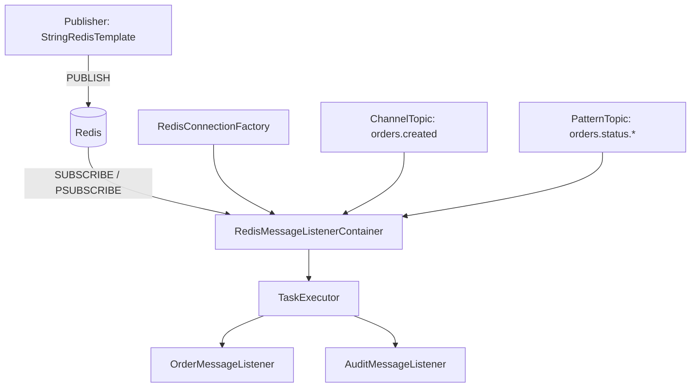
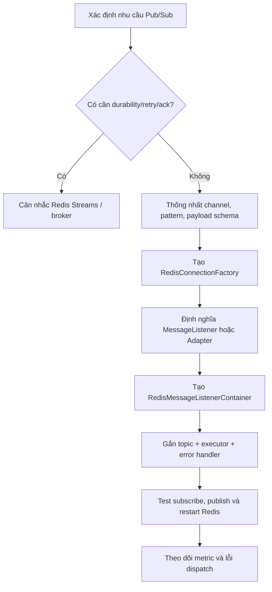

# Cấu hình RedisMessageListenerContainer trong Spring Data Redis

## 1. RedisMessageListenerContainer dùng để làm gì?

Redis **Publish/Subscribe (Pub/Sub)** cho phép một ứng dụng gửi thông điệp tới *channel*, còn những ứng dụng đang đăng ký (*subscribe*) channel đó sẽ nhận thông điệp. Publisher và subscriber không cần gọi trực tiếp lẫn nhau.

Ví dụ ứng dụng bán hàng phát sự kiện một đơn hàng đã được tạo:

```text
Order Service
    |
    | PUBLISH orders.created '{"orderId":"o-101"}'
    v
Redis Pub/Sub channel: orders.created
    |                                |
    v                                v
Notification Service          Analytics Service
  gửi thông báo                cập nhật số liệu
```

Trong Spring Data Redis, `RedisMessageListenerContainer` là thành phần quản lý việc **đăng ký các Redis channel/pattern, nhận message và chuyển message cho những `MessageListener` của ứng dụng**. Thay vì mỗi listener tự mở và quản lý một kết nối Redis để chờ `SUBSCRIBE`, ứng dụng khai báo một container dùng chung và đăng ký các listener cần thiết.

Một cấu hình điển hình:

```java
RedisMessageListenerContainer container =
    new RedisMessageListenerContainer();

container.setConnectionFactory(redisConnectionFactory);
container.addMessageListener(
    orderCreatedListener,
    new ChannelTopic("orders.created")
);
```

Khi được Spring quản lý như một bean và được khởi động theo vòng đời context, container sẽ nhận các thông điệp của channel và chuyển chúng đến callback `onMessage(...)` của listener.

**Điểm quan trọng:** container giải quyết **quản lý subscription và dispatch**, không biến Redis Pub/Sub thành message queue bền vững. Redis Pub/Sub không giữ message để phát lại cho subscriber mới hoặc subscriber vừa mất kết nối.

Sau bài học này, bạn có thể:

1. Cấu hình `RedisConnectionFactory`, `RedisMessageListenerContainer` và `MessageListener`.
2. Đăng ký channel cụ thể bằng `ChannelTopic` và nhóm channel bằng `PatternTopic`.
3. Dùng `MessageListenerAdapter` khi không muốn lớp nghiệp vụ trực tiếp triển khai interface Redis.
4. Phân biệt luồng phục vụ subscription với luồng xử lý message và cấu hình thread pool phù hợp.
5. Nắm vòng đời start/stop, đăng ký động, recovery sau mất kết nối và những điểm cần quan sát.
6. Kiểm tra end-to-end và hiểu giới hạn mất message, trùng xử lý hoặc thứ tự xử lý.

## 2. Kiến trúc của container

Những thành phần chính:

| Thành phần | Vai trò | Ví dụ |
|---|---|---|
| `RedisConnectionFactory` | Tạo Redis connection phù hợp cấu hình ứng dụng | `LettuceConnectionFactory` |
| `RedisMessageListenerContainer` | Duy trì subscription và chuyển message tới listener | Bean cấu hình trong Spring context |
| `Topic` | Mô tả channel hoặc pattern quan tâm | `ChannelTopic`, `PatternTopic` |
| `MessageListener` | Nhận message Redis dạng byte | `onMessage(Message, byte[])` |
| `MessageListenerAdapter` | Chuyển message tới một method của POJO | `handleMessage(String)` |
| `RedisTemplate` / `StringRedisTemplate` | Phát message lên channel | `convertAndSend(...)` |
| Task executor | Xử lý công việc dispatch callback | `ThreadPoolTaskExecutor` |
| Subscription executor | Dành cho công việc blocking của subscription | Executor riêng, không dùng cho nghiệp vụ nặng |



Container quản lý việc theo dõi nhiều topic, có thể dùng **một kết nối subscription chung** thay vì mở một Redis connection riêng cho mỗi listener. Với cùng container, các listener có thể dùng một tập topic, hoặc mỗi listener đăng ký các topic khác nhau.

Khác với kết nối Redis thông thường, một kết nối đang ở chế độ Pub/Sub được dùng để nhận message và cần một luồng xử lý subscription thích hợp. Vì vậy, **không nên dùng cùng một thread pool nhỏ cho cả subscription blocking và xử lý nghiệp vụ nặng**.

## 3. Chuẩn bị ứng dụng Spring Boot

### 3.1. Dependency

Với Spring Boot 3.x:

```groovy
dependencies {
    implementation 'org.springframework.boot:spring-boot-starter-data-redis'
}
```

Starter thông thường bao gồm Spring Data Redis và driver Lettuce. Nếu ứng dụng dùng một driver/kết nối khác, phải bảo đảm driver đó hỗ trợ Pub/Sub và tương thích với factory được cấu hình.

### 3.2. Cấu hình kết nối Redis

Trong `application.yml`:

```yaml
spring:
  data:
    redis:
      host: localhost
      port: 6379
      timeout: 3s
```

Đây là Redis local không xác thực, thích hợp để minh họa. Môi trường triển khai thực cần các thiết lập tương ứng cho password, TLS, Sentinel, Cluster và quản lý secrets.

Khi điều kiện auto-configuration được đáp ứng, Spring Boot tạo bean `RedisConnectionFactory` và thường cả `StringRedisTemplate`. Cấu hình container chỉ cần inject chúng thay vì tự tạo socket và mã hóa giao thức Redis.

## 4. Triển khai `MessageListener` trực tiếp

Interface `MessageListener` của Spring Data Redis có một callback:

```java
void onMessage(Message message, byte[] pattern);
```

Trong đó:

- `message.getBody()`: nội dung message ở dạng `byte[]`.
- `message.getChannel()`: tên channel thực sự phát thông điệp, dạng `byte[]`.
- `pattern`: pattern subscription liên quan khi nhận qua pattern, có thể là `null` đối với đăng ký channel trực tiếp.

Ví dụ:

```java
package com.example.redis.pubsub;

import java.nio.charset.StandardCharsets;

import org.slf4j.Logger;
import org.slf4j.LoggerFactory;
import org.springframework.data.redis.connection.Message;
import org.springframework.data.redis.connection.MessageListener;
import org.springframework.stereotype.Component;

@Component
public class OrderEventListener implements MessageListener {

    private static final Logger log =
        LoggerFactory.getLogger(OrderEventListener.class);

    @Override
    public void onMessage(Message message, byte[] pattern) {
        String channel = new String(
            message.getChannel(), StandardCharsets.UTF_8
        );
        String payload = new String(
            message.getBody(), StandardCharsets.UTF_8
        );

        String subscribedPattern = pattern == null
            ? null
            : new String(pattern, StandardCharsets.UTF_8);

        log.info(
            "Redis event channel={}, pattern={}, payload={}",
            channel,
            subscribedPattern,
            payload
        );

        // Gọi xử lý nghiệp vụ phù hợp với channel.
    }
}
```

Đoạn code giả định publisher gửi payload bằng UTF-8. Nếu publisher dùng Java serialization hoặc một codec JSON/binary khác, việc gọi `new String(bytes, UTF_8)` không tự giải mã được object theo đúng kiểu. **Publisher và subscriber phải thống nhất định dạng message.**

Nội dung Pub/Sub không có cơ chế acknowledgment mặc định. Khi callback trả về, Redis không lưu một trạng thái "message đã được xử lý thành công"; nếu listener lỗi, Redis không tự phát lại message đó.

## 5. Cấu hình container tối thiểu bằng Spring bean

```java
package com.example.redis.pubsub;

import org.springframework.context.annotation.Bean;
import org.springframework.context.annotation.Configuration;
import org.springframework.data.redis.connection.RedisConnectionFactory;
import org.springframework.data.redis.listener.ChannelTopic;
import org.springframework.data.redis.listener.RedisMessageListenerContainer;

@Configuration
public class RedisPubSubConfig {

    @Bean
    RedisMessageListenerContainer redisMessageListenerContainer(
            RedisConnectionFactory connectionFactory,
            OrderEventListener listener) {

        RedisMessageListenerContainer container =
            new RedisMessageListenerContainer();

        container.setConnectionFactory(connectionFactory);
        container.addMessageListener(
            listener,
            new ChannelTopic("orders.created")
        );

        return container;
    }
}
```

Ở cấu hình này:

1. `RedisConnectionFactory` được Spring Boot cung cấp.
2. `OrderEventListener` là một Spring component.
3. Container được đăng ký làm bean và tham gia vòng đời Spring.
4. Listener được gắn vào channel `orders.created` bằng `ChannelTopic`.
5. Khi container đang chạy và đã subscribe thành công, message trên channel được đưa đến callback.

Không cần viết một thread thủ công rồi gọi `redisConnection.subscribe(...)` trong service. Container đã cung cấp quản lý subscription, task execution và recovery.

### 5.1. Khi nào container thật sự đăng ký channel?

`addMessageListener(...)` khai báo nhu cầu lắng nghe. Bean `RedisMessageListenerContainer` có vòng đời khởi tạo/start của Spring; container sẽ tạo subscription khi bắt đầu hoạt động. Nếu chưa có kết nối hoặc Redis đang tạm gián đoạn, việc đăng ký có thể chưa hoàn tất ngay tại thời điểm method cấu hình bean trả về.

**Vì thế, vừa tạo bean xong rồi publish ngay không phải một cách đáng tin để kiểm tra subscriber đã sẵn sàng.** Để kiểm thử không bị race, cần bảo đảm đã có subscription thực sự trước khi gửi message, thay vì chỉ suy luận từ việc bean tồn tại.

## 6. Phát message bằng `StringRedisTemplate`

Spring Data Redis cung cấp `convertAndSend(channel, message)` qua `RedisTemplate`.

```java
package com.example.redis.pubsub;

import org.springframework.data.redis.core.StringRedisTemplate;
import org.springframework.stereotype.Service;

@Service
public class OrderEventPublisher {

    private final StringRedisTemplate redis;

    public OrderEventPublisher(StringRedisTemplate redis) {
        this.redis = redis;
    }

    public long publishOrderCreated(String orderId) {
        String payload = "{\"orderId\":\"" + orderId + "\"}";
        Long recipients = redis.convertAndSend(
            "orders.created",
            payload
        );
        return recipients == null ? 0L : recipients;
    }
}
```

Đây là ví dụ giản lược để minh họa channel và chuỗi. Trong ứng dụng thật, hãy dùng serializer JSON để mã hóa payload, thay vì nối trực tiếp input chưa kiểm soát vào JSON.

`convertAndSend(...)` trả về số lượng subscriber mà Redis báo đã nhận message theo ngữ nghĩa của lệnh `PUBLISH`. **Giá trị này không chứng minh một business handler đã xử lý xong**; nó cũng không phải một acknowledgment bền vững.

Ví dụ:

```java
long subscribedClients = publisher.publishOrderCreated("o-101");
```

Nếu không có subscriber đang kết nối, message có thể biến mất ngay mà không có lỗi ở phía publisher. Redis Pub/Sub hoạt động theo mô hình **fire-and-forget**; message không được giữ lại chờ service chưa khởi động.

## 7. `ChannelTopic` và `PatternTopic`

Container hỗ trợ đăng ký một channel cụ thể hoặc nhiều channel theo mẫu.

### 7.1. `ChannelTopic`: đăng ký chính xác

```java
container.addMessageListener(
    orderEventListener,
    new ChannelTopic("orders.created")
);
```

Listener chỉ nhận message của channel `orders.created` từ đăng ký này; channel `orders.deleted` không thuộc phạm vi đó.

### 7.2. `PatternTopic`: đăng ký bằng glob-style pattern

```java
import org.springframework.data.redis.listener.PatternTopic;

container.addMessageListener(
    orderEventListener,
    new PatternTopic("orders.status.*")
);
```

Pattern trên có thể nhận message của:

```text
orders.status.created
orders.status.paid
orders.status.shipped
```

Redis thực hiện matching theo quy tắc pattern của Pub/Sub, không phải Java regex. `*` biểu diễn nhóm ký tự bất kỳ; cú pháp hỗ trợ thêm các ký tự pattern khác theo Redis Pub/Sub.

Nếu listener được đăng ký cả `ChannelTopic("orders.status.paid")` và `PatternTopic("orders.status.*")`, một lần publish có thể tạo **nhiều delivery tương ứng với các subscription khớp**. Không nên mặc định mỗi lần publish chỉ tạo đúng một callback khi các đăng ký chồng lấn.

### 7.3. Đăng ký nhiều topic cùng listener

```java
import java.util.List;
import org.springframework.data.redis.listener.ChannelTopic;
import org.springframework.data.redis.listener.PatternTopic;
import org.springframework.data.redis.listener.Topic;

List<Topic> topics = List.of(
    new ChannelTopic("orders.created"),
    new ChannelTopic("orders.cancelled"),
    new PatternTopic("orders.status.*")
);

container.addMessageListener(orderEventListener, topics);
```

Sử dụng collection `Topic` để quản lý danh sách nhóm lắng nghe có cùng callback. Nếu cần loại xử lý hoàn toàn khác nhau, thường dễ theo dõi hơn khi chia thành các listener riêng.

## 8. `MessageListenerAdapter`: đưa message vào POJO

Nếu lớp nghiệp vụ chỉ muốn có một method nhận chuỗi, có thể dùng `MessageListenerAdapter` thay vì tự implement `MessageListener`.

Một handler bình thường:

```java
package com.example.redis.pubsub;

import org.slf4j.Logger;
import org.slf4j.LoggerFactory;
import org.springframework.stereotype.Component;

@Component
public class OrderCreatedHandler {

    private static final Logger log =
        LoggerFactory.getLogger(OrderCreatedHandler.class);

    public void handleMessage(String payload) {
        log.info("Received order-created payload: {}", payload);
        // Xử lý nghiệp vụ.
    }
}
```

Adapter:

```java
import org.springframework.context.annotation.Bean;
import org.springframework.context.annotation.Configuration;
import org.springframework.data.redis.listener.adapter.MessageListenerAdapter;
import org.springframework.data.redis.serializer.StringRedisSerializer;

@Configuration
public class RedisListenerAdapterConfig {

    @Bean
    MessageListenerAdapter orderCreatedListenerAdapter(
            OrderCreatedHandler handler) {

        MessageListenerAdapter adapter =
            new MessageListenerAdapter(handler, "handleMessage");

        adapter.setSerializer(new StringRedisSerializer());
        return adapter;
    }
}
```

Đăng ký adapter vào container:

```java
container.addMessageListener(
    orderCreatedListenerAdapter,
    new ChannelTopic("orders.created")
);
```

Adapter nhận message dạng byte từ Redis, deserialize body theo serializer đã cấu hình, rồi gọi method `handleMessage(String)`.

**Chỉ chọn một trong hai cách đăng ký cho cùng nhu cầu** nếu không muốn xử lý trùng: direct `OrderEventListener` hoặc `MessageListenerAdapter`. Nếu đăng ký cả hai vào cùng channel, cả hai handler sẽ được gọi.

### 8.1. Khi nào nên dùng adapter?

| Trực tiếp `MessageListener` | `MessageListenerAdapter` |
|---|---|
| Cần kiểm tra channel, pattern và raw bytes | Chủ yếu cần payload đã deserialize |
| Muốn tự dispatch nhiều loại sự kiện | Muốn method nghiệp vụ đơn giản |
| Phù hợp xử lý binary hoặc giao thức tùy chỉnh | Phù hợp với message converter/serializer đã thống nhất |
| Code phụ thuộc interface Redis | Handler POJO không cần biết Redis callback |

Nếu yêu cầu xử lý nhiều message schema hoặc lấy metadata channel, direct listener thường rõ ràng hơn. Adapter tiện khi payload có định dạng thống nhất và handler chủ yếu xử lý một loại message.

## 9. Cấu hình executor: điểm quan trọng khi chạy production

`RedisMessageListenerContainer` có hai nhóm công việc khác nhau:

1. **Subscription:** giữ kết nối đang lắng nghe Redis Pub/Sub; cách triển khai connection và subscribe có thể cần một luồng dành riêng cho tác vụ blocking.
2. **Dispatch:** chuyển message nhận được tới callbacks của các listener.

Spring Data Redis cho phép cấu hình riêng:

```java
container.setSubscriptionExecutor(subscriptionExecutor);
container.setTaskExecutor(dispatchExecutor);
```

Nếu dùng executor mặc định, Spring có thể dùng `SimpleAsyncTaskExecutor`, vốn không phải một thread pool có giới hạn hàng đợi và concurrency như một `ThreadPoolTaskExecutor` cấu hình rõ ràng. Với hệ thống nhận nhiều message, việc kiểm soát tài nguyên nên được xem xét chủ động.

### 9.1. Định nghĩa hai executor

```java
package com.example.redis.pubsub;

import org.springframework.context.annotation.Bean;
import org.springframework.context.annotation.Configuration;
import org.springframework.scheduling.concurrent.ThreadPoolTaskExecutor;

@Configuration
public class RedisListenerExecutorConfig {

    @Bean("redisSubscriptionExecutor")
    ThreadPoolTaskExecutor redisSubscriptionExecutor() {
        ThreadPoolTaskExecutor executor = new ThreadPoolTaskExecutor();
        executor.setCorePoolSize(1);
        executor.setMaxPoolSize(1);
        executor.setQueueCapacity(10);
        executor.setThreadNamePrefix("redis-subscription-");
        return executor;
    }

    @Bean("redisMessageDispatchExecutor")
    ThreadPoolTaskExecutor redisMessageDispatchExecutor() {
        ThreadPoolTaskExecutor executor = new ThreadPoolTaskExecutor();
        executor.setCorePoolSize(4);
        executor.setMaxPoolSize(8);
        executor.setQueueCapacity(500);
        executor.setThreadNamePrefix("redis-message-");
        return executor;
    }
}
```

Spring quản lý lifecycle của những executor beans này. Các con số `1/4/8/500` chỉ là **ví dụ ban đầu**, không phải cấu hình tối ưu cho mọi workload. Mỗi container cần đủ năng lực cho subscription và dispatch; nếu listener tăng tải, thread pool và queue cần được đo theo thực tế.

### 9.2. Kết nối executors với container

```java
package com.example.redis.pubsub;

import java.util.concurrent.Executor;

import org.slf4j.Logger;
import org.slf4j.LoggerFactory;
import org.springframework.beans.factory.annotation.Qualifier;
import org.springframework.context.annotation.Bean;
import org.springframework.context.annotation.Configuration;
import org.springframework.data.redis.connection.RedisConnectionFactory;
import org.springframework.data.redis.listener.ChannelTopic;
import org.springframework.data.redis.listener.PatternTopic;
import org.springframework.data.redis.listener.RedisMessageListenerContainer;

@Configuration
public class ProductionRedisPubSubConfig {

    private static final Logger log =
        LoggerFactory.getLogger(ProductionRedisPubSubConfig.class);

    @Bean
    RedisMessageListenerContainer redisMessageListenerContainer(
            RedisConnectionFactory connectionFactory,
            OrderEventListener listener,
            @Qualifier("redisSubscriptionExecutor")
            Executor subscriptionExecutor,
            @Qualifier("redisMessageDispatchExecutor")
            Executor dispatchExecutor) {

        RedisMessageListenerContainer container =
            new RedisMessageListenerContainer();

        container.setConnectionFactory(connectionFactory);
        container.setSubscriptionExecutor(subscriptionExecutor);
        container.setTaskExecutor(dispatchExecutor);

        container.addMessageListener(
            listener,
            new ChannelTopic("orders.created")
        );
        container.addMessageListener(
            listener,
            new PatternTopic("orders.status.*")
        );

        container.setRecoveryInterval(5_000L);
        container.setErrorHandler(error ->
            log.error("Redis message listener failed", error)
        );

        return container;
    }
}
```

Cấu hình này là một **phương án thay thế** cho bean container tối thiểu ở mục 5. Trong một ứng dụng chỉ nên khai báo một bean container với tên/nhóm topic tương ứng, hoặc chủ động dùng nhiều container có mục đích riêng. Không sao chép hai cấu hình tạo hai bean trùng tên vào cùng context.

`setRecoveryInterval(5_000L)` cấu hình khoảng nghỉ trước các lần recovery subscription, tính bằng mili giây. Đây không phải cấu hình retry message nghiệp vụ bị lỗi. `setErrorHandler(...)` xử lý/ghi nhận lỗi khi container dispatch listener; nó không làm Redis giữ lại message để phát lại.

### 9.3. Một thread subscription không nên xử lý nghiệp vụ nặng

Ví dụ callback không phù hợp:

```java
@Override
public void onMessage(Message message, byte[] pattern) {
    callExternalPaymentApi();  // Có thể chờ rất lâu.
    generateLargeReport();     // Có thể chiếm CPU lâu.
    Thread.sleep(30_000);      // Chặn thread xử lý.
}
```

Đoạn trên chỉ minh họa anti-pattern, không phải một đoạn code cần thực thi. Callback có thể khiến thread dispatch bị giữ lâu, tăng độ trễ và làm đầy queue.

Với công việc nghiệp vụ tốn thời gian:

- Giữ callback nhẹ, validate và parse payload rõ ràng.
- Dùng một executor/worker phù hợp có giới hạn tải nếu quy trình chấp nhận không bền vững.
- Nếu message **phải được xử lý dù service chết giữa chừng**, chuyển sang broker/queue có durability và acknowledgment thay vì chỉ đẩy sang một in-memory queue.
- Xác định trước việc nhiều message được xử lý song song có thể ảnh hưởng thứ tự và tính nhất quán.

## 10. Thứ tự message và nhiều listener

Redis có thể phát message theo thứ tự ở một channel trong cùng luồng Pub/Sub, nhưng việc container **dispatch callback qua nhiều thread** có thể khiến công việc nghiệp vụ hoàn thành **khác thứ tự nhận message**.

Ví dụ:

```text
Publish:
  orders.status.o-101 = CREATED
  orders.status.o-101 = PAID
  orders.status.o-101 = SHIPPED

Dispatch song song:
  Worker 1 xử lý CREATED (chậm)
  Worker 2 xử lý PAID    (nhanh)
  Worker 3 xử lý SHIPPED (nhanh)

Kết thúc có thể theo thứ tự:
  PAID -> SHIPPED -> CREATED
```

Nếu nghiệp vụ yêu cầu thứ tự theo `orderId`, cần thiết kế kiểm soát concurrency theo key, phiên bản sự kiện, hoặc dùng cơ chế message stream/queue có khả năng phân vùng và thứ tự phù hợp.

Giảm pool xử lý còn một thread có thể giúp bảo toàn thứ tự xử lý cục bộ của một subscriber trong một số trường hợp, nhưng không giải quyết vấn đề thứ tự toàn hệ thống khi:

- Có nhiều instance subscriber.
- Message đến từ nhiều publisher/channel.
- Có reconnect và message bị bỏ lỡ.
- Handler thực hiện thêm công việc bất đồng bộ bên ngoài.

Redis Pub/Sub không cung cấp một "đơn hàng sự kiện có acknowledgment và replay" chỉ nhờ container.

## 11. Spring quản lý vòng đời container như thế nào?

`RedisMessageListenerContainer` tham gia vòng đời Spring context và hỗ trợ khởi động, dừng, hủy tài nguyên. Khi được định nghĩa là bean:

```java
@Bean
RedisMessageListenerContainer redisMessageListenerContainer(...) {
    // ...
    return container;
}
```

Spring thường khởi động container trong quá trình refresh context và dừng nó khi context đóng. Không cần tự tạo `new Thread(...)` để gọi `subscribe`. Trong một ứng dụng Spring Boot bình thường, cũng không cần gọi `container.start()` thủ công ngay trong phương thức `@Bean`.

### 11.1. Container đang chạy khác đã sẵn sàng nhận message

Có thể kiểm tra:

```java
boolean running = container.isRunning();
```

Nhưng `running == true` không phải bằng chứng chắc chắn rằng **toàn bộ channel/pattern đã subscribe thành công tới Redis server** ngay tại thời điểm đó. Connection establishment, network recovery và subscription registration có thể có độ trễ.

Với quy trình khởi động yêu cầu tuyệt đối không bỏ sót sự kiện đầu tiên, Redis Pub/Sub đơn thuần không đáp ứng được chỉ bằng cách kiểm tra `isRunning()`. Phải có cơ chế readiness được xác nhận, hoặc dùng luồng event bền vững có replay.

### 11.2. Đóng ứng dụng và mất message

Khi context đóng, container ngừng subscribe. Những message phát trong khoảng service tắt **không được Redis lưu để phát lại** khi container start trở lại. Điều này không phải lỗi của Spring Data Redis; đó là đặc tính cơ bản của Redis Pub/Sub.

Khi triển khai rolling update có nhiều instance, khoảng mất subscription có thể được giảm bằng cách giữ ít nhất một subscriber còn chạy, nhưng **không thể từ đó suy ra mỗi instance sẽ xử lý toàn bộ message** hay mọi side effect được thực hiện đúng một lần.

## 12. Thêm hoặc gỡ listener động

Container hỗ trợ quản lý subscription lúc runtime:

```java
container.addMessageListener(
    listener,
    new ChannelTopic("orders.created")
);
```

Khi không còn cần:

```java
container.removeMessageListener(
    listener,
    new ChannelTopic("orders.created")
);
```

Có những overload để thao tác nhiều topic hoặc xóa listener khỏi các topic được đăng ký.

### 12.1. Khi nào cần đăng ký động?

- Bật/tắt theo feature flag.
- Tạm dừng một nhóm consumer không quan trọng.
- Đăng ký các channel dành cho tenant hoặc nhóm nghiệp vụ có vòng đời rõ ràng.
- Tách listener phục vụ một tiện ích tạm thời khỏi listener cố định.

Khi dùng dynamic topic, cần theo dõi và gỡ listener sau khi hết nhu cầu; tránh đăng ký một lượng topic không giới hạn theo user/session rồi không bao giờ unsubscribe.

### 12.2. Đừng nhầm remove listener với "hủy công việc đã chạy"

`removeMessageListener(...)` ngăn những lần dispatch theo registration đó về sau, nhưng không phải lệnh rollback những callback đã được nhận hoặc đang chạy trong executor. Tương tự, gỡ listener không hoàn tác những side effect đã gây ra.

Với use case có yêu cầu hủy tác vụ hoặc giao nhận mạnh, cần một mô hình xử lý công việc có trạng thái riêng.

## 13. Tự phục hồi sau lỗi Redis

Redis có thể tạm mất kết nối do restart, failover, hạ tầng mạng hoặc giới hạn connection. `RedisMessageListenerContainer` có cơ chế recovery subscription và có thể cấu hình khoảng backoff.

```java
container.setRecoveryInterval(5_000L);
```

Ý nghĩa:

1. Kết nối Pub/Sub bị mất hoặc việc subscribe thất bại.
2. Container ghi nhận lỗi và thử khôi phục subscription theo policy.
3. Khi Redis khả dụng lại, container có thể subscribe các topic đã cấu hình.
4. Các message được publish **trong thời gian mất subscription** vẫn không được tự phát lại.

Một sự cố thường gặp:

```text
10:00:00  Container subscribe orders.created
10:05:00  Redis mất kết nối
10:05:01  Publisher gửi message A -> không có subscriber này nhận
10:05:03  Publisher gửi message B -> không có subscriber này nhận
10:05:05  Container reconnect thành công
10:05:06  Publisher gửi message C -> container có thể nhận
```

Cơ chế recovery phục hồi **khả năng nghe trong tương lai**, không bảo toàn A và B.

### 13.1. ErrorHandler khác cơ chế retry

`container.setErrorHandler(...)` được dùng để xử lý các lỗi liên quan đến việc listener/dispatch. Ví dụ:

```java
container.setErrorHandler(ex ->
    log.error("Redis Pub/Sub callback error", ex)
);
```

Đây là nơi ghi log, metric hoặc alert; không tự tạo retry của message và không có ack/requeue. Nếu một listener làm side effect rồi ném exception, container không biết chắc hành động nghiệp vụ nào đã thành công để tự thực hiện lại an toàn.

### 13.2. Nhiều instance không biến Pub/Sub thành queue chia việc

Với Redis Pub/Sub thông thường, **mọi subscriber đang đăng ký channel đều có thể nhận cùng một message**:

```text
Publisher -> orders.created
                |
          +-----+------+
          |            |
       Instance A   Instance B
          |            |
       callback A   callback B
```

Nếu một message có nội dung "gửi email cho khách hàng", cả hai instance có thể đều gửi email nếu handler không có cơ chế idempotency hoặc phân quyền sở hữu công việc.

Mô hình Pub/Sub phù hợp để phát tín hiệu, invalidation hoặc notification có thể bỏ sót theo thiết kế. Nếu mục tiêu là **mỗi message chỉ do một worker xử lý, có retry/ack và không mất khi consumer offline**, Redis Streams với consumer groups hoặc một message broker phù hợp hơn.

## 14. Kết nối và tài nguyên của container

### 14.1. Vì sao nên dùng một container cho nhiều listener?

Nếu mỗi business handler tự mở connection và gọi `SUBSCRIBE`, số connection tăng theo số listener, khó quản lý vòng đời và reconnect. `RedisMessageListenerContainer` cho phép đăng ký nhiều topic/listener trên một cơ chế quản lý tập trung, giảm việc lặp code và tài nguyên connection.

Tuy nhiên, dùng một container cũng có nghĩa:

- Một lỗi connection có thể ảnh hưởng nhiều topic trong container.
- Task executor dùng chung có thể bị workload nóng chiếm tài nguyên.
- Một handler quá chậm hoặc gây nhiều exception có thể ảnh hưởng message latency của các handler khác.

Khi hai nhóm subscription có yêu cầu vận hành rất khác nhau, có thể tách container để có executor, recovery và giám sát khác nhau. Đừng tách chỉ vì mỗi channel cần một class handler khác nhau.

### 14.2. Queue và thread pool là các vùng đệm hữu hạn

Ví dụ cấu hình dispatch:

```java
executor.setCorePoolSize(4);
executor.setMaxPoolSize(8);
executor.setQueueCapacity(500);
```

Không có một batch size hoặc số thread đúng cho mọi hệ thống. Nếu publisher phát nhanh hơn tổng năng lực xử lý, queue có thể đầy và task bị từ chối theo rejection policy. Với Redis Pub/Sub, xử lý bị từ chối **không mặc nhiên được Redis retry**.

Hãy đo tốc độ message/giây, số message xử lý thất bại, queue depth và độ trễ dispatch. Với workload cần bảo đảm xử lý, nên thay kênh truyền bằng một hệ thống lưu bền event thay vì đơn thuần tăng queue trong JVM.

### 14.3. Không serialize công việc nặng trong callback

Nếu mỗi message có JSON lớn, việc parse và gọi nhiều service đồng bộ có thể chiếm phần lớn thời gian dispatch. Có thể:

- Dùng schema message gọn, version hóa rõ.
- Validate trước khi thực thi hành động không thể đảo ngược.
- Giữ handler nhanh và idempotent nếu các message có thể được gửi trùng bởi publisher hoặc cơ chế ứng dụng.
- Chuyển việc dài sang luồng xử lý bền vững khi cần retry.

**Pub/Sub không có replay**, nên chuyển message sang một queue trong bộ nhớ Java không thay thế yêu cầu durability.

## 15. Phân biệt Redis Pub/Sub với keyspace notifications

Redis có thể phát thông báo khi key hết hạn hoặc thay đổi nếu bật **keyspace notifications**. Đây cũng dùng Pub/Sub channel có định dạng đặc biệt, nhưng khác với channel nghiệp vụ `orders.created`.

Ví dụ với Redis database 0:

```text
__keyevent@0__:expired
```

Một `RedisMessageListenerContainer` có thể lắng nghe channel này:

```java
container.addMessageListener(
    keyExpiredListener,
    new ChannelTopic("__keyevent@0__:expired")
);
```

Nhưng Redis server phải bật notifications tương ứng, ví dụ với keyevent expired:

```redis
CONFIG SET notify-keyspace-events Ex
```

Đây là tùy chọn ở Redis server và có thể bị hạn chế trong managed Redis. Hơn nữa, expired notifications có thể đến trễ hoặc bị mất khi subscriber offline; không dùng làm scheduler hoặc hàng đợi bảo đảm chính xác.

**Không nhầm:** `RedisMessageListenerContainer` là cơ chế lắng nghe tổng quát. `RedisKeyExpiredEvent` của Spring Data Redis Repository thuộc một cơ chế framework khác có thể sử dụng keyspace notifications và lifecycle riêng. Nếu ứng dụng tự subscribe expired channel, cần xác định rõ handler nào chịu trách nhiệm cleanup để tránh xử lý trùng.

## 16. Redis Cluster và Pub/Sub

Redis Cluster có thể khiến topology subscription khác Redis standalone. Với Pub/Sub thông thường, thông điệp được phát qua cơ chế Redis Pub/Sub của cluster, nhưng cách driver thiết lập connection, node nào được subscribe và tác động của reconnect/failover cần được kiểm tra trên môi trường thật.

Đừng giả định:

- Kết nối subscriber hoạt động trên một node mãi mãi.
- Một lần Redis failover không tạo khoảng mất message.
- Mọi kiểu Pub/Sub (regular Pub/Sub và sharded Pub/Sub mới hơn) sử dụng cùng lệnh hoặc cùng container API.
- Các channel có thứ tự xử lý toàn cục giữa nhiều node và nhiều subscriber.

Redis 7 có **sharded Pub/Sub** với `SSUBSCRIBE`/`SPUBLISH`. `RedisMessageListenerContainer` truyền thống thường được dùng với `SUBSCRIBE`/`PSUBSCRIBE`; không nên mặc định rằng cấu hình `ChannelTopic` sẽ tự chuyển sang sharded Pub/Sub.

Nếu cần dùng sharded Pub/Sub hoặc custom routing, phải kiểm tra driver và Spring Data Redis version cụ thể, thay vì suy luận từ việc kết nối Redis Cluster hoạt động.

## 17. Kiểm tra bằng redis-cli

Các bước dưới đây giúp phân biệt publisher, Redis server và container.

### Bước 1: xác nhận Redis hoạt động

```redis
PING
```

Kỳ vọng:

```text
PONG
```

### Bước 2: mở một subscriber thủ công

Terminal A:

```redis
SUBSCRIBE orders.created
```

Terminal B:

```redis
PUBLISH orders.created '{"orderId":"o-101"}'
```

Terminal A sẽ nhận thông tin channel và payload tương ứng nếu subscription đã sẵn sàng.

### Bước 3: mở Spring Boot đã cấu hình container

Chạy ứng dụng Spring có `OrderEventListener` và `RedisMessageListenerContainer`. Sau khi subscription hoạt động, publish:

```redis
PUBLISH orders.created '{"orderId":"o-102"}'
```

Kiểm tra log `OrderEventListener`. Nếu không thấy:

1. Redis Boot config có trỏ đúng host/port/database/cluster không?
2. Container bean có được tạo và Spring context khởi động thành công không?
3. Topic có khớp chính xác `orders.created` không?
4. Listener đã subscribe trước thời điểm publish chưa?
5. Có lỗi kết nối, callback hoặc executor trong log không?
6. Publisher và subscriber có cùng định dạng payload/serializer không?

### Bước 4: thử pattern

Terminal A:

```redis
PSUBSCRIBE orders.status.*
```

Terminal B:

```redis
PUBLISH orders.status.paid '{"orderId":"o-102"}'
PUBLISH orders.status.shipped '{"orderId":"o-102"}'
```

Subscriber pattern nhận message cùng tên channel thực và thông tin pattern khớp.

### Bước 5: quan sát mất message

Thoát subscriber, publish một message, sau đó subscribe lại. Message gửi trong lúc subscriber offline sẽ **không xuất hiện lại**. Đây là một phép thử đặc tính Pub/Sub rất quan trọng trước khi quyết định dùng nó cho nghiệp vụ quan trọng.

## 18. Một test listener có tín hiệu hoàn tất

Kiểm thử end-to-end nên chờ kết quả bằng một cơ chế đồng bộ có timeout, thay vì gọi `Thread.sleep(...)` rồi hy vọng message đã đến.

Một listener dành riêng cho bài kiểm tra có thể ghi nhận message:

```java
import java.nio.charset.StandardCharsets;
import java.util.concurrent.BlockingQueue;
import java.util.concurrent.LinkedBlockingQueue;
import java.util.concurrent.TimeUnit;

import org.springframework.data.redis.connection.Message;
import org.springframework.data.redis.connection.MessageListener;

public class RecordingMessageListener implements MessageListener {

    private final BlockingQueue<String> received =
        new LinkedBlockingQueue<>();

    @Override
    public void onMessage(Message message, byte[] pattern) {
        received.offer(
            new String(message.getBody(), StandardCharsets.UTF_8)
        );
    }

    public String awaitMessage(long seconds)
            throws InterruptedException {
        return received.poll(seconds, TimeUnit.SECONDS);
    }
}
```

Trong test integration:

```java
import static org.assertj.core.api.Assertions.assertThat;

import java.util.UUID;

import org.junit.jupiter.api.Test;
import org.springframework.beans.factory.annotation.Autowired;
import org.springframework.boot.test.context.SpringBootTest;
import org.springframework.data.redis.core.StringRedisTemplate;
import org.springframework.data.redis.listener.ChannelTopic;
import org.springframework.data.redis.listener.RedisMessageListenerContainer;
import org.springframework.data.redis.listener.Topic;

@SpringBootTest
class RedisPubSubIntegrationTest {

    @Autowired
    RedisMessageListenerContainer container;

    @Autowired
    StringRedisTemplate redis;

    @Test
    void receivesMessageFromSubscribedChannel() throws Exception {
        String channel = "test:pubsub:" + UUID.randomUUID();
        Topic topic = new ChannelTopic(channel);
        RecordingMessageListener listener =
            new RecordingMessageListener();

        container.addMessageListener(listener, topic);
        try {
            String payload = "hello-" + UUID.randomUUID();
            redis.convertAndSend(channel, payload);

            String received = listener.awaitMessage(5);
            assertThat(received).isEqualTo(payload);
        } finally {
            container.removeMessageListener(listener, topic);
        }
    }
}
```

**Lưu ý về độ ổn định của test:** `addMessageListener(...)` và việc subscription xuất hiện trên Redis không phải lúc nào cũng đồng thời tức khắc. Do đó, test trên có thể gặp race nếu publish ngay trước khi Redis xác nhận subscription. Để test đáng tin, cần có **bước chờ điều kiện subscription đã sẵn sàng** trước khi publish (chẳng hạn quan sát subscription trên Redis test, hoặc một cơ chế readiness đã được thiết kế trong test harness); không nên chữa bằng `Thread.sleep` tùy ý.

Ví dụ chỉ minh họa cách tổ chức listener + timeout + cleanup của test. Nó chưa thiết lập một readiness barrier và vì vậy **không nên coi là test tuyệt đối deterministic** nếu chạy nguyên văn trên mọi CI.

Nếu dùng Testcontainers, Redis container phải khởi động và connection của ứng dụng phải được trỏ đúng tới Redis test. Không sử dụng Redis production để chạy test có publish, thay đổi cấu hình keyspace hoặc làm gián đoạn subscriber khác.

## 19. Logging, metrics và bảo mật

### 19.1. Những số liệu nên theo dõi

| Chỉ số | Ý nghĩa |
|---|---|
| Connection/subscription recovery | Redis bị mất kết nối hoặc failover bao nhiêu lần |
| Listener callback exceptions | Message nào gây lỗi ứng dụng và mức độ thường xuyên |
| Message throughput | Tốc độ publish và tốc độ xử lý của subscriber |
| Dispatch queue depth | Có đang dồn message trước callback không |
| Dispatch latency | Từ lúc nhận message đến khi xử lý xong |
| Task rejection | Executor có từ chối callback khi quá tải không |
| Số subscriber đang kết nối | Có đủ instance đang nhận channel cần thiết không |

Lệnh Redis hữu ích để quan sát:

```redis
PUBSUB CHANNELS
PUBSUB NUMSUB orders.created
PUBSUB NUMPAT
CLIENT LIST
```

Ý nghĩa:

- `PUBSUB CHANNELS` liệt kê các channel có subscriber phù hợp trên node/đường nhìn tương ứng.
- `PUBSUB NUMSUB orders.created` phản ánh số subscription trực tiếp với channel, không nhất thiết bao gồm pattern subscriptions theo cách bạn kỳ vọng.
- `PUBSUB NUMPAT` cho biết số pattern subscription theo phạm vi Redis báo cáo.
- `CLIENT LIST` hỗ trợ chẩn đoán kết nối, nhưng có thể chứa thông tin vận hành nhạy cảm.

Trong Redis Cluster, phạm vi kết quả và kiểu pubsub cần được đọc theo đúng version/topology; không mặc định một node cho số liệu toàn hệ thống.

### 19.2. Tránh log toàn bộ payload nhạy cảm

Nếu Pub/Sub mang dữ liệu người dùng, access token hoặc thông tin thanh toán, log toàn bộ `message.getBody()` có thể làm lộ dữ liệu. Nên:

- Ghi event type, version, correlation ID và channel khi đủ cho chẩn đoán.
- Giới hạn kích thước payload và kiểm tra format.
- Kiểm soát quyền Redis bằng ACL, network boundary và TLS phù hợp.
- Không coi tên channel là một cơ chế bảo mật: client có quyền subscription có thể nhận message nếu ACL cho phép.

Message nhận qua Pub/Sub là **input bên ngoài quy trình xử lý**, cần validate schema và tránh thực thi hành động nhạy cảm chỉ vì nhận được một payload không xác thực.

## 20. So sánh với Redis Streams và reactive listener

| Tiêu chí | `RedisMessageListenerContainer` + Pub/Sub | Redis Streams | Reactive Redis listener |
|---|---|---|---|
| Cơ chế truyền | Redis `PUBLISH` / `SUBSCRIBE` | `XADD` / `XREAD` / `XREADGROUP` | Flux nhận Pub/Sub qua reactive API |
| Lưu lại message để đọc sau | **Không** | Có, theo chính sách retention |
| Phát lại khi consumer offline | **Không** | Có thể đọc lại từ stream |
| Consumer group / acknowledgment | Không có theo Pub/Sub | Có consumer group và `XACK` |
| API Spring | Listener callback thông thường | Stream listener hoặc stream operations | Reactor `Flux` từ reactive Pub/Sub |
| Phù hợp | Tín hiệu ngắn hạn, thông báo, cache invalidation | Công việc cần durability, replay, xử lý theo nhóm | Ứng dụng cần API tiêu thụ dựa trên Reactor |

Spring Data Redis còn có `ReactiveRedisMessageListenerContainer` cho luồng Reactor khi dùng một Redis connection factory hỗ trợ reactive. Đó là lựa chọn khác nếu ứng dụng muốn nhận message như một `Flux` và xử lý bằng toán tử Reactor; **việc dùng reactive container không làm Redis Pub/Sub có durability hay replay**.

## 21. Những sai lầm thường gặp

### Sai lầm 1: Chỉ cấu hình `MessageListener` mà không đăng ký với container

Một Spring component implement `MessageListener` không tự nhận mọi Redis channel. Phải có container bean, connection factory và đăng ký topic rõ ràng.

### Sai lầm 2: Nhầm `ChannelTopic` với `PatternTopic`

`ChannelTopic("orders.*")` có thể được hiểu là tên channel trực tiếp, không phải pattern. Muốn nhận theo mẫu, dùng `PatternTopic("orders.*")`.

### Sai lầm 3: Publisher và subscriber dùng serializer khác nhau

Một bên gửi String UTF-8, bên kia giả định JDK-serialized object hoặc JSON schema khác sẽ gây decode sai. Cần thống nhất codec và version payload.

### Sai lầm 4: Cho rằng `PUBLISH` có số subscriber dương là nghiệp vụ thành công

Đếm subscriber không phải acknowledgment của handler. Một listener có thể nhận message rồi lỗi, hoặc hai instance cùng chạy handler.

### Sai lầm 5: Dùng một thread pool nhỏ cho cả blocking subscription và tác vụ nặng

Luồng lắng nghe có thể chiếm tài nguyên lâu dài. Tách subscription executor và dispatch executor giúp tránh tranh chấp trực tiếp giữa hai loại công việc.

### Sai lầm 6: Tăng queue dispatch vô hạn để không mất message

Queue lớn làm tăng memory và latency; nếu process chết, message đã nhận nhưng chưa xử lý trong queue JVM vẫn mất. Muốn durable phải chọn hạ tầng phù hợp.

### Sai lầm 7: Tưởng container reconnect sẽ nhận lại message trước đó

Container có thể tự tạo subscription mới nhưng Redis Pub/Sub **không replay** message được publish trong khoảng disconnect.

### Sai lầm 8: Giả định mọi message được xử lý đúng thứ tự khi nhiều worker chạy đồng thời

Task executor đa luồng có thể hoàn tất callback không theo thứ tự nhận. Khi cần thứ tự theo entity, phải có version hoặc phân vùng xử lý phù hợp.

### Sai lầm 9: Dùng Pub/Sub để giao việc đúng một lần cho một worker

Nhiều subscriber cùng channel có thể đều nhận message. Pub/Sub là fan-out, không phải competing-consumer queue mặc định.

### Sai lầm 10: Publish ngay sau khi tạo container rồi coi test thất bại là lỗi code listener

Container cần thời gian để thực sự subscribe tới Redis. Test phải có readiness barrier, không chỉ kiểm tra bean được tạo hoặc `isRunning()`.

## 22. Quy trình cấu hình triển khai thực tế

Một trình tự gợi ý:



Với một ứng dụng Spring Data Redis thường gặp, bộ phận quan trọng nhất là bean:

```java
@Bean
RedisMessageListenerContainer redisMessageListenerContainer(
        RedisConnectionFactory factory,
        MessageListener listener) {

    RedisMessageListenerContainer container =
        new RedisMessageListenerContainer();
    container.setConnectionFactory(factory);
    container.addMessageListener(
        listener,
        new ChannelTopic("orders.created")
    );
    return container;
}
```

Từ cấu hình cơ bản này, có thể mở rộng thêm `PatternTopic`, adapter, executor riêng, recovery interval và logging theo mức tải. Không nên bỏ qua giới hạn cốt lõi: **RedisMessageListenerContainer giúp quản lý việc nhận message từ Pub/Sub, không cung cấp lưu bền, replay hay xác nhận xử lý.**

## Tài liệu tham khảo

- [Spring Data Redis Reference — Pub/Sub Messaging](https://docs.spring.io/spring-data/redis/reference/redis/pubsub.html)
- [Spring Data Redis Reference — Messaging](https://docs.spring.io/spring-data/redis/reference/redis/messaging.html)
- [Spring Data Redis — RedisMessageListenerContainer API](https://docs.spring.io/spring-data/redis/docs/current/api/org/springframework/data/redis/listener/RedisMessageListenerContainer.html)
- [Spring Data Redis — MessageListenerAdapter API](https://docs.spring.io/spring-data/redis/docs/current/api/org/springframework/data/redis/listener/adapter/MessageListenerAdapter.html)
- [Spring Data Redis — ChannelTopic API](https://docs.spring.io/spring-data/redis/docs/current/api/org/springframework/data/redis/listener/ChannelTopic.html)
- [Spring Data Redis — PatternTopic API](https://docs.spring.io/spring-data/redis/docs/current/api/org/springframework/data/redis/listener/PatternTopic.html)
- [Redis Documentation — Pub/Sub](https://redis.io/docs/latest/develop/pubsub/)
- [Redis Documentation — PUBLISH](https://redis.io/docs/latest/commands/publish/)
- [Redis Documentation — PSUBSCRIBE](https://redis.io/docs/latest/commands/psubscribe/)
- [Redis Documentation — Sharded Pub/Sub](https://redis.io/docs/latest/operate/oss_and_stack/reference/cluster-spec/#sharded-pubsub)
- [Redis Documentation — Streams](https://redis.io/docs/latest/develop/data-types/streams/)
