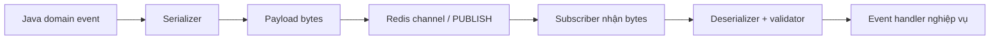

# Tuần tự hóa nội dung và quản lý phiên bản thông điệp trong Redis Pub/Sub

> **Module:** Spring Data Redis  
> **Chương:** Pub/Sub  
> **Chủ đề:** Thiết kế định dạng thông điệp, chọn serializer, xác định hợp đồng dữ liệu và tiến hóa phiên bản giữa publisher và subscriber trong hệ thống sử dụng Spring Data Redis.

## 1. Vì sao Pub/Sub cần một hợp đồng thông điệp rõ ràng?

Redis Pub/Sub là cơ chế phát và nhận thông điệp thông qua **channel**. Publisher gửi dữ liệu vào channel bằng `PUBLISH`, những subscriber đang đăng ký nhận trên channel đó có thể nhận thông điệp.

```redis
SUBSCRIBE catalog.product.price-changed
```

Một publisher khác gửi:

```redis
PUBLISH catalog.product.price-changed "{\"productId\":\"p-101\",\"newPrice\":129000}"
```

Ở mức giao thức, Redis **không hiểu** `productId`, `newPrice`, Java class, JSON schema hay tên phiên bản. Nó chuyển payload dạng bytes tới subscriber. Việc “chuỗi bytes này có nghĩa gì” do **publisher và subscriber thống nhất**.

Trong hệ thống nhỏ, hai service có thể cùng hiểu `"p-101|129000"`. Nhưng khi cần:

- Thay đổi cấu trúc object mà không cập nhật đồng thời tất cả service.
- Đổi Java package/class trong một ứng dụng.
- Thêm field mới nhưng vẫn hỗ trợ những consumer đang dùng phiên bản cũ.
- Phân biệt nhiều loại event cùng đi trên một channel.
- Hỗ trợ consumer viết bằng Java, Node.js hoặc Python.
- Phát hiện payload không hợp lệ, thông điệp thiếu trường hoặc không tương thích.
- Truy vết một thông điệp từ nơi phát đến nơi nhận.

…thì **tuần tự hóa (serialization)** và **quản lý phiên bản thông điệp (message versioning)** trở thành một phần của thiết kế API giữa các service.

Một bài học quan trọng: Redis Pub/Sub là **kênh phân phối tạm thời**, còn JSON/Avro/Protobuf… là **định dạng dữ liệu**. Chọn đúng serializer không khiến Redis Pub/Sub trở thành hàng đợi bền vững có replay, retry hay acknowledgement.

### 1.1. Ba ranh giới trong luồng truyền



Có ba việc khác nhau:

1. **Mã hóa:** biến dữ liệu ứng dụng thành dạng bytes và ngược lại.
2. **Thỏa thuận schema:** xác định field, kiểu dữ liệu, ý nghĩa và ràng buộc hợp lệ.
3. **Tiến hóa phiên bản:** cho phép producer/consumer triển khai lệch phiên bản nhưng vẫn xử lý đúng thông điệp mà chúng hỗ trợ.

Redis chỉ chuyển dữ liệu. Redis không tự kiểm tra schema hay nâng cấp thông điệp từ v1 sang v2.

## 2. Hiểu chính xác những gì Redis Pub/Sub truyền tải

### 2.1. Channel và body là dữ liệu riêng biệt

Một thông điệp Pub/Sub có ít nhất:

| Thành phần | Ý nghĩa | Ví dụ |
|---|---|---|
| Channel | Tên địa chỉ publisher gửi tới | `catalog.product.price-changed` |
| Payload/body | Bytes được phát | JSON UTF-8 hoặc Protobuf bytes |
| Pattern (nếu subscriber đăng ký pattern) | Pattern khớp channel | `catalog.product.*` |

Redis Pub/Sub **không tự thêm** các metadata nghiệp vụ như `eventId`, `schemaVersion`, `timestamp`, `correlationId` hay `aggregateVersion`. Nếu cần chúng, hãy đưa vào **payload** hoặc thiết kế metadata bằng quy ước riêng.

Tên channel và body đều cần thống nhất cách mã hóa. Với `StringRedisTemplate`, cách sử dụng thông thường là channel/value dưới dạng String, được serialize theo `StringRedisSerializer` (UTF-8). Với template tùy chỉnh, serializer có thể khác.

### 2.2. Pub/Sub không lưu trữ thông điệp

Một số thuộc tính cốt lõi của **Redis Pub/Sub thông thường**:

- Subscriber chỉ nhận những thông điệp phát khi nó đang kết nối và subscribe đúng channel/pattern.
- Không có offset, lịch sử thông điệp, cơ chế fetch lại hoặc acknowledgement như trong một message broker bền vững.
- Nếu subscriber offline, các thông điệp phát trong khoảng đó bị mất đối với subscriber.
- `PUBLISH` không đợi business handler xử lý thành công.
- Không có transaction tự động nối sự kiện Pub/Sub với việc commit database của publisher.
- Một channel có nhiều subscriber thì các subscriber đang hoạt động đều có thể nhận bản sao thông điệp.
- Redis không đảm bảo thứ tự toàn cục qua nhiều channel, connection, publisher và những lần reconnect.

Redis mô tả Pub/Sub thông thường có **at-most-once delivery semantics**. Đó là giới hạn của **hệ thống phân phối**, độc lập với JSON schema có tốt đến đâu.

Nếu cần phát lại thông điệp cho consumer mới, giữ lịch sử, xác nhận xử lý, kiểm soát retry hoặc khôi phục sự kiện bị bỏ lỡ, cân nhắc **Redis Streams với consumer groups** hoặc một message broker bền vững khác. Có thể vẫn dùng cùng kiểu schema và versioning, nhưng giao thức phân phối sẽ khác.

## 3. Serializer là gì và Spring Data Redis nằm ở đâu?

*Serialization* là quá trình:

```text
Java object -> bytes -> Redis Pub/Sub -> bytes -> Java object
```

*Deserialization* làm chiều ngược lại. Hai phía cần đồng thuận về:

- Định dạng: JSON, Protobuf, Avro, MessagePack, CBOR, text đơn giản…
- Encoding của text, thường là UTF-8.
- Kiểu số và cách biểu diễn tiền tệ.
- Quy tắc ngày giờ, timezone và precision.
- Trường bắt buộc, trường tùy chọn, giá trị `null`.
- Ý nghĩa của mọi field và quy tắc đổi phiên bản.
- Cách xử lý thông điệp không hiểu hoặc không hợp lệ.

Spring Data Redis cung cấp các cơ chế để làm việc với Redis bytes thông qua `RedisSerializer`, `RedisTemplate`, `StringRedisTemplate`, `MessageListener` và `MessageListenerAdapter`.

**Không có một serializer duy nhất tự động áp dụng cho mọi API:**

- `RedisTemplate` có key/value/hash serializer của chính bean đó.
- `StringRedisTemplate` thường dùng String serializers.
- `MessageListenerAdapter` có serializer dành cho việc chuyển đổi message thành tham số của phương thức nhận.
- `MessageListener` nhận trực tiếp raw Redis `Message` và tự quyết định giải mã `message.getBody()`.
- `RedisCacheManager` và Redis Repository có các quy tắc serialization/mapping riêng, không tự động áp lên Pub/Sub.

Do đó, nếu một subscriber giải mã bytes bằng JSON nhưng publisher thực tế gửi Java serialized object, lỗi nằm ở **hợp đồng serializer giữa hai phía**, dù cả hai đều đang kết nối đúng Redis server.

## 4. So sánh những lựa chọn serialization thường gặp

| Định dạng | Ưu điểm | Giới hạn | Khi nên cân nhắc |
|---|---|---|---|
| **UTF-8 plain text** | Đơn giản, dễ kiểm tra bằng CLI | Thiếu cấu trúc, khó mở rộng nhiều field | Tín hiệu đơn giản như `"refresh"` hoặc id |
| **JSON UTF-8** | Dễ đọc, liên ngôn ngữ, hỗ trợ thêm field | Payload thường lớn hơn nhị phân; cần validation và versioning | Domain events, microservices và đa ngôn ngữ |
| **MessagePack/CBOR** | Nhị phân gọn hơn JSON ở nhiều trường hợp | Khó đọc trực tiếp; cần thống nhất thư viện/schema | Event có dung lượng đáng kể, muốn cấu trúc gọn |
| **Protobuf** | Contract typed rõ ràng, mã hóa hiệu quả, quy tắc tiến hóa schema | Cần quản lý `.proto`, generated code và trường hợp field không còn phù hợp | Hệ thống nhiều service có hợp đồng chính thức |
| **Avro** | Có schema và mô hình reader/writer evolution | Cần quản lý schema, đôi khi schema registry | Event-driven platform có quy trình schema tập trung |
| **JDK serialization** | Có thể tiện khi cả hai phía là Java | Phụ thuộc lớp Java, khó tương tác đa ngôn ngữ, rủi ro deserialize dữ liệu không tin cậy | Không nên chọn làm contract Pub/Sub giữa service độc lập |
| **Raw byte protocol tự định nghĩa** | Có thể tối ưu đặc thù | Dễ phát sinh lỗi khi thay đổi format và thiếu công cụ | Trường hợp chuyên biệt có đặc tả giao thức rõ |

**JSON UTF-8 với schema envelope** là lựa chọn dễ hiểu và thực dụng cho phần lớn ví dụ Spring Data Redis Pub/Sub. Với hệ thống có hiệu năng và quy mô lớn, Protobuf/Avro có thể phù hợp hơn nhưng vẫn cần quy trình nâng cấp producer/consumer.

### 4.1. Vì sao không nên truyền Java object “nguyên xi”?

Giả sử publisher serialize trực tiếp:

```java
public class ProductPriceChanged {
    private String productId;
    private BigDecimal price;
}
```

Sau khi đổi tên class/package, thêm field hoặc thay đổi `serialVersionUID`, subscriber có thể không còn deserialize được payload cũ. Nếu sử dụng serializer cho phép nhận dạng class tùy ý trong payload không tin cậy, còn có rủi ro bảo mật.

Một **message contract** nên độc lập với chi tiết của domain object nội bộ. Ví dụ producer có thể dùng class `PriceChangedEntity`, nhưng thông điệp công khai vẫn có cấu trúc:

```json
{
  "eventType": "product.price.changed",
  "schemaVersion": 1,
  "payload": {
    "productId": "p-101",
    "price": 129000,
    "currency": "VND"
  }
}
```

Consumer không cần biết lớp Java nào producer đang dùng. Nó chỉ cần hiểu contract.

## 5. Thiết kế envelope để quản lý phiên bản và metadata

### 5.1. Envelope là gì?

*Envelope* là lớp bao ngoài phần dữ liệu nghiệp vụ (*payload*). Mỗi thông điệp nên tự mô tả loại sự kiện và phiên bản cần để giải mã.

Ví dụ:

```json
{
  "envelopeVersion": 1,
  "eventType": "product.price.changed",
  "schemaVersion": 1,
  "eventId": "e76fc6e5-803c-4ac4-b6e7-a59f87a917a8",
  "occurredAt": "2026-11-13T03:20:00Z",
  "producer": "catalog-service",
  "payload": {
    "productId": "p-101",
    "aggregateVersion": 43,
    "price": 129000,
    "currency": "VND"
  }
}
```

Ý nghĩa từng trường:

| Trường | Vai trò | Quy tắc khuyến nghị |
|---|---|---|
| `envelopeVersion` | Phiên bản **cấu trúc bao ngoài** | Tăng khi thay đổi cách hiểu metadata/envelope |
| `eventType` | Phân biệt loại sự kiện | Dùng tên có ý nghĩa nghiệp vụ và ổn định |
| `schemaVersion` | Phiên bản **schema của payload** ứng với event type | Xác định rõ quy tắc tương thích |
| `eventId` | Định danh một lần phát sự kiện | Định dạng ổn định, hỗ trợ log và deduplication |
| `occurredAt` | Thời điểm sự kiện nguồn phát sinh | ISO-8601 UTC, tránh timezone mơ hồ |
| `producer` | Dịch vụ phát sự kiện | Phục vụ log/điều tra; không dùng như bằng chứng tin cậy duy nhất |
| `payload` | Dữ liệu nghiệp vụ | Phải validate theo schemaVersion |
| `aggregateVersion` | Phiên bản thay đổi của thực thể nghiệp vụ | Phân biệt thứ tự cập nhật dữ liệu với phiên bản schema |

**`schemaVersion` không phải `aggregateVersion`:**

- `schemaVersion = 1` nghĩa là consumer đọc payload theo định dạng v1.
- `aggregateVersion = 43` nghĩa là thông điệp nói về lần thay đổi thứ 43 (theo hệ thống nguồn), nếu hệ thống nguồn có cơ chế version như vậy.

Không dùng `schemaVersion` để suy ra “thông điệp này mới hơn thông điệp kia”. Cần sequence hoặc aggregate version riêng để phát hiện sự kiện đến trễ/đảo thứ tự.

### 5.2. Nên đặt version trong channel hay body?

Có ba cách:

**Cách A — version trong payload/envelope:**

```text
channel: catalog.product.price-changed
body: { "schemaVersion": 1, ... }
```

Ưu điểm: cùng channel có thể chuyển tiếp nhiều phiên bản, consumer nhìn được metadata. Phù hợp khi cần triển khai độc lập producer/consumer.

**Cách B — version trong channel:**

```text
catalog.product.price-changed.v1
catalog.product.price-changed.v2
```

Ưu điểm: tách subscriber theo version, hữu ích với thay đổi lớn hoặc nhóm consumer rất khác nhau. Nhược điểm: phải quản lý nhiều subscription và có thể cần dual publish trong giai đoạn chuyển đổi.

**Cách C — kết hợp cả hai:**

Channel thể hiện family/major version, còn envelope ghi đầy đủ schema version. Phù hợp nếu muốn tách các thay đổi breaking ở cấp channel mà vẫn theo dõi metadata.

Đối với ứng dụng bắt đầu bằng JSON, cách A thường là lựa chọn đơn giản và rõ ràng. Không nên đổi channel chỉ vì thêm một field tùy chọn. Đổi channel có thể là một **thay đổi phân phối**, khác với đổi schema.

## 6. Quy tắc tiến hóa schema tương thích

Một thông điệp v1 đang được nhiều service nhận không thể được đổi tùy tiện thành bất kỳ cấu trúc nào rồi kỳ vọng consumer cũ vẫn chạy.

### 6.1. Những thay đổi thường có thể tương thích ngược

Giả sử v1:

```json
{
  "productId": "p-101",
  "aggregateVersion": 43,
  "price": 129000,
  "currency": "VND"
}
```

Một bản phát triển thêm field `source`:

```json
{
  "productId": "p-101",
  "aggregateVersion": 44,
  "price": 125000,
  "currency": "VND",
  "source": "FLASH_SALE"
}
```

Việc **thêm field tùy chọn** có thể tương thích nếu:

- Consumer cũ được thiết kế để **bỏ qua field chưa biết**, thay vì fail khi có unknown field.
- Consumer mới có default rõ ràng khi producer cũ chưa gửi `source`.
- Field mới không thay đổi ý nghĩa của những field cũ.
- Quy tắc schema của event type cho phép sự thay đổi này.

Nếu consumer cũ dùng deserializer strict và từ chối field lạ, thêm field cũng có thể làm nó hỏng. Do đó “thêm field là backward compatible” **phụ thuộc contract và cách consumer xử lý dữ liệu thực tế**.

Để an toàn, có thể giữ `schemaVersion = 1` đối với thay đổi hoàn toàn tương thích trong cùng một family schema, nhưng phải có quy tắc rõ ràng. Nếu tăng `schemaVersion = 2` cho mọi lần thêm field, consumer cũ có thể từ chối toàn bộ message v2 dù cấu trúc gần giống v1. Khi ấy cần nâng cấp consumer trước.

### 6.2. Những thay đổi thường gây breaking change

| Thay đổi | Nguy cơ | Cách xử lý thường dùng |
|---|---|---|
| Xóa field bắt buộc | Consumer cũ không còn dữ liệu cần thiết | Phiên bản schema mới, giai đoạn chuyển đổi |
| Đổi tên `productId` thành `sku` | Consumer cũ đọc thiếu id | Thêm field mới tạm thời, chuyển đổi rồi ngừng field cũ |
| Đổi `price` từ số sang string tự do | Deserialization/logic số có thể hỏng | Giữ kiểu số hoặc nâng version |
| Đổi `price` từ VND sang cent USD mà không đổi tên | Sai nghiệp vụ nghiêm trọng | Schema/event type mới, quy tắc đơn vị rõ |
| Đổi ý nghĩa `occurredAt` từ event time sang delivery time | Consumer tính thời gian sai | Metadata mới hoặc envelope version mới |
| Chuyển JSON sang Protobuf trên cùng channel mà không báo hiệu | Consumer dùng JSON không thể giải mã | Channel/format marker mới và rollout có kế hoạch |
| Bỏ hỗ trợ eventType cũ | Consumer cũ ngừng xử lý | Thông báo và giai đoạn dual support |

Một điểm dễ bị bỏ qua: **thay đổi ý nghĩa nhưng giữ nguyên kiểu dữ liệu cũng là breaking change**. Số `129000` có thể đại diện 129.000 VND hoặc 129.000 “cents”; hai cách hiểu khác nhau dù JSON vẫn hợp lệ.

### 6.3. Mô hình compatibility matrix

| Publisher phát | Consumer hiểu v1 | Consumer hiểu v1 và v2 | Consumer chỉ hiểu v2 |
|---|---|---|---|
| Event v1 | Hoạt động | Hoạt động | Chỉ hoạt động nếu có adapter/chuyển đổi v1 |
| Event v2 thêm field tương thích, vẫn khai báo v1 theo contract | Hoạt động nếu bỏ qua unknown field | Hoạt động | Tùy implementation |
| Event v2 khai báo `schemaVersion=2` | Bị từ chối hoặc bỏ qua có kiểm soát | Hoạt động | Hoạt động |
| Event v2 breaking | Không thể dùng trực tiếp | Hoạt động nếu có handler v2 | Hoạt động |

Việc consumer **bỏ qua thông điệp không hỗ trợ** là một lựa chọn kiểm soát lỗi. Với Redis Pub/Sub, bỏ qua có nghĩa dữ liệu **mất cơ hội xử lý**; không có backlog để xử lý lại sau khi nâng cấp. Vì thế không nên rollout breaking change khi vẫn còn những consumer cần xử lý sự kiện đó.

## 7. Ví dụ Spring Data Redis: publisher gửi JSON envelope

Ví dụ này dùng **Java 17+, Spring Boot và Spring Data Redis**, chọn một channel cố định, JSON UTF-8 và envelope tường minh.

### 7.1. Dependency cơ bản

Gradle Kotlin DSL:

```kotlin
dependencies {
    implementation("org.springframework.boot:spring-boot-starter-data-redis")
    implementation("org.springframework.boot:spring-boot-starter-json")
}
```

Tùy phiên bản Spring Boot, Jackson có thể đã là dependency gián tiếp của ứng dụng web, nhưng thêm starter JSON theo bản Boot đang dùng giúp thể hiện rõ nhu cầu serialize payload. Các đoạn Java sau giả định Jackson 2.x-compatible `ObjectMapper` được cấu hình bởi ứng dụng; cần dùng import/API tương ứng với phiên bản Spring Boot/Jackson của dự án.

Kết nối Redis đơn giản qua `application.yml`:

```yaml
spring:
  data:
    redis:
      host: localhost
      port: 6379
      timeout: 2s
```

Cấu hình kết nối này không tự bật Pub/Sub subscription. Subscription được khai báo bằng `RedisMessageListenerContainer` ở phần sau.

### 7.2. Định nghĩa envelope độc lập với domain entity

Đặt mỗi `public record` trong file Java tương ứng:

```java
// File: EventEnvelope.java
import com.fasterxml.jackson.databind.JsonNode;

public record EventEnvelope(
        int envelopeVersion,
        String eventType,
        int schemaVersion,
        String eventId,
        String occurredAt,
        String producer,
        JsonNode payload
) {}
```

Payload v1:

```java
// File: ProductPriceChangedV1.java
import java.math.BigDecimal;
import com.fasterxml.jackson.annotation.JsonIgnoreProperties;

@JsonIgnoreProperties(ignoreUnknown = true)
public record ProductPriceChangedV1(
        String productId,
        long aggregateVersion,
        BigDecimal price,
        String currency
) {}
```

Payload v2 có thêm field mới:

```java
// File: ProductPriceChangedV2.java
import java.math.BigDecimal;
import com.fasterxml.jackson.annotation.JsonIgnoreProperties;

@JsonIgnoreProperties(ignoreUnknown = true)
public record ProductPriceChangedV2(
        String productId,
        long aggregateVersion,
        BigDecimal price,
        String currency,
        String source
) {}
```

Với `@JsonIgnoreProperties(ignoreUnknown = true)`, consumer của những record này có thể chấp nhận field chưa biết. Tuy nhiên nó không tự đảm bảo một field **bị thiếu** có giá trị hợp lệ; ta vẫn cần validation.

Kiểu `BigDecimal` phù hợp hơn `double` cho giá tiền trong nhiều bài toán, nhưng còn cần quy ước **đơn vị** và **currency**. Với hệ thống tiền tệ nghiêm ngặt, có thể chọn integer minor units kèm currency nếu contract định nghĩa rõ.

### 7.3. Publisher sử dụng `StringRedisTemplate`

```java
import java.math.BigDecimal;
import java.time.Instant;
import java.util.UUID;

import com.fasterxml.jackson.core.JsonProcessingException;
import com.fasterxml.jackson.databind.ObjectMapper;
import org.springframework.data.redis.core.StringRedisTemplate;
import org.springframework.stereotype.Service;

@Service
public class PriceChangedPublisher {

    public static final String CHANNEL =
            "catalog.product.price-changed";
    public static final String EVENT_TYPE =
            "product.price.changed";

    private final StringRedisTemplate redis;
    private final ObjectMapper mapper;

    public PriceChangedPublisher(
            StringRedisTemplate redis, ObjectMapper mapper) {
        this.redis = redis;
        this.mapper = mapper;
    }

    public Long publishV1(String productId,
                          long aggregateVersion,
                          BigDecimal newPrice,
                          String currency) throws JsonProcessingException {

        ProductPriceChangedV1 payload = new ProductPriceChangedV1(
                productId, aggregateVersion, newPrice, currency);

        EventEnvelope event = new EventEnvelope(
                1,
                EVENT_TYPE,
                1,
                UUID.randomUUID().toString(),
                Instant.now().toString(),
                "catalog-service",
                mapper.valueToTree(payload));

        String json = mapper.writeValueAsString(event);

        return redis.convertAndSend(CHANNEL, json);
    }
}
```

Trong ví dụ:

- `ObjectMapper` chuyển record thành JSON string.
- `StringRedisTemplate` serialize string thành bytes UTF-8 để gửi `PUBLISH`.
- `eventType` và `schemaVersion` được đặt rõ ràng.
- `eventId` được tạo cho **một logical event**; nếu retry hoặc dual publish cùng event, nên giữ một eventId ổn định thay vì tạo eventId mới cho cùng thay đổi nghiệp vụ.
- `occurredAt` dùng ISO-8601 UTC qua `Instant.now().toString()`.
- `redis.convertAndSend(...)` trả số lượng subscriber được Redis báo là đang nhận thông điệp, **không** phải xác nhận mọi consumer đã xử lý thành công.

Với Java record khác hoặc Jackson version khác, có thể cần cấu hình ObjectMapper thích hợp. Lựa chọn lưu `occurredAt` dưới dạng string ISO-8601 giúp contract không phụ thuộc cách một thư viện serialize Java `Instant` mặc định.

### 7.4. Vì sao không publish thẳng entity Java?

Tránh kiểu:

```java
redisTemplate.convertAndSend(CHANNEL, productEntity);
```

nếu các service **chưa thống nhất serializer** cho `productEntity`. Bean `RedisTemplate` mặc định có thể dùng cách tuần tự hóa khác với `StringRedisTemplate`; dù tên channel giống nhau, subscriber JSON có thể nhận bytes không phải JSON.

Khi chọn JSON làm hợp đồng, publisher nên serialize tường minh hoặc cấu hình rõ một template với JSON serializer đã được kiểm soát. Không phụ thuộc serializer mặc định của bean không xác định.

## 8. Subscriber nhận message và giải mã theo version

### 8.1. Dùng `MessageListener` để chủ động xử lý raw bytes

```java
import java.math.BigDecimal;
import java.nio.charset.StandardCharsets;
import java.time.Instant;

import com.fasterxml.jackson.databind.ObjectMapper;
import org.slf4j.Logger;
import org.slf4j.LoggerFactory;
import org.springframework.data.redis.connection.Message;
import org.springframework.data.redis.connection.MessageListener;
import org.springframework.stereotype.Component;

@Component
public class PriceChangedListener implements MessageListener {

    private static final Logger log =
            LoggerFactory.getLogger(PriceChangedListener.class);

    private static final int MAX_BYTES = 64 * 1024;

    private final ObjectMapper mapper;
    private final PriceProjection projection;

    public PriceChangedListener(
            ObjectMapper mapper, PriceProjection projection) {
        this.mapper = mapper;
        this.projection = projection;
    }

    @Override
    public void onMessage(Message message, byte[] pattern) {
        byte[] body = message.getBody();

        // Giới hạn kích thước là chính sách của ứng dụng,
        // không phải giới hạn mặc định của Redis.
        if (body == null || body.length == 0 || body.length > MAX_BYTES) {
            log.warn("Reject empty or oversized price event");
            return;
        }

        try {
            String json = new String(body, StandardCharsets.UTF_8);
            EventEnvelope event =
                    mapper.readValue(json, EventEnvelope.class);

            if (event.envelopeVersion() != 1
                    || !PriceChangedPublisher.EVENT_TYPE
                            .equals(event.eventType())
                    || event.eventId() == null
                    || event.eventId().isBlank()
                    || event.payload() == null
                    || !event.payload().isObject()) {
                log.warn("Reject invalid price event envelope");
                return;
            }

            // Kiểm tra có thể parse thời điểm theo UTC/ISO-8601.
            Instant.parse(event.occurredAt());

            switch (event.schemaVersion()) {
                case 1 -> handleV1(event);
                case 2 -> handleV2(event);
                default -> log.warn(
                        "Unsupported schemaVersion={} eventId={}",
                        event.schemaVersion(), event.eventId());
            }
        } catch (Exception ex) {
            // Log + metric; Redis Pub/Sub không có cơ chế ack/nack
            // để Redis tự redeliver thông điệp này.
            log.warn("Cannot handle price-change message", ex);
        }
    }

    private void handleV1(EventEnvelope event) throws Exception {
        ProductPriceChangedV1 payload =
                mapper.treeToValue(
                        event.payload(), ProductPriceChangedV1.class);

        validate(payload.productId(),
                 payload.aggregateVersion(),
                 payload.price(),
                 payload.currency());

        projection.applyIfNewer(
                payload.productId(),
                payload.aggregateVersion(),
                payload.price(),
                payload.currency(),
                event.eventId());
    }

    private void handleV2(EventEnvelope event) throws Exception {
        ProductPriceChangedV2 payload =
                mapper.treeToValue(
                        event.payload(), ProductPriceChangedV2.class);

        validate(payload.productId(),
                 payload.aggregateVersion(),
                 payload.price(),
                 payload.currency());

        // source ở v2 có thể được dùng để đo nguồn cập nhật,
        // nhưng core projection vẫn dùng những field ổn định.
        projection.applyIfNewer(
                payload.productId(),
                payload.aggregateVersion(),
                payload.price(),
                payload.currency(),
                event.eventId());
    }

    private static void validate(
            String productId, long aggregateVersion,
            BigDecimal price, String currency) {

        if (productId == null || productId.isBlank()
                || aggregateVersion <= 0
                || price == null || price.signum() < 0
                || currency == null || currency.isBlank()) {
            throw new IllegalArgumentException(
                    "Invalid product price event");
        }
    }
}
```

Phụ thuộc nghiệp vụ được minh họa bằng interface:

```java
import java.math.BigDecimal;

public interface PriceProjection {

    // Implementation phải đảm bảo atomic check-and-update của version.
    void applyIfNewer(String productId,
                      long aggregateVersion,
                      BigDecimal price,
                      String currency,
                      String eventId);
}
```

`PriceProjection` ở đây là thành phần do ứng dụng tự triển khai. Nó có thể ghi cache, cập nhật read model hoặc lưu bảng projection. Hàm `applyIfNewer` phải xử lý so sánh version và cập nhật **theo cách nguyên tử** ở nguồn lưu trữ thích hợp; tên phương thức tự nó không tạo atomicity.

Listener minh họa hai điểm quan trọng:

- **Deserialize theo `schemaVersion`**, không đoán Java class từ payload.
- **Validate dữ liệu sau khi deserialize**, vì JSON đúng cú pháp không đồng nghĩa event hợp lệ về nghiệp vụ.

Ở đây một thông điệp không hợp lệ được ghi log và bỏ qua. Với Pub/Sub không có ack/replay, nếu việc bỏ qua không chấp nhận được thì **cần chuyển sang hạ tầng phân phối có độ bền và retry phù hợp**, hoặc bổ sung luồng đối soát lấy lại trạng thái chuẩn.

### 8.2. Đăng ký listener với `RedisMessageListenerContainer`

```java
import org.springframework.context.annotation.Bean;
import org.springframework.context.annotation.Configuration;
import org.springframework.data.redis.connection.RedisConnectionFactory;
import org.springframework.data.redis.listener.ChannelTopic;
import org.springframework.data.redis.listener.RedisMessageListenerContainer;

@Configuration
public class PriceEventsSubscriptionConfiguration {

    @Bean
    public RedisMessageListenerContainer priceEventsContainer(
            RedisConnectionFactory connectionFactory,
            PriceChangedListener listener) {

        RedisMessageListenerContainer container =
                new RedisMessageListenerContainer();
        container.setConnectionFactory(connectionFactory);
        container.addMessageListener(
                listener,
                new ChannelTopic(PriceChangedPublisher.CHANNEL));
        return container;
    }
}
```

Khi Spring quản lý container bean, nó quản lý vòng đời subscription. `ChannelTopic` đăng ký một channel cụ thể. Nếu cần đăng ký nhiều channel theo pattern, có thể dùng `PatternTopic` tương ứng.

Một số điểm vận hành:

- Subscription có thể tạm gián đoạn do Redis failover, network hoặc thay đổi topology. Reconnect không phát lại những event đã mất.
- Listener có thể được thực thi bởi task executor của container. Nếu callback rất nặng hoặc blocking, cần điều chỉnh executor hoặc tách công việc; xử lý quá chậm có thể gây backlog/bộ nhớ của client.
- Dùng channel ACL và cấu hình TLS/credentials phù hợp môi trường; container cần quyền subscribe thực tế.
- Một instance Spring có thể có nhiều listener; nhiều instance subscribe cùng channel đều có thể nhận event.

### 8.3. Các lớp example cần cấu trúc thế nào?

Một package minh họa:

```text
com.example.events
├── EventEnvelope.java
├── ProductPriceChangedV1.java
├── ProductPriceChangedV2.java
├── PriceChangedPublisher.java
├── PriceChangedListener.java
├── PriceEventsSubscriptionConfiguration.java
└── PriceProjection.java
```

Đây là ví dụ tách lớp cho rõ trách nhiệm; các import và Java package cần được đặt phù hợp dự án. Nếu producer và consumer là các service khác nhau, chỉ chia sẻ **contract đã công bố** và không buộc toàn bộ domain entities của hai service phải dùng cùng artifact Java.

## 9. Trường hợp sử dụng `MessageListenerAdapter`

Ngoài việc tự implement `MessageListener`, Spring Data Redis có `MessageListenerAdapter` để chuyển message thành lời gọi method trên delegate. Adapter có serializer để giải mã payload thành đối số phương thức.

Ví dụ khi thông điệp luôn là JSON String và service tự xử lý JSON:

```java
import org.springframework.context.annotation.Bean;
import org.springframework.context.annotation.Configuration;
import org.springframework.data.redis.listener.adapter.MessageListenerAdapter;
import org.springframework.data.redis.serializer.StringRedisSerializer;

@Configuration
public class PriceAdapterConfiguration {

    @Bean
    public MessageListenerAdapter priceMessageAdapter(
            PriceTextReceiver receiver) {

        MessageListenerAdapter adapter =
                new MessageListenerAdapter(receiver, "receive");
        adapter.setSerializer(new StringRedisSerializer());
        return adapter;
    }
}
```

Delegate:

```java
import org.springframework.stereotype.Component;

@Component
public class PriceTextReceiver {

    public void receive(String json) {
        // Parse envelope, kiểm tra eventType/schemaVersion,
        // validate payload rồi gọi business handler.
    }
}
```

Bean adapter cần được đăng ký vào một `RedisMessageListenerContainer` thay cho raw listener trong một cấu hình subscription khác; **không đăng ký cả hai** nếu chỉ muốn xử lý event một lần mỗi application instance.

Sự khác biệt:

- Với `MessageListener`: callback nhận `byte[]`, ứng dụng trực tiếp kiểm soát decode và validation.
- Với `MessageListenerAdapter`: adapter gọi serializer trước, nên cấu hình serializer **phải khớp publisher**.
- Nếu vô tình dùng serializer mặc định không tương thích, việc chuyển message thành Java argument có thể thất bại **trước khi** method delegate chạy.

Các ví dụ trong bài dùng raw listener làm đường chính để minh họa toàn bộ quá trình kiểm tra schema.

## 10. Đổi từ schema v1 sang v2 mà không làm hỏng consumer

Giả sử nhà phát hành muốn thêm trường `source` cho event giá. Có những consumer chưa thể nâng cấp cùng ngày.

### 10.1. Phân biệt “thêm field” và “nâng phiên bản”

Một chiến lược phổ biến:

- Khi **thêm field tùy chọn, hoàn toàn tương thích** và consumer cũ bỏ qua unknown field, có thể giữ cùng contract version nếu quy ước versioning cho phép.
- Khi muốn thông báo rõ có schema khác và consumer phải hiểu v2, nâng `schemaVersion` từ 1 lên 2.
- Khi thay đổi **ý nghĩa nghiệp vụ**, không chỉ là field, cân nhắc event type mới hoặc version mới có giai đoạn chuyển đổi.

Trong code listener ở trên, consumer đã hỗ trợ `schemaVersion = 1` và `2`. Producer có thể bắt đầu phát v2:

```java
ProductPriceChangedV2 payload =
        new ProductPriceChangedV2(
                "p-101", 44L,
                new BigDecimal("125000"), "VND",
                "FLASH_SALE");

EventEnvelope event = new EventEnvelope(
        1,
        "product.price.changed",
        2,
        "c69cfde9-a257-4c36-96fd-4ab85f732618",
        "2026-11-13T04:00:00Z",
        "catalog-service",
        mapper.valueToTree(payload));

redis.convertAndSend(
        PriceChangedPublisher.CHANNEL,
        mapper.writeValueAsString(event));
```

Đoạn code này nằm trong một context có `mapper`/`redis` tương ứng, minh họa cách tạo event v2; nó không phải một class hoàn chỉnh.

### 10.2. Trình tự rollout producer và consumer

Một kế hoạch triển khai an toàn hơn:

1. **Công bố schema v2:** định nghĩa field mới, kiểu và ý nghĩa. Viết rõ consumer v1 có được bỏ qua hay không.
2. **Mở rộng consumer trước:** deploy phiên bản có thể đọc **v1 lẫn v2**; giữ logic v1 hoạt động.
3. **Quan sát readiness:** kiểm tra các consumer quan trọng đã nâng cấp, telemetry ghi nhận version và lỗi decode.
4. **Chuyển publisher:** phát v2 khi các subscriber cần thiết đều hỗ trợ.
5. **Giữ tương thích trong cửa sổ chuyển đổi:** các producer cũ có thể vẫn phát v1.
6. **Loại bỏ v1 khi có bằng chứng không còn cần:** dựa trên inventory consumer và số liệu sử dụng; không chỉ dựa vào ngày deploy.
7. **Xử lý rollback:** nếu publisher quay lại v1, consumer mới vẫn phải hiểu v1.

Với Pub/Sub, nếu publisher phát v2 quá sớm, consumer v1 có thể **bỏ lỡ vĩnh viễn** các event v2 mà nó không hiểu. Không có backlog để xử lý lại khi consumer đã được nâng cấp.

### 10.3. Dual publish khi breaking change

Một số thay đổi không thể dùng chung contract. Có thể phát song song:

```text
catalog.product.price-changed.v1   -> payload v1
catalog.product.price-changed.v2   -> payload v2
```

Nhưng dual publish có rủi ro:

- Consumer vô tình subscribe cả hai channel có thể xử lý **cùng thay đổi hai lần**.
- Publish v1 thành công rồi publish v2 lỗi: hai nhóm consumer quan sát trạng thái khác nhau.
- Redis Pub/Sub không đảm bảo giao nhận đồng thời cả hai bản; không có transaction bền vững quanh việc phát hai channel.
- Nếu tạo `eventId` khác nhau cho cùng một thay đổi, deduplication càng khó.
- Cần giới hạn thời gian dual publish và có tiêu chí rõ để ngừng v1.

Nếu yêu cầu tất cả các consumer cùng nhận chính xác một event có độ tin cậy cao, dual Pub/Sub thuần không phải giải pháp bảo đảm; nên xét event log/queue với retry và idempotency.

## 11. Compatibility contract: cách định nghĩa để dễ bảo trì

Một tài liệu contract tối thiểu có thể mô tả:

```yaml
eventType: product.price.changed
channel: catalog.product.price-changed
envelopeVersion: 1
schemaVersion: 2
contentType: application/json
encoding: UTF-8

payload:
  productId:
    type: string
    required: true
    description: "ID ổn định của sản phẩm"
  aggregateVersion:
    type: integer
    required: true
    minimum: 1
    description: "Version tăng theo thay đổi của sản phẩm"
  price:
    type: decimal
    required: true
    minimum: 0
    description: "Giá theo đơn vị tiền tệ currency"
  currency:
    type: string
    required: true
    description: "Mã đơn vị tiền tệ, ví dụ VND"
  source:
    type: string
    required: false
    description: "Nguồn thay đổi; có thể thiếu ở bản cũ"
```

Đây là **bản mô tả YAML dành cho tài liệu thiết kế**, không phải định dạng bắt buộc của Spring Data Redis. Khi nhiều service tham gia, có thể dùng JSON Schema, Protobuf schema, Avro schema hoặc kho tài liệu contract được version trong Git.

Ngoài schema, mỗi event nên có **semantic rules**:

- `productId` có phân biệt chữ hoa/chữ thường không?
- `price` có được âm hoặc bằng 0 không? Đơn vị là tiền chính hay tiền nhỏ nhất?
- `aggregateVersion` tăng trên từng sản phẩm hay trên toàn hệ thống?
- `occurredAt` là thời điểm database commit hay thời điểm publisher gửi?
- `source` có enum cố định hay chuỗi mở rộng?
- Event biểu thị **sự kiện đã commit** hay chỉ là yêu cầu thay đổi?
- Khi consumer không biết một field, phải bỏ qua, cảnh báo hay từ chối?

Hai JSON có cùng field/kiểu dữ liệu nhưng khác ý nghĩa vẫn có thể không tương thích về nghiệp vụ.

## 12. Tách schema của event với schema của entity

Một lỗi thiết kế thường gặp là publish nguyên entity database:

```java
// Ý tưởng cần tránh khi event được dùng bởi các service độc lập:
redis.convertAndSend(channel, objectMapper.writeValueAsString(entity));
```

Entity có thể mang:

- Field chỉ dành cho database.
- Quan hệ lazy-loaded hoặc object graph phức tạp.
- Dữ liệu cá nhân/nhạy cảm không cần gửi.
- Tên lớp/field thay đổi theo refactor nội bộ.
- Trạng thái tạm chưa commit.
- Giá trị mà consumer không cần nhưng lại trở thành dependency.

Một **event DTO/contract** nên chỉ có các field cần thiết cho người nhận và được chọn có chủ đích. Chẳng hạn:

```text
Domain entity Product:
  id, name, description, internalCost, sellingPrice,
  supplierSecret, stock, updatedAt, auditFields ...

Public event product.price.changed:
  productId, aggregateVersion, price, currency, source
```

Cách tách này cho phép thay database schema mà không bắt buộc mọi consumer thay đổi. Nó cũng giảm rủi ro vô tình đưa bí mật nghiệp vụ vào Pub/Sub.

## 13. Xử lý thông điệp không biết phiên bản hoặc lỗi deserialize

Với event-driven code, cách xử lý lỗi phải được xác định trước. Ví dụ:

| Tình huống | Cách xử lý nên cân nhắc | Giới hạn |
|---|---|---|
| Bytes không phải UTF-8 hợp lệ | Từ chối, ghi metric/log có giới hạn | Pub/Sub không tự gửi lại |
| JSON lỗi cú pháp | Từ chối, log event channel và loại lỗi | Không có dead-letter queue mặc định |
| Thiếu `schemaVersion` | Từ chối hoặc áp compatibility default đã công bố | Không nên âm thầm đoán format |
| `schemaVersion` cao hơn mức hỗ trợ | Cảnh báo, metric, tránh cast sai | Event bị bỏ qua nếu không có đường bù |
| `eventType` lạ | Bỏ qua có kiểm soát hoặc đăng ký handler mới | Tránh gọi nhầm handler |
| Thiếu field bắt buộc | Validate và từ chối | JSON parse được vẫn có thể sai dữ liệu |
| `price` có kiểu/số không hợp lệ | Từ chối, log có redaction | Không nên ép string tùy ý sang tiền |
| Đã xử lý cùng `eventId` | Deduplicate nếu cần | Pub/Sub không cung cấp deduplication |
| `aggregateVersion` cũ hơn trạng thái hiện tại | Bỏ qua hoặc đối soát | Cần thao tác so sánh/cập nhật nguyên tử |
| Handler bị lỗi giữa chừng | Log/metric và reconcile; cân nhắc queue bền vững | Không có Redis Pub/Sub ACK/NACK |

**Không ghi toàn bộ raw payload vào log theo mặc định**, nhất là khi có thông tin cá nhân hoặc secrets. Nên log event type, schema version, event id, kích thước và mã lỗi; chỉ ghi payload đã redaction trong môi trường phù hợp.

### 13.1. Có nên dùng default schemaVersion khi thiếu?

Nếu một hệ thống cũ từng gửi JSON không có envelope, có thể viết adapter trong giai đoạn migrate:

```text
Nếu có schemaVersion -> decode theo schema đó.
Nếu không có schemaVersion nhưng body khớp legacy v0 ->
    decode theo LegacyPriceChangedV0.
Ngược lại -> reject.
```

Cần **điều kiện nhận diện legacy rõ ràng**. Không được suy đoán một message không có version tự động là v1 nếu điều đó có thể khiến field bị hiểu sai.

### 13.2. Giới hạn kích thước và độ sâu JSON

Mỗi subscriber có thể bị tấn công hoặc gặp lỗi do payload quá lớn/đệ quy quá sâu. Redis Pub/Sub không định nghĩa business size limit riêng cho event của bạn. Ứng dụng nên đặt giới hạn bytes, cấu hình parser constraints phù hợp với thư viện JSON, và giới hạn batch/payload theo từng event type.

Trong ví dụ listener, `MAX_BYTES = 64 * 1024` là **quy ước ứng dụng minh họa**, không phải giới hạn protocol của Redis.

## 14. Event ordering và phiên bản dữ liệu khác phiên bản schema

Giả sử một sản phẩm được cập nhật liên tiếp:

```text
Event A: productId=p-101, aggregateVersion=44, price=129000
Event B: productId=p-101, aggregateVersion=45, price=125000
```

Nếu nhiều publisher, network hoặc consumer handler xử lý bất đồng bộ, không nên dựa vào `occurredAt` hoặc thứ tự callback toàn cục để chắc chắn B luôn được áp dụng sau A. Một consumer nhận B trước rồi mới xử lý A có thể vô tình ghi **giá cũ** đè lên giá mới.

Giải pháp dùng version nghiệp vụ:

```text
storedVersion = 45
incomingVersion = 44

Nếu incomingVersion <= storedVersion:
    Bỏ qua event cũ/đã xử lý
Ngược lại:
    Cập nhật giá và version cùng một thao tác nguyên tử
```

**Cần atomic check-and-set** tại nơi lưu projection. Nếu kiểm tra version bằng `GET` rồi `SET` riêng rẽ dưới nhiều worker, vẫn có race.

Các lựa chọn:

- Transaction/optimistic locking tại database nguồn hoặc read model.
- Một Redis Lua script kiểm tra và cập nhật version/giá atomically trên cùng Redis instance/slot.
- Redis `WATCH` + `MULTI`/`EXEC` với retry.
- Một hệ thống event log có partition/order semantics phù hợp, kết hợp idempotency.

Không nhầm:

- **`schemaVersion`:** cấu trúc của event.
- **`aggregateVersion`:** thứ tự cập nhật của sản phẩm.
- **`eventId`:** định danh để phát hiện cùng một logical event.
- **`occurredAt`:** thời gian sự kiện xảy ra; hữu ích cho monitoring nhưng không thay phiên bản có thứ tự.

### 14.1. Event id không tự tạo exactly-once

Publisher có thể dùng `eventId` để consumer ghi nhận đã xử lý. Nhưng muốn ngăn trùng side effect, việc kiểm tra `eventId` và ghi kết quả phải được phối hợp bằng transaction/atomic operation.

```text
Worker A: kiểm tra eventId chưa xử lý
Worker B: kiểm tra eventId chưa xử lý
Worker A: ghi giá mới
Worker B: ghi giá mới
```

Nếu hai worker xử lý cùng event mà không có khóa/atomicity, cả hai có thể thực hiện side effect. Đặt UUID vào payload mới chỉ tạo **khả năng nhận diện**, không đảm bảo xử lý đúng một lần.

Ngoài ra, Redis Pub/Sub thông thường không tự retry; deduplication vẫn hữu ích khi publisher dual publish hoặc retry, nhưng không bù được thông điệp đã mất.

## 15. Tương thích khi có nhiều service và nhiều phiên bản đang chạy

Một hệ thống production có thể đồng thời chứa:

```text
catalog-service A  -> publisher v1
catalog-service B  -> publisher v2

pricing-view v1    -> subscriber chỉ hiểu schema v1
pricing-view v2    -> subscriber hiểu v1 + v2

notification v2    -> subscriber hiểu v1 + v2
analytics v1       -> subscriber chỉ hiểu v1
```

Việc deployment theo pod/rolling update khiến khoảng thời gian hỗn hợp phiên bản là bình thường.

### 15.1. Contract-first giúp tránh lỗi ra mắt

Một quy trình hợp lý:

1. Công bố schema ở repository/artifact được quản lý phiên bản.
2. Có ví dụ JSON canonical cho các phiên bản hiện hành.
3. Mô tả thay đổi nào được chấp nhận mà không tăng major version.
4. Xác định chủ sở hữu event, danh sách consumer và các yêu cầu chuyển đổi.
5. Mở rộng consumer trước khi publisher phát một version mới cần handler mới.
6. Quan sát eventVersion/schemaVersion sau khi rollout.
7. Xóa code hỗ trợ v1 khi không còn consumer/producer cần nó.

Không nên yêu cầu tất cả team deploy đúng một thời điểm như giải pháp duy nhất: môi trường phân tán có restart, rollback và deployment chồng nhau.

### 15.2. Shared contract library: lợi ích và rủi ro

Một thư viện chứa các DTO event và JSON schema có thể giảm lỗi gõ sai tên field giữa các ứng dụng Java. Tuy nhiên nếu shared library import quá nhiều domain code hoặc cùng release với mọi service, nó tạo coupling.

Một cách tổ chức:

```text
event-contracts/
  product-price-changed/
    v1.schema.json
    v1.example.json
    v2.schema.json
    v2.example.json
    README.md
```

Consumer Java có thể tự generate/khai báo DTO từ schema đó; consumer Node/Python cũng dùng cùng contract. Chủ sở hữu contract nên duy trì lịch sử thay đổi và danh sách version được hỗ trợ.

### 15.3. Consumer-driven compatibility

Producer thường không biết hết những yêu cầu ngầm của consumer. Khi có nhiều đội, có thể dùng contract tests để kiểm tra event mới với schema mà consumer thực tế hỗ trợ. Ví dụ: consumer cũ có bỏ qua field mới hay không; field `price` có còn được serialize là số; sự kiện `occurredAt` có đúng ISO-8601 UTC.

Đây là hoạt động quản trị chất lượng theo vòng đời phát triển. Nó **không thay thế giám sát runtime** vì sự kiện có thể bị mất do mạng dù schema hoàn toàn hợp lệ.

## 16. JSON có nhiều chi tiết dễ gây lỗi phiên bản

### 16.1. Phân biệt field thiếu và field `null`

Hai payload này có thể có semantics khác:

```json
{"productId":"p-101"}
```

```json
{"productId":"p-101","source":null}
```

Với một contract, **field thiếu** có thể nghĩa “producer chưa biết field mới”, còn **null** có thể nghĩa “nguồn thay đổi không được xác định”. Nếu logic nghiệp vụ phân biệt được hai trạng thái, cần schema và DTO/JsonNode xử lý tường minh.

### 16.2. Kiểu số và tiền tệ

Đừng gửi giá dưới dạng floating-point rồi giả định mọi consumer làm tròn giống nhau. Với dữ liệu tài chính:

- Dùng số nguyên biểu diễn đơn vị tiền nhỏ nhất hoặc decimal chính xác.
- Gắn `currency` và quy tắc đơn vị.
- Không thay đổi đơn vị mà giữ nguyên field/version.
- Định nghĩa rõ việc làm tròn và số chữ số thập phân.

Ví dụ:

```json
{
  "priceMinor": 129000,
  "currency": "VND"
}
```

Ý nghĩa của `priceMinor` phải được mô tả theo ISO 4217 hoặc quy tắc ứng dụng; với VND và một số tiền tệ khác, số chữ số phần thập phân có thể khác.

### 16.3. Timestamp

Ưu tiên biểu diễn không mơ hồ:

```json
{"occurredAt":"2026-11-13T03:20:00Z"}
```

Tránh:

```json
{"occurredAt":"13/11/2026 10:20"}
```

Chuỗi thứ hai thiếu timezone và phụ thuộc định dạng ngày. Nếu dùng epoch milliseconds, cần ghi rõ đơn vị; epoch seconds và epoch milliseconds đều là số nhưng khác nhau 1.000 lần.

### 16.4. Enum có thể tiến hóa

Ví dụ `source` ban đầu có `"ADMIN"` và `"IMPORT"`, sau đó thêm `"FLASH_SALE"`. Consumer nào dùng enum strict và không có fallback có thể fail khi thấy giá trị mới.

Nếu cho phép mở rộng, nên định nghĩa trạng thái `UNKNOWN` hoặc cách xử lý giá trị ngoài enum được công bố. Nếu không cho phép mở rộng, thêm enum value là một thay đổi contract cần rollout có kế hoạch.

### 16.5. JSON polymorphic type metadata

Không nên để JSON payload tự quyết định Java class cần khởi tạo qua type metadata tùy ý (`@class` hoặc cơ chế tương đương) cho những thông điệp nhận từ bên ngoài. Một chiến lược an toàn hơn là:

1. Kiểm tra `eventType` trong allowlist.
2. Kiểm tra `schemaVersion` trong tập hỗ trợ.
3. Map payload sang DTO class được code chọn tường minh.
4. Validate dữ liệu.
5. Gọi đúng handler.

Điều này giúp kiểm soát bề mặt deserialize và không khiến schema phụ thuộc tên package Java.

## 17. Bảo mật khi publish/subscribe dữ liệu có phiên bản

### 17.1. Channel không phải ranh giới bảo mật mặc định

Tên channel `catalog.product.price-changed` chỉ là quy ước phân luồng. Nếu Redis ACL hoặc network cho phép một client lạ subscribe, nó có thể nhận event đang phát. Cần:

- TLS khi dữ liệu đi qua đường mạng có rủi ro.
- Redis ACL giới hạn quyền `PUBLISH`/`SUBSCRIBE`/`PSUBSCRIBE` và patterns channel được phép.
- Tách hạ tầng hoặc quyền giữa môi trường dev/staging/production.
- Không gửi secrets/PII nếu subscriber không cần.
- Audit danh sách service được phép publish vào channel quan trọng.

Với Redis ACL các phiên bản hỗ trợ channel patterns, có thể giới hạn quyền theo nhóm channel thay vì cho phép toàn bộ kênh. Cần kiểm tra cụ thể khả năng ACL của engine/provider đang dùng.

### 17.2. Payload validation là ranh giới tin cậy

Subscriber nên xem mọi thông điệp nhận được là input không đáng tin cậy cho tới khi:

- Định dạng đúng và nằm trong giới hạn kích thước.
- Metadata hợp lệ.
- `eventType` và `schemaVersion` được hỗ trợ.
- Payload phù hợp schema và business validation.
- Nếu cần, xác minh nguồn phát ở cấp hạ tầng hoặc chứng thực thông điệp.
- Side effect được thực hiện idempotent hoặc có version check.

Chỉ parse JSON thành record mà không validate vẫn có thể đưa dữ liệu lỗi vào projection hoặc downstream service.

### 17.3. Thay đổi serializer không chỉ là thay performance

Chuyển từ JSON sang Java native serialization hoặc mở Jackson default typing tùy ý có thể làm tăng rủi ro deserialization. Ngược lại, chuyển sang Protobuf/Avro cũng không tự loại bỏ nhu cầu validate input. Quy tắc “chỉ deserialize loại DTO đã định nghĩa” thường dễ vận hành và kiểm soát hơn.

## 18. Giám sát versioning và lỗi thông điệp

Những metrics hữu ích:

| Metric | Phân loại đề xuất | Mục đích |
|---|---|---|
| `pubsub_published_total` | `eventType`, `schemaVersion` | Biết producer đang phát loại version nào |
| `pubsub_received_total` | `eventType`, `schemaVersion` | Biết consumer đang nhận loại version nào |
| `pubsub_decode_failed_total` | error reason, channel | Phát hiện JSON/serializer/schema không hợp lệ |
| `pubsub_unsupported_version_total` | event type, version | Phát hiện rollout sai thứ tự |
| `pubsub_handler_failed_total` | handler type, error class | Nhận biết side effect lỗi |
| `pubsub_payload_bytes` | event type | Theo dõi kích thước và nguy cơ overload |
| `pubsub_consumer_lag_hint` | event type | Ước lượng từ `now - occurredAt`, không phải lag broker bền vững |
| `pubsub_subscribe_reconnect_total` | Redis endpoint/instance | Phát hiện mất kết nối và nguy cơ mất event |

Không nên gắn `eventId` hay `productId` làm label metric vì cardinality có thể rất lớn. Những giá trị này phù hợp hơn trong structured logs/traces với chính sách bảo vệ dữ liệu.

**Lưu ý:** Tổng số published/received là các metric do ứng dụng tự đo; Redis Pub/Sub không cung cấp một bảng lịch sử event đáng tin để đo trực tiếp số event bị mất trong khoảng subscriber offline.

### 18.1. Có thể dùng kết quả `PUBLISH` như delivery confirmation không?

Không. Ví dụ:

```java
Long subscribers = redis.convertAndSend(channel, json);
```

Giá trị này phản ánh số subscriber mà Redis báo nhận được thông điệp theo ngữ nghĩa lệnh; nó **không** nói:

- Subscriber có parse JSON thành công không.
- Handler có cập nhật database/cache thành công không.
- Thông điệp có được lưu bền vững không.
- Có đúng một consumer được xử lý hay không.
- Mọi subscriber có hoàn tất trước khi publisher tiếp tục hay không.

Nếu yêu cầu acknowledgment nghiệp vụ, cần thiết kế một giao thức xác nhận riêng và lưu trữ trạng thái, hoặc dùng hạ tầng messaging phù hợp.

### 18.2. Nên ghi log những gì khi consumer từ chối message?

Một log có cấu trúc có thể chứa:

```json
{
  "level": "WARN",
  "channel": "catalog.product.price-changed",
  "eventType": "product.price.changed",
  "schemaVersion": 7,
  "eventId": "e76fc6e5-803c-4ac4-b6e7-a59f87a917a8",
  "errorCode": "UNSUPPORTED_SCHEMA_VERSION"
}
```

Nếu envelope không parse được, chỉ ghi channel, số bytes và loại lỗi mà không ghi payload thô. Gắn correlation id hoặc trace id có thể giúp điều tra, nhưng phải truyền thống nhất giữa producer và consumer nếu muốn theo dõi end-to-end.

## 19. Redis Pub/Sub và Redis Streams: cùng schema, khác độ tin cậy

| Tiêu chí | Redis Pub/Sub | Redis Streams |
|---|---|---|
| Subscriber offline lúc phát | Không nhận được thông điệp cũ | Có thể đọc lại những entry còn được giữ trong Stream |
| Lưu message history | Không | Có, tùy chính sách retention |
| Acknowledgement | Không | Consumer group hỗ trợ `XACK` |
| Retry/reclaim | Không có cơ chế built-in để replay | Có thể quản lý pending entries và reclaim |
| Quản lý schemaVersion | Tự thiết kế trong payload | Cũng phải tự thiết kế trong fields/payload |
| Consumer mới xử lý sự kiện đã phát | Không | Có thể đọc từ stream id có sẵn, tùy retention |
| Mô hình phát | Broadcast tới subscriber đang online | Stream log, consumer groups và cơ chế đọc riêng |
| Trường hợp dùng | Notification thời gian thực, có thể bỏ lỡ | Event cần tồn tại, cần xử lý lại/khôi phục |

Việc chuyển sang Streams **không tự sửa** các lỗi schema, validation hoặc consumer idempotency. Tuy nhiên Streams cung cấp cơ sở tốt hơn nếu một event không được phép mất chỉ vì subscriber restart.

Đối với sự kiện giá sản phẩm chỉ dùng để **invalidate cache tạm**, Pub/Sub có thể chấp nhận được nếu có TTL/fallback và nguồn chuẩn. Đối với sự kiện **hoàn tất giao dịch**, **ghi sổ** hoặc **đơn hàng phải xử lý**, một hệ thống messaging bền vững với retry thường phù hợp hơn.

## 20. Ví dụ kiểm tra đường truyền bằng Redis CLI

Với Redis thử nghiệm, một terminal subscribe:

```bash
redis-cli SUBSCRIBE catalog.product.price-changed
```

Một terminal khác publish JSON đơn giản:

```bash
redis-cli PUBLISH catalog.product.price-changed '{"envelopeVersion":1,"eventType":"product.price.changed","schemaVersion":1,"eventId":"demo-1","occurredAt":"2026-11-13T03:20:00Z","producer":"demo-cli","payload":{"productId":"p-101","aggregateVersion":1,"price":129000,"currency":"VND"}}'
```

Trong shell Linux/macOS, dấu nháy đơn bảo toàn chuỗi JSON. Trong Windows PowerShell, quy tắc quoting của native program khác; dùng file hoặc công cụ gửi phù hợp để tránh quote bị biến đổi trước khi tới Redis CLI.

Nếu subscriber đã đăng ký đúng, CLI có thể hiển thị:

```text
message
catalog.product.price-changed
{"envelopeVersion":1,"eventType":"product.price.changed", ...}
```

Mục đích của thao tác này là xem Redis truyền **nguyên payload** qua channel. Việc JSON được Spring deserialize và domain handler xử lý đúng còn phụ thuộc serializer, schemaVersion, validation và logic subscriber.

### 20.1. Thử tác động của subscriber offline

1. Subscribe trên một terminal.
2. Publish event A, xác nhận terminal nhận A.
3. Tắt subscriber.
4. Publish event B.
5. Mở subscriber lại.
6. Publish event C.

Subscriber mới có thể nhận C nhưng **không đọc lại B**. B vẫn không còn trong Pub/Sub dù JSON của nó hợp lệ và có `eventId`.

### 20.2. Thử tác động của đổi schema

1. Giữ một consumer chỉ hỗ trợ `schemaVersion = 1`.
2. Publish message v1.
3. Publish message v2 có `schemaVersion = 2`.
4. Quan sát consumer v1 cảnh báo/không xử lý v2 theo chính sách của nó.
5. Triển khai consumer hỗ trợ cả hai phiên bản.
6. Publish cả v1 và v2 để quan sát hai handler.

Với Pub/Sub, thứ tự nâng cấp consumer trước producer quan trọng hơn việc chờ Redis tự quản lý compatibility — Redis không làm điều này.

## 21. Những sai lầm phổ biến

### 21.1. Dùng serializer mặc định mà không xác nhận

Publisher dùng `RedisTemplate` theo một serializer, subscriber dùng `StringRedisSerializer` và cố parse JSON. Payload có thể là bytes nhị phân không phải JSON.

**Giải pháp:** định nghĩa contract serialization tường minh, ví dụ JSON UTF-8, và cấu hình cả hai đầu theo contract.

### 21.2. Không có field phiên bản

Producer đổi cấu trúc nhưng subscriber không thể xác định cách giải mã. Việc đoán schema theo field có mặt dễ dẫn tới sai nghiệp vụ.

**Giải pháp:** đặt `schemaVersion` và `eventType` trong envelope hoặc dùng channel/schema registry có versioning rõ ràng.

### 21.3. Đổi tên field mà giữ schemaVersion

Consumer có thể deserialize thiếu field, dùng null/default và ghi dữ liệu sai.

**Giải pháp:** duy trì compatibility hoặc nâng version, có giai đoạn chuyển đổi.

### 21.4. Cho rằng thêm field luôn tương thích

Một consumer strict có thể từ chối unknown fields. Một consumer dùng enum strict có thể lỗi với giá trị mới.

**Giải pháp:** contract phải quy định unknown-field handling và default values, không chỉ dựa vào định dạng JSON.

### 21.5. Dùng tên Java class làm event type công khai

Thay package/refactor class làm gãy tất cả subscriber dùng `@class` hoặc class name để deserialize.

**Giải pháp:** dùng eventType ổn định, độc lập với cấu trúc Java nội bộ.

### 21.6. Dùng `schemaVersion` làm thứ tự cập nhật

Hai event của cùng một sản phẩm đều có schemaVersion 1 nhưng phản ánh hai lần thay đổi giá khác nhau.

**Giải pháp:** dùng `aggregateVersion`, sequence hoặc cơ chế ordering riêng.

### 21.7. Cho rằng `eventId` tạo exactly-once

Một id duy nhất chỉ giúp nhận diện logical event. Nó không tự tạo transaction giữa deduplication và side effect.

**Giải pháp:** triển khai idempotency/atomic update nếu cần.

### 21.8. Cho rằng `PUBLISH` trả giá trị dương là business success

Redis có thể báo có subscriber nhưng handler vẫn lỗi sau khi message được chuyển tới client.

**Giải pháp:** metrics tại consumer và giao thức xác nhận riêng nếu cần.

### 21.9. Cho rằng subscriber restart sẽ đọc lại event chưa xử lý

Redis Pub/Sub không có replay. Subscriber offline có thể bỏ lỡ mọi event trong khoảng đó.

**Giải pháp:** dùng Streams/queue bền vững hoặc cơ chế reconcile dữ liệu từ nguồn chuẩn.

### 21.10. Gửi payload chứa object graph/database entity

Bên nhận vô tình phụ thuộc schema nội bộ, có thể lộ dữ liệu không cần thiết, payload lớn và dễ lỗi khi refactor.

**Giải pháp:** dùng DTO event tối thiểu, schema được công bố và version rõ ràng.

## 22. Câu hỏi tự kiểm tra

**Câu 1. Redis có biết nội dung JSON thuộc phiên bản nào không?**

Không. Redis Pub/Sub chuyển bytes; version là metadata do ứng dụng định nghĩa và kiểm tra.

**Câu 2. Vì sao phải dùng `schemaVersion` nếu JSON đã có tên field?**

Vì cùng một field có thể đổi ý nghĩa hoặc kiểu; một số thay đổi không thể suy ra an toàn chỉ bằng việc kiểm tra field có tồn tại.

**Câu 3. Khi nào thêm field mới không cần breaking change?**

Khi field tùy chọn, consumer cũ được quy định và thực tế có thể bỏ qua unknown fields, consumer mới có default phù hợp và ý nghĩa field cũ không thay đổi.

**Câu 4. Vì sao `MessageListenerAdapter` cần serializer phù hợp?**

Vì adapter chuyển bytes thành tham số Java trước khi gọi method. Mismatched serializer có thể gây lỗi trước khi logic nghiệp vụ chạy.

**Câu 5. Có nên dùng JDK serialization cho hợp đồng giữa microservices không?**

Thông thường không. Nó phụ thuộc Java class và version, khó tương thích đa ngôn ngữ và tăng rủi ro xử lý dữ liệu không tin cậy.

**Câu 6. Có thể dùng cùng channel cho v1/v2 không?**

Có nếu envelope có version và các consumer được triển khai hỗ trợ đúng; với breaking changes, cần kế hoạch rollout rõ.

**Câu 7. Thêm `eventId` có giúp Redis Pub/Sub phát lại event khi app restart không?**

Không. `eventId` chỉ là metadata; Pub/Sub không lưu event history.

**Câu 8. Vì sao consumer cần `aggregateVersion` nếu đã có `occurredAt`?**

Vì timestamp có thể trùng, lệch đồng hồ và không đại diện thứ tự cập nhật có transaction. Aggregate version từ nguồn chuẩn thường phù hợp hơn để phát hiện bản cập nhật cũ.

**Câu 9. Nếu producer phát v2 nhưng consumer chỉ đọc v1, có thể sửa bằng cách đợi không?**

Không. Với Pub/Sub, những event đã bỏ lỡ không được giữ lại. Cần nâng cấp consumer trước hoặc có cơ chế reconcile/đọc lại từ nguồn chuẩn.

**Câu 10. Khi nào nên đổi Redis Pub/Sub thành Streams hoặc broker khác?**

Khi yêu cầu xử lý thông điệp sau restart, retry, acknowledgement, lịch sử, khôi phục sự kiện đã mất hoặc độ tin cậy cao hơn mô hình Pub/Sub tạm thời.

## 23. Checklist thiết kế cho một event Pub/Sub

Trước khi công bố event mới, nên trả lời:

1. **Tên event và channel:** có ổn định và dễ phân biệt loại sự kiện không?
2. **Format và encoding:** JSON UTF-8 hay định dạng binary, có chính sách serializer rõ ràng không?
3. **Envelope:** có eventType, schemaVersion, eventId, occurredAt và nguồn phát không?
4. **Payload schema:** mỗi field có type, required/optional, đơn vị, default và ý nghĩa rõ không?
5. **Compatibility:** consumer cũ xử lý unknown fields/enum như thế nào?
6. **Versioning:** khi nào tăng schemaVersion, khi nào đổi channel hoặc eventType?
7. **Validation/security:** có kiểm soát kích thước, kiểu, allowlist, secrets và dữ liệu cá nhân không?
8. **Ordering/idempotency:** có aggregateVersion, eventId và atomic update khi cần không?
9. **Rollout:** có thể deploy consumer hỗ trợ v1/v2 trước khi producer phát v2 không?
10. **Failure semantics:** nếu subscriber offline hoặc handler lỗi, mất event có được chấp nhận không?
11. **Monitoring:** có metrics decode failures, unsupported versions, handler failures và reconnect không?
12. **Nguồn chuẩn:** nếu sự kiện bị mất, có cách reconcile trạng thái từ database hoặc event log không?

## 24. Tổng kết

Trong Spring Data Redis Pub/Sub, **serialization là hợp đồng biến object thành bytes**; **schema là hợp đồng ý nghĩa của bytes**; **versioning là cơ chế để hợp đồng ấy thay đổi có kiểm soát**. Redis không tự hiểu hoặc bảo đảm ba việc này.

Một thiết kế dễ vận hành là sử dụng **JSON UTF-8**, envelope có `eventType`/`schemaVersion`/`eventId`/`occurredAt`, payload DTO rõ nghĩa, và consumer dispatch theo version với validation chặt chẽ. Khi mở rộng schema, deploy consumer chấp nhận phiên bản mới trước khi publisher bắt đầu phát; khi breaking change, có lộ trình migration và quan sát các consumer chưa nâng cấp.

Cuối cùng, thông điệp có schema hoàn hảo vẫn có thể bị mất nếu subscriber offline, vì **Redis Pub/Sub không có lịch sử và cơ chế replay**. Các nghiệp vụ cần xử lý đáng tin cậy phải bổ sung nguồn chuẩn/reconciliation hoặc dùng Redis Streams, message broker hay event log bền vững thích hợp.

## Tài liệu tham khảo

- Redis — [Pub/Sub](https://redis.io/docs/latest/develop/pubsub/): `PUBLISH`, `SUBSCRIBE`, at-most-once delivery và các giới hạn.
- Redis — [PUBLISH command](https://redis.io/docs/latest/commands/publish/): cách phát message và ý nghĩa số subscriber trả về.
- Spring Data Redis — [Pub/Sub Messaging](https://docs.spring.io/spring-data/redis/reference/redis/pubsub.html): `RedisMessageListenerContainer`, `MessageListener`, `MessageListenerAdapter` và subscription.
- Spring Data Redis — [Serializers](https://docs.spring.io/spring-data/redis/reference/redis/serializers.html): `RedisSerializer`, String, JSON và lưu ý an toàn.
- Redis — [Redis Streams](https://redis.io/docs/latest/develop/data-types/streams/): message log, consumer groups và xử lý stream.
- Spring Data Redis — [Redis Streams](https://docs.spring.io/spring-data/redis/reference/redis/redis-streams.html): Stream operations và cách lắng nghe stream trong Spring.
- JSON Schema — [Understanding JSON Schema](https://json-schema.org/understanding-json-schema/): mô tả hợp đồng JSON và ràng buộc cấu trúc.
