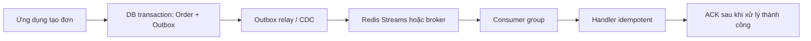
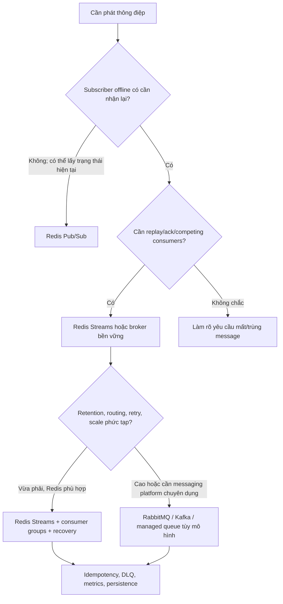
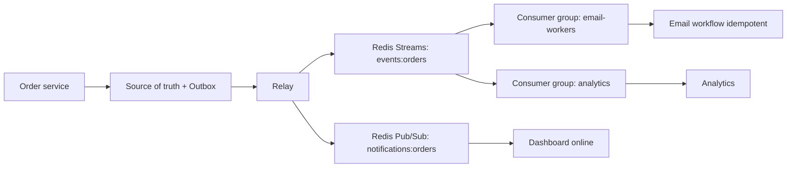

# Phân biệt Pub/Sub với Streams và hệ thống hàng đợi bền vững trong Spring Data Redis

## 1. Cùng là truyền thông điệp, nhưng không cùng hợp đồng

Một ứng dụng Spring có thể dùng Redis để phát sự kiện giữa các instance, phân phối công việc nền hoặc lưu nhật ký sự kiện. Dù tất cả đều liên quan đến "message", **Redis Pub/Sub**, **Redis Streams** và **message broker bền vững** giải quyết những yêu cầu khác nhau.

Xét ba nhu cầu:

- **Thông báo trực thời:** "Trang dashboard đang mở cần biết bảng xếp hạng vừa thay đổi". Client vắng mặt có thể lấy trạng thái hiện tại khi kết nối lại.
- **Công việc phải được xử lý:** "Mỗi đơn hàng mới phải được gửi email xác nhận; worker chết thì công việc cần được giao lại".
- **Sự kiện cần phát lại:** "Dịch vụ phân tích mới triển khai cần đọc các sự kiện đã được lưu từ hôm qua".

Tình huống đầu phù hợp với Pub/Sub nếu việc bỏ lỡ sự kiện không gây mất dữ liệu nghiệp vụ. Hai tình huống sau cần **lưu giữ message, theo dõi tiến độ xử lý và khả năng phục hồi**; Redis Streams hoặc hệ thống hàng đợi/event log riêng thường phù hợp hơn.

> Quy tắc cốt lõi: **Pub/Sub đẩy thông điệp đến subscriber đang trực tuyến; Streams lưu thông điệp vào một log để consumer đọc theo vị trí; broker bền vững cung cấp các cơ chế queue/log và vận hành theo mô hình của hệ thống cụ thể.**

Đừng nhầm việc "có nhiều subscriber" với việc "mỗi message sẽ được xử lý ít nhất một lần". Đó là hai yêu cầu khác nhau.

## 2. Tổng quan ba mô hình

| Tiêu chí | Redis Pub/Sub | Redis Streams | Broker/queue chuyên dụng |
|---|---|---|---|
| Cơ chế chính | Phát trực tiếp theo channel | Log có ID và thứ tự theo stream | Queue hoặc distributed log theo sản phẩm |
| Có lưu message để đọc lại? | **Không** | **Có**, cho đến khi bị trim/xóa/mất do sự cố lưu trữ | Thường có cơ chế lưu bền vững nếu cấu hình phù hợp |
| Subscriber/consumer offline | Bỏ lỡ message lúc offline | Có thể đọc lại message còn lưu | Có thể giao sau khi consumer kết nối lại, tùy cấu hình |
| Consumer acknowledgement | Không | Có với consumer group: `XACK` | Thường có acknowledgement/offset/commit |
| Theo dõi message chưa ack | Không | Pending Entries List (PEL) | Có cơ chế riêng, tùy broker |
| Phát lại lịch sử | Không | `XREAD` / đọc theo ID và retention | Tùy queue/log và retention |
| Fan-out | Tất cả subscriber đang kết nối nhận | Nhiều consumer group độc lập hoặc đọc không group | Exchange/topic/subscription/consumer group tùy hệ thống |
| Phân công việc giữa nhiều worker | Không theo cơ chế hàng đợi: tất cả subscriber đều nhận | Một group phân phối entry cho các consumer | Hàng đợi hoặc consumer group |
| Loại lỗi cần xử lý | Mất kết nối -> mất message | Pending, retry, duplicate, trim, persistence | Ack, retry, dead-letter, partition và failure recovery |
| Bảo đảm exactly-once toàn nghiệp vụ? | Không | Không tự động | Không tự động; phụ thuộc xử lý và hệ thống |

Bảng là định hướng; khả năng lưu giữ, thứ tự và durability thực tế phải được đánh giá theo **version, topology, persistence và cấu hình của từng hệ thống**.

## 3. Redis Pub/Sub hoạt động như thế nào?

### 3.1. Publish và subscribe

Redis Pub/Sub có hai vai trò:

- **Publisher** dùng `PUBLISH channel message` để phát một payload tới channel.
- **Subscriber** dùng `SUBSCRIBE channel` hoặc `PSUBSCRIBE pattern` để đăng ký nhận các message được phát sau khi đăng ký có hiệu lực.

Ví dụ hai terminal với Redis chạy tại localhost.

**Terminal A — subscriber:**

```redis
SUBSCRIBE notifications:orders
```

**Terminal B — publisher:**

```redis
PUBLISH notifications:orders "order-42-created"
```

Terminal A nhận message khi đang đăng ký và kết nối còn hoạt động. Có thể có nhiều subscriber của cùng channel và mỗi subscriber đang trực tuyến được Redis gửi message tương ứng.

Nếu dừng subscriber, publisher phát thêm hai message rồi subscriber kết nối lại, subscriber **không nhận lại hai message đã phát khi nó vắng mặt**. Redis không duy trì backlog của Pub/Sub.

### 3.2. Fan-out không phải competing consumers

```text
                         PUBLISH orders.changed
                                 |
                                 v
                           Redis channel
                                 |
               +-----------------+-----------------+
               |                 |                 |
               v                 v                 v
          Subscriber A      Subscriber B      Subscriber C
          đang online       đang online       đang offline
               |                 |                 |
             Nhận             Nhận             Bỏ lỡ
```

Với Pub/Sub thông thường, nếu A và B cùng đăng ký, **cả A và B đều nhận** thông điệp. Redis không tự chọn "chỉ một trong hai worker xử lý job". Muốn một công việc được giao đúng một worker trong nhóm, Pub/Sub không cung cấp sẵn cơ chế group, pending và ack như một work queue.

### 3.3. Delivery semantics của Pub/Sub

Redis Pub/Sub có ngữ nghĩa phân phối gần với **at-most-once**: thông điệp được phát tới các subscriber hiện diện, nhưng nếu subscriber không nhận hoặc xử lý thất bại, Redis không phát lại có quản lý. Không có:

- Message ID bền vững để subscriber đọc lại từ vị trí cũ.
- Ack xác nhận đã thực hiện nghiệp vụ.
- Pending list để tìm message còn dang dở.
- Dead-letter queue hay retry tích hợp cho các message Pub/Sub bị bỏ lỡ.

Số lượng trả về từ `PUBLISH` là số client/subscriber nhận theo cách Redis ghi nhận, **không phải số nghiệp vụ đã xử lý thành công**. Ví dụ kết quả `(integer) 2` không có nghĩa hai subscriber đã commit database thành công.

Trong Redis Cluster, Pub/Sub thông thường và sharded Pub/Sub có đặc điểm định tuyến khác nhau; dù dùng `PUBLISH` hay `SPUBLISH` ở môi trường hỗ trợ, tính chất không lưu backlog của Pub/Sub vẫn là điểm cần nhớ.

## 4. Pub/Sub với Spring Data Redis

Spring Data Redis cung cấp `RedisMessageListenerContainer` để quản lý subscriber connection và đăng ký các `MessageListener`. Phía publish có thể dùng `RedisTemplate.convertAndSend(...)` hoặc `StringRedisTemplate.convertAndSend(...)`.

### 4.1. Dependency và kết nối mẫu

```groovy
dependencies {
    implementation 'org.springframework.boot:spring-boot-starter-data-redis'
}
```

```yaml
spring:
  data:
    redis:
      host: localhost
      port: 6379
```

### 4.2. Publisher dùng StringRedisTemplate

```java
package com.example.demo.messaging;

import org.springframework.data.redis.core.StringRedisTemplate;
import org.springframework.stereotype.Service;

@Service
public class OrderNotificationPublisher {

    private static final String CHANNEL = "notifications:orders";
    private final StringRedisTemplate redis;

    public OrderNotificationPublisher(StringRedisTemplate redis) {
        this.redis = redis;
    }

    public Long publishOrderChanged(String orderId) {
        // Kết quả là số subscriber được Redis ghi nhận,
        // KHÔNG phải số consumer xử lý nghiệp vụ thành công.
        return redis.convertAndSend(CHANNEL, orderId);
    }
}
```

Trong ứng dụng thật, payload nên có schema/version/event ID nếu nhiều service cùng dùng; tránh gửi dữ liệu nhạy cảm trên channel mà không kiểm soát quyền kết nối và nội dung.

### 4.3. Subscriber bằng RedisMessageListenerContainer

```java
package com.example.demo.messaging;

import java.nio.charset.StandardCharsets;
import org.springframework.context.annotation.Bean;
import org.springframework.context.annotation.Configuration;
import org.springframework.data.redis.connection.MessageListener;
import org.springframework.data.redis.connection.RedisConnectionFactory;
import org.springframework.data.redis.listener.ChannelTopic;
import org.springframework.data.redis.listener.RedisMessageListenerContainer;

@Configuration
public class PubSubConfiguration {

    @Bean
    public MessageListener orderNotificationListener() {
        return (message, pattern) -> {
            String orderId = new String(
                    message.getBody(),
                    StandardCharsets.UTF_8
            );

            // Minh họa: nên chuyển sang xử lý phù hợp ở ứng dụng.
            System.out.println("Order changed: " + orderId);
        };
    }

    @Bean
    public RedisMessageListenerContainer orderNotificationContainer(
            RedisConnectionFactory connectionFactory,
            MessageListener orderNotificationListener) {

        RedisMessageListenerContainer container =
                new RedisMessageListenerContainer();

        container.setConnectionFactory(connectionFactory);
        container.addMessageListener(
                orderNotificationListener,
                new ChannelTopic("notifications:orders")
        );

        return container;
    }
}
```

Container phụ trách quản lý connection cho message listener và lifecycle khi được Spring quản lý. Điều này giúp giảm code subscribe thủ công, nhưng **không thêm khả năng lưu lại message Pub/Sub trong lúc ứng dụng offline**. Reconnect tốt hơn không thể khôi phục những message chưa từng được lưu.

Trong production, tránh xử lý công việc dài, gọi API chậm hoặc chặn thread listener quá lâu. Có thể giao cho một executor có giới hạn hàng chờ để xử lý ngắn hạn; tuy nhiên giao vào executor nội bộ cũng không biến Pub/Sub thành hệ thống xử lý công việc bền vững. Process chết thì công việc trong bộ nhớ vẫn có thể mất.

### 4.4. Khi nào Pub/Sub là lựa chọn hợp lý?

Pub/Sub phù hợp khi **message là tín hiệu về trạng thái**, còn dữ liệu chuẩn có thể tra lại:

- Invalidate cache cục bộ trên các instance, kết hợp TTL/kiểm tra version để chịu được thông báo bị mất.
- Đẩy tín hiệu cập nhật UI realtime, khi client có thể gọi API lấy snapshot sau reconnect.
- Thông báo presence hoặc trạng thái tạm thời mà bỏ lỡ một sự kiện không gây hậu quả nghiêm trọng.
- Phát tín hiệu "có dữ liệu mới" để service tự đọc từ nguồn có lưu trữ.

Nếu mất một message làm mất thanh toán, không gửi thông báo bắt buộc, bỏ qua một audit event hoặc không xử lý một job, Pub/Sub **không nên là kênh duy nhất chịu trách nhiệm**.

## 5. Redis Streams: log có ID, retention và khả năng đọc lại

Redis Streams được thiết kế cho dữ liệu sự kiện có thứ tự theo một stream. Mỗi entry mang **ID** và một tập field–value.

Ghi một sự kiện:

```redis
XADD events:orders * eventId evt-100 orderId 42 type CREATED
```

Redis trả một ID dạng `<milliseconds>-<sequence>`, ví dụ:

```text
1763000000000-0
```

Con số trên chỉ mang tính minh họa. ID trong stream được dùng để định vị entry và đọc các entry theo thứ tự. Không nên coi stream ID là transaction ID toàn hệ thống hoặc bằng chứng nghiệp vụ đã xử lý thành công.

Đọc dữ liệu lịch sử theo ID:

```redis
XRANGE events:orders - +
```

Đọc từ sau vị trí `0-0`:

```redis
XREAD COUNT 10 STREAMS events:orders 0-0
```

Khác Pub/Sub, entry còn nằm trong Redis Stream có thể được đọc lại sau khi consumer khởi động lại, miễn là dữ liệu chưa bị trim/xóa và điều kiện persistence/failover được đáp ứng.

### 5.1. Streams không phải một Set hoặc một Pub/Sub channel

Mỗi lần `XADD` tạo một entry mới; Streams là **append-oriented log**. Nó không tự sửa một entry cũ khi nghiệp vụ thay đổi. Ví dụ "OrderCreated", "OrderPaid" và "OrderCancelled" có thể là ba sự kiện khác nhau được append vào cùng stream.

Nội dung stream vẫn cần schema do ứng dụng thiết kế:

```text
Stream: events:orders

ID ...-0 -> {eventId: evt-100, orderId: 42, type: CREATED}
ID ...-1 -> {eventId: evt-101, orderId: 42, type: PAID}
ID ...-2 -> {eventId: evt-102, orderId: 56, type: CREATED}
```

Một message mới có thể được đọc bởi nhiều consumer độc lập theo các offset khác nhau. Việc entry vẫn còn trong stream **không** đồng nghĩa mọi consumer đã xử lý nó.

### 5.2. Lưu giữ dữ liệu và giới hạn tăng trưởng

Stream có thể lớn dần nếu chỉ dùng `XADD`. Có thể giới hạn bằng `XTRIM` hoặc tùy chọn trimming khi `XADD`:

```redis
XTRIM events:orders MAXLEN ~ 100000
```

Dấu `~` cho phép trimming xấp xỉ để tối ưu chi phí; đừng suy ra luôn còn đúng 100.000 entry. Lưu giữ lịch sử phải dựa trên yêu cầu replay, tốc độ xử lý và dung lượng.

**Cảnh báo:** trimming/xóa entry khi consumer group vẫn còn message chưa xử lý có thể khiến dữ liệu payload không còn để replay. Pending metadata và nội dung stream là hai thứ cần quản lý phối hợp. Nếu một queue công việc cần giữ dữ liệu tới khi tất cả group đã xử lý, không thể chỉ đặt một `MAXLEN` nhỏ rồi mặc định an toàn.

### 5.3. XREAD và XREADGROUP phục vụ nhu cầu khác nhau

- `XREAD` đọc entry theo offset mà client cung cấp; phù hợp với consumer tự quản lý vị trí hoặc tình huống replay.
- `XREADGROUP` đọc theo **consumer group**; Redis theo dõi delivery của entry trong group và pending khi chưa ack.

Dùng `XREAD` không tự có acknowledgement và pending list. Nếu muốn bền vững ở cấp ứng dụng với `XREAD`, phải tự lưu offset và xử lý crash/replay. Với worker queue, consumer group thường tiết kiệm nhiều công sức hơn.

## 6. Consumer group: chia công việc và theo dõi pending

### 6.1. Tạo group

Tạo consumer group từ đầu stream:

```redis
XGROUP CREATE events:orders order-workers 0-0 MKSTREAM
```

Ý nghĩa:

- `events:orders` là stream.
- `order-workers` là tên group.
- `0-0` khiến group có thể đọc cả entry lịch sử còn tồn tại.
- `MKSTREAM` cho phép tạo stream rỗng nếu key chưa tồn tại.

Nếu chỉ muốn group xử lý message **mới từ thời điểm tạo**, có thể dùng `$` thay `0-0`. Đây là quyết định quan trọng trong bootstrap; chọn `$` có thể bỏ qua những sự kiện đã ghi trước khi group được tạo.

Chạy lại `XGROUP CREATE` cho group đã tồn tại có thể nhận `BUSYGROUP`. Một cơ chế khởi tạo trong ứng dụng cần nhận diện riêng trường hợp "đã tồn tại" thay vì coi mọi lỗi đều tương đương.

### 6.2. Hai worker trong cùng group cạnh tranh nhận entry

Worker A:

```redis
XREADGROUP GROUP order-workers worker-a COUNT 10 BLOCK 2000 STREAMS events:orders >
```

Worker B:

```redis
XREADGROUP GROUP order-workers worker-b COUNT 10 BLOCK 2000 STREAMS events:orders >
```

Ký hiệu `>` có nghĩa yêu cầu các entry **chưa từng được giao cho consumer nào trong group**. Redis phân phối các entry cho consumer trong group; về nguyên tắc, một entry mới được giao cho một consumer của group trong một lần giao.

```text
                 Stream events:orders
                    /          \
                   /            \
                Group order-workers
                 /             \
                /               \
           worker-a          worker-b
           xử lý A, C        xử lý B, D
```

Nếu worker-a crash sau khi nhận A nhưng trước khi ack, entry A vẫn nằm trong pending của group. Nó **không tự biến lại thành entry mới cho `>`**; cần có cơ chế khôi phục pending. Đây là khác biệt với một queue có automatic redelivery policy đã được broker quản lý sẵn.

### 6.3. Ack sau khi xử lý thành công

Consumer hoàn thành tác vụ rồi ack theo ID thực tế đã nhận:

```redis
XACK events:orders order-workers 1763000000000-0
```

`XACK` loại entry khỏi **Pending Entries List** của group. Nó **không xóa entry khỏi stream**. Entry có thể vẫn tồn tại để group khác hoặc consumer khác đọc theo cơ chế của họ.

Một quy tắc cho worker:

1. Nhận entry.
2. Deserialize và validate payload.
3. Thực hiện side effect nghiệp vụ theo chiến lược idempotent.
4. Chỉ sau khi xử lý thành công và được ghi nhận bền vững theo yêu cầu mới `XACK`.
5. Nếu xử lý lỗi, giữ pending và sử dụng chiến lược retry/reclaim/dead-letter thích hợp.

Ack **trước** khi xử lý có thể làm mất cơ hội giao lại nếu worker chết sau ack. Ack **sau** khi xử lý có thể tạo duplicate nếu worker xử lý thành công nhưng chết trước ack. Vì vậy cần **idempotency**.

### 6.4. Pending Entries List là gì?

Khi entry được giao bởi `XREADGROUP`, Redis theo dõi entry đang pending tới khi group nhận `XACK`. Có thể quan sát:

```redis
XPENDING events:orders order-workers
```

Để kiểm tra chi tiết những entry pending trong một dải:

```redis
XPENDING events:orders order-workers - + 10
```

Thông tin có thể bao gồm message ID, consumer owner, idle time và delivery count. Các trường này giúp vận hành nhận diện worker chết, message bị kẹt hoặc retry quá nhiều.

Tuy nhiên, **pending không phải hàng đợi dead-letter tự động**. Nó là metadata của Redis. Ứng dụng phải xác định khi nào retry, khi nào bỏ qua, khi nào chuyển tới stream lỗi và ai chịu trách nhiệm điều tra.

## 7. Worker chết, reclaim message và cơ chế giao lại

### 7.1. Crash sau khi nhận nhưng trước ack

Ví dụ:

```text
XREADGROUP -> nhận event evt-100
       |
       v
Gọi API gửi email thành công
       |
       v
Process chết trước XACK
       |
       v
Redis PEL vẫn ghi nhận event đang pending
```

Khi chạy lại, event có thể được giao lại để xử lý. Nếu mã gửi email không kiểm tra event ID đã xử lý, người dùng có thể nhận **hai email**.

Đó là lý do hay mô tả Redis Streams consumer group là nền tảng cho **at-least-once processing khi ứng dụng triển khai recovery đúng**, không phải "exactly-once" mặc định. Nếu không có worker reclaim pending, một entry có thể nằm đó rất lâu và không được xử lý tiếp.

### 7.2. XAUTOCLAIM cho pending quá hạn

Redis phiên bản hỗ trợ `XAUTOCLAIM` có thể giúp một consumer nhận quyền sở hữu các pending entry đã idle đủ lâu:

```redis
XAUTOCLAIM events:orders order-workers worker-b 60000 0-0 COUNT 10
```

Ý nghĩa:

- `events:orders`: stream.
- `order-workers`: group.
- `worker-b`: consumer mới sẽ nhận quyền sở hữu entry.
- `60000`: chỉ xét entry idle ít nhất 60.000 ms.
- `0-0`: vị trí bắt đầu quét PEL.
- `COUNT 10`: giới hạn số entry yêu cầu ở lần quét.

Phản hồi có thể chứa cursor để tiếp tục quét và danh sách message được claim; cần xử lý đúng cấu trúc phản hồi của phiên bản Redis đang sử dụng. Không đặt idle threshold quá ngắn nếu worker bình thường có thể xử lý một job dài hơn 60 giây: hệ thống sẽ reclaim khi worker cũ vẫn đang chạy, gây xử lý trùng đồng thời.

Ngoài `XAUTOCLAIM` còn có `XCLAIM` cho các ID cụ thể. Mỗi cơ chế có phiên bản Redis và ngữ nghĩa riêng; khi chọn client API, cần kiểm tra server và Spring Data Redis version có hỗ trợ tương ứng.

### 7.3. Consumer restart không tự lấy lại toàn bộ pending bằng dấu >

Ví dụ worker-a đã nhận entry E nhưng chưa ack, rồi khởi động lại. Nếu chỉ luôn đọc:

```redis
XREADGROUP GROUP order-workers worker-a STREAMS events:orders >
```

worker-a sẽ yêu cầu **message mới** của group, không tự phát lại toàn bộ message đã giao cho nó trước đó.

Một hướng phục hồi là consumer đọc pending của chính nó theo ID thích hợp, ví dụ:

```redis
XREADGROUP GROUP order-workers worker-a STREAMS events:orders 0
```

Khi đọc với ID cụ thể thay vì `>` trong chế độ consumer group, Redis có thể trả những entry pending **đã được giao cho consumer này** theo điều kiện lệnh. Pending thuộc consumer khác cần được claim, không thể chỉ đổi tên consumer rồi đọc `0`.

Trong ứng dụng thực, có thể cần cả ba luồng: đọc message mới, xử lý pending của chính consumer sau restart, và reclaim pending quá hạn của consumer chết.

### 7.4. Retry, backoff và dead-letter

Một hệ thống xử lý job cần trả lời:

- Lỗi do mạng tạm thời hay payload vĩnh viễn không hợp lệ?
- Retry tối đa bao nhiêu lần và khoảng cách thế nào?
- Có cần phân biệt lỗi retryable và non-retryable không?
- Bao lâu thì coi consumer cũ đã chết để claim message?
- Message gây lỗi lặp cần đưa tới đâu và làm sao cảnh báo?

Có thể dùng một stream riêng, chẳng hạn `events:orders:dead`, để lưu metadata của message không thể xử lý. Nhưng Redis Streams **không tự cung cấp một cấu hình DLQ đầy đủ cho mọi group**; việc đưa sang dead stream, ack entry nguồn, ghi lý do lỗi và tránh mất/trùng giữa các thao tác phải được ứng dụng thiết kế, kể cả khi network ngắt.

Khi cần retry có độ trễ dài, priority queue, TTL cho từng message, routing phức tạp và DLQ built-in, broker chuyên dụng có thể giảm công việc tự triển khai.

## 8. Spring Data Redis Streams: producer và consumer

Spring Data Redis hỗ trợ `StreamOperations` qua `RedisTemplate.opsForStream()` và các container listener để tiêu thụ stream. Không nhầm API này với `RedisMessageListenerContainer` dùng cho Pub/Sub.

### 8.1. Producer: thêm một MapRecord

```java
package com.example.demo.messaging;

import java.util.Map;
import org.springframework.data.redis.connection.stream.MapRecord;
import org.springframework.data.redis.connection.stream.RecordId;
import org.springframework.data.redis.connection.stream.StreamRecords;
import org.springframework.data.redis.core.StringRedisTemplate;
import org.springframework.stereotype.Service;

@Service
public class OrderStreamPublisher {

    private static final String STREAM = "events:orders";
    private final StringRedisTemplate redis;

    public OrderStreamPublisher(StringRedisTemplate redis) {
        this.redis = redis;
    }

    public RecordId publishCreated(String eventId, String orderId) {
        MapRecord<String, String, String> record =
                StreamRecords.newRecord()
                        .in(STREAM)
                        .ofMap(Map.of(
                                "eventId", eventId,
                                "orderId", orderId,
                                "type", "CREATED"
                        ));

        return redis.opsForStream().add(record);
    }
}
```

`RecordId` do Redis trả về giúp consumer biết vị trí entry trong stream. `eventId` là **ID nghiệp vụ do producer tạo**, hữu ích cho idempotency khi sự kiện được retry hoặc đi qua nhiều hệ thống. Hai ID phục vụ mục đích khác nhau.

Ví dụ sử dụng `StringRedisTemplate` giả định key và field/value được serialize dưới dạng String. Nếu ứng dụng dùng serializer khác, việc quan sát bằng Redis CLI và cách map value trong worker sẽ khác.

### 8.2. Consumer group với StreamOperations

Giả sử group `order-workers` đã được tạo bằng `XGROUP CREATE ... MKSTREAM`. Một service có thể poll một batch:

```java
package com.example.demo.messaging;

import java.time.Duration;
import org.slf4j.Logger;
import org.slf4j.LoggerFactory;
import org.springframework.data.redis.connection.stream.Consumer;
import org.springframework.data.redis.connection.stream.ReadOffset;
import org.springframework.data.redis.connection.stream.StreamOffset;
import org.springframework.data.redis.core.StreamReadOptions;
import org.springframework.data.redis.core.StringRedisTemplate;
import org.springframework.stereotype.Service;

@Service
public class OrderStreamWorker {

    private static final Logger log =
            LoggerFactory.getLogger(OrderStreamWorker.class);

    private static final String STREAM = "events:orders";
    private static final String GROUP = "order-workers";

    private final StringRedisTemplate redis;
    private final OrderEventHandler handler;

    public OrderStreamWorker(
            StringRedisTemplate redis,
            OrderEventHandler handler) {
        this.redis = redis;
        this.handler = handler;
    }

    public void pollOnce(String consumerName) {
        var records = redis.opsForStream().read(
                Consumer.from(GROUP, consumerName),
                StreamReadOptions.empty()
                        .count(10)
                        .block(Duration.ofSeconds(2)),
                StreamOffset.create(
                        STREAM,
                        ReadOffset.lastConsumed()
                )
        );

        if (records == null || records.isEmpty()) {
            return;
        }

        for (var record : records) {
            try {
                var payload = record.getValue();
                String eventId = (String) payload.get("eventId");
                String orderId = (String) payload.get("orderId");

                handler.handle(eventId, orderId);

                // ACK sau khi handler xác nhận xử lý thành công.
                redis.opsForStream().acknowledge(
                        STREAM,
                        GROUP,
                        record.getId()
                );
            } catch (RuntimeException failure) {
                log.error(
                        "Order event remains pending: id={}",
                        record.getId(),
                        failure
                );
                // Không ACK: cần recovery/retry pending riêng.
            }
        }
    }

    public interface OrderEventHandler {
        void handle(String eventId, String orderId);
    }
}
```

Trong ví dụ, `pollOnce(...)` do một runner/scheduler hoặc worker loop gọi; một consumer instance nên có **consumer name ổn định và riêng biệt** trong group để theo dõi pending có ý nghĩa. Nếu dùng `@Scheduled` với nhiều instance, cần xác định concurrency, graceful shutdown và quy tắc chọn consumerName.

Quan trọng:

- `ReadOffset.lastConsumed()` trong chế độ consumer group phục vụ đọc entry mới theo vị trí group, không phải toàn bộ pending đã có.
- `handler.handle(...)` phải có idempotency vì có thể nhận lại cùng event sau crash/reclaim.
- `acknowledge(...)` được gọi **chỉ sau xử lý thành công**.
- Nếu Redis ack lỗi sau khi handler đã có side effect, trạng thái nghiệp vụ có thể đã thành công nhưng message vẫn pending; xử lý lặp phải an toàn.
- Catch rồi log và giữ pending không tự tạo một retry scheduler. Phải có một worker hoặc tác vụ recovery theo dõi `XPENDING` / `XAUTOCLAIM` và xử lý lại.

Với throughput cao hơn, có thể dùng `StreamMessageListenerContainer` để poll và dispatch message theo subscription, hoặc `StreamReceiver` trong ứng dụng reactive. Container giúp quản lý lifecycle và polling, **không thay thế logic ack, idempotency hay reclaim**.

### 8.3. Có cần tự quản lý offset khi không dùng group?

Khi dùng `XREAD` hoặc stream listener không thuộc consumer group, client phải quản lý **offset đã đọc**. Nếu mỗi lần khởi động đều dùng latest offset, message được ghi khi client offline có thể bị bỏ qua dù entry vẫn tồn tại trong stream. Muốn replay thì cần lưu offset bền vững và khởi động tại vị trí phù hợp.

Trong Spring Data Redis, `ReadOffset.latest()` và `ReadOffset.lastConsumed()` không có nghĩa tương đương ở mọi mode; lựa chọn không đúng có thể gây skip message khi polling. Với consumer group, hãy dùng chiến lược offset phù hợp `XREADGROUP` và có luồng xử lý pending riêng.

## 9. Nhiều consumer group: fan-out có lưu tiến độ độc lập

Redis Streams có thể phân phối theo **nhiều group**, mỗi group giữ tiến độ và pending riêng.

Ví dụ:

```redis
XGROUP CREATE events:orders email-workers 0-0
XGROUP CREATE events:orders analytics-workers 0-0
```

Một event "OrderCreated" có thể được xử lý bởi:

- Group `email-workers`, nơi một trong các email worker gửi email.
- Group `analytics-workers`, nơi một trong các analytics worker cập nhật dữ liệu phân tích.

Trong mỗi group, consumer chia nhau công việc; **giữa hai group**, mỗi group có thể xử lý cùng một entry độc lập.

```text
                           events:orders
                          /             \
                         /               \
               email-workers         analytics-workers
                 /      \                 /      \
              email-a email-b        stats-a    stats-b
```

Đó là sự kết hợp giữa **fan-out theo group** và **competing consumers trong group**, khác với Pub/Sub, nơi mọi subscriber còn kết nối của channel đều nhận message nhưng không có offset/ack theo group.

Không nên tạo group riêng cho từng instance nếu ý định là **một message chỉ được một instance trong tập worker xử lý**. Làm vậy khiến mọi group đọc và xử lý mọi event, dẫn đến công việc bị nhân bản.

## 10. Durability của Redis Streams cần được cấu hình và đo đạc

### 10.1. Có stream entry không đồng nghĩa mất điện vẫn giữ được 100%

Redis Streams lưu entry trong cấu trúc dữ liệu Redis, nhưng khả năng phục hồi khi node/process bị lỗi phụ thuộc:

- Redis persistence: AOF, RDB, chính sách fsync/snapshot.
- Replication, failover và độ trễ replica.
- Giới hạn bộ nhớ và chính sách eviction.
- Quy tắc trimming/retention của stream.
- Backup, khôi phục, thao tác xóa nhầm và khả năng phục hồi cả group metadata.

Ví dụ, AOF với fsync mỗi giây có cửa sổ mất dữ liệu khác với fsync sau từng write; RDB snapshot định kỳ có khả năng mất các ghi sau snapshot gần nhất khi gặp sự cố. Replica bất đồng bộ có thể không kịp nhận entry mới trước khi primary mất kết nối/failover.

**Streams mang tính lưu giữ/replay hơn Pub/Sub**, nhưng không nên tuyên bố "đã XADD thành công thì mọi sự cố phần cứng đều không mất message" nếu không có SLA và cấu hình durability tương ứng.

### 10.2. Retention phải gắn với tốc độ xử lý chậm nhất

Nếu mỗi phút producer ghi 10.000 entry nhưng consumer group chỉ xử lý 8.000, backlog tăng khoảng 2.000 entry/phút. Một cấu hình `MAXLEN` ngắn sẽ làm mất entry trước khi group xử lý xong.

Những số liệu tối thiểu cần biết:

- Tốc độ `XADD` theo stream.
- Kích thước trung bình mỗi entry và tổng bộ nhớ của stream.
- Độ trễ tiêu thụ message ở mỗi group.
- Số pending và thời gian idle lâu nhất.
- Số lần delivery/retry của entry.
- Tốc độ trim/xóa.
- Khả năng có message pending đã mất payload do trim.
- Sự kiện failover và độ trễ/khả năng mất dữ liệu.

Không chọn retention chỉ dựa vào dung lượng có sẵn; nó là một phần hợp đồng giữa producer và nhóm consumer chậm nhất.

## 11. Hệ thống hàng đợi bền vững chuyên dụng là gì?

Các nền tảng như **RabbitMQ**, **Apache Kafka** hoặc các dịch vụ queue managed được xây dựng cho messaging với những mô hình delivery, routing, consumer coordination, retention và vận hành riêng.

Không nên xem tất cả "broker" là cùng một công cụ:

| Công cụ | Mô hình thường dùng | Phù hợp với |
|---|---|---|
| Redis Pub/Sub | Kênh phát trực tiếp | Tín hiệu realtime có thể mất |
| Redis Streams | Stream log + group/PEL | Event/work queue quy mô phù hợp với hạ tầng Redis, có replay và quản lý retry |
| RabbitMQ | Queue, exchange, binding, acknowledgement, routing | Work queue, phân phối tác vụ, routing/TTL/DLQ theo broker |
| Apache Kafka | Log partitioned, offset và consumer group | Event streaming, retention dài, replay, throughput và tích hợp dữ liệu |
| Queue managed khác | Hợp đồng queue của provider, visibility timeout/ack và DLQ | Giảm công việc tự vận hành, tùy SLA/giới hạn dịch vụ |

### 11.1. RabbitMQ và mô hình work queue

Trong RabbitMQ, producer thường publish tới exchange, exchange route message vào queue dựa trên binding. Consumer nhận message từ queue và có thể gửi acknowledgement sau xử lý. Nếu consumer chết trước ack, broker có thể giao lại theo chính sách; queue, message persistence và publisher confirms phải được cấu hình đúng để đạt độ bền mong muốn.

RabbitMQ còn có các khả năng phục vụ workflow như routing key, prefetch, dead-letter exchanges/queues và chính sách retry; chúng giúp giảm logic ứng dụng phải tự viết, nhưng vẫn cần idempotency và vận hành đúng. Không phải mọi message RabbitMQ mặc định được ghi bền vững chỉ vì broker có queue.

### 11.2. Kafka và mô hình distributed event log

Kafka lưu event theo **topic partition**, cho phép consumer group theo dõi offset và phát lại theo retention. Nó phù hợp khi cần nhiều hệ thống dùng cùng event log, xử lý lượng dữ liệu lớn, stream processing hoặc giữ lịch sử đủ lâu để rebuild downstream.

Thứ tự trong Kafka thông thường được đảm bảo **trong một partition**, không phải một thứ tự toàn cục duy nhất cho mọi partition. Consumer offset commit và transaction/idempotent producer của Kafka có các bảo đảm riêng, nhưng **side effect ngoài Kafka** (ví dụ ghi PostgreSQL, gửi email) vẫn cần cơ chế dedup hoặc transaction phù hợp. Không mặc định "exactly once" tại toàn bộ chuỗi nghiệp vụ.

### 11.3. Khi nên dùng broker chuyên dụng thay vì chỉ dùng Redis Streams

Cân nhắc chuyển hoặc bổ sung broker khi:

- Message là phần cốt lõi của nghiệp vụ và SLA delivery/recovery cao.
- Cần queue/DLQ/retry/routing phức tạp hoặc delay/priority với khả năng được hỗ trợ chính thức.
- Lưu lượng và retention event rất lớn, nhiều downstream độc lập, nhu cầu replay dài hạn.
- Hệ thống đã có đội vận hành/bảo mật/monitoring chuyên biệt cho messaging.
- Muốn tách tài nguyên queue khỏi Redis đang lưu cache/session/hot key, tránh một nhóm workload gây ảnh hưởng nhóm khác.
- Cần topology đa vùng, replicated log, cơ chế audit/retention và độ bền được thiết kế cho yêu cầu cụ thể.

Ngược lại, Redis Streams có thể là lựa chọn thực dụng khi ứng dụng đã dùng Redis, quy mô trong khả năng của cluster, số group vừa phải, nhu cầu retention không quá dài và nhóm kỹ thuật chấp nhận vận hành pending/retry/trim.

## 12. So sánh delivery semantics qua tình huống lỗi

| Kịch bản | Redis Pub/Sub | Redis Streams + group | Broker bền vững (cấu hình đúng) |
|---|---|---|---|
| Consumer không online khi producer gửi | Message không được lưu cho consumer đó | Entry còn trong stream thì group có thể đọc sau | Queue/log có thể giữ message để nhận sau |
| Consumer chết trước xử lý | Không có redelivery có quản lý | Entry đã giao còn pending; cần recover/claim | Thường có redelivery/offset chưa commit theo cơ chế broker |
| Consumer xử lý xong nhưng chết trước ack | Không có ack | Entry có thể được xử lý lại; cần idempotency | Message có thể được giao lại; cần idempotency |
| Producer gửi thành công rồi mất reply | Khó biết subscriber nào đã nhận | Có thể không biết `XADD` đã thực hiện chưa; event ID giúp dedup | Có thể có outcome unknown; publisher confirm/idempotency giúp quản lý |
| Consumer muốn phát lại dữ liệu hôm qua | Không thể từ Pub/Sub | Được nếu entry còn theo retention/offset | Tùy kiểu queue/log và retention |
| Một nhóm consumer cần chia việc | Tất cả subscriber nhận | Dùng một consumer group | Dùng queue/consumer group |
| Hai downstream độc lập đều cần mọi event | Hai subscriber phải online khi publish | Hai consumer group độc lập | Topic/exchange/subscription theo thiết kế |
| Handler bị lỗi vĩnh viễn | Mất message sau delivery | Pending/retry/DLQ do app tổ chức | Broker có thể hỗ trợ retry/DLQ với cấu hình |
| Toàn node Redis/broker mất nguồn | Không có backlog | Phụ thuộc Redis persistence và replication | Phụ thuộc durability/replication của broker |

**At-most-once:** xử lý không lặp nhưng có thể mất. **At-least-once:** không mất message trong những điều kiện bảo đảm cụ thể, nhưng có thể xử lý lặp. **Exactly-once trong nghiệp vụ:** cần định nghĩa ranh giới và thiết kế idempotency/transaction; không xuất hiện miễn phí chỉ nhờ đổi Pub/Sub sang Streams.

## 13. Tại sao vẫn có thể mất hoặc trùng event khi dùng Streams?

### 13.1. Producer ghi dữ liệu chính rồi XADD

Ví dụ service:

```text
1. COMMIT đơn hàng trong PostgreSQL
2. XADD events:orders ...
```

Nếu process chết sau bước 1 nhưng trước bước 2, đơn hàng đã có trong database nhưng **không có event**. Redis Streams không thể giải quyết tự động atomicity giữa Redis và PostgreSQL.

Nếu đổi thứ tự:

```text
1. XADD events:orders ...
2. COMMIT đơn hàng trong PostgreSQL
```

Process có thể chết sau bước 1; downstream nhận event về đơn hàng chưa được commit.

Với dữ liệu gốc ở database giao dịch, **transactional outbox** là một mẫu thường dùng:



Đặt entity và outbox event trong **cùng transaction database** bảo đảm hai bản ghi cùng commit hoặc cùng rollback ở nguồn. Relay có thể gửi lại một event nếu mất xác nhận, nên consumer vẫn phải dedup bằng eventId. Outbox không tự cung cấp exactly-once khi gọi email/API bên ngoài, nhưng giảm cửa sổ "commit business data rồi mất event".

### 13.2. Consumer side effect rồi ACK

Chuỗi điển hình:

```text
XREADGROUP nhận evt-100
       |
       v
UPDATE database theo event
       |
       v
Database COMMIT
       |
       X process chết
       |
       v
Không XACK -> evt-100 còn pending
       |
       v
Worker khác XAUTOCLAIM và xử lý lại
```

Một cách xử lý là bảng hoặc key dedup có `eventId` cùng một thao tác cập nhật trạng thái được bao bởi transaction **của hệ dữ liệu đích**:

```text
BEGIN DB transaction
  Nếu eventId đã xử lý -> không thực hiện lại side effect
  Nếu chưa -> cập nhật entity và đánh dấu eventId đã xử lý
COMMIT
XACK event trên Redis
```

Nếu process chết trước DB commit, lần xử lý sau có thể làm lại. Nếu chết sau DB commit trước XACK, lần xử lý sau thấy eventId đã xử lý và chỉ cần ack. Đây là mẫu at-least-once + idempotent consumer, không phải transaction phân tán Redis–DB.

Nếu side effect là gửi email hoặc gọi dịch vụ ngoài không idempotent, cần dedup hoặc một cách phát tín hiệu có thể phục hồi phù hợp. Chỉ ghi "đã xử lý" vào database trước khi gọi email cũng có thể tạo trường hợp đánh dấu thành công nhưng email chưa được gửi, nên phải thiết kế vòng đời trạng thái cụ thể.

## 14. Vận hành Redis Streams đáng tin cậy

Khi chọn Streams làm hạ tầng công việc nền, không chỉ cần thêm `XADD` và `XREADGROUP`; còn phải đo và cảnh báo.

### 14.1. Những metric nên có

| Metric / tín hiệu | Ý nghĩa |
|---|---|
| Tốc độ `XADD` và tốc độ message đã ack | Phát hiện producer nhanh hơn consumer |
| `XLEN` theo stream | Kích thước log hiện lưu, không phải toàn bộ số việc chưa xử lý |
| `XPENDING` theo group | Số entry chưa ack |
| Pending idle time p95/max | Phát hiện job bị kẹt hoặc worker chết |
| Delivery/retry count | Phát hiện poison message hoặc retry vòng lặp |
| Thời gian từ `XADD` đến xử lý thành công | Độ trễ end-to-end |
| Tỷ lệ lỗi deserialize/handler | Cần sửa payload/schema hoặc nguồn |
| Số message trong dead-letter stream | Công việc cần can thiệp |
| Memory, AOF/RDB health, replication lag | Độ bền của hạ tầng Redis |
| Trim rate và tuổi entry cũ nhất | Retention có đủ cho consumer chậm hay không |

Có thể dùng CLI để quan sát:

```redis
XINFO STREAM events:orders
XINFO GROUPS events:orders
XINFO CONSUMERS events:orders order-workers
XPENDING events:orders order-workers
XLEN events:orders
```

Không mặc định `XLEN=1000` nghĩa là còn 1000 job chưa xử lý; rất nhiều entry có thể đã ack nhưng vẫn nằm trong log. Pending count cũng không phản ánh toàn bộ backlog **chưa từng giao** cho group. Cần xét group progress, stream tail và pending kết hợp.

### 14.2. Retention và consumer group lifecycle

Khi thêm một consumer group mới:

- Xác định có phải đọc lịch sử hay chỉ message mới.
- Chọn offset lúc tạo group tương ứng, tránh âm thầm bỏ message.
- Đảm bảo không trim mất lịch sử mà group mới cần.
- Định nghĩa thời hạn giữ event sau khi tất cả group đã xử lý, hoặc lưu trữ lâu dài sang nơi khác.
- Xác định cách xóa consumer/group đã ngừng dùng; pending của group bỏ quên có thể làm chính sách giữ dữ liệu phức tạp.

Trong các hệ thống dài hạn, một stream duy nhất cho mọi event không phải lúc nào tốt hơn phân chia theo domain/throughput/retention. Thiết kế naming, schema version, giới hạn số field và mục tiêu lưu giữ từ đầu.

### 14.3. Redis Cluster

Redis Cluster chia key theo hash slot. Mỗi stream key là một key Redis thuộc một slot; một hot stream có thể tập trung lưu lượng vào node sở hữu slot. Việc tạo nhiều consumer không tự phân tán một stream duy nhất qua nhiều node.

Nếu throughput vượt khả năng một stream/node, có thể chia nhiều stream theo partition key, ví dụ `events:orders:0` đến `events:orders:15`, nhưng lúc đó:

- Cần logic phân phối event lên partition.
- Cần consumer group và worker cho từng stream/partition.
- Thứ tự chỉ có thể được thiết kế theo từng partition.
- Rebalance partition và thống nhất ordering theo orderId cần kế hoạch.

Đừng mặc định thao tác nhiều stream/keys có thể nằm trong cùng Redis transaction trên Cluster; multi-key command và script chịu ràng buộc hash slot.

## 15. Ma trận quyết định theo bài toán

| Bài toán | Gợi ý khởi đầu | Lý do |
|---|---|---|
| Báo UI rằng trạng thái vừa đổi; client có thể refresh | Redis Pub/Sub | Tín hiệu realtime, bỏ lỡ được |
| Invalidate local cache với TTL backup | Redis Pub/Sub + TTL/version | Mất thông báo không kéo dài sai dữ liệu vô hạn |
| Gửi email xác nhận cho mỗi đơn hàng | Streams group hoặc broker queue | Cần retry, ack, phát lại và idempotency |
| Xử lý thumbnail/video background | Streams hoặc queue chuyên dụng | Công việc không được mất khi worker restart |
| Audit trail phải giữ lâu | Log bền vững phù hợp (Kafka/database/audit store) | Retention, replay, tính tuân thủ và vận hành |
| Đồng bộ sự kiện cho nhiều downstream | Streams nhiều group hoặc Kafka/topic | Mỗi downstream cần offset/tiến độ riêng |
| Dòng log analytics lưu nhiều ngày với throughput lớn | Kafka hoặc platform streaming phù hợp | Retention, partition và pipeline dữ liệu |
| Thông báo presence/typing realtime | Redis Pub/Sub | Event tạm thời, không cần backlog |
| Công việc retry theo lịch/delay, priority, DLQ phức tạp | Broker phù hợp | Giảm logic scheduling/retry tự xây |
| Chỉ muốn biết dữ liệu mới đã có trong DB | Pub/Sub signal + đọc DB hoặc stream tùy độ quan trọng | Nguồn chính vẫn quyết định khả năng phục hồi |
| Hạ tầng nhỏ, Redis đang có, workload vừa | Redis Streams nếu đội vận hành được pending/reclaim | Có backlog/ack mà không cần thêm broker |
| Thanh toán không được bỏ sót event | Outbox + stream/broker + idempotency | Bảo vệ ranh giới DB commit và publish |

### Sơ đồ lựa chọn nhanh



Câu hỏi đúng không phải "công nghệ nào nhanh nhất?", mà là **nếu process chết ở từng bước, event có còn và ai chịu trách nhiệm xử lý lại?**

## 16. Kết hợp Pub/Sub và Streams trong một kiến trúc

Một hệ thống có thể dùng cả hai, với vai trò khác nhau:



Trong mô hình này:

- **Streams** giữ event để các consumer group đọc lại, ack, retry và phát hiện pending.
- **Pub/Sub** là kênh báo realtime tới các màn hình/instance đang mở.
- **Database/outbox** giữ ý định nghiệp vụ và giúp phục hồi khi publish gặp lỗi.
- UI reconnect có thể đọc snapshot hoặc event từ nơi lưu trữ, không trông chờ Pub/Sub phát lại.

Nếu UI chỉ cần biết "có cập nhật", đôi khi không cần publish cùng payload đầy đủ trên cả hai đường; Pub/Sub chỉ gửi ID/version để UI refetch. Tránh ghi thông tin nhạy cảm vào channel rộng và cần thiết kế thứ tự event/version để client không áp dụng một update cũ hơn.

## 17. Những ngộ nhận thường gặp

**"Có subscriber ở Pub/Sub nghĩa là message chắc chắn được xử lý."** Không. Redis chỉ chuyển message tới subscriber đang kết nối theo cơ chế Pub/Sub. Không có ack của logic nghiệp vụ.

**"Pub/Sub là hàng đợi vì có nhiều worker đăng ký."** Không. Các worker đăng ký cùng channel đều có thể nhận cùng thông điệp; không có competing-consumer group tự động.

**"Streams không bao giờ mất dữ liệu."** Không. Retention, trimming, eviction, Redis persistence, replication và failover đều ảnh hưởng tới khả năng giữ entry.

**"XACK đã xóa event khỏi stream."** Không. XACK gỡ pending của consumer group. Việc xóa/trim entry là thao tác khác.

**"Dùng dấu > khi restart sẽ đọc lại message chưa ack."** Không. Dấu `>` dùng nhận entry chưa được giao cho group. Cần cơ chế đọc pending hoặc claim.

**"Có pending thì worker khác tự động nhận hết."** Không nhất thiết. Cần thiết kế recovery/reclaim với `XCLAIM`, `XAUTOCLAIM` hoặc tương đương.

**"Một stream có nhiều consumer name là fan-out cho mọi downstream."** Trong một consumer group, message được phân công giữa consumer. Muốn downstream độc lập đều nhận, dùng các group riêng.

**"RabbitMQ/Kafka bảo đảm xử lý exactly-once mọi API bên ngoài."** Không. Ack/offset và transaction của broker có phạm vi cụ thể; side effect ngoài broker cần thiết kế riêng.

**"Một khi XADD thành công thì chắc chắn dữ liệu cũng đã lưu trên đĩa/replica."** Không được kết luận như vậy nếu chưa biết persistence/fsync/replication và chính sách failover.

**"Cứ retry là giải quyết lỗi."** Retry một event có thể gửi email hai lần hoặc cập nhật database hai lần. Phải có operation ID/idempotency và phân loại lỗi.

## 18. Kết luận

Trong Spring Data Redis, **Redis Pub/Sub** thích hợp để phát tín hiệu realtime cho subscriber đang trực tuyến khi có thể chấp nhận mất thông điệp. **Redis Streams** bổ sung log có ID, khả năng đọc lại, consumer group, pending và acknowledgement, phù hợp với event processing hoặc work queue khi ứng dụng triển khai đúng retention, recovery và idempotency. **Broker/queue bền vững** như RabbitMQ, Kafka hoặc dịch vụ messaging phù hợp trở nên đáng cân nhắc khi yêu cầu delivery, retry, routing, retention, quy mô và vận hành phức tạp hơn.

Cả Streams lẫn broker chuyên dụng đều không tự biến những side effect ngoài hệ thống thành exactly-once. Một thiết kế đáng tin cậy cần xác định **nguồn dữ liệu chính, ranh giới transaction, thời điểm ack, khả năng giao lại, cách chống xử lý trùng và giới hạn lưu giữ**. Chọn đúng công cụ nghĩa là biết phải làm gì khi producer, consumer hoặc kết nối bị lỗi — chứ không chỉ biết cách gửi một message trong điều kiện bình thường.
