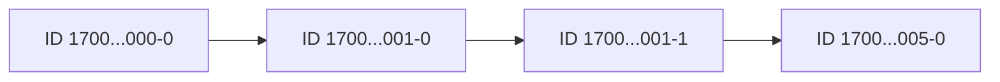
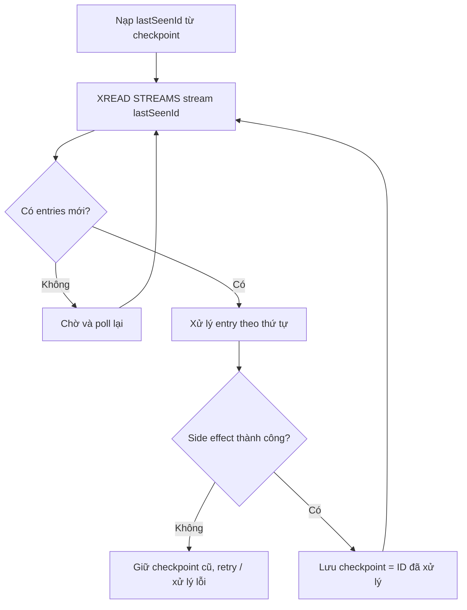
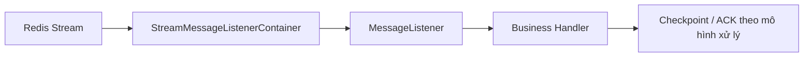
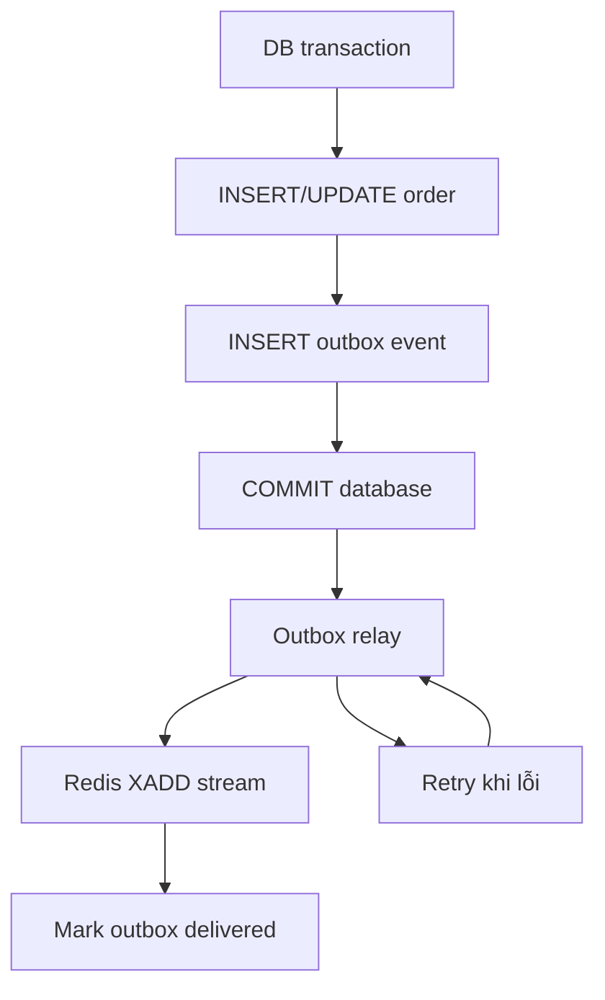

# Stream, entry ID và mô hình nhật ký sự kiện trong Spring Data Redis

Redis Streams là kiểu dữ liệu cho phép ứng dụng **ghi nối tiếp những bản ghi sự kiện có thứ tự và đọc lại chúng theo vị trí**. Trong Spring Data Redis, nó đặc biệt hữu ích để kết nối các thành phần xử lý bất đồng bộ: service phát sự kiện, worker đọc những sự kiện mới, hoặc một chương trình cần tiếp tục xử lý từ bản ghi cuối đã đọc.

Khác với một Redis String chỉ giữ giá trị hiện tại, một **Stream** giữ nhiều **entry**. Mỗi entry có một **ID duy nhất trong stream**, một nhóm trường (field) và giá trị (value). Các entry được sắp theo thứ tự ID, nên một consumer có thể nói: “Hãy đọc những sự kiện nằm **sau** ID này”.

Ví dụ, một dịch vụ đơn hàng phát ba sự kiện:

```text
Stream: orders:events

1700000000000-0  eventType=OrderCreated   orderId=42
1700000000001-0  eventType=OrderPaid      orderId=42
1700000000002-0  eventType=OrderShipped   orderId=42
```

Nếu worker đã xử lý đến ID `1700000000001-0`, nó có thể tiếp tục từ phần sau ID đó mà không phải quét toàn bộ khóa Redis. Đây là nền tảng của **mô hình nhật ký sự kiện (event log)**.

Bài học giải thích cấu trúc stream, cách Redis tạo và so sánh entry ID, các lệnh ghi/đọc cơ bản, ý nghĩa của “đọc tiếp” so với “đọc từ đầu”, mô hình producer–consumer, các đặc tính lưu giữ lịch sử, và cách dùng Spring Data Redis để phát hoặc đọc sự kiện. Phần cuối phân biệt Redis Streams với Redis Pub/Sub, Redis List, message broker và event sourcing, đồng thời chỉ ra các giới hạn về độ bền, thứ tự và xử lý lặp.

## 1. Stream là gì?

Redis Stream là một cấu trúc dữ liệu lưu **chuỗi bản ghi dạng field–value**, được bổ sung theo thời gian. Ở mức ứng dụng, có thể xem một stream như một nhật ký:

```text
orders:events
     |
     +-- entry ID A -> {eventType, orderId, occurredAt, ...}
     |
     +-- entry ID B -> {eventType, orderId, occurredAt, ...}
     |
     +-- entry ID C -> {eventType, orderId, occurredAt, ...}
     |
     +-- ...
```

Mỗi lần producer thêm một entry, Redis đặt entry đó vào một vị trí có ID lớn hơn các entry đã được tạo trước trong cùng stream. Consumer dùng ID làm mốc để tìm dữ liệu tiếp theo.

Ba thuật ngữ cần phân biệt:

| Thuật ngữ | Ý nghĩa |
|---|---|
| **Stream key** | Tên khóa Redis chứa toàn bộ stream, ví dụ `orders:events` |
| **Entry / message / record** | Một bản ghi nằm trong stream, gồm ID và các field–value |
| **Entry ID / RecordId** | Định danh và vị trí theo thứ tự của một entry trong **một stream** |

Ví dụ một entry:

```text
stream key: orders:events
entry ID  : 1700000000000-0
fields:
    eventType = "OrderCreated"
    orderId   = "42"
    version   = "1"
    amount    = "125000"
```

**Một Redis key chứa nhiều entry**, thay vì một key mới cho mỗi sự kiện. Stream hỗ trợ thêm entry, đọc theo khoảng ID, đọc những entry mới và duy trì metadata liên quan đến consumer group.

### 1.1. Vì sao gọi là nhật ký sự kiện?

Ở mô hình nhật ký sự kiện, thay vì chỉ giữ “trạng thái hiện tại”, hệ thống ghi nhận các sự kiện đã xuất hiện:

```text
OrderCreated -> OrderPaid -> OrderShipped
```

Consumer có thể đọc theo thứ tự, xây dựng bảng tổng hợp, phát thông báo hoặc cập nhật một read model. Nếu sự kiện còn được giữ và hệ thống có cách xác định điểm bắt đầu thích hợp, consumer còn có thể đọc lại dữ liệu cũ.

**Nhật ký sự kiện không đồng nghĩa một audit log vĩnh viễn.** Redis Streams cho phép trim và xóa entry; khả năng khôi phục lịch sử phụ thuộc vào retention, persistence và thiết kế hệ thống. Hơn nữa, entry ID phản ánh vị trí của sự kiện trong Redis Stream, không tự bảo đảm ý nghĩa nghiệp vụ hoặc tính duy nhất toàn hệ thống.

## 2. Ghi entry đầu tiên bằng XADD

Lệnh cơ bản để thêm dữ liệu vào Stream là `XADD`:

```redis
XADD orders:events * eventType OrderCreated orderId 42 amount 125000
```

Trong đó:

- `orders:events` là tên Redis Stream.
- `*` yêu cầu Redis tự sinh ID.
- `eventType OrderCreated` là một cặp field–value.
- `orderId 42` và `amount 125000` là các cặp field–value khác của cùng một entry.

Redis trả về ID của entry vừa thêm, ví dụ:

```text
"1700000000000-0"
```

Đây là **giá trị minh họa**, không phải ID cố định. Khi thực thi thật, Redis dùng thời điểm và trạng thái ID hiện tại của stream để phát sinh một ID hợp lệ.

Thêm entry thứ hai:

```redis
XADD orders:events * eventType OrderPaid orderId 42 amount 125000
```

Thêm entry thứ ba:

```redis
XADD orders:events * eventType OrderShipped orderId 42 trackingCode VN001
```

Nếu stream chưa tồn tại, `XADD` thông thường có thể tạo stream mới để chứa bản ghi đầu tiên. Sau mỗi lần thêm, `XLEN` cho biết số entry hiện còn trong stream:

```redis
XLEN orders:events
```

Nếu chưa xóa hoặc trim và đã thêm ba entry, số lượng là `3`.

### 2.1. Một entry có nhiều field

Không nên hiểu mỗi field là một message riêng. Lệnh:

```redis
XADD orders:events * eventType OrderPaid orderId 42 amount 125000
```

tạo **một entry** chứa ba field, không phải ba entry. Entry ID định danh toàn bộ record.

Phần field/value ở Redis là dữ liệu byte; Spring Data Redis sẽ serialize và deserialize dựa trên template hoặc mapping được cấu hình. Redis không tự suy ra `amount` là tiền, `orderId` là UUID hay `eventType` là một Java enum.

### 2.2. Có cần tạo stream trước không?

Thông thường không. `XADD` có thể tạo stream key khi chưa có. Tuy nhiên:

- Nếu key đã tồn tại với **kiểu dữ liệu khác** như String/Hash, `XADD` sẽ báo lỗi sai kiểu.
- Nếu stream bị xóa hoặc dữ liệu bị mất, một lần `XADD` sau đó có thể tạo một stream mới cùng tên, nhưng lịch sử cũ không tự khôi phục.
- Trong ứng dụng có consumer group, việc tạo stream và tạo group có thứ tự khởi tạo riêng cần chú ý.

## 3. Entry ID gồm những phần nào?

ID phổ biến của Redis Stream có dạng:

```text
<millisecondsTime>-<sequenceNumber>
```

Ví dụ:

```text
1700000000000-0
1700000000000-1
1700000000001-0
```

Phần trước dấu gạch nối thường tương ứng với **thời gian tính bằng millisecond** trong ID do Redis tự sinh; phần sau là **số thứ tự** để phân biệt các entry có cùng phần thời gian.

| ID | Phần milliseconds | Phần sequence | Ý nghĩa |
|---|---:|---:|---|
| `1700000000000-0` | `1700000000000` | `0` | Một entry |
| `1700000000000-1` | `1700000000000` | `1` | Entry sau trong cùng milliseconds |
| `1700000000001-0` | `1700000000001` | `0` | Entry thuộc phần milliseconds lớn hơn |

Redis so sánh ID theo **thứ tự số học** của hai thành phần, không phải sắp chữ theo từ điển:

```text
1700000000000-0
    <
1700000000000-1
    <
1700000000001-0
```

Định dạng này giúp stream có một thứ tự ổn định và giúp consumer lưu “đã xử lý đến ID nào”.

### 3.1. Entry ID là mốc thứ tự, không phải business event ID

ID `1700000000000-0` có thể là định danh của record trong `orders:events`. Nhưng một sự kiện nghiệp vụ còn có thể cần `eventId` riêng:

```text
stream entry ID = 1700000000000-0
eventId         = evt-8b0e
orderId         = 42
eventType       = OrderPaid
```

Vì sao cần tách hai thứ?

- Một event nghiệp vụ có thể bị producer gửi lại do timeout; lần gửi lại có thể tạo **entry ID mới**.
- Nếu cùng event được gửi vào hai stream, mỗi stream có ID riêng.
- Khi một hệ thống khác cũng phát sự kiện, entry ID không phải định danh toàn cục dùng để đối soát nghiệp vụ.
- Một consumer idempotent thường cần nhận biết **eventId** hoặc **operationId** ngoài vị trí stream.

Entry ID thích hợp để **định vị và tiếp tục đọc stream**; event ID thích hợp để **nhận diện một sự kiện nghiệp vụ trên các lần gửi hoặc xử lý lại**.

### 3.2. ID có phải thời điểm sự kiện thực sự xảy ra không?

Không nhất thiết. Với `XADD ... *`, Redis dùng thông tin thời gian tại lúc ghi, nhưng:

1. Sự kiện nghiệp vụ có thể xảy ra trước khi producer gửi nó.
2. Producer có thể retry sau nhiều giây hoặc nhiều phút.
3. Producer có thể chủ động cung cấp ID thay vì để Redis tự tạo.
4. Redis vẫn phải duy trì quy tắc ID tăng trên stream, kể cả khi đồng hồ hệ thống có sự thay đổi.
5. ID do producer tự đặt không bắt buộc có thời điểm “xảy ra” trùng với đồng hồ nghiệp vụ.

Vì vậy, payload nên có field riêng như `occurredAt` hoặc `sourceTimestamp` khi việc xử lý nghiệp vụ cần biết thời điểm thực tế.

```redis
XADD orders:events * eventType OrderPaid orderId 42 occurredAt 2026-11-13T03:00:00Z
```

**Không sắp xếp nghiệp vụ của nhiều nguồn chỉ bằng phần timestamp trong Stream ID.** Nếu cần causal ordering của một aggregate, hãy thiết kế sequence/version ở cấp nghiệp vụ.

## 4. ID tự động và ID do client chỉ định

### 4.1. Dùng * trong đa số trường hợp

```redis
XADD demo:events * type A
XADD demo:events * type B
```

Redis sinh ID theo quy tắc tăng đơn điệu, giúp producer không phải tự quản lý sequence.

Ưu điểm:

- Giảm nguy cơ hai producer cùng chọn một ID.
- Thuận tiện khi nhiều instance cùng ghi một stream.
- Redis giữ được thứ tự theo ID mà stream yêu cầu.
- Dễ dùng với Spring Data Redis; lệnh add thường trả về `RecordId`.

### 4.2. Chỉ định ID tường minh

Redis cho phép client chỉ định ID cụ thể trong những trường hợp cần:

```redis
XADD demo:imported-events 1700000000000-0 type Imported
```

Tuy nhiên, ID mới phải hợp lệ và **lớn hơn ID cuối cùng mà stream đã ghi nhận** theo quy tắc Redis, không đơn giản là “không trùng với một entry hiện có”.

Ví dụ:

```text
Stream đã ghi ID cuối = 1700000000000-1
Client cố XADD ID    = 1700000000000-0
=> Không hợp lệ vì ID mới không lớn hơn ID trước.
```

ID `0-0` được dùng làm mốc đọc từ đầu, nhưng không phải ID entry thông thường có thể tạo bằng `XADD`. Một số phiên bản Redis còn hỗ trợ ID tự động một phần; khi sử dụng cần kiểm tra phiên bản server và semantics cụ thể.

Nếu ứng dụng không có lý do đặc biệt để tự cấp ID, nên để Redis tạo bằng `*`.

### 4.3. Không đồng nhất sequence với số đếm message

Giữa hai ID liên tiếp không bảo đảm hiệu số sequence bằng số event đã phát. Stream có thể có các ID:

```text
1700000000000-0
1700000000002-0
1700000000007-0
```

Vẫn chỉ có ba entry. ID không phải chỉ số mảng liên tục từ `0` đến `N-1`. Sau khi trim hoặc xóa entry, các khoảng trống càng dễ nhìn thấy.

Nếu muốn đếm entry còn lại, dùng `XLEN`; nếu muốn đếm sự kiện nghiệp vụ toàn thời gian, cần thiết kế metric/counter riêng, không suy ra từ phép trừ ID.

## 5. Thứ tự của stream là thứ tự nào?

Trong **một Redis Stream**, entry được sắp theo ID. Các lệnh như `XRANGE` hoặc `XREAD` dùng ID để xác định vị trí.



Nhưng cần phân biệt:

- **Thứ tự append vào một stream:** vị trí theo ID mà Redis chấp nhận.
- **Thứ tự xảy ra của sự kiện nghiệp vụ:** phụ thuộc producer, DB transaction, clock, retry và hệ thống phát sinh.
- **Thứ tự consumer hoàn thành xử lý:** có thể khác thứ tự append nếu xử lý song song.
- **Thứ tự giữa nhiều stream khác nhau:** không có một total order chung chỉ từ ID của từng stream.

Ví dụ producer A phát `OrderCreated` và producer B phát `OrderPaid` vào cùng stream. Nếu B gửi trước khi A thực sự append, Redis có thể cấp ID cho `OrderPaid` trước, dù nghiệp vụ mong `OrderCreated` phải xảy ra trước.

Nếu domain yêu cầu strict ordering theo `orderId`, cần một cơ chế bảo đảm ở nguồn như aggregate version, transaction outbox theo thứ tự hoặc cơ chế xử lý có điều kiện. Stream không thể tự biết quan hệ phụ thuộc giữa hai event do các producer phát không đúng thứ tự.

## 6. Đọc lịch sử bằng XRANGE

`XRANGE` đọc entry trong một khoảng ID theo thứ tự tăng:

```redis
XRANGE orders:events - +
```

Trong đó:

- `-` là giới hạn thấp nhất.
- `+` là giới hạn cao nhất.
- Kết quả gồm các entry còn tồn tại trong khoảng.

Giới hạn số lượng:

```redis
XRANGE orders:events - + COUNT 10
```

Một phản hồi có dạng khái niệm:

```text
1) 1700000000000-0
   eventType = OrderCreated
   orderId   = 42
2) 1700000000001-0
   eventType = OrderPaid
   orderId   = 42
3) 1700000000002-0
   eventType = OrderShipped
   orderId   = 42
```

Đọc một khoảng hẹp hơn:

```redis
XRANGE orders:events 1700000000001-0 1700000000002-0
```

Các biên của `XRANGE` thông thường là **inclusive**. Tùy cú pháp Redis được hỗ trợ, có thể chỉ định biên loại trừ với dấu `(` khi cần phân trang mà không lặp entry cuối của trang trước.

### 6.1. Đọc ngược bằng XREVRANGE

`XREVRANGE` đọc theo thứ tự giảm, thường dùng để lấy sự kiện mới nhất:

```redis
XREVRANGE orders:events + - COUNT 5
```

Thứ tự tham số phạm vi của `XREVRANGE` là **đầu cao rồi đầu thấp**; không giống `XRANGE`. Mẫu này hữu ích cho màn hình “5 hoạt động mới nhất”, nhưng không được nhầm với một cơ chế đăng ký nhận sự kiện liên tục.

### 6.2. Đọc lịch sử có giới hạn, không tải toàn bộ

Một stream có thể chứa rất nhiều entry. Trong ứng dụng:

- Dùng `COUNT` khi truy vấn từng trang.
- Lưu mốc ID trang cuối để lấy trang tiếp.
- Cân nhắc retention: entry cũ có thể không còn.
- Không dùng `XRANGE stream - +` không giới hạn trong API online khi stream lớn.

Một lệnh đọc toàn bộ lịch sử có thể tiêu tốn bộ nhớ client và tạo phản hồi mạng lớn, dù server xử lý từng entry nhanh.

## 7. Đọc tiếp từ một ID bằng XREAD

Một lợi thế lớn của stream là consumer có thể giữ **last-seen ID**:

```text
Đã xử lý đến:
    lastSeenId = 1700000000001-0

Lần đọc tiếp:
    chỉ lấy entry có ID > lastSeenId
```

Lệnh:

```redis
XREAD COUNT 10 STREAMS orders:events 1700000000001-0
```

`XREAD` với ID cụ thể trả những entry có ID **lớn hơn** ID đã cung cấp. Nó không trả lại entry có ID đúng bằng mốc. Đây là khác biệt quan trọng với cách dùng `XRANGE` có biên inclusive.

### 7.1. Đọc từ đầu bằng 0-0

```redis
XREAD COUNT 100 STREAMS orders:events 0-0
```

Vì ID entry hợp lệ lớn hơn `0-0`, lệnh trên giúp lấy những entry còn tồn tại từ đầu stream trong phạm vi count.

Sau khi xử lý một batch, lưu ID của **entry cuối đã xử lý thành công** làm mốc:

```text
Batch 1: ID A, ID B, ID C
Checkpoint sau khi xử lý thành công: ID C

Batch 2:
    XREAD ... STREAMS orders:events C
    -> nhận entry sau C
```

Không cập nhật checkpoint trước khi side effect nghiệp vụ được commit, nếu không consumer có thể bỏ sót message sau crash.

### 7.2. XREAD BLOCK: chờ entry mới

Nếu không có entry mới, consumer có thể chờ một thời gian:

```redis
XREAD COUNT 20 BLOCK 5000 STREAMS orders:events 1700000000001-0
```

`BLOCK 5000` dùng millisecond, nghĩa là chờ tối đa khoảng 5 giây để có dữ liệu phù hợp. `BLOCK 0` có nghĩa chờ không giới hạn cho tới khi có message hoặc kết nối bị ngắt.

Khi timeout, `XREAD` có thể trả nil thay vì một mảng entry. Consumer cần coi đó là **không có dữ liệu ở lần poll này**, không phải lỗi nghiệp vụ.

Lưu ý:

- Chờ blocking giữ một connection trong thời gian chờ.
- Cần xử lý timeout, reconnect và shutdown có kiểm soát.
- Không nên dùng blocking vô hạn trực tiếp trong request thread HTTP.
- Nếu một lần đọc trả nhiều entry, vẫn cần giới hạn thời gian xử lý và khả năng retry sau lỗi.

### 7.3. Ký hiệu $ có nghĩa gì?

Redis cho phép:

```redis
XREAD BLOCK 5000 STREAMS orders:events $
```

`$` nghĩa là sử dụng **vị trí cuối hiện tại** của stream làm điểm bắt đầu và chỉ chờ các entry **được thêm sau đó**. Nó phù hợp với tình huống consumer **cố ý bỏ qua lịch sử** và chỉ muốn nhận sự kiện mới.

Nhưng `$` không thích hợp làm checkpoint cố định cho mọi lần poll:

```text
Poll 1 dùng $ rồi đọc message mới.
Trong lúc xử lý, message khác đến.
Poll 2 lại dùng $:
    bắt đầu từ cuối mới nhất,
    có nguy cơ bỏ qua message đến giữa hai lượt.
```

Vì thế:

1. Chỉ dùng `$` khi **lần đầu** muốn bắt đầu từ “bây giờ”, chấp nhận bỏ qua lịch sử.
2. Sau khi nhận entry, lưu và dùng **ID cụ thể cuối cùng** cho lần đọc tiếp.
3. Nếu cần khôi phục sau restart, giữ checkpoint bền thay vì mỗi lần lại bắt đầu từ `$`.

## 8. Ví dụ consumer duy trì checkpoint

Một consumer có thể lưu checkpoint ở DB hoặc một nơi có độ bền phù hợp:

```text
consumerName: accounting-projection
stream:       orders:events
lastSeenId:   1700000000001-0
```

Quy trình polling:



Tại sao checkpoint phải bền?

- Nếu chỉ giữ trong biến Java và ứng dụng restart, consumer không biết đã đọc đến đâu.
- Nếu luôn bắt đầu lại `0-0`, nó có thể xử lý lặp cả lịch sử.
- Nếu luôn bắt đầu `$`, nó có thể bỏ qua các entry đến trong lúc ứng dụng tắt.

### 8.1. Cửa sổ lỗi khi xử lý và lưu checkpoint

Giả sử consumer làm:

```text
1. Đọc event E
2. Ghi dữ liệu kết quả vào DB
3. Crash trước khi lưu lastSeenId
```

Sau restart, consumer đọc lại E vì checkpoint chưa tăng. Đây là lý do luồng xử lý message thường được thiết kế theo hướng **at-least-once** và side effect phải idempotent.

Nếu làm ngược:

```text
1. Đọc event E
2. Lưu lastSeenId = E
3. Crash trước khi ghi dữ liệu nghiệp vụ
```

thì E có thể bị **bỏ qua** ở lần đọc tiếp vì checkpoint đã nhảy qua nó.

Một cách tốt là đưa cập nhật projection và checkpoint vào **cùng DB transaction** nếu chúng cùng nằm trong một DB có thể transaction. Khi không thể cùng commit, cần một idempotency protocol hoặc cách xử lý bù trừ rõ ràng.

## 9. Redis Streams khác Redis Pub/Sub ở điểm nào?

Redis Pub/Sub gửi message tới những subscriber đang nhận tại thời điểm publish; nó không duy trì một danh sách entry để subscriber đọc lại theo ID bằng chính cơ chế Pub/Sub.

Redis Streams lại lưu các entry cho đến khi chúng bị xóa hoặc trim. Reader có thể đọc:

- Từ đầu lịch sử còn lưu.
- Từ một ID cụ thể.
- Chỉ những entry mới.
- Qua một consumer group có metadata xử lý.

| Khía cạnh | Redis Pub/Sub | Redis Streams |
|---|---|---|
| Có entry ID theo thứ tự | Không theo mô hình stream | Có |
| Lưu message để đọc lại | Không phải đặc tính của Pub/Sub | Có, trong phạm vi retention |
| Subscriber offline có thể đọc lại | Không bằng Pub/Sub thuần | Có thể, nếu entry còn tồn tại |
| Đọc từ một mốc đã lưu | Không theo offset Pub/Sub | Có, dùng ID |
| Consumer group, pending, acknowledge | Không theo cơ chế Streams | Có |
| Tính bền dữ liệu | Không lưu message Pub/Sub làm lịch sử | Phụ thuộc Redis persistence/replication và retention |
| Mục đích thường gặp | Broadcast tức thời | Event log, hàng đợi xử lý, đọc lại, streaming |

Không nên kết luận Redis Streams tự bảo đảm mọi message “không bao giờ mất”. **Lưu trong stream** và **độ bền sau crash/failover** là hai vấn đề khác nhau.

## 10. Redis Streams khác Redis List

Redis List thường được dùng làm queue với thao tác đẩy và lấy phần tử như `LPUSH`/`RPOP` hoặc các lệnh blocking. Một phần tử được pop thường không còn nằm trong list ở vị trí đó.

Với Streams, `XREAD` **không xóa entry** sau khi consumer đọc. Nhiều reader có thể đọc lại cùng một lịch sử, hoặc một consumer group phân chia công việc và theo dõi trạng thái xử lý.

| Nhu cầu | List | Streams |
|---|---|---|
| Queue đơn giản | Thường phù hợp | Cũng dùng được |
| Đọc lại theo ID | Không có entry ID như Stream | Có |
| Giữ lịch sử sau khi đọc | Không phải mô hình pop queue | Có nếu chưa trim/delete |
| Nhiều nhóm consumer độc lập | Phải thiết kế thêm | Consumer group hỗ trợ trực tiếp |
| Acknowledge và pending tracking | Phải thiết kế thêm | Có cơ chế PEL và `XACK` |
| Đọc theo khoảng vị trí ID | Không giống Stream | Có `XRANGE`/`XREAD` |

Nếu chỉ cần một queue rất đơn giản với semantics tối thiểu, List có thể đủ. Khi cần event ID, resume, replay và consumer groups, Streams có thể là lựa chọn tự nhiên hơn.

## 11. Consumer group nhìn vào stream thế nào?

Phần cốt lõi của bài này là Stream và entry ID. Tuy nhiên, để hiểu mô hình nhật ký sự kiện khi có nhiều worker, cần biết **consumer group** là một lớp quản lý đọc bổ sung, không phải một kiểu entry khác.

Giả sử một stream:

```text
orders:events
   E1
   E2
   E3
   E4
```

Hai nhóm độc lập:

```text
Group: billing-workers     -> xử lý kế toán
Group: notification-workers -> gửi thông báo
```

Mỗi group có trạng thái đọc riêng. Group kế toán và group thông báo có thể cùng nhận các event giống nhau, vì mỗi nhóm đang xây một mục đích xử lý khác nhau.

Trong **cùng một group**, nhiều consumer phối hợp chia công việc; một entry mới thông thường được giao cho một consumer trong group chứ không broadcast độc lập tới mọi consumer cùng group.

### 11.1. Tạo group bằng XGROUP CREATE

Tạo group từ đầu lịch sử còn lưu:

```redis
XGROUP CREATE orders:events billing-workers 0-0 MKSTREAM
```

Ý nghĩa:

- `orders:events` là stream.
- `billing-workers` là tên group.
- `0-0` chỉ định điểm bắt đầu để group có thể nhận entry từ lịch sử.
- `MKSTREAM` yêu cầu tạo stream trống nếu nó chưa tồn tại.

Nếu muốn group chỉ nhận những entry được thêm sau thời điểm tạo group, có thể dùng `$` ở vị trí mốc:

```redis
XGROUP CREATE orders:events notification-workers $ MKSTREAM
```

Quyết định dùng `0-0` hay `$` là **quyết định nghiệp vụ**. Với `$`, những event đã có trước đó không được phân phối như event mới theo con trỏ group vừa tạo.

### 11.2. XREADGROUP và ký hiệu >

Consumer trong group đọc entry mới:

```redis
XREADGROUP GROUP billing-workers worker-1 COUNT 10 STREAMS orders:events >
```

`>` là ký hiệu đặc biệt: yêu cầu những entry **chưa được giao cho consumer nào của group** thông qua chế độ đọc mới thông thường.

Đừng nhầm:

- `XREAD STREAMS stream $`: đọc entry đến sau vị trí cuối hiện tại (không thuộc consumer group).
- `XREADGROUP GROUP group consumer STREAMS stream >`: nhận entry mới của **group**, đồng thời liên quan đến metadata giao nhận trong group.

Hai cú pháp cùng nhắc đến “mới”, nhưng cơ chế checkpoint và pending không giống nhau.

### 11.3. Pending Entries List là gì?

Khi một consumer dùng `XREADGROUP` để nhận entry, group có thể ghi nhận thông tin entry đã giao nhưng chưa được acknowledge trong **Pending Entries List (PEL)**.

Sau khi xử lý thành công:

```redis
XACK orders:events billing-workers 1700000000001-0
```

`XACK` xác nhận entry đã xử lý trong **một group** và loại thông tin pending tương ứng khỏi PEL; **nó không xóa entry khỏi stream**.

Vì vậy:

```text
Entry E:
    còn trong stream         Có thể còn
    còn pending trong group  Có/không tùy đã XACK
```

Một consumer khác hoặc một group khác vẫn có thể đọc entry E theo cơ chế tương ứng nếu entry chưa bị xóa hay trim.

### 11.4. Consumer crash và xử lý lại

Nếu worker nhận message nhưng crash trước `XACK`, entry có thể tiếp tục nằm trong PEL. Các công cụ như `XPENDING`, `XCLAIM` và `XAUTOCLAIM` phục vụ việc quan sát/reclaim pending entry để một worker khác có thể tiếp quản xử lý.

Điều này rất khác việc đọc trực tiếp `XREAD`: cơ chế group giúp quản lý phân phối công việc và thông tin chưa xác nhận, nhưng vẫn đòi hỏi ứng dụng xử lý idempotency.

**Cảnh báo:** một entry đã được trim/delete có thể không còn payload mặc dù metadata pending liên quan từng tồn tại; đừng thiết kế retention quá ngắn khi các consumer có thể chậm hoặc offline.

## 12. Thêm sự kiện từ Spring Data Redis

Spring Data Redis cung cấp `StreamOperations`, `MapRecord`, `StringRecord` và `RecordId` để làm việc với stream. Thay vì viết lệnh `XADD` thủ công, ứng dụng có thể dùng `StringRedisTemplate`.

### 12.1. Cấu hình và dependency

Trong ứng dụng Spring Boot đã dùng Redis, một dependency điển hình là:

```xml
<dependency>
    <groupId>org.springframework.boot</groupId>
    <artifactId>spring-boot-starter-data-redis</artifactId>
</dependency>
```

Cấu hình kết nối ví dụ:

```yaml
spring:
  data:
    redis:
      host: localhost
      port: 6379
```

Đây là cách cấu hình phổ biến cho các phiên bản Spring Boot hiện đại; khóa property và cơ chế auto-configuration cần tương thích với phiên bản dự án thực tế. Ở production, nên cấu hình authentication, TLS, timeout, Redis Cluster/Sentinel và secrets theo chính sách môi trường.

`StringRedisTemplate` phù hợp với ví dụ vì field và value đều là chuỗi:

```java
private final StringRedisTemplate redis;
```

Nếu dùng `RedisTemplate<String, Object>` hoặc serializer JSON, kiểu dữ liệu nhận được và schema message có thể khác. Đừng trộn serializer của các producer/consumer khi không có hợp đồng chung.

### 12.2. Producer phát event với StreamRecords

```java
package com.example.orders.stream;

import java.time.Instant;
import java.util.LinkedHashMap;
import java.util.Map;
import java.util.UUID;

import org.springframework.data.redis.connection.stream.RecordId;
import org.springframework.data.redis.connection.stream.StringRecord;
import org.springframework.data.redis.connection.stream.StreamRecords;
import org.springframework.data.redis.core.StringRedisTemplate;
import org.springframework.stereotype.Service;

@Service
public class OrderEventPublisher {

    private static final String STREAM_KEY = "orders:events";

    private final StringRedisTemplate redis;

    public OrderEventPublisher(StringRedisTemplate redis) {
        this.redis = redis;
    }

    public String publishCreated(
            String orderId,
            long totalCents) {

        Map<String, String> fields = new LinkedHashMap<>();
        fields.put("eventId", UUID.randomUUID().toString());
        fields.put("eventType", "OrderCreated");
        fields.put("schemaVersion", "1");
        fields.put("orderId", orderId);
        fields.put("totalCents", Long.toString(totalCents));
        fields.put("occurredAt", Instant.now().toString());

        StringRecord record = StreamRecords.string(fields)
                .withStreamKey(STREAM_KEY);

        RecordId id = redis.opsForStream().add(record);
        if (id == null) {
            throw new IllegalStateException(
                    "Redis did not return a Stream RecordId");
        }

        // ID này là vị trí entry trong orders:events.
        return id.toString();
    }
}
```

Mã trên tạo một entry có nhiều field, rồi nhận ID do Redis cấp. Ví dụ gọi:

```java
String streamId = publisher.publishCreated("42", 125_000);
System.out.println("Redis stream entry ID = " + streamId);
```

Phân biệt:

- `eventId` do ứng dụng tạo: nhận diện sự kiện nghiệp vụ.
- `RecordId` do Redis trả về: định vị entry trong stream.
- `schemaVersion`: giúp consumer biết cách giải mã payload khi schema thay đổi.
- `occurredAt`: thời gian producer ghi nhận sự kiện nghiệp vụ, không phải một cam kết chính xác về thời gian append.

Nếu việc phát sự kiện xảy ra sau một DB transaction, cần quan tâm đến nguy cơ DB commit rồi Redis publish thất bại; phần sau sẽ bàn về outbox.

### 12.3. Thêm bản ghi mapBacked

Ngoài `StringRecord`, Spring Data Redis còn hỗ trợ record dạng map. Hình thức ý tưởng:

```java
Map<String, String> payload = Map.of(
        "eventType", "OrderPaid",
        "orderId", "42");

RecordId id = redis.opsForStream().add(
        StreamRecords.mapBacked(payload)
                .withStreamKey("orders:events"));
```

Khi dùng map record, cần xác nhận generic type và serializer của template phù hợp với dữ liệu field/value. Với dữ liệu toàn String, `StringRecord` giúp hợp đồng dễ nhìn hơn.

## 13. Đọc stream bằng Spring Data Redis

Để minh họa cơ chế tiếp tục từ một ID, chúng ta đọc theo lô không blocking và trả về record cùng ID.

### 13.1. ReadOffset và StreamOffset

Spring Data Redis dùng:

- `ReadOffset` để biểu diễn **vị trí bắt đầu đọc**.
- `StreamOffset` để gắn vị trí đó với **tên stream**.
- `StreamReadOptions` để chọn số lượng entry và chế độ blocking.
- `MapRecord` để biểu diễn một entry dạng map, có `getId()` và `getValue()`.

Đọc các entry mới hơn một ID:

```java
StreamOffset.create(
        "orders:events",
        ReadOffset.from("1700000000001-0"))
```

Đọc từ đầu:

```java
StreamOffset.create(
        "orders:events",
        ReadOffset.from("0-0"))
```

Ở mức khái niệm, tương ứng với `XREAD STREAMS orders:events <lastId>`.

### 13.2. Ví dụ service đọc một batch

```java
package com.example.orders.stream;

import java.util.ArrayList;
import java.util.List;
import java.util.Map;

import org.springframework.data.redis.connection.stream.MapRecord;
import org.springframework.data.redis.connection.stream.ReadOffset;
import org.springframework.data.redis.connection.stream.StreamOffset;
import org.springframework.data.redis.connection.stream.StreamReadOptions;
import org.springframework.data.redis.core.StreamOperations;
import org.springframework.data.redis.core.StringRedisTemplate;
import org.springframework.stereotype.Service;

@Service
public class OrderEventReader {

    private static final String STREAM_KEY = "orders:events";

    private final StringRedisTemplate redis;

    public OrderEventReader(StringRedisTemplate redis) {
        this.redis = redis;
    }

    public List<StreamEvent> readAfter(String lastSeenId) {

        StreamOperations<String, String, String> operations =
                redis.opsForStream();

        List<MapRecord<String, String, String>> records =
                operations.read(
                        StreamReadOptions.empty().count(50),
                        StreamOffset.create(
                                STREAM_KEY,
                                ReadOffset.from(lastSeenId)));

        if (records == null || records.isEmpty()) {
            return List.of();
        }

        List<StreamEvent> events =
                new ArrayList<>(records.size());

        for (MapRecord<String, String, String> record : records) {
            events.add(new StreamEvent(
                    record.getId().toString(),
                    Map.copyOf(record.getValue())));
        }
        return events;
    }

    public record StreamEvent(
            String streamId,
            Map<String, String> fields
    ) {}
}
```

Gọi lần đầu:

```java
List<OrderEventReader.StreamEvent> first =
        reader.readAfter("0-0");
```

Với từng record, xử lý theo ID tăng và lưu checkpoint sau khi side effect thành công. Ví dụ:

```java
String checkpoint = loadCheckpoint(); // Ví dụ "0-0".

for (var event : reader.readAfter(checkpoint)) {
    handleBusinessEvent(event.fields());
    storeCheckpoint(event.streamId());
}
```

Đoạn này biểu diễn **luồng xử lý đơn giản**. Nếu `handleBusinessEvent` và `storeCheckpoint` ghi hai hệ thống khác nhau, ứng dụng cần cơ chế tránh xử lý lặp/mất event như trình bày ở mục checkpoint. Không nên xem hai lời gọi Java liên tiếp là một transaction.

Ngoài ra, `Map.copyOf` chỉ phù hợp khi field/value không null theo hợp đồng mẫu; nếu serializer hoặc dữ liệu có null bất thường, ứng dụng cần chiến lược xử lý rõ ràng.

### 13.3. Blocking read trong worker

Ví dụ tùy chọn đọc với thời gian chờ:

```java
StreamReadOptions options = StreamReadOptions.empty()
        .count(20)
        .block(Duration.ofSeconds(2));

List<MapRecord<String, String, String>> records =
        operations.read(
                options,
                StreamOffset.create(
                        "orders:events",
                        ReadOffset.from(lastSeenId)));
```

Nhớ import `java.time.Duration`. Khi timeout và không có dữ liệu, kết quả có thể là `null` hoặc danh sách rỗng tùy API/driver; caller nên xử lý cả hai. Một vòng worker cần có cơ chế dừng, reconnect, backoff và giới hạn tài nguyên, thay vì chạy vòng lặp blocking không kiểm soát trong một HTTP request.

## 14. StreamMessageListenerContainer để nhận sự kiện liên tục

Spring Data Redis còn cung cấp **StreamMessageListenerContainer** để poll và chuyển record vào listener. Đây là một abstraction phía ứng dụng, giảm nhu cầu tự viết vòng polling bằng `while(true)`.

Mô hình:



Container thường có các cấu hình như poll timeout, executor, serializer và kiểu listener. Nó có thể đọc trực tiếp một stream hoặc đọc qua consumer group tùy cách subscription được tạo.

Lưu ý khi thiết kế:

- Listener phải được quản lý vòng đời và shutdown đúng cách.
- Với direct read, cần hiểu cách container cập nhật read offset sau mỗi lượt và hành vi khi listener lỗi.
- Với consumer group, quyết định khi nào `XACK` phải gắn với kết quả xử lý nghiệp vụ.
- Không đánh đồng “listener đã được gọi” với “side effect nghiệp vụ đã commit thành công”.
- Nếu xử lý kéo dài, cần kiểm soát đồng thời và số entry pending.

Trong bài nhập môn về stream ID, việc sử dụng `StreamOperations.read(...)` trực tiếp giúp thấy rõ offset và thứ tự; sau khi nắm bản chất, dùng listener container là một bước tổ chức code tốt hơn cho worker dài hạn.

## 15. Thiết kế schema của một event record

Redis Streams cho phép field–value tự do, nhưng ứng dụng nên chuẩn hóa một schema đủ rõ để consumer hiểu.

Ví dụ:

```text
eventId       = "evt-8b0e"
eventType     = "OrderPaid"
schemaVersion = "2"
aggregateType = "Order"
aggregateId   = "42"
aggregateVersion = "9"
occurredAt    = "2026-11-13T03:00:00Z"
traceId       = "tr-1cc5"
payload       = "{\"amountCents\":125000,\"currency\":\"VND\"}"
```

Ý nghĩa:

| Field | Vai trò |
|---|---|
| `eventId` | Nhận diện sự kiện nghiệp vụ để chống xử lý lặp |
| `eventType` | Loại sự kiện, ví dụ `OrderCreated`, `OrderPaid` |
| `schemaVersion` | Phiên bản hợp đồng payload |
| `aggregateType` | Loại đối tượng nghiệp vụ tạo event |
| `aggregateId` | ID đối tượng nghiệp vụ |
| `aggregateVersion` | Thứ tự sự kiện/thay đổi của cùng aggregate nếu được nguồn bảo đảm |
| `occurredAt` | Thời điểm sự kiện nghiệp vụ xảy ra hoặc được ghi nhận |
| `traceId` | Hỗ trợ truy vết liên dịch vụ |
| `payload` | Dữ liệu nghiệp vụ, ví dụ JSON string |

### 15.1. Field riêng hay một JSON payload?

Hai cách phổ biến:

**Cách A — nhiều field Redis Stream:**

```redis
XADD orders:events * eventType OrderPaid orderId 42 amountCents 125000 currency VND
```

**Cách B — metadata và payload JSON:**

```redis
XADD orders:events * eventType OrderPaid schemaVersion 2 orderId 42 payload "{\"amountCents\":125000,\"currency\":\"VND\"}"
```

Nhiều field giúp xem nhanh nội dung bằng Redis CLI; payload JSON thuận tiện để quản lý cấu trúc nested object. Lựa chọn phụ thuộc versioning, serializer, ngôn ngữ consumer, khả năng quan sát và cách bảo vệ thông tin nhạy cảm.

Redis Streams **không tự ép schema**. Producer có thể viết thiếu field và Redis vẫn chấp nhận record. Consumer cần validate, xử lý version chưa biết và không mặc định mọi entry đều hợp lệ.

### 15.2. Sự kiện nên là mô tả điều đã xảy ra

Ví dụ tên event:

```text
OrderCreated
OrderPaid
OrderCancelled
```

chỉ các sự kiện đã xảy ra. Tên như `CreateOrderNow` hoặc `SendEmailImmediately` thường là **command** hơn là event; hai loại thông điệp có vòng đời và semantics xử lý khác nhau.

Một event log có ý nghĩa hơn khi event thể hiện trạng thái đã được nguồn dữ liệu xác nhận, thay vì một yêu cầu có thể thất bại sau khi được ghi stream.

## 16. Event log không đồng nghĩa event sourcing

Redis Streams có thể đóng vai trò một event log dùng để tích hợp dịch vụ, nhưng **event sourcing** là một mô hình lưu trữ nghiệp vụ trong đó trạng thái được xây dựng từ chuỗi sự kiện như nguồn sự thật.

| Câu hỏi | Event log tích hợp | Event sourcing |
|---|---|---|
| Nguồn dữ liệu chính là gì? | Thường là DB hiện trạng | Thường là event store |
| Có thể xóa event cũ theo retention? | Thường có thể | Cần chính sách bảo toàn lịch sử và snapshot rất nghiêm ngặt |
| Event dùng để làm gì? | Thông báo thay đổi, cập nhật projection, xử lý bất đồng bộ | Tái dựng aggregate/state, audit các thay đổi |
| Có yêu cầu thứ tự theo aggregate? | Tùy consumer | Rất quan trọng |
| Có yêu cầu về replay lâu dài? | Theo mục tiêu tích hợp | Thường cốt lõi của kiến trúc |

Nếu dùng Streams chỉ để đẩy sự kiện từ DB:

```text
DB Order table = source of truth
Redis Stream   = kênh phát event
```

thì xóa/trim một số event cũ có thể chấp nhận được nếu consumer không còn cần replay. Nếu muốn dùng Redis Streams làm **nguồn duy nhất để tái dựng toàn bộ tài khoản, đơn hàng hay lịch sử thanh toán**, cần đánh giá nghiêm túc persistence, backup, retention, transaction, schema và recovery trước khi coi đó là một event store đủ bảo đảm.

## 17. Giới hạn lưu trữ và retention

Streams có thể tiếp tục tăng kích thước khi producer không ngừng `XADD`. Redis không tự giữ vô hạn mà không tốn RAM. Cần chính sách retention.

### 17.1. Giới hạn theo số lượng entry

Có thể thêm message kèm giới hạn xấp xỉ:

```redis
XADD orders:events MAXLEN ~ 100000 * eventType OrderCreated orderId 42
```

Ý nghĩa: khi thêm entry, Redis có thể trim các entry cũ để giữ kích thước **xấp xỉ** một ngưỡng. Dấu `~` cho phép tối ưu hiệu năng bằng việc không bắt buộc dừng ở chính xác 100.000 entry.

Nếu yêu cầu giới hạn chính xác, Redis có cú pháp trim chính xác phù hợp, nhưng có thể đắt hơn về chi phí thực thi.

### 17.2. Chủ động trim bằng XTRIM

```redis
XTRIM orders:events MAXLEN ~ 100000
```

Một lựa chọn khác là trim theo mốc ID:

```redis
XTRIM orders:events MINID ~ 1700000000000-0
```

Cách dùng `MINID` dựa trên ngưỡng ID, không nhất thiết là lịch sử theo thời điểm nghiệp vụ chính xác; ID không phải timestamp nghiệp vụ đáng tin tuyệt đối trong mọi điều kiện.

### 17.3. XDEL xóa entry cụ thể

```redis
XDEL orders:events 1700000000001-0
```

`XDEL` xóa entry được chỉ định. Đọc lại bằng `XRANGE`/`XREAD` sẽ không thấy entry đó như trước nữa; ID còn lại vẫn giữ thứ tự và không được đánh lại cho liên tục.

### 17.4. Retention có thể phá khả năng replay

Giả sử consumer dừng 7 ngày nhưng stream chỉ giữ 1 ngày:

```text
Consumer checkpoint = ID A (7 ngày trước)
Stream hiện chỉ còn   ID X, Y, Z (1 ngày gần đây)
```

Khi consumer dùng `XREAD` từ A, Redis chỉ trả những entry **còn lưu**, không thể tạo lại những entry đã bị trim. Consumer có thể nhìn thấy ID tiếp theo là X và tiếp tục, nhưng **các sự kiện nằm giữa A và X đã mất** đối với consumer đó.

Vì vậy, retention phải dựa trên:

- Thời gian offline tối đa có thể chấp nhận cho consumer.
- Độ trễ xử lý và backlog cực đại.
- Yêu cầu replay để sửa projection.
- Tài nguyên RAM/persistence.
- Chính sách phục hồi từ hệ thống nguồn khi message đã bị trim.

Không nên chọn `MAXLEN` chỉ theo số lượng event trung bình mỗi ngày mà bỏ qua các đợt tăng tải đột biến.

## 18. XINFO và quan sát stream

Redis có những lệnh giúp kiểm tra thông tin tổng quát:

```redis
XLEN orders:events
XINFO STREAM orders:events
XINFO GROUPS orders:events
```

`XINFO STREAM` cho biết metadata như số entry, những ID đầu/cuối đang tồn tại và một số trạng thái liên quan đến ID đã phát (trường cụ thể tùy phiên bản Redis).

`XINFO GROUPS` hiển thị thông tin các consumer group của stream như pending và trạng thái delivery. Khi cần kiểm tra một group cụ thể:

```redis
XPENDING orders:events billing-workers
```

Các chỉ số vận hành hữu ích:

| Chỉ số | Tác dụng |
|---|---|
| `XLEN` | Số entry còn tồn tại |
| Last-generated ID | Biết mốc ID gần nhất stream đã phát |
| First-entry ID | Biết đầu lịch sử còn lưu |
| Last-entry ID | Biết cuối lịch sử còn lưu |
| Consumer group lag | Quan sát độ chậm so với mốc của group, theo khả năng Redis cung cấp |
| Pending count | Biết có bao nhiêu entry đã giao nhưng chưa ACK |
| Oldest pending idle time | Phát hiện worker treo hoặc side effect quá chậm |
| Tốc độ `XADD` | Tốc độ producer |
| Tốc độ xử lý/ACK | Năng lực consumer |

Không nhầm **XLEN** với tổng số event đã từng được ghi trong lịch sử. Sau `XDEL` hoặc `XTRIM`, độ dài giảm; hệ thống vẫn đã từng nhận nhiều event hơn số còn lưu.

## 19. Độ bền: Redis lưu stream nhưng không phải “bất tử”

Redis giữ dữ liệu trong bộ nhớ và có các chế độ persistence như RDB snapshot, AOF, replication và failover. Việc `XADD` trả thành công nghĩa là Redis đã chấp nhận thao tác theo ngữ nghĩa lệnh, **không tự đồng nghĩa sự kiện đã được bảo toàn trên đĩa và ở mọi replica**.

Một số tình huống:

- Redis process crash trước khi dữ liệu được persistence phù hợp.
- Primary bị mất, replica chưa nhận đủ lệnh gần nhất.
- Cluster failover chọn replica chưa có những entry mới.
- Stream bị trim theo chính sách retention.
- Người vận hành hoặc mã ứng dụng gọi `DEL` lên stream key.
- Dữ liệu bị mất do cấu hình lưu bền/backup không đáp ứng RPO/RTO của nghiệp vụ.

Các cấu hình như AOF, `appendfsync`, replica acknowledgment và backup giúp cải thiện thuộc tính độ bền, nhưng phải được đánh giá theo môi trường thực tế. Không có một con số “không bao giờ mất event” mà Spring Data Redis tự bảo đảm chỉ bằng việc chọn Streams.

Nếu sự kiện chứa kết quả giao dịch quan trọng, hãy xác định:

1. RPO: tối đa bao nhiêu dữ liệu được phép mất khi hạ tầng gặp sự cố?
2. RTO: bao lâu hệ thống phải khôi phục khả năng phát/đọc sự kiện?
3. Có cần bảo toàn thứ tự theo aggregate không?
4. Producer retry có thể tạo duplicate không?
5. Event có cần được lưu thêm ở một nguồn bền vững hơn không?

## 20. Ghi DB và XADD không phải một transaction chung

Giả sử service tạo một đơn hàng:

```java
@Transactional
public void createOrder(...) {
    orderRepository.save(order);
    orderEventPublisher.publishCreated(order.getId(), total);
}
```

Mã trên có rủi ro vì DB transaction và Redis `XADD` thuộc **hai hệ thống riêng**. Những lịch lỗi có thể xảy ra:

**Lỗi A — Redis nhận event nhưng DB rollback:**

```text
DB INSERT trong transaction chưa commit
Redis XADD OrderCreated thành công
DB transaction rollback
=> Consumer thấy event cho đơn hàng chưa thực sự được commit.
```

**Lỗi B — DB commit nhưng Redis XADD chưa chạy:**

```text
DB COMMIT thành công
Process crash trước XADD
=> Đơn hàng đã tồn tại nhưng consumer không nhận event.
```

**Lỗi C — timeout không rõ kết quả:**

```text
Producer gửi XADD
Redis đã append và trả ID
Đường mạng đứt trước khi producer nhận phản hồi
Producer retry XADD với ID tự động mới
=> Một sự kiện nghiệp vụ có thể có hai entry trong stream.
```

Không thể giải quyết mọi trường hợp trên chỉ bằng `@Transactional` hoặc chuyển từ RedisTemplate sang Redis StreamOperations.

### 20.1. Transactional outbox

Một lựa chọn kiến trúc thường gặp:

1. Trong **cùng DB transaction**, ghi thay đổi đơn hàng và ghi một hàng `outbox_event`.
2. DB commit cả dữ liệu và ý định phát event.
3. Một relay đọc outbox và gọi `XADD` tới Redis Stream.
4. Relay đánh dấu outbox đã phát sau khi ghi thành công.
5. Nếu relay crash, nó có thể thử lại từ outbox.



Outbox giúp tránh việc bỏ lỡ ý định phát event do process crash sau DB commit. Nhưng relay có thể phát lặp khi timeout trước lúc đánh dấu delivered; **consumer vẫn cần idempotency**, thường dựa trên `eventId`.

Outbox cũng cần chính sách thứ tự khi nhiều event của cùng aggregate được phát song song; chỉ đưa vào stream không tự sửa thứ tự nghiệp vụ đã sai từ trước.

## 21. At-most-once, at-least-once và exactly-once

Redis Streams lưu message và hỗ trợ consumer group, nhưng **end-to-end exactly-once business processing** không phải một mặc định tự động của Redis.

### 21.1. At-most-once

Consumer ghi checkpoint/ACK trước khi side effect hoàn thành. Nếu crash, event có thể bị bỏ qua mà chưa xử lý. Ưu điểm là ít duplicate; nhược điểm là có nguy cơ mất xử lý.

### 21.2. At-least-once

Consumer thực hiện side effect thành công rồi mới checkpoint/ACK. Nếu crash giữa hai bước, event có thể được giao lại. Vì vậy nghiệp vụ cần chấp nhận hoặc loại duplicate.

```text
Read E
    |
    v
Process E
    |
    v
Commit business side effect
    |
    v
ACK E / store checkpoint
```

### 21.3. Idempotent consumer

Ví dụ consumer nhận event thanh toán:

```text
eventId = evt-8b0e
eventType = OrderPaid
orderId = 42
```

Trong DB nghiệp vụ của consumer, có thể lưu một bảng `processed_event` với khóa duy nhất `eventId` và thực hiện side effect **trong cùng DB transaction** với thao tác đánh dấu event đã xử lý.

Ý tưởng:

```text
BEGIN DB TRANSACTION
    INSERT processed_event(eventId)
       -- có unique constraint; nếu đã có thì bỏ qua xử lý lặp
    UPDATE accounting_projection ...
COMMIT
Sau commit mới XACK/checkpoint
```

Khi event được giao lại, consumer thấy `eventId` đã xử lý và ACK mà không nhân đôi side effect.

Đây là một cách tiến gần đến hiệu ứng “exactly once” tại **đích nghiệp vụ cụ thể**, không phải bảo đảm rằng Redis sẽ chỉ giao event một lần.

## 22. Stream, partition và thứ tự khi scale nhiều consumer

Một stream là một Redis key. Trong Redis Cluster, key thuộc một hash slot và được phục vụ bởi node sở hữu slot. Các lệnh trên **một stream** có một thứ tự entry, nhưng một stream rất nóng có thể tập trung lưu lượng trên một node.

### 22.1. Một stream cho mọi sự kiện

```text
orders:events
    OrderCreated(orderId=42)
    OrderCreated(orderId=43)
    OrderPaid(orderId=42)
    ...
```

Ưu điểm:

- Một luồng sự kiện đơn giản để quản lý.
- Có thứ tự ID trong cùng stream.
- Consumer group có thể phân phối entry tới nhiều worker.

Giới hạn:

- Lưu lượng `XADD`/`XREAD` tập trung trên một stream key/slot.
- Consumer xử lý song song không mặc nhiên giữ thứ tự **hoàn thành** theo orderId.
- Retention áp dụng trên tập entry chung.

### 22.2. Nhiều stream theo domain hoặc partition

```text
orders:events:0
orders:events:1
orders:events:2
orders:events:3
```

Ứng dụng có thể chọn partition dựa trên `orderId` để sự kiện cùng order đi vào cùng stream. Mỗi stream có thứ tự ID riêng; **không tồn tại total order giữa tất cả partition**.

Nếu chọn partition theo hash của aggregate ID, cần lưu ý:

- Producer của cùng aggregate phải dùng nhất quán quy tắc định tuyến.
- Thay số partition có thể thay vị trí của một aggregate nếu không có chiến lược chuyển đổi.
- Trong cùng partition, nhiều worker xử lý song song có thể hoàn thành sai thứ tự dù entry ID có thứ tự.
- Consumer phải theo dõi checkpoint/consumer group cho từng stream.

Stream phù hợp với workload lớn khi cách partition gắn với nhu cầu đặt thứ tự và phân phối tải, không chỉ để chia một tên key thành nhiều tên.

## 23. Stream ID không bảo đảm thứ tự xử lý khi worker song song

Giả sử:

```text
Entry E1 = orderId 42, version 8
Entry E2 = orderId 42, version 9

E1 có ID nhỏ hơn E2.
```

Hai worker có thể được giao các message khác nhau và:

```text
Worker A nhận E1, xử lý mất 3 giây.
Worker B nhận E2, xử lý mất 100 ms.
Worker B commit version 9.
Worker A commit version 8 muộn hơn.
```

Nếu side effect chỉ đơn giản `SET projection = payload`, dữ liệu có thể bị ghi ngược về version 8.

Giải pháp cần ở **tầng consumer**:

- Xử lý tuần tự theo aggregate nếu thứ tự nghiêm ngặt.
- Hoặc dùng compare-and-set/version check để từ chối message cũ.
- Thiết kế projection idempotent và monotonic.
- Không lấy ID lớn hơn đồng nghĩa message đã được xử lý xong trước.

Đối với các sự kiện độc lập, xử lý song song có thể rất hiệu quả. Đối với tài khoản, inventory hoặc state machine, phải xác định ranh giới thứ tự ngay từ đầu.

## 24. Lược đồ so sánh Stream entry ID và Kafka offset

Cả Redis Streams và các event log như Kafka đều dùng một mốc giúp consumer tiếp tục đọc, nhưng không nên xem chúng giống hệt nhau.

| Tiêu chí | Redis Stream ID | Kafka offset (trong một partition) |
|---|---|---|
| Dạng phổ biến | `milliseconds-sequence` | Số nguyên tăng trong partition |
| Phạm vi | Một Redis stream | Một topic partition |
| Có thể đọc từ mốc cụ thể | Có | Có |
| Có consumer group | Có | Có, nhưng cơ chế phân phối/commit khác |
| Entry/message bị trim theo retention | Có thể | Có thể theo chính sách retention |
| Con trỏ là business event ID | Không | Không |
| Tất cả stream/partition có global order | Không | Không |
| Cơ chế durability/replication | Theo Redis | Theo Kafka |

Mục đích của so sánh là hiểu **offset/ID dùng cho vị trí**, không phải đồng nhất những bảo đảm vận hành hay giao dịch của hai công nghệ.

## 25. Mô hình nhật ký sự kiện tốt cần định nghĩa hợp đồng

Trước khi đưa Redis Streams vào hệ thống, nên trả lời các câu hỏi:

### 25.1. Producer ghi gì?

- Event có được phát **sau khi trạng thái nghiệp vụ đã commit** hay chưa?
- Có `eventId` ổn định để retry không?
- Có `schemaVersion` và nguyên tắc tương thích giữa các phiên bản không?
- Có chứa dữ liệu nhạy cảm, credential hoặc PII không?
- Có cần ghi snapshot trạng thái hay chỉ các thay đổi?

### 25.2. Consumer cần gì?

- Đọc mọi sự kiện, hay chỉ sự kiện từ thời điểm đăng ký?
- Có cần replay khi rebuild read model không?
- Có xử lý song song hay buộc xử lý theo thứ tự aggregate?
- Khi gặp message không giải mã được, sẽ retry, quarantine hay dead-letter?
- Xử lý lặp có an toàn không?
- Khi entry đã trim, có nguồn khác để khôi phục không?

### 25.3. Vận hành giữ dữ liệu bao lâu?

- Retention theo số entry hay theo ID/time window?
- Consumer có thể dừng bao lâu?
- Cần bao nhiêu RAM và khả năng persistence?
- Có cần backup/audit bền riêng khỏi Redis không?
- Có dashboard cho lag, pending, throughput và lỗi xử lý không?

### 25.4. Cách xác định thành công là gì?

Không nên chỉ đo `XADD success`. Với một chuỗi xử lý:

```text
DB change
  -> event persisted / outbox
  -> XADD
  -> XREADGROUP
  -> business side effect
  -> DB commit
  -> XACK
```

“Thành công” của người dùng phụ thuộc giai đoạn nào phải hoàn tất trước khi API trả lời. Cần tách **đã nhận event**, **đã phát vào stream**, **đã giao consumer** và **đã áp dụng side effect**.

## 26. Những lỗi thường gặp khi sử dụng entry ID

### Lỗi 1: Dùng $ cho mọi lượt polling

```redis
XREAD BLOCK 5000 STREAMS orders:events $
```

Nếu lần nào cũng bắt đầu từ `$`, consumer có thể bỏ qua sự kiện được thêm giữa các lượt đọc. Hãy dùng ID cụ thể đã đọc cuối cùng.

### Lỗi 2: Coi ID là thời điểm nghiệp vụ xảy ra

Phần milliseconds thường phản ánh ID do Redis sinh khi append, không phải cam kết chính xác về `occurredAt`. Lưu timestamp nghiệp vụ riêng.

### Lỗi 3: Coi ID là eventId toàn hệ thống

Cùng một event được retry hoặc copy sang stream khác có thể có ID khác. Dùng `eventId` riêng cho deduplication nghiệp vụ.

### Lỗi 4: Coi ID là số liên tiếp

Sau trim/xóa hoặc thay đổi thời gian, ID có thể có khoảng nhảy lớn. Không tính tổng event bằng hiệu của ID.

### Lỗi 5: Dùng XRANGE inclusive để đọc trang tiếp mà không tránh trùng

Nếu trang 1 kết thúc ở ID E, gọi `XRANGE stream E +` lại sẽ nhận E lần nữa. Dùng biên loại trừ hợp lệ hoặc `XREAD` với last-seen ID cho luồng đọc tiếp.

### Lỗi 6: Lưu checkpoint trước khi xử lý thành công

Khi crash, message có thể bị bỏ qua vĩnh viễn. Cần xác định transaction/idempotency.

### Lỗi 7: Quên ACK trong consumer group

Message có thể tích lũy trong PEL, tạo backlog khó quan sát. Thiết kế lifecycle xử lý, ACK và reclaim pending.

### Lỗi 8: Tưởng XACK xóa entry khỏi stream

`XACK` chỉ xác nhận trong group. Entry còn lưu cho đến khi `XDEL`/`XTRIM`/xóa stream hoặc chính sách khác tác động.

### Lỗi 9: Trim trước khi consumer chậm theo kịp

Entry đã trim không được Redis tự phục hồi khi consumer quay lại. Retention phải xét độ trễ tối đa và yêu cầu replay.

### Lỗi 10: Coi Streams mặc nhiên là durable event store vô hạn

Redis persistence/failover và retention quyết định mức độ bền. Cần cấu hình, backup và đánh giá yêu cầu dữ liệu.

### Lỗi 11: XADD trước khi DB commit

Consumer có thể xử lý một sự kiện mà DB transaction sau đó rollback. Cần xác định thứ tự và giải pháp cross-system như outbox.

### Lỗi 12: XADD retry sau timeout mà không có dedupe

Server có thể đã append nhưng client chưa nhận ID. Retry với `*` có thể tạo entry thứ hai. `eventId` và consumer idempotency giúp xử lý.

### Lỗi 13: Dựa vào ID để giữ thứ tự xử lý song song

Stream ID cho biết vị trí append, không bảo đảm hai worker hoàn tất side effect theo đúng thứ tự. Dùng aggregate version/serial processing khi cần.

### Lỗi 14: Trộn serializer giữa producer và consumer

Một producer dùng String field/value, consumer dùng JSON/JDK serializer không tương thích có thể đọc sai kiểu hoặc lỗi deserialize. Tài liệu hóa schema và serializer cho stream.

### Lỗi 15: Dùng một stream nóng duy nhất cho tất cả workload

Một stream key nằm trong một slot Redis Cluster. Nếu thông lượng rất lớn, cần xem xét partition theo domain/aggregate, cân đối giữa thứ tự và phân phối tải.

## 27. Bài tập thực hành

### Bài 1 — Tạo stream và đọc lại lịch sử

Thực hiện:

```redis
XADD training:orders * eventType OrderCreated orderId 100
XADD training:orders * eventType OrderPaid orderId 100
XADD training:orders * eventType OrderShipped orderId 100
XLEN training:orders
XRANGE training:orders - + COUNT 10
```

Ghi lại ID của từng entry. Hãy xác định tên stream, số lượng entry, field của mỗi entry và thứ tự mà `XRANGE` trả về.

### Bài 2 — Đọc tiếp từ một ID

Gọi `XRANGE training:orders - +` để lấy ID của entry thứ hai, giả sử tên là `B`. Sau đó:

```text
XREAD COUNT 10 STREAMS training:orders B
```

Thay `B` bằng ID thực tế. Hãy giải thích vì sao entry thứ hai không xuất hiện, nhưng entry thứ ba có thể xuất hiện.

### Bài 3 — Phân biệt 0-0 và $

Trên một stream đã có ba entry:

1. Gọi `XREAD ... STREAMS training:orders 0-0`.
2. Gọi `XREAD BLOCK 5000 STREAMS training:orders $`.
3. Trong một Redis CLI khác, thêm entry mới bằng `XADD`.
4. Quan sát phản hồi.

Hãy giải thích vì sao lệnh đầu đọc lịch sử còn lệnh thứ hai chờ message phát sinh sau khi bắt đầu.

### Bài 4 — Viết producer bằng Spring Data Redis

Tạo service dùng `StringRedisTemplate` và `StreamRecords.string(...)` để gửi event `CustomerRegistered` có `eventId`, `customerId`, `schemaVersion` và `occurredAt`. Trả về `RecordId` mà Redis cấp.

Phân biệt ID này với `eventId` nằm trong payload.

### Bài 5 — Viết consumer đọc theo batch

Dùng `StreamOperations.read(...)`, `StreamReadOptions.count(20)` và `ReadOffset.from(lastSeenId)` để đọc những entry mới. Lưu checkpoint sau khi xử lý từng entry.

Hãy tạo hai kịch bản crash: crash **trước** khi lưu checkpoint và crash **sau** khi lưu checkpoint nhưng trước khi ghi side effect. Đề xuất cách chống duplicate và bỏ sót.

### Bài 6 — Kiểm tra retention

Tạo 20 entry rồi thử:

```redis
XTRIM training:orders MAXLEN 5
XLEN training:orders
XRANGE training:orders - +
```

Hãy mô tả tại sao ID đầu mới lớn hơn ID đầu cũ và vì sao consumer checkpoint trước vùng retention không thể replay mọi entry đã bị trim.

### Bài 7 — Tạo hai consumer group

Tạo hai group:

```redis
XGROUP CREATE training:orders accounting 0-0 MKSTREAM
XGROUP CREATE training:orders analytics 0-0
```

Cho mỗi group đọc entry mới:

```redis
XREADGROUP GROUP accounting worker-a COUNT 10 STREAMS training:orders >
XREADGROUP GROUP analytics worker-b COUNT 10 STREAMS training:orders >
```

Hãy quan sát mỗi group có trạng thái riêng, thử `XACK` trên một group rồi kiểm tra `XPENDING` để hiểu xác nhận xử lý không xóa entry khỏi stream.

### Bài 8 — Thiết kế nhật ký sự kiện đơn hàng

Đề xuất schema cho `OrderCreated`, `OrderPaid`, `OrderCancelled`. Yêu cầu:

- Có `eventId` để dedupe.
- Có `aggregateId` và `aggregateVersion`.
- Có `schemaVersion` để nâng cấp payload.
- Có `occurredAt`.
- Có retention và phương án phục hồi khi consumer offline quá lâu.

Giải thích trường hợp nào thích hợp dùng Redis Streams để tích hợp dịch vụ, trường hợp nào cần event store bền vững làm nguồn sự thật.

## 28. Những điểm cần ghi nhớ

| Câu hỏi | Câu trả lời |
|---|---|
| Stream key là gì? | Một Redis key chứa nhiều entry có thứ tự |
| Entry chứa gì? | Một RecordId cùng các field–value |
| Thêm entry bằng lệnh nào? | `XADD` |
| Redis tạo ID như thế nào? | Thường dùng `*`, trả ID dạng `milliseconds-sequence` |
| Entry ID có phải business event ID không? | Không, nên lưu `eventId` riêng nếu cần dedupe |
| Dùng gì để đọc lịch sử? | `XRANGE`, `XREVRANGE` |
| Dùng gì để đọc tiếp sau ID đã xử lý? | `XREAD ... STREAMS key lastSeenId` |
| `XREAD` có trả lại entry đúng bằng lastSeenId không? | Không, nó đọc những entry có ID lớn hơn mốc |
| `0-0` có ý nghĩa gì trong ví dụ đọc? | Mốc để đọc từ đầu lịch sử còn lưu |
| `$` có ý nghĩa gì với XREAD? | Bắt đầu từ cuối hiện tại để chờ entry mới; không dùng lại cho mọi poll |
| Đọc entry có tự xóa nó không? | Không |
| `XACK` có xóa entry không? | Không, chỉ xác nhận trong consumer group |
| Stream có tự lưu sự kiện vĩnh viễn không? | Không; phụ thuộc retention, xóa, persistence và failover |
| Có total order giữa nhiều stream không? | Không |
| Spring Data Redis dùng gì để thêm/đọc? | `StreamOperations`, `StreamRecords`, `RecordId`, `StreamOffset`, `ReadOffset` |
| Ghi DB rồi XADD có phải một transaction không? | Không tự động; cân nhắc transactional outbox |

**Tóm lại:** Redis Streams cung cấp một **nhật ký các entry có ID theo thứ tự trong từng stream**, cho phép producer append và consumer đọc lại từ một mốc cụ thể. Trong Spring Data Redis, `RecordId` chính là cầu nối từ bản ghi được append tới logic checkpoint/replay ở Java. Nhưng muốn biến luồng này thành hệ thống xử lý sự kiện đáng tin cậy, ứng dụng phải định nghĩa thêm event identity, schema, idempotency, acknowledgment, retention, transaction giữa các hệ thống và chiến lược khôi phục khi lỗi.

### Tài liệu tham khảo

- [Redis — Streams data type](https://redis.io/docs/latest/develop/data-types/streams/)
- [Redis — XADD](https://redis.io/docs/latest/commands/xadd/)
- [Redis — XRANGE](https://redis.io/docs/latest/commands/xrange/)
- [Redis — XREVRANGE](https://redis.io/docs/latest/commands/xrevrange/)
- [Redis — XREAD](https://redis.io/docs/latest/commands/xread/)
- [Redis — XREADGROUP](https://redis.io/docs/latest/commands/xreadgroup/)
- [Redis — XACK](https://redis.io/docs/latest/commands/xack/)
- [Redis — XTRIM](https://redis.io/docs/latest/commands/xtrim/)
- [Redis — XINFO STREAM](https://redis.io/docs/latest/commands/xinfo-stream/)
- [Spring Data Redis — Redis Streams](https://docs.spring.io/spring-data/redis/reference/redis/redis-streams.html)
- [Spring Data Redis — StreamOperations API](https://docs.spring.io/spring-data/redis/reference/api/java/org/springframework/data/redis/core/StreamOperations.html)
