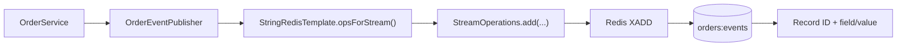
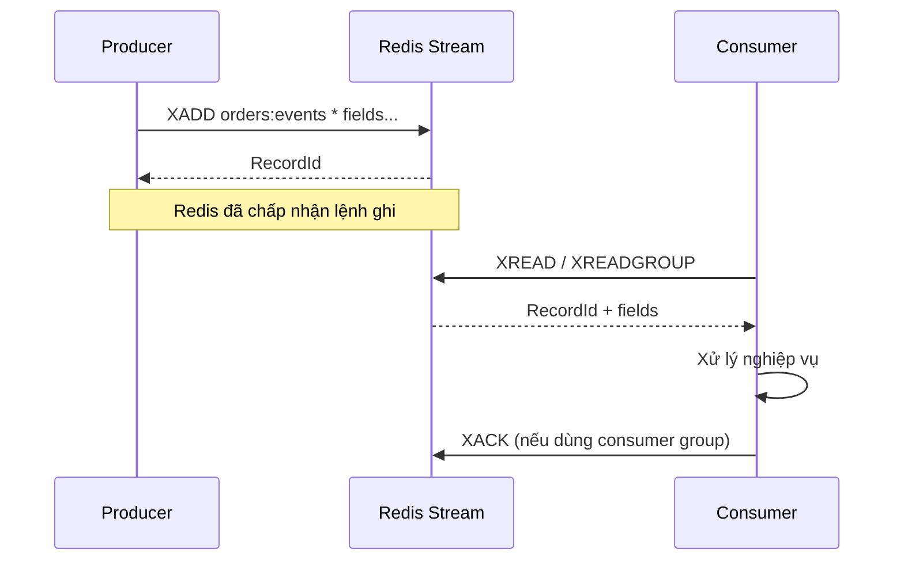
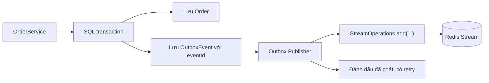

# Ghi bản ghi bằng `StreamOperations`

**Redis Streams** là kiểu dữ liệu lưu một chuỗi các bản ghi (*records*) theo thứ tự ID tăng dần. Trong **Spring Data Redis**, `StreamOperations` cung cấp API ghi bản ghi vào stream bằng phương thức `add(...)`, tương ứng với lệnh Redis **`XADD`**. Ví dụ, khi một đơn hàng được tạo, ứng dụng có thể thêm một bản ghi `OrderCreated` vào stream `orders:events` để các consumer xử lý sau.

Khác với Redis Pub/Sub, bản ghi trong stream vẫn có thể được đọc lại sau khi producer đã ghi, miễn là chúng còn được giữ trong stream. Tuy nhiên, việc ghi thành công **không có nghĩa** consumer đã đọc, đã xác nhận xử lý, hoặc một nghiệp vụ ở hệ thống khác đã hoàn tất. Bài này tập trung vào phía **producer**: tạo payload, gọi `StreamOperations.add(...)`, nhận `RecordId` và thiết kế việc ghi an toàn khi có nhiều tiến trình.

## 1. Cấu trúc của một Redis Stream record

Mỗi bản ghi trong Redis Stream có ba thành phần dễ quan sát:

| Thành phần | Ví dụ | Ý nghĩa |
| --- | --- | --- |
| **Stream key** | `orders:events` | Tên stream chứa các bản ghi |
| **Record ID** | `1730800000000-0` | Định danh do Redis sinh hoặc client cung cấp, quyết định thứ tự trong stream |
| **Field/value payload** | `type=OrderCreated`, `orderId=O-1001` | Các cặp tên trường và giá trị tạo nội dung bản ghi |

Ví dụ ghi trực tiếp bằng Redis CLI:

```redis
XADD orders:events * type OrderCreated orderId O-1001 amountMinor 250000
```

Redis trả về một ID, ví dụ:

```text
"1730800000000-0"
```

Dấu `*` yêu cầu **Redis tự sinh ID**. Đây là cách phổ biến nhất khi ứng dụng chỉ muốn ghi thêm bản ghi mới. Không dùng ID ví dụ trên làm ID cố định trong một hệ thống đang chạy.



Stream là một **log có thứ tự**. Việc ghi `XADD` thêm bản ghi mới vào cuối stream; thao tác này không phải `SET` ghi đè giá trị một key Redis string. Nếu stream key chưa tồn tại, `XADD` thông thường tự tạo stream. Nếu key đã tồn tại nhưng có kiểu dữ liệu khác stream, Redis trả lỗi `WRONGTYPE`.

## 2. Chuẩn bị Spring Boot và kết nối Redis

Với ứng dụng Spring Boot dùng API đồng bộ, thêm starter:

```groovy
// build.gradle
dependencies {
    implementation 'org.springframework.boot:spring-boot-starter-data-redis'
}
```

Cấu hình Redis Server, ví dụ trong môi trường phát triển:

```yaml
# src/main/resources/application.yml
spring:
  data:
    redis:
      host: localhost
      port: 6379
      timeout: 2s
```

Ví dụ dùng quy ước cấu hình Spring Boot 3.x. Ở môi trường thực tế, kết nối có thể cần mật khẩu, TLS, Sentinel hoặc Cluster theo cấu hình hạ tầng. Starter thường cung cấp `RedisConnectionFactory`, `RedisTemplate` và `StringRedisTemplate` thông qua auto-configuration khi các điều kiện được đáp ứng.

Để ghi các bản ghi với tên trường và giá trị là chuỗi, **`StringRedisTemplate` là điểm bắt đầu đơn giản và dễ quan sát bằng Redis CLI**:

```java
import org.springframework.data.redis.core.StringRedisTemplate;
import org.springframework.data.redis.core.StreamOperations;

StreamOperations<String, String, String> streamOperations =
        stringRedisTemplate.opsForStream();
```

Ba kiểu generic của `StreamOperations<K, HK, HV>` lần lượt là:

- `K`: kiểu của tên stream key, trong ví dụ là `String`.
- `HK`: kiểu của tên field trong bản ghi, trong ví dụ là `String`.
- `HV`: kiểu của giá trị field, trong ví dụ là `String`.

`StringRedisTemplate` dùng serializer chuỗi cho key và các giá trị phù hợp, nên các trường minh họa được Redis CLI nhìn thấy dưới dạng văn bản dễ đọc. Với `RedisTemplate` được tùy chỉnh, phải kiểm tra các serializer đang áp dụng.

## 3. Cách đơn giản nhất: `add(streamKey, Map)`

Một API thường dùng:

```java
RecordId add(K key, Map<? extends HK, ? extends HV> content)
```

Ví dụ tạo bản ghi:

```java
import java.util.LinkedHashMap;
import java.util.Map;
import org.springframework.data.redis.connection.stream.RecordId;
import org.springframework.data.redis.core.StringRedisTemplate;

String streamKey = "orders:events";

Map<String, String> fields = new LinkedHashMap<>();
fields.put("type", "OrderCreated");
fields.put("eventId", "event-9ab1");
fields.put("orderId", "O-1001");
fields.put("amountMinor", "250000");
fields.put("schemaVersion", "1");

RecordId recordId = stringRedisTemplate.opsForStream()
        .add(streamKey, fields);

System.out.println(recordId.getValue());
// Ví dụ: 1730800000000-0
```

Trong lời gọi trên, Spring Data Redis thực hiện thao tác tương đương:

```redis
XADD orders:events * type OrderCreated eventId event-9ab1 orderId O-1001 amountMinor 250000 schemaVersion 1
```

Thứ tự các field không phải hợp đồng nghiệp vụ; client đọc nên phân biệt field bằng **tên**. `RecordId` do `add(...)` trả về là ID **của lần ghi vào stream**, không phải `orderId` hay `eventId` nghiệp vụ.

**Lưu ý:** khi thực thi thông thường, kết quả `add` là `RecordId` nếu Redis chấp nhận lệnh. Một số API của Spring Data Redis có thể trả `null` khi lệnh được đưa vào **pipeline hoặc transaction**, vì kết quả thực tế sẽ có sau; không nên hiểu `null` trong ngữ cảnh này là Redis đã ghi thất bại hay đã ghi thành công.

## 4. Ví dụ producer hoàn chỉnh bằng Spring Service

Một ứng dụng nên gói việc dựng payload và ghi Redis trong một service duy nhất để quy ước field không bị phân tán. Ví dụ dưới đây ghi sự kiện đơn hàng có mã sự kiện riêng, thời gian xảy ra nghiệp vụ và số tiền dưới dạng **đơn vị tiền nhỏ nhất** (*minor units*, ví dụ đồng hoặc cent tùy hệ thống).

```java
package com.example.shop.stream;

import java.time.Instant;
import java.util.LinkedHashMap;
import java.util.Map;
import java.util.Objects;

import org.springframework.data.redis.connection.stream.RecordId;
import org.springframework.data.redis.core.StringRedisTemplate;
import org.springframework.stereotype.Service;

@Service
public class OrderEventPublisher {

    private static final String STREAM_KEY = "orders:events";

    private final StringRedisTemplate redis;

    public OrderEventPublisher(StringRedisTemplate redis) {
        this.redis = redis;
    }

    public record OrderCreatedEvent(
            String eventId,
            String orderId,
            Instant occurredAt,
            long amountMinor) {
    }

    public String publish(OrderCreatedEvent event) {
        Objects.requireNonNull(event, "event");
        requireText(event.eventId(), "eventId");
        requireText(event.orderId(), "orderId");
        Objects.requireNonNull(event.occurredAt(), "occurredAt");

        if (event.amountMinor() < 0) {
            throw new IllegalArgumentException(
                    "amountMinor must not be negative");
        }

        Map<String, String> payload = new LinkedHashMap<>();
        payload.put("type", "OrderCreated");
        payload.put("schemaVersion", "1");
        payload.put("eventId", event.eventId());
        payload.put("orderId", event.orderId());
        payload.put("occurredAt", event.occurredAt().toString());
        payload.put("amountMinor", Long.toString(event.amountMinor()));

        RecordId recordId = redis.opsForStream()
                .add(STREAM_KEY, payload);

        // Ví dụ này sử dụng thực thi đồng bộ, không pipeline/MULTI.
        if (recordId == null) {
            throw new IllegalStateException(
                    "Record ID unavailable in current execution context");
        }
        return recordId.getValue();
    }

    private static void requireText(String value, String field) {
        if (value == null || value.isBlank()) {
            throw new IllegalArgumentException(field + " is required");
        }
    }
}
```

Lời gọi minh họa:

```java
import java.time.Instant;
import java.util.UUID;

String id = publisher.publish(
        new OrderEventPublisher.OrderCreatedEvent(
                UUID.randomUUID().toString(),
                "O-1001",
                Instant.now(),
                250_000L
        )
);

System.out.println("Published Redis stream record: " + id);
```

Trong ví dụ này, `eventId` được sinh **một lần cho một sự kiện nghiệp vụ**; nếu cơ chế retry phải gửi lại cùng một sự kiện, cần **giữ lại eventId đã sinh**, thay vì gọi `UUID.randomUUID()` lần nữa. `RecordId` sẽ do Redis sinh mới cho mỗi lần `XADD`, kể cả khi hai bản ghi có nội dung giống hệt nhau.

### Vì sao không đưa số tiền hoặc timestamp dưới dạng object?

`StringRedisTemplate` làm việc tốt với các giá trị được chuyển thành chuỗi. Việc biểu diễn `amountMinor` thành số nguyên theo đơn vị đã quy định và `occurredAt` thành chuỗi ISO-8601 giúp các consumer ở ngôn ngữ khác đọc và parse dễ hơn.

Đối với dữ liệu nhiều phiên bản, **`schemaVersion`** giúp consumer biết cách giải mã. Điều này đặc biệt hữu ích khi nhiều đội phát triển đọc cùng một stream hoặc consumer có tốc độ triển khai phiên bản khác producer.

## 5. Ghi bằng `MapRecord` và `StreamRecords`

Ngoài `add(streamKey, Map)`, Spring Data Redis cho phép đóng gói tên stream và payload thành một **`MapRecord`**:

```java
import java.util.Map;
import org.springframework.data.redis.connection.stream.MapRecord;
import org.springframework.data.redis.connection.stream.RecordId;
import org.springframework.data.redis.connection.stream.StreamRecords;

MapRecord<String, String, String> record =
        StreamRecords.mapBacked(Map.of(
                "type", "OrderCreated",
                "eventId", "event-9ab1",
                "orderId", "O-1001"))
                .withStreamKey("orders:events");

RecordId id = stringRedisTemplate.opsForStream().add(record);
```

`MapRecord<K, HK, HV>` chứa:

| Thuộc tính | Ý nghĩa |
| --- | --- |
| `getStream()` | Stream key được chỉ định, ví dụ `orders:events` |
| `getValue()` | Map của các field/value tạo payload |
| `getId()` | Record ID; với record mới, để Redis sinh ID khi ghi |

`StreamRecords` có các builder và factory method như `mapBacked(...)`, `string(...)`, `newRecord()` để tạo record tương ứng với dữ liệu cần ghi. `MapRecord` phù hợp khi producer đã có payload phẳng dưới dạng các field/value.

**Hai dạng `add(streamKey, map)` và `add(mapRecord)` đều ghi thêm một record vào stream.** Dạng đầu ngắn gọn; dạng thứ hai thuận tiện khi ứng dụng cần truyền record qua nhiều lớp hoặc muốn chứa tên stream và payload trong cùng một đối tượng.

Không nên cố tái sử dụng một `MapRecord` mutable cho nhiều thread rồi thay payload trong lúc các thread đang ghi. Tạo một bản ghi/payload riêng cho từng sự kiện sẽ dễ kiểm soát hơn.

## 6. `ObjectRecord`: ghi đối tượng Java

`StreamOperations.add(...)` còn nhận `Record<K, ?>`, gồm **`ObjectRecord`**. Khi có một object Java muốn ghi và cấu hình `HashMapper`/serializer thích hợp, ứng dụng có thể để Spring Data Redis chuyển object thành dữ liệu stream.

Ví dụ mô hình:

```java
import org.springframework.data.redis.connection.stream.ObjectRecord;
import org.springframework.data.redis.connection.stream.RecordId;
import org.springframework.data.redis.connection.stream.StreamRecords;

// AuditEvent và objectRedisTemplate là thành phần ứng dụng đã cấu hình.
AuditEvent event = new AuditEvent("event-1", "LOGIN", "user-17");

ObjectRecord<String, AuditEvent> record =
        StreamRecords.newRecord()
                .in("audit:events")
                .ofObject(event);

RecordId id = objectRedisTemplate.opsForStream().add(record);
```

Đoạn trên minh họa API `ObjectRecord`; `AuditEvent` và `objectRedisTemplate` là các kiểu/bean phải được định nghĩa theo cách mapping object của ứng dụng. **Không nên chép nguyên đoạn này vào dự án chỉ có `StringRedisTemplate` rồi giả định mọi object đều tự serialize thành JSON.**

Spring Data Redis có thể ánh xạ object thành các field trong stream thông qua hash mapping, kể cả metadata kiểu như `_class` tùy cấu hình. Consumer dùng ngôn ngữ khác có thể không hiểu các chi tiết mapping do Java tạo. Vì thế, chọn định dạng theo nhu cầu tích hợp:

| Cách ghi | Ưu điểm | Điểm cần kiểm soát |
| --- | --- | --- |
| `Map<String, String>` / `MapRecord` | Cấu trúc field rõ ràng, đọc tốt qua Redis CLI và nhiều ngôn ngữ | Producer tự ánh xạ, validate và quản lý schema |
| `ObjectRecord<String, T>` | Gần với mô hình Java; có thể tái dùng mapping | Cần serializer/hash mapper tương thích, chú ý metadata Java và việc thay đổi class |
| Map với một field `payload` chứa JSON | Hợp đồng JSON dễ chia sẻ với consumer khác | Mất khả năng thao tác riêng theo các field Redis Stream; phải quản lý serializer JSON |

Ví dụ payload JSON trong một field:

```java
Map<String, String> fields = Map.of(
        "type", "OrderCreated",
        "schemaVersion", "1",
        "payload", "{\"orderId\":\"O-1001\",\"amountMinor\":250000}"
);

RecordId id = stringRedisTemplate.opsForStream()
        .add("orders:events", fields);
```

Trong môi trường thật, nên dùng thư viện JSON như Jackson để serialize một DTO đã validate, không ghép JSON thủ công từ input người dùng.

## 7. Serializer áp dụng cho stream

Redis lưu key, tên field và giá trị field dưới dạng **bytes**. Spring Data Redis lấy các serializer từ `RedisTemplate` tương ứng:

| Thành phần stream | Serializer được sử dụng |
| --- | --- |
| Tên stream key | `keySerializer` |
| Tên field trong payload | `hashKeySerializer` |
| Giá trị field trong payload | `hashValueSerializer` |

Ví dụ `StringRedisTemplate` giúp các trường hợp `String` được mã hóa dễ hiểu. Nếu dùng `RedisTemplate<String, Object>` với serializer object phức tạp, output có thể chứa binary data và không giống chuỗi mà Redis CLI hiển thị.

Các producer và consumer cần thống nhất:

- Tên stream, prefix và môi trường, ví dụ `prod:orders:events`.
- Cách mã hóa field và value (UTF-8, JSON, số dạng chuỗi, v.v.).
- Tên và kiểu các field bắt buộc; quy tắc khi field thiếu.
- Phiên bản payload và khả năng tương thích khi schema thay đổi.

**Đừng đổi serializer giữa chừng mà không có chiến lược chuyển đổi.** Bản ghi cũ vẫn được lưu theo encoding cũ, nên consumer mới có thể không giải mã được nếu giả định toàn bộ stream dùng một định dạng mới.

## 8. `RecordId` và thứ tự bản ghi

Redis Stream ID thông thường có dạng:

```text
<millisecondsTime>-<sequence>
```

Ví dụ:

```text
1730800000000-0
1730800000000-1
1730800000001-0
```

ID của một record mới phải lớn hơn ID cao nhất đã dùng trong stream. Khi sử dụng `XADD ... *`, Redis tự sinh ID đáp ứng thứ tự đó. Hai bản ghi có thể có cùng phần mili giây nhưng khác số sequence.

### Phân biệt ba định danh

| Định danh | Ví dụ | Dùng để làm gì? |
| --- | --- | --- |
| Redis `RecordId` | `1730800000000-0` | Xác định vị trí một entry trong stream, dùng khi đọc, acknowledge hoặc thao tác theo ID |
| `eventId` trong payload | `9d2f...` | Xác định một sự kiện nghiệp vụ xuyên qua retry và các hệ thống |
| `orderId` trong payload | `O-1001` | Xác định đơn hàng hoặc aggregate phát sinh sự kiện |

`RecordId` **không phải** định danh idempotency nghiệp vụ. Hai lời gọi `add` có cùng payload có thể tạo **hai RecordId khác nhau**. Vì vậy cần có `eventId` và cơ chế chống trùng ở producer/consumer nếu không được xử lý sự kiện lặp.

Spring Data Redis cũng hỗ trợ record ID được chỉ định trong một số API, nhưng thông thường nên để Redis tự sinh. Nếu tự cung cấp ID, nó phải theo đúng định dạng và lớn hơn mọi ID đã dùng trước đó trên stream; ID cũ hoặc không hợp lệ khiến `XADD` bị Redis từ chối. Thời gian nhúng trong ID cũng không nhất thiết là thời điểm xảy ra nghiệp vụ; muốn lưu thời gian nghiệp vụ hãy dùng field `occurredAt`.

## 9. Giới hạn độ dài stream khi ghi: `XAddOptions`

Redis Streams có thể tăng liên tục nếu producer ghi nhanh hơn việc dữ liệu cũ được xóa. Một ứng dụng cần chọn **chính sách retention** dựa trên yêu cầu khôi phục và xử lý của consumer.

Trong Redis CLI, có thể thêm record đồng thời yêu cầu giới hạn số entry:

```redis
XADD orders:events MAXLEN ~ 100000 * type OrderCreated orderId O-1001
```

`MAXLEN` đặt ngưỡng giữ số bản ghi; dấu `~` cho phép **trim gần đúng**, thường hiệu quả hơn trim chính xác và có thể giữ nhiều hơn ngưỡng trong một thời gian. Ví dụ `100000` là ngưỡng minh họa, không phải kích thước đúng cho mọi hệ thống.

Trong Spring Data Redis, có overload `add(..., XAddOptions)`:

```java
import java.util.Map;
import org.springframework.data.redis.connection.RedisStreamCommands;
import org.springframework.data.redis.connection.stream.RecordId;

RedisStreamCommands.XAddOptions options =
        RedisStreamCommands.XAddOptions.maxlen(100_000);

RecordId id = stringRedisTemplate.opsForStream()
        .add("orders:events",
                Map.of("type", "OrderCreated", "orderId", "O-1001"),
                options);
```

Ví dụ Java trên dùng **giới hạn theo `MAXLEN` không yêu cầu approximate trimming**. API để chọn approximate trimming khác nhau theo phiên bản Spring Data Redis. Với các phiên bản mới có `TrimOptions`, có thể khai báo ý định một cách tường minh:

```java
import org.springframework.data.redis.connection.RedisStreamCommands;

RedisStreamCommands.XAddOptions options =
        RedisStreamCommands.XAddOptions.trim(
                RedisStreamCommands.TrimOptions
                        .maxLen(100_000)
                        .approximate());
```

Ở những phiên bản Spring Data Redis cũ hơn, có API `.approximateTrimming(true)`; từ dòng mới hơn, API này được đánh dấu deprecated và thay bằng `TrimOptions`. Khi áp dụng dự án cụ thể, sử dụng biến thể API phù hợp với phiên bản dependency đang chạy.

### Cảnh báo về dữ liệu chưa xử lý

Trimming có thể loại bỏ entry cũ khi consumer còn chậm hoặc khi consumer group còn tham chiếu tới entry chưa hoàn tất. Tùy phiên bản Redis và chính sách xóa, điều đó có thể khiến payload không còn để replay, dù metadata pending vẫn tồn tại. Do đó:

1. Chọn retention dựa trên **thời gian consumer có thể ngừng hoạt động** và tốc độ ghi lớn nhất, không chỉ theo bộ nhớ còn trống.
2. Theo dõi backlog, pending và độ trễ consumer trước khi giảm `MAXLEN`.
3. Nếu cần lưu sự kiện lâu dài để audit, cân nhắc lưu vào một hệ thống bền vững phù hợp thay vì chỉ dựa vào một stream bị trim.

Redis Stream **không có TTL riêng cho từng record theo mô hình key TTL thông thường**. Lệnh `EXPIRE orders:events 3600` đặt TTL cho **toàn bộ stream key**; khi hết hạn, tất cả entry trong stream biến mất. Quản lý retention theo record thường dựa trên `MAXLEN`, `MINID`, `XTRIM` hoặc chính sách tương ứng.

## 10. Kiểm tra record vừa ghi

Trong môi trường phát triển, sau lời gọi `add`, có thể dùng Redis CLI:

```redis
TYPE orders:events
# stream

XLEN orders:events
# Số lượng entry hiện có

XRANGE orders:events - + COUNT 10
# Các entry đầu tiên, mỗi entry gồm ID và các field/value
```

Xem entry mới nhất:

```redis
XREVRANGE orders:events + - COUNT 5
```

Xem thông tin stream:

```redis
XINFO STREAM orders:events
```

Nếu đã nhận `RecordId`, có thể tra đúng entry theo ID:

```redis
XRANGE orders:events 1730800000000-0 1730800000000-0
```

Thay ID minh họa bằng ID thực tế mà producer nhận được. Nếu entry đã bị trim hoặc stream bị xóa, việc tra ID cũ sẽ không còn dữ liệu.

**Đừng sử dụng `XRANGE stream - +` không giới hạn trên một stream rất lớn để phục vụ request web.** Với môi trường production, cần `COUNT`, trang theo ID hoặc cơ chế consumer thích hợp để tránh tải toàn bộ lịch sử vào bộ nhớ.

## 11. Ghi bản ghi và xử lý ở consumer là hai giai đoạn khác nhau



**`add(...)` chỉ ghi record.** Nó không tạo consumer group, không tự đánh dấu message đã xử lý và không thay consumer đi `XACK`. Nếu dùng consumer group, các bước đọc, xử lý lỗi, retry và acknowledge thuộc về phía consumer.

Khác với Pub/Sub, Redis Stream lưu record cho đến khi bị xóa/trim/expire. Tuy nhiên, stream không tự tạo quy tắc xử lý đúng một lần. Một consumer có thể nhận lại bản ghi khi phải phục hồi từ lỗi, và việc xử lý nghiệp vụ thường cần **idempotency**.

## 12. Khi lỗi xảy ra trong lúc gọi `add(...)`

Có ba tình huống cần phân biệt:

| Quan sát ở producer | Diễn giải | Hành động phù hợp |
| --- | --- | --- |
| `add` trả về `RecordId` | Redis đã nhận và thêm bản ghi trong điều kiện thực thi thông thường | Ghi nhận ID và tiếp tục; trạng thái xử lý ở consumer là bước riêng |
| Redis trả lỗi như `WRONGTYPE`, sai định dạng, không đủ quyền | Ghi thất bại theo lỗi được server xác nhận | Sửa dữ liệu/cấu hình/quyền; không retry vô hạn |
| Timeout hoặc mất kết nối sau khi lệnh có thể đã được gửi | **Không biết chắc** Redis đã ghi hay chưa | Không tự suy luận là chưa ghi; cần hợp đồng retry/idempotency |

Tình huống cuối là quan trọng nhất. Ví dụ:

```text
Producer -> Redis: XADD orders:events * eventId=e-123
Redis: đã thêm entry 1730800000000-0
Redis -> Producer: response bị mất do network timeout
Producer: thấy exception, không nhận được RecordId
```

Nếu producer chỉ gọi `add` lại, Redis có thể sinh một ID mới và stream có **hai entry cùng `eventId`**. `XADD` mặc định không khử trùng theo payload. Vì vậy, các hệ thống cần xử lý chính xác phải chủ động quản lý định danh nghiệp vụ.

### 12.1. Sử dụng `eventId` và consumer idempotent

Ví dụ event gồm:

```text
eventId = e-123
orderId = O-1001
type = OrderCreated
```

Khi consumer xử lý, một kho dữ liệu bền vững có thể có ràng buộc unique trên `eventId` hoặc `(consumerName, eventId)`. Nếu event lặp lại với một `RecordId` khác, consumer nhận ra nó đã xử lý và không thực hiện lại tác dụng phụ. Với thao tác cập nhật một cơ sở dữ liệu, nên ghi dấu vết đã xử lý và thay đổi nghiệp vụ trong **cùng transaction ở kho đó** nếu có thể.

Việc thêm field `eventId` **không tự khử trùng**. Nó chỉ tạo định danh ổn định để các thành phần khác thực thi cơ chế idempotency.

### 12.2. Producer có transaction SQL: cân nhắc transactional outbox

Giả sử ứng dụng vừa ghi đơn hàng vào PostgreSQL, vừa phát sự kiện lên Redis:

```text
BEGIN SQL TRANSACTION
INSERT orders (...)
COMMIT
XADD orders:events ...
```

Nếu ứng dụng chết **giữa `COMMIT` và `XADD`**, đơn hàng đã lưu nhưng stream không có sự kiện. Nếu gửi XADD trước commit SQL, consumer lại có thể thấy sự kiện của đơn hàng sau đó bị rollback.

Một thiết kế đáng tin cậy hơn là **transactional outbox**:



Outbox publisher có thể retry việc gửi, và consumer dùng `eventId` để chống trùng. Đây là mô hình *at-least-once* phù hợp để không mất sự kiện nghiệp vụ; không nên mặc định hai hệ thống SQL và Redis tạo thành một transaction chung chỉ nhờ `@Transactional` trong Spring.

Ngay cả khi Redis trả `RecordId`, độ bền vững sau crash/failover còn phụ thuộc Redis persistence, replication và cách hạ tầng được cấu hình. Nếu bài toán yêu cầu log không mất dữ liệu theo SLA nghiêm ngặt, cần thiết kế durability theo yêu cầu đó.

## 13. Batching và tốc độ ghi

Producer có thể cần ghi nhiều record:

```java
for (OrderEventPublisher.OrderCreatedEvent event : events) {
    publisher.publish(event);
}
```

Với cách trên, mỗi `add` là một lời gọi tuần tự, đơn giản và dễ lấy `RecordId`. Khi lượng ghi tăng lớn, nhiều round trip có thể thành điểm nghẽn. Spring Data Redis hỗ trợ **pipelining**, nhưng khi chạy pipeline, giá trị trả trực tiếp từ `add(...)` có thể là `null`; kết quả thật nằm trong tập kết quả pipeline.

Vì vậy, nếu chuyển sang pipeline cần thiết kế rõ:

- Liên hệ từng kết quả pipeline với đúng event đã gửi.
- Xử lý trường hợp một lệnh lỗi hoặc kết nối mất phản hồi.
- Không đánh dấu tất cả event đã ghi thành công chỉ vì đã đưa lệnh vào pipeline.
- Giữ nguyên `eventId` khi retry những record có kết quả chưa chắc chắn.
- Xác định có cần thứ tự chặt trong **cùng stream** hay việc phân vùng thành nhiều stream có thể chấp nhận.

Đối với tốc độ ghi cao, việc dùng pipeline cần có metric, giới hạn kích thước batch và chính sách backpressure. Không nên tạo một batch không giới hạn rồi giữ toàn bộ payload trong bộ nhớ.

## 14. Ghi bằng StreamOperations trong hệ thống Redis Cluster

Mỗi `XADD` ghi vào **một stream key**, nên Redis Cluster định tuyến lệnh tới node sở hữu hash slot của key đó. Nếu có nhiều stream:

```text
orders:events
payments:events
notifications:events
```

chúng có thể nằm trên các slot hoặc node khác nhau. Thứ tự ID được bảo đảm **trong từng stream**, không phải một thứ tự toàn cục cho mọi stream trên cluster.

Nếu muốn giao dịch/script thao tác đồng thời nhiều key trong Redis Cluster, cần quan tâm yêu cầu cùng hash slot. Điều này nằm ngoài việc gọi một `StreamOperations.add(streamKey, ...)` đơn lẻ nhưng quan trọng khi thiết kế pipeline event lớn.

Đối với ứng dụng có nhiều instance producer cùng ghi một stream, Redis sinh ID và sắp thứ tự theo trình tự lệnh đến server. Đó không nhất thiết là thứ tự **thời gian xảy ra nghiệp vụ** ở các instance; không nên suy ra một sự kiện diễn ra trước ngoài đời chỉ vì `RecordId` nhỏ hơn khi các sự kiện được gửi bất đồng bộ.

## 15. Những lỗi và hiểu nhầm thường gặp

### 15.1. Nhầm `opsForStream()` với `opsForValue()`

`opsForValue()` làm việc với kiểu dữ liệu string; `opsForStream()` làm việc với Redis Stream. Nếu key đã được tạo bằng `SET`, gọi `XADD` trên cùng tên key sẽ gặp `WRONGTYPE`. Hãy đặt prefix và convention riêng cho stream.

### 15.2. Gửi map rỗng hoặc field có giá trị null

Lệnh `XADD` cần ít nhất một cặp field/value. `Map.of(...)` không cho phép `null`; với map khác, serializer cũng có thể xử lý `null` theo cách không mong muốn. Validate payload trước khi gửi và quy định field nào là bắt buộc.

### 15.3. Coi `RecordId` là chứng cứ consumer đã xử lý

`RecordId` cho biết Redis đã thêm entry. Consumer có thể chưa được tạo, đang offline hoặc đang chậm. Cần quan sát nhóm consumer, backlog và trạng thái acknowledge riêng.

### 15.4. Gửi lại một event với ID nghiệp vụ mới

Nếu timeout khiến client retry và sinh `eventId` mới, consumer không nhận diện được hai record là cùng một sự kiện. Sinh và lưu ID ở thời điểm tạo event; các lần gửi lại giữ nguyên ID đó.

### 15.5. Đặt `MAXLEN` quá nhỏ

Khi throughput producer lớn và consumer tạm dừng, bản ghi chưa kịp xử lý có thể bị trim. Hãy ước lượng retention theo tải thực tế, ngưỡng downtime và tốc độ xử lý, thay vì chọn một con số nhỏ để tiết kiệm RAM.

### 15.6. Dùng `EXPIRE` để xóa từng message

`EXPIRE streamKey ...` hết hạn **cả stream key**. Redis Stream không tự gán một TTL độc lập cho mỗi entry theo lệnh `EXPIRE` thông thường. Nếu cần loại bỏ entry cũ, sử dụng chiến lược trim/delete phù hợp.

### 15.7. Giả định serializer không ảnh hưởng dữ liệu stream

`StringRedisTemplate` và `RedisTemplate` tùy chỉnh có thể ghi ra bytes khác nhau cho cùng giá trị Java. Producer và consumer dùng serializer không tương thích có thể thấy field tên lạ, lỗi giải mã hoặc không đọc được record.

### 15.8. Gọi `add()` trong pipeline nhưng đòi nhận ID ngay

Khi pipeline hoặc transaction đang queue, giá trị trả trực tiếp từ `add()` có thể là `null` vì kết quả chỉ xuất hiện sau khi thực thi. Phải lấy kết quả ở nơi kết thúc pipeline/transaction, không dùng ID chưa có để quyết định thành công.

### 15.9. Tưởng một XADD ghi cùng lúc vào SQL

Redis và SQL có ranh giới transaction khác nhau. Nếu cần vừa lưu entity vừa phát sự kiện, dùng outbox hoặc một thiết kế phục hồi phù hợp; không giả định `@Transactional` gói được cả hai thành một commit nguyên tử.

## 16. Quy trình thực hành và quan sát

Có thể thử trên Redis dành cho học tập với ba bước:

**Bước 1: Ghi hai bản ghi bằng CLI.**

```redis
XADD lesson:orders * type OrderCreated orderId O-1 eventId e-1
XADD lesson:orders * type OrderPaid orderId O-1 eventId e-2
```

**Bước 2: Quan sát stream.**

```redis
TYPE lesson:orders
XLEN lesson:orders
XRANGE lesson:orders - + COUNT 10
XREVRANGE lesson:orders + - COUNT 1
```

**Bước 3: Ghi bằng Spring Data Redis vào cùng stream.**

```java
RecordId id = stringRedisTemplate.opsForStream().add(
        "lesson:orders",
        Map.of(
                "type", "OrderShipped",
                "orderId", "O-1",
                "eventId", "e-3")
);
System.out.println(id.getValue());
```

Sau đó gọi `XRANGE lesson:orders - + COUNT 10` lần nữa để thấy bản ghi mới. Nội dung trong CLI và bản ghi Spring Data Redis phải tuân thủ cùng quy ước encoding; ví dụ dùng string cho tất cả field/value.

Để quan sát retention mà không ảnh hưởng dữ liệu thật:

```redis
XADD lesson:trim MAXLEN ~ 5 * type Demo seq 1
XADD lesson:trim MAXLEN ~ 5 * type Demo seq 2
XLEN lesson:trim
```

Đừng kỳ vọng `MAXLEN ~ 5` luôn trả đúng tối đa 5 entry: dấu `~` yêu cầu trim gần đúng.

## 17. Các quyết định thiết kế trước khi triển khai

| Câu hỏi | Gợi ý |
| --- | --- |
| Cần ghi payload đơn giản, dễ đọc nhiều ngôn ngữ? | `StringRedisTemplate.opsForStream().add(key, Map<String,String>)` |
| Cần gom stream key và payload thành đối tượng? | `StreamRecords.mapBacked(...).withStreamKey(...)` |
| Muốn ghi object Java trực tiếp? | `ObjectRecord`, nhưng phải cấu hình mapper/serializer và hợp đồng schema |
| Cần consumer nhận diện sự kiện lặp? | Gắn `eventId` ổn định và lưu trạng thái xử lý idempotent |
| Cần bounded memory? | Chọn `XAddOptions` hoặc cơ chế trim với retention đáp ứng downtime consumer |
| Cần bảo đảm event phát ra sau khi giao dịch SQL hoàn tất? | Dùng transactional outbox hoặc quy trình có retry và idempotency |
| Producer không nhận được phản hồi Redis? | Coi kết quả commit là chưa rõ; kiểm tra theo `eventId`/hợp đồng phục hồi |
| Cần nhiều record/giây? | Cân nhắc pipeline, batch, giới hạn tải và quan sát độ trễ |

## 18. Tổng kết

`StreamOperations` là API chính của **Spring Data Redis** để ghi bản ghi vào Redis Streams. Với dữ liệu dạng cặp field/value, có thể dùng `StringRedisTemplate.opsForStream().add(streamKey, map)` hoặc đóng gói vào `MapRecord` và gọi `add(record)`. Kết quả thông thường là một `RecordId` do Redis sinh, thể hiện vị trí bản ghi mới trong stream.

Hãy tách **RecordId** khỏi **ID sự kiện nghiệp vụ**, quản lý serializer và schema rõ ràng, đặt retention theo khả năng khôi phục của consumer và xử lý các lần gửi lại bằng idempotency. Ghi record thành công chỉ xác nhận Redis đã chấp nhận lệnh thêm vào stream; các bước đọc, xử lý và acknowledge thuộc về consumer, còn việc bảo đảm nhất quán với SQL cần cơ chế riêng như transactional outbox.

### Tài liệu tham khảo

- [Spring Data Redis — Redis Streams](https://docs.spring.io/spring-data/redis/reference/redis/redis-streams.html): ghi bản ghi với `StreamOperations`, `MapRecord`, `ObjectRecord` và serializer.
- [Spring Data Redis — `StreamOperations` API](https://docs.spring.io/spring-data/redis/reference/api/java/org/springframework/data/redis/core/StreamOperations.html): các overload `add(...)`, `RecordId`, trim và kết quả khi pipeline/transaction.
- [Spring Data Redis — `StreamRecords` API](https://docs.spring.io/spring-data/redis/reference/api/java/org/springframework/data/redis/connection/stream/StreamRecords.html): tạo record từ map hoặc object.
- [Redis — XADD](https://redis.io/docs/latest/commands/xadd/): ID tự sinh, field/value, `MAXLEN` và retention.
- [Redis — Introduction to Streams](https://redis.io/docs/latest/develop/data-types/streams/): mô hình stream, consumer group và vòng đời dữ liệu.
