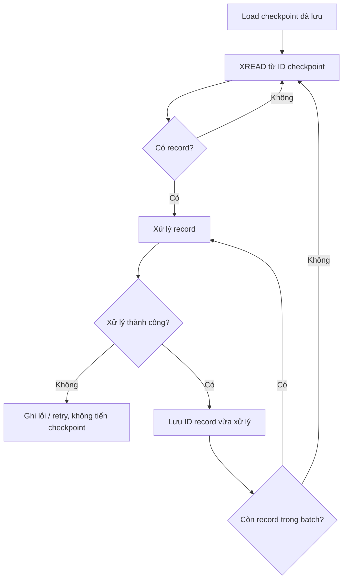

# Đọc theo khoảng, theo offset và đọc chặn trong Redis Streams với Spring Data Redis

## 1. Mục tiêu và bài toán

Redis Streams là cấu trúc dữ liệu dạng nhật ký các sự kiện có thứ tự, phù hợp cho các luồng sự kiện như đơn hàng, thanh toán, thay đổi tồn kho hoặc công việc bất đồng bộ. Khác Redis List, mỗi bản ghi trong Stream có một **ID có thứ tự** và một tập các cặp field–value. Nhờ ID này, ứng dụng có thể tìm lại lịch sử theo khoảng, đọc tiếp từ mốc đã xử lý hoặc chờ sự kiện mới.

Ví dụ ứng dụng ghi sự kiện vào Stream `shop:orders:events`:

```text
ID                  type        orderId   status
1700000000000-0     CREATED     O-1001    NEW
1700000000001-0     CONFIRMED   O-1001    PAID
1700000000002-0     CREATED     O-1002    NEW
1700000000003-0     SHIPPED     O-1001    SHIPPING
```

Các nhu cầu đọc khác nhau dẫn đến các lệnh khác nhau:

- **Đọc theo khoảng:** lấy sự kiện từ ID A đến ID B, hoặc lấy 20 bản ghi đầu tiên trong lịch sử để kiểm tra.
- **Đọc theo offset:** đã xử lý tới ID B, giờ chỉ lấy những bản ghi **sau B**.
- **Đọc chặn (*blocking read*):** chưa có bản ghi mới thì giữ yêu cầu đọc trong một khoảng thời gian, thay vì gửi câu lệnh liên tục.
- **Đọc bằng consumer group:** nhiều worker cần chia nhau công việc, theo dõi bản ghi đang chờ xác nhận; đây là một cơ chế bổ sung, khác đọc offset độc lập.

Trong Spring Data Redis, ba nhu cầu đầu được thực hiện chủ yếu bằng `StreamOperations`, `Range`, `ReadOffset`, `StreamOffset` và `StreamReadOptions`.

## 2. Stream ID là mốc định vị bản ghi

Mỗi entry của Redis Stream gồm **ID** và một map field–value:

```text
1700000000001-0
  type       = CONFIRMED
  orderId    = O-1001
  status     = PAID
```

ID theo định dạng thường gặp `milliseconds-sequence`, ví dụ `1700000000001-0`. Phần trước là thành phần thời gian tính bằng mili giây, phần sau là số thứ tự trong cùng mốc. Khi dùng `XADD ... *`, Redis tạo ID mới có thứ tự tăng phù hợp với Stream.

Những nguyên tắc quan trọng:

1. **ID là vị trí đọc**, không phải tên field hay mã nghiệp vụ. `orderId=O-1001` có thể xuất hiện trong nhiều entry với nhiều ID.
2. Hai entry ở cùng một mili giây vẫn có thể có ID khác nhau, chẳng hạn `1700000000001-0` và `1700000000001-1`.
3. ID có thứ tự tăng trong một Stream. Nếu ứng dụng tự tạo ID, phải tuân thủ các ràng buộc ID của Redis.
4. Không suy ra chắc chắn thời điểm nghiệp vụ từ ID nếu hệ thống sử dụng ID do client cung cấp hoặc event được ghi trễ. Muốn lọc theo `businessOccurredAt`, cần lưu thêm field và chiến lược truy vấn thích hợp.
5. Việc đọc lại ID cũ hoặc đọc sau ID mới phụ thuộc API: **`XRANGE` có giới hạn khoảng**, trong khi **`XREAD` dùng offset loại trừ**.

### Các ký hiệu thường gặp

| Ký hiệu | Ngữ cảnh | Ý nghĩa |
|---|---|---|
| `-` | `XRANGE` / `XREVRANGE` | ID nhỏ nhất có thể trong range |
| `+` | `XRANGE` / `XREVRANGE` | ID lớn nhất có thể trong range |
| `0-0` | `XREAD` hoặc range | Điểm bắt đầu rất sớm; thường dùng để đọc lịch sử |
| `$` | `XREAD` | Chỉ quan tâm entry xuất hiện **sau thời điểm bắt đầu lệnh đọc** |
| `(1700000000001-0` | Range | Ranh giới mở: loại trừ ID này |
| `>` | `XREADGROUP` | Những entry chưa được giao cho consumer của group theo semantics của group |

Đặc biệt, `$` và `>` không thay thế lẫn nhau: `$` thuộc cách đọc Stream trực tiếp; `>` là ký hiệu đọc bản ghi mới trong consumer group.

## 3. Tạo dữ liệu minh họa bằng Redis CLI

Có thể dùng Redis CLI tại môi trường phát triển để thêm một số entry:

```redis
XADD shop:orders:events * type CREATED orderId O-1001 status NEW
XADD shop:orders:events * type CONFIRMED orderId O-1001 status PAID
XADD shop:orders:events * type CREATED orderId O-1002 status NEW
XADD shop:orders:events * type SHIPPED orderId O-1001 status SHIPPING
```

Redis trả về ID thực tế cho mỗi lệnh `XADD`. Trong những ví dụ tiếp theo, hãy thay các ID minh họa bằng **ID Redis trả về trên hệ thống của bạn**.

Kiểm tra số entry đang lưu:

```redis
XLEN shop:orders:events
```

Xem thông tin chung của Stream:

```redis
XINFO STREAM shop:orders:events
```

`XLEN` là số entry hiện có trong Stream, không phải số sự kiện từng được ghi kể từ lúc tạo; các thao tác xóa hoặc trim có thể làm số entry giảm. `XINFO STREAM` cung cấp metadata hữu ích nhưng không thay thế việc đọc từng record khi cần xử lý nội dung.

## 4. Đọc theo khoảng bằng XRANGE

Lệnh `XRANGE` cho phép truy xuất các record có ID nằm trong một khoảng:

```redis
XRANGE shop:orders:events - +
```

`-` là đầu nhỏ nhất, `+` là đầu lớn nhất. Câu lệnh trên đọc toàn bộ record còn tồn tại trong Stream theo **thứ tự ID tăng dần**.

Nếu cần giới hạn lượng kết quả trong một lần:

```redis
XRANGE shop:orders:events - + COUNT 2
```

Lệnh lấy tối đa hai entry đầu tiên đang có trong khoảng. `COUNT 2` giới hạn kết quả của **lần gọi này**, không thay đổi dữ liệu Stream và không có nghĩa Stream chỉ còn hai entry.

### Đọc một khoảng ID cụ thể

Giả sử muốn đọc từ ID `1700000000001-0` đến `1700000000003-0`:

```redis
XRANGE shop:orders:events 1700000000001-0 1700000000003-0
```

Theo mặc định, các biên được **bao gồm** nếu entry có ID bằng biên đang tồn tại. Muốn loại trừ ID ở đầu khoảng, thêm dấu `(`:

```redis
XRANGE shop:orders:events (1700000000001-0 1700000000003-0
```

Lệnh thứ hai không trả về entry có ID chính xác `1700000000001-0`, dù ID đó có tồn tại.

### Khi nào dùng đọc theo khoảng?

- Điều tra sự kiện trong một khoảng ID đã biết.
- Xây dựng trang xem lịch sử sự kiện.
- Chạy lại những entry từ một mốc cũ tới một mốc xác định.
- Đọc dữ liệu cho một tác vụ đối soát, có giới hạn lượng kết quả.
- Phân trang lịch sử bằng ID cuối của trang trước.

`XRANGE` **không chờ** record mới. Nếu khoảng không có entry, nó trả kết quả rỗng ngay.

## 5. Đọc ngược bằng XREVRANGE

Khi cần hiển thị những sự kiện mới nhất trước, dùng `XREVRANGE`:

```redis
XREVRANGE shop:orders:events + - COUNT 5
```

Kết quả theo **thứ tự ID giảm dần**, tối đa năm entry.

Dấu biên đảo vị trí so với `XRANGE`: với `XREVRANGE`, truyền **max trước**, **min sau**.

| Mục đích | Lệnh |
|---|---|
| Toàn bộ bản ghi, cũ tới mới | `XRANGE key - +` |
| 10 bản ghi đầu tiên | `XRANGE key - + COUNT 10` |
| 10 bản ghi mới nhất | `XREVRANGE key + - COUNT 10` |
| Một khoảng cụ thể, tăng dần | `XRANGE key startId endId` |
| Một khoảng cụ thể, giảm dần | `XREVRANGE key endId startId` |

`XREVRANGE` thường phù hợp cho giao diện nhật ký gần nhất hoặc trang quản trị cần xem những sự kiện vừa đến; còn worker xử lý tiến lên phía trước thường dùng `XREAD` hoặc consumer group.

## 6. Phân trang bằng ID để tránh đọc trùng trang

Một yêu cầu phổ biến: đọc từng trang 100 entry mà không tải toàn bộ Stream vào bộ nhớ.

Với chiều tăng dần:

1. Trang đầu: `XRANGE key - + COUNT 100`.
2. Ghi nhận **ID của entry cuối trong trang**.
3. Trang sau: `XRANGE key (lastId + COUNT 100`.
4. Lặp tới khi không còn entry.

Ví dụ cú pháp CLI với ID mẫu:

```redis
XRANGE shop:orders:events - + COUNT 2
XRANGE shop:orders:events (1700000000001-0 + COUNT 2
```

Dấu `(` bảo đảm trang sau **không lặp lại entry cuối trang trước** do ranh giới bao gồm.

Không nên tạo ID kế tiếp bằng cách cộng một đơn vị vào số thứ tự của ID, vì khi ID do Redis tạo hoặc có khoảng trống sau khi trim/xóa, cách cộng thủ công không cần thiết và dễ sai. Dùng ranh giới **mở** với chính ID cuối đã thấy.

### Đọc trang theo chiều ngược

Để tiếp tục từ entry cuối của trang vừa xem khi dùng `XREVRANGE`, đặt ranh giới trên mở:

```redis
XREVRANGE shop:orders:events + - COUNT 2
XREVRANGE shop:orders:events (1700000000002-0 - COUNT 2
```

Ở lần gọi thứ hai, `(1700000000002-0` loại trừ ID đầu trên tương ứng. Đầu vào cần là **ID cuối của trang trước** trong thứ tự giảm dần thực tế.

### Những thay đổi trong lúc phân trang

Phân trang bằng ID ổn định hơn phân trang bằng một vị trí số trong danh sách. Tuy vậy, đây không phải một snapshot bất biến:

- Record có thể được thêm vào cuối Stream trong lúc người dùng xem trang cũ.
- Record có thể bị `XDEL` hoặc `XTRIM` làm mất.
- Nếu ứng dụng chuyển sang một key Stream khác, checkpoint ID cũ không còn biểu diễn vị trí ở key mới.

Với yêu cầu xuất một khoảng lịch sử cố định, nên ghi nhận **ID đích cuối cùng** trước khi duyệt, rồi đọc các trang tới biên đó. Nếu dữ liệu có thể bị trim trong khi xuất, cần cơ chế lưu trữ/giữ dữ liệu thích hợp.

## 7. Spring Data Redis: đọc theo khoảng bằng StreamOperations

Trong Spring Boot, có thể sử dụng `StringRedisTemplate` để thao tác với Stream có tên key, field và value là chuỗi.

Phụ thuộc Gradle:

```kotlin
dependencies {
    implementation("org.springframework.boot:spring-boot-starter-data-redis")
}
```

Hoặc Maven:

```xml
<dependency>
    <groupId>org.springframework.boot</groupId>
    <artifactId>spring-boot-starter-data-redis</artifactId>
</dependency>
```

Cấu hình local minh họa:

```yaml
spring:
  data:
    redis:
      host: localhost
      port: 6379
```

Khi dùng starter mặc định, Spring Boot có thể cấu hình `RedisConnectionFactory` và `StringRedisTemplate` từ các thuộc tính kết nối. Dự án thực tế cần cấu hình endpoint, TLS, xác thực, timeout và topology theo môi trường.

### Ví dụ một service đọc khoảng ID

**`OrderEventRangeReader.java`**

```java
package com.example.orders.stream;

import java.util.List;

import org.springframework.data.domain.Range;
import org.springframework.data.domain.Limit;
import org.springframework.data.redis.connection.stream.MapRecord;
import org.springframework.data.redis.core.StreamOperations;
import org.springframework.data.redis.core.StringRedisTemplate;
import org.springframework.stereotype.Service;

@Service
public class OrderEventRangeReader {

    private static final String STREAM = "shop:orders:events";

    private final StreamOperations<String, String, String> streams;

    public OrderEventRangeReader(StringRedisTemplate redis) {
        this.streams = redis.opsForStream();
    }

    public List<MapRecord<String, String, String>> firstPage(int size) {
        requirePageSize(size);

        return streams.range(
                STREAM,
                Range.unbounded(),
                Limit.limit().count(size)
        );
    }

    public List<MapRecord<String, String, String>> between(
            String startId,
            String endId,
            int size
    ) {
        requirePageSize(size);

        return streams.range(
                STREAM,
                Range.closed(startId, endId),
                Limit.limit().count(size)
        );
    }

    public List<MapRecord<String, String, String>> newest(int size) {
        requirePageSize(size);

        return streams.reverseRange(
                STREAM,
                Range.unbounded(),
                Limit.limit().count(size)
        );
    }

    private static void requirePageSize(int size) {
        if (size < 1 || size > 1_000) {
            throw new IllegalArgumentException(
                    "size must be between 1 and 1000"
            );
        }
    }
}
```

Giải thích:

- `StreamOperations<String, String, String>` là API cho tên Stream, field và value dùng chuỗi.
- `Range.unbounded()` chọn toàn bộ khoảng có thể đọc; kết hợp `Limit` để giữ lượng kết quả trong một lần gọi ở mức hợp lý.
- `Range.closed(startId, endId)` định nghĩa khoảng bao gồm hai biên.
- `range(...)` đọc từ cũ tới mới; `reverseRange(...)` đọc từ mới tới cũ.
- `MapRecord` chứa ID record cùng các field và value; tên key Stream cũng là metadata của record.
- `Limit.limit().count(size)` giới hạn tối đa số record trả về cho lần đọc; nó không đặt giới hạn tổng số record trong Stream.

Dùng:

```java
List<MapRecord<String, String, String>> page =
        orderEventRangeReader.firstPage(10);

for (MapRecord<String, String, String> record : page) {
    System.out.println("ID = " + record.getId().getValue());
    System.out.println("Fields = " + record.getValue());
}
```

Cần nhớ rằng `MapRecord` là dữ liệu **được đọc từ Stream**, không nhất thiết tự ánh xạ thành POJO nghiệp vụ. Khi cần object mapping, có thể tìm hiểu thêm `ObjectRecord` và các thao tác mapping; ví dụ dùng chuỗi để tập trung vào hành vi đọc theo vị trí.

### Phân trang tiếp bằng ranh giới mở

Với Spring Data, có thể mô tả khoảng tiếp theo bằng ranh giới mở:

```java
String lastSeenId = "1700000000001-0";

List<MapRecord<String, String, String>> nextPage =
        streams.range(
                "shop:orders:events",
                Range.leftOpen(lastSeenId, "+"),
                Limit.limit().count(100)
        );
```

Ý nghĩa là **ID phải lớn hơn `lastSeenId`**, nhưng không vượt quá biên trên. Dùng chính ID cuối của trang đã đọc làm ranh giới; không tự tạo ID kế tiếp.

Khi triển khai API phục vụ người dùng, nên kiểm tra đầu vào `lastSeenId` theo định dạng ID hợp lệ, giới hạn `size` và đảm bảo người gọi chỉ được truy xuất đúng Stream của mình.

## 8. Đọc theo offset bằng XREAD

Khác với `XRANGE` đọc trong một khoảng, `XREAD` đọc những entry có ID **lớn hơn offset truyền vào**. Đây là cách xây dựng consumer độc lập tiếp tục từ nơi đã dừng.

Ví dụ:

```redis
XREAD COUNT 10 STREAMS shop:orders:events 0-0
```

Lệnh đọc tối đa 10 entry có ID **lớn hơn `0-0`**. Với một Stream thông thường, điều này giúp đọc từ đầu lịch sử còn tồn tại.

Nếu lần đọc trả về entry cuối có ID `1700000000002-0`, đọc tiếp:

```redis
XREAD COUNT 10 STREAMS shop:orders:events 1700000000002-0
```

Lần này Redis chỉ trả những entry có ID **sau `1700000000002-0`**.

### Điểm khác nhau quan trọng: XRANGE và XREAD

| Thuộc tính | `XRANGE` | `XREAD` |
|---|---|---|
| Đầu vào chính | ID đầu và ID cuối | Offset ID cuối đã xử lý |
| Có bao gồm ID biên đầu không? | Mặc định có | Không; chỉ lấy record có ID lớn hơn |
| Có giới hạn cuối không? | Có thể chỉ định ID cuối | Thông thường đọc tiếp về phía cuối Stream |
| Chờ dữ liệu mới | Không | Có thể dùng `BLOCK` |
| Thích hợp cho | Lịch sử, phân trang, đối soát | Tiếp tục xử lý sau checkpoint |
| Có consumer-group PEL/ACK | Không | Không, nếu dùng `XREAD` thông thường |

Hai lệnh có thể đọc những record tương tự khi đặt biên thích hợp, nhưng mang ngữ nghĩa khác nhau. Lẫn lộn ranh giới có thể gây **đọc trùng hoặc bỏ qua entry**.

### Đọc từ mốc cuối bằng $

Nếu consumer chỉ muốn nhận entry xuất hiện sau khi bắt đầu lắng nghe:

```redis
XREAD BLOCK 5000 STREAMS shop:orders:events $
```

`$` đại diện cho ID lớn nhất tại thời điểm lệnh đọc bắt đầu. Các entry đã có trước đó không được phát lại bởi lệnh này.

Điểm cần chú ý: **`$` không phải checkpoint bền vững.** Nếu mỗi lần polling đều truyền `$`, các sự kiện xuất hiện giữa hai lượt đọc có thể bị bỏ qua. Sau khi đã nhận được một batch, hãy dùng **ID cuối đã xử lý** làm offset cho lượt tiếp theo.

## 9. Đọc XREAD bằng Spring Data Redis

Spring Data Redis có `ReadOffset` để thể hiện vị trí đọc và `StreamOffset` để gắn vị trí với một key Stream cụ thể.

**`OrderEventOffsetReader.java`**

```java
package com.example.orders.stream;

import java.util.List;

import org.springframework.data.redis.connection.stream.MapRecord;
import org.springframework.data.redis.connection.stream.ReadOffset;
import org.springframework.data.redis.connection.stream.StreamOffset;
import org.springframework.data.redis.connection.stream.StreamReadOptions;
import org.springframework.data.redis.core.StreamOperations;
import org.springframework.data.redis.core.StringRedisTemplate;
import org.springframework.stereotype.Service;

@Service
public class OrderEventOffsetReader {

    private static final String STREAM = "shop:orders:events";

    private final StreamOperations<String, String, String> streams;

    public OrderEventOffsetReader(StringRedisTemplate redis) {
        this.streams = redis.opsForStream();
    }

    public List<MapRecord<String, String, String>> readAfter(
            String lastProcessedId,
            int maxRecords
    ) {
        if (maxRecords < 1 || maxRecords > 1_000) {
            throw new IllegalArgumentException(
                    "maxRecords must be between 1 and 1000"
            );
        }

        StreamReadOptions options =
                StreamReadOptions.empty().count(maxRecords);

        List<MapRecord<String, String, String>> records =
                streams.read(
                        options,
                        StreamOffset.create(
                                STREAM,
                                ReadOffset.from(lastProcessedId)
                        )
                );

        return records == null ? List.of() : records;
    }
}
```

Lời gọi:

```java
List<MapRecord<String, String, String>> first =
        reader.readAfter("0-0", 20);

if (!first.isEmpty()) {
    String lastId =
            first.get(first.size() - 1).getId().getValue();

    List<MapRecord<String, String, String>> next =
            reader.readAfter(lastId, 20);
}
```

`ReadOffset.from(lastProcessedId)` thể hiện offset tuyệt đối. Spring Data Redis sẽ đọc những record **có ID lớn hơn** offset đó.

Có thể dùng:

```java
StreamOffset.create(
        "shop:orders:events",
        ReadOffset.latest()
);
```

để bắt đầu từ các sự kiện đến sau thời điểm câu lệnh đọc chạy, tương đương ý tưởng `$` của Redis. Chỉ nên dùng khi chủ đích là **bỏ qua backlog**; không dùng `latest()` để thay checkpoint khi cần đọc đầy đủ sự kiện.

## 10. Đọc chặn bằng XREAD BLOCK

Thay vì hỏi Redis liên tục:

```text
GET new events?  no
GET new events?  no
GET new events?  no
...
```

Consumer có thể yêu cầu Redis **đợi sự kiện mới** trong một khoảng thời gian bằng `BLOCK`:

```redis
XREAD BLOCK 5000 COUNT 10 STREAMS shop:orders:events $
```

Ý nghĩa:

- `BLOCK 5000`: cho phép chờ tối đa khoảng 5.000 mili giây nếu chưa có record thỏa điều kiện.
- `COUNT 10`: giới hạn/gợi ý số record được trả về trong một lượt đọc theo cú pháp của lệnh.
- `STREAMS shop:orders:events $`: đợi record xuất hiện sau vị trí hiện tại của Stream.

Nếu không có record mới trong khoảng chờ, lệnh trả về kết quả rỗng/nil. Nếu đã có record **sau offset truyền vào**, lệnh có thể trả ngay, không cần chờ đủ 5 giây.

Redis cũng cho phép `BLOCK 0` để chờ vô thời hạn, nhưng ứng dụng cần cân nhắc cách dừng worker, timeout kết nối, shutdown và việc giữ kết nối Redis trong lúc block. Đối với service cần dừng có kiểm soát, chờ hữu hạn thường đơn giản hơn.

### Blocking không đồng nghĩa ngủ trong Java

Khi `XREAD BLOCK` được gửi tới Redis, lệnh chờ ở phía Redis server. Worker phía Java không phải gửi liên tục các request trống đến server. Tuy vậy, **một Redis connection vẫn bị giữ trong khoảng block**; cần tính đến số lượng reader đồng thời và pool kết nối.

### Dùng offset cũ khi muốn đọc cả backlog

Nếu consumer đã xử lý tới ID `1700000000002-0`, lệnh phù hợp là:

```redis
XREAD BLOCK 5000 COUNT 10 STREAMS shop:orders:events 1700000000002-0
```

Nếu còn entry mới hơn mốc đó, Redis trả ngay. Nếu chưa có, Redis chờ tối đa 5 giây. Khi có sự kiện, consumer xử lý rồi tiếp tục từ ID cuối đã hoàn thành.

Đây là cách kết hợp **đọc backlog + chờ dữ liệu tương lai** trong cùng một vòng xử lý.

## 11. Đọc chặn bằng StreamReadOptions.block()

Trong Spring Data Redis, `StreamReadOptions` có thể cấu hình số lượng record và thời gian chờ.

**`OrderEventBlockingReader.java`**

```java
package com.example.orders.stream;

import java.time.Duration;
import java.util.List;

import org.springframework.data.redis.connection.stream.MapRecord;
import org.springframework.data.redis.connection.stream.ReadOffset;
import org.springframework.data.redis.connection.stream.StreamOffset;
import org.springframework.data.redis.connection.stream.StreamReadOptions;
import org.springframework.data.redis.core.StreamOperations;
import org.springframework.data.redis.core.StringRedisTemplate;
import org.springframework.stereotype.Service;

@Service
public class OrderEventBlockingReader {

    private static final String STREAM = "shop:orders:events";

    private final StreamOperations<String, String, String> streams;

    public OrderEventBlockingReader(StringRedisTemplate redis) {
        this.streams = redis.opsForStream();
    }

    public List<MapRecord<String, String, String>> waitAfter(
            String lastProcessedId
    ) {
        StreamReadOptions options = StreamReadOptions.empty()
                .count(50)
                .block(Duration.ofSeconds(3));

        List<MapRecord<String, String, String>> records =
                streams.read(
                        options,
                        StreamOffset.create(
                                STREAM,
                                ReadOffset.from(lastProcessedId)
                        )
                );

        return records == null ? List.of() : records;
    }
}
```

Điểm cần nhớ:

- `count(50)` giới hạn lượng bản ghi nhận trong một lần đọc.
- `block(Duration.ofSeconds(3))` yêu cầu chờ tối đa ba giây nếu không có record thỏa offset.
- `ReadOffset.from(lastProcessedId)` chỉ đọc sau ID đã xử lý.
- Khi timeout không có record, API có thể trả `null`; service trả `List.of()` để caller không phải xử lý null.
- Lời gọi vẫn là **blocking I/O** tại thread gọi API đồng bộ; không nên đặt trực tiếp trong đường HTTP request có ngân sách độ trễ nhỏ.

### Lưu ý về timeout

Thời gian `block(...)` có thể tương tác với timeout của Redis driver và cấu hình pool. Nếu command timeout phía client nhỏ hơn khoảng block mong đợi, một lượt chờ bình thường có thể kết thúc bằng timeout của client trước khi Redis trả lời.

Vì vậy:

- Chọn thời gian block phù hợp với vòng đời worker.
- Đảm bảo timeout command/network của driver tương thích.
- Có cơ chế dừng worker, xử lý lỗi kết nối và retry có giới hạn.
- Không tạo quá nhiều blocking reader vượt khả năng kết nối của ứng dụng.

Không nên nhầm Redis `BLOCK` với một `Thread.sleep` trong code Java: sleep chỉ trì hoãn client và thường tạo những khoảng không lắng nghe được sự kiện theo thời gian thực.

## 12. Quản lý checkpoint để đọc tiếp sau khi khởi động lại

Đọc theo offset cần một quyết định quan trọng: **offset lần sau lấy từ đâu?**

Nếu mọi lượt khởi động lại đều dùng `ReadOffset.latest()`, worker sẽ bỏ qua những event đã đến trong thời gian nó ngừng hoạt động. Nếu mọi lần đều dùng `ReadOffset.from("0-0")`, worker đọc lại toàn bộ lịch sử còn tồn tại.

Giải pháp phổ biến là lưu **ID record cuối đã xử lý thành công** vào một kho bền vững phù hợp:

```text
orders-worker:lastProcessedId = 1700000000002-0
```

Luồng:



**Thứ tự ghi checkpoint rất quan trọng.** Nếu cập nhật checkpoint **trước khi** xử lý nghiệp vụ và tiến trình bị sập, event có thể bị bỏ qua khi khởi động lại.

Nếu xử lý nghiệp vụ thành công rồi tiến trình bị sập **trước khi** checkpoint được lưu, event có thể bị đọc lại. Vì thế hệ thống tự quản lý offset thường đạt semantics **at-least-once** khi có cơ chế retry, và handler nên xử lý trùng an toàn.

### Ví dụ vòng lặp với checkpoint trừu tượng

```java
package com.example.orders.stream;

import java.util.List;

import org.springframework.data.redis.connection.stream.MapRecord;

public class OrderEventWorker {

    private final OrderEventBlockingReader reader;
    private final EventHandler handler;
    private final CheckpointStore checkpoints;

    public OrderEventWorker(
            OrderEventBlockingReader reader,
            EventHandler handler,
            CheckpointStore checkpoints
    ) {
        this.reader = reader;
        this.handler = handler;
        this.checkpoints = checkpoints;
    }

    public void runUntilInterrupted() {
        String checkpoint = checkpoints.load()
                .orElse("0-0");

        while (!Thread.currentThread().isInterrupted()) {
            List<MapRecord<String, String, String>> batch =
                    reader.waitAfter(checkpoint);

            for (MapRecord<String, String, String> record : batch) {
                // Chỉ tiến offset khi xử lý đã thành công.
                handler.handle(record);

                String processedId = record.getId().getValue();
                checkpoints.save(processedId);
                checkpoint = processedId;
            }
        }
    }

    public interface EventHandler {
        void handle(MapRecord<String, String, String> record);
    }

    public interface CheckpointStore {
        java.util.Optional<String> load();
        void save(String lastProcessedId);
    }
}
```

`EventHandler` và `CheckpointStore` là interface ví dụ do ứng dụng định nghĩa; cần có implementation cụ thể. `CheckpointStore` nên lưu trong hệ thống có độ bền phù hợp với nhu cầu khôi phục. Đoạn code trên cố ý cho exception từ xử lý hoặc lưu checkpoint đi lên, để caller hoặc supervisor quản lý restart/retry; không âm thầm bỏ qua lỗi rồi tiến offset.

Với worker production còn cần chính sách backoff khi Redis lỗi, cơ chế dừng, đo lường độ trễ và cách xử lý sự kiện bị lỗi lặp lại. Không nên chạy vòng lặp vô hạn ngay trong constructor hoặc method HTTP controller.

### Một Stream có nhiều reader độc lập

Hai reader tự dùng `XREAD` với checkpoint riêng sẽ **đều có thể nhận cùng một entry**. Điều đó phù hợp cho các hệ thống cần fan-out sự kiện sang nhiều nhóm chức năng khác nhau.

Nếu mong muốn các worker cùng nhóm chia nhau sự kiện và có tracking pending/ack, nên dùng **Redis consumer group**, không chỉ chia sẻ một checkpoint thủ công mà không có cơ chế phối hợp.

## 13. Đọc từ đầu, đọc mới nhất và đọc sau checkpoint

Tùy mục tiêu nghiệp vụ, việc chọn offset ban đầu khác nhau:

| Mục tiêu | Redis CLI | Spring Data Redis |
|---|---|---|
| Đọc lịch sử còn tồn tại từ đầu | `XREAD STREAMS key 0-0` | `ReadOffset.from("0-0")` |
| Tiếp tục sau ID đã xử lý | `XREAD STREAMS key <lastId>` | `ReadOffset.from(lastId)` |
| Chỉ chờ sự kiện đến sau lúc bắt đầu đọc | `XREAD BLOCK ... STREAMS key $` | `ReadOffset.latest()` |
| Worker chia việc theo consumer group | `XREADGROUP ... STREAMS key >` | `ReadOffset.lastConsumed()` trong ngữ cảnh đọc group |

Hai quy tắc tránh mất event:

1. **Muốn không bỏ sót backlog, không đặt `$` sau mỗi lần poll.** Dùng ID đã xử lý từ lượt trước.
2. **Muốn khôi phục sau restart, lưu checkpoint ngoài bộ nhớ tiến trình.** Một biến `lastId` chỉ tồn tại trong RAM không đủ để tiếp tục sau crash.

Khi ứng dụng bắt đầu với `$`, các entry xuất hiện trước thời điểm `XREAD` đầu tiên không được đọc. Nếu việc bỏ qua này là chủ đích, có thể phù hợp với một màn hình chỉ theo dõi sự kiện trực tiếp. Nếu đây là worker xử lý đơn hàng, thường cần khôi phục từ checkpoint hay consumer group.

## 14. Khi nào cần XREADGROUP thay cho XREAD?

`XREAD` trực tiếp trả những bản ghi sau một offset do client quản lý. Nó **không** tạo Pending Entries List và không cần `XACK`.

Redis consumer group thêm các khái niệm:

- **Group:** tập consumer cùng chia sẻ tiến độ giao nhận.
- **Consumer:** tên worker nhận entry.
- **Pending Entries List (PEL):** những entry đã được giao nhưng chưa được xác nhận.
- **`XACK`:** xác nhận đã xử lý một entry.
- **Claim/recovery:** xử lý lại entry đang pending khi consumer gặp sự cố theo cơ chế phù hợp.

Ví dụ Redis CLI tạo group:

```redis
XGROUP CREATE shop:orders:events order-handlers 0-0 MKSTREAM
```

Đọc entry mới cho consumer:

```redis
XREADGROUP GROUP order-handlers worker-1 COUNT 10 BLOCK 5000 STREAMS shop:orders:events >
```

Xác nhận một ID đã xử lý:

```redis
XACK shop:orders:events order-handlers 1700000000001-0
```

Thay ID minh họa bằng ID thực tế nhận được.

### Khác nhau về ý nghĩa offset

- `XREAD ... 0-0`: đọc mọi record có ID lớn hơn `0-0` còn tồn tại; không theo dõi ack.
- `XREAD ... $`: chỉ quan tâm entry xuất hiện sau khi lệnh bắt đầu.
- `XREADGROUP ... >`: yêu cầu các entry chưa được giao cho một consumer của group theo tiến độ của group.
- Với consumer group, muốn đọc lại pending của một consumer hoặc xử lý record chưa ack, cần dùng ngữ nghĩa ID/PEL và các lệnh liên quan như `XPENDING`, `XAUTOCLAIM`; không chỉ lặp lại `>` rồi mong Redis tự giao lại mọi pending.

Tạo group từ `0-0` cho phép bắt đầu từ lịch sử còn tồn tại; tạo từ `$` bắt đầu từ các entry mới tại thời điểm tạo group. Quyết định này cũng phải khớp với mục tiêu có xử lý backlog hay không.

### Trong Spring Data Redis

API Stream hỗ trợ đọc theo group thông qua `Consumer`:

```java
import org.springframework.data.redis.connection.stream.Consumer;
import org.springframework.data.redis.connection.stream.ReadOffset;
import org.springframework.data.redis.connection.stream.StreamOffset;
import org.springframework.data.redis.connection.stream.StreamReadOptions;

var records = stringRedisTemplate.opsForStream().read(
        Consumer.from("order-handlers", "worker-1"),
        StreamReadOptions.empty()
                .count(10)
                .block(java.time.Duration.ofSeconds(5)),
        StreamOffset.create(
                "shop:orders:events",
                ReadOffset.lastConsumed()
        )
);
```

Cần tạo group từ trước và bổ sung đường `acknowledge(...)` sau xử lý nếu muốn theo dõi pending chính xác. Ví dụ này chỉ giúp phân biệt cách đọc có group; chủ đề chính của bài vẫn là `XRANGE`, `XREAD` và `XREAD BLOCK`.

## 15. Đọc nhiều Stream cùng lúc

`XREAD` hỗ trợ đọc nhiều key Stream trong một lệnh:

```redis
XREAD COUNT 20 BLOCK 5000 STREAMS shop:orders:events shop:payments:events 0-0 0-0
```

Sau từ khóa `STREAMS`, Redis nhận **danh sách tên Stream trước**, sau đó là **danh sách offset theo đúng thứ tự tên Stream**.

Trong ví dụ:

```text
shop:orders:events   -> offset 0-0
shop:payments:events -> offset 0-0
```

Có thể dùng một offset khác nhau cho từng Stream, bởi ID của Stream A không định nghĩa tiến độ xử lý của Stream B.

Spring Data Redis có thể truyền nhiều `StreamOffset`:

```java
var records = stringRedisTemplate.opsForStream().read(
        StreamReadOptions.empty()
                .count(20)
                .block(java.time.Duration.ofSeconds(5)),
        StreamOffset.create(
                "shop:orders:events",
                ReadOffset.from(orderCheckpoint)
        ),
        StreamOffset.create(
                "shop:payments:events",
                ReadOffset.from(paymentCheckpoint)
        )
);
```

Ở đây `orderCheckpoint` và `paymentCheckpoint` là hai ID được quản lý độc lập.

**Không dùng một checkpoint chung cho các Stream không liên quan.** Phía xử lý cần lưu tên Stream cùng ID của entry để biết phải cập nhật checkpoint nào.

Trong Redis Cluster, lệnh đa key có giới hạn hash slot. Nếu các Stream không nằm trên cùng slot phù hợp, một lệnh đọc đa Stream có thể không thực hiện được như trên Redis đơn node. Cần thiết kế key placement hoặc đọc từng Stream theo khả năng của driver/topology.

## 16. Đọc chặn và quản lý kết nối trong Spring Boot

Một consumer đồng bộ với `block(Duration.ofSeconds(3))` giữ một thread và một Redis connection trong thời gian chờ. Khi tăng số worker, cần tính toán tài nguyên thay vì mở không giới hạn các vòng `while(true)`.

Các điều cần quyết định:

| Yếu tố | Câu hỏi vận hành |
|---|---|
| Số reader | Có bao nhiêu worker thực sự cần đọc cùng Stream? |
| Cách phân phối | Fan-out độc lập bằng XREAD hay chia việc bằng consumer group? |
| Thời gian block | Chờ bao lâu để vừa tiết kiệm poll vừa có thể dừng worker? |
| Client timeout | Timeout của driver có đủ để lệnh blocking hoàn thành? |
| Pool kết nối | Có đủ kết nối nếu nhiều reader đang block đồng thời? |
| Sự cố Redis | Retry có backoff và có giới hạn hay đang gọi lại liên tục? |
| Shutdown | Vòng đọc có nhận tín hiệu dừng và giải phóng connection? |
| Checkpoint | Lưu ở đâu để restart không bỏ qua backlog? |

### StreamMessageListenerContainer

Spring Data Redis còn có `StreamMessageListenerContainer` dành cho xử lý Stream bằng mô hình listener. Nó tổ chức việc poll/dispatch sự kiện trên cơ sở `StreamReadOptions` và `StreamOffset`, giảm nhu cầu tự quản lý một vòng lặp blocking trong mã nghiệp vụ.

Phác thảo cấu hình:

```java
import java.time.Duration;

import org.springframework.data.redis.connection.stream.MapRecord;
import org.springframework.data.redis.connection.stream.ReadOffset;
import org.springframework.data.redis.connection.stream.StreamOffset;
import org.springframework.data.redis.stream.StreamMessageListenerContainer;

// redisConnectionFactory là bean RedisConnectionFactory của ứng dụng.
var options =
        StreamMessageListenerContainer.StreamMessageListenerContainerOptions
                .builder()
                .pollTimeout(Duration.ofSeconds(2))
                .build();

var container = StreamMessageListenerContainer.create(
        redisConnectionFactory,
        options
);

// listener phải có type phù hợp MapRecord của template/converter.
// container.receive(StreamOffset.create(...), listener);
// container.start();
```

Đoạn minh họa cho thấy ý tưởng tạo container và cấu hình thời gian poll; trong ứng dụng thật cần xác định chính xác kiểu record, serializer, listener, lifecycle bean và chiến lược offset/ack theo phiên bản Spring Data Redis đang sử dụng.

Với ứng dụng reactive, Spring Data Redis còn cung cấp `StreamReceiver` và các API reactive phù hợp cho luồng dữ liệu không chặn thread theo cách API đồng bộ. Tuy vậy, **reactive không tự giải quyết checkpoint, retry hoặc bảo đảm xử lý một lần**.

## 17. Xử lý bản ghi có thứ tự và tránh đọc thiếu do retention

Redis Stream lưu record cho đến khi có thao tác xóa/trim phù hợp; đây không phải message queue tự xóa mọi record ngay sau khi một client đọc.

Các lệnh liên quan:

```redis
XDEL shop:orders:events 1700000000001-0
XTRIM shop:orders:events MAXLEN ~ 100000
```

`XDEL` xóa entry theo ID. `XTRIM` giới hạn độ dài Stream; cú pháp `~` cho phép trim gần đúng để tối ưu hiệu năng.

Nếu consumer đã lưu checkpoint nhưng Stream bị trim quá nhanh, những record mà consumer **chưa kịp đọc** có thể bị xóa trước khi nó tiếp tục. `XREAD` sẽ chỉ trả những record còn tồn tại sau offset; nó không phục hồi nội dung đã bị trim.

Do đó cần thiết kế retention theo các chỉ số:

- Tốc độ producer ghi entry.
- Tốc độ xử lý của consumer chậm nhất cần dữ liệu đó.
- Khoảng thời gian consumer có thể ngừng hoạt động.
- Ngân sách bộ nhớ Redis và kích thước record.
- Yêu cầu truy vết/đối soát lịch sử.

Nếu dữ liệu cần giữ lâu dài, một Stream trong Redis có giới hạn bộ nhớ thường không thay thế hệ lưu trữ bền vững có chính sách retention tương ứng. Có thể lưu sự kiện sang kho lịch sử khác sau khi nhận.

### Stream không đảm bảo mọi trường hợp “exactly once”

Ngay cả khi một consumer luôn đọc ID tăng dần:

- Nếu xử lý xong nhưng chưa lưu checkpoint, restart có thể xử lý lại.
- Nếu checkpoint đi trước xử lý, crash có thể làm mất logic xử lý.
- Nếu record bị trim trước khi đọc, nó không thể tự xuất hiện trở lại.
- Nếu cùng một nghiệp vụ phát event trùng nội dung với ID khác nhau, checkpoint ID không loại bỏ trùng nghiệp vụ.

Thiết kế handler **idempotent** theo event ID hoặc khóa nghiệp vụ khi có thể. Với tác vụ có side effect quan trọng, cần lưu trạng thái kết quả/đánh dấu xử lý ở nơi phù hợp để retry an toàn.

## 18. Cách đọc phù hợp cho từng yêu cầu

| Yêu cầu | API/lệnh phù hợp | Điều cần quan tâm |
|---|---|---|
| Xem 20 event đầu tiên | `XRANGE ... COUNT 20` / `range(..., Limit)` | Ranh giới bao gồm; không dùng cho poll liên tục |
| Xem 20 event mới nhất | `XREVRANGE ... COUNT 20` / `reverseRange` | Thứ tự giảm dần |
| Trang kế tiếp trong lịch sử | `XRANGE key (lastId + COUNT n` | Loại trừ record cuối trang trước |
| Replay một đoạn ID | `XRANGE key startId endId` | Chọn biên lịch sử và giới hạn số record |
| Tiếp tục sau record đã xử lý | `XREAD ... lastId` / `ReadOffset.from(lastId)` | Lưu checkpoint sau khi xử lý thành công |
| Chỉ theo dõi sự kiện phát sinh từ bây giờ | `XREAD ... $` / `ReadOffset.latest()` | Cố ý bỏ qua backlog; tránh dùng `$` ở mọi lượt |
| Chờ event mới, tránh busy polling | `XREAD BLOCK t STREAMS key lastId` | Timeout, tài nguyên kết nối, vòng đời worker |
| Nhiều worker cùng nhóm chia event | `XREADGROUP` / `Consumer.from` | Pending, ack, retry/reclaim |
| Nhiều bộ phận đều cần mọi event | Mỗi bộ phận dùng `XREAD` và checkpoint riêng | Fan-out, quản lý nhiều checkpoint |
| Đọc từ hai Stream đồng thời | `XREAD STREAMS key1 key2 id1 id2` | Offset riêng theo key, giới hạn cluster |
| Dữ liệu lớn cần giữ lịch sử | Stream + retention/archiving | Trim có thể làm mất backlog chưa đọc |

## 19. Những lỗi thường gặp

### 19.1. Dùng XRANGE rồi đọc tiếp với cùng ranh giới đóng

`XRANGE key lastId +` sẽ **bao gồm lại** `lastId`. Để phân trang tiếp, dùng `XRANGE key (lastId +`, hoặc dùng `XREAD` từ offset `lastId` nếu ngữ nghĩa phù hợp.

### 19.2. Dùng XREAD từ $ ở mọi lần polling

Một record xuất hiện giữa hai lần gọi có thể bị bỏ qua nếu mỗi lần đều đặt `$`. Sau lần đọc có kết quả, giữ **ID của entry cuối đã xử lý** để đọc tiếp.

### 19.3. Tưởng BLOCK luôn chờ đủ thời gian

`BLOCK 5000` chỉ chờ khi chưa có record phù hợp. Nếu có backlog sau offset, Redis có thể trả ngay. Khi timeout, đừng coi kết quả rỗng là Stream đã kết thúc vĩnh viễn.

### 19.4. Dùng BLOCK 0 nhưng không có kế hoạch dừng

Đọc vô thời hạn có thể khiến worker khó dừng và giữ connection lâu. Có thể dùng timeout hữu hạn, lifecycle quản lý từ Spring và cơ chế hủy kết nối khi shutdown.

### 19.5. Không lưu checkpoint

Một worker chạy một lần trong RAM có thể trông ổn, nhưng sau restart không biết điểm đọc trước đó. Cần checkpoint bền vững nếu không được bỏ backlog.

### 19.6. Lưu checkpoint trước khi xử lý

Nếu tiến trình gặp lỗi sau khi lưu offset nhưng trước khi hoàn tất công việc, event sẽ không được đọc lại từ checkpoint mới. Lưu checkpoint **sau xử lý thành công** và làm handler chịu được xử lý lặp.

### 19.7. Coi XREAD là consumer group

`XREAD` không có pending/ack và không tự phân việc giữa worker. Muốn một nhóm consumer chia tải và quản lý entry chưa ack, dùng `XREADGROUP` với quy trình recovery.

### 19.8. Đọc quá nhiều record trong một lần

`XRANGE key - +` không giới hạn có thể tạo payload lớn. Nên dùng `COUNT`/`Limit` để phân trang; tránh load toàn bộ lịch sử Stream vào bộ nhớ.

### 19.9. Không xử lý Stream đã bị trim

Nếu checkpoint trỏ tới record bị xóa, `XREAD` vẫn có thể tìm các record có ID lớn hơn đang tồn tại, nhưng những event bị trim **không thể phục hồi từ Stream**. Cần retention thích hợp và khả năng khôi phục từ nguồn khác nếu yêu cầu.

### 19.10. Dùng serializer không tương thích

`StringRedisTemplate` tiện cho field/value chuỗi. Nếu producer dùng serializer JSON, JDK hoặc binary khác và consumer dùng template mặc định không khớp, dữ liệu có thể không giải mã đúng. Producer/consumer phải thống nhất format, version schema và cách serialize Stream field/value.

### 19.11. Đọc đa Stream trên Redis Cluster mà không xét slot

Redis Cluster phân phối key theo hash slot. Lệnh nhiều Stream key có thể bị từ chối nếu không tương thích quy tắc đa key. Thiết kế vị trí key và cách đọc theo topology thực tế.

### 19.12. Quên rằng event ID khác thời gian nghiệp vụ

Lọc theo khoảng ID có thể gần thời gian Redis tạo ID nhưng không thay thế truy vấn theo `eventTime` do nghiệp vụ cung cấp. Khi cần kiểm kê theo thời gian nghiệp vụ, lưu trường thời gian riêng và chọn chiến lược lưu trữ/truy vấn phù hợp.

## 20. Thực hành kết hợp cả ba cách đọc

Bắt đầu từ Stream mới trong môi trường thử nghiệm:

```redis
XADD demo:stream:learning * event CREATED aggregate A
XADD demo:stream:learning * event UPDATED aggregate A
XADD demo:stream:learning * event CREATED aggregate B
```

**Bước 1 — Xem hai entry đầu tiên:**

```redis
XRANGE demo:stream:learning - + COUNT 2
```

Ghi nhận ID cuối của trang, giả sử Redis trả `1700000000001-0`.

**Bước 2 — Xem trang tiếp theo, loại trừ ID đã thấy:**

```redis
XRANGE demo:stream:learning (1700000000001-0 + COUNT 2
```

Cần thay ID ví dụ bằng ID bạn thực sự nhận được.

**Bước 3 — Đọc tiếp theo offset:**

```redis
XREAD COUNT 10 STREAMS demo:stream:learning 1700000000001-0
```

Lúc này entry có ID bằng offset không được trả lại; chỉ những ID lớn hơn mới được đọc.

**Bước 4 — Bắt đầu chờ sự kiện mới:**

```redis
XREAD BLOCK 5000 COUNT 10 STREAMS demo:stream:learning $
```

Trong cửa sổ terminal khác, gửi:

```redis
XADD demo:stream:learning * event SHIPPED aggregate A
```

Nếu lệnh blocking đang chờ, nó sẽ nhận record mới. Nếu đợi quá 5 giây mà không có event, nó trả kết quả không có dữ liệu; gửi lại lệnh với offset thích hợp.

**Bước 5 — Tiếp tục từ ID vừa nhận:**

```redis
XREAD BLOCK 5000 COUNT 10 STREAMS demo:stream:learning <last-received-id>
```

Trong thực tế thay `<last-received-id>` bằng ID Redis trả về, chẳng hạn `1700000000003-0`, **không giữ dấu ngoặc nhọn hoặc placeholder** trong lệnh. Nếu ứng dụng đã xử lý xong record, lưu ID đó làm checkpoint.

### Kết quả cần hiểu sau thực hành

- `XRANGE` trả dữ liệu theo khoảng, có thể bao gồm ID biên.
- `XREAD` tiếp tục sau offset, không lặp lại entry đúng bằng offset.
- `BLOCK` làm Redis chờ khi chưa có entry sau offset, giúp tránh polling liên tục.
- Khi dùng `$`, chỉ nhận entry đến sau thời điểm bắt đầu lệnh; phải đổi sang ID thật đã xử lý nếu muốn tiếp tục chính xác.
- Không có `XACK` ở những lượt `XREAD` thông thường; đó là cơ chế của consumer group.

## 21. Tóm lược lựa chọn API

Trong Spring Data Redis, ba thao tác cốt lõi có thể nhìn bằng những đoạn sau:

**Đọc một khoảng ID:**

```java
streams.range(
        streamKey,
        Range.closed(startId, endId),
        Limit.limit().count(100)
);
```

**Đọc sau ID đã xử lý:**

```java
streams.read(
        StreamReadOptions.empty().count(100),
        StreamOffset.create(
                streamKey,
                ReadOffset.from(lastProcessedId)
        )
);
```

**Đọc chặn sau ID đã xử lý:**

```java
streams.read(
        StreamReadOptions.empty()
                .count(100)
                .block(Duration.ofSeconds(3)),
        StreamOffset.create(
                streamKey,
                ReadOffset.from(lastProcessedId)
        )
);
```

`XRANGE` thích hợp để **duyệt lịch sử theo ranh giới**. `XREAD` thích hợp để **tiến theo offset**. `XREAD BLOCK` thích hợp để **chờ sự kiện mới mà không liên tục gửi lệnh rỗng**. Khi cần nhiều worker cùng chia việc và quản lý xác nhận, dùng thêm consumer group.

Dù chọn API nào, cần làm rõ **biên bao gồm hay loại trừ**, **offset được lưu lúc nào**, **hành vi sau restart**, **giới hạn retention**, và **semantics khi xử lý trùng**. Đây mới là các yếu tố quyết định hệ thống đọc Stream đáng tin cậy theo nhu cầu nghiệp vụ.

### Tài liệu tham khảo

- [Spring Data Redis — Redis Streams](https://docs.spring.io/spring-data/redis/reference/redis/redis-streams.html)
- [Spring Data Redis — StreamOperations API](https://docs.spring.io/spring-data/redis/reference/api/java/org/springframework/data/redis/core/StreamOperations.html)
- [Spring Data Redis — StreamReadOptions API](https://docs.spring.io/spring-data/redis/reference/api/java/org/springframework/data/redis/connection/stream/StreamReadOptions.html)
- [Redis — Streams introduction](https://redis.io/docs/latest/develop/data-types/streams/)
- [Redis — XRANGE](https://redis.io/docs/latest/commands/xrange/)
- [Redis — XREVRANGE](https://redis.io/docs/latest/commands/xrevrange/)
- [Redis — XREAD](https://redis.io/docs/latest/commands/xread/)
- [Redis — XREADGROUP](https://redis.io/docs/latest/commands/xreadgroup/)
- [Redis — XTRIM](https://redis.io/docs/latest/commands/xtrim/)
