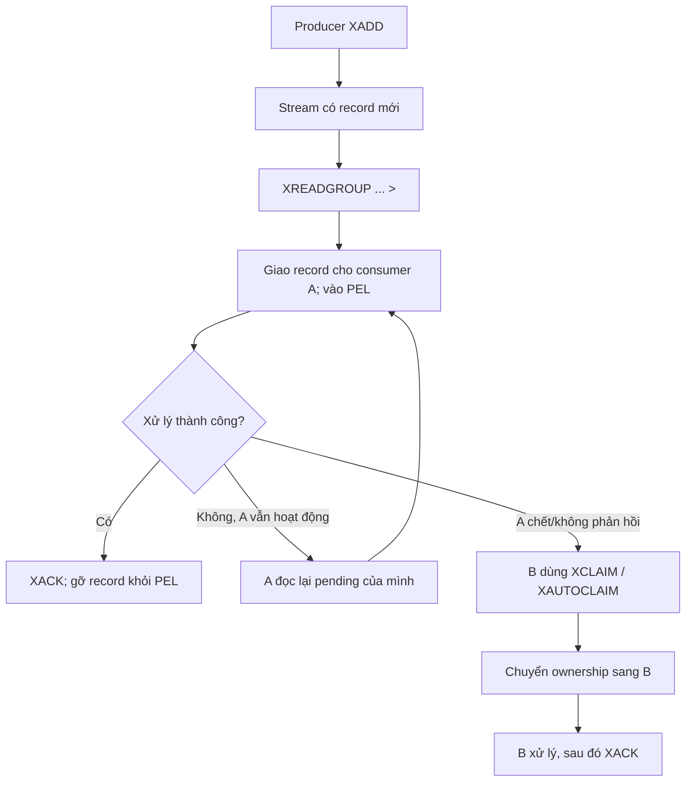
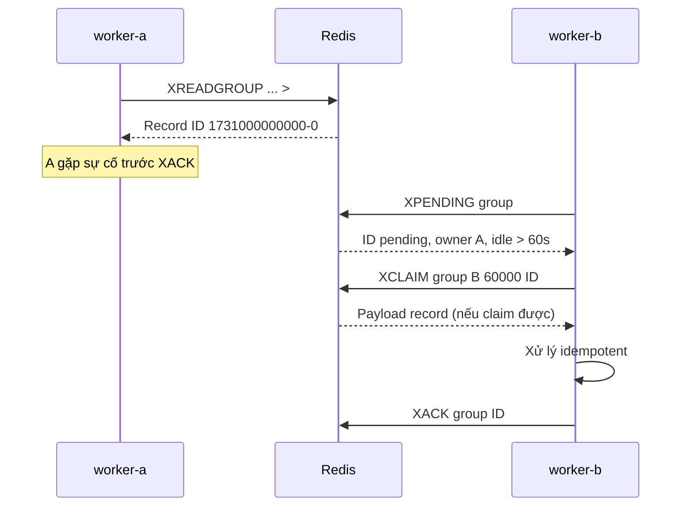

# Đọc lại bản ghi đang chờ và chuyển quyền xử lý bản ghi bị bỏ dở

Trong **Redis Streams**, một bản ghi được consumer group giao cho consumer chưa có nghĩa là công việc đã hoàn tất. Khi consumer đọc bằng `XREADGROUP`, Redis có thể đưa bản ghi vào **Pending Entries List (PEL)**. Bản ghi chỉ được xóa khỏi trạng thái pending của group sau khi consumer xác nhận bằng `XACK` hoặc một cơ chế kết thúc khác được thiết kế rõ ràng.

Nếu tiến trình gặp lỗi sau khi nhận bản ghi nhưng trước khi xác nhận, bản ghi trở thành công việc **đang chờ xử lý**. Spring Data Redis cung cấp API để đọc lại pending record; Redis còn có các lệnh `XPENDING`, `XCLAIM` và `XAUTOCLAIM` giúp một consumer khác tiếp quản bản ghi mà consumer cũ đã bỏ dở.

**Nguyên tắc quan trọng:** tiếp quản chỉ là thay đổi **quyền sở hữu bản ghi trong consumer group**. Nó không hoàn tác tác dụng phụ mà consumer cũ có thể đã thực hiện. Mọi handler có tác dụng phụ cần chịu được việc một sự kiện bị xử lý nhiều lần.

## 1. Bản ghi chuyển từ mới sang pending như thế nào?

Giả sử producer ghi một sự kiện:

```redis
XADD orders:events * eventId evt-101 orderId O-101 type OrderCreated
```

Ta tạo consumer group:

```redis
XGROUP CREATE orders:events order-workers 0 MKSTREAM
```

`0` nghĩa là group bắt đầu trước những bản ghi đã có; các bản ghi cũ có thể được phân phối. Nếu dùng `$` khi tạo group, group thường chỉ nhận bản ghi mới được thêm sau thời điểm tạo. Nếu group đã tồn tại, `XGROUP CREATE` trả `BUSYGROUP`; không nên coi đây là lý do xóa group đang hoạt động.

Worker `worker-a` đọc bản ghi mới:

```redis
XREADGROUP GROUP order-workers worker-a COUNT 10 STREAMS orders:events >
```

`>` yêu cầu các bản ghi **chưa từng được phân phối cho consumer nào trong group**. Sau lần đọc bình thường (không dùng `NOACK`), Redis theo dõi record trong PEL:

```text
Stream: orders:events
  id=1731000000000-0  eventId=evt-101
                |
                v
Consumer group: order-workers
  PEL
    id=1731000000000-0
    owner=worker-a
    deliveryCount=1
    idleTime=thời gian từ lần giao gần nhất
```

Nếu `worker-a` xử lý xong:

```redis
XACK orders:events order-workers 1731000000000-0
```

PEL không còn theo dõi ID đó cho group. **`XACK` không xóa bản ghi khỏi chính stream**; việc lưu trữ, trim hoặc xóa stream được quản lý riêng.

## 2. Hiểu Pending Entries List (PEL)

PEL là tập metadata Redis duy trì cho **từng consumer group**, ghi nhận các bản ghi đã giao nhưng chưa được acknowledge. Một pending entry thường có:

| Thông tin | Ý nghĩa |
| --- | --- |
| Stream record ID | Định danh bản ghi trong stream |
| Owner consumer | Consumer hiện được group ghi nhận là đang sở hữu record |
| Idle time | Khoảng thời gian tính từ lần giao/claim gần nhất |
| Delivery count | Số lần record được giao lại theo ngữ nghĩa Redis |

Một bản ghi có thể đã có trong stream từ lâu nhưng chưa pending nếu chưa được giao cho group. Ngược lại, một record có thể còn pending sau khi tiến trình consumer sở hữu nó đã dừng.

Redis Streams quản lý **PEL của group** và **PEL theo từng consumer**. Các consumer trong cùng group không tự động thấy pending record của nhau qua cách đọc bản ghi mới (`>`).



**Không dùng `NOACK`** nếu mục tiêu là phục hồi công việc bị bỏ dở: với `NOACK`, Redis không giữ bản ghi trong PEL như luồng xác nhận thông thường.

## 3. Hai tình huống phục hồi cần phân biệt

| Tình huống | Cơ chế phù hợp | Điểm quan trọng |
| --- | --- | --- |
| `worker-a` chạy lại với **cùng consumer name** và muốn xử lý record nó đã nhận | `XREADGROUP GROUP ... worker-a STREAMS key 0` | Đọc **pending của chính `worker-a`** |
| `worker-a` mất hẳn, `worker-b` cần nhận những record của A | `XCLAIM` hoặc `XAUTOCLAIM` | Thay đổi owner trong PEL khi record đủ điều kiện idle |
| Muốn nhận các record chưa giao trước đó | `XREADGROUP ... STREAMS key >` | Đọc **bản ghi mới** của group |
| Muốn quan sát pending nhưng chưa nhận ownership | `XPENDING` | Đọc metadata, không tự chuyển quyền |

Trong thực tế, hệ thống thường kết hợp cả ba: kiểm tra pending của consumer hiện tại khi khởi động lại, tiếp quản các pending record già cỗi của worker đã chết, rồi tiếp tục nhận bản ghi mới.

## 4. Quan sát backlog với `XPENDING`

Trước khi phục hồi, cần biết group còn bao nhiêu bản ghi chưa được xác nhận.

### 4.1. Xem tổng quan

```redis
XPENDING orders:events order-workers
```

Redis trả về thông tin tổng quát, thường gồm số pending, ID nhỏ nhất/lớn nhất và thống kê số pending theo consumer. Đây là metadata chứ không phải nội dung event.

Ví dụ một kết quả mang ý nghĩa:

```text
pending total: 6
smallest ID: 1731000000000-0
largest ID:  1731000004000-0
worker-a: 5 pending
worker-b: 1 pending
```

Các số trên chỉ minh họa, không phải cú pháp nguyên văn của một response Redis CLI.

### 4.2. Liệt kê pending record

```redis
XPENDING orders:events order-workers - + 10
```

Mỗi mục trong kết quả mở rộng có thể cho biết ID, owner, idle time tính theo mili giây và số lần giao. Để xem riêng pending của một consumer:

```redis
XPENDING orders:events order-workers - + 10 worker-a
```

Ở các phiên bản Redis hỗ trợ điều kiện idle, có thể lọc những record chưa được giao lại trong ít nhất 60 giây:

```redis
XPENDING orders:events order-workers IDLE 60000 - + 10
```

`60000` là **mili giây**, không phải giây. `IDLE` trong `XPENDING` giúp quan sát và sàng lọc metadata; **nó không claim hay đánh dấu record đã xử lý**.

### 4.3. Các lệnh quan sát bổ sung

```redis
XINFO GROUPS orders:events
XINFO CONSUMERS orders:events order-workers
XLEN orders:events
```

`XINFO GROUPS` cho biết thống kê group; `XINFO CONSUMERS` giúp xem các consumer và pending count. Chỉ số `XLEN` thể hiện tổng số record hiện còn lưu trong stream, **không phải số record chưa được acknowledge**. Một stream có `XLEN` lớn không có nghĩa toàn bộ record đang pending.

## 5. Đọc lại bản ghi đang chờ của chính consumer

Redis phân biệt hai loại ID khi gọi `XREADGROUP`:

```redis
# Lấy record chưa từng được giao trong group
XREADGROUP GROUP order-workers worker-a STREAMS orders:events >

# Đọc lại các record đã pending của worker-a
XREADGROUP GROUP order-workers worker-a STREAMS orders:events 0
```

Khi ID truyền vào **khác `>`**, Redis duyệt lịch sử các bản ghi pending đã được giao cho **consumer hiện tại** và có ID lớn hơn ID được truyền. Vì vậy, `0` là điểm bắt đầu để đọc các pending record của chính consumer đó.

Ví dụ:

```redis
XREADGROUP GROUP order-workers worker-a COUNT 20 STREAMS orders:events 0
```

Nếu `worker-a` từng nhận `evt-101` nhưng chết trước `XACK`, sau khi chạy lại với **tên consumer `worker-a`**, lệnh này có thể lấy lại record đó.

**Lưu ý khi lặp:**

- Một lần gọi với `0` có thể chỉ trả một đợt pending theo `COUNT`. Nếu cần đọc nhiều đợt, dùng ID cuối đã duyệt để tiếp tục, hoặc tiếp tục từ `0` sau khi những record xử lý thành công đã được `XACK`.
- Khi xử lý thất bại mà không `XACK`, việc gọi lại ngay từ `0` có thể nhận lại cùng record nhiều lần. Cần backoff và chính sách retry có giới hạn.
- Chế độ đọc lịch sử pending không phải một lệnh `BLOCK` chờ record mới. Sau khi xử lý pending, chuyển sang đọc `>` để nhận công việc mới.
- Một consumer mới mang tên `worker-b` **không thể dùng `0` để đọc pending đang thuộc `worker-a`**. Với trường hợp này phải claim.

### 5.1. Ví dụ Spring Data Redis dùng `StringRedisTemplate`

Ví dụ sau minh họa một lượt đọc lại pending record của **cùng consumer name** rồi `XACK` sau khi handler hoàn tất. Giả định stream `orders:events` và group `order-workers` đã được tạo.

```java
package com.example.orders.stream;

import java.util.Map;
import org.springframework.data.redis.connection.stream.Consumer;
import org.springframework.data.redis.connection.stream.ReadOffset;
import org.springframework.data.redis.connection.stream.StreamOffset;
import org.springframework.data.redis.core.StreamReadOptions;
import org.springframework.data.redis.core.StringRedisTemplate;
import org.springframework.stereotype.Service;

@Service
public class OwnPendingRecoveryService {

    private static final String STREAM = "orders:events";
    private static final String GROUP = "order-workers";

    private final StringRedisTemplate redis;
    private final OrderEventHandler handler;

    public OwnPendingRecoveryService(
            StringRedisTemplate redis, OrderEventHandler handler) {
        this.redis = redis;
        this.handler = handler;
    }

    public int replayOneBatch(String consumerName) {
        Consumer consumer = Consumer.from(GROUP, consumerName);

        var records = redis.opsForStream().read(
                consumer,
                StreamReadOptions.empty().count(20),
                StreamOffset.create(STREAM, ReadOffset.from("0")));

        if (records == null || records.isEmpty()) {
            return 0;
        }

        int acknowledged = 0;
        for (var record : records) {
            // Phải xử lý idempotent; exception sẽ ngăn XACK.
            handler.handle(record.getId().getValue(), record.getValue());

            Long ack = redis.opsForStream()
                    .acknowledge(STREAM, GROUP, record.getId());
            if (ack != null && ack == 1L) {
                acknowledged++;
            }
        }

        return acknowledged;
    }

    public interface OrderEventHandler {
        void handle(String recordId, Map<?, ?> fields);
    }
}
```

`OrderEventHandler` trong ví dụ là hợp đồng ứng dụng cần có implementation/bean tương ứng. Có thể dùng các field như `eventId`, `orderId` và `type` để xử lý nghiệp vụ, đồng thời kiểm tra idempotency bằng `eventId`.

Code chỉ đọc **một batch** để tránh vòng lặp không kiểm soát khi handler liên tục thất bại. Trong một job thực tế, có thể lập lịch chạy nhiều batch, tăng thời gian nghỉ giữa các lần thất bại và đo số pending trước/sau. `XACK` chỉ được gọi sau khi phần xử lý được xác nhận hoàn tất.

Khi ứng dụng triển khai nhiều instance, cần chọn cách đặt `consumerName` có ý nghĩa. Nếu instance khởi động lại với tên mới, pending cũ dưới tên consumer trước đó sẽ phải được tiếp quản bằng `XCLAIM`/`XAUTOCLAIM`.

## 6. Chuyển quyền bằng `XCLAIM`

`XCLAIM` phù hợp khi đã biết **ID cụ thể** của pending record cần chuyển:

```redis
XCLAIM orders:events order-workers worker-b 60000 1731000000000-0
```

Các tham số:

| Tham số | Ý nghĩa |
| --- | --- |
| `orders:events` | Stream chứa record |
| `order-workers` | Consumer group sở hữu PEL |
| `worker-b` | Consumer sẽ trở thành owner mới |
| `60000` | Thời gian idle tối thiểu, tính bằng mili giây |
| `1731000000000-0` | ID record muốn tiếp quản |

Redis chỉ claim nếu record thực sự đang pending trong group và đáp ứng điều kiện thời gian chờ (trừ các biến thể tùy chọn đặc biệt có ngữ nghĩa riêng). Sau khi claim thành công, bản ghi thuộc PEL của `worker-b` và không còn thuộc PEL riêng của `worker-a`.



Một quy trình với `XCLAIM` thường là:

1. `XPENDING` tìm các record đã chờ quá ngưỡng.
2. Chọn các ID ứng viên.
3. `XCLAIM` với `min-idle-time`.
4. Chỉ xử lý **những record thực sự được trả về sau khi claim thành công**.
5. `XACK` sau khi nghiệp vụ hoàn tất.

Giữa lúc `XPENDING` và `XCLAIM`, record có thể đã được consumer khác xử lý hoặc claim. Vì vậy kết quả của `XPENDING` chỉ là danh sách ứng viên, còn kết quả `XCLAIM` mới xác nhận bản ghi nào đã được chuyển cho worker hiện tại.

Redis còn có các tùy chọn nâng cao như `IDLE`, `TIME`, `RETRYCOUNT`, `FORCE`, `JUSTID`. Không dùng `FORCE` để ép tạo pending entry hay đặt lại `RETRYCOUNT` trừ khi hiểu rõ tác động: chúng thay đổi ngữ nghĩa bình thường của cơ chế retry và theo dõi delivery count.

## 7. Chuyển quyền tự động bằng `XAUTOCLAIM`

Nếu số lượng pending lớn, việc gọi `XPENDING` để liệt kê ID rồi `XCLAIM` từng nhóm khá tốn công. Redis **6.2 trở lên** hỗ trợ `XAUTOCLAIM`, vừa quét PEL vừa claim các record đủ thời gian idle:

```redis
XAUTOCLAIM orders:events order-workers worker-b 60000 0-0 COUNT 25
```

Ý nghĩa:

- `worker-b` là consumer nhận ownership.
- `60000` yêu cầu record có **idle tối thiểu 60 giây**.
- `0-0` là cursor bắt đầu quét PEL.
- `COUNT 25` là số record tối đa được yêu cầu trả về trong một lần.

Kết quả thông thường gồm:

1. **Cursor để tiếp tục quét PEL**.
2. **Những record đã claim**, có ID và field/value.
3. Trên Redis **7.0 trở lên**, có thêm danh sách ID pending mà entry gốc không còn trong stream và đã được dọn khỏi PEL.

Ví dụ luồng:

```text
XAUTOCLAIM ... 60000 0-0 COUNT 25
  -> nextCursor = 1731000010000-0
  -> claimed = [record A, record B]

XAUTOCLAIM ... 60000 1731000010000-0 COUNT 25
  -> nextCursor = 0-0
  -> claimed = [record C]
```

Cursor trả về `0-0` nghĩa là **lượt quét hiện tại đã đến cuối PEL**, không có nghĩa vĩnh viễn không còn pending. Những record chưa đủ 60 giây idle lúc quét có thể trở thành ứng viên trong lượt kiểm tra tiếp theo.

Một đặc điểm quan trọng: Redis chỉ quét một số mục pending nhất định cho mỗi lần `XAUTOCLAIM` (liên quan đến `COUNT`), nên có thể trả về **ít hoặc không có record** nhưng cursor vẫn khác `0-0`. Không dừng chỉ vì danh sách claimed rỗng; hãy dùng cursor để quyết định đã quét hết lượt.

### 7.1. Quy trình phục hồi bằng Redis CLI

```redis
# Xem backlog trước khi claim
XPENDING orders:events order-workers

# Claim những record idle ít nhất 60s
XAUTOCLAIM orders:events order-workers worker-b 60000 0-0 COUNT 25

# Sau khi xử lý thành công từng ID đã được trả về
XACK orders:events order-workers 1731000000000-0

# Quan sát lại
XPENDING orders:events order-workers
```

Thay record ID minh họa bằng ID thực tế trả về từ `XAUTOCLAIM`. Với nhiều batch, lặp bằng cursor Redis trả ra; sau khi cursor `0-0`, kết thúc vòng quét và kiểm tra lại theo lịch nếu cần.

### 7.2. Trong Spring Data Redis

Spring Data Redis cung cấp `StreamOperations` và các thành phần Redis connection để làm việc với pending, claim và auto-claim. API `StreamOperations.claim(...)`, các overload liên quan đến pending và `autoClaim(...)` có hình dạng tham số/kết quả thay đổi giữa các dòng thư viện.

Ở mức sử dụng thông thường:

```java
var ops = stringRedisTemplate.opsForStream();

// Liệt kê/thống kê pending của group bằng ops.pending(...).
// Claim những RecordId cụ thể bằng ops.claim(...).
// Với phiên bản hỗ trợ, dùng ops.autoClaim(...) và duyệt cursor
// trả về cho đến khi hoàn thành một lượt quét.
```

Khi viết code thực tế cho `autoClaim`, dùng đúng signature và kiểu `AutoClaimedRecords`/offset của **phiên bản Spring Data Redis đang có trong dự án**, vì lớp API này đã được mở rộng theo các phiên bản Redis hỗ trợ `XAUTOCLAIM`. Cách xử lý về mặt nghiệp vụ không thay đổi: chỉ xử lý record đã claim thành công, acknowledge sau khi xử lý và lưu lại trạng thái retry bền vững nếu cần.

Trong các ứng dụng dùng Redis cũ không có `XAUTOCLAIM`, có thể triển khai vòng **`XPENDING` → `XCLAIM`**. Không nên tự phát lệnh `XAUTOCLAIM` lên server Redis chưa hỗ trợ.

## 8. Bao lâu thì một record được xem là bỏ dở?

`min-idle-time` là ngưỡng xác định record đã bao lâu **không được giao lại**, chứ không phải bằng chứng chắc chắn consumer cũ đã chết. Một worker có thể vẫn đang xử lý một tác vụ lâu.

Ví dụ:

```text
12:00:00  worker-a nhận record
12:00:30  worker-a đang gọi dịch vụ ngoài, chưa XACK
12:01:00  worker-b thấy idle >= 60s và XAUTOCLAIM
12:01:01  worker-a vẫn đang chạy, chưa biết đã mất ownership
12:01:02  worker-a và worker-b có thể cùng tạo side effect
```

Do đó, chọn ngưỡng idle nên dựa trên:

| Yếu tố | Hệ quả khi chọn ngưỡng quá thấp |
| --- | --- |
| Thời gian xử lý p95/p99 | Record còn đang xử lý đã bị claim |
| Timeout của API bên ngoài | Worker đang chờ nhưng chưa chết |
| GC pause hoặc thread starvation | Redis thấy idle lâu dù tiến trình còn sống |
| Độ trễ Redis/network | Claim chồng lấn do worker chậm |
| Kích thước batch và số worker | Nhiều bản ghi chờ tới lượt xử lý trong batch |

Một ngưỡng 60 giây có thể phù hợp với công việc nhanh, nhưng không phù hợp nếu xử lý thông thường kéo dài 2–3 phút. Hãy cấu hình ngưỡng theo đặc điểm tác vụ, không sao chép cố định cho mọi stream.

**Redis PEL không phải một lease có fencing token.** Việc record chuyển sang owner mới không ngăn một worker cũ đã nhận payload tiếp tục thực hiện thao tác bên ngoài Redis. Với tác vụ cần chặn hoàn toàn xử lý cũ, cần thêm cơ chế version/fencing hoặc giao dịch/idempotency tại đích.

## 9. Delivery count, retry và poison message

PEL còn theo dõi **delivery count**. Mỗi lần bản ghi được đọc lại hoặc claim bằng đường đi thông thường, số lần giao có thể tăng. Đây là tín hiệu hữu ích để phát hiện record xử lý thất bại nhiều lần.

Ví dụ dùng `XPENDING` dạng mở rộng:

```redis
XPENDING orders:events order-workers - + 20
```

Từ đó, ứng dụng có thể áp dụng chính sách:

| Số lần giao / lỗi | Hướng xử lý |
| --- | --- |
| Lần đầu | Xử lý bình thường |
| Lỗi tạm thời, số lần còn ít | Giữ pending; retry/backoff khi đủ idle |
| Liên tục lỗi do dữ liệu không hợp lệ | Không retry nóng; chuyển sang luồng điều tra/dead-letter |
| Vượt số lần cho phép | Ghi nhận lỗi bền vững, quyết định chuyển DLQ hoặc can thiệp thủ công |

`deliveryCount` không hoàn toàn tương đương “số lần handler thật sự tạo tác dụng phụ”: worker có thể nhận nhưng chết trước khi chạy, hoặc chạy xong mà không kịp `XACK`.

### 9.1. Dead-letter stream

Một cách xử lý record không thể phục hồi là ghi thông tin sang stream riêng:

```redis
XADD orders:dead-letter * originalId 1731000000000-0 eventId evt-101 reason invalid-payload
```

Chỉ sau khi luồng chuyển bản ghi lỗi được xác nhận theo hợp đồng ứng dụng mới quyết định `XACK` bản gốc. Hai lệnh `XADD` dead-letter và `XACK` **không mặc nhiên nguyên tử** khi ứng dụng gọi riêng: crash giữa chúng có thể tạo duplicate dead-letter hoặc mất dấu trạng thái. Nếu cần bảo đảm chặt, sử dụng thiết kế nguyên tử/idempotency phù hợp, chú ý giới hạn cùng hash slot khi dùng Redis Cluster.

Không `XACK` hàng loạt mọi pending chỉ để backlog về 0. Điều đó làm mất khả năng retry qua consumer group với các record chưa thực sự được xử lý.

## 10. Tại sao handler phải idempotent?

Redis Streams consumer group thường được dùng với mô hình **at-least-once**. Nếu handler xử lý thành công nhưng tiến trình chết trước `XACK`, record vẫn pending và sẽ được xử lý lại:

```mermaid
sequenceDiagram
    participant R as Redis Stream
    participant A as worker-a
    participant DB as Database
    participant B as worker-b
    R-->>A: Record eventId=evt-101
    A->>DB: Tạo trạng thái đơn hàng
    DB-->>A: Commit thành công
    Note over A: A chết trước XACK
    B->>R: XAUTOCLAIM sau idle timeout
    R-->>B: Cùng eventId=evt-101
    B->>DB: Kiểm tra evt-101 đã xử lý?
    DB-->>B: Đã có; bỏ qua side effect
    B->>R: XACK record ID
```

Một cơ chế phổ biến là đặt unique constraint trên `(consumerGroup, eventId)` hoặc một ID nghiệp vụ ổn định ở hệ thống đích. Khi xử lý:

1. Bắt đầu transaction dữ liệu đích (nếu hệ thống hỗ trợ).
2. Kiểm tra/ghi nhận `eventId` như một thao tác có tính duy nhất.
3. Thực hiện cập nhật nghiệp vụ **trong cùng transaction**.
4. Commit transaction đích.
5. Gửi `XACK` cho Redis.

Nếu `XACK` thất bại, record có thể được giao lại; lần sau thấy `eventId` đã xử lý và có thể acknowledge sau khi xác minh. Nếu ghi dấu xử lý và side effect nằm ở hai hệ thống khác nhau, vẫn cần một thiết kế nhất quán phù hợp, không chỉ thêm một `Set` tạm trong bộ nhớ.

**Record ID** là ID trong Redis Stream, còn **eventId** là định danh sự kiện nghiệp vụ. Producer có thể vô tình gửi hai record với hai Record ID khác nhau nhưng cùng eventId, nên dedup theo eventId thường có giá trị rộng hơn chỉ theo Record ID.

## 11. Bản ghi bị trim hoặc xóa khi vẫn pending

Redis Stream có thể bị cắt bớt bằng `XTRIM`, `XADD MAXLEN` hoặc một cơ chế retention. Một entry đã được group giao nhưng chưa `XACK` **vẫn có thể bị xóa khỏi stream** nếu chính sách retention không bảo vệ nó.

Khi đó:

- Metadata trong PEL có thể vẫn tồn tại một thời gian dù payload gốc đã biến mất.
- `XREADGROUP` đọc lại lịch sử pending có thể không còn đầy đủ payload như trước.
- `XAUTOCLAIM` trên Redis 7.0 trở lên có thể loại bỏ những PEL entry không còn bản ghi trong stream, đồng thời trả danh sách ID đã bị dọn.
- Không thể khôi phục nội dung sự kiện chỉ từ ID và metadata PEL nếu dữ liệu stream đã thực sự bị xóa.

Do vậy, cần chọn retention dựa trên thời gian consumer có thể ngừng hoạt động và lượng backlog lớn nhất. Nếu công việc phải tồn tại lâu hơn thời gian giữ record trong Redis, hãy lưu payload vào kho bền vững phù hợp hoặc sử dụng cơ chế retention bảo vệ các entry chưa được xử lý theo khả năng của phiên bản Redis.

`XACK` và xóa record khỏi stream là hai hành động khác nhau. **Giảm PEL bằng `XACK` không có nghĩa xóa dữ liệu lịch sử**, và **trim stream không có nghĩa các consumer đã hoàn thành xử lý**.

## 12. Vòng đời khởi động và phục hồi cho nhiều worker

Một hệ thống thực tế thường cần hai nhánh phục hồi:

### 12.1. Worker khởi động lại với cùng tên

Nếu một instance dùng consumer name cố định như `orders-node-1`, khi restart có thể:

1. Kết nối Redis, xác nhận stream/group đã được tạo theo quy trình triển khai.
2. Đọc lại pending của `orders-node-1` bằng `XREADGROUP ... 0`.
3. Xử lý từng record, `XACK` sau khi hoàn tất.
4. Khi đã duyệt hết các pending xử lý được, chuyển sang `XREADGROUP ... >` để nhận record mới.

Tên consumer cố định giúp khôi phục pending của chính consumer, nhưng chỉ phù hợp khi **không có hai instance sống đồng thời sử dụng cùng một tên**. Với autoscaling, mỗi instance thường có tên riêng; pending của instance bị loại bỏ cần một cơ chế claim chủ động.

### 12.2. Worker thay thế consumer đã mất

Đối với autoscaling hoặc worker chết hẳn:

1. Worker mới vẫn xử lý công việc mới từ `>`, theo chính sách tải hệ thống.
2. Một lịch recovery định kỳ thực hiện `XAUTOCLAIM` với ngưỡng idle phù hợp.
3. Duyệt cursor cho hết một vòng hoặc tới ngân sách mỗi lượt; xử lý từng record đã claim.
4. Acknowledge sau khi handler hoàn tất; lỗi tạm thời giữ pending để xử lý lại.
5. Theo dõi pending count, tuổi pending và số lần claim; cảnh báo khi backlog tăng.

Không cần dừng hoàn toàn việc đọc bản ghi mới để xử lý recovery nếu hệ thống có kiểm soát tải và số lượng worker phù hợp. Tuy nhiên, phải tránh tình huống recovery liên tục tranh chấp tài nguyên với luồng chính khiến backlog càng tăng.

## 13. Phân biệt reclaim với Redis Stream consumer-group lag

Các chỉ số thường bị nhầm lẫn:

| Chỉ số / trạng thái | Ý nghĩa |
| --- | --- |
| **Pending count** (`XPENDING`) | Đã giao cho consumer trong group nhưng chưa `XACK` |
| **Group lag** (`XINFO GROUPS` khi được hỗ trợ) | Số bản ghi mới còn chưa được phân phối cho group theo cách Redis tính toán |
| **Stream length** (`XLEN`) | Số record hiện còn lưu trong stream |
| **Consumer idle** (`XINFO CONSUMERS`) | Hoạt động/nhàn rỗi của consumer theo thống kê Redis; không tự chứng minh worker chết |
| **Delivery count** (XPENDING mở rộng) | Lịch sử giao/claim của pending record |

Hệ thống có thể có `lag = 0` nhưng `pending = 1000`: mọi record đã được giao, nhưng chưa xử lý xong hoặc chưa được acknowledge. Nếu chỉ nhìn lag, nhóm vận hành có thể kết luận sai rằng consumer group đã hoàn tất toàn bộ công việc.

Ngược lại, pending thấp nhưng lag cao cho thấy group chưa kịp nhận record mới. Hai tình huống cần cách xử lý khác nhau: tăng năng lực tiêu thụ bản ghi mới và giải quyết pending backlog không phải cùng một việc.

## 14. Những lỗi thường gặp

### Lỗi 1: Dùng `>` để mong đọc lại pending

```redis
XREADGROUP GROUP order-workers worker-a STREAMS orders:events >
```

`>` dành cho record chưa giao trong group. Muốn đọc lại pending thuộc chính `worker-a`, dùng ID lịch sử như `0`. Muốn lấy pending của `worker-b` về `worker-a`, phải claim.

### Lỗi 2: Tạo consumer name mới ở mỗi lần restart nhưng chỉ đọc pending bằng `0`

Một consumer mới chưa có pending của chính nó, nên lệnh `XREADGROUP ... 0` có thể rỗng dù `XPENDING` báo còn hàng nghìn record thuộc tên consumer cũ. Dùng `XAUTOCLAIM` hoặc `XCLAIM` để chuyển ownership.

### Lỗi 3: XACK trước khi nghiệp vụ hoàn tất

Nếu ACK trước rồi xử lý lỗi, record không còn trong PEL để được giao lại qua group. Luôn xác định ranh giới hoàn tất nghiệp vụ trước khi ACK. Nếu cần tiếp tục nhiều bước, hãy dùng trạng thái bền vững và retry ở tầng phù hợp.

### Lỗi 4: Coi `XPENDING` là thao tác claim

`XPENDING` chỉ đọc metadata. Hai worker có thể cùng nhìn thấy một ID trong pending summary; chỉ kết quả `XCLAIM`/`XAUTOCLAIM` mới xác nhận ownership đã chuyển.

### Lỗi 5: Chọn `min-idle-time` thấp hơn thời gian xử lý thường lệ

Nếu công việc mất 120 giây nhưng worker khác claim sau 30 giây, hai tiến trình có thể cùng xử lý. Tăng ngưỡng, cải thiện thời gian xử lý hoặc thêm version/fencing ở hệ thống đích tùy yêu cầu nghiệp vụ.

### Lỗi 6: Dừng XAUTOCLAIM ngay khi trả danh sách rỗng

Một batch không có record đủ idle không có nghĩa đã đến cuối PEL. Dùng **cursor** trả về; chỉ khi cursor là `0-0` mới kết thúc một lượt quét.

### Lỗi 7: Retry độc hại vô hạn

Một record có payload không hợp lệ có thể được claim liên tục và gây lỗi mãi. Dùng giới hạn lần giao, backoff, DLQ/quy trình điều tra và cảnh báo phù hợp; tránh vòng lặp nóng làm quá tải Redis.

### Lỗi 8: Lấy delivery count làm bằng chứng đã xử lý N lần

Delivery count là số lượt giao được Redis ghi nhận, không phải số lần tác dụng phụ nghiệp vụ đã xảy ra. Khi cần audit, lưu dấu xử lý trong hệ thống nghiệp vụ.

### Lỗi 9: Xóa consumer hoặc group để “dọn pending”

Các lệnh quản trị như `XGROUP DELCONSUMER` và `XGROUP DESTROY` có thể ảnh hưởng tới trạng thái pending và khả năng recovery. Không sử dụng như cách làm sạch backlog mặc định khi vẫn còn công việc chưa hoàn tất; phải đánh giá dữ liệu và ownership trước.

### Lỗi 10: Trộn pending replay với đọc mới trên cùng offset

`0` và `>` là hai chế độ đọc khác nhau. Xác định rõ job đang phục hồi pending của chính consumer hay nhận event mới, tránh một vòng lặp vừa không tiêu thụ hết pending vừa bỏ đói luồng đọc mới.

## 15. Một quy trình vận hành có thể áp dụng

| Bước | Lệnh / API | Kết quả mong đợi |
| --- | --- | --- |
| 1. Quan sát group | `XINFO GROUPS`, `XPENDING` | Biết lag, số pending và consumer sở hữu |
| 2. Khôi phục chính consumer | `XREADGROUP ... STREAMS key 0` | Nhận các record pending cũ của cùng consumer |
| 3. Phát hiện công việc bỏ dở | `XPENDING ... IDLE ...` | Tìm các record lâu không được giao lại |
| 4. Tiếp quản | `XCLAIM` hoặc `XAUTOCLAIM` | Record được chuyển sang consumer đang nhận |
| 5. Xử lý idempotent | Handler với `eventId`/transaction đích | Không lặp tác dụng phụ khi cùng event được giao lại |
| 6. Acknowledge | `XACK stream group id` | Gỡ pending entry khỏi consumer group |
| 7. Theo dõi | XPENDING, tuổi pending, delivery count | Phát hiện backlog, poison message, recovery chậm |

### Lệnh Redis CLI tổng hợp

```redis
# Tạo stream/group và gửi dữ liệu minh họa
XGROUP CREATE lesson:orders lesson-group 0 MKSTREAM
XADD lesson:orders * eventId evt-1 type OrderCreated orderId O-1

# Consumer A nhận record mới, nhưng chưa ACK
XREADGROUP GROUP lesson-group consumer-a COUNT 1 STREAMS lesson:orders >
XPENDING lesson:orders lesson-group

# A khởi động lại, đọc pending của chính mình
XREADGROUP GROUP lesson-group consumer-a COUNT 10 STREAMS lesson:orders 0

# Hoặc B claim record của A nếu đã idle đủ thời gian
XPENDING lesson:orders lesson-group - + 10
XAUTOCLAIM lesson:orders lesson-group consumer-b 60000 0-0 COUNT 10

# Sau khi consumer xử lý thành công, ACK theo ID thực tế
XACK lesson:orders lesson-group 1731000000000-0
XPENDING lesson:orders lesson-group
```

Đoạn trên là quy trình minh họa. Thay ID cuối bằng `RecordId` thực tế, và chỉ gọi `XACK` ở consumer đã xử lý hoàn tất. Với lệnh `XAUTOCLAIM ... 60000`, record phải thực sự idle ít nhất 60 giây; thực hiện ngay sau khi đọc có thể không claim được record nào.

## 16. Tổng kết

Trong Redis Streams, **PEL** ghi nhận các record đã giao cho consumer group nhưng chưa được `XACK`. Khi consumer chạy lại với **cùng tên**, dùng `XREADGROUP ... 0` để đọc lại pending của chính nó. Khi một consumer khác phải tiếp quản, dùng `XPENDING` để quan sát và `XCLAIM` hoặc `XAUTOCLAIM` để chuyển ownership các record đã chờ đủ lâu.

`XAUTOCLAIM` phù hợp khi phải quét nhiều pending ID và cần cursor để phân trang; `XCLAIM` phù hợp khi đã biết các ID cụ thể. **Chỉ ACK sau khi xử lý thành công**, chọn ngưỡng idle dựa trên thời gian xử lý, theo dõi retry/poison message và thiết kế handler idempotent. Ownership trong PEL không chặn worker cũ tiếp tục tạo side effect, nên các nghiệp vụ quan trọng vẫn cần kiểm soát trùng lặp tại hệ thống đích.

### Tài liệu tham khảo

- [Redis — XREADGROUP](https://redis.io/docs/latest/commands/xreadgroup/): đọc record mới và đọc lại lịch sử pending của consumer.
- [Redis — XPENDING](https://redis.io/docs/latest/commands/xpending/): quan sát PEL, owner, idle time và delivery count.
- [Redis — XCLAIM](https://redis.io/docs/latest/commands/xclaim/): chuyển ownership record pending theo ID.
- [Redis — XAUTOCLAIM](https://redis.io/docs/latest/commands/xautoclaim/): tự quét và chuyển ownership dựa trên idle time, cursor.
- [Redis — XACK](https://redis.io/docs/latest/commands/xack/): xác nhận hoàn tất và gỡ record khỏi PEL.
- [Spring Data Redis — Redis Streams](https://docs.spring.io/spring-data/redis/reference/redis/redis-streams.html): consumer group, đọc pending và API `StreamOperations`.
- [Spring Data Redis — StreamOperations API](https://docs.spring.io/spring-data/redis/reference/api/java/org/springframework/data/redis/core/StreamOperations.html): các phương thức đọc, pending, claim, auto-claim và acknowledge.
