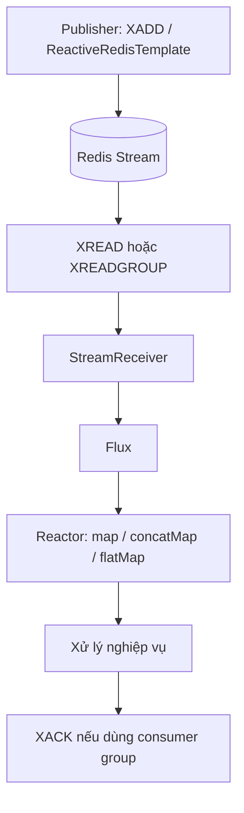
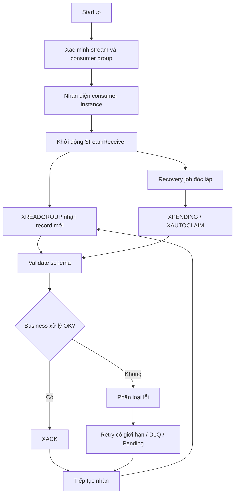

# Sử dụng StreamReceiver trong luồng phản ứng với Spring Data Redis

## 1. Bài toán: xử lý Redis Streams mà không tự quản lý vòng lặp polling

Giả sử dịch vụ bán hàng ghi một sự kiện vào Redis Stream mỗi khi một đơn hàng mới xuất hiện:

```redis
XADD orders.events * eventType ORDER_CREATED orderId o-101
XADD orders.events * eventType ORDER_CREATED orderId o-102
```

Một dịch vụ khác cần nhận các sự kiện, xử lý bất đồng bộ, và chỉ xác nhận (*acknowledge*) sau khi nghiệp vụ thành công. Với cách tiếp cận imperative, lập trình viên có thể tự viết vòng lặp `XREAD` hoặc `XREADGROUP`, quản lý kết nối, thời gian chờ, luồng xử lý, cơ chế dừng và lỗi mạng.

Spring Data Redis cung cấp **`StreamReceiver`** để tiêu thụ Redis Streams theo kiểu **Reactor `Flux`**. Thay vì tự điều khiển một vòng lặp vô hạn, ứng dụng đăng ký nhận một luồng các `Record`; framework phối hợp các lần đọc từ Redis với nhu cầu tiêu thụ ở phía downstream.

```java
Flux<MapRecord<String, String, String>> events =
    receiver.receive(StreamOffset.fromStart("orders.events"));
```

Khi được subscribe, `events` có thể phát từng bản ghi của stream, và ứng dụng sử dụng các toán tử Reactor để chuyển đổi, lọc, xử lý lỗi hoặc kết hợp với các nguồn bất đồng bộ khác.

Tuy nhiên, một `Flux` nhận record **không tự bảo đảm xử lý chính xác một lần**. Cần hiểu rõ:

- `receive(...)` đọc theo offset nào?
- Đọc trực tiếp bằng `XREAD` khác gì đọc qua consumer group bằng `XREADGROUP`?
- Khi nào nên gọi `XACK`, khi nào không nên dùng `receiveAutoAck(...)`?
- Backpressure, subscription, cancellation và polling tương tác thế nào?
- Nếu tiến trình dừng giữa chừng, các record đang pending được phục hồi ra sao?

Bài này tập trung đúng các vấn đề trên trong ngữ cảnh **Spring Data Redis / Redis Streams**.

## 2. Redis Stream là gì?

Redis Stream lưu một chuỗi các **entry có ID tăng theo thứ tự**, mỗi entry chứa một tập cặp field/value. Ví dụ:

```redis
XADD orders.events * eventType ORDER_CREATED orderId o-101
XADD orders.events * eventType ORDER_PAID orderId o-101
```

Redis tạo ID có dạng tương tự:

```text
1750000000000-0
1750000000001-0
```

Các số trên chỉ minh họa định dạng. ID thực tế phụ thuộc thời điểm và sequence do Redis tạo. Khác với Redis Pub/Sub:

- Stream **giữ lại các entry** cho tới khi bị xóa, trim hoặc chịu các chính sách hạ tầng liên quan.
- Consumer có thể bắt đầu đọc từ một ID đã biết.
- Consumer group cho phép phân phối công việc giữa nhiều consumer và theo dõi pending entries.
- Stream hỗ trợ `XACK` để ghi nhận entry đã được xử lý ở mức consumer group.

Vì vậy, Stream phù hợp hơn Pub/Sub khi ứng dụng cần đọc lại backlog hoặc quản lý công việc đang chờ. Dù vậy, khả năng lưu lại entry **không tương đương bảo đảm không mất dữ liệu trong mọi sự cố**: cần xét cấu hình persistence, replication, trimming, retention và retry.

### 2.1. Các khái niệm nền

| Khái niệm | Ý nghĩa |
|---|---|
| **Stream key** | Key Redis chứa các entry, ví dụ `orders.events` |
| **Record** | Entry có `RecordId` và body các field/value |
| **Stream ID** | Mốc để xác định vị trí đọc, thường dạng `milliseconds-sequence` |
| **Consumer group** | Nhóm nhận công việc; cùng group chia sẻ tiến độ giao nhận |
| **Consumer name** | Định danh một consumer bên trong group |
| **PEL** (*Pending Entries List*) | Danh sách entry đã giao cho consumer nhưng chưa được `XACK` |
| **Read offset** | Quy tắc cho Redis biết cần đọc bắt đầu từ đâu |
| **Acknowledgment** | `XACK` xác nhận entry đối với một group; **không xóa entry khỏi stream** |

Điểm quan trọng: **Redis giữ dữ liệu stream và trạng thái pending của group ở hai khía cạnh khác nhau**. Một entry đã được ACK vẫn có thể tiếp tục tồn tại trong stream cho đến khi chính sách lưu giữ loại bỏ nó.

## 3. StreamReceiver nằm ở đâu trong Spring Data Redis?

Spring Data Redis có hai phong cách tiếp nhận Redis Streams:

1. **Imperative:** `StreamMessageListenerContainer` quản lý listener callback và thường dispatch đến method `onMessage`.
2. **Reactive:** `StreamReceiver` tạo một `Flux` và phù hợp với ứng dụng Reactor/WebFlux cần kết hợp các toán tử xử lý bất đồng bộ.



Trong mô hình này:

- `StreamReceiver` không phải một broker riêng. Nó là một tầng của Spring Data Redis để tạo và điều phối quá trình đọc.
- `Flux` biểu diễn luồng bản ghi và hỗ trợ điều phối theo nhu cầu downstream.
- Hành vi ghi nhận hoàn tất nghiệp vụ là một phần **do ứng dụng lựa chọn**, không mặc nhiên đồng nhất với việc record được emit.

### 3.1. Các class/API thường gặp

| API | Công dụng |
|---|---|
| `StreamReceiver<K, V>` | Receiver reactive phát các record từ Redis Stream |
| `StreamReceiver.StreamReceiverOptions` | Cấu hình cách receiver poll và chuyển đổi record |
| `StreamOffset<K>` | Gắn tên stream với offset cần đọc |
| `ReadOffset` | Chọn ID cụ thể, điểm mới nhất hoặc điểm cuối đã tiêu thụ |
| `Consumer.from(group, name)` | Xác định consumer thuộc consumer group |
| `MapRecord<K, HK, HV>` | Record có body dạng Map các field/value |
| `ObjectRecord<K, V>` | Record có nội dung được mapping thành object |
| `ReactiveRedisTemplate` | Ghi và quản lý stream/consumer group qua API reactive |
| `ReactiveStreamOperations` | API xử lý stream, bao gồm `add` và `acknowledge` |

Các type generic và tên overload có thể khác theo dòng Spring Data Redis. Khi xây dựng dự án thật, dùng API của phiên bản đang khai báo trong dependency để đối chiếu.

## 4. Chuẩn bị môi trường Spring Boot và Redis

Ví dụ dùng Spring Boot 3.x, Spring Data Redis và driver Lettuce, vốn hỗ trợ kết nối Redis reactive.

```groovy
dependencies {
    implementation 'org.springframework.boot:spring-boot-starter-data-redis-reactive'
    implementation 'org.springframework.boot:spring-boot-starter-webflux'
}
```

Nếu ứng dụng không sử dụng WebFlux controller, vẫn có thể dùng Reactor/Reactive Redis API mà không nhất thiết cần triển khai endpoint web reactive. Phần starter WebFlux ở đây giúp minh họa một ứng dụng sử dụng Reactor hoàn chỉnh.

Cấu hình kết nối Redis local:

```yaml
spring:
  data:
    redis:
      host: localhost
      port: 6379
```

Ứng dụng có thể inject `ReactiveRedisConnectionFactory` và `ReactiveStringRedisTemplate` khi auto-configuration phù hợp.

### 4.1. Tạo stream dữ liệu thử

Trong `redis-cli`:

```redis
XADD orders.events * eventType ORDER_CREATED orderId o-101
XADD orders.events * eventType ORDER_CREATED orderId o-102
XADD orders.events * eventType ORDER_PAID orderId o-101
XLEN orders.events
XRANGE orders.events - +
```

`XLEN` trả về số entry đang nằm trong stream. `XRANGE` dùng để quan sát dữ liệu và ID đã tạo. Khi triển khai production, hạn chế đọc toàn bộ stream lớn; dùng phạm vi ID, count hoặc chính sách retention phù hợp.

## 5. Cấu hình StreamReceiver tối thiểu

Với các record có field và value dạng chuỗi, có thể dùng `MapRecord<String, String, String>`:

```java
import java.time.Duration;

import org.springframework.context.annotation.Bean;
import org.springframework.context.annotation.Configuration;
import org.springframework.data.redis.connection.ReactiveRedisConnectionFactory;
import org.springframework.data.redis.connection.stream.MapRecord;
import org.springframework.data.redis.stream.StreamReceiver;
import org.springframework.data.redis.stream.StreamReceiver.StreamReceiverOptions;

@Configuration
public class RedisStreamReceiverConfig {

    @Bean
    StreamReceiver<String, MapRecord<String, String, String>>
    orderStreamReceiver(ReactiveRedisConnectionFactory connectionFactory) {

        StreamReceiverOptions<String, MapRecord<String, String, String>> options =
            StreamReceiverOptions.<String, MapRecord<String, String, String>>builder()
                .pollTimeout(Duration.ofSeconds(2))
                .batchSize(50)
                .build();

        return StreamReceiver.create(connectionFactory, options);
    }
}
```

Ở một số dòng Spring Data Redis, các overload builder có thể suy luận generic từ biến mục tiêu. Đoạn ví dụ khai báo generic tường minh để thể hiện kiểu record mong muốn.

Giải thích:

- `connectionFactory` cho phép receiver sử dụng kết nối Redis reactive.
- `pollTimeout(Duration.ofSeconds(2))` giới hạn khoảng chờ một lần đọc blocking-style ở Redis cho tới khi có dữ liệu.
- `batchSize(50)` đặt số record tối đa được yêu cầu cho mỗi lần poll, không có nghĩa lúc nào cũng trả đủ 50.
- `StreamReceiver.create(...)` tạo receiver; việc đọc thực sự xảy ra khi `Flux` được subscribe.

**Không hiểu `pollTimeout` là thời gian hết hạn của record hoặc timeout toàn bộ nghiệp vụ.** Nó liên quan đến cách đợi Redis trả dữ liệu mới trong một vòng đọc.

### 5.1. Có nhất thiết phải tạo receiver dưới dạng bean?

Không. Có thể gọi `StreamReceiver.create(...)` trong nơi khác được quản lý bởi Spring. Nhưng với ứng dụng có nhiều component đọc cùng loại stream, khai báo receiver qua cấu hình giúp:

- Dùng lại connection factory và options.
- Dễ thay đổi `pollTimeout`, `batchSize` theo môi trường.
- Dễ áp dụng cấu hình serialization/type conversion nhất quán.

**Lưu ý:** bản thân bean receiver không phải một subscription. Nếu không có subscriber đối với `Flux` do receiver tạo, Redis không tự bắt đầu gửi record cho business handler.

## 6. Đọc trực tiếp bằng `receive(StreamOffset)`

Ví dụ bắt đầu đọc các entry sẵn có:

```java
import org.springframework.data.redis.connection.stream.MapRecord;
import org.springframework.data.redis.connection.stream.StreamOffset;
import org.springframework.data.redis.stream.StreamReceiver;
import reactor.core.publisher.Flux;

public class DirectStreamReader {

    private final StreamReceiver<String, MapRecord<String, String, String>>
        receiver;

    public DirectStreamReader(
            StreamReceiver<String, MapRecord<String, String, String>> receiver) {
        this.receiver = receiver;
    }

    public Flux<MapRecord<String, String, String>> allAvailable() {
        return receiver.receive(StreamOffset.fromStart("orders.events"));
    }
}
```

`StreamOffset.fromStart(...)` biểu diễn ý định bắt đầu từ đầu stream. Trong luồng đọc không dùng group, Redis sử dụng một mốc ID để lấy những entry có ID lớn hơn mốc đó, nên receiver phải theo dõi mốc tiến dần khi tiêu thụ.

Khi nguồn phát:

```text
MapRecord:
  stream key = orders.events
  id         = 1750000000000-0
  value      = {eventType=ORDER_CREATED, orderId=o-101}
```

Ứng dụng có thể xử lý:

```java
Flux<String> orderIds = reader.allAvailable()
    .map(record -> record.getValue().get("orderId"));
```

Trong thực tế, cần kiểm tra field có tồn tại và dữ liệu có hợp lệ trước khi dùng. `MapRecord` chứa cả ID của entry, rất hữu ích cho logging, checkpoint và acknowledgment trong consumer group.

### 6.1. Không dùng group: những giới hạn

Với cách đọc trực tiếp:

- Một subscription có thể đọc các entry mà không cần tạo consumer group.
- Receiver có thể bắt đầu ở vị trí do `ReadOffset` chỉ định.
- **Redis không quản lý PEL và ACK cho một reader không thuộc group**.
- Nếu receiver restart, ứng dụng phải xác định offset khởi đầu thích hợp hoặc tự lưu checkpoint.
- Hai instance đọc trực tiếp cùng stream có thể đều nhìn thấy các entry tương ứng; không có consumer-group load balancing.

Đọc trực tiếp phù hợp với người quan sát, phân tích hoặc xử lý luồng khi mỗi subscriber cần có bản đọc riêng. Khi nhiều worker cần chia việc và theo dõi chưa ACK, hãy dùng consumer group.

## 7. Hiểu đúng `ReadOffset`

Một trong những quyết định quan trọng nhất là chọn offset. Các chế độ thường dùng:

| API | Ý định | Cần đặc biệt chú ý |
|---|---|---|
| `ReadOffset.from("0-0")` | Chọn một ID xuất phát cụ thể | Redis trả entry có ID lớn hơn mốc; phù hợp đọc backlog |
| `ReadOffset.latest()` | Chỉ quan tâm entry mới hơn mốc mới nhất tại thời điểm đọc | Có thể bỏ qua dữ liệu cũ và nhạy với việc tạm dừng polling |
| `ReadOffset.lastConsumed()` | Tiếp tục theo mốc đã tiêu thụ; trong group thường dùng để lấy entry mới chưa phân phối | Ý nghĩa khác nhau theo ngữ cảnh standalone/group |
| `StreamOffset.fromStart("orders.events")` | Tạo offset ở đầu stream | Hữu ích để đọc lại backlog có sẵn |
| `StreamOffset.create("orders.events", offset)` | Chỉ định offset chính xác cho stream | Dùng với `receive(...)` hoặc group receive |

Ví dụ đọc một vị trí cụ thể:

```java
import org.springframework.data.redis.connection.stream.ReadOffset;
import org.springframework.data.redis.connection.stream.StreamOffset;

StreamOffset<String> offset =
    StreamOffset.create(
        "orders.events",
        ReadOffset.from("1750000000000-0")
    );
```

Khi đọc qua `XREAD`, ID offset hoạt động như **exclusive lower bound** đối với việc trả các entry mới hơn ID đó.

### 7.1. Tại sao `latest()` có thể làm bỏ sót entry?

Khi dùng chế độ mới nhất, receiver chỉ đọc các entry mới phát sinh theo ngữ nghĩa của Redis tại từng vòng poll. Nếu việc polling bị tạm dừng do không có downstream demand hoặc do lặp lại một truy vấn với mốc mới nhất, một số entry được thêm trong khoảng đó có thể bị bỏ qua.

Với nhu cầu **không muốn bỏ sót** dữ liệu, ưu tiên một mốc ID có thể kiểm soát hoặc consumer group và kiểm soát pending/retention, thay vì mặc định dùng `latest()`.

Lựa chọn offset phải dựa vào nghiệp vụ:

- Dashboard chỉ xem hoạt động **từ bây giờ**: có thể dùng mốc mới nhất khi chấp nhận bỏ qua backlog.
- Import dữ liệu tồn tại từ đầu: dùng offset bắt đầu.
- Worker cần nhận công việc mới và theo dõi ACK: dùng consumer group với `ReadOffset.lastConsumed()`.
- Reader có checkpoint sau restart: khôi phục theo ID đã lưu, kèm chính sách xử lý trùng.

## 8. Tạo consumer group cho worker

Redis hỗ trợ consumer group qua `XGROUP`. Ví dụ tạo group trước khi ứng dụng bắt đầu nhận:

```redis
XGROUP CREATE orders.events orders-workers 0 MKSTREAM
```

Trong đó:

- `orders.events`: tên stream.
- `orders-workers`: tên group.
- `0`: bắt đầu từ đầu các entry đang tồn tại, phục vụ đọc backlog.
- `MKSTREAM`: tạo stream rỗng nếu key chưa tồn tại.

Nếu chỉ muốn nhận entry mới sau lúc tạo group:

```redis
XGROUP CREATE orders.events orders-workers $ MKSTREAM
```

Hai lệnh trên là **hai phương án thay thế**, không chạy liên tiếp với cùng tên group. Nếu group đã tồn tại, Redis báo `BUSYGROUP`; ứng dụng nên xử lý tình huống "đã tồn tại" có chủ đích thay vì tự xóa và tạo lại group vì điều đó có thể làm mất trạng thái pending.

### 8.1. Tại sao tạo group với `0` hay `$` quan trọng?

Ví dụ stream đã có ba entry:

```text
ID 100-0: ORDER_CREATED o-101
ID 101-0: ORDER_CREATED o-102
ID 102-0: ORDER_PAID    o-101
```

Tạo group ở `0` cho phép group đọc những entry có sẵn như backlog.

Tạo group ở `$` làm con trỏ group bắt đầu tại ID mới nhất hiện thời; worker dùng chế độ nhận message mới sẽ không tự được phát các entry cũ trước thời điểm tạo group.

Hãy xác định nghiệp vụ muốn **replay lịch sử** hay **chỉ theo dõi tương lai** trước khi tạo group. Không nên thay đổi mốc một group đang chạy chỉ vì một lần deploy.

## 9. Tiêu thụ qua consumer group bằng StreamReceiver

Đây là mô hình phù hợp khi nhiều instance cùng xử lý các entry mà Redis theo dõi trạng thái đã giao/chưa ACK.

```java
import org.springframework.data.redis.connection.stream.Consumer;
import org.springframework.data.redis.connection.stream.MapRecord;
import org.springframework.data.redis.connection.stream.ReadOffset;
import org.springframework.data.redis.connection.stream.StreamOffset;
import org.springframework.data.redis.stream.StreamReceiver;
import reactor.core.publisher.Flux;

public class OrderGroupReader {

    private final StreamReceiver<String, MapRecord<String, String, String>>
        receiver;

    public OrderGroupReader(
            StreamReceiver<String, MapRecord<String, String, String>> receiver) {
        this.receiver = receiver;
    }

    public Flux<MapRecord<String, String, String>> incoming(
            String instanceConsumerName) {

        return receiver.receive(
            Consumer.from("orders-workers", instanceConsumerName),
            StreamOffset.create(
                "orders.events",
                ReadOffset.lastConsumed()
            )
        );
    }
}
```

Khi dùng consumer group, `ReadOffset.lastConsumed()` thường tương ứng cách Redis dùng `XREADGROUP ... STREAMS orders.events >` để lấy entry **chưa được phân phối** cho group.

### 9.1. Mỗi instance có tên consumer riêng

Nên dùng một định danh ổn định theo vòng đời instance, ví dụ:

```text
orders-workers / order-worker-a1
orders-workers / order-worker-a2
orders-workers / order-worker-a3
```

Tất cả thuộc cùng `orders-workers` nhưng có tên consumer khác nhau. Redis chia việc giao entry mới giữa những consumer đang yêu cầu đọc.

Nếu một nhóm khác, ví dụ `analytics-workers`, cũng đọc cùng stream, group đó có tiến độ và pending riêng. Đây là cách để nhiều hệ thống xử lý độc lập cùng tập event mà không tranh cùng một group.

**Consumer group không đồng nghĩa broadcast cho từng instance.** Nếu mọi instance phải nhận đủ một bản của mỗi event, cần group riêng cho từng nhóm logic hoặc mô hình fan-out khác.

### 9.2. Một record được giao không có nghĩa đã xử lý xong

Khi `XREADGROUP` trả một entry, Redis đưa entry đó vào **Pending Entries List (PEL)** của group/consumer. Khi nghiệp vụ thành công, ứng dụng gọi `XACK` để đánh dấu đã xử lý.

```text
XADD -> entry trong stream
       |
       v
XREADGROUP -> Redis giao entry cho consumer
       |
       +--> entry xuất hiện trong PEL (chưa ACK)
       |
       v
Ứng dụng thực hiện nghiệp vụ
       |
       +--> thành công: XACK -> ra khỏi PEL
       |
       +--> lỗi: chưa XACK -> còn pending để phục hồi
```

Redis không tự biết handler đã ghi database, gọi HTTP API hay gửi email thành công. Chỉ ứng dụng mới có thể chọn điểm ACK phù hợp.

## 10. Gọi ACK sau khi nghiệp vụ thành công

Spring Data Redis reactive cung cấp thao tác `acknowledge(...)` thông qua `ReactiveStreamOperations`.

Ví dụ service xử lý record:

```java
import org.springframework.data.redis.connection.stream.MapRecord;
import org.springframework.data.redis.core.ReactiveStringRedisTemplate;
import org.springframework.stereotype.Service;
import reactor.core.publisher.Mono;

@Service
public class OrderEventHandler {

    private final ReactiveStringRedisTemplate redis;

    public OrderEventHandler(ReactiveStringRedisTemplate redis) {
        this.redis = redis;
    }

    public Mono<Void> handleAndAck(
            MapRecord<String, String, String> record) {

        String orderId = record.getValue().get("orderId");
        String eventType = record.getValue().get("eventType");

        if (orderId == null || eventType == null) {
            return Mono.error(
                new IllegalArgumentException("Missing required stream fields")
            );
        }

        return applyBusinessOperation(orderId, eventType)
            .then(
                redis.opsForStream()
                    .acknowledge(
                        "orders.events",
                        "orders-workers",
                        record.getId()
                    )
            )
            .then();
    }

    private Mono<Void> applyBusinessOperation(
            String orderId, String eventType) {
        // Thay bằng thao tác reactive thật: ghi DB, HTTP call, ...
        return Mono.fromRunnable(
            () -> System.out.println(eventType + " " + orderId)
        );
    }
}
```

Trình tự xử lý:

1. Lấy `orderId` và `eventType` từ field của record.
2. Kiểm tra dữ liệu đủ để xử lý.
3. Thực hiện nghiệp vụ.
4. **Chỉ khi bước 3 hoàn tất thành công** mới gọi `XACK`.
5. Nếu bước 3 trả error, `then(acknowledge(...))` không được thực thi.

Ví dụ `Mono.fromRunnable(...)` chỉ minh họa việc nối luồng; trong ứng dụng reactive, thao tác thực tế cũng nên có API bất đồng bộ. Nếu có công việc I/O blocking, không đặt trực tiếp nó trên Reactor event-loop; cần giải pháp non-blocking hoặc cô lập bằng scheduler phù hợp.

### 10.1. `XACK` không xóa entry khỏi Stream

Sau khi gọi `XACK`, entry thường vẫn còn trong `orders.events` để group khác hoặc reader khác sử dụng:

```redis
XRANGE orders.events - +
XPENDING orders.events orders-workers
```

`XRANGE` có thể vẫn hiển thị entry đã ACK. `XPENDING` phản ánh entry đang pending trong group, nên một entry ACK thành công không còn nằm ở danh sách pending của group đó.

Việc dọn dữ liệu cũ khỏi stream là **quản lý retention**, khác với ACK. Không lấy `XDEL` hoặc `XTRIM` làm bước thay thế `XACK` khi muốn quản lý PEL.

## 11. Gắn xử lý vào Flux bằng `concatMap`

Ví dụ pipeline đọc và xử lý theo thứ tự:

```java
import reactor.core.publisher.Flux;

Flux<Void> processing = receiver.receive(
        Consumer.from("orders-workers", "worker-a1"),
        StreamOffset.create(
            "orders.events",
            ReadOffset.lastConsumed()
        )
    )
    .concatMap(handler::handleAndAck);
```

`concatMap` xử lý các Publisher bên trong theo thứ tự nguồn, phù hợp khi:

- Cần giảm số tác vụ nghiệp vụ đang hoạt động đồng thời.
- Muốn ACK sau khi từng record hoàn tất.
- Có yêu cầu thứ tự trong **một subscription**.

Tuy nhiên, `concatMap` không bảo đảm thứ tự xử lý toàn cục nếu:

- Có nhiều consumer cùng group.
- Có nhiều instance cùng xử lý.
- Nghiệp vụ bên ngoài tiến hành bất đồng bộ không theo thứ tự.
- Entry lỗi bị chuyển sang pending và được một worker khác xử lý sau.

### 11.1. `flatMap` và giới hạn concurrency

Đối với các record độc lập:

```java
Flux<Void> processing = receiver.receive(
        Consumer.from("orders-workers", "worker-a1"),
        StreamOffset.create(
            "orders.events",
            ReadOffset.lastConsumed()
        )
    )
    .flatMap(handler::handleAndAck, 8);
```

`flatMap(..., 8)` giới hạn số xử lý đồng thời ở đoạn này, nhưng không bảo đảm kết quả hoàn tất theo thứ tự record được nhận.

Nếu cùng một `orderId` có các event `CREATED`, `PAID`, `SHIPPED`, xử lý đồng thời có thể làm cập nhật trạng thái sai thứ tự. Hãy dùng phiên bản sự kiện, partition logic theo key hoặc cơ chế kiểm soát tính nhất quán phù hợp. **Chọn `flatMap` vì throughput không được làm thay đổi ngữ nghĩa nghiệp vụ.**

### 11.2. Ưu tiên pipeline không chặn

Ví dụ không nên dùng:

```java
receiver.receive(groupConsumer, offset)
    .map(record -> {
        blockingJdbcRepository.save(...);
        return record;
    });
```

Nếu bắt buộc gọi API blocking, hãy đưa nó sang scheduler thích hợp như `Schedulers.boundedElastic()` hoặc dùng một tầng worker riêng có giới hạn. Cách tốt hơn trong hệ thống reactive là sử dụng client reactive/bất đồng bộ ở toàn bộ đường xử lý.

## 12. `receiveAutoAck(...)`: tiện nhưng có rủi ro

Spring Data Redis cung cấp một overload cho consumer group:

```java
Flux<MapRecord<String, String, String>> records =
    receiver.receiveAutoAck(
        Consumer.from("orders-workers", "worker-a1"),
        StreamOffset.create(
            "orders.events",
            ReadOffset.lastConsumed()
        )
    );
```

Ý tưởng của `receiveAutoAck(...)` là framework tự xác nhận các record được nhận. Điều này phù hợp khi công việc **không cần ACK sau khi side effect nghiệp vụ thành công**, hoặc khi có thể chấp nhận mất công việc vì lỗi xử lý downstream.

**Nguy cơ quan trọng:** ACK có thể diễn ra **trước** thời điểm business handler hoàn tất. Nếu handler sau đó lỗi, entry đã được xác nhận khỏi PEL và không còn ở trạng thái "chưa ACK" để consumer group phục hồi theo cách thông thường.

So sánh:

| Cách nhận | Thời điểm ACK | Phù hợp |
|---|---|---|
| `receive(Consumer, offset)` + ứng dụng gọi `XACK` | Sau khi ứng dụng chọn thời điểm xác nhận, thường là sau thành công | Xử lý nghiệp vụ cần retry/kiểm soát trạng thái |
| `receiveAutoAck(Consumer, offset)` | Framework tự ACK trong quá trình nhận | Tác vụ có thể chấp nhận thất bại downstream mà không redelivery |

Ví dụ tuyệt đối không nên suy diễn:

```text
receiveAutoAck()
    -> record xuất hiện trong Flux
    -> gọi API thanh toán
    -> API thanh toán lỗi
    -> Redis sẽ phát lại record
```

Kết luận "Redis sẽ phát lại" **không được bảo đảm**. Nếu hệ thống quan trọng, dùng receive + ACK có chủ đích sau khi ghi nhận kết quả.

## 13. Subscription, cancellation và vòng đời receiver

Reactor `Flux` thường có tính **lazy**: tạo pipeline chưa làm Redis bắt đầu nhận record.

```java
Flux<MapRecord<String, String, String>> flux =
    receiver.receive(StreamOffset.fromStart("orders.events"));
```

Cho tới khi có subscriber, `flux` chỉ là mô tả luồng xử lý.

Trong một ứng dụng chạy liên tục, có thể quản lý subscription bằng `Disposable`:

```java
import jakarta.annotation.PreDestroy;

import org.springframework.boot.context.event.ApplicationReadyEvent;
import org.springframework.context.event.EventListener;
import org.springframework.stereotype.Component;

import reactor.core.Disposable;

@Component
public class OrderStreamWorker {

    private final OrderGroupReader reader;
    private final OrderEventHandler handler;

    private Disposable subscription;

    public OrderStreamWorker(
            OrderGroupReader reader,
            OrderEventHandler handler) {
        this.reader = reader;
        this.handler = handler;
    }

    @EventListener(ApplicationReadyEvent.class)
    public void start() {
        subscription = reader.incoming("worker-a1")
            .concatMap(handler::handleAndAck)
            .subscribe(
                ignored -> { },
                error -> System.err.println(
                    "Stream worker stopped: " + error.getMessage()
                )
            );
    }

    @PreDestroy
    public void stop() {
        if (subscription != null) {
            subscription.dispose();
        }
    }
}
```

Đoạn trên minh họa **nơi giữ handle subscription** và cách dừng khi ứng dụng đóng; nó không phải một worker production hoàn thiện:

- Tên consumer `worker-a1` phải được tạo duy nhất theo instance trong triển khai thật.
- Khi Flux kết thúc bằng error, subscriber có thể dừng; cần chính sách retry/restart thích hợp.
- Khi `dispose()`, một số công việc đang chạy có thể bị hủy giữa chừng.
- Nếu side effect đã thực thi nhưng ACK chưa tới Redis, entry có thể được xử lý lại sau recovery.
- Cần log/metric/health check thay vì chỉ `System.err.println`.

### 13.1. Tại sao không đặt `subscribe()` khắp nơi?

Nhiều lời gọi `subscribe()` tạo nhiều subscription độc lập và có thể dẫn đến:

- Nhiều vòng polling.
- Nhiều lần xử lý cùng record khi đọc không dùng group.
- Tranh nhau xử lý entry trong cùng consumer group.
- Khó kiểm soát shutdown, lỗi và số lượng connection.

Chỉ subscribe tại ranh giới ứng dụng được quản lý. Trong các luồng request WebFlux, thường **trả Publisher về caller** để framework/subscriber ngoài điều khiển vòng đời, thay vì tự gọi subscribe tùy tiện ở mọi layer.

## 14. Backpressure: giảm nhu cầu downstream có ý nghĩa gì?

Reactor hỗ trợ giao thức yêu cầu số phần tử (*demand*). `StreamReceiver` cố gắng điều phối việc poll từ Redis theo nhu cầu downstream để không đọc vô hạn vào bộ nhớ Java.

Ví dụ downstream chỉ có thể xử lý một số record đang bay:

```java
receiver.receive(
        Consumer.from("orders-workers", "worker-a1"),
        StreamOffset.create(
            "orders.events",
            ReadOffset.lastConsumed()
        )
    )
    .flatMap(handler::handleAndAck, 4);
```

Giới hạn concurrency giúp giảm số business operations đồng thời. Nhưng cần phân biệt:

- **Backpressure của Flux** quản lý mức phát dữ liệu tới subscriber.
- **Redis stream retention** là lượng entry đang nằm trên server.
- **PEL của consumer group** là số entry đã giao nhưng chưa ACK.

Ba đại lượng này không đồng nhất. Một ứng dụng có downstream chậm có thể khiến backlog stream tăng; ngược lại, do prefetch/batch polling, một số record có thể đã được đưa vào PEL trước khi business handler hoàn tất.

### 14.1. Vì sao offset `latest()` nhạy với backpressure?

Nếu receiver tạm ngừng poll vì downstream không yêu cầu thêm phần tử, dữ liệu mới có thể tiếp tục được thêm vào Redis stream. Khi resume bằng một offset chọn "mới nhất" tại thời điểm đó, có nguy cơ bỏ qua những entry đã xuất hiện trong khoảng tạm dừng.

Để ưu tiên không bỏ sót dữ liệu:

- Với consumer group, dùng `ReadOffset.lastConsumed()` cho entry mới và có quy trình khôi phục pending.
- Với standalone reader, giữ offset cụ thể có thể resume thay vì luôn hỏi "mới nhất".
- Cấu hình retention đủ dài để backlog không bị trim trước khi reader bắt kịp.

Backpressure cải thiện điều phối tài nguyên, **không tự tạo cơ chế durable checkpoint** hoặc ACK nghiệp vụ.

## 15. Điều chỉnh polling và batch size

`StreamReceiverOptions` có các thiết lập ảnh hưởng đến cách đọc:

```java
StreamReceiverOptions<String, MapRecord<String, String, String>> options =
    StreamReceiverOptions.<String, MapRecord<String, String, String>>builder()
        .pollTimeout(Duration.ofMillis(500))
        .batchSize(100)
        .build();
```

### 15.1. `pollTimeout`

Redis cho phép các lệnh đọc Stream chờ dữ liệu mới thông qua tham số `BLOCK`. `pollTimeout` điều chỉnh khoảng chờ của một lần đọc:

- Ngắn: receiver thức dậy và thực hiện những vòng đọc mới thường xuyên hơn khi stream rỗng.
- Dài: giảm số lần polling không có dữ liệu nhưng làm một vòng đọc có thể chờ lâu hơn trước khi quay lại xử lý trạng thái khác.

Đây **không phải** thời gian timeout của một bản ghi nghiệp vụ. Nếu handler gọi API bên ngoài mất 30 giây, `pollTimeout = 500 ms` không tự hủy handler sau 500 ms.

### 15.2. `batchSize`

`batchSize(100)` giới hạn số entry tối đa được đề nghị trả trong một lần đọc. Không có nghĩa:

- Mỗi lần poll chắc chắn nhận 100 entry.
- Redis thực thi nghiệp vụ song song 100 lần.
- Mỗi 100 entry được ACK cùng lúc.
- Receiver tự gộp 100 record thành một transaction.

Nếu batch lớn nhưng downstream chậm, cần theo dõi memory, PEL và thời gian xử lý record. Batch nhỏ có thể giúp giảm burst nhưng tăng số lần đọc. **Không có kích thước tối ưu áp dụng cho mọi workload**; phải đo.

## 16. Xử lý lỗi trong Reactor pipeline

Với:

```java
receiver.receive(groupConsumer, offset)
    .concatMap(handler::handleAndAck);
```

Nếu `handleAndAck` trả lỗi, `concatMap` có thể làm cả Flux bị terminal error và subscription dừng. Khi đó, record đang xử lý có thể còn pending và các record khác tiếp tục nằm trên stream.

Các dạng lỗi nên phân biệt:

| Loại lỗi | Tác động khả dĩ | Hướng xử lý |
|---|---|---|
| Payload thiếu field | Handler không xử lý được | Ghi nhận, đưa sang luồng xử lý lỗi hoặc DLQ theo thiết kế |
| Lỗi nghiệp vụ tạm thời | Record còn pending nếu chưa ACK | Retry có giới hạn; sau đó phục hồi pending |
| Redis connection lỗi | Receiver có thể kết thúc hoặc retry | Khởi động lại subscription theo policy |
| Lỗi ACK sau khi side effect thành công | Entry có thể còn pending dù đã xử lý | Idempotency trước khi thử lại |
| Server trim entry trước khi xử lý | Không còn dữ liệu để replay đầy đủ | Điều chỉnh retention và cảnh báo |

### 16.1. Không retry vô hạn một message độc hại

Ví dụ:

```java
handler.handleAndAck(record)
    .retryWhen(
        reactor.util.retry.Retry.backoff(
            3,
            java.time.Duration.ofMillis(200)
        )
    );
```

Đây là retry **cho một record**, có giới hạn lần và backoff. Nếu lỗi do JSON sai định dạng hoặc dữ liệu không hợp lệ vĩnh viễn, retry nhiều lần vẫn không sửa được.

Một policy trưởng thành cần phân loại:

- **Lỗi tạm thời:** timeout backend, rate limit, một số lỗi mạng.
- **Lỗi vĩnh viễn:** schema sai, field bắt buộc thiếu, nghiệp vụ từ chối hợp lệ.
- **Trạng thái không chắc chắn:** side effect đã xảy ra nhưng ACK hoặc response bị mất.

Đối với lỗi vĩnh viễn, cần chính sách dead-letter record hoặc ghi lại lỗi vào nơi lưu bền, rồi ACK bản gốc nếu đã quyết định dứt điểm. Đừng ACK vô điều kiện khi việc ghi DLQ còn thất bại.

### 16.2. Retry toàn bộ receiver khác retry một record

Ví dụ:

```java
receiver.receive(groupConsumer, offset)
    .retryWhen(
        reactor.util.retry.Retry.backoff(
            5,
            java.time.Duration.ofSeconds(1)
        )
    );
```

Toán tử trên retry bằng **resubscription** khi upstream báo lỗi. Nó có thể có ích với lỗi kết nối, nhưng không tự phục hồi các record đã vào PEL, và có thể làm che khuất lỗi lặp lại từ một handler nếu đặt sai chỗ.

Nếu xử lý group với `ReadOffset.lastConsumed()`, resubscribe thường tiếp tục nhận entry **mới chưa giao**, không mặc định đọc lại mọi entry pending cũ. Muốn phục hồi pending phải thiết kế bước riêng.

## 17. Pending Entries List: điều gì xảy ra khi worker chết?

Giả sử Redis đã giao `o-101` cho worker A:

```text
XREADGROUP -> worker A nhận entry 100-0
Worker A ghi database thành công
Worker A chết trước khi XACK
Entry 100-0 vẫn pending trong group
```

Sau restart, một worker khác bắt đầu:

```text
XREADGROUP GROUP orders-workers worker-B STREAMS orders.events >
```

Lệnh `>` lấy **entry mới chưa giao**, không tự động lấy lại pending đang thuộc worker A. Đây là một trong những lỗi kiến trúc thường gặp nhất: ứng dụng dùng consumer group và ACK đúng cách, nhưng không có quy trình khôi phục pending.

### 17.1. Quan sát pending bằng redis-cli

```redis
XPENDING orders.events orders-workers
```

Lệnh trên cho thống kê tổng quan số pending, ID nhỏ/lớn và phân bổ theo consumer (theo dạng kết quả Redis hỗ trợ). Có thể yêu cầu phạm vi chi tiết:

```redis
XPENDING orders.events orders-workers - + 10
```

Kết quả chi tiết có thể cho biết ID, consumer đang sở hữu, idle time và số lần delivery.

### 17.2. Claim entry từ consumer lỗi

Redis hỗ trợ `XCLAIM` và từ Redis 6.2 có `XAUTOCLAIM` để chuyển quyền sở hữu những entry pending đã nhàn rỗi đủ lâu.

Ví dụ từ Redis CLI:

```redis
XAUTOCLAIM orders.events orders-workers worker-B 60000 0-0 COUNT 20
```

Ý nghĩa:

- `orders.events`: stream.
- `orders-workers`: group.
- `worker-B`: consumer muốn claim.
- `60000`: idle time tối thiểu 60.000 ms.
- `0-0`: cursor bắt đầu quét PEL.
- `COUNT 20`: giới hạn số entry được xử lý/trả trong một lần.

`XAUTOCLAIM` trả cursor để tiếp tục quét. Cần kiểm soát cursor, số lần delivery, thời gian idle và các entry đã bị trim/xóa khỏi stream.

**Không claim quá sớm**: một record đang được worker khác xử lý hợp lệ nhưng mất nhiều thời gian có thể bị chuyển sang worker thứ hai, tạo duplicate side effects. Idle threshold phải xét thời gian xử lý thông thường và khả năng quá tải.

### 17.3. Đọc pending của chính consumer

Trong một số quy trình phục hồi, có thể đọc các entry pending thuộc **chính consumer name** bằng `XREADGROUP` với ID cụ thể thay vì `>`. Ví dụ Redis CLI:

```redis
XREADGROUP GROUP orders-workers worker-a1 COUNT 10 STREAMS orders.events 0
```

Đây không phải lệnh lấy pending của mọi consumer trong group: với ID khác `>`, Redis làm việc với pending history của consumer được chỉ định theo semantics `XREADGROUP`. Khi muốn chuyển từ worker cũ sang worker mới, dùng claim phù hợp.

**Không tự động sửa group offset hoặc xóa group để "lấy lại toàn bộ backlog".** Việc đó có thể làm mất thông tin pending hoặc tạo replay trùng không kiểm soát.

## 18. Tại sao Redis Streams thường là at-least-once khi có retry?

Giả sử xử lý gồm:

```text
1. Nhận event E
2. Ghi kết quả vào database
3. XACK event E
```

Nếu worker chết giữa bước 2 và 3, database có thể đã ghi nhưng Redis chưa biết đã xử lý. Khi E được giao lại, business logic có thể chạy lần thứ hai.

Vì vậy, thiết kế consumer group + ACK sau thành công + phục hồi pending thường hướng đến **at-least-once processing**, chứ không phải exactly-once side effects.

Muốn an toàn khi redelivery, hãy dùng:

- ID sự kiện làm khóa deduplication.
- Ghi dữ liệu theo transaction có uniqueness constraint nếu database hỗ trợ.
- Kiểm tra version nghiệp vụ, không áp dụng trạng thái cũ đè trạng thái mới.
- Idempotency key đối với API bên ngoài.
- Tách "nhận message" khỏi "xác nhận side effect" bằng quy trình bền vững phù hợp.

### 18.1. Ví dụ idempotency theo record ID

Mỗi `MapRecord` có `record.getId()`. Có thể dùng ID này kết hợp với tên stream/group làm định danh lần xử lý:

```text
processingKey = "orders.events:orders-workers:" + recordId
```

Trong một database nguồn sự thật, đặt unique constraint trên `processingKey` để ngăn cùng event tạo side effect nhiều lần.

Không nên làm kiểu:

```text
EXISTS processed:event-id
nếu chưa có:
    gọi API bên ngoài
    SET processed:event-id 1
```

và cho rằng toàn bộ là nguyên tử. Hai worker có thể cùng thấy "chưa xử lý" rồi cùng thực hiện side effect. Với yêu cầu exactly-once ở mức nghiệp vụ, phải thiết kế cơ chế ràng buộc idempotency theo nơi tạo side effect.

## 19. Đăng ký consumer có nên tự tạo group mỗi lần start?

Ứng dụng thường muốn khởi động ngay cả khi stream/group đã tồn tại. Có thể quản lý group bằng migration/bootstrap độc lập:

```redis
XGROUP CREATE orders.events orders-workers 0 MKSTREAM
```

Nếu báo `BUSYGROUP`, nghĩa là group đã tồn tại. Ứng dụng có thể nhận đây là trạng thái hợp lệ; **không xóa group để tạo lại**.

Nếu muốn quản lý group qua Spring Data Redis API, có các thao tác trong `ReactiveStreamOperations`/stream operations. Ví dụ ý tưởng:

```java
redis.opsForStream()
    .createGroup("orders.events", "orders-workers");
```

Nhưng việc tạo group theo API có thể yêu cầu stream key đã tồn tại hoặc cần dùng overload để tạo từ offset cụ thể. Để tránh race giữa nhiều instance khởi động, nên thực hiện bootstrap có idempotency hoặc một bước triển khai do ứng dụng quản lý riêng.

**Đặc biệt:** group được tạo ở `0` và group được tạo ở `$` có ý nghĩa backlog khác nhau. Khi đã vận hành, đừng thay đổi mốc group tùy ý vì điều này ảnh hưởng hành vi delivery.

## 20. Serialization: MapRecord, ObjectRecord và key

Redis Streams lưu field/value dưới dạng bytes. Spring Data Redis mapping hỗ trợ các hình thức record khác nhau.

### 20.1. `MapRecord`

Thích hợp nếu field và value dạng String:

```text
record.getId()        -> ID Redis Stream
record.getStream()    -> tên stream
record.getValue()     -> Map<String, String>
```

Ví dụ:

```java
String type = record.getValue().get("eventType");
String orderId = record.getValue().get("orderId");
```

Ưu điểm: schema Redis rõ ràng và không cần deserialize thành class ứng dụng ngay tại receiver. Nhưng cần tự kiểm tra field bắt buộc, type conversion và version schema.

### 20.2. `ObjectRecord`

Khi dùng mapping object, có thể đọc các record như:

```java
ObjectRecord<String, OrderEvent> record;
OrderEvent event = record.getValue();
```

Receiver options có thể cấu hình target type và conversion tương ứng. Tuy nhiên, **producer và receiver phải thống nhất mapper/serializer**; đừng mặc định một event JSON được `XADD` dưới field `payload` sẽ tự được chuyển thành bất kỳ Java DTO nào bằng object mapping của framework.

### 20.3. Schema evolution

Một event có thể tồn tại lâu trong Stream hơn vòng đời deployment hiện tại. Sau khi nâng version ứng dụng, receiver mới có thể gặp record schema cũ.

Một ví dụ:

```text
v1: { eventType: "ORDER_CREATED", orderId: "o-101" }
v2: { eventType: "ORDER_CREATED", orderId: "o-101", tenantId: "t-7" }
```

Nếu `tenantId` trở thành bắt buộc trong v2, cần policy với backlog v1:

- Gán giá trị mặc định có kiểm soát nếu nghiệp vụ cho phép.
- Dùng event schema version và adapter.
- Chuyển record không hợp lệ sang DLQ và ACK theo policy đã xác nhận.

Không nên vì parse lỗi liên tục mà retry vô hạn cùng một entry trong PEL.

## 21. Producer reactive để thực hành end-to-end

Trong Spring Data Redis, `ReactiveStringRedisTemplate` có thể cung cấp stream operations để thêm MapRecord:

```java
import java.util.Map;

import org.springframework.data.redis.connection.stream.MapRecord;
import org.springframework.data.redis.connection.stream.RecordId;
import org.springframework.data.redis.connection.stream.StreamRecords;
import org.springframework.data.redis.core.ReactiveStringRedisTemplate;
import org.springframework.stereotype.Service;

import reactor.core.publisher.Mono;

@Service
public class OrderEventPublisher {

    private final ReactiveStringRedisTemplate redis;

    public OrderEventPublisher(ReactiveStringRedisTemplate redis) {
        this.redis = redis;
    }

    public Mono<RecordId> publishCreated(String orderId) {
        MapRecord<String, String, String> record =
            StreamRecords.string(
                Map.of(
                    "eventType", "ORDER_CREATED",
                    "orderId", orderId
                )
            ).withStreamKey("orders.events");

        return redis.opsForStream().add(record);
    }
}
```

Phương thức trả `Mono<RecordId>`. Chỉ khi Mono được subscribe, lệnh `XADD` mới được gửi. Redis trả ID của entry mới, có thể dùng để log correlation hoặc theo dõi quá trình xử lý.

Nếu producer dùng String serializer mà receiver dùng mapper binary/JSON khác, record có thể không parse đúng. Cần thống nhất tên stream, field/value serialization và format key ở cả hai phía.

### 21.1. Khi ghi record và database cùng lúc

Giả sử Order Service vừa lưu order vào PostgreSQL vừa `XADD` event vào Redis. Hai thao tác này không tự tham gia một transaction phân tán:

```text
Ghi order DB -> thành công
XADD Redis   -> thất bại
```

hoặc:

```text
XADD Redis   -> thành công
Ghi order DB -> thất bại
```

Nếu event là dữ liệu quan trọng, hãy xem xét transactional outbox, cơ chế đồng bộ lại hoặc thiết kế nhất quán rõ ràng. `StreamReceiver` chỉ xử lý phía **đọc**, không giải quyết tính nguyên tử giữa nguồn dữ liệu và việc ghi Redis Stream.

## 22. Redis CLI: quan sát đúng những gì StreamReceiver đang làm

### 22.1. Kiểm tra stream

```redis
TYPE orders.events
XLEN orders.events
XINFO STREAM orders.events
XRANGE orders.events - + COUNT 10
```

Nếu `TYPE` khác `stream`, có thể key bị dùng nhầm cho dữ liệu String/Hash và `XADD` sẽ báo lỗi kiểu dữ liệu.

### 22.2. Kiểm tra group

```redis
XINFO GROUPS orders.events
XINFO CONSUMERS orders.events orders-workers
```

Các lệnh này giúp xem group, consumer, pending và những chỉ số hoạt động khác (tùy phiên bản Redis).

### 22.3. Đọc trực tiếp để hiểu offset

```redis
XREAD COUNT 5 STREAMS orders.events 0-0
```

Lệnh trên đọc các entry có ID lớn hơn `0-0`. Để chờ entry mới có thể dùng:

```redis
XREAD BLOCK 2000 COUNT 5 STREAMS orders.events $
```

`$` diễn đạt chỉ quan tâm entry mới, và lệnh có thể chờ tối đa 2.000 ms. Dùng cách này để thấy vì sao chọn mốc latest có thể bỏ qua backlog đang tồn tại.

### 22.4. Đọc consumer group

Sau khi group tồn tại:

```redis
XREADGROUP GROUP orders-workers worker-debug COUNT 5 BLOCK 2000 STREAMS orders.events >
```

Lệnh này có side effect lên trạng thái group: các entry được giao có thể đi vào PEL của `worker-debug`. **Không dùng consumer debug trên cùng group production chỉ để xem dữ liệu**, vì nó có thể lấy công việc của worker thật.

Muốn quan sát dữ liệu lịch sử mà không làm thay đổi PEL của group production, dùng các lệnh đọc như `XRANGE` trong phạm vi phù hợp.

## 23. Retention: Stream có thể lớn không giới hạn

Nếu producer liên tục `XADD` mà không có retention, Redis Stream có thể tăng rất lớn. Redis cho phép cắt bớt entry:

```redis
XADD orders.events MAXLEN ~ 100000 * eventType ORDER_CREATED orderId o-103
```

Tham số `MAXLEN ~ 100000` cho phép approximate trimming để giới hạn kích thước stream một cách gần đúng.

Tuy nhiên, cần thận trọng:

- Entry chưa xử lý có thể bị trim nếu stream vượt giới hạn quá nhanh.
- PEL của group có thể còn tham chiếu tới ID mà payload đã bị xóa.
- Retention quá ngắn khiến worker chậm hoặc tạm offline không thể replay dữ liệu đã bị trim.
- Trimming không tương đương ACK; chúng phục vụ hai mục tiêu khác nhau.

Khi chọn retention, hãy tính tốc độ ghi, thời gian downtime tối đa chấp nhận được, thời gian xử lý chậm nhất và khả năng lưu trữ. Nếu dữ liệu là nguồn sự thật lâu dài, nên xem xét hệ thống lưu trữ bền vững chuyên dụng.

## 24. Redis Cluster và consumer group

Một Redis Stream là một key và thuộc một hash slot trên Redis Cluster. Khi gọi `XREADGROUP` trên một stream, request sẽ được định tuyến tới node sở hữu key đó. Khi phải đọc nhiều stream cùng một lệnh, Redis Cluster có thể yêu cầu các key cùng slot.

Nếu ứng dụng có nhiều stream liên quan:

```text
orders:{region-a}:created
orders:{region-a}:paid
```

Hash tag `{region-a}` giúp đưa các key này về cùng hash slot khi cần thao tác nhiều key. Tuy nhiên, không nên dồn toàn bộ dữ liệu vào một tag vì có thể làm một shard quá tải.

Một số điều cần tính:

- Sau failover, kết nối có thể bị gián đoạn và receiver cần phục hồi.
- Entry được Redis giao trước khi đứt kết nối có thể nằm trong PEL.
- Resubscribe để nhận entry mới không tự lấy lại toàn bộ pending.
- Mọi thao tác ACK/claim phải dùng đúng stream key và group.
- Tính đúng của business handler vẫn cần idempotency kể cả khi cluster/driver hỗ trợ reconnect.

## 25. Lập chiến lược triển khai worker hoàn chỉnh

Một worker production không chỉ có một `subscribe()`:



### 25.1. Hai luồng bổ trợ nhau

**Luồng A — nhận entry mới:** `StreamReceiver.receive(Consumer, StreamOffset(...lastConsumed()))`.

**Luồng B — cứu pending:** một worker theo lịch quan sát PEL, claim các entry idle đủ lâu rồi chạy lại handler idempotent.

Hai luồng này cùng có thể gọi business handler, vì vậy cần ràng buộc tránh side effect trùng, quản lý concurrency và ACK theo cùng một hợp đồng.

### 25.2. Monitoring tối thiểu

| Metric | Điều cần xem |
|---|---|
| Entry được `XADD` mỗi giây | Tốc độ nguồn |
| Entry xử lý thành công mỗi giây | Throughput của worker |
| Entry pending trong group | Tồn đọng chưa ACK |
| Tuổi lớn nhất của pending | Dấu hiệu worker chết hoặc xử lý chậm |
| Số lần redelivery/claim | Tỷ lệ lỗi và phục hồi |
| Handler latency p95/p99 | Có đủ năng lực xử lý không |
| Số lỗi parse/schema | Có dữ liệu không tương thích không |
| Số lần reconnect/retry subscription | Độ ổn định Redis/client |
| Stream length và retention | Có nguy cơ trim entry chưa xử lý không |
| Tỷ lệ ACK lỗi | Có nguy cơ xử lý trùng sau crash không |

Đừng coi backlog thấp là bằng chứng xử lý đúng: có thể receiver đang auto-ack trước khi business hoàn tất hoặc retention đang xóa entry nhanh hơn khả năng xử lý.

## 26. Các sai lầm thường gặp

### Sai lầm 1: "Tạo StreamReceiver bean là đã nhận message"

Sai. Một `Flux` cần subscriber để thực sự bắt đầu các lần đọc. Quản lý vòng đời subscription là trách nhiệm của ứng dụng ở ranh giới phù hợp.

### Sai lầm 2: "Redis Stream giống Redis Pub/Sub nên subscriber offline sẽ mất hết message"

Stream có thể giữ entry để đọc lại từ offset hoặc consumer group. Nhưng retention/persistence vẫn quyết định dữ liệu còn đủ để replay hay không.

### Sai lầm 3: "receiveAutoAck là an toàn nhất vì không phải tự gọi XACK"

Auto-ack giúp code đơn giản nhưng có thể xác nhận record trước khi business side effect thành công. Với yêu cầu không mất công việc, nên ACK sau thành công.

### Sai lầm 4: "XACK sẽ xóa entry khỏi stream"

Sai. `XACK` bỏ trạng thái pending trong consumer group; việc xóa/trim entry khỏi stream là thao tác khác.

### Sai lầm 5: "lastConsumed sẽ tự động nhận lại tất cả pending của worker đã chết"

Không. Trong consumer group, chế độ nhận entry mới thường dùng `>`. Pending cần quy trình riêng như đọc lịch sử của consumer, `XCLAIM` hoặc `XAUTOCLAIM`.

### Sai lầm 6: "flatMap nhiều concurrency vẫn giữ thứ tự nghiệp vụ"

Không. `flatMap` có thể hoàn tất lệch thứ tự. Nhiều consumer trong group càng làm thứ tự hoàn tất không có bảo đảm toàn cục.

### Sai lầm 7: "Có backpressure thì Redis không cần retention"

Không. Backpressure giới hạn downstream Java; Redis vẫn nhận các entry mới và stream vẫn tăng nếu producer ghi liên tục.

### Sai lầm 8: "Mất ACK nghĩa là nghiệp vụ chưa thành công"

Không chắc. Side effect có thể đã hoàn thành rồi kết nối Redis mất trước khi `XACK`; recovery phải có idempotency.

### Sai lầm 9: "XGROUP CREATE $ luôn phù hợp"

Nếu stream đã có backlog, tạo group ở `$` có thể bỏ qua các entry cũ trong quá trình đọc mới. Phải quyết định rõ có cần backlog hay không.

### Sai lầm 10: "Một luồng xử lý không lỗi là đã đủ cho production"

Vẫn có thể thiếu pending recovery, idempotency, retention, schema validation và metric. Những cơ chế này quyết định khả năng phục hồi sự cố thực tế.

## 27. Bài thực hành theo từng bước

Thực hiện trên một Redis test riêng.

**Bước 1 — Tạo stream và group từ đầu.**

```redis
XGROUP CREATE demo:orders demo-workers 0 MKSTREAM
```

**Bước 2 — Ghi ba entry.**

```redis
XADD demo:orders * eventType CREATED orderId o-1
XADD demo:orders * eventType PAID orderId o-1
XADD demo:orders * eventType CREATED orderId o-2
```

**Bước 3 — Đọc như worker.**

```redis
XREADGROUP GROUP demo-workers demo-worker-A COUNT 2 STREAMS demo:orders >
```

Ghi lại hai ID Redis trả về.

**Bước 4 — Xem pending.**

```redis
XPENDING demo:orders demo-workers
XPENDING demo:orders demo-workers - + 10
```

Hai entry vừa giao có thể nằm trong PEL cho đến khi được ACK.

**Bước 5 — ACK một entry thành công.**

```redis
XACK demo:orders demo-workers <ID-thu-nhat>
```

Thay placeholder bằng ID thực. Sau đó kiểm tra lại `XPENDING`. Entry thứ hai vẫn pending nếu chưa ACK.

**Bước 6 — Đọc tiếp entry mới.**

```redis
XREADGROUP GROUP demo-workers demo-worker-A COUNT 10 STREAMS demo:orders >
```

Phần `>` sẽ trả những entry chưa giao còn lại, nhưng **không đọc lại entry thứ hai** đã pending của consumer A.

**Bước 7 — Xem recovery.**

```redis
XPENDING demo:orders demo-workers
XAUTOCLAIM demo:orders demo-workers demo-worker-B 1000 0-0 COUNT 10
```

Chỉ những entry đã idle ít nhất 1.000 ms mới đủ điều kiện claim trong ví dụ. Khi đã claim để xử lý lại, hãy ACK chúng sau khi thành công.

**Bước 8 — Chạy với Spring Data Redis.** Đăng ký receiver dùng:

```java
receiver.receive(
    Consumer.from("demo-workers", "demo-worker-java"),
    StreamOffset.create(
        "demo:orders",
        ReadOffset.lastConsumed()
    )
);
```

Đừng chỉ tạo Flux. Hãy subscribe theo một vòng đời được quản lý và quan sát record, xử lý rồi ACK bằng đúng `demo:orders` / `demo-workers`.

**Bước 9 — Thử dừng worker.** Cho worker nhận một entry nhưng chưa ACK, dừng ứng dụng, rồi restart bằng consumer khác. Quan sát: đọc mới qua `>` không tự phát lại entry pending; sau đó dùng recovery để claim và xử lý lại. Thử nghiệm này minh họa vì sao pending recovery là một phần không thể bỏ qua của kiến trúc.

## 28. Cách chọn mô hình tiếp nhận

| Nhu cầu | Cách thường phù hợp | Lưu ý |
|---|---|---|
| Chỉ quan sát stream từ đầu | `receive(StreamOffset.fromStart(...))` | Không có PEL/ACK khi không dùng group |
| Theo dõi dữ liệu mới, chấp nhận bỏ qua backlog | Offset kiểu latest theo ngữ cảnh | Nhạy với các khoảng ngừng polling |
| Nhiều worker chia việc và ACK sau thành công | `receive(Consumer, StreamOffset(...lastConsumed()))` | Cần tạo group và recovery pending |
| Chấp nhận xác nhận sớm | `receiveAutoAck(...)` | Có thể mất cơ hội redelivery khi handler lỗi |
| Nghiệp vụ cần thứ tự theo một key | Xử lý tuần tự theo key và kiểm tra version | Nhiều consumer có thể phá thứ tự toàn cục |
| Cần retry sau crash | Consumer group + ACK thủ công + claim PEL | Idempotency là bắt buộc cho side effects |
| Muốn streaming Reactor | `StreamReceiver` | Quản lý subscription, scheduler và error |
| Code imperative dựa trên callback | `StreamMessageListenerContainer` | Phong cách xử lý khác Reactor Flux |
| Cần không mất dữ liệu lâu dài | Redis persistence/retention + nguồn dữ liệu bền vững | Stream không thay thế mọi thiết kế độ bền dữ liệu |

## 29. Kết luận

`StreamReceiver` là API reactive của Spring Data Redis để biến Redis Stream thành **`Flux<Record>`**, giúp ứng dụng kết hợp đọc stream với các toán tử Reactor và xử lý bất đồng bộ. Nó cung cấp cơ chế polling theo demand tốt hơn một vòng lặp Java tự viết, nhưng không xóa bỏ trách nhiệm thiết kế của consumer.

Những nguyên tắc cốt lõi:

1. **Chọn đúng offset:** `fromStart` cho backlog, offset cụ thể cho checkpoint, `lastConsumed` cho entry mới qua consumer group; thận trọng với `latest`.
2. **Chọn đúng cơ chế ACK:** nếu xử lý nghiệp vụ quan trọng, dùng `receive(...)` và `XACK` sau khi thành công thay vì auto-ack sớm.
3. **Quản lý vòng đời subscription:** chỉ một receiver bean không tạo kết nối đọc; phải subscribe, giữ handle và dừng có kiểm soát.
4. **Tôn trọng backpressure và concurrency:** giới hạn tải, không mặc định `flatMap` giữ thứ tự, và không chạy I/O blocking trên event-loop.
5. **Phục hồi pending độc lập:** `>` nhận entry mới; `XPENDING`/`XAUTOCLAIM` xử lý các entry đã giao nhưng chưa ACK.
6. **Thiết kế idempotency và retention:** ACK có thể mất sau side effect, entry có thể bị giao lại hoặc trim; tính đúng đến từ cả Redis và nghiệp vụ.

Khi những điểm trên được thiết kế rõ, `StreamReceiver` trở thành nền tảng phù hợp để xây một worker **reactive, có kiểm soát tải và có khả năng phục hồi**, thay vì chỉ một chương trình nhận message liên tục.

## Tài liệu tham khảo

- [Spring Data Redis Reference — Redis Streams](https://docs.spring.io/spring-data/redis/reference/redis/redis-streams.html)
- [Spring Data Redis Reference — Reactive Redis Support](https://docs.spring.io/spring-data/redis/reference/redis/reactive.html)
- [Spring Data Redis API — StreamReceiver](https://docs.spring.io/spring-data/redis/docs/current/api/org/springframework/data/redis/stream/StreamReceiver.html)
- [Spring Data Redis API — StreamReceiverOptions](https://docs.spring.io/spring-data/redis/docs/current/api/org/springframework/data/redis/stream/StreamReceiver.StreamReceiverOptions.html)
- [Spring Data Redis API — ReactiveStreamOperations](https://docs.spring.io/spring-data/redis/docs/current/api/org/springframework/data/redis/core/ReactiveStreamOperations.html)
- [Redis Documentation — Streams](https://redis.io/docs/latest/develop/data-types/streams/)
- [Redis Documentation — XREAD](https://redis.io/docs/latest/commands/xread/)
- [Redis Documentation — XREADGROUP](https://redis.io/docs/latest/commands/xreadgroup/)
- [Redis Documentation — XACK](https://redis.io/docs/latest/commands/xack/)
- [Redis Documentation — XPENDING](https://redis.io/docs/latest/commands/xpending/)
- [Redis Documentation — XAUTOCLAIM](https://redis.io/docs/latest/commands/xautoclaim/)
- [Redis Documentation — XGROUP CREATE](https://redis.io/docs/latest/commands/xgroup-create/)
- [Project Reactor — Reference Guide](https://projectreactor.io/docs/core/release/reference/)
