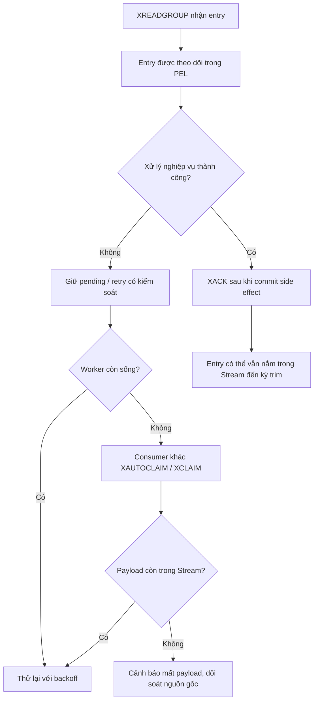
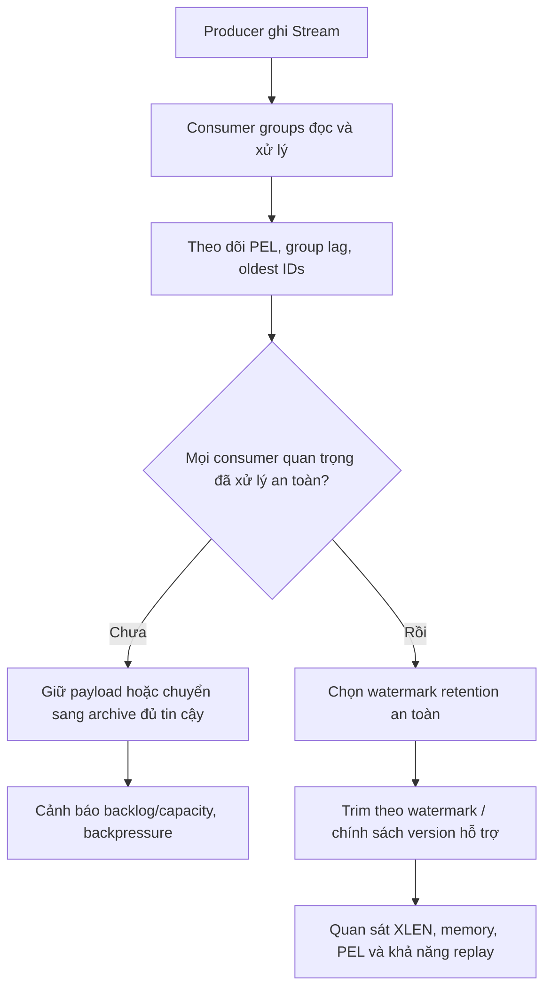

# Trim Stream, giới hạn lưu trữ và dữ liệu đang chờ xử lý trong Spring Data Redis

## 1. Vấn đề cốt lõi: Stream không thể tăng mãi

Redis Streams cho phép ứng dụng ghi sự kiện bằng `XADD`, đọc lại theo ID bằng `XREAD`, và phân phối công việc giữa các consumer trong một group bằng `XREADGROUP`. Khác Redis Pub/Sub, message của Stream được **lưu thành entry** để có thể đọc sau khi producer đã gửi.

Lợi ích đó kéo theo một trách nhiệm: nếu producer tiếp tục ghi mà không giới hạn lưu trữ, số entry có thể tăng không ngừng và chiếm nhiều bộ nhớ Redis. Vì vậy cần cơ chế **trim** (*cắt bỏ entry cũ*) và một **retention policy** (*chính sách giữ dữ liệu*).

Điểm dễ gây mất dữ liệu nghiệp vụ là:

> **Xóa entry khỏi Stream khác với xác nhận đã xử lý entry trong consumer group.** Một entry có thể đã được giao cho worker nhưng chưa `XACK`. Nếu trim xóa payload của entry đó, worker gặp sự cố có thể không còn dữ liệu để xử lý lại dù thông tin pending vẫn xuất hiện trong group ở những phiên bản/chính sách Redis nhất định.

Bài học tập trung vào việc kết hợp ba loại trạng thái:

1. **Stream entries:** các message còn thực sự tồn tại trong log.
2. **Consumer-group metadata:** vị trí đã giao, pending entries và trạng thái consumer.
3. **Giới hạn lưu trữ:** kích thước/timestamp cutoff, dung lượng bộ nhớ và thời gian cần phục hồi.

Lựa chọn retention tốt phải xét **consumer chậm nhất**, không chỉ tốc độ ghi của producer.

## 2. Phân biệt những khái niệm thường bị đánh đồng

Giả sử một event có ID `1763000000000-0` trong Stream `events:payments`.

| Khái niệm | Câu hỏi nó trả lời | Lệnh điển hình |
|---|---|---|
| Stream entry | Message/payload còn trong Redis hay không? | `XRANGE`, `XREAD` |
| Last-delivered ID của group | Group đã đi đến vị trí phát message nào? | `XINFO GROUPS` |
| Pending entry (PEL) | Message đã được giao cho consumer group nhưng chưa ack? | `XPENDING` |
| Acknowledgement | Group đã xác nhận xử lý xong message? | `XACK` |
| Stream trimming | Entry nào bị loại khỏi log vì retention? | `XTRIM`, `XADD ... MAXLEN/MINID` |
| Xóa entry cụ thể | Muốn xóa một hoặc một số ID khỏi Stream? | `XDEL` |
| Xóa cả stream | Muốn xóa toàn bộ key và cấu trúc dữ liệu? | `DEL`, key expiration |

Các thao tác này có hậu quả khác nhau. Ví dụ:

- `XACK` làm entry thôi pending trong **một consumer group**; theo mô hình truyền thống nó **không xóa payload** khỏi Stream.
- `XTRIM` loại các entry theo tuổi/thứ tự hoặc số lượng; nó **không có nghĩa mọi group đã xử lý xong**.
- `XDEL` loại entry cụ thể khỏi log nhưng không phải hành động "ack cho tất cả group".
- `DEL events:payments` xóa cả Stream cùng những thông tin group gắn với key; đây không phải cách vận hành backlog an toàn.
- Một số phiên bản Redis mới có các lựa chọn quản lý tham chiếu PEL khi xóa/trim; cần nắm rõ semantics theo version.

### Minh họa quan hệ giữa Stream và consumer groups

```text
Stream events:payments (payload còn lưu)
  ID-101  -> PaymentRequested
  ID-102  -> PaymentAuthorized
  ID-103  -> PaymentCaptured
  ID-104  -> PaymentRefunded

Consumer group billing
  ID-101: acknowledged
  ID-102: pending của worker-a
  ID-103: chưa giao
  ID-104: chưa giao

Consumer group analytics
  ID-101: acknowledged
  ID-102: acknowledged
  ID-103: pending của worker-b
  ID-104: chưa giao
```

Nếu một lệnh trim loại `ID-102` vì nó quá cũ, worker-a có thể mất payload cần thiết để chạy lại. Đồng thời, `ID-103` đang pending trong group analytics cũng phải được xét khi đặt retention. **Không có một "đã đọc" toàn hệ thống chung cho mọi group.**

## 3. XTRIM MAXLEN: giới hạn theo số entry

Cú pháp cơ bản:

```redis
XTRIM events:payments MAXLEN 100000
```

Lệnh yêu cầu Redis loại các entry cũ nhất để Stream còn nhiều nhất khoảng số lượng đã đặt theo semantics cụ thể của lệnh. Khi dùng **exact trimming**, Redis cố đưa số entry về giới hạn chỉ định.

Ví dụ nhỏ:

```redis
DEL demo:stream:len

XADD demo:stream:len * type A
XADD demo:stream:len * type B
XADD demo:stream:len * type C
XADD demo:stream:len * type D

XLEN demo:stream:len
# (integer) 4

XTRIM demo:stream:len MAXLEN = 2
# (integer) 2 (trong ví dụ không có thay đổi khác)

XLEN demo:stream:len
# (integer) 2

XRANGE demo:stream:len - +
# Còn 2 entry mới nhất (C và D), theo ID Redis tự sinh.
```

Chú ý:

- Redis loại các entry có ID cũ nhất; không chọn theo một field như `type` hoặc theo trạng thái nghiệp vụ.
- `MAXLEN` quản lý **số entry**, không phải số MB hay tổng byte.
- Payload lớn/nhỏ có thể khác nhau rất nhiều; cùng `MAXLEN 100000` nhưng mức sử dụng RAM không cố định.
- `XTRIM` trả số entry được cắt bỏ bởi lệnh, không phải số message đã ack.
- Không suy ra `XLEN` sau trim bằng chính xác ngưỡng trong môi trường ghi đồng thời hoặc khi dùng cách trim xấp xỉ.

### 3.1. Exact trimming và approximate trimming

Redis hỗ trợ cú pháp so sánh:

```redis
XTRIM demo:stream:len MAXLEN = 100000
XTRIM demo:stream:len MAXLEN ~ 100000
```

| Chế độ | Ý nghĩa | Đánh đổi |
|---|---|---|
| `=` (exact) | Cố trim đến giới hạn mong muốn | Có thể tốn chi phí hơn do phải thao tác trên cấu trúc lưu trữ |
| `~` (approximate) | Cho phép Redis trim hiệu quả theo các đơn vị lưu trữ nội bộ | Thường nhanh hơn, nhưng có thể giữ **hơn** số entry cấu hình |

Streams được tổ chức theo cấu trúc nội bộ tối ưu cho việc lưu nhiều entry; approximate trimming có thể bỏ qua việc loại từng entry lẻ trong một node, thay vào đó ưu tiên xóa các khối phù hợp. Vì vậy **`MAXLEN ~ N` không phải hard cap chính xác N entry**.

Đây là một công cụ hữu ích để kiểm soát **tăng trưởng bộ nhớ trung bình** trong đường ghi nhiều sự kiện, nhưng không thay thế cơ chế đo `XLEN`, `MEMORY USAGE` và cảnh báo dung lượng.

### 3.2. LIMIT là giới hạn công việc trim

Trong các cú pháp có hỗ trợ, `LIMIT` kiểm soát mức độ công việc tìm kiếm/trimming khi thực hiện lệnh:

```redis
XTRIM demo:stream:len MAXLEN ~ 100000 LIMIT 1000
```

Không hiểu `LIMIT 1000` là "giữ đúng 1000 message", cũng không phải "xóa tối đa 1000 entry" theo nghĩa tuyệt đối của mọi phiên bản/cách biểu diễn. Đây là tham số điều khiển công việc của thuật toán trim; cần xem cách Redis server đang chạy định nghĩa và giới hạn sử dụng. Khi dùng `~` với workload lớn, lựa chọn này có thể làm số entry vẫn vượt ngưỡng sau một lần gọi.

Nếu bài toán cần một hard bound chặt chẽ, phải đo tác động hiệu năng của exact trimming hoặc chọn cơ chế retention khác phù hợp.

## 4. XADD kèm MAXLEN: vừa ghi vừa duy trì giới hạn

Ngoài việc gọi `XTRIM` riêng, Redis cho phép gắn chính sách giới hạn ngay khi append:

```redis
XADD events:payments MAXLEN ~ 100000 * eventId evt-1 type REQUESTED
```

Lệnh thêm một entry mới và áp dụng chính sách trim trong đường ghi của chính command. Đây là mẫu thông dụng cho stream tốc độ cao vì không cần một worker dọn dẹp chạy riêng mới giữ được giới hạn số entry.

Ví dụ:

```redis
DEL demo:stream:bounded

XADD demo:stream:bounded MAXLEN = 3 * n 1
XADD demo:stream:bounded MAXLEN = 3 * n 2
XADD demo:stream:bounded MAXLEN = 3 * n 3
XADD demo:stream:bounded MAXLEN = 3 * n 4

XLEN demo:stream:bounded
# (integer) 3

XRANGE demo:stream:bounded - +
# Còn các entry n=2, n=3, n=4
```

Khi chọn `MAXLEN ~`, Stream có thể lớn hơn ngưỡng mục tiêu một mức nào đó. Hãy theo dõi bộ nhớ thực tế và latency của producer, nhất là nếu nhiều loại workload dùng chung Redis instance.

### 4.1. Thêm rồi trim riêng có giống XADD MAXLEN không?

Hai cách đều có thể làm giảm tăng trưởng nhưng **khác thời điểm và tính nguyên tử của thao tác**:

```redis
XADD events:payments * eventId evt-2 type CAPTURED
XTRIM events:payments MAXLEN ~ 100000
```

Đây là **hai Redis commands riêng**. Nếu producer thành công ở `XADD` nhưng lỗi mạng hoặc process chết trước `XTRIM`, việc dọn dẹp chưa diễn ra. Đồng thời có thể có client khác xen giữa hai lệnh.

Với `XADD ... MAXLEN ...`, thêm entry và xử lý giới hạn đi cùng một command Redis. Tuy vậy, **tính nguyên tử của lệnh ghi/trim không đồng nghĩa an toàn đối với consumer chưa xử lý**. Retention vẫn có thể loại entry pending.

### 4.2. Trường hợp không nên trim ngay khi producer ghi

Nếu Stream đóng vai trò **job queue bắt buộc xử lý**, producer thường không biết:

- Group nào đang chậm hoặc bị dừng.
- Message nào còn pending tại từng consumer.
- Có group mới sẽ cần đọc lại lịch sử hay không.
- Message đã được xác nhận trong hệ thống đích hay mới chỉ được phân phối.

Chọn `MAXLEN ~ 1000` theo cảm tính ở producer có thể làm mất những job chưa xử lý khi lưu lượng tăng. Với dữ liệu quan trọng, retention nên được thiết kế theo **trạng thái tiêu thụ và thời gian phục hồi**, không chỉ số entry đẹp trong cấu hình.

## 5. XTRIM MINID: giữ theo ngưỡng Stream ID

Bên cạnh số entry, Redis hỗ trợ trim các entry có ID nhỏ hơn một mốc:

```redis
XTRIM events:payments MINID = 1763000000000-0
```

Ý nghĩa là giữ lại những entry **có ID không nhỏ hơn ngưỡng** và loại những entry cũ hơn, nếu chính sách xử lý tham chiếu group cho phép. Ví dụ phiên bản có cú pháp tương ứng:

```redis
XTRIM events:payments MINID ~ 1763000000000-0
```

Cũng có thể đặt ngưỡng trong đường ghi:

```redis
XADD events:payments MINID ~ 1763000000000-0 * eventId evt-3 type SETTLED
```

Khi Redis tự sinh stream ID theo dạng timestamp–sequence, `MINID` có thể được sử dụng để triển khai chính sách gần với "giữ tối thiểu N giờ/ngày". Tuy nhiên:

- **Stream ID không phải TTL của từng entry.**
- Nếu producer gán ID thủ công hoặc timestamp của producer/server có những đặc thù, mối quan hệ giữa ID và thời gian nghiệp vụ không phải lúc nào cũng tương ứng.
- Mốc MINID phải được tính và áp dụng nhất quán; nếu lấy thời gian sai, có thể xóa dữ liệu vẫn cần.
- Với approximate trimming, một số entry cũ hơn ngưỡng có thể còn tồn tại.
- Nếu group có pending entry cũ hơn ngưỡng, chính sách theo thời gian vẫn có nguy cơ mất payload nếu không bảo vệ pending.

### 5.1. MAXLEN và MINID nên chọn theo tiêu chí nào?

| Nhu cầu | Cách tiếp cận | Giới hạn |
|---|---|---|
| Giữ khoảng 100.000 event gần nhất | `MAXLEN ~ 100000` | Không bảo đảm mỗi event còn trong một thời gian tối thiểu |
| Giữ event gần 24 giờ theo ID thời gian | `MINID` với cutoff tương ứng | Không có giới hạn số entry nếu tốc độ ghi tăng mạnh |
| Cần vừa giới hạn RAM vừa giữ một cửa sổ replay tối thiểu | Thiết kế policy kết hợp với giám sát và lưu trữ phụ | Một ngưỡng duy nhất thường không thể đồng thời bảo đảm cả hai |
| Queue công việc quan trọng phải xử lý đến khi ack | Retention xét tiến độ các group | Một MAXLEN cố định không biết tiến độ consumer |
| Event log cần truy xuất nhiều tháng | Archive sang hệ lưu trữ bền vững/search/log phù hợp | Redis RAM có thể không kinh tế cho lịch sử quá dài |

Trong một workload có tốc độ ghi biến động mạnh, `MAXLEN` xác định số message giữ lại nhưng thời gian replay thực tế có thể thay đổi đáng kể. Ví dụ 100.000 entry ở mức 100 event/giây chỉ chứa khoảng 1.000 giây lịch sử, còn ở 10 event/giây là khoảng 10.000 giây, nếu không có các yếu tố cắt/xóa khác.

## 6. Consumer groups và Pending Entries List (PEL)

Consumer group duy trì metadata để phân phối message cho các consumer và theo dõi entry đã giao nhưng **chưa ack**.

Các lệnh tiêu biểu:

```redis
XGROUP CREATE events:payments billing 0-0 MKSTREAM
XREADGROUP GROUP billing worker-a COUNT 10 STREAMS events:payments >
XPENDING events:payments billing
XACK events:payments billing 1763000000000-0
```

Trong đó:

- `XREADGROUP ... >` lấy các entry mới chưa từng được giao trong group.
- Entry được giao và chưa `XACK` được theo dõi trong **PEL** của group.
- `XPENDING` trả thông tin tổng quan hoặc chi tiết PEL.
- `XACK` xóa tham chiếu pending trong **group đó**, không mặc định xóa payload Stream.
- Việc nhiều consumer nhận message trong cùng group không có nghĩa các group khác đã xử lý event này.

### 6.1. PEL khác với backlog chưa giao

Một lỗi giám sát phổ biến là chỉ xem `XPENDING`:

```text
Producer đã ghi:           1.000.000 entry
Group đã từng được giao:     200.000 entry
Group đã ack:                199.999 entry
PEL còn:                           1 entry
Chưa giao cho group:         800.000 entry
```

PEL chỉ có 1 entry, nhưng group thực chất đang **tụt rất xa so với đầu stream**. Nếu trim theo ngưỡng chỉ dựa trên số lượng pending, có thể xóa hàng trăm nghìn entry chưa từng được worker nhận.

Theo dõi cùng lúc:

- Stream `XLEN`, `XINFO STREAM`.
- `XINFO GROUPS`: group progress, pending và lag khi Redis có thể tính được.
- `XPENDING`: các message đã giao chưa ack.
- Tốc độ `XADD` và tốc độ xử lý thành công.
- Tuổi entry cũ nhất còn giữ, tuổi pending cũ nhất và độ trễ end-to-end.
- Trạng thái của những group bị tạm dừng hoặc chưa khởi tạo.

Giá trị `lag` trong `XINFO GROUPS` có thể là không xác định trong một số điều kiện, ví dụ cách khởi tạo offset hoặc khi entry bị xóa/trim ảnh hưởng mô hình đếm. Không coi mọi giá trị lag luôn chính xác tuyệt đối trên mọi phiên bản Redis.

## 7. Điều gì xảy ra nếu trim xóa entry đang pending?

Đây là tình huống cần hiểu kỹ nhất.

### 7.1. Ví dụ thực nghiệm bằng redis-cli

Sử dụng **namespace thử nghiệm riêng**, không chạy trên Stream production:

```redis
DEL demo:stream:pending

XGROUP CREATE demo:stream:pending group-a 0-0 MKSTREAM
# OK

XADD demo:stream:pending * eventId ev-1 payload first
# <id-1>

XADD demo:stream:pending * eventId ev-2 payload second
# <id-2>

XREADGROUP GROUP group-a worker-a COUNT 1 STREAMS demo:stream:pending >
# Nhận entry id-1; lúc này id-1 nằm trong PEL.

XPENDING demo:stream:pending group-a
# Có 1 message pending.

XTRIM demo:stream:pending MAXLEN = 1
# Loại entry cũ nhất id-1, còn id-2 trong Stream.

XRANGE demo:stream:pending - +
# Chỉ còn entry id-2.
```

Mục tiêu của ví dụ là tạo trạng thái: **id-1 đã giao nhưng chưa ack, sau đó payload bị trim khỏi stream**.

Trên nhiều phiên bản Redis trước những mở rộng xử lý tham chiếu ở Redis 8.2, hành vi trim truyền thống vẫn có thể giữ reference của message đã bị xóa trong PEL. Kết quả:

- `XPENDING` có thể vẫn hiển thị id-1.
- Khi consumer cố đọc lại pending bằng ID phù hợp, payload của id-1 **không còn**.
- Không thể dựa vào Redis Stream để tái tạo body đã bị trim.
- PEL và Stream content bị lệch: còn metadata về delivery nhưng thiếu dữ liệu để xử lý lại.

Khi đọc pending với `XREADGROUP` theo ID cụ thể, phiên bản Redis có thể trả record mang payload null/thiếu fields cho ID đã bị xóa. Phải xử lý trường hợp đó thay vì giả định mọi pending ID đều có message body.

### 7.2. XAUTOCLAIM không hồi sinh payload đã bị trim

`XAUTOCLAIM` giúp consumer reclaim các pending message quá thời gian idle:

```redis
XAUTOCLAIM demo:stream:pending group-a worker-b 60000 0-0 COUNT 10
```

Nhưng nếu payload của entry đã bị trim/xóa, Redis **không thể phát lại dữ liệu không còn lưu**. Từ Redis 7.0, `XAUTOCLAIM` có hành vi làm sạch các reference PEL trỏ tới entry không còn trong Stream, đồng thời trả thêm thông tin những ID bị loại theo hợp đồng phiên bản đó. Việc dọn metadata như vậy **không phải khôi phục message**.

Do đó, quy trình recovery cần phân biệt:

1. Pending ID và payload vẫn còn → có thể claim, xử lý lại, rồi ack.
2. Pending ID nhưng payload đã biến mất → ghi nhận **mất payload**, cảnh báo hoặc tái tạo từ nguồn dữ liệu gốc nếu kiến trúc cho phép.
3. Entry đã ack trong group A nhưng còn cần cho group B → không được mặc định an toàn để trim chỉ vì A đã ack.

Không được tự tạo payload giả hoặc tự động ack một message bị mất nội dung rồi coi nghiệp vụ đã hoàn thành.

## 8. Những thay đổi ở Redis mới về tham chiếu khi xóa/trim

Từ **Redis 8.2**, các lệnh liên quan Stream bổ sung những cơ chế điều khiển việc xử lý tham chiếu của consumer groups khi xóa/trim, như các chế độ **`KEEPREF`**, **`DELREF`** và **`ACKED`**, cùng những lệnh phục vụ acknowledge/delete phối hợp như `XACKDEL` và `XDELEX`.

Ý nghĩa ở mức thiết kế:

| Chính sách | Mục đích | Điều phải đánh đổi |
|---|---|---|
| `KEEPREF` | Có thể loại payload nhưng giữ reference PEL ở các group theo cơ chế truyền thống | Pending còn nhưng payload có thể đã mất |
| `DELREF` | Khi xóa entry, đồng thời xóa tham chiếu liên quan trong PEL | Mất cả dấu vết pending để phục hồi; không đồng nghĩa đã xử lý |
| `ACKED` | Chỉ xóa những entry đáp ứng điều kiện đã được các consumer group xác nhận theo semantics của Redis | Không thể bảo đảm hard cap nhỏ nếu group đang chậm/không ack |

Đây là một khác biệt thực sự quan trọng giữa deployment Redis cũ và mới. **Không mặc định mọi Redis server đều hỗ trợ ba tùy chọn này**; cần xác nhận phiên bản và cú pháp cụ thể của `XADD`, `XTRIM`, `XDELEX`, `XACKDEL` trước khi đưa vào cấu hình hoặc runbook.

Điểm không thay đổi: nếu một chế độ cho phép xóa payload chưa được xử lý, việc có/không giữ PEL **không giúp message được xử lý thành công**. Một chính sách như `DELREF` có thể làm metric pending giảm, nhưng điều đó không phải bằng chứng workload đã hoàn thành.

### 8.1. ACKED có phải giải pháp cho mọi bài toán retention?

Không. Chính sách chỉ xóa khi các group đã ack giúp bảo vệ payload trước thao tác trim sớm **theo các điều kiện nó hỗ trợ**, nhưng có các hệ quả:

- Một group chết hoặc quá chậm có thể khiến Stream tăng trưởng vượt ngưỡng MAXLEN mong muốn.
- Group mới, group thử nghiệm hoặc group không còn dùng phải được quản lý lifecycle chặt chẽ.
- Bộ nhớ có thể bị áp lực khi producer nhanh hơn consumer trong thời gian dài.
- Nếu có xử lý nghiệp vụ ngoài Redis mà worker ack sai thời điểm, chỉ mục ack không bảo đảm side effect thật sự hoàn tất.
- Việc phụ thuộc tính năng mới tạo yêu cầu đồng bộ phiên bản Redis/server/client.

Với hệ thống có giới hạn RAM bắt buộc, retention theo ack cần có **ngưỡng cảnh báo, backpressure, chính sách tạm dừng producer hoặc lưu trữ phụ**, không thể chỉ đặt MAXLEN và bỏ qua.

## 9. XACK không giải phóng dung lượng Stream như bạn tưởng

Ví dụ:

```redis
XGROUP CREATE demo:stream:ack group-a 0-0 MKSTREAM
XADD demo:stream:ack * eventId ev-101
XREADGROUP GROUP group-a worker-a STREAMS demo:stream:ack >
XACK demo:stream:ack group-a <id-vua-nhan>
```

Ở mô hình Redis Streams truyền thống, sau `XACK`:

- Entry không còn pending trong group-a.
- Payload của entry vẫn có thể được đọc bằng `XRANGE`.
- `XLEN` không giảm chỉ vì ack.
- Group khác có thể vẫn cần entry đó để đọc/replay.
- Redis memory của Stream không tự giảm tương ứng số message ack.

Vì vậy nếu pipeline consumer đã xử lý cả triệu message nhưng không có trim/delete/retention, Stream vẫn có thể phình to. **Quản lý ack và quản lý lưu trữ là hai vòng đời độc lập**, cần được thiết kế song song.

### 9.1. XDEL có thay thế XACK được không?

Không. `XDEL` xóa entry có ID cụ thể khỏi Stream, không phải thao tác hoàn thành công việc trong một consumer group. Với các chính sách/version cũ, PEL có thể còn reference của entry đã xóa.

Tương tự, nếu một consumer group xử lý thành công và gọi `XACK` rồi lập tức `XDEL`, group khác chưa xử lý có thể mất payload. Khi một Stream có nhiều group, chỉ một consumer **không nên quyết định xóa lịch sử cho toàn bộ group** nếu chưa có hợp đồng retention chung.

### 9.2. EXPIRE trên Stream key là khác hẳn entry retention

```redis
EXPIRE events:payments 3600
```

Lệnh này đặt TTL trên **toàn bộ Redis key Stream**, không phải TTL riêng cho từng entry. Khi key hết hạn, cả Stream và consumer groups gắn với key biến mất.

Không dùng `EXPIRE` trên Stream đang hoạt động để thay thế chính sách "giữ mỗi message 1 giờ". Đó là rủi ro xóa toàn bộ log, group metadata và pending state cùng lúc. Với retention theo thời gian, cân nhắc `MINID` và cơ chế tính cutoff/giám sát riêng.

## 10. Xây retention policy từ nhu cầu nghiệp vụ

Thay vì hỏi "Stream nên MAXLEN bao nhiêu?", hãy xác định:

1. **Tốc độ ghi lớn nhất và trung bình** (events/giây).
2. **Kích thước payload** và overhead lưu trữ theo số key/field.
3. **Tốc độ xử lý** của consumer group chậm nhất.
4. **Thời gian worker được phép offline** nhưng vẫn có thể bắt kịp.
5. **Thời gian điều tra/replay** sau lỗi hoặc triển khai phiên bản mới.
6. **Số group** và thời điểm tạo/xóa group.
7. **Mức độ quan trọng của message**: mất được hay bắt buộc phục hồi.
8. **Dung lượng Redis** dành cho Stream, PEL, persistence và replication.
9. **Yêu cầu backup/archive**, retention dài hạn và compliance.

### 10.1. Ước lượng dung lượng theo tốc độ ghi

Một ước lượng đơn giản về số entry cần giữ:

```text
N ≈ producer_rate_per_second × retention_seconds
```

Ví dụ hệ thống ghi 200 entry/giây và muốn giữ 6 giờ lịch sử:

```text
6 giờ = 6 × 3600 = 21600 giây
N ≈ 200 × 21600 = 4.320.000 entry
```

Nếu chỉ đặt `MAXLEN 100000`, cửa sổ dữ liệu thực tế ở mức 200 entry/giây vào khoảng 500 giây, tức hơn 8 phút. Trong khi worker được phép dừng 30 phút, chính sách này không đủ để đảm bảo khả năng bắt kịp backlog.

Nếu payload trung bình khoảng 400 byte/entry, chỉ riêng phần dữ liệu thô đã khoảng 1,7 GB cho 4,32 triệu entry (theo cách ước lượng thập phân). Redis còn cần cấu trúc nội bộ, field names, PEL, replication buffers, AOF/RDB overhead và các workload khác; **không dùng phép nhân payload thô làm ước lượng chính xác của RAM Redis**.

Cần đo trên hệ thống hoặc môi trường tải đại diện bằng `MEMORY USAGE`, `INFO memory` và tốc độ tăng thực tế.

### 10.2. Retention tính theo thời gian không có hard memory bound

Nếu chọn "giữ 6 giờ" nhưng producer tăng từ 200 lên 2.000 event/giây, số entry tồn tại trong 6 giờ có thể tăng khoảng 10 lần. Vì vậy policy dựa trên MINID cần gắn với:

- Giới hạn/điều tiết producer.
- Capacity plan cho đỉnh lưu lượng.
- Cảnh báo memory và backlog.
- Phương án giảm tải hoặc spill/archive.
- Quy tắc xử lý khi không thể vừa giữ toàn bộ dữ liệu vừa nằm trong budget RAM.

Nếu hệ thống bắt buộc **không mất một job nào**, không thể chỉ cắt bỏ những entry cũ khi hết bộ nhớ mà vẫn tuyên bố đáp ứng yêu cầu. Cần lựa chọn giữa tăng khả năng lưu trữ, giảm tốc độ nhận việc, chuyển sang broker/storage phù hợp hoặc chấp nhận rủi ro mất theo SLA đã được quyết định.

## 11. An toàn với nhiều consumer group

Giả sử Stream `events:orders` có:

- Group `notifications`: xử lý nhanh, gần như không pending.
- Group `billing`: chậm 2 giờ vì một downstream lỗi.
- Group `analytics`: tạm dừng vài ngày để bảo trì.

Nếu producer trim theo group `notifications`, hai group còn lại có thể mất message chưa xử lý. Một event được ack trong `notifications` không có nghĩa đã ack trong `billing` và `analytics`.

### 11.1. Định nghĩa watermark an toàn

Một **safe retention watermark** là ngưỡng ID cũ nhất có thể xóa mà vẫn không vi phạm nhu cầu replay/processing của các consumer quan trọng.

Để tính nó, chỉ kiểm tra `last-delivered ID` là **chưa đủ**:

- Group có thể đã được giao đến ID mới, nhưng vẫn giữ entry cũ trong PEL.
- Một số entry chưa từng được giao khi consumer mới khởi động hoặc group lag.
- Nhóm khác có thể cần lịch sử lâu hơn.
- Lịch sử phục vụ audit/replay có thể cần giữ sau khi tất cả group đã ack.

Thiết kế chính sách an toàn cần kết hợp **vị trí đã giao, pending chưa ack, phạm vi replay và nhóm đang hoạt động**. Trong các hệ thống có thứ tự xử lý không đồng đều, một "highest acked ID" riêng lẻ có thể nhảy qua entry chưa ack, nên không thể lấy nó làm mốc trim an toàn.

Một ứng dụng có thể duy trì **contiguous processed watermark** theo group (mốc tất cả entry trước nó đã được xử lý đủ theo điều kiện), nhưng đây là logic nghiệp vụ riêng; Redis không tự bảo đảm giá trị đó luôn có sẵn qua một lệnh `XPENDING` duy nhất.

### 11.2. Group bị bỏ quên và chính sách dọn dẹp

Một group không dùng nữa có thể ngăn việc dọn dữ liệu nếu policy yêu cầu tất cả group ack. Trong runbook cần có:

- Chủ sở hữu mỗi consumer group.
- SLA xử lý và giới hạn thời gian offline.
- Điều kiện xóa group đã nghỉ hẳn.
- Kế hoạch xử lý pending khi triển khai lại consumer.
- Quyền quyết định có bỏ qua một group để giải phóng dữ liệu hay không.

Không dùng `XGROUP DESTROY` chỉ vì thấy group "lâu không hoạt động" mà chưa xác định nhu cầu nghiệp vụ; thao tác này xóa metadata của group và cơ hội khôi phục pending qua group đó.

## 12. Vòng đời pending: ack, retry, reclaim và dữ liệu mất

Một worker tiêu chuẩn:



Thứ tự xử lý quan trọng:

1. Nhận event qua `XREADGROUP`.
2. Validate payload và xử lý nghiệp vụ, có idempotency dựa trên event ID.
3. Chỉ `XACK` sau khi side effect đã được xác nhận theo hợp đồng nghiệp vụ.
4. Nếu worker chết trước ack, message có thể được xử lý lại.
5. Nếu message bị trim trước khi worker hồi phục, Redis không thể giao lại payload đã mất.

### 12.1. Recovery pending không chạy tự động chỉ vì có group

Những worker chỉ gọi:

```redis
XREADGROUP GROUP billing worker-a STREAMS events:payments >
```

sẽ nhận entry mới; họ không tự lấy lại mọi entry pending của consumer chết. Cần một vòng recovery, ví dụ:

```redis
XPENDING events:payments billing
XAUTOCLAIM events:payments billing worker-b 60000 0-0 COUNT 50
```

Với consumer restart giữ tên cũ, có thể đọc pending thuộc chính consumer bằng `XREADGROUP` với ID thích hợp theo API/phiên bản. Message pending của consumer khác cần được claim hoặc xử lý bằng cơ chế chuyển ownership.

Đặt `min-idle-time` khi claim phù hợp thời gian xử lý bình thường; quá nhỏ sẽ khiến hai worker cùng xử lý một event, quá lớn sẽ kéo dài phục hồi sau crash.

### 12.2. Idempotency không thay thế retention

Idempotency bảo vệ khi **một message được giao lại** và side effect có nguy cơ thực thi hai lần. Nhưng khi payload bị trim trước lần xử lý đầu tiên, idempotency không tái tạo được message. Hai yêu cầu cần giải riêng:

- **Chống duplicate:** event ID, dedup state, ack sau xử lý.
- **Chống mất payload:** retention đủ dài, persistence, replay archive, giám sát backlog, không trim entry còn cần.

## 13. Spring Data Redis: ghi, đọc, ack và trim

Spring Data Redis có các API cho Streams thông qua `StringRedisTemplate.opsForStream()` hoặc `RedisTemplate.opsForStream()`. Đường ghi và consumer code nên dùng cùng serializer, keyspace và schema event.

### 13.1. Dependency và kết nối mẫu

```groovy
dependencies {
    implementation 'org.springframework.boot:spring-boot-starter-data-redis'
}
```

```yaml
spring:
  data:
    redis:
      host: localhost
      port: 6379
```

Sử dụng `StringRedisTemplate` để ghi key và field/value dạng chuỗi, giúp quan sát qua `redis-cli`.

### 13.2. Producer với MapRecord

```java
package com.example.demo.streams;

import java.util.Map;
import org.springframework.data.redis.connection.stream.MapRecord;
import org.springframework.data.redis.connection.stream.RecordId;
import org.springframework.data.redis.connection.stream.StreamRecords;
import org.springframework.data.redis.core.StringRedisTemplate;
import org.springframework.stereotype.Service;

@Service
public class PaymentEventPublisher {

    private static final String STREAM = "events:payments";

    private final StringRedisTemplate redis;

    public PaymentEventPublisher(StringRedisTemplate redis) {
        this.redis = redis;
    }

    public RecordId publish(
            String eventId, String paymentId, String eventType) {

        MapRecord<String, String, String> record =
                StreamRecords.newRecord()
                        .in(STREAM)
                        .ofMap(Map.of(
                                "eventId", eventId,
                                "paymentId", paymentId,
                                "eventType", eventType
                        ));

        return redis.opsForStream().add(record);
    }
}
```

`RecordId` là ID của entry trong Redis Stream. `eventId` là ID nghiệp vụ do ứng dụng đặt và có thể dùng làm dedup key. Không coi hai ID luôn đồng nhất: một lần gửi lại cùng event có thể tạo Stream ID mới nếu không có logic chống lặp.

### 13.3. Consumer group: xử lý rồi mới ack

Giả sử group đã được khởi tạo trong Redis:

```redis
XGROUP CREATE events:payments billing 0-0 MKSTREAM
```

Một worker minh họa:

```java
package com.example.demo.streams;

import java.time.Duration;
import org.springframework.data.redis.connection.stream.Consumer;
import org.springframework.data.redis.connection.stream.ReadOffset;
import org.springframework.data.redis.connection.stream.StreamOffset;
import org.springframework.data.redis.core.StreamReadOptions;
import org.springframework.data.redis.core.StringRedisTemplate;
import org.springframework.stereotype.Service;

@Service
public class PaymentStreamWorker {

    private static final String STREAM = "events:payments";
    private static final String GROUP = "billing";

    private final StringRedisTemplate redis;
    private final PaymentHandler handler;

    public PaymentStreamWorker(
            StringRedisTemplate redis,
            PaymentHandler handler) {
        this.redis = redis;
        this.handler = handler;
    }

    public void pollOnce(String consumerName) {
        var records = redis.opsForStream().read(
                Consumer.from(GROUP, consumerName),
                StreamReadOptions.empty()
                        .count(20)
                        .block(Duration.ofSeconds(1)),
                StreamOffset.create(
                        STREAM,
                        ReadOffset.lastConsumed()
                )
        );

        if (records == null || records.isEmpty()) {
            return;
        }

        for (var record : records) {
            try {
                String eventId =
                        (String) record.getValue().get("eventId");
                String paymentId =
                        (String) record.getValue().get("paymentId");

                // Handler cần xử lý idempotent theo eventId.
                handler.process(eventId, paymentId);

                // XACK chỉ sau khi xử lý thành công.
                redis.opsForStream().acknowledge(
                        STREAM, GROUP, record.getId()
                );
            } catch (RuntimeException ex) {
                // Ghi log/metric và để entry pending.
                // Recovery worker phải retry/reclaim về sau.
                throw ex;
            }
        }
    }

    public interface PaymentHandler {
        void process(String eventId, String paymentId);
    }
}
```

Ví dụ tập trung vào quan hệ **xử lý → ack**; nó chưa triển khai scheduler, pending recovery, DLQ hay retry policy. Nếu một batch có nhiều record mà worker dừng khi gặp exception, các entry đã được giao trong batch nhưng chưa xử lý tiếp cũng có thể ở trạng thái pending, cần được recovery. Không dùng `XACK` trong `finally` vì điều đó có thể ack cả khi handler lỗi.

### 13.4. Spring Data Redis StreamOperations.trim

Với cơ chế retention chấp nhận cắt theo số entry, Spring Data Redis hỗ trợ thao tác trim qua `StreamOperations`:

```java
package com.example.demo.streams;

import org.springframework.data.redis.core.StringRedisTemplate;
import org.springframework.stereotype.Service;

@Service
public class StreamRetentionService {

    private static final String STREAM = "events:notifications";
    private static final long TARGET_MAXLEN = 100_000L;

    private final StringRedisTemplate redis;

    public StreamRetentionService(StringRedisTemplate redis) {
        this.redis = redis;
    }

    public Long trimApproximate() {
        return redis.opsForStream().trim(
                STREAM,
                TARGET_MAXLEN,
                true
        );
    }

    public Long trimExact() {
        return redis.opsForStream().trim(
                STREAM,
                TARGET_MAXLEN,
                false
        );
    }
}
```

Ý tưởng của overload có tham số boolean là chọn approximate/exact trimming theo API của phiên bản Spring Data Redis đang sử dụng. Hãy kiểm tra hợp đồng chính xác của version trong dự án khi chuyển ví dụ vào source; có phiên bản/API cũng cung cấp tùy chọn trim theo `MINID` hoặc `XAddOptions` để đưa chính sách vào lệnh ghi.

**Quan trọng:** tên Stream ở ví dụ retention là `events:notifications`, không phải `events:payments` đang dùng làm work queue bắt buộc xử lý. Việc cố tình tách hai Stream nhấn mạnh rằng một policy `MAXLEN` đơn giản có thể phù hợp với dữ liệu notification có thể mất lịch sử, nhưng **không mặc nhiên an toàn với job queue có pending/consumer groups quan trọng**.

### 13.5. Nếu cần XADD MAXLEN trong một command

Redis CLI:

```redis
XADD events:notifications MAXLEN ~ 100000 * eventId notif-100 message updated
```

Với Spring Data Redis, có thể sử dụng các API `XAddOptions` hoặc lower-level connection stream commands **nếu version hỗ trợ các tùy chọn cần thiết**. Phân biệt:

- Gọi `add(record)` rồi `trim(...)`: hai commands.
- Dùng XADD kết hợp MAXLEN: một command ghi kèm trim.

Không tự viết một wrapper rồi tuyên bố nó là atomic nếu thực tế gọi hai lệnh. Khi yêu cầu giới hạn retention ảnh hưởng dữ liệu pending, version Redis server và policy tham chiếu của các lệnh mới phải được đối chiếu rõ.

## 14. Thiết kế một job retention an toàn

Với Stream lưu thông báo có thể bỏ một phần lịch sử, chính sách định kỳ có thể đơn giản:

```text
Producer -> XADD
Scheduler (theo chu kỳ) -> XTRIM MAXLEN ~ N
Metrics -> XLEN, MEMORY USAGE, oldest ID, errors
```

Với Stream chứa công việc **bắt buộc hoàn tất**, chính sách cần phức tạp hơn:



Một retention job an toàn không thể chỉ làm:

```text
Nếu XLEN > 100000:
    XTRIM MAXLEN 100000
```

mà bỏ qua group lag. Với hệ thống cần độ bền cao, nhiệm vụ retention thường yêu cầu **lưu giữ theo SLA** và policy công khai về việc phải làm khi consumer không theo kịp.

### 14.1. Trước khi trim: quan sát gì?

Những lệnh hữu ích:

```redis
XLEN events:payments
XINFO STREAM events:payments
XINFO GROUPS events:payments
XINFO CONSUMERS events:payments billing
XPENDING events:payments billing

XRANGE events:payments - + COUNT 1
XREVRANGE events:payments + - COUNT 1

MEMORY USAGE events:payments
INFO memory
```

`XRANGE ... COUNT 1` và `XREVRANGE ... COUNT 1` cung cấp ID của entry cũ nhất/mới nhất còn lưu, hữu ích khi so sánh cửa sổ retention với SLA replay. Chúng không nói thay consumer rằng toàn bộ event cũ đã xử lý.

Dùng `XINFO GROUPS` để xem các group, nhưng số liệu chỉ là metadata phía Redis; cần kết hợp metrics handler thành công/ack thực tế.

### 14.2. Sau trim: xác định điều gì bị mất

Sau một lần trim, cần hiểu:

- Số entry đã loại, `XLEN` còn lại và ID nhỏ nhất còn trong Stream.
- Mốc thấp nhất của các group còn cần replay.
- PEL có còn ID trỏ đến entry đã mất payload hay không, theo version/chính sách.
- Những sự kiện quan trọng đã được archive hoặc có thể tái tạo từ source of truth hay chưa.
- Redis memory có giảm tương xứng không (không phải lúc nào giảm theo byte payload ngay tức thì do allocation/fragmentation).

Không dùng "`XPENDING` giảm" làm tiêu chí duy nhất đánh giá trim thành công: nếu xóa cả reference, pending có thể giảm vì dữ liệu **đã mất**, không phải vì handler xử lý xong.

## 15. Sự cố thường gặp

| Triệu chứng | Nguyên nhân có thể | Hướng xử lý |
|---|---|---|
| `XLEN` rất lớn dù worker ack liên tục | `XACK` không xóa payload khỏi Stream | Thiết kế trim/retention riêng |
| Worker báo pending ID nhưng không còn fields | Entry đã bị `XTRIM` hoặc `XDEL` xóa; PEL reference còn | Đối soát nguồn dữ liệu, xem policy trim, không giả lập payload |
| Consumer mới không đọc được event cũ | Event đã bị trim hoặc group được tạo từ `$` | Xác định retention và offset bootstrap |
| Redis memory tăng dù `MAXLEN ~` được đặt | Approximate trimming, payload lớn, nhiều streams/PEL | Đo `XLEN`/`MEMORY USAGE`, cân đối policy và capacity |
| `MAXLEN` đủ cho giờ bình thường nhưng mất dữ liệu lúc cao điểm | Tốc độ producer tăng làm cửa sổ thời gian ngắn lại | Đặt retention theo peak rate hoặc MINID/archival |
| Group pending ít nhưng xử lý rất chậm | Nhiều entry **chưa từng giao** cho group | Xem lag và last-delivered, không chỉ XPENDING |
| Worker chỉ đọc `>` và pending ngày càng lâu | Thiếu pending recovery/claim | Bổ sung logic retry/reclaim |
| `XAUTOCLAIM` trả ID đã xóa thay vì payload | Payload bị trim; Redis 7+ có thể dọn PEL ref cũ | Ghi nhận mất dữ liệu, sửa retention/recovery |
| Xóa entry sau ack của group A làm group B thiếu event | Không có policy retention chung giữa group | Tính theo mọi group quan trọng |
| Stream biến mất cùng toàn bộ group | `EXPIRE` key hoặc `DEL` | Không dùng key TTL cho per-entry retention |
| Trim chính xác làm tăng latency producer | Exact trimming có thể tốn công hơn ở tải cao | Đo approximate mode, LIMIT, tách dọn dẹp |
| Dùng chính sách tham chiếu mới mà lệnh lỗi | Redis version không hỗ trợ `ACKED/DELREF` | Kiểm tra version/cú pháp server và driver |
| Backlog lớn hơn khả năng RAM, không được phép mất job | Producer nhanh hơn khả năng xử lý trong thời gian dài | Backpressure, scale consumer, lưu trữ bền vững khác |

## 16. Vận hành với Redis Cluster và các giới hạn khác

Một Stream key nằm trên **một hash slot** trong Redis Cluster. Nếu tất cả event dồn vào một Stream lớn, thêm node không tự chia nhỏ Stream đó. Hot Stream vừa tạo áp lực ghi vừa làm tăng memory tại node sở hữu.

Có thể chia thành nhiều Stream theo partition, ví dụ:

```text
events:payments:0
events:payments:1
events:payments:2
events:payments:3
```

Nhưng khi partition:

- Mỗi Stream có tập group và retention riêng.
- Consumer cần polling/subscribe tương ứng cho từng Stream.
- Thứ tự event chỉ nên được giả định **theo partition** khi thiết kế đúng.
- Một số lệnh nhiều key/script trong Cluster phải thỏa quy tắc hash slot.
- Capacity monitoring phải tổng hợp theo nhiều Stream và bảo đảm không có partition chậm bị trim quá sớm.

Nếu nghiệp vụ cần lưu lịch sử lâu dài, giải pháp archive ra database/object storage/event log chuyên dụng có thể kinh tế và dễ vận hành hơn việc giữ hàng tháng dữ liệu trên Redis RAM. Có thể để Redis Streams phục vụ *hot processing window*, còn dữ liệu dài hạn nằm ở hệ thống khác.

### 16.1. Có nên dùng Redis persistence để thay retention?

Không. AOF và RDB giúp phục hồi dữ liệu Redis trong những điều kiện nhất định, nhưng:

- Không ngăn Stream tăng trưởng khi producer không trim.
- Không bảo đảm message đã bị trim còn đọc được qua Stream.
- Không thay thế backup/audit archive có thể truy cập độc lập.
- Không làm thao tác gửi/ack tới database ngoài Redis thành một distributed transaction.

Cần phân biệt **durability** (dữ liệu có sống sót sau lỗi máy chủ hay không) với **retention** (ứng dụng chủ động giữ dữ liệu bao lâu). Một hệ thống có persistence tốt vẫn có thể mất payload vì policy trim sai.

## 17. Một mẫu chính sách theo mức độ quan trọng

### 17.1. Realtime notification không quan trọng để replay lâu

```text
Stream: events:notifications
Mục đích: hiển thị cập nhật UI gần đây
Retention: MAXLEN ~ 100000
Khi overflow: chấp nhận entry cũ bị trim
Phục hồi UI: đọc snapshot từ API/source of truth
Giám sát: XLEN, memory, latency, rate of trim
```

Trong trường hợp này, một bound xấp xỉ có thể phù hợp vì việc bỏ lỡ một thông báo cũ không làm mất dữ liệu chuẩn.

### 17.2. Job thanh toán hoặc sự kiện nghiệp vụ quan trọng

```text
Stream: events:payments
Mục đích: worker cần xử lý từng sự kiện
Retention: bảo vệ pending và entry chưa giao của mọi group cần thiết
Overflow: cảnh báo, backpressure, mở rộng capacity / lưu trữ phụ
Recovery: XPENDING + XAUTOCLAIM, idempotent handler, DLQ có chủ đích
Durability: cấu hình Redis và kiến trúc nguồn dữ liệu phù hợp SLA
Giám sát: lag, pending age, handler success, oldest ID, RAM
```

Nếu Redis server mới hỗ trợ chính sách chỉ xóa entry đã được các group ack, có thể cân nhắc sử dụng cùng các giới hạn/cảnh báo tương ứng; không coi đó là một bảo đảm vô hạn về dung lượng. Nếu server cũ không có khả năng này, cần retention job hoặc thiết kế riêng dựa trên watermark/consumer progress.

### 17.3. Event log phục vụ phân tích và replay lâu dài

```text
Redis Streams: giữ cửa sổ xử lý nóng
Archive: cơ sở dữ liệu, object storage hoặc event log bền vững
Consumer analytics: có offset/checkpoint và khả năng replay từ archive
Retention Redis: đủ cho worst-case outage và thời gian rebuild ngắn
Dữ liệu cũ: đọc từ archive thay vì yêu cầu Redis giữ mọi entry
```

Ở mẫu này, trim Redis không đồng nghĩa xóa sự kiện khỏi toàn bộ hệ thống; nhưng điều đó chỉ đúng nếu archive đã được ghi và có thể phục hồi một cách đáng tin cậy.

## 18. Các ngộ nhận cần tránh

**"XACK sẽ làm Stream nhỏ đi."** Không theo mô hình truyền thống: nó chỉ xóa trạng thái pending của group. Payload có thể còn đến khi trim/delete.

**"XTRIM chỉ xóa message đã xử lý."** Không phải mặc định. MAXLEN/MINID chọn theo vị trí hoặc số lượng, không biết mọi consumer có hoàn thành nghiệp vụ hay chưa.

**"PEL có bao nhiêu entry thì backlog chỉ bấy nhiêu."** Không. PEL không tính các entry **chưa từng được giao**.

**"Nếu một message vẫn pending thì Redis chắc chắn có payload để retry."** Sai. Trim/delete có thể làm mất payload trong khi reference còn ở PEL theo các chính sách/version nhất định.

**"XAUTOCLAIM luôn cứu được message đã bị trim."** Sai. Claim chỉ lấy lại những gì còn được lưu, và một số version dùng XAUTOCLAIM để làm sạch PEL reference của entry đã mất.

**"MAXLEN ~ 100000 là hard cap chính xác 100000 entry."** Không. Chế độ `~` ưu tiên hiệu năng và có thể vượt ngưỡng.

**"MINID chính là TTL riêng cho từng event."** Không. Nó chọn ngưỡng Stream ID; semantics về thời gian tùy cách tạo ID/cutoff và lệnh trim.

**"Chỉ cần đủ RAM là không bao giờ mất event."** Không. Trim, key expiration, Redis persistence/failover và lỗi logic nghiệp vụ đều có thể làm mất khả năng replay.

**"Một group ack rồi thì có thể xóa event ngay."** Không nếu còn các group khác hoặc chính sách audit/replay yêu cầu giữ.

**"ACKED giải quyết cả memory limit và retention tuyệt đối."** Không. Nếu consumer không ack, entry có thể không bị xóa, gây tăng bộ nhớ; phải có backpressure/capacity policy.

## 19. Kết luận

**Trim Stream** là cơ chế kiểm soát tăng trưởng Redis Streams theo **số lượng entry** (`MAXLEN`) hoặc **ngưỡng ID** (`MINID`). Có thể gọi `XTRIM` riêng hoặc gắn chính sách với `XADD`; exact trimming và approximate trimming có chi phí/độ chính xác khác nhau.

Nhưng điều quan trọng nhất trong hệ thống có consumer groups là **retention của payload không đồng nghĩa tiến độ xử lý**. `XACK` chỉ xác nhận trong một group, PEL chỉ theo dõi message đã giao chưa ack, và một entry đang pending hoặc chưa từng được đọc vẫn có thể bị mất payload nếu chính sách trim không bảo vệ nó. Những phiên bản Redis mới có lựa chọn tham chiếu/ack-aware deletion hỗ trợ thiết kế tốt hơn, nhưng không loại bỏ nhu cầu capacity planning và recovery.

Trong Spring Data Redis, `StreamOperations` giúp append, đọc, ack và trim; ứng dụng vẫn phải xây chính sách dựa trên **tốc độ ghi, consumer chậm nhất, cửa sổ replay, dung lượng RAM và khả năng phục hồi lỗi**. Với thông báo có thể mất, một giới hạn MAXLEN đơn giản có thể đủ. Với sự kiện nghiệp vụ bắt buộc xử lý, cần giữ message đến khi an toàn, giám sát cả backlog lẫn pending và có kế hoạch backpressure/archive khi vượt khả năng lưu trữ.
