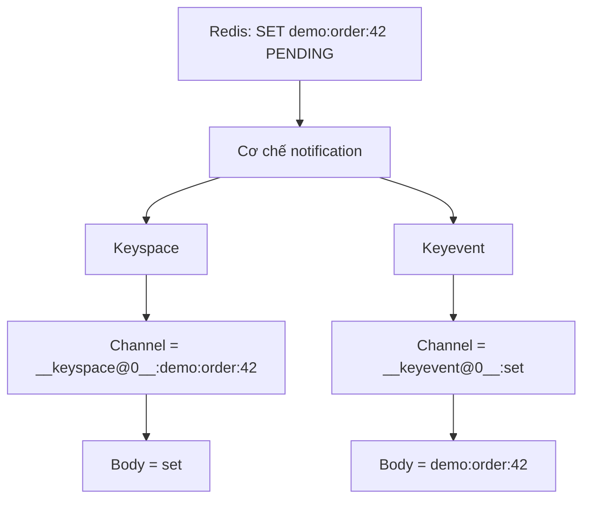
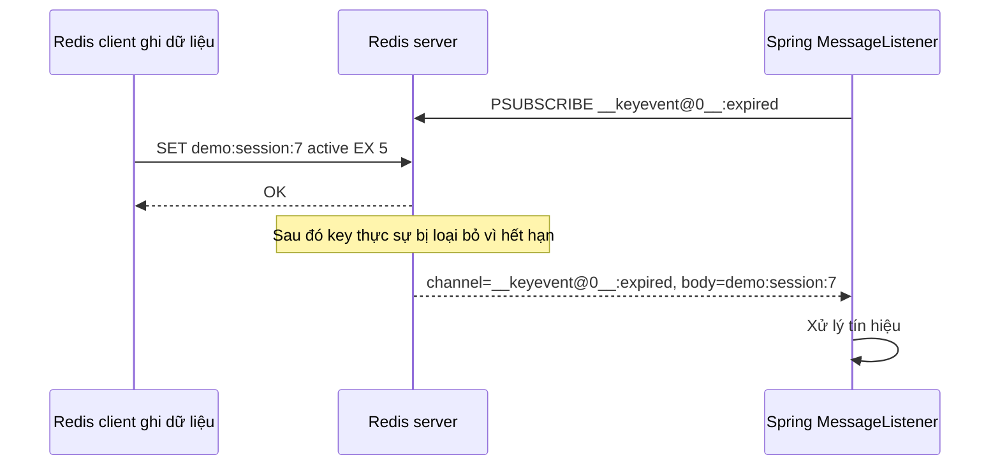
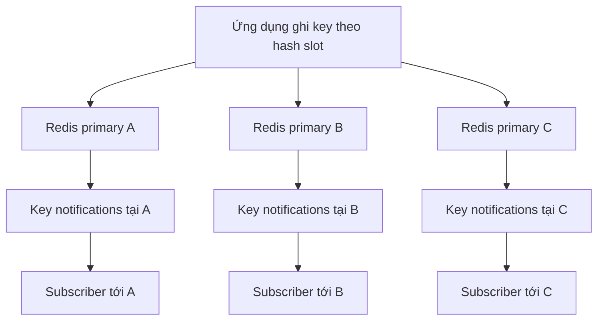

# Keyspace notification và keyevent notification trong Spring Data Redis

Redis không chỉ lưu dữ liệu theo key. Nó còn có thể **phát thông báo khi một key được tạo, thay đổi, xóa, hết hạn hoặc bị loại bỏ khỏi bộ nhớ**. Cơ chế này gọi chung là *Redis keyspace notifications*, bao gồm hai cách tổ chức kênh rất dễ nhầm lẫn: **keyspace notification** và **keyevent notification**.

Trong ứng dụng Spring Data Redis, thông báo khóa hữu ích khi cần quan sát những thay đổi mang tính tín hiệu: một session key vừa hết hạn, một khóa cache bị xóa, hoặc một nhóm key nghiệp vụ vừa được cập nhật. Ứng dụng có thể dùng `RedisMessageListenerContainer` để đăng ký kênh hoặc mẫu kênh Redis Pub/Sub, rồi chuyển thông báo cho một `MessageListener`.

Tuy nhiên, đây **không phải một hàng đợi sự kiện bền vững**. Keyspace/keyevent notifications dựa trên Redis Pub/Sub: nếu subscriber mất kết nối, chưa kịp đăng ký hoặc Redis không được cấu hình phát loại event đó, thông báo có thể bị bỏ lỡ và Redis không lưu chúng để phát lại. Sự kiện `expired` cũng không có nghĩa callback được gọi đúng mili-giây TTL về 0.

Bài học làm rõ cấu trúc hai nhóm kênh, tùy chọn `notify-keyspace-events`, ví dụ Redis CLI và Spring Data Redis, trường hợp TTL/eviction, cùng các giới hạn về độ tin cậy, hiệu năng, bảo mật, Cluster và thiết kế nghiệp vụ.

## 1. Keyspace notification là gì?

Một key trong Redis có thể trải qua vòng đời:

```text
Không tồn tại
    |
    v
SET / HSET / SADD ...
    |
    v
Đang tồn tại
    |
    +-- SET / HSET ... -> thay đổi giá trị
    |
    +-- EXPIRE ... -> có thời gian sống
    |
    +-- DEL ... -> bị xóa chủ động
    |
    +-- TTL hết hạn -> Redis loại bỏ vì hết hạn
    |
    +-- maxmemory -> Redis loại bỏ theo eviction policy
```

Redis có thể phát các thông báo khi những thao tác và biến cố tương ứng xảy ra. Ví dụ ứng dụng chạy:

```redis
SET demo:order:42 PENDING
```

Nếu bật loại notification phù hợp, Redis có thể gửi một message nói rằng key `demo:order:42` vừa nhận thao tác `set`.

Hai cách tổ chức message:

1. **Keyspace:** kênh chỉ ra **key nào** thay đổi, body nói **sự kiện gì** đã xảy ra.
2. **Keyevent:** kênh chỉ ra **sự kiện gì**, body nói **key nào** bị tác động.

Đó là hai góc nhìn về cùng một loại sự kiện Redis; không phải hai hệ thống phát sự kiện độc lập, và cũng không phải cơ chế tự đồng bộ dữ liệu giữa Redis và database.

## 2. Phân biệt keyspace và keyevent bằng một ví dụ

Giả sử sử dụng Redis database số `0`, key `demo:order:42`, thao tác `SET`.

**Thông báo kiểu keyspace:**

```text
Channel: __keyspace@0__:demo:order:42
Message: set
```

**Thông báo kiểu keyevent:**

```text
Channel: __keyevent@0__:set
Message: demo:order:42
```

| Thuộc tính | Keyspace notification | Keyevent notification |
|---|---|---|
| Cấu trúc kênh | `__keyspace@<db>__:<key>` | `__keyevent@<db>__:<event>` |
| Channel chứa | Tên key | Loại event |
| Message body chứa | Tên event | Tên key |
| Phù hợp nhất với | Theo dõi một key hoặc nhóm key theo prefix | Theo dõi mọi key xảy ra một event nhất định |
| Ví dụ subscription | `__keyspace@0__:demo:order:*` | `__keyevent@0__:expired` |
| Cần bật nhóm flag | `K` | `E` |

Có thể hình dung:



**Quy tắc dễ nhớ:** *keyspace: key ở channel; keyevent: event ở channel*.

### 2.1. Cả hai nhóm không bắt buộc bật cùng lúc

Nếu chỉ cần biết key nào vừa hết hạn, subscription như `__keyevent@0__:expired` thường đơn giản hơn. Khi đó có thể chỉ bật flag `E` và `x`.

Nếu chỉ cần theo dõi thao tác trên những key `demo:order:*`, có thể chọn keyspace channel và chỉ bật những nhóm event liên quan.

Bật cả hai nhóm giúp quan sát linh hoạt, nhưng cũng tăng số message Pub/Sub mà Redis phải tạo và gửi. Không có lý do vận hành để luôn bật mọi loại sự kiện trong production.

## 3. Redis Pub/Sub là kênh vận chuyển của notification

Keyspace/keyevent notifications sử dụng **Redis Pub/Sub**. Redis publish message đến những client đang subscribe đúng kênh/mẫu kênh.

Luồng tổng quát:



Những điểm đặc trưng:

- Subscriber phải **đang kết nối và đã đăng ký** khi Redis phát event để nhận message.
- Redis không lưu keyspace notification như một hàng đợi riêng có thể `ACK`, `retry` hoặc replay.
- Nếu client mất kết nối, những message phát trong khoảng mất kết nối không được tự phát lại khi reconnect.
- Việc một subscriber nhận message không có nghĩa một thao tác nghiệp vụ sau đó đã hoàn tất.
- Nếu có nhiều subscriber, mỗi subscriber đã đăng ký có thể nhận cùng một message. Đây là mô hình broadcast, không phải consumer group phân chia công việc.

Do đó, keyspace notification là **tín hiệu best-effort**, không phải nguồn sự thật để ghi sổ kế toán, xử lý thanh toán, tạo quyền truy cập hay đảm bảo chính xác một lần.

## 4. Cấu hình notify-keyspace-events

Mặc định trên nhiều cài đặt Redis, keyspace notifications **không được bật** để tránh chi phí phát event không cần thiết.

Kiểm tra cấu hình:

```redis
CONFIG GET notify-keyspace-events
```

Nếu giá trị trả về là chuỗi rỗng, Redis không được cấu hình phát những notification tương ứng.

Bật tạm thời cho server hiện tại:

```redis
CONFIG SET notify-keyspace-events KEA
```

Lệnh trên là ví dụ thuận tiện khi học, vì bật cả keyspace, keyevent và nhiều nhóm event thường dùng. **Không nên coi `KEA` là cấu hình tối ưu cho production**, và ký hiệu `A` không bao hàm mọi loại notification mới được Redis bổ sung ở mọi phiên bản.

### 4.1. Ý nghĩa của K và E

Hai flag nền tảng:

| Flag | Ý nghĩa | Kênh có thể được publish |
|---|---|---|
| `K` | Bật **keyspace channel** | `__keyspace@0__:some:key` |
| `E` | Bật **keyevent channel** | `__keyevent@0__:set` hoặc `__keyevent@0__:expired` |

Chỉ `K` hoặc `E` **không đủ**: còn phải chỉ định nhóm sự kiện cần theo dõi, như `g`, `$` hoặc `x`.

Ví dụ:

```redis
CONFIG SET notify-keyspace-events Ex
```

Nghĩa là phát **keyevent** cho những key hết hạn. Khi một key thực sự bị xóa bởi cơ chế expiration, kênh có dạng:

```text
__keyevent@0__:expired
```

Message body là tên key.

### 4.2. Các flag nhóm sự kiện

Những ký hiệu thường gặp:

| Flag | Nhóm sự kiện | Ví dụ |
|---|---|---|
| `g` | Generic commands, thao tác độc lập kiểu dữ liệu | `del`, `expire`, `rename_from`/`rename_to` tùy thao tác |
| `$` | String commands | `set` |
| `l` | List commands | `lpush`, `rpop` |
| `s` | Set commands | `sadd`, `srem` |
| `h` | Hash commands | `hset`, `hdel` |
| `z` | Sorted Set commands | `zadd`, `zrem` |
| `t` | Stream commands | `xadd`, `xdel` |
| `x` | Expired events | `expired` |
| `e` | Evicted events do chính sách bộ nhớ | `evicted` |
| `A` | Alias cho nhóm các event thường dùng | Gói nhiều nhóm; không nhất thiết bao gồm mọi flag |

Một số phiên bản Redis còn có các flag cho key miss, new key, overwritten hoặc type change. Danh sách và ngữ nghĩa cụ thể tùy phiên bản Redis; khi dùng một event ít gặp, đối chiếu tài liệu đúng server đang triển khai.

Ví dụ cấu hình tối thiểu theo nhu cầu:

| Yêu cầu | Cấu hình ví dụ |
|---|---|
| Chỉ nhận keyevent khi key hết hạn | `Ex` |
| Cả keyspace và keyevent cho expired | `KEx` |
| Theo dõi thao tác String và generic trên keyspace | `K$g` |
| Theo dõi nhiều loại sự kiện khi phát triển | `KEA` |
| Chỉ theo dõi event bị loại do maxmemory | `Ee` |

**Phân biệt chữ thường:** `x` là expiration, `e` là eviction, còn `E` viết hoa chọn kiểu channel *keyevent*. Đây là những flag khác nhau.

### 4.3. Cấu hình trong redis.conf

Thay vì `CONFIG SET` lúc runtime, môi trường tự quản lý Redis có thể dùng:

```conf
notify-keyspace-events Ex
```

Sau đó khởi động hoặc nạp cấu hình theo quy trình triển khai tương ứng.

`CONFIG SET` thay đổi cấu hình đang chạy nhưng không tự bảo đảm duy trì sau mọi lần restart. Có thể cần cấu hình nguồn, `CONFIG REWRITE` trong môi trường cho phép, hoặc cơ chế cấu hình của nhà cung cấp dịch vụ.

Redis managed service có thể **không cho phép `CONFIG SET`** hoặc yêu cầu thay đổi qua parameter group/portal quản trị. Ứng dụng Spring không nên giả định luôn được cấp quyền sửa Redis server config.

### 4.4. Đừng bật mọi event trong production chỉ để debug

Một hệ thống cache có lượng `GET`, `SET`, `DEL` lớn có thể tạo rất nhiều notification nếu bật nhóm rộng. Chi phí bao gồm:

- Redis tạo và phân phối thêm Pub/Sub message.
- Kết nối subscriber nhận nhiều dữ liệu hơn.
- Ứng dụng parse và lọc các message không liên quan.
- Log có thể tăng rất nhanh nếu in mỗi event.
- Những thao tác lặp lại với cùng một key có thể tạo nhiều thông báo.

Chỉ bật các nhóm thực sự cần. Với mục tiêu theo dõi expiration, `Ex` thường hợp lý hơn bật `KEA` chỉ để nghe duy nhất `expired`.

## 5. Quan sát thông báo bằng Redis CLI

Để thấy sự khác nhau, cần **hai cửa sổ terminal** kết nối tới cùng Redis server/database phù hợp.

### 5.1. Bật keyspace và keyevent cho String

```redis
CONFIG SET notify-keyspace-events KE$
```

Trong terminal A:

```redis
PSUBSCRIBE __keyspace@0__:demo:order:*
```

Trong terminal B:

```redis
SET demo:order:42 PENDING
SET demo:order:42 PROCESSING
```

Terminal A nhận message có dạng khái niệm:

```text
pattern = __keyspace@0__:demo:order:*
channel = __keyspace@0__:demo:order:42
body    = set
```

Tên channel cho biết **key** nào thay đổi, còn body cho biết thao tác `set`.

### 5.2. Theo dõi mọi thao tác SET theo keyevent

Trong terminal A:

```redis
PSUBSCRIBE __keyevent@0__:set
```

Trong terminal B:

```redis
SET demo:order:42 PAID
SET demo:order:43 NEW
```

Terminal A nhận hai Pub/Sub messages:

```text
channel = __keyevent@0__:set
body    = demo:order:42

channel = __keyevent@0__:set
body    = demo:order:43
```

Cùng một kênh vì cùng loại sự kiện, nhưng message body khác vì Redis key khác nhau.

### 5.3. Nếu không thấy message

Cần kiểm tra:

1. Server hiện tại có cấu hình đúng flag `K`/`E` và nhóm event tương ứng không?
2. Subscriber có subscribe **trước khi** lệnh ghi chạy không?
3. Database index ở tên channel có khớp với database được lệnh ghi sử dụng không?
4. Có đang kết nối đến cùng Redis instance hoặc node phát event không?
5. Pattern có khớp tên key/event không?
6. Lệnh có thực sự gây ra loại event đó hay không?

Redis Pub/Sub không giữ message để lần subscribe sau được nhận lại. Vì vậy, việc đăng ký listener **sau** lệnh `SET` không giúp nhìn thấy thao tác đã xảy ra trước đó.

## 6. Theo dõi key hết hạn bằng keyevent

Expiration là trường hợp thường gặp nhất của Redis key notifications.

Bật cấu hình:

```redis
CONFIG SET notify-keyspace-events Ex
```

Terminal A:

```redis
PSUBSCRIBE __keyevent@0__:expired
```

Terminal B:

```redis
SET demo:session:7 active EX 5
```

Khi Redis **thực sự loại bỏ key vì hết hạn**, subscriber có thể nhận:

```text
channel = __keyevent@0__:expired
body    = demo:session:7
```

Điều kiện bắt buộc:

- Key có expiration hợp lệ và thực sự hết hạn.
- Redis server đang bật flag `E` và `x`.
- Subscriber còn kết nối tại thời điểm event được phát.
- Redis xử lý expiration đủ để loại bỏ key.

**Không nhầm “TTL về 0” với “notification được gửi đúng lúc đó”.** Redis có các cơ chế expiration chủ động và thụ động; một expired event được phát khi key bị Redis xóa do expiration, có thể muộn hơn thời điểm hết hạn theo lịch.

### 6.1. Expiration không phải bộ hẹn giờ chính xác

Đây là tình huống phổ biến:

```text
T0          SET demo:session:7 active EX 5
T0 + 5s     Thời hạn logic đã hết
T0 + 5s+δ   Redis thực sự xóa key và publish "expired"
```

Khoảng `δ` không phải hằng số do ứng dụng kiểm soát. Nó phụ thuộc cơ chế cleanup, tải Redis, số lượng key hết hạn và đặc điểm runtime.

Vì vậy, đừng dùng `expired` event làm **lịch hẹn chính xác** cho các nhiệm vụ như chuyển tiền lúc 09:00:00.000, đóng phiên đấu giá đúng thời điểm hay kích hoạt tác vụ có SLA nghiêm ngặt từng millisecond.

Nếu cần chạy tác vụ theo deadline, nên có nguồn lịch bền vững hoặc scheduler có cơ chế polling/recovery phù hợp, dùng Redis TTL như một tín hiệu hỗ trợ chứ không phải nguồn bảo đảm duy nhất.

### 6.2. Đến lúc nhận expired event, value thường không còn

Đoạn code có ý tưởng:

```java
String key = "demo:session:7";
String value = stringRedisTemplate.opsForValue().get(key);
```

trong callback expired thường trả `null` vì Redis đã loại bỏ key.

Thông báo expiration thường chứa **tên key**, không chứa value trước khi hết hạn. Redis cũng không giữ “old value” để subscriber truy xuất từ message.

Nếu cần dữ liệu cũ để xử lý cleanup:

- Lưu metadata cần xử lý trong một nguồn khác có vòng đời dài hơn.
- Hoặc phát event nghiệp vụ có payload vào một luồng bền trước khi hết hạn.
- Hoặc duy trì bản ghi trạng thái trong DB và dùng key ID để tra cứu nguồn chính.

Không nên đặt logic phụ thuộc vào giá trị của key đã hết hạn mà không lưu dữ liệu đó ở nơi khác.

## 7. Phân biệt EXPIRE, expired, DEL và evicted

Tên sự kiện phản ánh **nguyên nhân và thời điểm**, không chỉ kết quả cuối cùng “key không còn”.

| Tình huống | Event đáng quan tâm | Ý nghĩa |
|---|---|---|
| `EXPIRE key 60` thành công | `expire` | Đã đặt/đổi TTL; **chưa** phải key bị xóa vì hết hạn |
| Key bị Redis loại bỏ khi hết hạn | `expired` | Key đã thực sự bị loại do expiration |
| `DEL key` | `del` | Key bị xóa chủ động |
| Redis loại key theo `maxmemory-policy` | `evicted` | Key bị loại do áp lực bộ nhớ |
| `PERSIST key` thành công | `persist` | Xóa TTL, key vẫn tồn tại |
| `SET key value` | `set` | Thao tác String SET |

Lưu ý Redis có thể phát event `del` thay vì `expired` khi expiration được đặt về thời điểm quá khứ hoặc TTL không dương khiến key bị xóa ngay lập tức. Vì vậy, đừng dùng riêng `expired` để suy ra **mọi** trường hợp key biến mất.

### 7.1. Ví dụ EXPIRE không phải expired

```redis
SET demo:task:1 RUNNING
EXPIRE demo:task:1 60
TTL demo:task:1
```

`EXPIRE` đặt thời hạn. Nếu subscriber bật nhóm generic và theo dõi `expire`, có thể nhận thông báo khi TTL được đặt. Thông báo `expired` chỉ xảy ra **sau đó**, khi key thực sự được xóa vì hết hạn.

### 7.2. DEL trước thời điểm hết hạn

```redis
SET demo:task:2 RUNNING EX 60
DEL demo:task:2
```

Key bị xóa chủ động. Subscriber chỉ nghe `__keyevent@0__:expired` sẽ không nhận loại event `del` do lệnh `DEL`.

Nếu nghiệp vụ cần biết “key không còn tồn tại do bất kỳ lý do nào”, phải xác định tập nguyên nhân cần theo dõi, thay vì chỉ nghe expired. Ngay cả khi nghe nhiều loại event, vẫn phải tính tới việc Pub/Sub có thể mất message.

### 7.3. Evicted do memory policy

Khi Redis đạt giới hạn bộ nhớ theo `maxmemory` và dùng eviction policy như `allkeys-lru` hoặc `volatile-ttl`, một key có thể bị loại để giải phóng tài nguyên.

Nếu bật `Ee`, keyevent tương ứng có thể có:

```text
channel = __keyevent@0__:evicted
body    = demo:cache:product:42
```

Đây **không phải** TTL expiration. Một key bị evict có thể vẫn còn TTL hoặc chưa có TTL tùy policy. Nếu dùng event để thống kê các nguyên nhân key biến mất, cần phân biệt rõ hai loại.

## 8. Khi nào Redis phát event?

Redis phát thông báo theo những sự kiện nội bộ mà server thực sự thực hiện và đã được cấu hình cho phép. Không phải mọi câu lệnh đều tạo một event mà ứng dụng đoán được chỉ dựa trên tên lệnh:

- Một lệnh thay đổi một key có thể phát event cùng tên hoặc tên event liên quan.
- Một thao tác ảnh hưởng nhiều key có thể tạo nhiều thông báo riêng.
- Một command có thể không tạo event nếu không có thay đổi tương ứng.
- Các lệnh đặt TTL có thể tạo event loại `expire`, trong khi việc xóa key do hết hạn tạo `expired`.
- Phiên bản Redis và nhóm flag được bật quyết định loại event có thể xuất hiện.

Ví dụ:

```redis
HSET demo:profile:42 name Lan
HSET demo:profile:42 city HCM
HDEL demo:profile:42 city
```

Khi bật nhóm Hash, ứng dụng có thể nhận thông báo liên quan đến `hset`/`hdel`, nhưng thông báo **không chứa giá trị cũ hay mới của field**. Keyspace notification là tín hiệu về thao tác trên key, không phải một change data capture record đầy đủ.

Không nên dùng số lượng notification làm số lượng bản ghi nghiệp vụ cập nhật thành công, vì một thao tác nghiệp vụ có thể phát nhiều notification; mặt khác có những thao tác không phát event hoặc message có thể bị bỏ lỡ.

## 9. Spring Data Redis nhận notification bằng gì?

Spring Data Redis có `RedisMessageListenerContainer` giúp quản lý kết nối Pub/Sub và dispatch message đến các `MessageListener` đã đăng ký. Các thành phần chính:

| Thành phần | Vai trò |
|---|---|
| `RedisConnectionFactory` | Tạo Redis connection cho container |
| `RedisMessageListenerContainer` | Quản lý subscription và chuyển message tới listener |
| `MessageListener` | Nhận callback `onMessage(Message, byte[] pattern)` |
| `PatternTopic` | Đăng ký theo Pub/Sub pattern như `__keyevent@0__:expired` |
| `ChannelTopic` | Đăng ký một kênh chính xác |
| `StringRedisTemplate` | Đọc/ghi key chuỗi khi cần xử lý tín hiệu |

Không cần tự gọi `PSUBSCRIBE` bằng tay trong ứng dụng nếu đã cấu hình container phù hợp.

### 9.1. Message nhận được có gì?

Trong `MessageListener.onMessage(...)`:

- `message.getChannel()` là byte của **kênh Pub/Sub**.
- `message.getBody()` là byte của **message body**.
- Tham số `pattern` là thông tin mẫu subscription tương ứng khi dùng pattern.

Với keyevent expired:

```text
message.getChannel() -> "__keyevent@0__:expired"
message.getBody()    -> "demo:session:7"
```

Với keyspace:

```text
message.getChannel() -> "__keyspace@0__:demo:order:42"
message.getBody()    -> "set"
```

Trong các ví dụ dùng `StringRedisTemplate`, có thể giải mã channel/body theo UTF-8 nếu key được quy định là chuỗi UTF-8. Redis key về nguyên tắc có thể chứa byte bất kỳ; với binary key, tự chuyển byte sang String có thể không bảo toàn key gốc.

## 10. Ví dụ hoàn chỉnh: nghe expired và keyspace trong Spring Boot

Ví dụ sau dùng Spring Boot với Spring Data Redis, Redis database `0` và tên key UTF-8. Hai subscription:

1. `__keyevent@0__:expired` để nhận tên **mọi key đã hết hạn** trong DB 0, rồi lọc prefix `demo:session:`.
2. `__keyspace@0__:demo:order:*` để nhận các loại sự kiện đã bật cho các key đơn hàng theo prefix.

### 10.1. Dependency và cấu hình Redis

Dependency Maven điển hình:

```xml
<dependency>
    <groupId>org.springframework.boot</groupId>
    <artifactId>spring-boot-starter-data-redis</artifactId>
</dependency>
```

Cấu hình kết nối Spring Boot ví dụ:

```yaml
spring:
  data:
    redis:
      host: localhost
      port: 6379
      database: 0
```

Để cả hai nhóm kênh hoạt động trong ví dụ, cấu hình Redis cần bật `E`, `K`, expiration và nhóm event cần nghe cho key đơn hàng. Khi thử nghiệm có thể dùng:

```redis
CONFIG SET notify-keyspace-events KEA
```

Khi triển khai thật, chọn các flag hẹp hơn theo nhu cầu, cấu hình qua hệ thống quản trị Redis và xác định chính xác database index.

### 10.2. MessageListener nhận và phân loại

```java
package com.example.redis.notifications;

import java.nio.charset.StandardCharsets;

import org.slf4j.Logger;
import org.slf4j.LoggerFactory;
import org.springframework.data.redis.connection.Message;
import org.springframework.data.redis.connection.MessageListener;
import org.springframework.stereotype.Component;

@Component
public class RedisKeyNotificationHandler implements MessageListener {

    private static final Logger log =
            LoggerFactory.getLogger(RedisKeyNotificationHandler.class);

    private static final String KEYEVENT_PREFIX =
            "__keyevent@0__:";
    private static final String KEYSPACE_PREFIX =
            "__keyspace@0__:";

    @Override
    public void onMessage(Message message, byte[] pattern) {
        String channel = new String(
                message.getChannel(), StandardCharsets.UTF_8);
        String body = new String(
                message.getBody(), StandardCharsets.UTF_8);

        if (channel.startsWith(KEYEVENT_PREFIX)) {
            String event = channel.substring(KEYEVENT_PREFIX.length());

            if ("expired".equals(event)
                    && body.startsWith("demo:session:")) {
                // body chính là tên key đã hết hạn.
                log.info("Session key expired: {}", body);
            }
            return;
        }

        if (channel.startsWith(KEYSPACE_PREFIX)) {
            // Với keyspace, channel chứa tên key,
            // còn body chứa event như "set" hoặc "del".
            String key = channel.substring(KEYSPACE_PREFIX.length());
            String event = body;

            if (key.startsWith("demo:order:")) {
                log.info(
                        "Order key notification: key={}, event={}",
                        key, event);
            }
        }
    }
}
```

Mã này **chỉ quan sát và ghi log**, không giả định rằng mọi expired event chắc chắn được nhận. Để demo dễ hiểu, listener phân loại bằng prefix channel. Trong hệ thống thật, không nên log toàn bộ key nếu key có chứa dữ liệu định danh nhạy cảm.

Không nên đưa truy vấn DB chậm hoặc logic nghiệp vụ dễ retry vào trực tiếp `onMessage` mà không kiểm soát luồng thực thi. Container nhận message qua Pub/Sub và có thể bị backlog khi listener xử lý quá chậm. Nếu cần tác vụ bất đồng bộ, phải thiết kế executor/queue, giới hạn tải và chiến lược khi đầy hàng đợi; **đưa từ Pub/Sub sang queue nội bộ không tự biến nó thành durable delivery**.

### 10.3. Đăng ký RedisMessageListenerContainer

```java
package com.example.redis.notifications;

import org.springframework.context.annotation.Bean;
import org.springframework.context.annotation.Configuration;
import org.springframework.data.redis.connection.RedisConnectionFactory;
import org.springframework.data.redis.listener.PatternTopic;
import org.springframework.data.redis.listener.RedisMessageListenerContainer;

@Configuration
public class RedisNotificationConfig {

    @Bean
    RedisMessageListenerContainer keyNotificationContainer(
            RedisConnectionFactory connectionFactory,
            RedisKeyNotificationHandler handler) {

        RedisMessageListenerContainer container =
                new RedisMessageListenerContainer();

        container.setConnectionFactory(connectionFactory);

        container.addMessageListener(
                handler,
                new PatternTopic("__keyevent@0__:expired"));

        container.addMessageListener(
                handler,
                new PatternTopic("__keyspace@0__:demo:order:*"));

        return container;
    }
}
```

Spring quản lý vòng đời bean container. Khi application context khởi chạy, container thiết lập subscription phù hợp; khi đóng, container giải phóng tài nguyên theo lifecycle.

Lưu ý:

- Container **không tự bật** `notify-keyspace-events` trên Redis server chỉ nhờ việc subscribe.
- Nếu ứng dụng đang dùng Redis database khác `0`, tên channel phải theo đúng DB index tương ứng.
- Với Cluster, subscription trên một kết nối/node không được mặc định xem là đã thu được toàn bộ keyspace event của mọi node.
- Cấu hình container ở đây chỉ thể hiện **cách nhận message**, không cung cấp chức năng replay message bị mất trong lúc container chưa hoạt động.

## 11. Chạy thử demo với listener Spring

Với app đã chạy và Redis bật notifications:

### Bước 1 — Theo dõi thao tác trên order key

```redis
SET demo:order:42 PENDING
SET demo:order:42 PROCESSING
DEL demo:order:42
```

Listener có thể log các sự kiện tương ứng nếu nhóm flag được bật:

```text
Order key notification: key=demo:order:42, event=set
Order key notification: key=demo:order:42, event=set
Order key notification: key=demo:order:42, event=del
```

### Bước 2 — Theo dõi expiration

```redis
SET demo:session:7 active EX 5
```

Khi key được Redis thực sự loại bỏ vì expiration, listener có thể log:

```text
Session key expired: demo:session:7
```

### Bước 3 — Phân biệt xóa chủ động và hết hạn

```redis
SET demo:session:8 active EX 60
DEL demo:session:8
```

Listener ở ví dụ chỉ subscribe **keyevent expired** cho session, nên không có lý do để nhận thông báo `expired` của `demo:session:8` chỉ vì `DEL` đã xóa key.

Nếu cần theo dõi `del`, hãy bật nhóm generic và subscribe thêm:

```text
__keyevent@0__:del
```

Khi đó handler cần phân loại `del` riêng thay vì đặt mọi sự kiện key biến mất vào nhánh `expired`.

## 12. Subscribe một key, một event hoặc một nhóm

Redis Pub/Sub có hai hình thức đăng ký:

- **Channel chính xác:** `SUBSCRIBE channel`, trong Spring là `ChannelTopic`.
- **Pattern subscription:** `PSUBSCRIBE pattern`, trong Spring là `PatternTopic`.

Ví dụ:

```java
container.addMessageListener(
        handler,
        new ChannelTopic("__keyevent@0__:expired"));
```

Đây là một tên kênh chính xác.

Ví dụ:

```java
container.addMessageListener(
        handler,
        new PatternTopic("__keyspace@0__:demo:order:*"));
```

Đây là một Pub/Sub pattern. Dấu `*` là wildcard của Redis Pub/Sub pattern, **không phải chính quy Java** và không phải cơ chế Redis `SCAN`.

### 12.1. Khi nào chọn keyspace channel?

Nếu cần theo dõi mọi thay đổi đối với một tập key:

```text
demo:order:42
demo:order:43
demo:order:44
```

Pattern:

```text
__keyspace@0__:demo:order:*
```

Lúc này body thể hiện loại event. Người xử lý có thể lọc `set`, `del`, `expire` hoặc event khác đã bật trong handler.

### 12.2. Khi nào chọn keyevent channel?

Nếu mục tiêu là mọi key vừa hết hạn:

```text
__keyevent@0__:expired
```

Subscriber không cần một pattern phụ thuộc từng prefix key để nhận expired event; chỉ cần kiểm tra message body và lọc tên key quan tâm.

Nếu chỉ muốn nhận `set` event:

```text
__keyevent@0__:set
```

Subscriber có thể tìm theo tên key trong body, nhưng Redis vẫn publish event cho mọi key thuộc phạm vi DB/node và flag đang bật. Việc lọc ở listener không đồng nghĩa Redis chỉ phát message cho prefix đó.

### 12.3. Tránh đăng ký trùng không cần thiết

Nếu cùng một listener đăng ký cả:

```text
__keyspace@0__:demo:order:42
__keyevent@0__:set
```

thì một thao tác `SET demo:order:42 ...` có thể dẫn đến **hai message** liên quan cùng thay đổi (một ở mỗi kiểu channel). Nếu code quy đổi mỗi message thành một tác vụ nghiệp vụ, nó có thể xử lý sự kiện hai lần.

Với notification, nhận trùng còn có thể do nhiều subscriber, nhiều instance hoặc cách ứng dụng retry. Hãy định nghĩa rõ một loại kênh làm nguồn tín hiệu chính hoặc dùng logic dedupe thích hợp.

## 13. KeyExpirationEventMessageListener của Spring Data Redis

Spring Data Redis có listener chuyên dụng cho expiration ở package `org.springframework.data.redis.listener`: `KeyExpirationEventMessageListener`. Nó giúp xử lý nhóm event `expired` mà không phải viết toàn bộ phần đăng ký kênh bằng tay.

Một ví dụ mở rộng:

```java
package com.example.redis.notifications;

import java.nio.charset.StandardCharsets;

import org.slf4j.Logger;
import org.slf4j.LoggerFactory;
import org.springframework.data.redis.connection.Message;
import org.springframework.data.redis.listener.KeyExpirationEventMessageListener;
import org.springframework.data.redis.listener.RedisMessageListenerContainer;
import org.springframework.stereotype.Component;

@Component
public class SessionExpirationListener
        extends KeyExpirationEventMessageListener {

    private static final Logger log =
            LoggerFactory.getLogger(SessionExpirationListener.class);

    public SessionExpirationListener(
            RedisMessageListenerContainer listenerContainer) {
        super(listenerContainer);
    }

    @Override
    public void onMessage(Message message, byte[] pattern) {
        String key = new String(
                message.getBody(), StandardCharsets.UTF_8);

        if (key.startsWith("demo:session:")) {
            log.info("Expired key observed: {}", key);
        }

        // Nếu cần giữ behavior publish Spring event
        // của lớp cha, xem xét gọi super.onMessage(...)
        // theo contract và mục tiêu ứng dụng.
        super.onMessage(message, pattern);
    }
}
```

**Dùng một trong hai cách đăng ký:** listener thủ công ở mục 10 hoặc specialized listener ở mục này, tùy mục đích. Nếu đồng thời đăng ký cả hai, cùng một Redis expired event có thể được quan sát bởi hai listener, và phần xử lý nghiệp vụ cần tránh trùng lặp.

### 13.1. Lưu ý về auto-configure notify-keyspace-events

Các lớp listener chuyên dụng có thể cố gắng cấu hình notification của Redis khi khởi tạo, tùy phiên bản Spring Data Redis và cấu hình liên quan. Trong Redis managed service, thao tác `CONFIG SET` có thể bị cấm.

Với môi trường không cho ứng dụng sửa Redis config, hãy cấu hình notification **trực tiếp ở server/provider**, rồi xác định API/cấu hình phiên bản Spring Data Redis để tránh các lệnh `CONFIG SET` không được phép. Không nên cấp quyền quản trị Redis rộng cho ứng dụng chỉ để làm cho listener chạy.

### 13.2. Phân biệt KeyExpirationEventMessageListener với Redis Repository TTL

Spring Data Redis repositories cũng có khả năng sử dụng key expiration events để quản lý lifecycle entity có TTL. Một số cấu hình repository còn dùng **shadow copy / phantom copy** nhằm giữ dữ liệu entity thêm một khoảng thời gian để cung cấp thông tin trong event sau khi key chính hết hạn.

Đó là cơ chế thuộc **Repository infrastructure**, không phải thuộc tính mặc định của mọi Redis expired notification. Một listener Pub/Sub thuần chỉ nhận **tên key**, không tự lấy được DTO cũ đã hết hạn.

Nếu dùng Redis Repository TTL trong một ứng dụng, cần hiểu cấu hình listener, shadow copies, memory overhead, startup subscriptions và khả năng mất event trên môi trường nhiều node. Không nên phụ thuộc hoàn toàn vào sự kiện expired để bảo đảm công việc nghiệp vụ bắt buộc được thực hiện.

## 14. Keyspace notification và Spring Cache

Spring Cache với `RedisCacheManager` thường tạo Redis key vật lý có prefix:

```text
<cacheName>::<logicalKey>
```

Ví dụ:

```java
@Cacheable(cacheNames = "productDetail", key = "#id")
public ProductDto getProduct(String id) {
    return repository.load(id);
}
```

Với ID `p-42`, Redis key có thể là:

```text
productDetail::p-42
```

hoặc có thêm namespace tùy `RedisCacheConfiguration`.

Nếu đăng ký:

```text
__keyspace@0__:productDetail::*
```

handler có thể quan sát những event Redis phát cho physical key thuộc cache đó, miễn notification flags phù hợp.

Điều cần hiểu:

- `@CacheEvict` có thể dẫn đến một thao tác xóa Redis key và một notification `del` khi key thực sự bị xóa.
- TTL cache entry hết hạn có thể phát `expired`, nhưng không phải tại thời điểm chính xác do ứng dụng định trước.
- Một cache entry bị Redis eviction vì memory pressure có thể phát `evicted` nếu bật nhóm `e`.
- `RedisTemplate` và `RedisCacheManager` có thể dùng prefix/serializer khác nhau; listener thấy **physical Redis key**.
- Không nên cho rằng mọi logical cache key đều ánh xạ trực tiếp 1:1 tới chuỗi bạn tự ghép nếu cache manager có cấu hình prefix, key conversion hoặc serializer riêng.

### 14.1. Có thể dùng expired event để cập nhật cache trước khi hết hạn không?

Không theo đúng nghĩa *refresh before expiry*. Event `expired` được phát **khi key đã bị xóa**. Khi listener nhận được, cache entry cũ không còn, nên nếu cần làm nóng cache thì phải truy vấn lại nguồn dữ liệu.

Nếu muốn refresh trước hạn hoặc làm mới có kiểm soát, có thể dùng TTL còn lại, scheduler, cơ chế refresh-ahead, hoặc một hệ thống event nghiệp vụ riêng. Không nên lấy keyspace expired notification làm bộ hẹn giờ chính xác cho việc refresh trước hạn.

### 14.2. Đừng tạo vòng lặp ghi cache vô hạn

Một listener xử lý sự kiện `set` bằng cách gọi thêm `SET` trên chính key vừa thay đổi có thể tạo một chuỗi:

```text
SET key
  -> keyspace event "set"
  -> listener SET key
  -> keyspace event "set"
  -> listener SET key
  -> ...
```

Để tránh:

- Chỉ đọc hoặc ghi sang namespace khác khi cần.
- Dùng điều kiện idempotent, generation/version hoặc dấu mốc xử lý.
- Không dùng listener để phản hồi mọi thao tác ghi bằng chính thao tác ghi tương tự.
- Cân nhắc thiết kế event nghiệp vụ riêng thay vì suy luận nghiệp vụ từ mọi `SET`.

## 15. Keyspace notification không chứa dữ liệu cũ và dữ liệu mới

Đây là hạn chế quan trọng khi so sánh với CDC (Change Data Capture) hoặc event sourcing.

Giả sử:

```redis
SET account:42:status ACTIVE
SET account:42:status SUSPENDED
```

Nếu nghe `__keyevent@0__:set`, cả hai thông báo đều có body:

```text
account:42:status
```

Không có:

```text
oldValue = ACTIVE
newValue = SUSPENDED
```

trong message mặc định. Khi handler gọi `GET account:42:status`, nó đọc **trạng thái tại thời điểm GET**, có thể đã khác trạng thái lúc event xảy ra.

Ví dụ:

```text
T1: SET status = ACTIVE      -> publish "set"
T2: SET status = SUSPENDED   -> publish "set"
T3: Listener nhận event T1
T4: Listener GET status -> SUSPENDED
```

Listener không thể tái dựng chính xác mọi trạng thái trung gian từ các thông báo keyspace. Nếu nghiệp vụ cần lưu lịch sử thay đổi với old/new value, hãy phát **business event có payload** hoặc dùng một cơ chế CDC/event log thích hợp.

## 16. Tính thứ tự và xử lý đồng thời của notification

Redis xử lý lệnh theo các quy tắc thứ tự của nó, nhưng ứng dụng nhận keyspace notifications không nên tự suy diễn ra một **global order giao dịch nghiệp vụ**:

- Message trên một kết nối Pub/Sub được nhận theo thứ tự Redis gửi trên kết nối đó.
- Một thay đổi có thể tạo nhiều loại notification với các channel khác nhau.
- Nhiều Redis node trong Cluster không có một luồng notification toàn cục duy nhất do cơ chế này tự cung cấp.
- Nhiều instance subscriber có thể nhận cùng event rồi thực hiện side effect khác nhau.
- Một handler có executor xử lý bất đồng bộ có thể hoàn thành tác vụ không theo thứ tự message nhận.
- Event có thể đến sau khi dữ liệu đã thay đổi thêm lần nữa.

Vì vậy, keyspace notification phù hợp với **“có điều gì đó đã thay đổi, hãy kiểm tra lại”** hơn là **“đây chính là bản cập nhật số N phải áp dụng một lần duy nhất”**.

Một pattern an toàn hơn cho các thao tác chỉ cần làm mới read model là khi nhận tín hiệu, kiểm tra lại nguồn dữ liệu có thẩm quyền và áp dụng thay đổi có kiểm soát theo version. Nhưng nếu tín hiệu có thể bị mất, vẫn cần một cơ chế kiểm tra định kỳ hoặc event pipeline bền để bảo đảm tiến độ.

## 17. Redis Cluster: notifications mang tính node-local

Trong Redis Cluster, các key được phân phối qua nhiều hash slot và node primary. Một thao tác cập nhật key ở node A sẽ tạo notification tại node xử lý thao tác đó.

**Keyspace notifications không được Redis Cluster tự broadcast qua mọi node để một subscriber bất kỳ có thể nhận đầy đủ tất cả key event.** Một subscription chỉ gắn với một node không đủ để quan sát mọi thay đổi trên toàn Cluster.

Minh họa:



Muốn quan sát toàn Cluster, cần thiết kế subscription tới **những node cần theo dõi**, thường là các primary chịu trách nhiệm xử lý key liên quan, và thích ứng với topology thay đổi.

Những điểm cần chú ý:

1. **Cấu hình event flags tại các node.** Không mặc định một `CONFIG SET` lên một node đã bật notification ở mọi node còn lại.
2. **Client/subscription topology.** Kiểm tra chính xác driver Lettuce/Jedis và Spring Data Redis version có khả năng subscription trên các node ra sao; không suy đoán một container mặc định gom mọi keyspace event toàn Cluster.
3. **Resharding.** Khi slot chuyển node, nơi phát event có thể thay đổi. Subscriber cần được cập nhật nếu muốn tiếp tục bao phủ nhóm key đó.
4. **Failover.** Subscription tới primary cũ có thể mất kết nối; message phát trong lúc chuyển đổi không được replay.
5. **Database index.** Redis Cluster thông thường sử dụng database `0`, nên tên channel thường chứa `@0`; không dựa vào cơ chế nhiều logical DB như standalone.

Nếu yêu cầu nghiệp vụ cần mọi event trên toàn Cluster và không được mất, một event log bền được producer ghi có chủ đích thường phù hợp hơn keyspace notifications.

## 18. Managed Redis và giới hạn về quyền cấu hình

Một số nhà cung cấp Redis managed hạn chế:

- `CONFIG GET`/`CONFIG SET` hoặc `CONFIG REWRITE`.
- Thay đổi thông số động trong quá trình chạy.
- Quyền sử dụng Pub/Sub hoặc một số pattern subscription.
- Cách truy cập riêng từng node khi chạy Cluster.

Trong trường hợp đó:

1. Xem cấu hình provider hỗ trợ nhóm notification nào.
2. Bật flags cần thiết bằng parameter group hoặc quy trình vận hành cho phép.
3. Đảm bảo Redis user/ACL có quyền Subscribe/PSubscribe kênh phù hợp.
4. Tránh viết code tự cấp quyền hoặc cố đổi cấu hình server tại startup bằng tài khoản ứng dụng nếu không cần thiết.
5. Nếu không thể bật notification, dùng cơ chế khác: event nghiệp vụ, Redis Streams, database outbox, hoặc polling có kiểm soát.

Không có lý do để cho application user quyền quản trị Redis rộng chỉ nhằm nhận thông báo `expired`.

## 19. Cân nhắc bảo mật thông tin trong tên key

Keyevent notification đặt **toàn bộ tên key vào message body**. Keyspace notification đặt **tên key vào channel**. Nếu ứng dụng dùng key:

```text
session:user-email@example.com:token-secret
```

thì notification có thể làm lộ thông tin này cho những subscriber có quyền và trong log.

Vì vậy:

- Không đưa password, access token hoặc dữ liệu bí mật vào Redis key name.
- Hạn chế các định danh cá nhân trực tiếp trong tên key khi có thể dùng ID nội bộ.
- Chỉ cấp quyền Pub/Sub theo phạm vi thực sự cần cho ứng dụng.
- Không log nguyên key nếu nó chứa dữ liệu nhạy cảm.
- Kiểm tra ACL cho Pub/Sub channels, nhất là khi nhiều ứng dụng chia sẻ một Redis server.

Prefix tên key không phải hàng rào bảo mật. Một subscriber được phép nghe một pattern rộng có thể nhìn thấy những channel/message thuộc phạm vi quyền đó.

## 20. Có nên xử lý nghiệp vụ dựa vào expired event không?

Xét trường hợp session timeout:

```text
session:42 -> TTL 30 phút
```

Nếu mục tiêu chỉ là **xóa một dữ liệu phụ trợ** sau khi session key hết hạn, notification có thể là tín hiệu hữu ích để dọn các cấu trúc bổ sung.

Nếu mục tiêu là **bảo đảm trả tiền, khóa tài khoản hoặc phát hóa đơn đúng một lần** khi TTL hết hạn, notification không đủ vì:

- Thời điểm phát `expired` có thể trễ.
- Message có thể mất khi subscriber offline.
- Nhiều instance có thể nhận cùng event và xử lý trùng.
- Key đã bị xóa nên value có thể không đọc lại được.
- Không có cơ chế retry/ACK bền.

Một thiết kế phù hợp hơn thường giữ một deadline ở nguồn bền vững và có scheduler/worker kiểm tra deadline, idempotency và trạng thái đã xử lý. Redis TTL và notification có thể thúc đẩy xử lý nhanh, còn một cơ chế reconciliation định kỳ xử lý những tình huống tín hiệu bị bỏ lỡ.

### 20.1. Tín hiệu tốt cho cache invalidation phụ trợ

Ví dụ có một bộ nhớ local cache và Redis là cache chia sẻ. Khi Redis key bị xóa, một instance muốn xóa dữ liệu local tương ứng.

Key notification có thể giúp giảm thời gian local cache giữ dữ liệu cũ, nhưng **không bảo đảm mọi instance nhận được event**. Vì vậy local cache vẫn cần TTL riêng hoặc cơ chế invalidation bền phù hợp với yêu cầu nhất quán.

### 20.2. Không coi “thấy expired” là “đã xử lý xong”

Một message expired không có ACK. Nếu callback gọi API bên ngoài rồi timeout, Redis không giữ một pending entry để tự giao lại cho worker khác. Ứng dụng phải tự định nghĩa nguồn trạng thái và cơ chế retry nếu đó là công việc bắt buộc.

## 21. Keyspace/keyevent notifications so với Redis Streams

| Đặc điểm | Keyspace / Keyevent notifications | Redis Streams |
|---|---|---|
| Nguồn tạo message | Redis tự phát từ thao tác trên key khi đã bật flags | Producer chủ động gọi `XADD` |
| Nội dung chính | Loại event và tên key | Entry ID và các field–value do producer khai báo |
| Kênh vận chuyển | Redis Pub/Sub | Kiểu dữ liệu Stream |
| Lưu lại để đọc sau | Không | Có trong phạm vi retention |
| Consumer offline đọc lại | Không | Có thể, nếu entry còn tồn tại |
| Có entry ID/offset | Không | Có |
| Có consumer group và ACK | Không | Có |
| Có old/new value trong message | Không mặc định | Có thể có nếu producer đưa vào payload |
| Nhận mọi thay đổi của DB | Không; chỉ biết thao tác Redis | Không tự động; cần producer/CDC/outbox |
| Khi dùng | Tín hiệu nhẹ, best-effort | Luồng sự kiện cần đọc lại và quản lý xử lý |

Nếu hệ thống cần biết **một key vừa bị xóa**, notifications có thể phù hợp. Nếu hệ thống cần **một công việc không được thất lạc và có thể retry**, Redis Streams hoặc một message broker/event log bền thường là lựa chọn đúng hơn.

### 21.1. Không thể biến notification thành Stream chỉ bằng listener

Một phương án hay được nêu:

```text
Redis keyevent Pub/Sub -> Spring listener -> XADD Redis Stream
```

Phương án này tạo ra khả năng replay **sau khi message đã được ghi vào Stream**, nhưng khoảng trước đó vẫn có nguy cơ mất:

```text
Redis phát keyevent
       |
       +-- listener offline -> message mất, không bao giờ XADD
```

Nếu cần đảm bảo event không mất, producer phải phát event bền ở **đường thay đổi dữ liệu chính**, hoặc có quy trình reconciliation và nguồn có thẩm quyền để khôi phục những thay đổi không nhận được.

## 22. Khi cần event nghiệp vụ, nên phát event chủ động

Thay vì suy ra nghiệp vụ từ mọi thao tác `SET`/`DEL`, service có thể chủ động phát event khi một transaction DB commit thành công.

Ví dụ ý tưởng:

```text
DB transaction
    UPDATE order
    INSERT outbox(OrderPaid, orderId, eventId)
COMMIT
    |
    v
Outbox relay
    XADD orders:events *
        eventType OrderPaid
        orderId 42
        eventId evt-...
    |
    v
Consumer group
    Process + idempotency
    XACK
```

Cách này có thể đáp ứng tốt hơn các yêu cầu:

- Có payload nghiệp vụ.
- Có event ID phục vụ deduplication.
- Có bằng chứng event cần phát trong outbox.
- Có retry khi Redis hoặc consumer gặp lỗi.
- Có khả năng đọc lại trong phạm vi retention.

Đó là một kiến trúc có chi phí vận hành cao hơn notifications đơn giản, nhưng phù hợp khi việc mất hoặc xử lý lặp event gây hậu quả nghiêm trọng.

## 23. Hiệu năng: lọc sớm và tránh callback chậm

Một hệ thống Redis phục vụ hàng nghìn lệnh mỗi giây có thể phát một lượng lớn notification nếu bật nhiều nhóm flag. Nên:

1. Bật **ít loại event nhất** cần thiết tại Redis server.
2. Đăng ký channel/pattern có phạm vi phù hợp.
3. Lọc prefix hoặc event name trong callback nếu subscription rộng.
4. Không gọi truy vấn DB chậm cho mọi event trùng lặp.
5. Không log toàn bộ payload hoặc tên key ở lưu lượng cao.
6. Theo dõi số notification/giây, thời gian xử lý callback và mức sử dụng CPU.
7. Thiết kế listener idempotent khi nhận nhiều tín hiệu liên quan một thay đổi.

Nếu xử lý qua thread pool:

- Sử dụng queue có kích thước giới hạn.
- Có chính sách khi queue đầy.
- Tránh giả định thứ tự hoàn thành callback giống thứ tự message.
- Khi tác vụ bắt buộc, không chỉ chuyển message từ Redis Pub/Sub vào queue trong memory rồi coi là bảo đảm độ bền.

Thông báo khóa rất tiện lợi nhưng không miễn phí; bật flags rộng có thể gây overhead trên Redis và application.

## 24. Những vấn đề thường gặp trong sản xuất

### 24.1. Listener chạy nhưng không nhận expired

Nguyên nhân có thể:

- Server chưa bật `Ex` hoặc `KEx`.
- Key chưa từng được đặt TTL.
- Key bị `DEL` thay vì hết hạn tự nhiên.
- Subscriber chưa hoạt động lúc Redis phát message.
- Redis thực tế xóa key muộn hơn TTL logic.
- Subscription đang ở DB/node khác.

### 24.2. Nhận được event nhưng GET trả null

Đây là hành vi bình thường với `expired` vì key đã bị xóa. Với `del` cũng vậy. Tên key trong notification không phải đường dẫn để phục hồi dữ liệu đã mất.

### 24.3. Nhận hai event cho một thao tác

Có thể ứng dụng subscribe đồng thời keyspace và keyevent, hoặc một thao tác Redis tạo các event khác nhau. Đừng nhân đôi side effect vì mỗi message.

### 24.4. Khi deploy lại, một số event bị thiếu

Redis Pub/Sub không replay thời gian app tắt. Cần reconciliation hoặc event log bền nếu việc bỏ sót không được chấp nhận.

### 24.5. Cluster chỉ nhận event của một phần key

Một subscription đang gắn với node cụ thể có thể không thấy các key do node khác xử lý. Cần thiết kế subscription theo topology, đồng thời xem xét resharding/failover.

### 24.6. Redis managed không cho CONFIG SET

Đây là giới hạn quyền/cấu hình của môi trường. Đặt flags tại provider hoặc chọn cơ chế khác; không nên cố mở quyền quản trị rộng cho app.

### 24.7. Cache evict không tạo notification như mong đợi

Cần kiểm tra physical key, event flags, liệu Redis key thực sự tồn tại và có bị xóa hay không. `Cache.evict(logicalKey)` không nhất thiết gọi `DEL` trên đúng tên logical key chưa có prefix.

### 24.8. Listener tạo vòng lặp thao tác

Callback nhận `set` rồi `SET` lại key cũ có thể khiến event lặp. Chỉ thực hiện hành động có điều kiện, có cơ chế chống vòng lặp hoặc ghi sang namespace riêng.

### 24.9. Dùng notification làm hệ thống audit

Notification không có payload trước/sau, không lưu bền, không đảm bảo đầy đủ. Với audit, cần source có thẩm quyền và log được thiết kế để truy vết.

### 24.10. Lấy thời gian nhận expired làm thời gian deadline

Thời điểm callback được gọi có thể muộn hơn lúc key hết hạn. Hãy lưu deadline nghiệp vụ riêng và kiểm tra nó tại hệ thống có thẩm quyền nếu yêu cầu độ chính xác.

## 25. Tạo cơ chế reconciliation khi notification chỉ là tín hiệu

Trong nhiều hệ thống, notifications vẫn hữu ích nếu chúng được sử dụng như **đường nhanh**, không phải đường duy nhất.

Ví dụ một worker dọn các bản ghi tạm:

```text
                   +---------------------------+
                   | DB chứa session deadline |
                   +-------------+-------------+
                                 |
                +----------------+----------------+
                |                                 |
                v                                 v
      Redis expired notification          Scheduled reconciliation
                |                                 |
                v                                 v
          Thử cleanup ngay               Quét các deadline quá hạn
                |                                 |
                +----------------+----------------+
                                 |
                                 v
                        Idempotent cleanup
```

Nguyên tắc:

1. **Deadline được lưu bền** ở nguồn dữ liệu có thẩm quyền.
2. Key Redis có TTL giúp tối ưu tốc độ lookup.
3. Event expired là một lời nhắc để cleanup sớm.
4. Job định kỳ tìm những bản ghi đã quá hạn nhưng chưa được xử lý.
5. Cleanup có khóa/idempotency để tránh tác động nhiều lần.

Ngay cả khi notification mất, reconciliation vẫn hoàn thành công việc. Nếu event tới nhiều lần, logic idempotent hạn chế tác dụng phụ.

Đây là kiểu thiết kế phù hợp hơn cho những tác vụ cần độ tin cậy nhưng muốn tận dụng notification để giảm độ trễ trung bình.

## 26. Cách kiểm thử listener không phụ thuộc thời gian tuyệt đối

Khi viết kiểm thử tích hợp cho expired notification, **không nên cố định kỳ vọng callback xảy ra chính xác 1.000 ms** sau `SET EX 1`.

Một kiểm thử thực tế nên:

- Sử dụng một Redis server kiểm thử đã bật đúng flags.
- Đăng ký listener trước khi tạo key.
- Dùng một key prefix riêng cho test để tránh nhận sự kiện ngoài ý muốn.
- Ghi key có TTL ngắn.
- Chờ callback với **timeout có dư địa**.
- Không dùng một assertion dựa vào thứ tự callback tuyệt đối với các event khác.
- Xóa dữ liệu test và giải phóng connection/container khi kết thúc.

Ví dụ khái niệm với `CountDownLatch`:

```java
import java.nio.charset.StandardCharsets;
import java.time.Duration;
import java.util.concurrent.CountDownLatch;
import java.util.concurrent.TimeUnit;

import org.springframework.data.redis.connection.Message;
import org.springframework.data.redis.connection.MessageListener;
import org.springframework.data.redis.core.StringRedisTemplate;
import org.springframework.data.redis.listener.ChannelTopic;
import org.springframework.data.redis.listener.RedisMessageListenerContainer;

public void observeExpiration(
        RedisMessageListenerContainer container,
        StringRedisTemplate redis) throws InterruptedException {

    String key = "test:expiration:sample";
    CountDownLatch latch = new CountDownLatch(1);

    MessageListener listener = (Message message, byte[] pattern) -> {
        String expiredKey = new String(
                message.getBody(), StandardCharsets.UTF_8);
        if (key.equals(expiredKey)) {
            latch.countDown();
        }
    };

    ChannelTopic topic =
            new ChannelTopic("__keyevent@0__:expired");

    // Listener/container phải thực sự subscribed trước khi SET.
    container.addMessageListener(listener, topic);

    try {
        redis.opsForValue().set(key, "temporary", Duration.ofSeconds(1));

        boolean received = latch.await(10, TimeUnit.SECONDS);
        if (!received) {
            throw new AssertionError(
                    "Expired notification was not observed");
        }
    } finally {
        container.removeMessageListener(listener, topic);
        redis.delete(key);
    }
}
```

Đây là ví dụ phương thức kiểm thử ở mức ý tưởng; khi triển khai, test phải quản lý vòng đời container và **đảm bảo subscription đã được xác nhận/ổn định trước khi ghi key**, tránh race trong bước setup. Test cũng cần có Redis server bật `Ex`; chỉ thêm listener không tự bảo đảm cấu hình.

Ngay cả kiểm thử nhận được event thành công không phải bằng chứng rằng cơ chế Pub/Sub có **durable delivery** trong production.

## 27. Bài tập thực hành

### Bài 1 — Nhận diện channel và message

Redis phát thông báo cho thao tác:

```redis
SET demo:cart:17 OPEN
```

Hãy viết:

1. Keyspace channel và message body.
2. Keyevent channel và message body.
3. Subscription nào phù hợp nếu muốn theo dõi tất cả key `demo:cart:*`?
4. Subscription nào phù hợp nếu muốn theo dõi tất cả thao tác `set` trong DB 0?

Đáp án định hướng:

```text
Keyspace: channel __keyspace@0__:demo:cart:17, body set
Keyevent: channel __keyevent@0__:set, body demo:cart:17
```

### Bài 2 — Chỉ bật expired keyevent

Thiết lập:

```redis
CONFIG SET notify-keyspace-events Ex
```

Đăng ký:

```redis
PSUBSCRIBE __keyevent@0__:expired
```

Sau đó:

```redis
SET demo:ttl:1 value EX 3
```

Quan sát event và giải thích vì sao listener không nhận được body chứa `value`.

### Bài 3 — Phân biệt expired và del

Thực hiện:

```redis
SET demo:ttl:2 value EX 60
DEL demo:ttl:2
```

Giải thích vì sao không nên chờ `expired` event trong trường hợp key bị xóa chủ động. Cần bật nhóm nào và subscribe kênh nào nếu muốn nhận `del`?

### Bài 4 — Lập trình Spring listener

Viết `RedisMessageListenerContainer` đăng ký:

```text
__keyspace@0__:demo:inventory:*
__keyevent@0__:expired
```

Trong `MessageListener.onMessage(...)`, phân biệt:

- Tên key ở channel đối với keyspace.
- Tên event ở channel đối với keyevent.
- Tên key hoặc event tương ứng trong message body.

Không gọi `GET` để lấy “giá trị cũ” của một expired key.

### Bài 5 — Mô phỏng subscriber bị mất kết nối

1. Bật keyevent cho `set`.
2. Dừng subscriber.
3. Gửi một số lệnh `SET`.
4. Khởi động lại subscriber.

Xác định những event nào subscriber có thể nhận. So sánh với một Redis Stream đã chứa entry và có thể đọc từ một ID cũ còn được giữ.

### Bài 6 — Phân tích Redis Cluster

Giả sử `cart:{1}:items` thuộc primary A và `cart:{2}:items` thuộc primary B. Một Spring listener chỉ subscribe trên A.

Hãy giải thích vì sao không thể mặc định listener này nhận tất cả keyspace notifications ở B, và mô tả thay đổi cần có khi slot được di chuyển trong quá trình resharding.

### Bài 7 — Thiết kế xử lý timeout đáng tin cậy

Một nghiệp vụ yêu cầu đóng đơn đặt trước sau đúng deadline và không được bỏ sót đơn nào. Hãy trình bày tại sao chỉ dựa trên Redis `expired` event là không đủ. Đề xuất mô hình có lưu deadline bền, scheduler/reconciliation và xử lý idempotent.

### Bài 8 — Chống vòng lặp event

Một listener nhận keyspace `set` của `demo:status:42` rồi `SET` lại chính key đó. Vẽ vòng lặp xảy ra. Đề xuất cách thay đổi logic để tránh tạo vô hạn notification hoặc tách event nghiệp vụ ra khỏi thao tác lưu trữ.

## 28. Những điều cần ghi nhớ

| Câu hỏi | Câu trả lời |
|---|---|
| Keyspace notification là gì? | Channel chứa key, message body chứa event |
| Keyevent notification là gì? | Channel chứa event, message body chứa key |
| Kênh keyspace có dạng nào? | `__keyspace@<db>__:<key>` |
| Kênh keyevent có dạng nào? | `__keyevent@<db>__:<event>` |
| Redis dùng cấu hình nào để bật? | `notify-keyspace-events` |
| Flag `K` và `E` khác nhau thế nào? | `K` chọn keyspace channel, `E` chọn keyevent channel |
| Flag cho expiration là gì? | `x`; thường kết hợp `Ex` |
| Flag cho eviction do memory policy là gì? | `e` |
| `expire` và `expired` có giống nhau không? | Không; một event đặt TTL, một event loại bỏ key do hết hạn |
| Có nhận old value từ expired notification không? | Không theo message mặc định; key thường đã bị xóa |
| Expired event có đúng ngay thời điểm TTL về 0 không? | Không được bảo đảm |
| Subscriber offline có được replay notification không? | Không |
| Spring Data Redis dùng gì để subscribe? | `RedisMessageListenerContainer` và `MessageListener` |
| Có listener tiện ích cho expired không? | `KeyExpirationEventMessageListener` |
| Redis Cluster có tự broadcast keyspace event tới mọi node không? | Không; cần xem xét subscription theo node/topology |
| Key notifications có thay Redis Streams không? | Không; đây là Pub/Sub best-effort không có retention/ACK |
| Khi cần tác vụ không được bỏ sót nên làm gì? | Thiết kế nguồn deadline/event bền, retry, idempotency và reconciliation |

**Tóm lại:** Redis keyspace và keyevent notifications đều mô tả những thay đổi trên Redis key, chỉ khác **thông tin nào nằm trong channel và thông tin nào nằm trong body**. Trong Spring Data Redis, việc subscribe khá đơn giản bằng `RedisMessageListenerContainer`, nhưng **cơ chế vận chuyển Pub/Sub không có bảo đảm replay, không có old/new payload và expiration không phải bộ hẹn giờ chính xác**. Hãy dùng notifications để tối ưu phản ứng với tín hiệu; với công việc nghiệp vụ bắt buộc, phải bổ sung nguồn dữ liệu có thẩm quyền và cơ chế xử lý lỗi phù hợp.

### Tài liệu tham khảo

- [Redis — Redis keyspace notifications](https://redis.io/docs/latest/develop/pubsub/keyspace-notifications/)
- [Redis — Pub/Sub](https://redis.io/docs/latest/develop/pubsub/)
- [Redis — CONFIG SET](https://redis.io/docs/latest/commands/config-set/)
- [Redis — EXPIRE](https://redis.io/docs/latest/commands/expire/)
- [Redis — TTL](https://redis.io/docs/latest/commands/ttl/)
- [Redis — Key eviction](https://redis.io/docs/latest/develop/reference/eviction/)
- [Redis — Redis Cluster specification](https://redis.io/docs/latest/operate/oss_and_stack/reference/cluster-spec/)
- [Spring Data Redis — Pub/Sub Messaging](https://docs.spring.io/spring-data/redis/reference/redis/pubsub.html)
- [Spring Data Redis — RedisMessageListenerContainer API](https://docs.spring.io/spring-data/redis/reference/api/java/org/springframework/data/redis/listener/RedisMessageListenerContainer.html)
- [Spring Data Redis — KeyExpirationEventMessageListener API](https://docs.spring.io/spring-data/redis/reference/api/java/org/springframework/data/redis/listener/KeyExpirationEventMessageListener.html)
- [Spring Data Redis — Time To Live / Repositories](https://docs.spring.io/spring-data/redis/reference/redis/redis-repositories/expirations.html)
