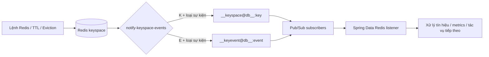

# Cấu hình notify-keyspace-events và chọn loại sự kiện trong Spring Data Redis

## 1. Mục tiêu

Redis có thể phát thông báo khi khóa được tạo, thay đổi, xóa, hết hạn hoặc bị loại khỏi bộ nhớ do chính sách eviction. Cơ chế đó gọi là **keyspace notifications**. Trong ứng dụng Spring Data Redis, ta có thể đăng ký một listener để nhận thông báo và xử lý những việc như:

- Biết khóa phiên tạm đã hết hạn.
- Theo dõi sự kiện xóa khóa thuộc một namespace.
- Cập nhật thống kê hoặc phát tín hiệu làm mới dữ liệu dẫn xuất.
- Quan sát thay đổi Redis key do nhiều tiến trình tạo ra.
- Tích hợp với các cơ chế xử lý vòng đời khóa của Redis Repository.

Tuy nhiên, Redis **không tự phát mọi sự kiện theo mặc định**. Ta phải bật cấu hình `notify-keyspace-events` với đúng tổ hợp ký tự. Nếu cấu hình thiếu ký tự chọn loại thông báo hoặc loại sự kiện, listener vẫn chạy nhưng không nhận thông báo mong đợi.

Bài học này hướng dẫn cách chọn cấu hình vừa đủ, đăng ký listener qua Spring Data Redis, phân biệt `expired` với `expire` và `evicted`, đồng thời hiểu giới hạn của Redis Pub/Sub khi dùng trong nghiệp vụ thực tế.

> **Nguyên tắc:** keyspace notifications là **tín hiệu quan sát sự thay đổi đã xảy ra**, không phải hàng đợi công việc bền vững, lịch hẹn chính xác hay cơ chế transaction.

## 2. Keyspace notifications hoạt động như thế nào?

Redis keyspace notifications được phát trên Redis Pub/Sub. Có hai cách nhìn cùng một thay đổi:

1. **Keyspace notification:** kênh biểu diễn **khóa nào thay đổi**, message biểu diễn **sự kiện gì xảy ra**.
2. **Keyevent notification:** kênh biểu diễn **sự kiện gì xảy ra**, message biểu diễn **khóa nào chịu tác động**.

Giả sử khóa `session:user-42` trong Redis database 0 hết hạn.

Redis có thể phát:

```text
Keyspace notification
  Channel: __keyspace@0__:session:user-42
  Message: expired

Keyevent notification
  Channel: __keyevent@0__:expired
  Message: session:user-42
```

Sự khác biệt nằm ở cách người nghe lọc dữ liệu:

| Tiêu chí | Keyspace | Keyevent |
|---|---|---|
| Cấu trúc channel | `__keyspace@<db>__:<key>` | `__keyevent@<db>__:<event>` |
| Nội dung message | Tên sự kiện, ví dụ `expired` | Tên khóa, ví dụ `session:user-42` |
| Phù hợp khi | Quan sát một khóa hoặc nhóm khóa theo tên | Nhận mọi khóa có cùng loại sự kiện |
| Ký tự cấu hình cần bật | `K` | `E` |
| Lọc bằng `PSUBSCRIBE` | `__keyspace@0__:session:*` | `__keyevent@0__:expired` |

Cả hai vẫn phụ thuộc vào **nhóm loại sự kiện** được bật. Chỉ cấu hình `K` hoặc `E` mà không chọn một loại sự kiện tương ứng thì không đủ để tạo thông báo có ích.

### Sơ đồ luồng sự kiện



Những message này được gửi khi Redis phát sinh sự kiện. Redis **không lưu chúng thành lịch sử** để ứng dụng đến sau có thể đọc lại.

## 3. Cấu hình notify-keyspace-events là một chuỗi ký tự

Cấu hình Redis có tên:

```text
notify-keyspace-events
```

Giá trị của cấu hình này là một **chuỗi gồm những cờ ký tự**. Mỗi ký tự chọn một tính năng hoặc nhóm sự kiện. Ví dụ:

```text
Ex
```

nghĩa là:

- `E`: bật thông báo dạng **keyevent**.
- `x`: chọn sự kiện khóa **hết hạn** (*expired*).

Khi dùng `Ex`, subscriber trên kênh `__keyevent@0__:expired` có thể nhận tên các key đã hết hạn.

Nếu dùng:

```text
Kx
```

thì sẽ chọn **keyspace notifications** cho sự kiện expired. Subscriber cần lắng nghe kênh `__keyspace@0__:<key>` và lấy `expired` từ message.

### 3.1. Hai cờ bắt buộc để chọn dạng thông báo

| Cờ | Ý nghĩa |
|---|---|
| `K` | Bật keyspace notifications, kênh chứa tên key |
| `E` | Bật keyevent notifications, kênh chứa tên event |

Có thể bật cả hai bằng `KE` nếu ứng dụng cần cả hai dạng. Nhưng để thực sự nhận được sự kiện, cần thêm cờ nhóm sự kiện như `x`, `g` hoặc `h`.

Ví dụ:

```text
KEx
```

bật cả keyspace và keyevent cho sự kiện expired. Khi một key hết hạn, cùng một thay đổi có thể tạo hai thông báo với hai dạng channel khác nhau.

### 3.2. Những cờ chọn nhóm sự kiện

| Cờ | Nhóm sự kiện | Ví dụ điển hình |
|---|---|---|
| `g` | Sự kiện lệnh chung (*generic*) | `del`, `expire`, `rename_from`, `rename_to` |
| `$` | Lệnh trên string | `set`, `incrby` và những thay đổi string khác |
| `l` | Lệnh trên list | `lpush`, `rpush`, `lpop` |
| `s` | Lệnh trên set | `sadd`, `srem` |
| `h` | Lệnh trên hash | `hset`, `hdel` |
| `z` | Lệnh trên sorted set | `zadd`, `zrem` |
| `t` | Lệnh trên stream | `xadd`, `xdel` |
| `d` | Sự kiện cho module key type | Phụ thuộc module Redis đang dùng |
| `x` | Khóa hết hạn (*expired*) | `expired` |
| `e` | Khóa bị đẩy khỏi bộ nhớ (*evicted*) | `evicted` |
| `m` | Sự kiện truy cập key không tồn tại | `keymiss` |
| `n` | Sự kiện tạo key mới | `new` |
| `o` | Sự kiện ghi đè khóa | `overwritten` |
| `c` | Sự kiện đổi kiểu dữ liệu của khóa | `type_changed` |

Một số nhóm hoặc loại thông báo chỉ xuất hiện trong những phiên bản Redis tương ứng. Những ký tự như `m`, `n`, `o`, `c` cần được xem xét theo phiên bản Redis server đang vận hành. Không giả định mọi Redis cũ hoặc dịch vụ Redis tương thích đều hỗ trợ toàn bộ các sự kiện mới.

### 3.3. Cờ A: viết tắt của nhiều nhóm sự kiện

Redis có ký tự `A` dùng làm bí danh cho phần lớn các nhóm sự kiện thông dụng. Theo tài liệu Redis, `A` đại diện cho:

```text
g$lshztdxe
```

Vì vậy:

```text
KEA
```

là cách bật keyspace + keyevent và nhiều loại thông báo thông dụng. **`A` không có nghĩa là mọi loại sự kiện có thể tồn tại**, vì một số nhóm như `m`, `n`, `o`, `c` không nằm trong bí danh trên và có thể cần bật tường minh.

Quan trọng hơn, ứng dụng production hiếm khi cần nhận gần như mọi loại thông báo. Cấu hình rộng khiến Redis phải phát thêm nhiều message khi dữ liệu thay đổi thường xuyên, dẫn tới tải Pub/Sub và log cao hơn.

**Ưu tiên cấu hình tối thiểu đúng nhu cầu** thay vì bật `KEA` theo thói quen.

## 4. Chọn tổ hợp cờ theo loại sự kiện cần nhận

Hãy bắt đầu bằng câu hỏi: **điều gì thực sự cần theo dõi?** Sau đó chọn keyspace hay keyevent và nhóm sự kiện phù hợp.

| Nhu cầu | Cấu hình ví dụ | Kênh nên subscribe |
|---|---|---|
| Chỉ nhận key hết hạn | `Ex` | `__keyevent@0__:expired` |
| Theo dõi một prefix khi key hết hạn | `Kx` | `__keyspace@0__:session:*` |
| Nhận key được xóa bằng lệnh DEL | `Eg` | `__keyevent@0__:del` |
| Nhận cả xóa chủ động và hết hạn | `Egx` | `__keyevent@0__:del` và `__keyevent@0__:expired` |
| Nhận key bị eviction vì bộ nhớ | `Ee` | `__keyevent@0__:evicted` |
| Theo dõi thao tác thay đổi hash | `Eh` | `__keyevent@0__:hset` và những event hash có hỗ trợ |
| Theo dõi string update | `E$` | Các channel keyevent tương ứng với string, như `set` |
| Theo dõi stream update | `Et` | Các channel tương ứng, như `xadd` |
| Theo dõi generic + expired + evicted | `Egxe` | Các channel tương ứng |
| Cần cả hai dạng channel cho expired | `KEx` | `__keyspace...` và `__keyevent...` |

Những cấu hình trên là **ví dụ theo mục đích**, không có nghĩa mỗi Redis instance chỉ được có một nhu cầu. Nếu nhiều ứng dụng dùng chung một Redis server, phải kết hợp các cờ cần thiết thành **một chuỗi cấu hình thống nhất**.

Ví dụ một ứng dụng cần `Ex`, ứng dụng khác cần `Eg`, thì giá trị kết hợp có thể là:

```text
Egx
```

Thứ tự các cờ không mang ý nghĩa thứ tự thực thi sự kiện.

### Không nhầm expire, expired và evicted

Có ba tình huống thường bị nhầm:

**1. Lệnh đặt TTL:**

```redis
EXPIRE session:user-42 300
```

Khi Redis chấp nhận lệnh đặt thời hạn, một sự kiện generic như `expire` có thể được phát nếu bật `g`. **Khóa chưa hết hạn**: chỉ có mốc TTL được thiết lập/thay đổi.

**2. Khóa thực sự hết hạn:**

```text
Sau một thời gian, Redis phát hiện TTL của key đã hết.
Sự kiện: expired
Nhóm cờ: x
```

`expired` không đồng nghĩa với `expire`.

**3. Khóa bị loại bỏ do chính sách bộ nhớ:**

```text
Redis cần giải phóng bộ nhớ theo maxmemory-policy.
Khóa bị eviction.
Sự kiện: evicted
Nhóm cờ: e
```

`evicted` không đồng nghĩa với TTL expired. Một key có TTL vẫn có thể bị eviction trước thời hạn nếu chính sách bộ nhớ cho phép. Ngược lại, key hết hạn theo TTL không nhất thiết bị eviction do maxmemory.

### DEL không phải expired

Nếu ứng dụng chủ động chạy:

```redis
DEL session:user-42
```

thì sự kiện thuộc nhóm generic, chẳng hạn `del`, không phải `expired`. Nếu listener chỉ subscribe `__keyevent@0__:expired` thì **không nhận được** các lần xóa bằng `DEL`.

Cần theo dõi cả hai trường hợp thì dùng cấu hình có cả `g` và `x`, ví dụ `Egx`, rồi đăng ký listener cho cả hai channel.

## 5. Đọc và thay đổi cấu hình trong Redis CLI

### 5.1. Xem cấu hình hiện tại

Trên Redis server cần cấu hình:

```redis
CONFIG GET notify-keyspace-events
```

Giá trị rỗng có nghĩa thông báo loại này chưa được bật. Một số Redis server có thể trả chuỗi các ký tự đã được chuẩn hóa thứ tự; điều quan trọng là **tập ký tự đang bật**, không phải vị trí từng ký tự trong chuỗi.

### 5.2. Bật keyevent expired

```redis
CONFIG SET notify-keyspace-events Ex
```

Sau đó đọc lại:

```redis
CONFIG GET notify-keyspace-events
```

Đây là cấu hình phục vụ việc nhận `__keyevent@0__:expired`. Nó **không** tự tạo key có TTL hoặc tự đăng ký subscriber; ứng dụng vẫn phải lắng nghe đúng channel.

### 5.3. Bật nhiều loại khi cần

Nếu muốn nhận sự kiện key bị xóa chủ động và key hết hạn:

```redis
CONFIG SET notify-keyspace-events Egx
```

Nếu muốn theo dõi thêm eviction vì bộ nhớ:

```redis
CONFIG SET notify-keyspace-events Egxe
```

**Cẩn trọng:** `CONFIG SET notify-keyspace-events ...` thay **toàn bộ giá trị cấu hình**, không chỉ thêm một cờ mới. Nếu Redis server đang phục vụ một ứng dụng khác cần loại sự kiện `h`, việc đặt `Ex` có thể vô tình làm listener của ứng dụng khác không nhận được hash event.

Trước khi thay đổi trong môi trường chung, cần đọc cấu hình hiện tại và thống nhất tập các cờ yêu cầu.

### 5.4. Cấu hình trong redis.conf hoặc khi khởi động Redis

Với Redis tự quản lý, có thể cấu hình trong `redis.conf`:

```conf
notify-keyspace-events "Egx"
```

Hoặc khi khởi động server cho môi trường thử nghiệm:

```bash
redis-server --notify-keyspace-events Egx
```

Điều này giúp cấu hình có hiệu lực khi Redis khởi động theo file/tham số đó. Nếu thay đổi bằng `CONFIG SET` khi server đang chạy, cấu hình runtime **không nhất thiết tồn tại sau lần restart**.

Một số Redis self-hosted cho phép dùng:

```redis
CONFIG REWRITE
```

để ghi lại một số cấu hình động vào file cấu hình đang sử dụng. Khả năng này phụ thuộc cách server được khởi động, file cấu hình và quyền ghi; môi trường managed Redis có thể không hỗ trợ hoặc không cho phép `CONFIG REWRITE`.

### 5.5. Redis được quản lý và quyền truy cập CONFIG

Trên nhiều nền tảng Redis managed, ứng dụng **không có quyền** dùng `CONFIG SET` hoặc không được thay đổi cấu hình bằng lệnh runtime. Khi đó cần dùng cơ chế parameter group, cấu hình dịch vụ hoặc công cụ quản trị do nhà cung cấp hỗ trợ.

Không đặt logic trong mỗi instance ứng dụng để liên tục chạy `CONFIG SET` mà không kiểm soát quyền và phối hợp. Khi nhiều dịch vụ cùng dùng một Redis server, các lệnh cấu hình có thể ghi đè lẫn nhau.

Ứng dụng nên kiểm tra cấu hình đã được triển khai đúng tại hạ tầng thay vì coi quyền chỉnh sửa Redis server luôn có sẵn.

## 6. Thực hành: nhận sự kiện expired bằng Redis CLI

Thực hành dưới đây dùng Redis database 0 và hai cửa sổ terminal.

**Bước 1 — bật keyevent expired:**

```redis
CONFIG SET notify-keyspace-events Ex
```

**Bước 2 — terminal A đăng ký lắng nghe trước khi tạo key:**

```redis
PSUBSCRIBE __keyevent@0__:expired
```

Terminal A tiếp tục chạy để chờ message.

**Bước 3 — terminal B tạo một key có TTL ngắn:**

```redis
SET demo:notification:session:1 active EX 5
```

Lệnh `SET ... EX 5` tạo key string có hạn sống 5 giây.

**Bước 4 — quan sát:**

Khi Redis xử lý expiration, terminal A nhận một message có channel:

```text
__keyevent@0__:expired
```

và payload:

```text
demo:notification:session:1
```

Thông báo có thể đến **sau** mốc 5 giây một chút vì Redis phát sự kiện khi key thực sự bị xử lý là hết hạn, không bảo đảm phát ngay đúng tại thời điểm TTL chạm 0.

### Thử keyspace notification thay vì keyevent

Đổi cấu hình:

```redis
CONFIG SET notify-keyspace-events Kx
```

Terminal A:

```redis
PSUBSCRIBE __keyspace@0__:demo:notification:*
```

Terminal B:

```redis
SET demo:notification:session:2 active EX 5
```

Message khi hết hạn có dạng:

```text
Channel: __keyspace@0__:demo:notification:session:2
Payload: expired
```

**Khác biệt rõ nhất:** với keyevent, payload là tên khóa; với keyspace, tên khóa nằm trong channel còn payload là loại sự kiện.

### Đừng quên chọn database đúng

Nếu subscriber đang nghe `__keyevent@0__:expired` nhưng ứng dụng ghi key trong Redis logical database 1, sự kiện sẽ xuất hiện ở channel tương ứng với database 1, chẳng hạn:

```text
__keyevent@1__:expired
```

Do đó phải kiểm tra connection factory, cấu hình database của ứng dụng và DB đang dùng trong Redis CLI. Redis Cluster thường chỉ hỗ trợ database 0, nên không lấy kinh nghiệm nhiều logical DB của Redis standalone để suy ra thiết kế tương ứng trong cluster.

## 7. Thực hành: phân biệt DEL và expired

Đặt cấu hình:

```redis
CONFIG SET notify-keyspace-events Egx
```

Terminal A theo dõi các keyevent:

```redis
PSUBSCRIBE __keyevent@0__:*
```

Terminal B:

```redis
SET demo:notification:delete-me value
DEL demo:notification:delete-me

SET demo:notification:expire-me value EX 5
```

Các sự kiện đáng chú ý:

| Thao tác | Event thường liên quan | Cờ cần bật |
|---|---|---|
| `DEL demo:notification:delete-me` | `del` | `g` |
| `SET ... EX 5` | Có thể phát event `set` cho string và event đặt TTL theo nhóm phù hợp | `$` / `g` tùy loại |
| Key `expire-me` thực sự hết hạn | `expired` | `x` |

Với `Egx`, mục đích của thử nghiệm là nhận `del` và `expired`; **không cần** bật `$` nếu không quan tâm sự kiện ghi string.

Cũng cần phân biệt trường hợp `EXPIRE key 0` hoặc đặt một thời hạn đã qua: Redis có thể xóa key ngay và phát một sự kiện `del` theo ngữ nghĩa của lệnh, thay vì `expired` như trường hợp key chờ TTL rồi hết hạn tự nhiên.

## 8. Đăng ký listener bằng Spring Data Redis

Redis keyspace notifications là cơ chế Pub/Sub, vì vậy có thể dùng `RedisMessageListenerContainer` của Spring Data Redis để đăng ký các channel cần lắng nghe.

Dependency Spring Boot với Gradle:

```kotlin
dependencies {
    implementation("org.springframework.boot:spring-boot-starter-data-redis")
}
```

Hoặc Maven:

```xml
<dependency>
    <groupId>org.springframework.boot</groupId>
    <artifactId>spring-boot-starter-data-redis</artifactId>
</dependency>
```

Cấu hình Redis local minh họa trong `application.yml`:

```yaml
spring:
  data:
    redis:
      host: localhost
      port: 6379
      database: 0
```

Ứng dụng Spring Boot thường tự cấu hình `RedisConnectionFactory`. Cần đặt thêm xác thực, TLS, topology và timeout theo môi trường thực tế. **Cấu hình kết nối không tự động bật `notify-keyspace-events` cho Redis server**; đó vẫn là thiết lập phía Redis.

### 8.1. Listener nhận khóa expired

**File `RedisExpiredKeyListenerConfig.java`:**

```java
package com.example.notifications;

import java.nio.charset.StandardCharsets;

import org.slf4j.Logger;
import org.slf4j.LoggerFactory;
import org.springframework.context.annotation.Bean;
import org.springframework.context.annotation.Configuration;
import org.springframework.data.redis.connection.RedisConnectionFactory;
import org.springframework.data.redis.listener.ChannelTopic;
import org.springframework.data.redis.listener.RedisMessageListenerContainer;

@Configuration
public class RedisExpiredKeyListenerConfig {

    private static final Logger log =
            LoggerFactory.getLogger(RedisExpiredKeyListenerConfig.class);

    @Bean
    public RedisMessageListenerContainer expiredKeyContainer(
            RedisConnectionFactory connectionFactory
    ) {
        RedisMessageListenerContainer container =
                new RedisMessageListenerContainer();

        container.setConnectionFactory(connectionFactory);

        container.addMessageListener(
                (message, pattern) -> {
                    String key = new String(
                            message.getBody(),
                            StandardCharsets.UTF_8
                    );

                    log.info("Redis key expired: {}", key);
                },
                new ChannelTopic("__keyevent@0__:expired")
        );

        return container;
    }
}
```

Cần lưu ý:

- `RedisMessageListenerContainer` quản lý việc subscribe/unsubscribe bằng Redis Pub/Sub.
- `ChannelTopic` đăng ký **đúng một channel**; ở đây là `__keyevent@0__:expired`.
- `message.getBody()` chứa payload. Với keyevent expired, payload là **tên Redis key**.
- Ví dụ chuyển bytes sang UTF-8 vì hệ thống giả định tên key có thể biểu diễn bằng UTF-8. Với một số key nhị phân hoặc serializer khác, không nên mặc định mọi byte đều là chuỗi UTF-8 hợp lệ theo quy ước nghiệp vụ.
- Listener **chỉ nhận** các sự kiện xảy ra trong lúc nó đang subscribe; nó không nhận lại sự kiện trong quá khứ.
- Để nhận message, Redis server phải bật `Ex` hoặc một cấu hình bao gồm `E` và `x`.

Trong production, tránh log nguyên tên khóa nếu chúng chứa token, dữ liệu người dùng hoặc thông tin nhạy cảm. Có thể phân loại theo namespace và log hash/identifier đã được xử lý an toàn.

### 8.2. Nghe nhiều loại keyevent

Nếu cần nhận đồng thời `del`, `expired` và `evicted`:

```java
@Bean
public RedisMessageListenerContainer keyLifecycleContainer(
        RedisConnectionFactory connectionFactory
) {
    RedisMessageListenerContainer container =
            new RedisMessageListenerContainer();

    container.setConnectionFactory(connectionFactory);

    container.addMessageListener(
            (message, pattern) -> {
                String channel = new String(
                        message.getChannel(),
                        java.nio.charset.StandardCharsets.UTF_8
                );

                String key = new String(
                        message.getBody(),
                        java.nio.charset.StandardCharsets.UTF_8
                );

                if (channel.endsWith(":expired")) {
                    // Xử lý tín hiệu key đã hết hạn.
                } else if (channel.endsWith(":del")) {
                    // Xử lý tín hiệu xóa chủ động.
                } else if (channel.endsWith(":evicted")) {
                    // Xử lý tín hiệu eviction.
                }
            },
            new org.springframework.data.redis.listener.PatternTopic(
                    "__keyevent@0__:*"
            )
    );

    return container;
}
```

Đoạn trên minh họa cách chọn hành động theo tên event. Nếu subscriber quan tâm đúng ba loại, cũng có thể đăng ký **ba `ChannelTopic` riêng biệt** để tránh nghe những event không liên quan.

Redis server phải được cấu hình có các cờ tương ứng, ví dụ:

```redis
CONFIG SET notify-keyspace-events Egxe
```

`PatternTopic("__keyevent@0__:*")` chỉ mở rộng phạm vi **subscribe**; nó không tự bật thêm sự kiện trên Redis server.

**Không nên tạo đồng thời nhiều container trùng chức năng** nếu không cần thiết. Hai bean ở ví dụ 8.1 và 8.2 là những **phương án cấu hình độc lập**: chọn một cách theo nhu cầu, hoặc tổ chức thành một container quản lý nhiều listener rõ ràng.

## 9. Nghe keyspace notification theo prefix khóa

Nếu cần theo dõi mọi thay đổi được bật cho nhóm khóa `session:*`, channel keyspace phù hợp hơn:

```java
container.addMessageListener(
        (message, pattern) -> {
            String channel = new String(
                    message.getChannel(),
                    java.nio.charset.StandardCharsets.UTF_8
            );

            String event = new String(
                    message.getBody(),
                    java.nio.charset.StandardCharsets.UTF_8
            );

            // Ví dụ:
            // channel = "__keyspace@0__:session:user-42"
            // event   = "expired"
        },
        new org.springframework.data.redis.listener.PatternTopic(
                "__keyspace@0__:session:*"
        )
);
```

Với cấu hình Redis:

```redis
CONFIG SET notify-keyspace-events Kx
```

listener có thể nhận những thông báo expired trên các khóa có tiền tố `session:`. Nếu cũng muốn theo dõi `del` thì thêm `g`, ví dụ `Kgx`.

### Chọn dạng kênh nào cho ứng dụng Spring?

| Nhu cầu | Nên cân nhắc |
|---|---|
| Mọi key expired trong DB 0 | `E` + `x`, channel `__keyevent@0__:expired` |
| Một namespace khi các loại thay đổi xảy ra | `K` + nhóm sự kiện, pattern `__keyspace@0__:prefix*` |
| Phân loại nhiều event theo tên event | Keyevent channels |
| Chỉ cần biết một key cụ thể bị thay đổi | Keyspace channel của key đó |
| Cần nội dung giá trị trước khi xóa | Không đủ thông tin chỉ từ keyspace notifications |
| Cần xử lý sự kiện không được phép mất | Không nên chỉ dựa vào Redis Pub/Sub notifications |

Cần chú ý channel pattern sử dụng glob-style matching của Redis Pub/Sub. Nếu cho dữ liệu người dùng đi vào pattern subscription, phải kiểm soát phạm vi và ký tự đặc biệt để tránh vô tình subscribe rộng hơn dự kiến.

## 10. Spring Data Redis Repository và sự kiện khóa hết hạn

Khi dùng **Redis Repository** cùng `@RedisHash(timeToLive = ...)` hoặc `@TimeToLive`, Spring Data Redis có thể dùng keyspace notifications để theo dõi việc entity hết hạn và phát sự kiện ứng dụng.

Ví dụ entity tạm:

```java
package com.example.notifications.model;

import org.springframework.data.annotation.Id;
import org.springframework.data.redis.core.RedisHash;

@RedisHash(value = "demo:temporary-session", timeToLive = 600)
public class TemporarySession {

    @Id
    private String id;

    private String state;

    public TemporarySession() {
    }

    public TemporarySession(String id, String state) {
        this.id = id;
        this.state = state;
    }

    public String getId() {
        return id;
    }

    public void setId(String id) {
        this.id = id;
    }

    public String getState() {
        return state;
    }

    public void setState(String state) {
        this.state = state;
    }
}
```

Key của entity có thể được lưu theo quy ước:

```text
demo:temporary-session:session-1001
```

Sau khi key hết hạn, listener của Spring Data Redis Repository có thể nhận sự kiện tương ứng và phát `RedisKeyExpiredEvent` trong ứng dụng, nếu được cấu hình hoạt động.

### 10.1. Bật listener khi cần

Ví dụ cấu hình repository tường minh:

```java
package com.example.notifications.config;

import org.springframework.context.annotation.Configuration;
import org.springframework.data.redis.core.RedisKeyValueAdapter.EnableKeyspaceEvents;
import org.springframework.data.redis.repository.configuration.EnableRedisRepositories;

@Configuration
@EnableRedisRepositories(
        basePackages = "com.example.notifications.repository",
        enableKeyspaceEvents = EnableKeyspaceEvents.ON_STARTUP
)
public class RedisRepositoryConfig {
}
```

Ví dụ này dùng khi ứng dụng cần cấu hình repository bằng tay. Nếu Spring Boot đã có cấu hình repository đúng, không thêm một lớp quét repository chồng lặp mà không hiểu ảnh hưởng.

Chế độ `ON_STARTUP` bắt đầu listener từ khi ứng dụng khởi động. Các chế độ khác có thể trì hoãn việc khởi tạo listener tùy lúc entity có TTL được thêm vào. Cần chọn theo yêu cầu theo dõi và tác động tài nguyên.

Spring Data Redis Repository có thể yêu cầu cấu hình `notify-keyspace-events` phù hợp (thường là loại expired) và có thể cố thiết lập cấu hình Redis khi khởi tạo listener. Trên Redis managed nơi `CONFIG` bị chặn, việc tự cấu hình này có thể thất bại; cần đặt cấu hình ở server và điều chỉnh hành vi tự cấu hình của thư viện theo phiên bản đang dùng.

### 10.2. Shadow copy: sự kiện hết hạn có mang nội dung entity không?

Một khi Redis key thực sự hết hạn, hash ban đầu **không còn để đọc**. Spring Data Redis Repository có cơ chế dùng **shadow copy/phantom copy** trong một số cấu hình để giữ tạm dữ liệu phục vụ sự kiện hết hạn chứa nội dung entity.

Tính năng này có chi phí bộ nhớ, vì có thể lưu thêm khóa phụ với vòng đời dài hơn hash gốc. Nếu ứng dụng không cần toàn bộ nội dung entity trong `RedisKeyExpiredEvent`, có thể xem xét cấu hình tắt shadow copy theo khả năng phiên bản đang dùng.

Dù có shadow copy, sự kiện expiration vẫn phụ thuộc Pub/Sub và listener. Không nên dùng nó làm kênh sự kiện bền vững cho các nghiệp vụ bắt buộc chính xác một lần.

### 10.3. Secondary index và xử lý hết hạn

Redis Repository có thể quản lý secondary index cho các thuộc tính `@Indexed`. Khi hash entity hết hạn tự nhiên, Redis **không tự xóa mọi quan hệ index** do Spring Data tạo.

Cơ chế nhận expiration event có thể giúp repository thực hiện công việc dọn dẹp index. Nếu listener không chạy hoặc bỏ lỡ event, index phụ trợ có thể chứa tham chiếu cũ, dù key chính đã biến mất.

Vì vậy, khi dùng Redis Repository với TTL, cần xét không chỉ thời gian sống của entity mà còn:

- Cấu hình notify-keyspace-events và listener.
- Khả năng nhận sự kiện khi ứng dụng đang chạy.
- Trường hợp ứng dụng dừng trong lúc key hết hạn.
- Phương án kiểm tra và dọn index lỗi thời.
- Chi phí shadow copy và thông báo trên keyspace lớn.

## 11. Giới hạn: thông báo không đảm bảo đến đúng lúc TTL về 0

Giả sử:

```redis
SET demo:notification:short value EX 5
```

Lệnh này yêu cầu Redis cho key sống khoảng 5 giây. Nhưng `expired` được phát khi Redis **thực sự phát hiện và xử lý việc hết hạn khóa**, không phải nhất thiết ngay tại đúng mốc đồng hồ khi TTL lý thuyết vừa về 0.

Redis có các cơ chế hết hạn bị động và chủ động. Một key có thể được xử lý là hết hạn khi được truy cập hoặc trong vòng quét các key sắp hết hạn của Redis. Do đó, thời điểm phát event có thể trễ so với mốc TTL đặt trước.

### Hệ quả đối với nghiệp vụ

Không nên dùng `expired` làm đồng hồ hẹn giờ chính xác để:

- Chốt giao dịch thanh toán đúng từng mili giây.
- Gửi thông báo bắt buộc đúng một lần.
- Xử lý duy nhất một yêu cầu hoàn tiền.
- Quyết định quyền truy cập dựa trên sự kiện đến muộn hay sớm.
- Bảo đảm hoàn tất tác vụ trước một deadline cứng.

Nếu nghiệp vụ có deadline, lưu mốc `expiresAt` và xác minh điều kiện tại nơi quyết định. Khi cần một tác vụ chắc chắn được xử lý sau deadline, nên có một scheduler, hàng đợi hoặc job bền vững đủ khả năng retry.

### Đặc biệt: hết hạn ngay do EXPIRE với thời gian không dương

Nếu đặt TTL bằng 0 hoặc mốc hết hạn đã qua cho key đang tồn tại, Redis có thể xóa key ngay theo semantics của lệnh. Khi đó sự kiện có thể được xem là **`del`**, không phải `expired` thông thường. Listener chỉ bật `x` có thể không nhìn thấy trường hợp này.

Nếu muốn theo dõi mọi cách khóa biến mất, phải lựa chọn thêm các nhóm sự kiện liên quan và hiểu cả thao tác xóa chủ động lẫn eviction.

## 12. Giới hạn: Redis Pub/Sub không lưu bền vững thông báo

Keyspace notifications dựa trên **Redis Pub/Sub**. Đây là cơ chế gửi thông báo tới các subscriber đang kết nối, không phải Stream hay queue có ack.

Tình huống:

```text
09:00:00  Spring listener đang hoạt động
09:00:01  Ứng dụng mất kết nối Redis
09:00:02  Một key hết hạn và Redis phát expired
09:00:05  Ứng dụng kết nối lại
```

Thông báo phát lúc 09:00:02 có thể **đã mất đối với ứng dụng**. Khi listener kết nối lại, Redis không phát lại event từ quá khứ.

Do đó:

- Không có `ACK` hoặc cơ chế retry tự động cho một keyspace notification đã phát.
- Không có khả năng đọc lại backlog như `XREAD` của Redis Streams.
- Không thể chứng minh “không bỏ sót” chỉ vì listener thường xuyên chạy.
- Nếu listener xử lý lỗi sau khi nhận message, Redis không tự gửi lại message đó theo cơ chế consumer group.
- Khi có nhiều instance subscribe cùng một channel Pub/Sub, mỗi subscriber đang hoạt động có thể đều nhận thông báo; không tự chia việc như hàng đợi một-consumer.

Nếu cần xử lý từng sự kiện với retry và giám sát tiến độ, cân nhắc phát sự kiện nghiệp vụ chủ động vào Redis Streams hoặc hàng đợi có độ bền phù hợp tại **thời điểm thao tác nghiệp vụ**, thay vì suy ra một event bền vững chỉ từ TTL.

## 13. Redis Cluster và nhiều node: không suy ra phạm vi toàn cụm

Trong Redis Cluster, key được phân phối giữa nhiều primary theo hash slot. Keyspace notifications được tạo tại node xử lý thay đổi key. Việc subscribe thông qua một kết nối tới một node cụ thể **không mặc nhiên đồng nghĩa ứng dụng đã quan sát được mọi thay đổi trên toàn cluster**.

Khi triển khai, phải xét:

- Mỗi key nằm trên node nào và thông báo của key được phát ở đâu.
- Driver Redis (Lettuce/Jedis), connection factory và cách xử lý Pub/Sub trong cluster.
- Failover, resharding và khả năng subscriber đang kết nối lại.
- Có cần subscribe hoặc quản lý listener trên nhiều node không.
- Redis database index trên cluster; phổ biến là database 0.
- Chính sách cấu hình `notify-keyspace-events` trên các node có đồng nhất không.

Không nên xác nhận “đã cấu hình listener trên một host” rồi coi là đủ cho toàn bộ Redis Cluster. Phải dựa vào tài liệu của driver/Redis deployment và thiết kế subscriber đúng topology.

Trong Redis Sentinel, client thường kết nối tới primary hiện tại và failover có thể làm connection thay đổi. Subscriber cần cơ chế kết nối lại và vẫn chịu nguy cơ bỏ lỡ sự kiện trong khoảng chuyển đổi.

## 14. Hiệu năng: bật đúng số loại event cần thiết

Keyspace notifications có chi phí xử lý vì Redis phải tạo message khi key thay đổi và phát qua Pub/Sub cho các subscriber. Redis thường tắt tính năng này theo mặc định để tránh chi phí khi ứng dụng không sử dụng.

Giả sử hệ thống ghi hàng chục nghìn `HSET` mỗi giây. Nếu bật `Eh` và listener ghi một dòng log cho mỗi thay đổi, hệ thống có thể tạo lượng Pub/Sub message và log rất lớn.

Các nguồn chi phí:

| Thành phần | Chi phí có thể phát sinh |
|---|---|
| Redis server | Phát message cho những loại thay đổi đã bật |
| Kết nối Pub/Sub | Truyền message liên tục tới các subscriber |
| Spring listener | Giải mã channel/payload và dispatch callback |
| Logging/metrics | Ghi lượng lớn event vào log hoặc hệ giám sát |
| Xử lý nghiệp vụ | Có thể gọi database, HTTP hoặc tạo job theo event |
| Nhiều subscriber | Mỗi subscriber phù hợp có thể nhận cùng event |

### Cách hạn chế tải

1. **Chỉ bật nhóm sự kiện thực sự cần.** Nếu chỉ cần expired, chọn `Ex` thay vì `KEA`.
2. **Đăng ký channel cụ thể.** Chẳng hạn `__keyevent@0__:expired` thay vì tất cả `__keyevent@0__:*`.
3. **Lọc namespace sớm.** Với keyevent, payload là tên key; listener có thể kiểm tra prefix để tránh tác động ngoài vùng quản lý.
4. **Không xử lý nặng ngay trong callback.** Một callback chậm có thể làm nghẽn thread dispatch/notification; đưa công việc phù hợp sang executor/queue có giới hạn nếu cần.
5. **Không log secret hoặc toàn bộ dữ liệu nhạy cảm.** Tên key có thể chứa identifier, session token hoặc thông tin riêng tư.
6. **Không dùng thông báo thay kiểm tra trạng thái chuẩn.** Event chỉ là tín hiệu kích hoạt kiểm tra, không phải nguồn sự thật bất biến.

### Hạn chế xử lý trùng

Nếu một ứng dụng có nhiều instance cùng subscribe keyevent, một sự kiện expired có thể được nhiều instance nhận và xử lý. Nếu tất cả cùng gọi một API bên ngoài, có thể phát sinh side effect nhiều lần.

Khi cần chỉ một lần, phải có cơ chế điều phối/idempotency theo khóa nghiệp vụ; Pub/Sub subscription tự nó không cung cấp phân phối exactly-once.

## 15. Keyspace event không chứa giá trị cũ của key

Thông báo keyevent thông thường cho ta **tên key**, còn keyspace thông báo **loại event** trong message. Không có sẵn toàn bộ hash/value cũ trong payload.

Ví dụ:

```text
Channel: __keyevent@0__:expired
Body:    session:user-42
```

Nếu listener chạy:

```java
String value = redis.opsForValue().get("session:user-42");
```

thì giá trị thường đã biến mất vì key hết hạn. Không nên xây dựng nghiệp vụ dựa trên việc có thể đọc lại nội dung key sau một thông báo `expired`.

Tương tự, khi nhận `del`, key đã bị xóa nên nội dung cũ thường không thể truy vấn từ Redis.

Các cách thiết kế khi cần biết nội dung trước khi biến mất:

- Lưu metadata hoặc bản ghi nghiệp vụ cần thiết trong nguồn bền vững khác.
- Phát sự kiện nghiệp vụ chứa dữ liệu cần thiết **trước khi** xóa hoặc đặt lại trạng thái.
- Với Redis Repository TTL, cân nhắc cơ chế shadow copy nếu phù hợp với yêu cầu và chi phí.
- Chỉ đưa key identifier vào message rồi truy vấn nguồn chuẩn để xác minh lại.

**Không tạo phụ thuộc sống còn vào việc một Redis expired event sẽ cung cấp đầy đủ object đã xóa.**

## 16. Chọn chiến lược listener theo namespace

Một Redis instance có thể chứa nhiều nhóm dữ liệu:

```text
shop:v1:cart:*
shop:v1:session:*
shop:v1:products:*
shop:v1:rate-limit:*
```

Không phải sự kiện của mọi nhóm đều cần xử lý giống nhau.

Ví dụ thiết kế:

| Namespace | Nhu cầu | Cách nghe |
|---|---|---|
| `shop:v1:session:*` | Quan sát session hết hạn | Keyspace pattern + `Kx` hoặc keyevent expired + lọc prefix |
| `shop:v1:cart:*` | Ghi metrics về cart hết hạn | `Ex`, lọc prefix, xử lý không bắt buộc |
| `shop:v1:products:*` | Theo dõi lệnh xóa thủ công | `Eg`, lọc prefix |
| `shop:v1:rate-limit:*` | Không cần side effect khi counter hết hạn | Không cần listener |
| `shop:v1:order:*` | Có yêu cầu xử lý nghiệp vụ bền vững | Dùng event/job riêng; không chỉ dựa vào Pub/Sub expired |

Cấu hình `notify-keyspace-events` là ở Redis server, không phải mỗi prefix một cấu hình riêng. Việc lọc prefix xảy ra ở phần **subscription channel** (đối với keyspace) hoặc trong **callback** (đối với keyevent).

Nếu nhiều team cùng dùng Redis, cần quy định namespace rõ để tránh subscriber xử lý nhầm key của nhau.

## 17. Cách chẩn đoán khi Spring listener không nhận sự kiện

Khi listener đã chạy nhưng không thấy message, hãy kiểm tra theo thứ tự.

### 17.1. Redis có bật cấu hình đúng không?

```redis
CONFIG GET notify-keyspace-events
```

Nếu đang chờ keyevent expired, cần có `E` và `x` (hoặc một cấu hình tương đương có `A` bao gồm `x`).

Nếu cấu hình là `Kx` thì server phát **keyspace**, không phát **keyevent**; subscription tới `__keyevent@0__:expired` sẽ không nhận được.

### 17.2. Subscribe đúng Redis database không?

Kênh có DB index:

```text
__keyevent@0__:expired
__keyevent@1__:expired
```

Nếu listener nghe DB 0 nhưng client tạo key ở DB 1, sẽ không nhận được message trên channel DB 0.

### 17.3. Có tạo sự kiện thực sự không?

- `SET key value` không phải sự kiện `expired`.
- `EXPIRE key 60` chỉ đặt thời hạn; chờ 60 giây mới có thể có `expired`.
- `DEL key` là thao tác xóa, không phải TTL expired.
- Nếu `DEL` trên key không tồn tại, có thể không có thay đổi nào để phát event tương ứng.
- Nếu Redis bị cấu hình không bật nhóm `x`, chờ lâu hơn cũng không giải quyết được việc thiếu cờ.

### 17.4. Listener có chạy trước lúc sự kiện phát không?

Pub/Sub không replay. Nếu key đã hết hạn trước khi Spring khởi tạo subscription, không có message cũ để nhận.

Thử dùng `PSUBSCRIBE` trực tiếp trên Redis CLI trước khi tạo key mới. Nếu CLI nhận event còn Spring không nhận, kiểm tra lại container, connection factory, channel, quyền và connection lifecycle của ứng dụng.

### 17.5. Có nhầm payload keyspace với keyevent không?

Với keyspace:

```text
Channel = __keyspace@0__:session:user-42
Payload = expired
```

Với keyevent:

```text
Channel = __keyevent@0__:expired
Payload = session:user-42
```

Nếu code lấy payload làm tên key trong khi đang nghe keyspace, ứng dụng sẽ cố xử lý chuỗi `expired` như thể tên key. Cần giải mã đúng kiểu channel đã subscribe.

### 17.6. Redis Cluster hay Redis Sentinel có failover không?

Nếu môi trường có nhiều node, thông báo có thể phát tại node khác, hoặc listener có thể đã mất kết nối trong failover. Xác nhận khả năng subscribe theo topology và tình trạng reconnect.

### 17.7. Quyền truy cập Redis có đủ không?

Một số Redis ACL có thể hạn chế các lệnh `SUBSCRIBE`/`PSUBSCRIBE`, truy cập Pub/Sub channel hoặc `CONFIG GET/SET`. Cần xác nhận quyền của tài khoản Redis mà ứng dụng dùng.

Không cấp quyền `CONFIG SET` cho toàn bộ application worker chỉ vì muốn bật notification. Cấu hình Redis server nên được quản lý có chủ đích ở tầng vận hành.

## 18. Bảng lỗi thường gặp

| Triệu chứng | Nguyên nhân phổ biến | Cách khắc phục |
|---|---|---|
| `PSUBSCRIBE` không nhận `expired` | Thiếu `E` hoặc `x` | Dùng `Ex` hoặc cấu hình tương đương |
| Keyspace listener không nhận, nhưng keyevent listener có nhận | Cấu hình chỉ bật `E` | Thêm `K` khi cần keyspace |
| Nhận `expire` nhưng không nhận `expired` | Chỉ bật nhóm generic `g`, chưa bật `x` | Thêm `x` |
| Xóa bằng `DEL` không phát `expired` | `DEL` thuộc nhóm generic | Nghe `del` và bật `g` |
| Không nhận key bị eviction | Nhầm eviction với TTL | Thêm `e`, nghe `evicted` |
| Một listener nhận thông báo quá nhiều | Bật quá nhiều cờ hoặc pattern quá rộng | Thu hẹp cấu hình, channel và namespace |
| Không đọc được value sau khi nhận expired | Key chính đã bị loại bỏ | Lưu metadata trước hoặc dùng nguồn dữ liệu khác |
| Sự kiện đến trễ | Redis xử lý expiration không đúng khoảnh khắc TTL chạm 0 | Không dùng event làm timer chính xác |
| Mất event trong khi ứng dụng restart | Redis Pub/Sub không bền vững | Dùng hàng đợi/job khi cần không bỏ sót |
| Listener chạy trên DB khác | Channel có DB index khác | Kiểm tra DB của connection và channel |
| Lỗi `CONFIG SET` trên managed Redis | Nhà cung cấp chặn CONFIG | Cấu hình tại hạ tầng |
| Tự bật `Ex` làm listener khác ngừng nhận sự kiện | Ghi đè toàn bộ cấu hình đang có | Hợp nhất các cờ cần dùng |
| Redis Cluster chỉ nhận event một phần key | Subscriber không bao phủ các node liên quan | Thiết kế subscription theo topology/driver |
| Nhiều instance cùng thực thi một tác vụ | Pub/Sub gửi tới nhiều subscriber | Dùng idempotency, lock hoặc queue phù hợp |
| Redis Repository index còn dữ liệu cũ | Expiration listener bỏ lỡ sự kiện | Có cơ chế reconciliation/index cleanup |

## 19. Quy trình triển khai trong một ứng dụng Spring Data Redis

Trước khi bật keyspace notifications trong production, có thể triển khai theo thứ tự:

1. **Xác định nghiệp vụ dùng sự kiện vào việc gì.** Chỉ để ghi metrics, refresh cache, cleanup index hay kích hoạt một giao dịch quan trọng?
2. **Xác định loại event thực sự cần.** `expired`, `del`, `evicted` hay các event thay đổi hash/string/stream?
3. **Chọn dạng channel.** Dùng `E` nếu muốn chọn event; dùng `K` nếu muốn lọc theo key/prefix.
4. **Tính cấu hình hợp nhất.** Không ghi đè cờ mà các ứng dụng khác đang sử dụng.
5. **Cấu hình phía Redis.** Dùng `redis.conf`, tham số khởi động, `CONFIG SET` có quyền hoặc cấu hình managed service.
6. **Đăng ký `RedisMessageListenerContainer`.** Dùng `ChannelTopic` hoặc `PatternTopic` phù hợp, đúng database.
7. **Xử lý callback gọn, an toàn và có giới hạn.** Không đưa tác vụ chặn dài vào đường nhận message.
8. **Xác định chính sách khi bỏ lỡ event.** Nếu cần xử lý chắc chắn, có nguồn dữ liệu/queue khác để khôi phục.
9. **Kiểm tra topology Redis.** Standalone, Sentinel và Cluster có yêu cầu subscribe/reconnect khác nhau.
10. **Đặt metrics và cảnh báo.** Theo dõi kết nối Pub/Sub, tốc độ sự kiện, lỗi callback và tác vụ xử lý thất bại.

### Một ví dụ lựa chọn tối thiểu

Ứng dụng chỉ muốn ghi nhận số phiên tạm hết hạn để phục vụ thống kê:

- Redis server: `notify-keyspace-events Ex`.
- Listener: `__keyevent@0__:expired`.
- Callback: chỉ nhận key có prefix `session:`, tăng counter metrics và không lộ identifier nhạy cảm.
- Nếu bỏ lỡ thông báo khi Redis hoặc ứng dụng mất kết nối, thống kê chấp nhận sai số; nếu yêu cầu số liệu chuẩn, cần đối soát bằng nguồn đáng tin cậy hơn.

Trong trường hợp này, không cần bật thêm `K`, `g`, `e` hoặc `A` nếu ứng dụng không dùng những sự kiện đó.

## 20. Câu hỏi luyện tập

**Câu 1.** Ứng dụng subscribe `__keyevent@0__:expired` nhưng Redis có `notify-keyspace-events Kx`. Vì sao không nhận message?

**Giải thích:** `Kx` chỉ bật keyspace notifications cho expired. Kênh keyevent cần cờ `E`. Chuyển sang `Ex` hoặc `KEx` nếu cần cả hai.

**Câu 2.** Đặt `EXPIRE key 300` rồi mong nhận ngay một sự kiện `expired`. Cách hiểu có đúng không?

**Giải thích:** không. Lệnh `EXPIRE` đặt TTL; sự kiện `expired` được phát khi key thực sự bị xử lý là hết hạn. Nếu muốn quan sát thao tác đặt TTL, xem nhóm generic; nếu muốn quan sát hết hạn, dùng `x`.

**Câu 3.** Một key bị xóa bởi `DEL`, listener chỉ nghe `expired`. Vì sao không nhận?

**Giải thích:** `DEL` là xóa chủ động, thường phát sự kiện `del` khi bật generic `g`, không phải `expired`.

**Câu 4.** Redis server có `Egx`. Một tiến trình khác chạy `CONFIG SET notify-keyspace-events Ex`. Điều gì thay đổi?

**Giải thích:** giá trị cấu hình bị thay thế; nhóm `g` không còn được bật. Listener theo dõi `del` có thể ngừng nhận event dù subscriber vẫn kết nối.

**Câu 5.** Listener nhận `expired` rồi đọc lại value của key bằng `GET`. Có thể trông đợi đọc được value trước khi hết hạn không?

**Giải thích:** không. Event thường chỉ chứa key, và khi event được phát thì key chính đã bị xóa. Cần lưu dữ liệu thiết yếu trước hoặc dùng nguồn lưu trữ khác.

**Câu 6.** Một key hết hạn trong lúc ứng dụng Spring ngừng chạy. Khi ứng dụng khởi động lại, `RedisMessageListenerContainer` có nhận lại event đó không?

**Giải thích:** không có bảo đảm. Pub/Sub không lưu event để replay; nếu công việc không được bỏ sót, cần kiến trúc khác.

**Câu 7.** Một dự án Redis Cluster chỉ subscribe trên một node và nhận sự kiện của một số key nhưng bỏ sót key khác. Có thể kết luận cấu hình `Ex` bị sai không?

**Giải thích:** chưa chắc. Cần xem phân phối key theo node và chiến lược Pub/Sub của Redis Cluster/driver. Cấu hình event đúng không đồng nghĩa một connection đã bao phủ mọi node.

**Câu 8.** Hệ thống chỉ cần nhận các phiên hết hạn, nhưng bật `KEA` và ghi log toàn bộ event. Điều gì không hợp lý?

**Giải thích:** cấu hình quá rộng và tạo thêm chi phí. `Ex` với lọc prefix `session:` có thể đủ cho yêu cầu này.

**Câu 9.** Redis có eviction vì maxmemory và TTL expiration. Cấu hình `Ex` có cho biết cả hai tình huống không?

**Giải thích:** không. `x` dành cho expired; `e` dành cho evicted. Cần thêm `e` và subscribe `evicted` nếu muốn phân biệt.

## 21. Kết luận

Cấu hình **`notify-keyspace-events`** có hai phần độc lập:

1. **Chọn dạng notification:** `K` cho keyspace hoặc `E` cho keyevent.
2. **Chọn loại sự kiện:** `g` cho generic, `x` cho expired, `e` cho evicted, `$`/`h`/`l`/`s`/`z`/`t` cho các kiểu dữ liệu và những nhóm bổ sung phù hợp với phiên bản Redis.

Ví dụ ngắn gọn nhất khi chỉ cần nhận key hết hạn:

```redis
CONFIG SET notify-keyspace-events Ex
PSUBSCRIBE __keyevent@0__:expired
```

Trong Spring Data Redis, dùng `RedisMessageListenerContainer` và một topic đúng channel để nhận các message đó. Cần xác nhận database, quyền Pub/Sub, cấu hình Redis server, khả năng reconnect và Redis topology.

**Ghi nhớ:** `expired`, `del` và `evicted` là những tình huống khác nhau; payload notification không chứa value cũ; sự kiện TTL không đến chính xác theo đồng hồ; Pub/Sub có thể bỏ lỡ event. Vì vậy, keyspace notifications rất hữu ích cho quan sát và xử lý bổ trợ, nhưng các tác vụ nghiệp vụ bắt buộc không bỏ sót phải có cơ chế lưu trữ và khôi phục riêng.

### Tài liệu tham khảo

- [Redis — Keyspace notifications](https://redis.io/docs/latest/develop/pubsub/keyspace-notifications/)
- [Redis — CONFIG SET](https://redis.io/docs/latest/commands/config-set/)
- [Redis — EXPIRE](https://redis.io/docs/latest/commands/expire/)
- [Redis — TTL](https://redis.io/docs/latest/commands/ttl/)
- [Redis — Pub/Sub](https://redis.io/docs/latest/develop/pubsub/)
- [Spring Data Redis — Pub/Sub Messaging](https://docs.spring.io/spring-data/redis/reference/redis/pubsub.html)
- [Spring Data Redis — RedisMessageListenerContainer](https://docs.spring.io/spring-data/redis/reference/api/java/org/springframework/data/redis/listener/RedisMessageListenerContainer.html)
- [Spring Data Redis — Redis Repositories: Time To Live](https://docs.spring.io/spring-data/redis/reference/redis/redis-repositories/expirations.html)
