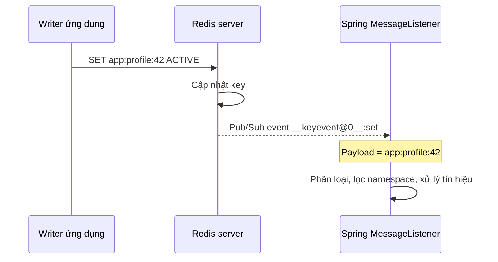

# Đăng ký lắng nghe thay đổi khóa qua Spring Data Redis

## 1. Khi nào cần nghe thay đổi Redis key?

Một ứng dụng dùng Redis có thể muốn biết **khi nào một khóa được tạo, sửa, xóa, hết hạn hoặc bị eviction**. Chẳng hạn:

- Một instance cập nhật cache cục bộ khi một key cấu hình trên Redis bị thay đổi.
- Một dịch vụ ghi số liệu theo dõi số key session vừa hết hạn.
- Một công cụ quản trị cần quan sát thao tác `SET`, `HSET` và `DEL` trên nhóm khóa thử nghiệm.
- Một ứng dụng phát tín hiệu cho các thành phần đang hoạt động khi dữ liệu phụ trợ thay đổi.

Redis có cơ chế **keyspace notifications** để phát các thông báo này qua **Redis Pub/Sub**. Spring Data Redis cung cấp `RedisMessageListenerContainer` và `MessageListener` để đăng ký, tiếp nhận và xử lý các thông báo.

Tuy nhiên, thông báo khóa có mục đích **quan sát thay đổi**. Nó không phải nhật ký thay đổi bền vững, không chứa mặc định giá trị cũ/mới của một field và không bảo đảm ứng dụng nhận được mọi sự kiện khi bị ngắt kết nối.

Mục tiêu của bài:

1. Hiểu sự khác nhau giữa **keyspace event** và **keyevent**.
2. Bật đúng loại notification ở Redis bằng `notify-keyspace-events`.
3. Đăng ký listener trong Spring bằng `RedisMessageListenerContainer`.
4. Giải mã tên channel, tên key và loại thao tác mà thông báo đại diện.
5. Giới hạn phạm vi lắng nghe, xử lý an toàn trong môi trường có nhiều instance.
6. Biết khi nào cần dùng Streams, outbox hoặc cơ chế đối soát thay vì chỉ dựa vào notification.

## 2. Keyspace notifications hoạt động như thế nào?

Khi Redis thực hiện một thao tác thuộc nhóm sự kiện đã bật, nó có thể phát một thông điệp Pub/Sub. Subscriber đang lắng nghe channel tương ứng nhận được thông điệp gần như ngay lúc phát.

Ví dụ Redis nhận lệnh:

```redis
SET app:profile:42 "ACTIVE"
```

Nếu cấu hình cho phép thông báo thao tác `SET`, Redis có thể phát:

```text
Kênh keyevent:
  channel = __keyevent@0__:set
  message = app:profile:42

Kênh keyspace:
  channel = __keyspace@0__:app:profile:42
  message = set
```

Chữ `@0` biểu thị logical database số 0 trong ví dụ. Hai thông báo nói về **cùng một thay đổi**, nhưng đảo vị trí giữa tên khóa và tên sự kiện.

Sơ đồ:



Thông báo do **Redis server phát ra**, không cần writer gọi `PUBLISH` riêng. Vì thế một thay đổi bằng `redis-cli`, một client Python hay một ứng dụng Java đều có thể tạo thông báo, miễn Redis bật loại sự kiện tương ứng.

Ngược lại, một ứng dụng tự `PUBLISH` lên channel có tên giống notification không chứng minh rằng đã có key nào thay đổi; đó chỉ là một thông điệp Pub/Sub do client phát.

## 3. Hai định dạng channel: keyspace và keyevent

### 3.1. Keyspace notification

Tên channel mô tả **khóa**, payload là **loại thao tác**:

```text
Channel: __keyspace@0__:app:profile:42
Payload: set

Channel: __keyspace@0__:app:profile:43
Payload: hset

Channel: __keyspace@0__:app:profile:42
Payload: del
```

Cách này đặc biệt hữu ích nếu muốn nghe một key hoặc một namespace cụ thể:

```redis
PSUBSCRIBE __keyspace@0__:app:profile:*
```

Nhờ tên key nằm trong channel, Redis có thể lọc tên key ở bước pattern subscription. Listener nhận ít thông điệp không liên quan hơn.

### 3.2. Keyevent notification

Tên channel mô tả **loại thao tác**, payload là **tên khóa**:

```text
Channel: __keyevent@0__:set
Payload: app:profile:42

Channel: __keyevent@0__:hset
Payload: app:profile:43

Channel: __keyevent@0__:del
Payload: app:profile:42
```

Cách này thuận tiện khi cần theo dõi một loại thao tác ở nhiều khóa:

```redis
SUBSCRIBE __keyevent@0__:del
```

Hoặc theo dõi nhiều loại thao tác:

```redis
PSUBSCRIBE __keyevent@0__:*
```

**Hạn chế cần hiểu:** nếu subscribe `__keyevent@0__:*`, Redis không tự lọc payload theo `app:profile:*`. Listener phải kiểm tra tên key trong Java. Khi một Redis instance có lưu lượng ghi lớn, lựa chọn keyspace pattern hẹp thường giảm số thông báo chuyển tới ứng dụng.

### 3.3. Bảng so sánh

| Tiêu chí | Keyspace | Keyevent |
| --- | --- | --- |
| Channel | `__keyspace@<db>__:<key>` | `__keyevent@<db>__:<event>` |
| Payload | Tên sự kiện, như `set` hoặc `del` | Tên key, như `app:profile:42` |
| Lọc theo key prefix ngay ở subscription | Thuận tiện với `PatternTopic` | Thường phải lọc payload tại listener |
| Lọc theo loại thao tác ngay ở subscription | Thường lọc payload tại listener | Thuận tiện với `ChannelTopic` |
| Có chứa giá trị cũ/mới của key? | Không | Không |
| Có lưu lịch sử để subscriber đọc lại? | Không | Không |

Một thay đổi có thể tạo cả hai loại nếu cùng bật cờ `K` và `E`. Nếu ứng dụng đăng ký cả hai dạng mà không phân biệt, nó có thể phản ứng hai lần với cùng một thay đổi.

## 4. Bật notification bằng `notify-keyspace-events`

Redis không nhất thiết bật mọi loại keyspace notification mặc định. Cần xem cấu hình:

```redis
CONFIG GET notify-keyspace-events
```

Giá trị chuỗi rỗng nghĩa là thông báo khóa chưa được bật. Tham số cấu hình là tổ hợp các cờ lựa chọn **kiểu channel** và **nhóm sự kiện**.

| Cờ | Ý nghĩa |
| --- | --- |
| `K` | Phát thông báo theo dạng **keyspace**. |
| `E` | Phát thông báo theo dạng **keyevent**. |
| `$` | Nhóm sự kiện của các lệnh thao tác kiểu String, như `SET`. |
| `h` | Nhóm sự kiện Hash, như `HSET` và `HDEL`. |
| `g` | Nhóm sự kiện generic, như `DEL` và các thao tác expiration metadata thích hợp. |
| `x` | Thông báo key thật sự **expired**. |
| `e` | Thông báo key bị **evicted** do chính sách bộ nhớ. |
| `A` | Bí danh cho nhiều nhóm sự kiện thông dụng; chỉ có ý nghĩa khi phối hợp với `K` hoặc `E`. |

Muốn nghe thay đổi String, Hash, xóa key và expiration trên cả hai dạng channel trong môi trường thử nghiệm:

```redis
CONFIG SET notify-keyspace-events "KE$ghx"
```

Khi đó:

- `K` cho phép nhận `__keyspace@0__:*`.
- `E` cho phép nhận `__keyevent@0__:*`.
- `$`, `h`, `g`, `x` bật những nhóm sự kiện cần quan sát.

Muốn chỉ nhận keyevent `expired`:

```redis
CONFIG SET notify-keyspace-events "Ex"
```

Muốn theo dõi phạm vi sự kiện rộng trong **môi trường test**, có thể dùng:

```redis
CONFIG SET notify-keyspace-events "KEA"
```

Không mặc nhiên dùng `KEA` cho production: Redis phải tạo và gửi thêm nhiều thông báo, có thể tăng CPU, lưu lượng mạng và số callback xử lý. Chọn những nhóm sự kiện thật sự cần.

### Khi môi trường không cho phép `CONFIG SET`

Nhiều Redis managed service không cho tài khoản ứng dụng dùng `CONFIG SET`. Khi đó hãy cấu hình `notify-keyspace-events` từ parameter group, cơ chế cấu hình của nhà cung cấp hoặc cấu hình server được hệ thống vận hành quản lý.

Spring `RedisMessageListenerContainer` **không tự thay đổi `notify-keyspace-events` chỉ vì có một `PatternTopic` đăng ký**. Nếu Redis không phát loại event tương ứng, listener sẽ không nhận được thông báo dù kết nối Pub/Sub vẫn hoạt động.

Lưu ý không ghi đè các cờ notification hiện có một cách tùy tiện khi nhiều dịch vụ dùng chung Redis. Đọc cấu hình và phối hợp với bên vận hành để giữ những nhóm sự kiện mà dịch vụ khác cần.

## 5. Các loại thay đổi khóa thường cần lắng nghe

| Lệnh / tình huống | Tên event có thể gặp | Điều nên hiểu |
| --- | --- | --- |
| `SET key value` | `set` | Value String được ghi; notification không chứa value mới. |
| `HSET hash field value` | `hset` | Hash được thay đổi; không mặc định biết field nào hay value nào từ notification. |
| `DEL key` | `del` | Key bị xóa nếu tồn tại và lệnh xóa có hiệu lực. |
| `EXPIRE key seconds` | `expire` | Metadata TTL được cập nhật; **không đồng nghĩa** key đã hết hạn ngay. |
| Key tự hết hạn do TTL | `expired` | Redis thực sự loại key khi expiration được xử lý. |
| Key bị loại để giải phóng bộ nhớ | `evicted` | Do chính sách eviction; khác nguyên nhân với `expired`. |

Cần phân biệt:

**`expire`** là thông báo về **đặt hoặc thay đổi thời hạn** của key. **`expired`** là thông báo về **key đã bị Redis xóa do hết hạn**. Việc gọi `EXPIRE` không đảm bảo rằng event `expired` xảy ra tức thì.

Redis không luôn phát event ở chính thời điểm đếm ngược TTL chạm 0: expiration có thể xảy ra khi Redis truy cập key hoặc khi vòng xử lý expiration chủ động loại nó. Vì thế không xây scheduler chính xác theo giây chỉ bằng `expired`.

Một số lệnh có thể phát nhiều loại notification hoặc đổi event theo tham số và trạng thái key. Ví dụ thao tác expiration với thời gian không dương có thể dẫn tới xóa key ngay, nên cần xem semantics của lệnh và phiên bản Redis đang chạy. Không coi danh sách event trên là hợp đồng chứa mọi trường hợp.

## 6. Dựng subscriber bằng `RedisMessageListenerContainer`

Trong Spring Data Redis, cách thông dụng để lắng nghe notification là đăng ký một `MessageListener` vào `RedisMessageListenerContainer`.

Các thành phần:

- `RedisConnectionFactory`: tạo kết nối tới Redis.
- `RedisMessageListenerContainer`: quản lý subscription, vòng đời, kết nối và dispatch callback.
- `ChannelTopic`: subscribe đúng một tên channel.
- `PatternTopic`: subscribe các channel phù hợp mẫu.
- `MessageListener.onMessage(...)`: xử lý payload và tên channel.

Ví dụ dưới đây dùng Spring Boot với dependency Spring Data Redis và một Redis server đã bật `notify-keyspace-events` phù hợp.

### 6.1. Listener nhận keyevent và lọc prefix trong Java

```java
package com.example.redis;

import java.nio.charset.StandardCharsets;
import org.slf4j.Logger;
import org.slf4j.LoggerFactory;
import org.springframework.data.redis.connection.Message;
import org.springframework.data.redis.connection.MessageListener;
import org.springframework.stereotype.Component;

@Component
public class RedisKeyChangeListener implements MessageListener {

    private static final Logger log =
            LoggerFactory.getLogger(RedisKeyChangeListener.class);

    private static final String CHANNEL_PREFIX = "__keyevent@0__:";
    private static final String KEY_PREFIX = "app:profile:";

    @Override
    public void onMessage(Message message, byte[] pattern) {
        String channel = new String(
                message.getChannel(), StandardCharsets.UTF_8);
        String key = new String(
                message.getBody(), StandardCharsets.UTF_8);

        if (!channel.startsWith(CHANNEL_PREFIX)) {
            return;
        }
        if (!key.startsWith(KEY_PREFIX)) {
            return;
        }

        String operation = channel.substring(CHANNEL_PREFIX.length());

        switch (operation) {
            case "set", "hset", "del" -> {
                log.info("Key event={}, namespace=app:profile:", operation);
                onProfileKeyChanged(key, operation);
            }
            case "expired" -> onProfileKeyExpired(key);
            default -> {
                // Bỏ qua loại event ứng dụng không quan tâm.
            }
        }
    }

    private void onProfileKeyChanged(String key, String operation) {
        // Ví dụ: invalidate local cache hoặc cập nhật metric.
        // Handler phải chạy nhanh và chấp nhận event lặp/mất.
    }

    private void onProfileKeyExpired(String key) {
        // Tín hiệu key đã hết hạn; không kỳ vọng đọc lại key còn tồn tại.
    }
}
```

Ví dụ sử dụng `UTF-8` vì key do ứng dụng đặt theo quy ước chuỗi. Redis truyền channel và payload dưới dạng bytes. Nếu tên key dùng serializer khác, phải giải mã đúng định dạng; một key nhị phân không nhất thiết tương đương chuỗi UTF-8.

Logger chỉ ghi loại event và namespace để tránh lộ ID, token hoặc dữ liệu nhạy cảm từ tên key. Nếu nghiệp vụ cần ghi chi tiết tên key, cần có chính sách log/sanitize tương ứng.

### 6.2. Đăng ký với `PatternTopic`

```java
package com.example.redis;

import org.springframework.context.annotation.Bean;
import org.springframework.context.annotation.Configuration;
import org.springframework.data.redis.connection.RedisConnectionFactory;
import org.springframework.data.redis.listener.PatternTopic;
import org.springframework.data.redis.listener.RedisMessageListenerContainer;

@Configuration
public class KeyNotificationConfiguration {

    @Bean
    public RedisMessageListenerContainer keyNotificationContainer(
            RedisConnectionFactory connectionFactory,
            RedisKeyChangeListener listener) {

        RedisMessageListenerContainer container =
                new RedisMessageListenerContainer();

        container.setConnectionFactory(connectionFactory);

        container.addMessageListener(
                listener,
                new PatternTopic("__keyevent@0__:*"));

        return container;
    }
}
```

Container đăng ký pattern subscription và gọi `onMessage(...)` cho các notification thỏa mẫu. Trong ví dụ, listener tự lọc những key mang prefix `app:profile:`.

Vì pattern `__keyevent@0__:*` có thể nhận nhiều loại event của mọi key trong database 0, hệ thống có lưu lượng lớn nên cân nhắc cấu hình Redis chỉ phát các nhóm event cần dùng hoặc chuyển sang **keyspace subscription theo prefix**.

### 6.3. Chỉ lắng nghe key bị xóa

Nếu chức năng chỉ cần biết các key bị xóa và không cần các event khác:

```java
container.addMessageListener(
        listener,
        new ChannelTopic("__keyevent@0__:del"));
```

Cần import `org.springframework.data.redis.listener.ChannelTopic`. Listener ở trên kiểm tra event `del` và prefix; với cấu hình này, callback chỉ được gọi từ channel `__keyevent@0__:del`.

Lệnh `DEL` không phải cách xóa duy nhất. Key có thể hết hạn hoặc bị eviction, và khi đó event khác là `expired` hoặc `evicted`. Muốn quản lý việc key không còn tồn tại theo mọi nguyên nhân, cần chọn đúng nhóm event, tránh chỉ nghe `del` rồi coi là bao phủ mọi cách key biến mất.

## 7. Đăng ký theo keyspace để lọc namespace ngay tại Redis

Khi keyspace notification được bật (cờ `K`), ta có thể subscribe theo mẫu tên key nằm trong channel:

```java
container.addMessageListener(
        keyspaceListener,
        new PatternTopic("__keyspace@0__:app:profile:*"));
```

Với subscription này:

```text
Channel: __keyspace@0__:app:profile:42
Body:    set

Channel: __keyspace@0__:app:profile:43
Body:    hset

Channel: __keyspace@0__:app:profile:42
Body:    del
```

Listener cần giải mã ngược với keyevent: channel chứa tên key, body chứa thao tác.

```java
package com.example.redis;

import java.nio.charset.StandardCharsets;
import org.springframework.data.redis.connection.Message;
import org.springframework.data.redis.connection.MessageListener;
import org.springframework.stereotype.Component;

@Component
public class ProfileKeyspaceListener implements MessageListener {

    private static final String CHANNEL_PREFIX =
            "__keyspace@0__:app:profile:";

    @Override
    public void onMessage(Message message, byte[] pattern) {
        String channel = new String(
                message.getChannel(), StandardCharsets.UTF_8);
        String operation = new String(
                message.getBody(), StandardCharsets.UTF_8);

        if (!channel.startsWith(CHANNEL_PREFIX)) {
            return;
        }

        String profileId = channel.substring(CHANNEL_PREFIX.length());

        if ("set".equals(operation) || "hset".equals(operation)) {
            // Xử lý tín hiệu cập nhật key tương ứng profileId.
        } else if ("del".equals(operation) || "expired".equals(operation)) {
            // Xử lý tín hiệu key không còn tồn tại.
        }
    }
}
```

Đây là phương án thuận tiện nếu chương trình chỉ quan tâm `app:profile:*`. Không dùng cùng một listener nhưng giải mã payload theo kiểu keyevent khi subscription lại là keyspace: hai dạng có channel/body khác nhau.

Một `PatternTopic` có thể dùng glob như `*`, nhưng đó là bộ lọc tên channel, không phải truy vấn SQL hay bộ lọc giá trị trong Redis Hash. Nếu có nhiều tenant hoặc key thuộc các nhóm bảo mật khác nhau, không coi pattern tại listener là biện pháp phân quyền truy cập.

## 8. Keyspace notifications khác Pub/Sub nghiệp vụ tự phát

Cả hai đều sử dụng Redis Pub/Sub, nhưng **nguồn và ý nghĩa thông điệp** khác nhau:

| Tiêu chí | Keyspace notifications | Pub/Sub nghiệp vụ |
| --- | --- | --- |
| Nguồn phát | Redis server tự phát khi thực thi loại thao tác được bật | Ứng dụng gọi `PUBLISH` hoặc `convertAndSend(...)` |
| Channel | Quy ước hệ thống `__keyspace@...__:*`, `__keyevent@...__:*` | Tên do ứng dụng đặt như `orders.created` |
| Payload | Tên key hoặc loại event | Nội dung do publisher thiết kế, có thể là JSON |
| Có giá trị trước/sau? | Không tự có | Có thể có nếu ứng dụng chủ động đưa vào |
| Lưu lịch sử? | Không | Không với Pub/Sub thông thường |
| Ý nghĩa | Thông báo một thay đổi Redis đã thực thi | Một tín hiệu/sự kiện do ứng dụng phát |

Ví dụ Spring:

```java
stringRedisTemplate.opsForValue().set(
        "app:profile:42",
        "ACTIVE");
```

Khi Redis bật notification phù hợp, thao tác này có thể tự tạo `__keyevent@0__:set`.

Ngược lại:

```java
stringRedisTemplate.convertAndSend(
        "profile.changed",
        "{\"profileId\":\"42\"}");
```

Đây là Pub/Sub nghiệp vụ. Nó **không tự thay đổi key `app:profile:42`**, cũng không chứng minh rằng một `SET` hay `HSET` đã xảy ra.

Tùy thiết kế, ứng dụng có thể dùng cả hai: keyspace event để quan sát thay đổi thực tế, và business event để truyền ngữ nghĩa giàu thông tin hơn. Không nên tự xây giao thức nghiệp vụ quan trọng dựa vào việc parse mọi loại Redis command event.

## 9. Dữ liệu nhận được có giới hạn gì?

Một thông báo dạng:

```text
channel = __keyevent@0__:hset
body    = app:profile:42
```

chỉ chứng minh Redis đã phát notification `hset` cho key được nêu. Nó **không chứa**:

- Field Hash nào được cập nhật.
- Giá trị trước khi cập nhật.
- Giá trị sau khi cập nhật.
- Ai thực hiện lệnh, request ID hoặc thông tin nghiệp vụ.
- Transaction SQL nào đã commit.
- Số lần event trước đó đã bị subscriber bỏ lỡ.

### Đọc lại trạng thái bằng RedisTemplate có thể cho kết quả khác

Ví dụ listener nhận `set` rồi đọc:

```java
String currentValue = stringRedisTemplate
        .opsForValue()
        .get("app:profile:42");
```

Giữa lúc Redis phát event và lúc listener đọc, một client khác có thể đã gọi `SET` lần nữa hoặc `DEL`. Listener nhận tín hiệu về một thay đổi nhưng đọc được **trạng thái mới nhất tại thời điểm đọc**, không nhất thiết là trạng thái đúng ngay sau event ban đầu.

Với event `expired` hoặc `del`, key có thể đã bị xóa. Đọc bằng `GET` sẽ trả `null`, trừ khi một client đã tạo lại key cùng tên.

Vì vậy:

- Muốn biết **key nào thay đổi**, notification có thể hữu ích.
- Muốn biết **chính xác thay đổi cũ → mới**, hãy thiết kế business event có payload đủ dữ liệu hoặc nguồn change log bền vững.
- Muốn phản ứng dựa trên **trạng thái hiện tại**, có thể dùng notification làm tín hiệu rồi đọc lại, kèm xử lý tranh chấp đồng thời.

## 10. Đăng ký lắng nghe key hết hạn bằng Spring

Một trường hợp riêng của thông báo khóa là event `expired`. Có thể subscribe trực tiếp:

```java
container.addMessageListener(
        expirationListener,
        new ChannelTopic("__keyevent@0__:expired"));
```

Redis phải bật `Ex` hoặc tổ hợp cờ tương thích. Body là tên key hết hạn:

```text
channel = __keyevent@0__:expired
body    = app:session:s-101
```

Đối với Redis Repository với entity có TTL, Spring Data Redis còn có các component riêng, chẳng hạn `KeyExpirationEventMessageListener`, và có thể công bố `RedisKeyExpiredEvent` qua cơ chế repository listener.

Ví dụ cấu hình repository có quan tâm tới event hết hạn:

```java
@Configuration
@EnableRedisRepositories(
        basePackages = "com.example.session",
        enableKeyspaceEvents =
                RedisKeyValueAdapter.EnableKeyspaceEvents.ON_STARTUP,
        shadowCopy = RedisKeyValueAdapter.ShadowCopy.OFF)
public class SessionRepositoryConfiguration {
}
```

Các import tương ứng là `org.springframework.data.redis.repository.configuration.EnableRedisRepositories` và `org.springframework.data.redis.core.RedisKeyValueAdapter`.

Ở cấu hình này, repository event listener có thể phát `RedisKeyExpiredEvent` khi nhận notification; `shadowCopy = OFF` tránh tạo bản sao entity phụ cho payload. Khi không có bản sao, event chủ yếu mang thông tin định danh chứ không mang đầy đủ entity đã hết hạn.

**Đừng nhầm hai luồng**:

1. `RedisMessageListenerContainer` tùy biến theo ví dụ đầu bài: lắng nghe những channel event mà bạn đăng ký, không tự yêu cầu Redis Repository phải có entity.
2. TTL Repository listener: hướng tới metadata/entity do Redis Repository quản lý, có thêm lựa chọn lifecycle và shadow copy.

Cả hai đều phải phụ thuộc vào Redis keyspace notifications và kết nối đang hoạt động; không nên đăng ký hai handler thực hiện cùng một tác dụng phụ mà không kiểm soát xử lý trùng.

### Cấu hình Redis managed service

Khi Redis không cho phép ứng dụng thay đổi `notify-keyspace-events` qua `CONFIG`, với **repository listener** có thể yêu cầu Spring Data Redis không tự cấu hình lại tham số:

```java
@EnableRedisRepositories(
        enableKeyspaceEvents =
                RedisKeyValueAdapter.EnableKeyspaceEvents.ON_STARTUP,
        keyspaceNotificationsConfigParameter = "")
```

Cấu hình rỗng này **chỉ ngăn thao tác tự cấu hình của repository listener**, không tự bật event ở Redis. Operator vẫn phải bật các cờ phù hợp từ hệ thống quản trị Redis.

## 11. Phạm vi database, Redis Cluster và nhiều instance

### 11.1. Logical database xuất hiện trong tên channel

`__keyevent@0__:set` và `__keyevent@1__:set` là hai channel khác nhau tương ứng database 0 và database 1.

Nếu ứng dụng dùng logical database 2 nhưng listener chỉ subscribe `__keyevent@0__:*`, listener sẽ không nhìn thấy các event của database 2.

Trong Redis Cluster thông thường chỉ sử dụng database 0, nhưng điều đó **không có nghĩa một subscription tới một node sẽ tự nhìn thấy mọi keyspace event ở mọi node**. Notification được phát tại node sở hữu/thực thi thao tác; khi dùng cluster, cần đánh giá khả năng nhận event từ các node liên quan và cấu hình listener theo topology thực tế.

### 11.2. Nhiều ứng dụng cùng subscribe có thể nhận cùng event

Nếu hai instance Spring Boot đều subscribe `__keyevent@0__:del`:

```text
Redis phát keyevent del
       |
       +--> Instance A nhận
       |
       +--> Instance B nhận
```

Đây là **broadcast**, không phải hàng đợi phân phối công việc. Nếu cả hai instance đều invalidate local cache của mình thì đúng mục tiêu. Nhưng nếu cả hai đều gửi email, cập nhật hóa đơn hoặc thực hiện tác dụng phụ không được phép lặp, thiết kế đó không an toàn.

### 11.3. Subscriber reconnect không nhận lại lịch sử

Redis keyspace notifications dựa vào Pub/Sub. Khi ứng dụng dừng, restart hoặc đứt kết nối, những event phát trong thời gian ấy không được xếp hàng cho ứng dụng đọc bù.

Những thay đổi bị lỡ có thể khiến cache cục bộ không đồng bộ. Vì thế nếu dùng notification cho cache invalidation, nên có TTL ở cache cục bộ hoặc cơ chế đối soát/làm mới định kỳ.

## 12. Hiệu năng, quyền truy cập và bảo vệ subscriber

### 12.1. Chi phí khi bật nhiều event

Khi bật cờ notification, Redis phải thực hiện thêm bước tạo và phát thông báo cho các thao tác phù hợp. Nếu ứng dụng ghi hàng chục nghìn key mỗi giây, lượng event có thể lớn.

Một số nguyên tắc:

1. Chỉ bật nhóm sự kiện cần dùng, ví dụ `E$ghx` thay vì tất cả.
2. Nếu quan tâm một prefix, cân nhắc **keyspace pattern** để lọc tại subscription.
3. Giữ callback ngắn; không gọi HTTP chậm hoặc xử lý dữ liệu nặng trực tiếp trên luồng nhận thông báo.
4. Theo dõi tốc độ message nhận, lỗi handler, thời gian callback và trạng thái kết nối listener.
5. Không dùng `KEYS *` để kiểm tra hàng loạt trong môi trường sản xuất; nếu cần đối soát, dùng `SCAN` có giới hạn.

### 12.2. Redis ACL và kết nối

User Redis để subscribe cần quyền kết nối, `SUBSCRIBE` hoặc `PSUBSCRIBE` tùy cách đăng ký, cùng quyền trên channel tương ứng theo chính sách ACL của Redis. User này **không nhất thiết cần quyền `PUBLISH`** vì keyspace notifications do Redis server phát.

Nếu listener còn thực hiện `GET`/`HGETALL` để đọc trạng thái hiện tại, kết nối thực hiện thao tác đọc đó cần quyền lệnh và key pattern tương ứng.

Không cấp tài khoản runtime quyền `CONFIG SET` hoặc `+@all` chỉ để bật notification. Cấu hình server nên nằm trong quyền vận hành, còn service chỉ có quyền cần để đọc subscription.

Các tên key trong thông báo có thể chứa ID hoặc thông tin nhạy cảm theo quy ước đặt key. Giới hạn quyền subscribe, dùng kết nối mã hóa khi thích hợp và kiểm soát log.

### 12.3. Kiểm soát lỗi listener

Callback Java có thể ném exception do payload không hợp lệ hoặc lỗi bên ngoài. `RedisMessageListenerContainer` hỗ trợ khai báo error handler:

```java
container.setErrorHandler(error ->
        log.error("Redis key notification listener failed", error));
```

`log` trong ví dụ là một logger có sẵn tại class cấu hình. Error handler giúp quan sát lỗi; **nó không làm Redis phát lại message vừa bị xử lý lỗi**.

Nếu cần xử lý nặng, hãy chuyển tín hiệu sang một cơ chế xử lý có kiểm soát. Chỉ chuyển message từ Pub/Sub sang queue trong callback mà không có dữ liệu bền vững bổ sung cũng chưa giải quyết trường hợp listener đã offline trước khi nhận.

## 13. Thực hành với keyevent và keyspace

Thực hành trên Redis thử nghiệm, sử dụng namespace `demo:notify:*` để tránh ảnh hưởng dữ liệu khác.

### Bước 1 — Xem và bật cấu hình

```redis
CONFIG GET notify-keyspace-events
CONFIG SET notify-keyspace-events "KE$ghx"
```

Nếu ứng dụng không có quyền `CONFIG`, nhờ hệ thống quản trị cấu hình tương ứng trước khi chạy thử. Không thử ghi đè cấu hình notification của Redis dùng chung.

### Bước 2 — Subscribe keyevent

Trong một cửa sổ redis-cli:

```redis
PSUBSCRIBE __keyevent@0__:*
```

Giữ terminal này mở.

### Bước 3 — Thực hiện thao tác trên khóa thử nghiệm

Trong terminal khác, cùng Redis instance và database 0:

```redis
SET demo:notify:status ACTIVE
HSET demo:notify:profile:42 name An
DEL demo:notify:status
SET demo:notify:short lived EX 3
```

Quan sát ở subscriber có các event như `set`, `hset`, `del` và sau đó `expired` cho khóa `demo:notify:short` khi Redis thực sự hết hạn và loại key.

### Bước 4 — Subscribe keyspace theo prefix

Trong terminal thứ ba:

```redis
PSUBSCRIBE __keyspace@0__:demo:notify:*
```

Thực hiện thêm:

```redis
SET demo:notify:status AGAIN
HSET demo:notify:profile:42 name Binh
DEL demo:notify:profile:42
```

Ở subscriber keyspace, **channel là tên key**, còn payload là các từ như `set`, `hset` và `del`. So sánh trực tiếp với subscriber keyevent để thấy chúng biểu diễn cùng loại thay đổi theo hai cách.

### Bước 5 — Chạy Spring listener

Khởi động ứng dụng có `KeyNotificationConfiguration` và `RedisKeyChangeListener`. Thực hiện một `SET` hoặc `DEL` trên khóa có prefix `app:profile:` để thấy callback nhận được thông báo.

Nếu dùng namespace `demo:notify:` trong bài thử, thay giá trị `KEY_PREFIX` của listener mẫu thành `demo:notify:` trước khi chạy. Hai ví dụ dùng prefix khác nhau có chủ đích để phân biệt mô hình ứng dụng và dữ liệu thử nghiệm.

Không dùng một lần thử không thấy log để kết luận Redis không phát notification: phải kiểm tra cả cờ server, logical database, topic đã đăng ký, connection factory và thời điểm container bắt đầu subscribe.

## 14. Kiểm chứng listener trong tích hợp Spring

Một thử nghiệm tích hợp có thể ghi một key thử nghiệm sau khi listener đã đăng ký, rồi chờ trong thời hạn ngắn để xác định callback nhận được channel và payload mong muốn.

Ví dụ phác thảo hành vi cần thử:

```text
Given:
  Redis thử nghiệm đã bật E$ (keyevent của SET).
  Spring RedisMessageListenerContainer đã start.
  Listener đã hoàn tất đăng ký __keyevent@0__:set.

When:
  StringRedisTemplate SET demo:notify:status "ON".

Then:
  Listener nhận channel __keyevent@0__:set.
  Payload là demo:notify:status.
```

Có hai lý do khiến integration test dễ bị flaky:

1. Listener container có lifecycle bất đồng bộ. Nếu gọi `SET` **trước khi subscription sẵn sàng**, event bị lỡ và test thất bại dù cấu hình đúng.
2. Redis Pub/Sub không phát lại message. Việc “đợi lâu hơn” không cứu được event đã phát trước lúc subscribe.

Vì vậy test cần có cơ chế xác nhận listener đã subscribe thành công, ví dụ một bước đồng bộ lifecycle hoặc subscription readiness trong môi trường thử nghiệm, rồi mới ghi key. Dùng `CountDownLatch` hoặc công cụ chờ sự kiện có timeout để tránh test bị treo; không cần dùng delay cố định quá dài.

Nếu test chạy trên Redis Cluster, cần xác định key thuộc node nào và listener đã subscribe đúng topology. Với Redis standalone, tránh giả định mỗi test đều có một database rỗng nếu nhiều test chạy song song trên cùng instance.

## 15. Khi không nhận được thông báo: cách chẩn đoán

| Triệu chứng | Nguyên nhân thường gặp | Hướng kiểm tra |
| --- | --- | --- |
| Subscriber đã kết nối nhưng không có event | `notify-keyspace-events` rỗng hoặc thiếu cờ | Chạy `CONFIG GET notify-keyspace-events` bằng danh tính vận hành |
| Nhận `set` nhưng không nhận `expired` | Chưa bật `x`, key chưa thật sự hết hạn hoặc đã bị xóa theo nguyên nhân khác | Kiểm tra TTL và nhóm cờ; chờ Redis xử lý expiration |
| Listener chỉ nghe `@0` nhưng key ở DB khác | Sai logical database trong channel | So sánh database của writer và tên topic |
| Nhận keyevent nhưng code parse thành keyspace | Đảo channel/body | Kiểm tra prefix `__keyevent@...` và payload |
| `NOPERM` khi subscribe | Thiếu quyền `SUBSCRIBE`/`PSUBSCRIBE` hoặc quyền channel | Kiểm tra Redis ACL |
| `NOPERM` khi CONFIG | Dịch vụ không cấp quyền thay đổi cấu hình Redis | Cấu hình từ công cụ vận hành, không cấp thêm quyền admin cho ứng dụng |
| Không nhận event trên một số key trong Cluster | Listener không quan sát node phát notification | Kiểm tra cluster topology và chiến lược subscribe theo node |
| Callback không có log khi ứng dụng restart | Event phát lúc listener chưa subscribe | Thiết kế cơ chế đồng bộ lại trạng thái |
| Callback xảy ra nhiều lần | Nhiều listener, đăng ký chồng lấn hoặc nhiều instance đều subscribe | Kiểm tra danh sách topic, topology và idempotency |
| Handler đọc lại nhưng key không còn | Event đã xảy ra trước lúc đọc; key hết hạn/xóa hoặc thay đổi tiếp | Chấp nhận trạng thái hiện tại, không suy luận payload có snapshot |
| Tăng CPU và lưu lượng mạng sau bật notification | Bật quá nhiều nhóm sự kiện hoặc subscription quá rộng | Thu hẹp cờ và pattern, theo dõi metric |

Khi cần quan sát thông điệp đang được phát, có thể dùng `redis-cli PSUBSCRIBE` trên Redis thử nghiệm. Không cần dùng `MONITOR` liên tục trong môi trường sản xuất: `MONITOR` có thể gây tải lớn và làm lộ dữ liệu từ lệnh Redis.

## 16. Khi nào không nên dựa hoàn toàn vào keyspace notifications?

Keyspace notifications phù hợp cho **tín hiệu bổ trợ**, chẳng hạn:

- Đánh thức một tác vụ quan sát hoặc invalidation có đường phục hồi.
- Theo dõi số lượng key hết hạn cho mục đích thống kê gần thời gian thực.
- Đồng bộ cache cục bộ ở mức best effort, có TTL để tự phục hồi.
- Cập nhật giao diện khi còn kết nối, chấp nhận lấy snapshot mới sau reconnect.

Nó **không phù hợp làm nguồn sự thật duy nhất** khi:

- Mọi thay đổi khóa bắt buộc được kiểm toán đầy đủ.
- Mỗi sự kiện phải được xử lý và retry khi consumer offline.
- Cần chính xác field Hash nào thay đổi và giá trị trước/sau.
- Sự kiện hết hạn phải kích hoạt một nghĩa vụ thanh toán, xóa quyền hoặc quy trình bắt buộc đúng hạn.
- Nghiệp vụ cần total order hoặc exactly-once trên nhiều instance.

Các phương án bổ sung:

| Nhu cầu | Cơ chế cần cân nhắc |
| --- | --- |
| Có thể bỏ lỡ thông báo nhưng cần tự sửa lệch | TTL cache cục bộ và job đối soát định kỳ |
| Cần lưu và đọc lại event | Redis Streams hoặc message broker bền vững |
| Thay đổi database và phát event phải có thể phục hồi | Transactional outbox cùng database transaction |
| Cần xác định field/value thay đổi | Business event payload đầy đủ hoặc change log do ứng dụng ghi |
| Cần chạy công việc tại thời hạn cụ thể, có retry | Scheduler/queue bền vững, có trạng thái và idempotency |

Ví dụ, nếu yêu cầu “khi session hết hạn thì thu hồi quyền tại dịch vụ khác”, chỉ lắng nghe `expired` có thể bỏ lỡ sự kiện khi ứng dụng downtime. Phải thiết kế TTL như một tín hiệu và dùng nguồn dữ liệu/logic phân quyền có thể tự xác minh, kèm job đối soát khi cần.

## 17. Những nhầm lẫn thường gặp

**“Chỉ cần đăng ký `PatternTopic` là Redis tự bật mọi notification.”**  
Không. Redis phải bật cờ `notify-keyspace-events` thích hợp trước.

**“Keyspace và keyevent là hai loại thay đổi khác nhau.”**  
Không. Chúng là hai **định dạng thông báo** có thể phát cho cùng một thao tác: một loại đặt tên key trong channel, loại còn lại đặt tên thao tác trong channel.

**“Thông báo `hset` cho biết Hash field nào đã thay đổi.”**  
Không. Notification tiêu chuẩn chỉ mang tên key hoặc loại sự kiện. Cần nguồn dữ liệu khác nếu muốn field hoặc giá trị thay đổi.

**“Gọi `EXPIRE` xong chắc chắn nhận `expired` ngay.”**  
Không. Đặt TTL khác với việc key bị loại do TTL; thời điểm xóa thực tế có thể đến sau.

**“Nếu `redis-cli GET` vẫn trả dữ liệu thì event không xảy ra.”**  
Không nhất thiết. Sau một event `set`, giá trị hiện tại có thể đã khác lúc event; sau một event `del`, key cũng có thể đã được tạo lại.

**“Một listener nhận event nghĩa là mọi instance đều nhận.”**  
Không. Mỗi instance cần subscription hoạt động và tiếp cận đúng Redis node/channel; Pub/Sub không bảo đảm khi offline.

**“Keyspace notifications thay thế audit log.”**  
Không. Pub/Sub không lưu lịch sử, không ACK và không có replay.

## 18. Câu hỏi tự kiểm tra

1. Với `SET app:profile:42 ACTIVE`, hai channel `__keyspace@0__:app:profile:42` và `__keyevent@0__:set` có payload khác nhau ra sao?
2. Vì sao listener dùng `PatternTopic("__keyevent@0__:*")` thường phải tự lọc prefix của tên key, còn `PatternTopic("__keyspace@0__:app:profile:*")` có thể lọc qua tên channel?
3. Hai cờ `K` và `E` trong `notify-keyspace-events` có ý nghĩa gì?
4. Vì sao `expire` và `expired` không được coi là cùng một event?
5. Khi Spring listener nhận `hset` rồi đọc lại Hash, liệu có thể chắc chắn đó là giá trị ngay sau thao tác `HSET` tạo ra notification không?
6. Vì sao `RedisMessageListenerContainer` và `@EnableRedisRepositories(enableKeyspaceEvents=...)` phục vụ những đường lắng nghe khác nhau?
7. Nếu ứng dụng offline trong lúc Redis phát notification, làm cách nào để tự khôi phục trạng thái?
8. Khi Redis Cluster có nhiều primary node, cần kiểm tra vấn đề gì trước khi kết luận một listener theo dõi đủ mọi key?
9. Tại sao không nên cấp quyền `CONFIG SET` cho mọi tài khoản ứng dụng chỉ để dùng notifications?
10. Khi cần xử lý mọi sự kiện với ACK/retry, tại sao Redis Streams hoặc outbox phù hợp hơn keyspace notifications?

**Ghi nhớ:** Đăng ký lắng nghe thay đổi Redis key trong Spring Data Redis thường gồm **bật `notify-keyspace-events` ở Redis**, **đăng ký `ChannelTopic` hoặc `PatternTopic` qua `RedisMessageListenerContainer`**, rồi **giải mã `MessageListener.onMessage(...)` đúng theo dạng keyspace/keyevent**. Đây là cơ chế Pub/Sub tức thời, hữu ích để quan sát và phát tín hiệu, nhưng không thay thế một hệ thống lưu sự kiện bền vững.

## Tài liệu tham khảo

- [Redis — Keyspace Notifications](https://redis.io/docs/latest/develop/pubsub/keyspace-notifications/): định dạng `__keyspace`/`__keyevent`, `notify-keyspace-events` và các nhóm sự kiện.
- [Redis — Pub/Sub](https://redis.io/docs/latest/develop/pubsub/): đặc tính broadcast và giao hàng at-most-once.
- [Spring Data Redis — Pub/Sub Messaging](https://docs.spring.io/spring-data/redis/reference/redis/pubsub.html): `MessageListener` và `RedisMessageListenerContainer`.
- [Spring Data Redis — RedisMessageListenerContainer API](https://docs.spring.io/spring-data/redis/docs/current/api/org/springframework/data/redis/listener/RedisMessageListenerContainer.html): đăng ký listener và vòng đời container.
- [Spring Data Redis — Time To Live](https://docs.spring.io/spring-data/redis/reference/redis/redis-repositories/expirations.html): listener của entity hết hạn, `RedisKeyExpiredEvent` và shadow copy.
