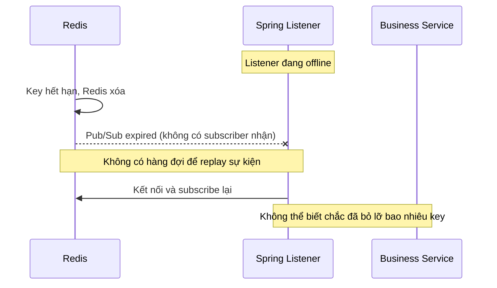
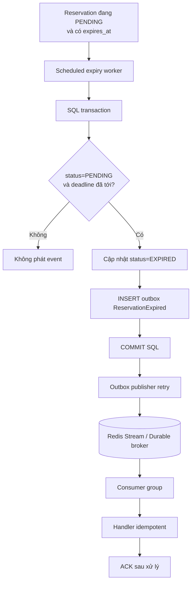

# Phân biệt sự kiện hạ tầng khóa với sự kiện nghiệp vụ đáng tin cậy

Trong ứng dụng dùng **Spring Data Redis**, việc một khóa được tạo, thay đổi, xóa hoặc hết hạn có thể phát sinh **Redis keyspace notifications**. Spring có thể lắng nghe những thông báo đó để ghi nhận hoạt động cache, dọn tài nguyên phụ trợ hay cập nhật số liệu quan sát. Tuy nhiên, sự kiện kiểu `expired` của một Redis key **không đồng nghĩa** một sự kiện nghiệp vụ như `PaymentExpired`, `ReservationCancelled` hay `OrderClosed` đã xảy ra một cách đáng tin cậy.

Đây là ranh giới kiến trúc quan trọng. Thông báo khóa thuộc tầng **hạ tầng lưu trữ**; còn sự kiện nghiệp vụ cần biểu diễn **một thay đổi trạng thái có ý nghĩa trong domain**, với định danh, dữ liệu và cơ chế khôi phục phù hợp. Nếu dùng keyspace notifications như hàng đợi công việc bắt buộc phải xử lý, ứng dụng có thể bỏ sót thông báo khi listener tắt, mất kết nối hoặc Redis thay đổi vai trò.

Bài học này làm rõ phạm vi bảo đảm của Redis keyspace notifications, cách nhận sự kiện từ Spring Data Redis, những trường hợp chúng hữu ích và cách xây dựng luồng sự kiện nghiệp vụ có thể retry, đối soát và chống xử lý trùng.

## 1. Hai loại sự kiện phục vụ hai mục đích khác nhau

Giả sử ứng dụng bán vé tạm giữ một chỗ trong 10 phút:

```text
reservation:r-101   -> Redis key có TTL 600 giây
Reservation r-101   -> Bản ghi nghiệp vụ, trạng thái PENDING
```

Khi Redis phát thông báo rằng `reservation:r-101` đã hết hạn, điều ta biết là **Redis đã xóa key vì hết hạn**, tại một thời điểm Redis thực hiện việc xóa. Ta **chưa biết chắc**:

- Giao dịch đặt vé đã thực sự chuyển từ `PENDING` sang `EXPIRED` hay chưa.
- Người dùng đã thanh toán kịp lúc, hoặc một tiến trình khác đã gia hạn chỗ hay chưa.
- Hệ thống thanh toán, cơ sở dữ liệu chính và dịch vụ thông báo đã đồng bộ trạng thái hay chưa.
- Có một listener nào nhận được thông báo hay không.

Sự khác nhau:

| Khía cạnh | Sự kiện hạ tầng khóa | Sự kiện nghiệp vụ đáng tin cậy |
| --- | --- | --- |
| Ví dụ | Redis `expired`, `del`, `set`, `evicted` | `ReservationExpired`, `PaymentCaptured`, `OrderCancelled` |
| Nơi phát sinh | Thao tác hoặc vòng đời Redis key | Quy tắc nghiệp vụ và chuyển trạng thái được ứng dụng xác nhận |
| Định danh | Thường là tên key và loại lệnh/sự kiện | `eventId`, `aggregateId`, loại sự kiện, phiên bản hoặc thời điểm |
| Payload | Keyspace notifications thường không có dữ liệu nghiệp vụ đầy đủ | Có hợp đồng schema, thông tin cần cho downstream |
| Khả năng lưu lại để phát lại | Không: Pub/Sub không lưu lịch sử thông báo | Cần thiết kế event log/outbox/broker có lưu trữ |
| Xác nhận tiêu thụ | Không có `ACK` cho keyspace notification | Có thể có `XACK`, consumer offset hoặc trạng thái xử lý ở đích |
| Khi listener mất kết nối | Sự kiện có thể mất vĩnh viễn | Có đường retry/replay/reconciliation nếu kiến trúc hỗ trợ |
| Dùng làm nguồn sự thật cho nghiệp vụ | **Không nên** | Có thể, khi gắn với thay đổi trạng thái và giao thức nhất quán phù hợp |

Một key có thể tồn tại vì mục đích **tăng tốc truy cập**, trong khi dữ liệu nghiệp vụ tồn tại ở hệ thống khác. Redis xóa cache key không có nghĩa thực thể nghiệp vụ đã bị xóa khỏi cơ sở dữ liệu chính.

## 2. Redis keyspace notifications hoạt động thế nào?

Redis có thể xuất bản thông báo qua cơ chế **Pub/Sub** khi các sự kiện liên quan đến key xảy ra. Theo mặc định, tính năng keyspace notifications thường không được bật vì có chi phí thực thi; cần đặt `notify-keyspace-events` phù hợp.

Hai dạng channel cơ bản:

| Kiểu thông báo | Channel ví dụ | Nội dung message |
| --- | --- | --- |
| **Key-space notification** | `__keyspace@0__:session:abc` | Tên sự kiện, ví dụ `expired` |
| **Key-event notification** | `__keyevent@0__:expired` | Tên key, ví dụ `session:abc` |

Trong đó `0` là Redis logical database số 0. Nếu dùng database khác, tên channel thay đổi theo database đó; trong Redis Cluster, logical database thường bị giới hạn ở database 0.

Sự kiện `expired` là **thông báo rằng khóa đã bị Redis xóa do expiration**, không phải thông báo được đặt lịch chắc chắn chạy đúng thời điểm TTL về 0.

### 2.1. Bật thông báo khóa trong Redis

Ví dụ trong môi trường phát triển, bật thông báo **key-event cho expiration**:

```redis
CONFIG SET notify-keyspace-events Ex
```

Ý nghĩa ký tự:

- `E`: phát thông báo lên channel dạng `__keyevent@<db>__:<event>`.
- `x`: bao gồm sự kiện `expired` khi key hết hạn.

Kiểm tra:

```redis
CONFIG GET notify-keyspace-events
```

Nếu muốn nhận dạng key-space channel thay vì key-event, dùng nhóm cấu hình tương ứng với `K` (ví dụ `Kx`). Ký tự `A` là nhóm sự kiện rộng, nhưng **không tự thay thế yêu cầu bật `K` hoặc `E`** để lựa chọn loại channel. Chỉ bật các nhóm thực sự cần quan sát nhằm hạn chế chi phí và nhiễu.

Ở dịch vụ Redis được quản lý (managed Redis), `CONFIG SET` có thể bị chặn. Khi đó phải sử dụng cơ chế cấu hình của nhà cung cấp thay vì kỳ vọng ứng dụng Java có quyền thay đổi cấu hình server.

### 2.2. Quan sát bằng Redis CLI

Mở terminal A:

```redis
PSUBSCRIBE __keyevent@0__:expired
```

Ở terminal B:

```redis
SET session:demo "active" EX 3
```

Sau khi khóa thực sự hết hạn và bị Redis xóa, terminal A **có thể** thấy:

```text
channel: __keyevent@0__:expired
message: session:demo
```

Thông báo đến khi quá trình expiration diễn ra. Không dùng ví dụ này để suy ra Redis luôn phát thông báo chính xác sau 3.000 mili giây.

So sánh thao tác xóa trực tiếp:

```redis
SET session:manual "active"
DEL session:manual
```

`DEL` dẫn tới nhóm sự kiện xóa khóa, **không phải `expired`**. Tương tự, `evicted` mô tả khóa bị Redis loại bỏ theo chính sách giới hạn bộ nhớ, không phải hết hạn TTL. Một khóa có thể biến mất vì nhiều nguyên nhân, không nên gộp mọi trường hợp thành một sự kiện nghiệp vụ “hết hạn”.

## 3. Thời điểm TTL hết hạn không phải lịch hẹn chính xác

Redis theo dõi TTL bằng thời điểm hết hạn của key và có hai con đường chính để loại bỏ khóa hết hạn:

1. **Passive expiration:** một lệnh truy cập key phát hiện key đã quá hạn và xóa nó.
2. **Active expiration:** Redis chủ động kiểm tra, loại bỏ các key đã hết hạn theo cơ chế nội bộ.

Vì vậy, khi một khóa có TTL 600 giây, Redis **không bảo đảm** sẽ gửi sự kiện `expired` vào đúng mili giây thứ 600. Nếu ứng dụng phụ thuộc vào một công việc phải được kích hoạt vào thời điểm chính xác, dùng keyspace notification làm bộ lập lịch nghiệp vụ là không phù hợp.

Ví dụ:

```text
12:00:00  SET reservation:r-101 ... EX 600
12:10:00  Deadline dự kiến đã tới
12:10:01  Redis có thể xóa key khi quét expiration
12:10:01  Nếu notifications bật, Redis publish sự kiện expired
12:10:02  Listener có thể nhận được, nếu đang kết nối
```

Thời điểm giữa deadline, xóa key và xử lý listener đều có thể khác nhau. Đó là lý do **TTL phù hợp cho tự động dọn dữ liệu**, nhưng không phải một lịch đảm bảo để hoàn tất nghiệp vụ.

## 4. Hạn chế bảo đảm của Redis Pub/Sub

Keyspace notifications được chuyển qua **Redis Pub/Sub**. Điều này dẫn đến một số đặc điểm cần ghi nhớ:

| Tình huống | Hậu quả |
| --- | --- |
| Listener chưa khởi động | Không nhận những thông báo phát trước lúc subscribe |
| Listener mất mạng trong vài giây | Các sự kiện xuất hiện trong khoảng đứt kết nối có thể bị mất |
| Ứng dụng restart | Không có kho message để tự động phát lại những notification cũ |
| Consumer xử lý lỗi sau khi nhận | Redis Pub/Sub không giữ PEL hoặc cơ chế ACK để retry |
| Hệ thống có nhiều instance subscribe | Mỗi subscriber có thể nhận sự kiện riêng; không mặc nhiên chia việc như consumer group |
| Redis failover/restart | Có thể bỏ lỡ notification; không có log keyspace event để replay sau failover |
| Redis Cluster | Keyspace notifications phụ thuộc các node; cần cấu hình và subscribe đúng topology |

Vì vậy, keyspace notifications mang tính **best effort**, không phải delivery guarantee *at-least-once*. Listener có thể nhận **0 sự kiện** đối với một thay đổi đã xảy ra nếu nó tạm thời vắng mặt.

Ngay cả khi listener có nhận được notification, điều đó cũng không tự tạo bảo đảm **exactly-once processing**: chương trình có thể gặp lỗi, chạy lại hoặc nhiều instance cùng thực thi handler. Những hệ thống quan trọng vẫn cần trạng thái xử lý bền vững và idempotency.



Một thiết kế chỉ dựa trên callback `onMessage(...)` để hủy đơn hàng hoặc thu tiền sẽ tạo **lỗ hổng không thể phục hồi** nếu có bất kỳ khoảng ngắt kết nối nào.

## 5. Nhận keyspace notification bằng Spring Data Redis

Trong Spring Data Redis, `RedisMessageListenerContainer` quản lý subscription tới Redis Pub/Sub và chuyển message cho các `MessageListener`.

### 5.1. Dependency và kết nối

Với Spring Boot 3.x:

```groovy
// build.gradle
dependencies {
    implementation 'org.springframework.boot:spring-boot-starter-data-redis'
}
```

Ví dụ Redis trên máy phát triển:

```yaml
# application.yml
spring:
  data:
    redis:
      host: localhost
      port: 6379
```

Kích hoạt key-event expired trên Redis Server bằng `notify-keyspace-events Ex` trước khi thử listener. Thuộc tính kết nối Redis của Boot **không tự bảo đảm** Redis Server đã bật keyspace notifications.

### 5.2. Ví dụ listener chỉ dùng để quan sát

Tạo một service đếm số notification nhận được **trong vòng đời process**, không dùng con số này như nguồn sự thật:

```java
package com.example.shop.redis;

import java.util.concurrent.atomic.AtomicLong;
import org.springframework.stereotype.Component;

@Component
public class RedisExpiryObserver {

    private final AtomicLong observedSessions = new AtomicLong();

    public void observeExpiredKey(String key) {
        // Key của Redis là thông tin hạ tầng, không phải event nghiệp vụ.
        if (key.startsWith("session:")) {
            observedSessions.incrementAndGet();
        }
    }

    public long getObservedSessions() {
        // Chỉ là số sự kiện instance này quan sát được.
        return observedSessions.get();
    }
}
```

Đăng ký container lắng nghe database 0:

```java
package com.example.shop.redis;

import java.nio.charset.StandardCharsets;
import org.springframework.context.annotation.Bean;
import org.springframework.context.annotation.Configuration;
import org.springframework.data.redis.connection.RedisConnectionFactory;
import org.springframework.data.redis.connection.MessageListener;
import org.springframework.data.redis.listener.PatternTopic;
import org.springframework.data.redis.listener.RedisMessageListenerContainer;

@Configuration
public class RedisKeyEventConfiguration {

    @Bean
    public RedisMessageListenerContainer expiredKeyListenerContainer(
            RedisConnectionFactory connectionFactory,
            RedisExpiryObserver observer) {

        RedisMessageListenerContainer container =
                new RedisMessageListenerContainer();
        container.setConnectionFactory(connectionFactory);

        MessageListener listener = (message, pattern) -> {
            String key = new String(
                    message.getBody(), StandardCharsets.UTF_8);
            observer.observeExpiredKey(key);
        };

        container.addMessageListener(
                listener, new PatternTopic("__keyevent@0__:expired"));
        return container;
    }
}
```

`message.getBody()` chứa tên key khi subscribe dạng key-event cho `expired`. Đoạn này giả định key được mã hóa bằng UTF-8, phù hợp nếu ứng dụng dùng `StringRedisTemplate`. Nếu key được tạo bằng serializer nhị phân, không được tự động decode chúng như chuỗi UTF-8.

**Giới hạn của ví dụ:** bộ đếm `AtomicLong` chỉ thống kê những thông báo instance hiện tại đã quan sát. Nó có thể reset khi restart và không phản ánh số key hết hạn thực tế. Nếu chạy ba instance, mỗi instance có thể có bộ đếm khác nhau, thậm chí cùng nhận một sự kiện.

### 5.3. Những điều không nên làm bên trong callback

Không đặt các tác vụ bắt buộc phải thành công trực tiếp vào callback Pub/Sub:

```java
// Thiết kế không phù hợp cho nghiệp vụ bắt buộc:
MessageListener listener = (message, pattern) -> {
    paymentService.refundReservation(...);
    orderService.cancelOrder(...);
    emailService.sendCancellation(...);
};
```

Nếu Redis đã publish nhưng instance không lắng nghe, các thao tác trên không bao giờ xảy ra. Nếu callback ném exception, Pub/Sub không có ACK/replay tự động cho notification đó. Ngoài ra, handler chậm có thể làm tắc quá trình tiêu thụ message và gia tăng áp lực tài nguyên.

Thay vào đó, listener nên làm việc **không quan trọng đối với tính đúng đắn**, chẳng hạn đo metric, ghi log đã lọc dữ liệu nhạy cảm, hoặc đánh thức một job đối soát vốn có khả năng tự chạy độc lập.

## 6. Trường hợp Redis Repository và `RedisKeyExpiredEvent`

Spring Data Redis Repository hỗ trợ TTL cho các aggregate được đánh dấu `@RedisHash`, ví dụ:

```java
package com.example.shop.redis;

import org.springframework.data.annotation.Id;
import org.springframework.data.redis.core.RedisHash;

@RedisHash(value = "temporary-sessions", timeToLive = 900)
public class TemporarySession {

    @Id
    private String id;

    private String ownerId;

    public TemporarySession() {
    }

    public TemporarySession(String id, String ownerId) {
        this.id = id;
        this.ownerId = ownerId;
    }

    public String getId() {
        return id;
    }

    public void setId(String id) {
        this.id = id;
    }

    public String getOwnerId() {
        return ownerId;
    }

    public void setOwnerId(String ownerId) {
        this.ownerId = ownerId;
    }
}
```

Repository có thể dùng Redis keyspace notifications để phát `RedisKeyExpiredEvent` ở tầng Spring khi aggregate hết hạn. Ví dụ bật listener khi ứng dụng khởi động:

```java
package com.example.shop.redis;

import org.springframework.context.annotation.Configuration;
import org.springframework.data.redis.core.RedisKeyValueAdapter.EnableKeyspaceEvents;
import org.springframework.data.redis.repository.configuration.EnableRedisRepositories;

@Configuration
@EnableRedisRepositories(
    basePackageClasses = TemporarySessionRepository.class,
    enableKeyspaceEvents = EnableKeyspaceEvents.ON_STARTUP
)
public class SessionRepositoryConfiguration {
}
```

Trong ví dụ, `TemporarySessionRepository` là một interface `CrudRepository<TemporarySession, String>` đã được định nghĩa trong dự án.

Tùy phiên bản và cấu hình, repository có cơ chế **shadow copy** (còn gọi phantom copy), giữ bản sao tạm trong một khoảng sau khi key chính hết hạn để phục vụ payload của `RedisKeyExpiredEvent`. Cơ chế đó có thêm chi phí bộ nhớ; nếu không bật hoặc không còn bản sao, event có thể không chứa đủ aggregate để xử lý tùy ý.

Một vài điểm cần nhớ:

- `RedisKeyExpiredEvent` được kích hoạt dựa trên **notification của Redis**, nên chịu cùng giới hạn Pub/Sub.
- `enableKeyspaceEvents = ON_STARTUP` khởi tạo cơ chế listener sớm hơn, nhưng **không làm Redis event trở thành durable event**.
- Nếu listener chỉ khởi động theo nhu cầu (`ON_DEMAND`), những key hết hạn trước khi listener được đăng ký có thể không được quan sát.
- Nếu managed Redis không cho ứng dụng gọi `CONFIG SET`, có thể cần khai báo `keyspaceNotificationsConfigParameter = ""` và bật cấu hình keyspace notifications bằng cơ chế bên ngoài ứng dụng. Chuỗi rỗng chỉ tránh việc framework tự thay đổi cấu hình, **không tự bật tính năng ở Redis Server**.
- Repository có thể cần notification để dọn chỉ mục phụ trợ liên quan đến key hết hạn. Nếu notification bị mất, metadata/index có nguy cơ không được dọn đầy đủ; cần chính sách vận hành phù hợp.

Vì vậy, event này có thể hữu ích cho **cleanup hoặc quan sát**, nhưng không nên dùng một mình làm lệnh bắt buộc phát hành `PaymentRefunded` hoặc `OrderCancelled`.

## 7. Expired, deleted và evicted không có cùng ý nghĩa

Các key có thể biến mất khỏi Redis theo nhiều cơ chế:

| Nguyên nhân | Ví dụ | Nhóm sự kiện liên quan | Có chắc nghiệp vụ đã hết hạn? |
| --- | --- | --- | --- |
| Hết TTL | `SET k v EX 60`, Redis xóa khi quá hạn | `expired` | Không, chỉ chắc key hết hạn và bị xóa |
| Xóa chủ động | `DEL k` hoặc `UNLINK k` | Sự kiện xóa tương ứng | Không, có thể là invalidation chủ động |
| Eviction do bộ nhớ | Redis cần giải phóng memory theo `maxmemory-policy` | `evicted` | Không, có thể xảy ra trước deadline |
| Thay thế key | `SET k newValue` | Nhóm sự kiện của thao tác ghi | Không, bản ghi vẫn có thể tồn tại dưới giá trị khác |
| `FLUSHDB`/`FLUSHALL` | Quản trị xóa dữ liệu | Không tương đương danh sách `expired` cho từng key | Không |

Đừng xây dựng quy tắc:

```text
Nếu nhận expired -> hủy đơn hàng
Nếu không nhận expired -> đơn hàng vẫn đang hoạt động
```

Cả hai mệnh đề đều có thể sai. Thông báo hạ tầng không chứa đủ bối cảnh xác nhận quy tắc nghiệp vụ và cũng không bảo đảm được quan sát đầy đủ.

### Một trường hợp dễ nhầm: Redis key là bản sao của dữ liệu SQL

Giả sử SQL có:

```text
reservations(id=r-101, status=CONFIRMED, expires_at=12:10)
```

Redis key `reservation:r-101` được dùng để cache trạng thái và đã hết hạn. Nếu listener nhìn tên key rồi phát `ReservationExpired`, nó có thể phát sai sự kiện vì reservation đã được thanh toán và xác nhận. **Nguồn dữ liệu nghiệp vụ** phải được kiểm tra hoặc cập nhật theo điều kiện trạng thái, không được suy diễn từ vòng đời cache key.

## 8. Sự kiện nghiệp vụ đáng tin cậy cần những gì?

Một event nghiệp vụ nên trả lời rõ:

1. **Điều gì đã xảy ra?** Ví dụ `ReservationExpired`, không phải `redis-key-expired`.
2. **Điều đó xảy ra với ai/cái gì?** `reservationId`, `tenantId` hoặc aggregate ID.
3. **Sự kiện có định danh ổn định?** `eventId` cho deduplication qua retry.
4. **Có schema có phiên bản?** Consumer biết cách giải mã khi publisher thay đổi.
5. **Khi nào trạng thái thực sự chuyển?** `occurredAt` hoặc `stateVersion`.
6. **Có cách phát lại sau crash không?** Outbox, durable log hoặc broker với retention phù hợp.
7. **Có quy tắc xác nhận xử lý?** ACK/offset và idempotency ở consumer.

Ví dụ payload độc lập với tên Redis key:

```json
{
  "eventId": "evt-reservation-r-101-expired",
  "eventType": "ReservationExpired",
  "schemaVersion": 1,
  "aggregateId": "r-101",
  "aggregateVersion": 7,
  "occurredAt": "2030-05-01T12:10:03Z",
  "reason": "DEADLINE_REACHED"
}
```

`eventId` cần được sinh/ghi nhận nhất quán với quy trình chuyển trạng thái để có thể dùng lại khi publisher retry. Cùng một sự kiện nghiệp vụ **không nên tạo eventId mới** mỗi lần gửi lại, vì sẽ khó chống xử lý trùng.

Độ tin cậy của sự kiện không chỉ do định dạng JSON hoặc việc đặt tên field. Nó đến từ **giao thức ghi trạng thái, lưu sự kiện và xử lý lỗi**.

## 9. Mẫu kiến trúc: deadline ở nguồn dữ liệu + transactional outbox

Với nghiệp vụ phải hết hạn chắc chắn, ví dụ giữ chỗ, một cách thiết kế rõ ràng là:

1. Lưu `status` và `expires_at` ở nguồn dữ liệu có tính bền vững phù hợp, ví dụ PostgreSQL.
2. Một worker định kỳ tìm các bản ghi `PENDING` đã quá hạn.
3. Worker chuyển trạng thái từ `PENDING` sang `EXPIRED` bằng điều kiện ở **chính database**; nếu trạng thái đã chuyển sang `CONFIRMED`, thao tác sẽ không làm gì.
4. Trong **cùng SQL transaction**, thêm một bản ghi vào bảng outbox với `eventId`.
5. Một publisher đọc outbox và gửi sự kiện tới Redis Streams hoặc broker, rồi ghi nhận trạng thái đã phát.
6. Consumer xử lý idempotent và xác nhận sau khi tác dụng phụ đã hoàn tất.



Nếu worker chết trước commit SQL, cả thay đổi trạng thái lẫn outbox đều rollback. Worker khác có thể quét lại bản ghi. Nếu worker chết **sau commit**, outbox đã tồn tại để publisher gửi tiếp. Nếu publisher gửi xong nhưng chết trước khi đánh dấu outbox đã phát, event có thể bị gửi trùng; consumer phải nhận diện eventId.

Đây là mẫu *at-least-once with idempotent consumers*, không phải lời hứa **exactly-once end-to-end**.

### 9.1. Ví dụ SQL chuyển trạng thái có điều kiện

Ví dụ PostgreSQL, `:reservationId` và `:eventId` là các tham số do ứng dụng cung cấp:

```sql
BEGIN;

WITH expired AS (
    UPDATE reservations
       SET status = 'EXPIRED',
           version = version + 1
     WHERE id = :reservationId
       AND status = 'PENDING'
       AND expires_at <= CURRENT_TIMESTAMP
     RETURNING id, version
)
INSERT INTO outbox_events (
    event_id, aggregate_id, aggregate_version,
    event_type, created_at
)
SELECT :eventId, id, version,
       'ReservationExpired', CURRENT_TIMESTAMP
  FROM expired;

COMMIT;
```

Nếu reservation không còn `PENDING` hoặc chưa tới deadline, CTE `expired` không trả hàng nào, nên câu lệnh không tạo event outbox. Nếu nhiều worker cùng xử lý một reservation, điều kiện `status = 'PENDING'` cùng cơ chế cập nhật của database giúp chỉ một chuyển trạng thái hợp lệ thắng.

Trong ứng dụng Spring, có thể dùng `@Transactional` của **SQL transaction manager** để nhóm `UPDATE` và `INSERT outbox` vào một giao dịch. **`@Transactional` không tự tạo một giao dịch nguyên tử giữa PostgreSQL và Redis Pub/Sub/Streams.** Đó chính là lý do cần outbox khi có hai hệ thống.

Đối với các tác vụ quét nhiều bản ghi, chọn các reservation đã quá hạn theo batch và xử lý cạnh tranh bằng `FOR UPDATE SKIP LOCKED` hoặc cập nhật có điều kiện phù hợp. Dùng cursor/giới hạn batch để tránh khóa quá nhiều hàng hoặc tiêu tốn tài nguyên.

### 9.2. Vẫn dùng Redis TTL làm gì?

Redis TTL có thể tiếp tục hữu ích cho:

- Tự dọn cache của reservation hoặc phiên tạm.
- Giảm thời gian lưu các token không còn cần thiết.
- Cung cấp kiểm tra nhanh ở tầng phụ trợ.
- Phát thông báo **best-effort** để đánh thức một job kiểm tra sớm hơn.

Nhưng **worker quét `expires_at` phải chạy được ngay cả khi không nhận một Redis notification nào**. Nếu listener chỉ đóng vai trò thúc đẩy job chạy sớm và scheduler vẫn quét định kỳ, việc mất notification ảnh hưởng độ trễ, không làm mất hẳn khả năng xử lý đúng.

## 10. Nếu nghiệp vụ dùng Redis làm nguồn trạng thái chính

Không phải ứng dụng nào cũng có SQL. Nếu trạng thái cần hết hạn được quản lý chủ yếu trong Redis, nên cân nhắc **một cấu trúc deadline có thể quét lại**, chẳng hạn Redis sorted set:

```redis
# Điểm số là Unix timestamp ở mili giây.
ZADD reservations:deadlines 1893499800000 r-101
```

Worker định kỳ chọn phần tử có deadline đã tới:

```redis
ZRANGEBYSCORE reservations:deadlines -inf 1893499800000 LIMIT 0 100
```

Điều kiện đầu vào là timestamp hiện tại từ nguồn thời gian mà ứng dụng lựa chọn. Worker có thể xử lý lại cùng ID khi gặp lỗi; khi chuyển trạng thái, cần dùng thao tác nguyên tử phù hợp như Lua script hoặc Redis transaction có kiểm tra điều kiện, rồi ghi sự kiện vào một cơ chế lưu trữ bền vững theo yêu cầu.

Một mô hình khái niệm:

```text
Redis hash reservation:r-101
  status: PENDING
  expiresAt: 1893499800000

Redis sorted set reservations:deadlines
  member: r-101
  score:  1893499800000

Worker:
  -> lấy ID đến hạn
  -> kiểm tra status/version hiện tại
  -> chuyển PENDING thành EXPIRED nếu điều kiện còn đúng
  -> ghi sự kiện / dấu đã xử lý theo cách có thể phục hồi
  -> xóa ID khỏi chỉ mục deadline khi hoàn tất
```

**Chỉ thêm `ZADD` không tự tạo độ tin cậy.** Phải giải quyết việc cập nhật hash và sorted set một cách nhất quán, duplicate worker, retry, durability của Redis, giới hạn Cluster hash slot và tình huống lỗi kết nối sau khi lệnh ghi có thể đã thực thi. Nếu dùng Lua để chuyển trạng thái và `XADD` trong cùng một script, các key liên quan ở Redis Cluster phải nằm trong cùng hash slot.

Với Redis Streams làm event log, Redis có cơ chế lưu bản ghi để consumer đọc lại, nhưng độ bền dữ liệu khi crash/failover phụ thuộc cấu hình persistence/replication và chính sách retention. Redis Streams không tự biến mọi workflow thành exactly-once.

## 11. Vì sao Redis Streams đáng tin hơn keyspace notifications, nhưng vẫn cần thiết kế?

Hai cơ chế cùng thuộc Redis nhưng khác hợp đồng:

| Khía cạnh | Keyspace notification | Redis Stream với consumer group |
| --- | --- | --- |
| Cách tạo sự kiện | Redis tự publish khi thay đổi khóa | Producer chủ động `XADD` |
| Có lưu payload | Không lưu message Pub/Sub | Bản ghi lưu trong stream đến khi bị xóa/trim |
| Replay sau listener restart | Không | Có thể đọc lại record còn lưu theo offset/PEL |
| Consumer ownership | Không | Consumer group và pending entries |
| Acknowledge sau xử lý | Không | `XACK` |
| Tiếp quản worker hỏng | Không có cơ chế PEL | `XCLAIM`/`XAUTOCLAIM` theo idle time |
| Nguy cơ mất bản ghi | Bỏ lỡ ngay nếu subscriber vắng | Phụ thuộc persistence, failover, trim và vận hành |
| Duplicate processing | Không có hợp đồng xử lý duy nhất | Vẫn có thể lặp; consumer phải idempotent |
| Gắn với commit SQL | Không | Cần outbox hoặc giao thức riêng |

Ví dụ ghi một event nghiệp vụ vào Redis Stream:

```redis
XADD reservations:events * eventId evt-r101-expired type ReservationExpired reservationId r-101 version 7
```

Consumer group đọc và xác nhận:

```redis
XREADGROUP GROUP reservation-workers worker-a COUNT 10 STREAMS reservations:events >

# Sau khi handler hoàn tất với eventId tương ứng:
XACK reservations:events reservation-workers 1893499801000-0
```

`1893499801000-0` ở ví dụ `XACK` phải được thay bằng **record ID thực tế** trả về từ `XREADGROUP`. Payload `eventId` và Redis record ID có vai trò khác nhau: ID thứ nhất dùng cho idempotency nghiệp vụ; ID thứ hai dùng để quản lý vị trí/ACK trong stream.

Một consumer có thể chết sau khi cập nhật dữ liệu đích nhưng trước `XACK`; lúc phục hồi, record được giao lại. Vì vậy, cần ghi dấu `eventId` đã xử lý và tác dụng phụ trong một transaction phù hợp ở hệ thống đích.

## 12. Xử lý event nghiệp vụ theo cách idempotent

Giả sử consumer nhận `ReservationExpired` và cần giải phóng một quota trên SQL. Một cách làm là có bảng `processed_events` với unique key:

```sql
CREATE TABLE processed_events (
    consumer_name VARCHAR(100) NOT NULL,
    event_id VARCHAR(200) NOT NULL,
    processed_at TIMESTAMP NOT NULL DEFAULT CURRENT_TIMESTAMP,
    PRIMARY KEY (consumer_name, event_id)
);
```

Trong cùng SQL transaction với cập nhật quota:

```text
BEGIN TRANSACTION
  Thử INSERT processed_events(consumerName, eventId)
  Nếu đã tồn tại:
      Không lặp lại thao tác giải phóng quota
  Nếu mới:
      Kiểm tra trạng thái reservation
      Cập nhật quota theo quy tắc nghiệp vụ
COMMIT

Sau COMMIT: gửi XACK tới Redis Stream
```

Nếu tiến trình chết trước SQL commit, transaction có thể rollback; khi record được giao lại, consumer có cơ hội xử lý từ đầu. Nếu chết sau commit nhưng trước `XACK`, lần xử lý lại sẽ thấy `eventId` đã có và không giải phóng quota lần nữa.

**Chỉ dùng `SETNX` với TTL ngắn trong Redis để đánh dấu đã xử lý** có thể không phù hợp với tác dụng phụ ở SQL: token dedup có thể hết hạn, bị mất khi restart hoặc được ghi trước khi cập nhật SQL hoàn tất. Chọn thời gian lưu dấu và tính nguyên tử theo yêu cầu nghiệp vụ thật.

## 13. Ma trận tình huống lỗi: hạ tầng so với luồng đáng tin cậy

| Sự cố | Chỉ dùng listener `expired` | Deadline + outbox + consumer idempotent |
| --- | --- | --- |
| Listener offline lúc key hết hạn | Notification bị bỏ lỡ, không có replay | Worker vẫn quét deadline khi chạy lại |
| Listener nhận event nhưng process chết | Handler chưa chắc chạy xong, Redis không giữ message | Trạng thái và outbox vẫn có thể được kiểm tra và retry |
| Worker xử lý cùng reservation hai lần | Có nguy cơ lặp side effect | Cập nhật trạng thái có điều kiện và eventId để dedup |
| Redis `EXPIRE` bị trễ | Nghiệp vụ bị phụ thuộc vào lúc Redis publish | Worker dựa trên `expires_at` của nguồn sự thật |
| Reservation đã thanh toán | Listener có thể hủy nhầm nếu chỉ nhìn key | Điều kiện `status='PENDING'` ngăn chuyển sai trạng thái |
| Publisher phát event rồi mất phản hồi | Không có trạng thái retry đáng tin cậy | Outbox còn đó; có thể retry cùng eventId |
| Consumer chết trước ACK | Không có ACK/PEL của notification | Stream còn record thì có thể tiếp quản/replay |
| Cơ sở dữ liệu chính tạm lỗi | Callback Pub/Sub không có retry bền vững | Worker/outbox có trạng thái để xử lý sau khi DB hồi phục |

Không có một cách triển khai duy nhất cho mọi bài toán. Nhưng nếu yêu cầu là “không được bỏ sót việc hết hạn một reservation và không được hủy reservation đã thanh toán”, phải có **nguồn trạng thái bền vững và chuyển trạng thái có điều kiện**, thay vì chỉ phụ thuộc một Redis key bị xóa.

## 14. Các hiểu nhầm thường gặp

### 14.1. “Đã bật `notify-keyspace-events` thì sẽ không mất event”

Sai. Cấu hình chỉ yêu cầu Redis **publish** thông báo; Pub/Sub không duy trì message log cho subscriber đang offline. Bật `Ex` không thêm retry, ACK hay retention.

### 14.2. “`expired` được gửi đúng ngay khi TTL = 0”

Sai. Redis xóa key khi quá trình expiration xử lý nó, có thể muộn hơn deadline dự kiến. Dùng timestamp/deadline và worker có thể quét lại nếu cần nghiệp vụ đến hạn.

### 14.3. “Thông báo chỉ đến một Spring instance”

Sai. Pub/Sub có mô hình fan-out: các subscriber đang lắng nghe channel có thể **cùng** nhận thông báo. Không coi Redis notification như một job queue phân công duy nhất cho nhiều instance.

### 14.4. “`RedisKeyExpiredEvent` là event nghiệp vụ đáng tin cậy”

Sai. Dù được biểu diễn dưới dạng Spring `ApplicationEvent`, nó vẫn bắt nguồn từ Redis keyspace notifications và kế thừa giới hạn delivery của cơ chế đó. Spring event không tự bổ sung durability của event.

### 14.5. “Key hết hạn nghĩa là giao dịch phải chuyển sang EXPIRED”

Chưa chắc. Key có thể chỉ là cache, trong khi trạng thái nghiệp vụ đã thay đổi. Phải kiểm tra điều kiện trên nguồn sự thật, ví dụ `status='PENDING' AND expires_at <= now`.

### 14.6. “Redis Streams tự bảo đảm exactly-once”

Không. Stream giúp lưu record để đọc lại và hỗ trợ consumer group/ACK, nhưng producer có thể gửi trùng sau timeout và consumer có thể xử lý lại trước/ sau ACK. Cần eventId ổn định, idempotent handler và chính sách retention/persistence phù hợp.

### 14.7. “Gửi event ngay sau SQL commit là đủ”

Không hoàn toàn. Process có thể chết giữa commit SQL và lần gửi event. Transactional outbox giải quyết khoảng trống đó bằng cách lưu **thay đổi trạng thái và sự kiện cần phát trong cùng SQL transaction**.

### 14.8. “Nghe event `del` hoặc `evicted` là giống `expired`”

Không. Lý do biến mất của key khác nhau. Xóa chủ động, eviction do bộ nhớ và expiration do TTL không phải cùng một hành động nghiệp vụ. Nếu cần sự kiện domain, hãy phát sau khi chuyển trạng thái domain, không suy luận từ một loại Redis key event.

### 14.9. “Không nhận event thì key chắc chắn vẫn tồn tại”

Không. Listener có thể mất thông báo vì chưa subscribe, restart, failover hoặc disconnect. Muốn kiểm tra key còn tồn tại, phải đọc trạng thái Redis hiện tại; muốn kiểm tra nghiệp vụ, phải đọc nguồn sự thật nghiệp vụ.

### 14.10. “Có thể gọi thanh toán ngay trong RedisMessageListenerContainer”

Không nên với hành động bắt buộc, không idempotent hoặc cần retry bền vững. Chỉ dùng listener như nguồn tín hiệu best-effort; những tác vụ quan trọng phải đi qua hàng đợi/log và workflow có thể khôi phục.

## 15. Cách vận hành và quan sát phù hợp

Nếu dùng keyspace notifications cho **quan sát**, nên thu thập:

| Chỉ số | Điều cần hiểu |
| --- | --- |
| `redis_expired_notifications_observed` | Số notification mà listener đã nhận, **không phải tổng số key thật sự hết hạn** |
| Listener connected/subscribed | Khả năng đang nhận event tại thời điểm hiện tại |
| Redis key expiration/eviction metrics | Xu hướng hoạt động của Redis, không thay thế business event count |
| Redis Pub/Sub errors/reconnects | Khoảng thời gian có nguy cơ mất thông báo |
| Cache hit/miss | Tác động của TTL đến hiệu năng ứng dụng |

Nếu dùng deadline + outbox cho **nghiệp vụ**, nên thu thập thêm:

- Số reservation `PENDING` đã quá hạn nhưng chưa xử lý.
- Độ trễ từ `expires_at` đến lúc chuyển trạng thái domain.
- Số outbox record chưa phát, tuổi record cũ nhất và số lần publisher retry.
- Consumer group lag, pending entries và số lần redelivery.
- Số event duplicate được nhận diện; số job thất bại cần can thiệp.
- Tỷ lệ xử lý thành công và thời gian hoàn tất side effect sau khi nhận event.

Khi mất keyspace notifications, hệ thống đáng tin cậy vẫn cần một **đường đối soát độc lập**. Một job có thể chạy định kỳ:

```text
SELECT id
  FROM reservations
 WHERE status = 'PENDING'
   AND expires_at <= CURRENT_TIMESTAMP
 ORDER BY expires_at
 LIMIT 100;
```

Sau đó chuyển trạng thái có điều kiện và ghi outbox trong transaction. Dùng cơ chế phân chia công việc hoặc kiểm soát đồng thời để nhiều worker không tác động lặp không kiểm soát.

## 16. Lựa chọn kiến trúc theo yêu cầu

| Nhu cầu | Hướng triển khai |
| --- | --- |
| Quan sát khi key cache/session biến mất | Redis keyspace notifications + `RedisMessageListenerContainer`, chấp nhận mất sự kiện |
| Dọn một tài nguyên phụ trợ có thể tạo lại | Listener best-effort và định kỳ đối soát |
| Ghi metric expiration | Listener để quan sát xu hướng; không lấy notification count làm nguồn sự thật |
| Cần đảm bảo reservation cuối cùng phải EXPIRED nếu quá hạn | Durable `expires_at` + worker quét lại + chuyển trạng thái có điều kiện |
| Cần phát `ReservationExpired` cho nhiều dịch vụ | Outbox và Redis Streams/broker có persistence/retention phù hợp |
| Consumer có thể chết giữa xử lý | Consumer group, pending recovery, ACK sau commit và idempotency |
| Cần chống thanh toán/hủy hai lần | Unique event/operation ID và state transition có điều kiện ở nguồn dữ liệu |
| Redis là nguồn dữ liệu chính | Deadline index có thể quét lại, thao tác nguyên tử, persistence và recovery được thiết kế rõ |

## 17. Quy trình thực hành

### Thử 1: Quan sát notification hạ tầng

Trong Redis cho mục đích học tập:

```redis
CONFIG SET notify-keyspace-events Ex
```

Terminal A:

```redis
PSUBSCRIBE __keyevent@0__:expired
```

Terminal B:

```redis
SET lesson:expiry "demo" EX 5
```

Sau khi key hết hạn và Redis xử lý expiration, subscriber có thể nhận tên key. Dừng subscriber, tạo key khác với TTL ngắn, chờ nó hết hạn, rồi subscribe lại: thông báo cũ **không được Redis gửi lại**.

### Thử 2: Phân biệt `del` và `expired`

Để quan sát cả hai loại event key-event trong môi trường học tập:

```redis
CONFIG SET notify-keyspace-events Egx
```

Terminal A:

```redis
PSUBSCRIBE __keyevent@0__:*
```

Terminal B:

```redis
SET lesson:manual "value"
DEL lesson:manual

SET lesson:auto "value" EX 5
```

Kết quả giúp thấy `del` phát sinh từ xóa chủ động còn `expired` phát sinh từ expiration. Cấu hình ví dụ bật `E` cùng nhóm sự kiện generic `g` và expired `x`; việc bật nhóm nào trong production phải dựa trên nhu cầu và chi phí.

### Thử 3: Xây dựng event nghiệp vụ độc lập

Tạo một bảng reservation có `status` và `expires_at`, chạy worker chuyển trạng thái có điều kiện, đồng thời ghi outbox trong SQL transaction. Tắt Redis notification listener trong khi worker chạy. Nếu hệ thống vẫn chuyển được trạng thái đến hạn và phát được event sau khi outbox publisher phục hồi, luồng nghiệp vụ đã **không còn phụ thuộc** vào việc quan sát một notification Pub/Sub cụ thể.

Đây là phép thử đáng giá hơn việc chỉ xác nhận rằng `expired` xuất hiện trên terminal trong điều kiện lý tưởng.

## 18. Tổng kết

**Redis keyspace notifications là tín hiệu hạ tầng, không phải sự kiện nghiệp vụ đáng tin cậy.** Chúng giúp ứng dụng quan sát thay đổi của khóa và thực hiện một số thao tác cleanup best-effort. Vì đi qua Pub/Sub, notifications không có lưu trữ, ACK, replay hoặc bảo đảm giao đúng thời điểm; sự kiện có thể bị mất nếu listener không hiện diện.

Với các nghiệp vụ như giữ chỗ, hủy đơn hàng, hoàn tiền hoặc giải phóng quota, hãy lưu **deadline và trạng thái ở nguồn sự thật**, chuyển trạng thái **có điều kiện**, ghi **outbox** trong cùng transaction nếu có cơ sở dữ liệu hỗ trợ, rồi phát event qua stream/broker có khả năng xử lý lại. Consumer phải idempotent và chỉ acknowledge sau khi tác dụng phụ được xác nhận.

Redis TTL vẫn hữu ích để dọn dữ liệu và cải thiện hiệu năng. Nhưng **đừng để độ đúng đắn của nghiệp vụ phụ thuộc vào việc một listener có nghe kịp thông báo `expired` hay không**.

### Tài liệu tham khảo

- [Redis — Keyspace notifications](https://redis.io/docs/latest/develop/pubsub/keyspace-notifications/): channel keyspace/keyevent, cấu hình `notify-keyspace-events`, Pub/Sub và giới hạn delivery.
- [Redis — Pub/Sub](https://redis.io/docs/latest/develop/pubsub/): mô hình fan-out và đặc tính at-most-once của Pub/Sub.
- [Redis — EXPIRE](https://redis.io/docs/latest/commands/expire/): đặt TTL và vòng đời expiration của key.
- [Spring Data Redis — Pub/Sub Messaging](https://docs.spring.io/spring-data/redis/reference/redis/pubsub.html): dùng `RedisMessageListenerContainer` và `MessageListener`.
- [Spring Data Redis — Time To Live](https://docs.spring.io/spring-data/redis/reference/redis/redis-repositories/expirations.html): TTL của aggregate, `RedisKeyExpiredEvent`, keyspace event listener và shadow copy.
- [Spring Data Redis — Redis Streams](https://docs.spring.io/spring-data/redis/reference/redis/redis-streams.html): ghi/đọc record, consumer group, pending và acknowledge.
- [Redis — XADD](https://redis.io/docs/latest/commands/xadd/): thêm sự kiện vào stream và các lựa chọn retention.
