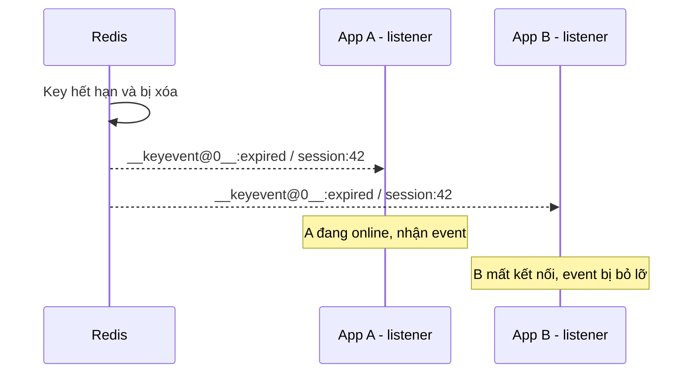
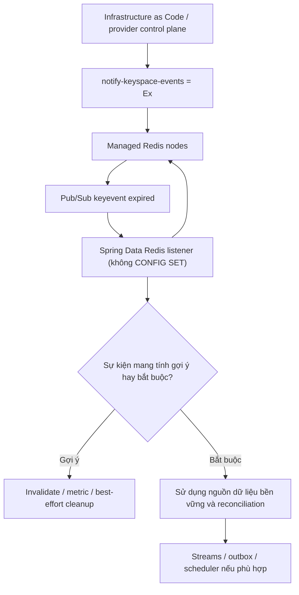
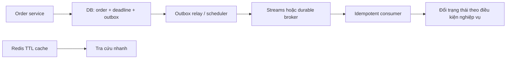

# Chi phí vận hành và giới hạn quyền cấu hình thông báo khóa trong Spring Data Redis

## 1. Vì sao keyspace notifications là một quyết định vận hành?

Redis có thể phát **keyspace notifications** khi khóa được tạo, thay đổi, xóa, hết hạn TTL hoặc bị loại bỏ bởi eviction policy. Spring Data Redis có thể đăng ký nhận những tín hiệu này để phục vụ logic như:

- Biết một khóa phiên tạm thời đã hết hạn.
- Phát một sự kiện ứng dụng khi entity của Redis Repository hết TTL.
- Hỗ trợ dọn secondary index gắn với entity đã hết hạn.
- Làm tín hiệu invalidation của một lớp cache ở nơi khác.
- Quan sát một số thay đổi trong keyspace mà không phải liên tục truy vấn từng key.

Điểm cần cân nhắc không chỉ là vài dòng Java thêm listener. Bật thông báo có thể yêu cầu thay đổi **cấu hình toàn Redis node**, tăng số sự kiện Pub/Sub cần tạo và chuyển qua mạng, và phụ thuộc vào quyền hạn mà dịch vụ Redis được quản lý (*managed Redis*) cho phép.

> **Không nên coi keyspace notifications là một event log bền vững.** Chúng dựa trên Redis Pub/Sub: listener ngắt kết nối có thể bỏ lỡ thông báo, không có cơ chế ack/replay tích hợp, và thông báo hết hạn không bảo đảm đến đúng thời điểm TTL vừa bằng 0.

Điều này đặc biệt quan trọng trên các dịch vụ Redis được quản lý, nơi người viết ứng dụng có thể **không có quyền `CONFIG SET`** hoặc không kiểm soát từng node của cluster.

Bài học tập trung vào hai câu hỏi:

1. Kích hoạt và tiêu thụ thông báo khóa tạo ra **những chi phí và rủi ro vận hành nào**?
2. Khi dịch vụ được quản lý **hạn chế lệnh cấu hình**, làm thế nào sử dụng Spring Data Redis mà không phụ thuộc vào quyền quản trị của ứng dụng?

## 2. Phân biệt keyspace event và keyevent event

Redis có hai kiểu channel cho cùng một thay đổi.

Giả sử lệnh sau xóa khóa `session:42` trong database 0:

```redis
DEL session:42
```

Nếu bật loại sự kiện phù hợp, Redis có thể tạo hai dạng thông báo:

| Dạng | Channel | Nội dung message |
|---|---|---|
| **Keyspace** | `__keyspace@0__:session:42` | `del` |
| **Keyevent** | `__keyevent@0__:del` | `session:42` |

Với **keyspace**, channel nói *khóa nào* và payload nói *sự kiện gì*. Với **keyevent**, channel nói *sự kiện gì* và payload nói *khóa nào*. Hai loại này khác cấu trúc message, không phải hai cơ chế lưu trữ.

Khi muốn nhận tất cả khóa vừa hết hạn, thường đăng ký:

```text
__keyevent@0__:expired
```

và nhận tên khóa ở phần body.

Khi muốn theo dõi một khóa cụ thể với các loại sự kiện, có thể đăng ký mẫu:

```text
__keyspace@0__:session:42
```

và đọc tên sự kiện trong body.

**Không nhầm channel `__keyevent@0__:expire` với `__keyevent@0__:expired`.** Sự kiện `expire` liên quan thao tác đặt thời hạn cho khóa, còn `expired` được phát khi Redis thực sự xóa khóa đã hết hạn.

### 2.1. Tham số notify-keyspace-events

Redis điều khiển nhóm sự kiện được phát bằng tham số:

```text
notify-keyspace-events
```

Các ký hiệu thường cần hiểu:

| Ký hiệu | Ý nghĩa |
|---|---|
| `K` | Phát channel dạng `__keyspace@<db>__:...` |
| `E` | Phát channel dạng `__keyevent@<db>__:...` |
| `g` | Sự kiện thao tác chung như `del`, `expire`, `rename` |
| `$` | Sự kiện cho String commands |
| `l` | List |
| `s` | Set |
| `h` | Hash |
| `z` | Sorted Set |
| `t` | Stream trong phiên bản có hỗ trợ |
| `x` | Khóa thực sự **expired** |
| `e` | Khóa bị **evicted** do chính sách bộ nhớ |
| `A` | Bí danh cho một nhóm rộng các sự kiện; danh sách mở rộng có thể khác theo phiên bản |

Các phiên bản Redis mới có thêm nhóm sự kiện như key miss, new, overwrite hoặc type-change. Không tùy tiện sao chép một chuỗi flag từ phiên bản mới sang dịch vụ có Redis/Valkey engine cũ.

**Phải có ít nhất `K` hoặc `E`** để Redis phát một trong hai loại channel. Chỉ đặt `x` mà không có `K` hoặc `E` sẽ không kích hoạt thông báo hết hạn.

Một số cấu hình điển hình:

| Giá trị | Tác dụng | Khi sử dụng |
|---|---|---|
| `""` | Tắt keyspace notifications | Hệ thống không cần listener |
| `Ex` | Phát keyevent cho khóa hết hạn | Theo dõi `__keyevent@...__:expired` |
| `Eg` | Phát keyevent cho nhóm thao tác chung | Theo dõi `del`, `rename`, `expire` theo nhu cầu |
| `Kx` | Phát keyspace cho khóa hết hạn | Theo dõi dạng `__keyspace@...__:<key>` |
| `KEAx` hoặc `KEA` | Bật nhiều nhóm sự kiện, tùy hỗ trợ phiên bản | Chỉ dùng khi thực sự cần phạm vi rộng và đã đo tải |

Khi chỉ cần nghe event hết hạn, **`Ex` thường là điểm xuất phát ít gây nhiễu hơn `KEA`**. Phải giữ các flag cần thiết của những ứng dụng đang chia sẻ node; không ghi đè một cấu hình đang phục vụ consumer khác chỉ để thêm `Ex`.

### 2.2. Thử nghiệm trên Redis tự quản lý

Trên môi trường phát triển có quyền quản trị Redis:

```redis
CONFIG GET notify-keyspace-events
# Ví dụ ban đầu: ""

CONFIG SET notify-keyspace-events Ex
# OK
```

Terminal thứ nhất:

```redis
SUBSCRIBE __keyevent@0__:expired
```

Terminal thứ hai:

```redis
SET demo:notification:42 active EX 2
# OK
```

Sau khi Redis loại bỏ khóa hết hạn, terminal thứ nhất nhận tên khóa:

```text
demo:notification:42
```

Thời điểm nhận có thể muộn hơn 2 giây; không dùng thí nghiệm này làm bằng chứng Redis bảo đảm lịch hẹn chính xác từng mili-giây.

**Đây là ví dụ dành cho Redis do mình quản lý.** Trên managed Redis, `CONFIG GET` hoặc `CONFIG SET` có thể bị chặn; không áp dụng nguyên xi chuỗi lệnh vào production. Nếu thay đổi cấu hình phục vụ một thí nghiệm, cần có kế hoạch khôi phục cấu hình ban đầu sau khi kết thúc, đồng thời hiểu rằng tham số tác động đến những ứng dụng dùng chung node.

## 3. Thông báo khóa không có độ bền của message queue

Redis keyspace notifications được gửi qua Pub/Sub. Mô hình đơn giản:



Với event quan trọng, có ít nhất ba cửa sổ rủi ro:

1. **Trước khi listener bắt đầu:** Redis đã phát event nhưng ứng dụng chưa subscribe.
2. **Trong lúc listener mất kết nối:** mạng, failover, restart hoặc redeploy làm mất một số thông báo.
3. **Sau khi listener nhận nhưng trước khi xử lý xong:** thread/process chết, trong khi Redis không lưu event để giao lại dựa trên ack.

Do đó, dù Spring có cơ chế reconnect thông qua listener container, những event đã được phát lúc không có subscriber không tự được phát lại sau reconnect.

| Mong đợi | Keyspace notifications có đáp ứng? |
|---|---|
| Phát tín hiệu gần thời gian thực tới subscriber đang kết nối | Có |
| Lưu event để consumer offline đọc lại | **Không** |
| Ack sau khi xử lý nghiệp vụ | **Không** |
| Redelivery khi handler lỗi | **Không** |
| Replay từ offset hoặc timestamp | **Không** |
| Biết chính xác có bao nhiêu event bị mất | Không có cơ chế trực tiếp |
| Thích hợp làm tín hiệu bổ trợ cho cache/TTL | Có, nếu chấp nhận khả năng bỏ lỡ |
| Đảm bảo mọi email/thanh toán/job bắt buộc được xử lý | Không nên dùng làm kênh duy nhất |

Đây là lý do phải phân tích **mức độ quan trọng của side effect** trước khi bật notifications; chi phí CPU không phải đánh đổi duy nhất.

## 4. Chi phí vận hành khi bật keyspace notifications

Redis documentation nêu rõ feature này thường **tắt mặc định vì việc tạo thông báo tiêu tốn tài nguyên CPU**. Tài nguyên thực tế còn phụ thuộc các loại event bật, tốc độ thao tác, số subscriber, cách phân phối và công việc của phía ứng dụng.

### 4.1. CPU cho việc phát hiện, tạo và phân phối sự kiện

Mỗi thao tác Redis vốn đã có công việc xử lý data structure. Khi bật thông báo cho loại sự kiện đó, server có thêm thao tác tạo Pub/Sub message và phân phối cho những subscriber phù hợp.

Với một hệ thống có hàng nghìn hoặc hàng chục nghìn thao tác mỗi giây, overhead nhỏ trên từng thao tác vẫn có thể đáng kể khi cộng lại.

Khi chỉ cần sự kiện expired mà cấu hình lại là `KEA`, Redis có thể phải phát thêm các sự kiện write, delete, list/hash/set/stream theo flags được hỗ trợ. Một hệ thống có nhiều thao tác trên Hash hoặc Set sẽ tạo ra nhiều thông điệp không cần thiết.

**Nguyên tắc:** bật **ít loại sự kiện nhất đáp ứng mục tiêu thực tế**, không chọn `KEA` chỉ vì "dễ debug".

### 4.2. Mạng, Pub/Sub fan-out và số subscriber

Với keyevent, payload thường là tên key, nhưng vẫn có overhead của protocol, channel, connection, network buffer và thư viện client.

Ví dụ **ước lượng minh họa**, không phải benchmark Redis:

```text
5.000 events/giây
3 listener nhận mỗi event
80 byte dữ liệu message trung bình trước overhead transport

=> 5.000 × 3 × 80 = 1.200.000 byte/giây
   ≈ 1,2 MB/giây chỉ tính dữ liệu message giả định
```

Con số thực có thể lớn hơn vì protocol/transport, tên channel, mã hóa và metadata. Ngoài băng thông Redis phát ra, **mỗi listener** cũng phải parse message, lọc key, ghi log hoặc kích hoạt các công việc tiếp theo.

Một kiến trúc nhiều Spring instance cùng đăng ký `__keyevent@0__:expired` có thể khiến **tất cả instance đều nhận cùng thông báo**. Đây là *fan-out*, không phải work queue có phân phối một event cho một worker. Nếu mỗi listener đều gọi API hoặc ghi database, cùng một sự kiện có thể tạo nhiều side effect.

### 4.3. Bảng chi phí theo lựa chọn

| Yếu tố | Khi tăng lên | Hậu quả có thể gặp | Cách giảm |
|---|---|---|---|
| Phạm vi flags | Từ `Ex` tới `KEA` | Thêm CPU và event traffic | Bật đúng nhóm cần thiết |
| Số key đổi trạng thái | Nhiều write/expire/evict | Event rate tăng | Giảm churn, chọn event loại hẹp |
| Số subscriber | Nhiều application instance | Fan-out/network/CPU listener tăng | Tách subscriber chuyên trách nếu nghiệp vụ phù hợp |
| Độ dài key | Key chứa nhiều dữ liệu trong tên | Payload tăng, tốn băng thông | Naming ổn định, ngắn và không lộ bí mật |
| Xử lý nặng trong listener | Gọi DB/API ngay trên callback | Tắc luồng, backlog client, lỗi tăng | Tách việc nặng sang cơ chế có giới hạn và độ bền phù hợp |
| Ghi log từng event | Lưu log toàn bộ event | Tăng I/O, log cost và cardinality | Sampling, metric aggregate, không log payload nhạy cảm |
| Nhiều Redis node | Cluster lớn hơn | Cần nhiều subscription/quan sát hơn | Theo dõi theo node và topology |
| Tần suất reconnect | Mạng hoặc failover không ổn định | Mất event khi offline | Alert, reconciliation, không dựa vào event cho correctness |

### 4.4. Chi phí phụ của Spring Data Redis Repository

Khi dùng entity Redis Repository có TTL, cơ chế publish event hết hạn có thể đi kèm **shadow copy / phantom copy** của aggregate để cho phép event object mang dữ liệu thực thể đã hết hạn. Tùy cấu hình/version, bản sao được giữ thêm một khoảng thời gian sau khi original key hết hạn.

Lợi ích: listener có thể nhận thông tin domain object thay vì chỉ ID/key.

Đánh đổi:

- Thêm dữ liệu trong Redis trong thời gian ngắn.
- Thêm chi phí serialize/ghi và storage cho aggregate.
- Các entity lớn hoặc TTL ngắn có thể làm tăng lượng bản sao.
- Khi listener không được bật/không nhận event, dữ liệu/index phụ trợ vẫn cần xem xét vòng đời riêng.

Nếu chỉ cần ID của key hết hạn, có thể cân nhắc **tắt shadow copy** theo API Spring Data Redis phù hợp. Khi tắt, event không còn snapshot đầy đủ của object đã bị xóa; consumer phải có nguồn dữ liệu khác nếu cần các trường nghiệp vụ.

Không nên sao chép logic shadow copy sang mọi ứng dụng `StringRedisTemplate`: đây là khía cạnh của cơ chế Redis Repository TTL, không phải behavior bắt buộc của tất cả key có TTL.

## 5. Expired event không đến đúng mili-giây TTL bằng 0

Redis loại bỏ key hết hạn theo hai cơ chế phổ biến:

- **Passive expiration:** khi key được truy cập, Redis thấy TTL đã qua và loại bỏ nó.
- **Active expiration:** Redis định kỳ kiểm tra một phần các key có TTL và loại bỏ key đã hết hạn.

Event `expired` được tạo **khi key thực sự bị xóa khỏi dataset**, không phải ngay khi đồng hồ đi qua mốc TTL lý thuyết.

Ví dụ:

```text
12:00:00  SET session:42 active EX 60
12:01:00  TTL lý thuyết kết thúc
12:01:01  Redis chưa quét hoặc truy cập key
12:01:03  Redis thực sự xóa key -> có thể phát expired
```

Khoảng trễ phụ thuộc tải, số lượng key và thuật toán expiration. Trong một số điều kiện có thể dài đáng kể.

**Không dùng `expired` làm bộ hẹn giờ chính xác** cho những công việc như:

- Tự động chuyển tiền đúng một thời điểm.
- Đóng đơn hàng bảo đảm trong thời hạn nghiêm ngặt.
- Thực thi job theo SLA từng giây.
- Thu hồi quyền với giả định listener luôn chạy.

Nếu yêu cầu là "sau thời điểm T, không còn quyền truy cập", hãy kiểm tra **thời hạn tại đường đọc/authorization** dựa trên nguồn có thẩm quyền. Notification có thể dùng để dọn dữ liệu phụ, không nên là điều kiện duy nhất để chặn truy cập.

### 5.1. Expired khác evicted

| Sự kiện | Nguyên nhân | Flag |
|---|---|---|
| `expired` | Key hết TTL và Redis thực sự xóa | `x` |
| `evicted` | Redis loại key do chính sách `maxmemory` | `e` |
| `del` | Một thao tác xóa/command tương ứng loại key | `g` |

Không giả định rằng bật `Ex` sẽ nhận mọi loại key biến mất. Nếu cache có maxmemory eviction, key có thể mất do eviction mà **không tạo event expired**.

Ngược lại, bật cả expired/evicted/delete có thể tăng traffic và vẫn không giải quyết các trường hợp subscriber mất kết nối.

## 6. Quyền CONFIG và ACL: hai tầng giới hạn khác nhau

Trên một Redis tự quản lý, người vận hành có thể cấu hình `notify-keyspace-events` qua `redis.conf` hoặc lệnh `CONFIG SET` khi được cấp quyền.

Trên managed Redis, có thể có hai loại giới hạn:

1. **Quyền của Redis user (ACL):** lệnh `CONFIG`, `SUBSCRIBE`, `PSUBSCRIBE` hoặc channel có thể không nằm trong danh sách được phép.
2. **Chính sách của nhà cung cấp:** một số cấu hình bị cấm hoặc chỉ cho thay đổi qua control plane/parameter group, ngay cả khi tài khoản ứng dụng có nhiều quyền Redis.

Hai lớp phải được kiểm tra riêng. Cấp thêm quyền `+config` trong Redis ACL không chắc gỡ được một hạn chế của dịch vụ được quản lý.

### 6.1. Tối thiểu một listener cần quyền gì?

Một listener thuần túy nhận event thường cần:

- Kết nối và xác thực vào Redis.
- Quyền subscribe tương ứng `SUBSCRIBE` hoặc `PSUBSCRIBE`.
- Quyền channel pattern phù hợp với ACL version, ví dụ channel `__keyevent@0__:expired`.
- Network connectivity đến những node thực sự phát event.
- Quyền thực hiện các lệnh khác nếu code listener còn đọc/ghi Redis (nên hạn chế).

Listener **không cần quyền `CONFIG SET`** chỉ để subscribe, nếu phía Redis **đã bật đúng thông báo** bằng cấu hình hạ tầng.

Cần tách ba trách nhiệm:

| Vai trò | Quyền thường cần |
|---|---|
| Infra/platform administrator | Thiết lập cấu hình Redis ở control plane |
| Redis notification listener | Subscribe tới channel được phép, quyền Redis tối thiểu |
| Business service handler | Quyền đọc/ghi các key nghiệp vụ cụ thể, không mặc định quyền quản trị |

Đừng giao quyền quản trị cấu hình cho toàn bộ microservice chỉ để khắc phục lỗi listener khi startup.

### 6.2. Các lỗi quyền và ý nghĩa

| Hiện tượng | Diễn giải có thể |
|---|---|
| `NOPERM ... CONFIG` | Redis ACL từ chối lệnh CONFIG |
| `ERR unknown command 'CONFIG'` hoặc command bị chặn | Nhà cung cấp/engine đã ẩn hoặc cấm CONFIG |
| `NOPERM ... PSUBSCRIBE` | User không được phép subscribe hoặc channel pattern không hợp lệ |
| Kết nối Redis thành công, nhưng không có expired event | Flag chưa bật đúng, subscribe sai DB/node hoặc listener offline |
| Code thử `CONFIG GET` cũng thất bại | Quyền đọc cấu hình bị hạn chế; không suy ra ngay tính năng notification không tồn tại |
| Sau failover chỉ một phần key có event | Topology subscription hoặc listener chưa bám đúng node |
| Service chạy local nhưng lỗi trên managed | Local có quyền admin, managed yêu cầu cấu hình qua control plane |

Khi chẩn đoán, ưu tiên xem **log lỗi gốc** và chính sách platform, không retry vô hạn một lệnh quản trị bị cấm.

## 7. Dịch vụ Redis được quản lý: cấu hình qua control plane

Managed Redis thường tách **data plane** (lệnh đọc/ghi key) khỏi **control plane** (quản lý cấu hình, topology, bảo mật, failover). Ứng dụng được phép làm việc với dữ liệu nhưng không nhất thiết được thay đổi thông số server.

### 7.1. Ví dụ Amazon ElastiCache

Với Amazon ElastiCache for Redis OSS/Valkey, tài liệu nhà cung cấp mô tả tham số `notify-keyspace-events` trong **parameter group**. Cách triển khai thông thường:

1. Xác định engine version, parameter-group family và nhóm đang áp dụng.
2. Tạo hoặc chọn **custom parameter group** có thể chỉnh sửa.
3. Đặt `notify-keyspace-events` theo phạm vi tối thiểu (ví dụ `Ex`).
4. Gắn nhóm cấu hình phù hợp cho replication group/cluster theo cơ chế của nhà cung cấp.
5. Theo dõi trạng thái áp dụng thay đổi và kiểm tra listener nhận event.
6. Quản lý cấu hình đó bằng IaC/runbook, không thay đổi lén từ code application.

Tài liệu Spring Data Redis có lưu ý rằng `CONFIG` không khả dụng theo cách cần thiết trong môi trường ElastiCache; vì thế startup listener nếu cố gắng tự gọi `CONFIG` có thể thất bại. Giải pháp là **tách việc cấu hình Redis khỏi tiến trình ứng dụng** và vô hiệu hóa bước tự chỉnh cấu hình của Spring Data Redis như mục sau.

Đừng mặc định custom parameter group sẽ áp dụng mọi thay đổi ngay trong mọi engine version/topology; thông tin có cần restart/apply hay không phải lấy từ chính chính sách của provider và loại tham số đang cấu hình.

### 7.2. Với Azure, Google Cloud và nhà cung cấp khác

Không có một lệnh quản trị hay UI duy nhất dùng cho mọi managed Redis. Những điều cần xác minh theo dịch vụ cụ thể:

- Dịch vụ/edition/engine version **có hỗ trợ** keyspace notifications không?
- Tham số `notify-keyspace-events` có thể được đặt từ portal/API/IaC hay bị khóa?
- `CONFIG GET` và `CONFIG SET` có được hỗ trợ, có cần quyền đặc biệt không?
- Event có được phát trên primary/replica/node cụ thể hay không?
- Cluster mode có yêu cầu subscribe từng node, endpoint hoặc shard?
- Khi failover/scale-out, cấu hình có tự đồng bộ và client có reconnect đúng không?
- Các flag nào được chấp nhận trong engine version đang dùng?

Không suy ra "Redis protocol compatible" có nghĩa mọi câu lệnh admin và mọi server setting đều được mở. Dịch vụ managed có thể giới hạn quyền vì lý do bảo mật, tính ổn định và vận hành đa khách hàng.

### 7.3. Ma trận quyết định cấu hình

| Môi trường | Ai cấu hình `notify-keyspace-events`? | Cách ứng dụng nên hoạt động |
|---|---|---|
| Redis tự quản lý với quyền admin | Platform/DBA qua redis.conf hoặc CONFIG theo quy trình | Listener subscribe; app có thể không cần quyền CONFIG |
| Managed Redis có tham số cấu hình qua control plane | Infra/platform team | Thiết lập ngoài ứng dụng, listener không gọi CONFIG |
| Managed Redis cho phép CONFIG SET có kiểm soát | Theo chính sách platform | Vẫn ưu tiên IaC, tránh các instance tranh nhau chỉnh cấu hình |
| Managed Redis không hỗ trợ notifications | Không thể bật theo cách dự kiến | Dùng polling/scheduler/Streams/outbox theo yêu cầu |
| Redis Cluster nhiều node | Infra cấu hình tất cả node liên quan | Listener bao phủ node phát event; kiểm tra failover |

## 8. Spring Data Redis: listener cho keyevent mà không cần CONFIG

Nếu chỉ cần nhận tên key hết hạn, có thể tạo một `RedisMessageListenerContainer`. Container quản lý subscription và dispatch message nhưng **không tự bảo đảm Redis đã bật notify-keyspace-events**.

Ví dụ Spring Boot:

```groovy
dependencies {
    implementation 'org.springframework.boot:spring-boot-starter-data-redis'
}
```

```yaml
spring:
  data:
    redis:
      host: localhost
      port: 6379
```

Java configuration:

```java
package com.example.redis.notifications;

import java.nio.charset.StandardCharsets;
import org.springframework.context.annotation.Bean;
import org.springframework.context.annotation.Configuration;
import org.springframework.data.redis.connection.MessageListener;
import org.springframework.data.redis.connection.RedisConnectionFactory;
import org.springframework.data.redis.listener.ChannelTopic;
import org.springframework.data.redis.listener.RedisMessageListenerContainer;

@Configuration
public class ExpirationListenerConfiguration {

    @Bean
    public MessageListener expiredKeyListener() {
        return (message, pattern) -> {
            String key = new String(
                    message.getBody(),
                    StandardCharsets.UTF_8
            );

            // Lọc tên key để tránh xử lý sự kiện không liên quan.
            if (!key.startsWith("session:")) {
                return;
            }

            // Đây chỉ là tín hiệu; key có thể đã không còn.
            // Không chạy một công việc dài hoặc không-idempotent
            // ngay trong callback Pub/Sub.
            System.out.println("Expired session key: " + key);
        };
    }

    @Bean
    public RedisMessageListenerContainer expirationContainer(
            RedisConnectionFactory connectionFactory,
            MessageListener expiredKeyListener) {

        RedisMessageListenerContainer container =
                new RedisMessageListenerContainer();

        container.setConnectionFactory(connectionFactory);
        container.addMessageListener(
                expiredKeyListener,
                new ChannelTopic("__keyevent@0__:expired")
        );

        return container;
    }
}
```

Giải thích:

- `ChannelTopic` subscribe đúng channel cho event hết hạn ở **database 0**.
- Body của keyevent chứa **tên key**, không phải giá trị object đã mất.
- `RedisMessageListenerContainer` quản lý subscription connection riêng phù hợp; handler vẫn phải xử lý mất kết nối, duplicate side effect giữa nhiều instance và vận hành.
- `startsWith("session:")` chỉ lọc **ở phía ứng dụng sau khi event đã được gửi tới subscriber**; nó không làm giảm số event Redis đã phát cho channel `expired`.
- Ví dụ này **không cố gọi `CONFIG SET`**. Trước đó, platform phải bật `Ex` hoặc cấu hình tương đương trên Redis.

Để hạn chế chi phí, không tạo thêm một subscription container cho từng session key. Một hoặc vài listener được quản lý theo mô hình deployment thường hiệu quả hơn việc nhân subscription không giới hạn.

### 8.1. Event nhận được sau khi key đã bị xóa

Đoạn sau dễ gây hiểu nhầm:

```java
String value = stringRedisTemplate.opsForValue().get(expiredKey);
// Thường trả null vì Redis đã xóa key hết hạn.
```

Thông báo `expired` được tạo khi key bị Redis xóa. Do đó, listener không nên kỳ vọng đọc lại payload từ key vừa expired.

Nếu handler cần userId, tenantId, kiểu phiên hoặc thông tin công việc, có thể:

- Mã hóa **ID tối thiểu, không nhạy cảm** vào tên key theo quy tắc an toàn.
- Lưu metadata ở nguồn dữ liệu khác có thời gian sống lâu hơn.
- Ghi một event bền vững trước thời điểm expiration.
- Dùng cơ chế shadow copy của Spring Data Redis Repository khi phù hợp và chấp nhận overhead/giới hạn mất event.

Không để khóa Redis chứa password, token hoặc PII trong tên chỉ để lấy lại thông tin lúc expire, bởi tên khóa có thể xuất hiện trong logs, metrics, monitor và thông báo.

## 9. Spring Data Redis Repository: tránh lệnh CONFIG trên managed Redis

Redis Repository hỗ trợ TTL và có thể phát `RedisKeyExpiredEvent` khi aggregate hết hạn. Khi bật listener hết hạn qua Repository, Spring Data Redis có cơ chế cấu hình `notify-keyspace-events` nếu tham số này chưa được thiết lập trong Redis.

Đây là điểm thường khiến ứng dụng **chạy tốt ở local nhưng lỗi khi deploy lên managed Redis**: tài khoản ứng dụng không thể thực hiện `CONFIG`.

### 9.1. Cấu hình @EnableRedisRepositories

Ví dụ cấu hình theo API Spring Data Redis tương ứng:

```java
package com.example.redis.repository;

import org.springframework.context.annotation.Configuration;
import org.springframework.data.redis.core.RedisKeyValueAdapter;
import org.springframework.data.redis.repository.configuration.EnableRedisRepositories;

@Configuration
@EnableRedisRepositories(
        basePackages = "com.example.redis.repository",
        enableKeyspaceEvents =
                RedisKeyValueAdapter.EnableKeyspaceEvents.ON_STARTUP,
        keyspaceNotificationsConfigParameter = ""
)
public class ManagedRedisRepositoryConfiguration {
}
```

Phần quan trọng nhất:

```java
keyspaceNotificationsConfigParameter = ""
```

Nó yêu cầu Spring Data Redis **không thử thay đổi** tham số `notify-keyspace-events` trên Redis. Đây là workaround được tài liệu Spring Data Redis mô tả cho môi trường mà lệnh `CONFIG` không được phép.

**Nó không tự bật notifications trên server.** Nếu hạ tầng chưa cấu hình `Ex` hoặc tập flags phù hợp, listener có thể chạy nhưng **không nhận được expired event**.

Hai công việc phải tách nhau:

```text
Platform team:
  Managed Redis parameter group / control plane
  notify-keyspace-events = Ex

Application:
  @EnableRedisRepositories(...)
  keyspaceNotificationsConfigParameter = ""
  subscribe/handle RedisKeyExpiredEvent
```

Cũng nên xem xét `ON_STARTUP` so với mode khởi động khi cần. Trì hoãn listener tới lần đầu lưu entity có TTL có thể gây bỏ lỡ các event xảy ra trước khi listener bắt đầu.

### 9.2. Ví dụ entity có TTL

```java
package com.example.redis.repository;

import org.springframework.data.annotation.Id;
import org.springframework.data.redis.core.RedisHash;
import org.springframework.data.redis.core.TimeToLive;

@RedisHash("sessions")
public class SessionEntity {

    @Id
    private String id;

    private String ownerId;

    @TimeToLive
    private Long ttlSeconds;

    protected SessionEntity() {
    }

    public SessionEntity(
            String id, String ownerId, Long ttlSeconds) {
        this.id = id;
        this.ownerId = ownerId;
        this.ttlSeconds = ttlSeconds;
    }

    public String getId() {
        return id;
    }

    public String getOwnerId() {
        return ownerId;
    }

    public Long getTtlSeconds() {
        return ttlSeconds;
    }
}
```

Sau khi entity được lưu qua Repository và hết TTL, Spring Data Redis có thể phát event ứng dụng tương ứng nếu listener đang hoạt động và Redis thực sự phát keyevent. Tuy nhiên:

- Redis Pub/Sub không lưu event để listener reconnect đọc lại.
- Keyspace event có thể không đến đúng mốc TTL.
- Event payload phụ thuộc cơ chế shadow copy và cấu hình Repository.
- Nếu một entity có index phụ trợ và event bị bỏ lỡ, metadata/index có thể cần reconciliation.

### 9.3. Tắt shadow copies khi chỉ cần ID

Với những trường hợp không cần snapshot aggregate trong expired event, Spring Data Redis có tùy chọn shadow copy:

```java
@EnableRedisRepositories(
        basePackages = "com.example.redis.repository",
        enableKeyspaceEvents =
                RedisKeyValueAdapter.EnableKeyspaceEvents.ON_STARTUP,
        keyspaceNotificationsConfigParameter = "",
        shadowCopy = RedisKeyValueAdapter.ShadowCopy.OFF
)
```

Đây là mẫu cấu hình thay thế cho annotation ở mục 9.1, không phải một annotation cần thêm lần nữa trên cùng configuration.

Khi shadow copy tắt, event hết hạn không còn bản sao đầy đủ của aggregate; theo cơ chế được mô tả trong tài liệu, event có thể chỉ có ID/key. Đổi lại, giảm chi phí lưu thêm dữ liệu phụ cho TTL entity.

Không phải dự án nào cũng cần bật keyspace events cho Repository. Nếu chỉ dùng Redis làm cache theo key và không sử dụng các sự kiện domain expiry, không nên bật cơ chế này theo quán tính.

## 10. Vấn đề Redis Cluster: subscriber một node không nhìn thấy mọi key

Trong Redis Cluster, mỗi key thuộc một hash slot và được quản lý bởi node tương ứng. Redis documentation nêu rõ **keyspace notifications có phạm vi node**, không được broadcast đến mọi node như một event tổng hợp toàn cluster.

```text
                 Redis Cluster
         +---------------------------+
         |                           |
       Node A                     Node B
    key: session:1             key: session:2
         |                           |
   expired(session:1)          expired(session:2)
         |                           |
         v                           v
     Listener A                  Listener B
```

Nếu Spring listener chỉ subscribe được tới node A, nó có thể bỏ lỡ expiration của key thuộc node B.

Điều này không được sửa bằng cách đặt topic thành `__keyevent@0__:expired`: **topic xác định kiểu sự kiện, không tạo ra một luồng tập trung từ mọi shard**.

### 10.1. Những điểm phải thiết kế ở cluster

- Xác định primary nào sở hữu key đang quan tâm.
- Kiểm tra nhà cung cấp hỗ trợ subscription/node endpoint như thế nào.
- Cấu hình `notify-keyspace-events` nhất quán trên các node liên quan.
- Subscribe đến những node phát event theo cách topology của deployment đòi hỏi.
- Theo dõi reconnect và đăng ký lại sau failover/scale-out.
- Không suy ra listener tự bao phủ cluster chỉ vì client Redis có khả năng định tuyến `GET`/`SET` theo slot.
- Redis Cluster thông thường sử dụng database 0; tránh viết cấu hình topic cho DB khác mà không có lý do hợp lệ.

Với managed cluster, endpoint được quảng bá cho data commands có thể không tương đương đầy đủ với các endpoint/connection cần cho Pub/Sub node-specific notifications. Quy tắc cụ thể phải được xác nhận qua tài liệu và thử nghiệm của provider.

### 10.2. Failover có thể tạo khoảng trống sự kiện

Khi primary failover:

1. Connection subscribe cũ có thể ngắt.
2. Listener/container reconnect theo cơ chế client.
3. Node mới tiếp nhận keyspace tương ứng.
4. Những expiration đã xảy ra trong khoảng trống có thể **không được phát lại**.

Không có giải pháp chỉ bằng tăng số lần retry `SUBSCRIBE` mà biến Pub/Sub thành durable queue. Nếu ứng dụng cần biết chắc mọi expiration, phải có phương án khác: sự kiện nghiệp vụ bền vững, job scheduling từ dữ liệu gốc hoặc reconciliation.

## 11. ACL và nguyên tắc cấp quyền tối thiểu

Trên Redis hỗ trợ ACL theo user/channel, có thể giới hạn:

- Nhóm lệnh được thực thi.
- Pattern key ứng dụng được đọc/ghi.
- Channel Pub/Sub có thể subscribe/publish.
- Những lệnh quản trị như `CONFIG`.

Đối với expired-key listener:

- Chỉ cấp quyền subscription cần thiết.
- Chỉ cho phép những channel có liên quan theo ACL syntax/engine version.
- Không cấp quyền `CONFIG SET` để listener tự "sửa" server mỗi lần khởi động.
- Không dùng tài khoản quản trị chung cho application và platform.
- Không log đầy đủ tên key nếu key có thông tin nhạy cảm.
- Dùng TLS và credential management của provider theo chính sách doanh nghiệp.

Ví dụ những câu hỏi kiểm tra quyền trong môi trường đã được cấp phép:

```redis
ACL WHOAMI
CONFIG GET notify-keyspace-events
```

Nếu lệnh thứ hai bị chặn, không cố "đi vòng" qua một tài khoản khác. Cần yêu cầu hạ tầng xác nhận cấu hình và quyền subscription bằng con đường được provider hỗ trợ. Kể cả `ACL WHOAMI` cũng có thể bị giới hạn tùy user/service; thất bại của thao tác kiểm tra không đồng nghĩa toàn bộ Redis không dùng được.

**Không nên cấp `+@all` hoặc quyền quản trị quá rộng cho listener chỉ vì một lỗi `NOPERM`.** Đó là rủi ro bảo mật và làm ứng dụng có thể thay đổi cấu hình chung ngoài chủ đích.

## 12. Mô hình triển khai an toàn trên managed Redis

Một sơ đồ trách nhiệm rõ ràng:



Ở đây:

- Platform cấu hình server như một phần của việc triển khai, có version và audit.
- App chỉ cần kết nối và subscribe.
- Không thay đổi trạng thái Redis ngoài phạm vi ứng dụng khi mỗi instance khởi động.
- Chức năng quan trọng không phụ thuộc duy nhất vào một event có thể mất.

### 12.1. Lựa chọn startup mode

Spring Data Redis Repository có lựa chọn khởi chạy listener sự kiện lúc startup hoặc theo yêu cầu. Nếu bắt đầu listener quá muộn, các khóa hết hạn trước khi listener subscribe có thể không được báo tới app.

Cần phân biệt:

- **ON_STARTUP:** cố bật listener ngay khi ứng dụng khởi tạo.
- **ON_DEMAND:** khởi tạo theo nhu cầu, có thể mất event trước lần cần thiết.
- **OFF:** không lắng nghe sự kiện theo cơ chế này.

Lựa chọn cụ thể còn phụ thuộc phiên bản Spring Data Redis và ngữ cảnh Repository. Nếu application không cần expiry event và chỉ dùng `@TimeToLive` cho key lifecycle, không phải lúc nào cũng cần ON_STARTUP.

Nếu bật ON_STARTUP trên managed Redis mà không cấu hình `keyspaceNotificationsConfigParameter = ""`, lỗi quyền `CONFIG` có thể xuất hiện trong giai đoạn khởi tạo listener. Cần kiểm tra log startup và readiness, tránh service báo Ready trong khi phần thông báo bắt buộc của ứng dụng chưa thực sự hoạt động.

### 12.2. Vì sao không nên để ứng dụng tự động CONFIG SET?

Trong hệ thống nhiều instance:

```text
Pod A startup -> CONFIG SET notify-keyspace-events Ex
Pod B startup -> CONFIG SET notify-keyspace-events KEA
Pod C startup -> CONFIG SET notify-keyspace-events ""
```

Nếu các instance có quyền thay cấu hình chung, giá trị cuối phụ thuộc tiến trình nào ghi sau. Một thay đổi có thể vô tình tắt loại event mà ứng dụng khác cần. Trong managed Redis, việc ứng dụng thử lệnh này còn có thể bị từ chối.

Vì vậy, ngay cả khi Redis tự quản lý cho phép CONFIG SET, production thường nên:

1. Có một owner cấu hình.
2. Khai báo trong IaC/config management.
3. Kiểm tra thay đổi có tương thích consumer hiện tại không.
4. Triển khai theo kế hoạch và đo overhead.
5. Tách vai trò subscriber khỏi role quản trị.

## 13. Chi phí xử lý trong Spring listener

Một event expiry body chỉ chứa tên key, nhưng listener có thể làm thêm việc rất tốn kém: đọc database, gọi API, ghi log, xử lý session hoặc thực hiện cleanup phức tạp.

### 13.1. Tránh block luồng dispatch

Ví dụ không phù hợp:

```java
return (message, pattern) -> {
    String key = new String(
            message.getBody(),
            StandardCharsets.UTF_8
    );

    // Ví dụ không nên áp dụng trực tiếp:
    remoteBillingApi.finalizeInvoice(key); // Có thể chậm, retry hoặc timeout.
};
```

Nếu mỗi event phải gọi API 500 ms và có hàng nghìn sự kiện mỗi giây, listener dễ tích tụ backlog ở client. Ngoài ra, khi callback đã nhận rồi process chết, Redis Pub/Sub không lưu event để consumer khôi phục.

Với công việc chỉ mang tính best-effort, có thể xử lý qua executor có giới hạn và kiểm soát tải. Nếu công việc **phải hoàn tất**, cần một durable queue/Streams/outbox ở điểm phù hợp trong workflow; chỉ `executor.submit(...)` trong RAM không làm event có durability.

### 13.2. Nhiều instance dẫn đến xử lý trùng

Ví dụ ba service instance cùng subscribe expired event:

```text
Redis expired(session:42)
    |
    +--> instance A -> cleanup
    +--> instance B -> cleanup
    +--> instance C -> cleanup
```

Cả ba có thể nhận **cùng event**. Nếu cleanup đơn giản là xóa một entry phụ theo key, tác vụ có thể idempotent. Nhưng nếu mỗi instance gửi email, trừ phí hoặc tạo invoice, kết quả có thể bị thực hiện nhiều lần.

Giải pháp không phải chỉ thêm `synchronized` trong Java, vì lock cục bộ của mỗi process không phối hợp với process khác. Cần:

- Chủ sở hữu listener chuyên trách khi kiến trúc cho phép.
- Side effect idempotent theo operation ID/key.
- Kiểm tra trạng thái ở nguồn dữ liệu chính.
- Hoặc chuyển nghiệp vụ sang hàng đợi có competing consumers và ack.

### 13.3. Message body không phải sự kiện nghiệp vụ đầy đủ

`expired(session:42)` không cung cấp:

- Ai đã tạo session.
- Vì sao thời hạn được thiết lập.
- Có phải đó là phiên bản mới nhất không.
- Tác vụ dọn nào đã được xử lý.
- Cơ chế retry và kết quả cuối cùng.

Vì vậy keyspace event nên được xem là **tín hiệu ở tầng hạ tầng**. Nếu domain cần `SessionClosed`, `OrderExpired` hoặc `PaymentTimedOut` với dữ liệu đầy đủ và replay, ứng dụng nên phát một event nghiệp vụ từ nguồn có thẩm quyền.

## 14. Đo lường và cảnh báo khi bật notifications

Một rollout an toàn cần **đường đo trước và sau thay đổi**.

### 14.1. Redis-side metrics

Những thông số thường hữu ích:

| Tín hiệu | Mục đích |
|---|---|
| Redis CPU usage | Phát hiện overhead sau khi bật notification |
| Network outbound / bytes sent | Phát hiện fan-out tới nhiều subscriber |
| Connected clients / Pub/Sub subscriptions | Phát hiện số listener lớn hoặc reconnect bất thường |
| `expired_keys` trong `INFO stats` | Khóa được Redis loại vì TTL |
| `evicted_keys` trong `INFO stats` | Khóa bị loại do memory policy |
| Redis latency p95/p99 | Phát hiện ảnh hưởng lên command đọc/ghi |
| Memory usage / fragmentation | Theo dõi áp lực bộ nhớ nền |
| Failover/topology changes | Giải thích khoảng thời gian listener không nhận event |

`INFO stats` không phải số liệu per-application; khi nhiều workload dùng cùng Redis, `expired_keys` là bộ đếm ở cấp instance/node. Nó cũng **không bằng số thông báo chắc chắn đã tới ứng dụng**.

Trong Redis Cluster, cần tổng hợp metrics từ các node phù hợp. Không lấy bộ đếm expired trên primary A làm tổng cho cả cluster.

### 14.2. Application-side metrics

Một số tên metric tự định nghĩa:

```text
redis_keyevent_listener_connected
redis_keyevent_messages_received_total
redis_keyevent_messages_filtered_total
redis_keyevent_handler_errors_total
redis_keyevent_handler_duration_seconds
redis_keyevent_listener_reconnects_total
redis_keyevent_reconciliation_pending
```

Đây là gợi ý, **không phải các metric Spring Data Redis tự sinh mặc định**.

Cách diễn giải:

- `received_total` tăng chứng minh listener đã nhận event, không chứng minh Redis không phát event bị bỏ lỡ.
- `listener_connected` và reconnect counter phản ánh health cơ bản, không mang bảo đảm replay.
- `handler_errors_total` giúp phát hiện callback lỗi.
- `reconciliation_pending` đo số đối tượng cần kiểm tra ở workflow bền vững.

Không tạo label `key="session:..."` cho từng key ở hệ thống có hàng triệu key; cardinality metric có thể nổ. Dùng loại event, service, environment, shard hoặc prefix đã chuẩn hóa.

### 14.3. Kiểm tra end-to-end bằng canary

Một kiểm tra khả năng hoạt động có thể:

1. Tạo một key canary duy nhất trong namespace thử nghiệm, có TTL ngắn.
2. Xác nhận listener đã subscribe trước khi tạo canary.
3. Theo dõi việc nhận tên key khi nó hết hạn.
4. Ghi lại latency quan sát được, node nguồn và phiên bản cấu hình.
5. Dọn dữ liệu và không dùng canary để phát side effect nghiệp vụ.

Canary chứng minh **một mẫu event đã tới**, không có nghĩa hệ thống nhận được mọi event hay độ trễ luôn cố định. Nếu triển khai cluster, cần kiểm tra coverage ở các node/shard có liên quan.

## 15. Runbook bật notifications trên dịch vụ được quản lý

### Bước 1: xác nhận nhu cầu

Xác định rõ loại event nào cần nghe và hậu quả nếu bỏ lỡ:

```text
Use case: dọn metadata phiên đã hết TTL
Event: expired
Khả năng mất event: chấp nhận nếu reconciliation xử lý được
Bản sao dữ liệu cần trong event: không
Mục tiêu tải: theo số session hết hạn/giây
```

Nếu "bỏ lỡ một event là mất tiền hoặc vi phạm SLA", dừng ý tưởng dùng keyspace notifications làm nguồn duy nhất và thay bằng mô hình bền vững trước.

### Bước 2: kiểm tra capability của provider

Thu thập:

- Redis/Valkey engine version.
- Managed service và topology standalone/replica/cluster.
- Hình thức cấu hình: parameter group, portal, API hoặc không hỗ trợ.
- Quyền Pub/Sub và channel ACL.
- Có thể đọc giá trị cấu hình hay phải nhờ đội hạ tầng xác nhận.
- Có giới hạn thay đổi/rate hoặc ràng buộc bảo trì không.

Không thử lệnh admin trên production trước khi hiểu quyền và phạm vi tác động.

### Bước 3: chọn flags hẹp

Ví dụ chỉ expired keyevent ở DB 0:

```text
notify-keyspace-events = Ex
subscription topic = __keyevent@0__:expired
```

Nếu nhiều consumer cần sự kiện khác nhau, phải tổng hợp nhu cầu để chọn **hợp của các flags** mà không vô tình loại nhóm event đã có. Đừng gộp mọi thứ thành `KEA` nếu không có lý do.

### Bước 4: cấu hình ở hạ tầng

Dùng parameter group/control plane/IaC phù hợp. Ghi nhận:

- Ai sở hữu thay đổi.
- Giá trị trước và sau.
- Node/shard áp dụng.
- Thời điểm hiệu lực.
- Kế hoạch rollback.
- Chỉ số tải trước khi bật.

### Bước 5: triển khai listener không tự chỉnh Redis

Với direct listener, dùng `RedisMessageListenerContainer` và subscribe topic. Với Repository expiry events, đặt:

```java
keyspaceNotificationsConfigParameter = ""
```

trong cấu hình tương ứng khi cần tránh lệnh `CONFIG`. Đồng thời xác định startup mode và shadow-copy policy.

### Bước 6: thử nghiệm failover và mất kết nối

Kiểm tra ít nhất:

- Listener nhận expired event bình thường.
- Mất kết nối trong lúc key hết hạn.
- Reconnect và hoạt động lại.
- Failover primary hoặc thay đổi topology.
- Một phần node trong cluster không subscribe được.
- Listener xử lý lỗi, event duplicate giữa nhiều instance.

Với các sự kiện xảy ra trong thời gian listener offline, cần chấp nhận mất hoặc có **reconciliation** thực sự; không thể dùng kết quả "sau reconnect listener lại chạy" để kết luận các event cũ đã được xử lý.

### Bước 7: đo overhead và đưa vào vận hành

Theo dõi CPU, network, Redis latency, event rate, reconnect và xử lý handler. Nếu chỉ cần expired nhưng thấy event traffic lớn do `KEA`, chỉnh hẹp flags. Nếu fan-out quá lớn vì nhiều instance cùng subscribe, xem lại topology listener.

### Bước 8: có rollback và fallback rõ ràng

Nếu bật notifications gây ảnh hưởng dịch vụ:

1. Hạ phạm vi flags theo quy trình platform.
2. Tạm dừng những callback không thiết yếu.
3. Giữ dữ liệu chuẩn và cơ chế reconciliation hoạt động.
4. Nếu cần tắt hẳn, thực hiện qua control plane thay vì app tự gọi CONFIG.
5. Xác nhận các chức năng bắt buộc không phụ thuộc duy nhất vào sự kiện đã tắt.

## 16. Khi managed Redis không cho bật keyspace notifications

Có trường hợp dịch vụ/edition không hỗ trợ tính năng, không cho đổi thông số hoặc điều kiện bảo mật khiến người vận hành không thể cấp quyền subscription. Khi đó ứng dụng cần giải pháp khác **theo yêu cầu nghiệp vụ**, không tìm cách nâng quyền trái chính sách.

| Nhu cầu | Phương án thay thế | Đánh đổi |
|---|---|---|
| Hết hạn cache bình thường | Dựa vào TTL khi đọc | Không nhận callback khi key bị xóa |
| Đóng phiên đúng thời điểm | Kiểm tra `expiresAt` ở đường đọc/ủy quyền | Phải đồng bộ mốc thời gian và source of truth |
| Chạy job vào thời điểm định sẵn | Scheduler + bảng deadline bền vững | Cần polling/lease/retry và quản lý độ trễ |
| Bảo đảm mỗi event được xử lý | Redis Streams với consumer group hoặc broker | Cần ack, idempotency, retention, recovery |
| Đồng bộ event với database | Transactional outbox + relay | Thêm thành phần nhưng giảm rủi ro mất event sau commit |
| Dọn dữ liệu phụ không quan trọng | Reconciliation định kỳ và thao tác idempotent | Không hoàn toàn realtime; phải tránh scan Redis quá nặng |
| Thông báo UI realtime không bắt buộc | Pub/Sub ứng dụng hoặc WebSocket với refresh snapshot | Khi offline vẫn phải đồng bộ lại trạng thái |
| TTL event dùng để dọn secondary index | Thiết kế quy trình repair/cleanup dựa trên nguồn ID đáng tin cậy | Tốn công nhưng không phụ thuộc event thoáng qua |

**Không mặc định dùng `KEYS prefix:*` để thay listener.** Lệnh `KEYS` có thể gây tải lớn trên production và không tìm được các key đã hết hạn để tái tạo event bị mất. `SCAN` cũng không phải event log: nó quét trạng thái còn tồn tại, không trả lịch sử key đã xóa. Reconciliation cần nguồn dữ liệu/thông tin đủ để xác định đối tượng đã hoặc cần hết hạn.

### 16.1. Outbox cho sự kiện nghiệp vụ bắt buộc

Giả sử "đơn hàng hết hạn" phải được xử lý kể cả Redis hoặc listener bị ngắt. Một mô hình khác:



Ở đây Redis TTL giúp truy vấn nhanh hoặc dọn cache, nhưng **deadline/intent nghiệp vụ được lưu ở nơi bền vững**. Để bảo đảm đúng một lần về tác động nghiệp vụ, handler cần ID ổn định, kiểm tra trạng thái và cơ chế idempotent/transaction phù hợp.

Outbox không tự tạo exactly-once cho mọi side effect ngoài database (ví dụ gửi email); nó giúp đóng khoảng trống giữa commit dữ liệu chính và phát event.

## 17. Một số tình huống thiết kế thực tế

### 17.1. Cache session nhẹ trên managed Redis

Hệ thống lưu:

```text
session:user-42:device-7 -> state, TTL 30 phút
```

Nhu cầu: biết khi session hết hạn để giảm bộ đếm active sessions trên dashboard.

Nếu bộ đếm chỉ là **ước lượng**, expired notifications có thể là tín hiệu bổ trợ. Cần tính đến missed events và có job đối soát định kỳ hoặc tính từ dữ liệu chuẩn khi cần.

Nếu bộ đếm là điều kiện cấp quyền hoặc tính phí, không được phụ thuộc duy nhất vào callback hết hạn. Đường authorization phải tự kiểm tra TTL/`expiresAt`, và thay đổi trạng thái nghiệp vụ phải có nguồn đáng tin cậy.

### 17.2. Redis Repository có indexed entity và TTL

Một entity có `@RedisHash`, `@Indexed` và `@TimeToLive`. Khi hết hạn, Spring Data Redis có thể dùng keyspace event để hỗ trợ dọn secondary index.

Rủi ro:

- Listener chưa startup khi entity hết hạn.
- Managed Redis không bật `Ex`.
- Failover khiến event bị mất.
- Shadow copies tăng memory khi entity nhiều/lớn.
- Index phụ trợ còn reference tới entity đã hết hạn nếu mất event.

Thiết kế vận hành phải bao gồm policy keyspace notifications phù hợp, cấu hình tránh CONFIG bị cấm, và cơ chế kiểm tra/sửa index khi độ nhất quán là quan trọng.

### 17.3. Hàng triệu khóa TTL ngắn cùng hết hạn

Ví dụ cache rate-limit hoặc token ngắn hạn có số lượng key lớn và TTL tương tự nhau. Nếu bật `Ex` cho mọi key, lượng expired events có thể tăng mạnh theo từng đợt.

Ngay cả khi chỉ có một listener quan tâm đến `session:`, Redis vẫn phát **các event của những key khác** thuộc loại expired cho subscriber cùng channel. Bộ lọc prefix ở Java chỉ giảm công việc sau khi nhận, không loại bỏ chi phí phát event ở Redis.

Nếu chỉ cần cảnh báo một vài loại khóa, cân nhắc phân tách workload/keyspace/node phù hợp hoặc bỏ qua keyspace notifications và dùng dữ liệu nghiệp vụ riêng. Việc giảm số lượng listener không làm Redis ngừng tạo toàn bộ các event đã bật, nhưng có thể giảm fan-out và tải của ứng dụng.

### 17.4. Redis Cluster có nhiều node và nhiều pod

Ví dụ 4 primary và 20 Spring pods. Nếu mỗi pod kết nối tới một endpoint duy nhất rồi subscribe `expired`, không có bảo đảm tất cả event của 4 primary đều được thu nhận. Nếu mỗi pod lại subscribe đủ cả 4 primary, có thể có đến 80 subscription connections và fan-out tới 20 pod cho mỗi event.

Cần thiết kế architecture:

- Chia rõ consumer nào chịu trách nhiệm các node.
- Tránh xử lý nghiệp vụ 20 lần cho cùng một expired event.
- Theo dõi reconnect/scale-out và quyền ACL trên từng node.
- Có fallback khi event bị bỏ lỡ.
- Tối ưu flags và lưu lượng trước khi tăng subscriber.

**Topology-aware subscription** quan trọng ngang với đoạn code xử lý message.

## 18. Bảng xử lý sự cố

| Hiện tượng | Điều nên kiểm tra | Cách xử lý phù hợp |
|---|---|---|
| Local chạy, managed lỗi `CONFIG` lúc startup | Spring Repository tự cấu hình `notify-keyspace-events` | Thiết lập qua provider; dùng `keyspaceNotificationsConfigParameter = ""` |
| Listener chạy nhưng không nhận expired | `Ex` chưa bật hoặc không đúng DB/channel | Xác nhận hạ tầng và subscribe đúng channel |
| Chỉ nhận expiry một phần các key | Redis Cluster node-specific events | Đảm bảo subscription coverage các node |
| Key hết TTL nhưng event đến trễ | Active/passive expiration | Không dùng làm timer chính xác |
| Key biến mất nhưng không có `expired` | Có thể do `DEL` hoặc `evicted` | Phân biệt loại event, không mở rộng flags nếu chưa cần |
| Đột ngột tăng CPU/network | Flags quá rộng, event rate hoặc subscriber tăng | Giới hạn flags, quan sát fan-out |
| Event bị mất trong deploy/failover | Pub/Sub không replay | Reconciliation hoặc durable event source |
| Một event kích hoạt nhiều side effect | Nhiều instance cùng subscribe | Idempotency hoặc một consumer owner phù hợp |
| Redis Repository có nhiều key phụ khi TTL | Shadow/phantom copy | Cân nhắc tắt shadow copy nếu chỉ cần ID |
| `NOPERM` khi subscribe | ACL thiếu lệnh hoặc channel permission | Cấp đúng quyền tối thiểu |
| Listener bị lag vì callback chậm | Xử lý nặng trực tiếp trong callback | Bounded executor hoặc durable processing pipeline |
| Sau restart index còn stale | Expiry events bị bỏ lỡ khi app offline | Repair/reindex và kế hoạch TTL event |
| Metrics server có expired_keys tăng, app nhận ít event | Chỉ số server khác delivered event, topology/mất kết nối | Đo listener, shard coverage và canary |
| Thay đổi provider config không có hiệu lực | Parameter group chưa áp dụng đúng topology | Kiểm tra trạng thái triển khai và engine version |
| Không thể bật tính năng dù đã có quyền Redis | Provider không hỗ trợ hoặc policy khóa tham số | Chọn thiết kế không phụ thuộc notifications |

## 19. Quy tắc lựa chọn

Trước khi dùng keyspace notifications trên managed Redis, hãy trả lời rõ:

1. **Message có thể mất không?** Nếu không, cần nguồn event bền vững.
2. **Loại event tối thiểu là gì?** Ví dụ `Ex` thay vì bật mọi thông báo.
3. **Ai có quyền bật trên server?** Platform control plane, không mặc định ứng dụng.
4. **Listener subscribe đúng những node nào?** Đặc biệt với Redis Cluster.
5. **Nếu không nhận event thì hệ thống phục hồi thế nào?** Reconciliation, outbox hoặc scheduler.
6. **Mỗi event có thể được xử lý mấy lần?** Fan-out nhiều instance đòi hỏi idempotency hoặc phân công.
7. **Có cần nội dung entity đã hết hạn không?** Shadow copy có thêm chi phí bộ nhớ.
8. **Khối lượng events/giây và lượng subscriber là bao nhiêu?** Ước lượng CPU/network và đo thực tế.
9. **Khi failover/scale-out, có phát hiện khoảng trống không?** Cần metrics và runbook.
10. **Có chính sách bảo mật cho channel/key names không?** Tránh bí mật trong tên key, cấp ACL tối thiểu.

Một lựa chọn tốt không nhất thiết là "bật được event". Một hệ thống đúng là hệ thống biết **những gì event có thể làm** và **những gì nó không thể bảo đảm**.

## 20. Kết luận

Thông báo khóa của Redis hữu ích để phát tín hiệu khi key bị thay đổi, hết hạn hoặc evict, và Spring Data Redis cung cấp listener/Repository integrations để tiếp nhận chúng. Tuy nhiên, việc bật `notify-keyspace-events` là **quyết định vận hành trên Redis server**, không chỉ là cấu hình annotation.

Trên dịch vụ được quản lý, ứng dụng có thể không được phép gọi `CONFIG`. Cách thiết kế hợp lý thường là **platform cấu hình flags tối thiểu qua control plane**, còn Spring listener chỉ subscribe. Với Redis Repository, `keyspaceNotificationsConfigParameter = ""` giúp tránh nỗ lực tự cấu hình Redis ở những môi trường hạn chế, nhưng không tự bật event trên server.

Ba giới hạn phải được chấp nhận: **Pub/Sub không phát lại event bị mất**, **expired không bảo đảm đúng thời điểm TTL**, và **Redis Cluster phát keyspace notifications theo từng node**. Ngoài ra, cần tính chi phí CPU, network, fan-out, xử lý callback và shadow copies. Nếu nghiệp vụ đòi hỏi không bỏ sót công việc, hãy đặt correctness lên một cơ chế bền vững như outbox, scheduler hoặc Streams/broker phù hợp; dùng keyspace notifications như một tín hiệu tối ưu bổ trợ.

## Tài liệu tham khảo

- [Redis documentation — Keyspace notifications](https://redis.io/docs/latest/develop/pubsub/keyspace-notifications/)
- [Redis documentation — Expiration events and cluster behavior](https://redis.io/docs/latest/manual/keyspace-notifications/)
- [Spring Data Redis — Redis Repositories, Time To Live](https://docs.spring.io/spring-data/redis/reference/redis/redis-repositories/expirations.html)
- [Spring Data Redis — @EnableRedisRepositories API](https://docs.spring.io/spring-data/redis/docs/current/api/org/springframework/data/redis/repository/configuration/EnableRedisRepositories.html)
- [Amazon ElastiCache — Engine-specific parameters](https://docs.aws.amazon.com/AmazonElastiCache/latest/dg/ParameterGroups.Engine.html)
- [Amazon ElastiCache — Implement keyspace notifications](https://repost.aws/knowledge-center/elasticache-redis-keyspace-notifications)
