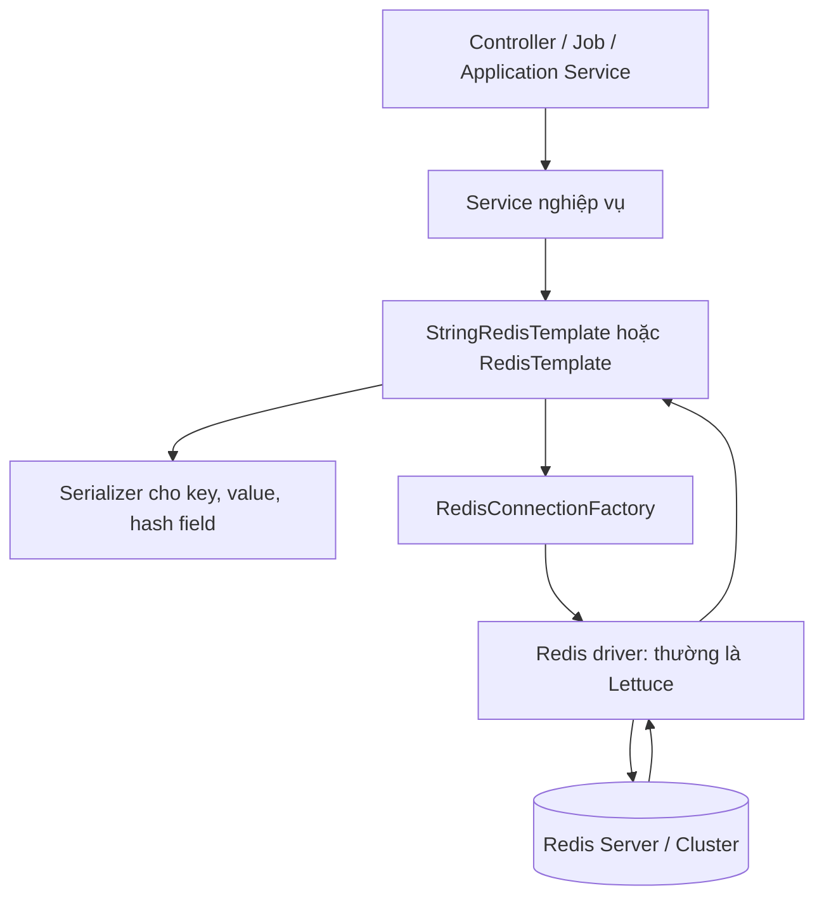

# RedisTemplate và StringRedisTemplate trong truy cập dữ liệu đồng bộ

## 1. Vai trò của template trong kiến trúc Spring Data Redis

Khi một ứng dụng Spring Boot cần đọc hoặc ghi dữ liệu Redis theo cách **đồng bộ (synchronous)**, hai API thường gặp nhất là `RedisTemplate<K, V>` và `StringRedisTemplate`. Chúng là các lớp hỗ trợ truy cập Redis ở tầng ứng dụng: biến thao tác Java thành lệnh Redis, quản lý việc lấy kết nối qua `RedisConnectionFactory`, tuần tự hóa key/value thành byte và chuyển kết quả về kiểu dữ liệu phù hợp.

Giả sử một service cần lưu trạng thái giỏ hàng, tăng bộ đếm hoặc đọc nhanh một bản ghi đã được chuẩn bị sẵn. Thay vì tự tạo TCP connection, gửi câu lệnh thô và giải mã phản hồi, service gọi các nhóm thao tác như `opsForValue()`, `opsForHash()`, `opsForSet()` hoặc `opsForZSet()`. Đây là điểm giao giữa **mã nghiệp vụ** và **hạ tầng Redis** trong Spring Data Redis.



Sơ đồ thể hiện các trách nhiệm chính, không có nghĩa serializer là một máy chủ hoặc một kết nối riêng. Template dùng serializer khi đọc/ghi, rồi gọi các thao tác kết nối được tạo qua factory. Với cấu hình Spring Boot phổ biến, `LettuceConnectionFactory` là một triển khai `RedisConnectionFactory`, sử dụng Redis client Lettuce.

Điểm cần xác định ngay từ đầu:

- **Đồng bộ** nghĩa là luồng Java gọi method thường chờ thao tác Redis trả kết quả hoặc lỗi trước khi tiếp tục. Lettuce có thể có cơ chế I/O bất đồng bộ bên trong, nhưng lời gọi `RedisTemplate` vẫn có giao diện đồng bộ.
- **Template không phải một kết nối Redis cố định do từng service sở hữu**. Spring quản lý factory/client và template có thể được inject, dùng lại bởi nhiều component.
- **Template không tự biến dữ liệu thành cache**. Gọi `opsForValue().set(...)` là thao tác ghi dữ liệu trực tiếp. Cơ chế `@Cacheable` thuộc Spring Cache, dù bên dưới cũng có thể dùng Redis.
- **Kiểu generic không thay thế serializer**. `RedisTemplate<String, Product>` chỉ mô tả kỳ vọng ở Java; Redis thật sự nhận và lưu các chuỗi byte.

## 2. Khởi tạo Redis cho ứng dụng Spring Boot

Với dự án Spring Boot dùng Gradle (Groovy DSL), dependency thông dụng là:

```groovy
dependencies {
    implementation 'org.springframework.boot:spring-boot-starter-data-redis'
}
```

Starter này đưa Spring Data Redis cùng các thành phần client thích hợp vào ứng dụng. Việc dùng `RedisTemplate` **không đòi hỏi** thêm `@EnableCaching`. Annotation đó dành cho Spring Cache khi muốn dùng các annotation như `@Cacheable`.

Ví dụ cấu hình local trong `application.yml`:

```yaml
spring:
  data:
    redis:
      host: localhost
      port: 6379
      database: 0
      connect-timeout: 2s
      timeout: 2s
```

- `host`/`port` xác định địa chỉ Redis.
- `database` chọn logical database ở môi trường Redis hỗ trợ. Redis Cluster chỉ dùng database 0; logical database cũng không phải ranh giới cô lập tài nguyên hoặc bảo mật.
- `connect-timeout` giới hạn thời gian thiết lập kết nối; `timeout` giới hạn thời gian chờ thao tác theo cấu hình client.
- Ở môi trường triển khai thật, thông tin xác thực, TLS, topology, retry và pool (nếu cần) phải được cấu hình theo hạ tầng. Không lưu mật khẩu trực tiếp trong ví dụ hoặc mã nguồn.

Khi auto-configuration được kích hoạt, Spring Boot thường cung cấp sẵn:

| Bean | Mục đích |
|---|---|
| `RedisConnectionFactory` | Tạo/lấy kết nối Redis thông qua client. |
| `StringRedisTemplate` | Template chuyên dùng key, value và các thành phần hash ở dạng chuỗi. |
| `RedisTemplate<Object, Object>`, thường có tên `redisTemplate` | Template tổng quát được Boot tạo mặc định; phải hiểu serializer trước khi dùng. |

Trong ứng dụng có nhiều bean hoặc tự định nghĩa cấu hình, việc auto-configuration tạo bean nào còn phụ thuộc điều kiện trên classpath và các bean người dùng đã cung cấp. Một `RedisTemplate<String, ProductSnapshot>` có serializer riêng thường cần khai báo thành bean riêng thay vì kỳ vọng Spring tự suy luận từ kiểu generic.

Ví dụ inject template có sẵn:

```java
import org.springframework.data.redis.core.StringRedisTemplate;
import org.springframework.stereotype.Service;

@Service
public class RedisHealthNoteService {
    private final StringRedisTemplate redis;

    public RedisHealthNoteService(StringRedisTemplate redis) {
        this.redis = redis;
    }

    public void saveNote(String note) {
        redis.opsForValue().set("demo:note", note);
    }

    public String readNote() {
        return redis.opsForValue().get("demo:note");
    }
}
```

Đoạn mã chủ ý ngắn để nhìn rõ tầng gọi API. Trong thiết kế thực, key nên có namespace theo nghiệp vụ, giá trị cần validation và phải quyết định có TTL hay không. Kết quả `get` có thể là `null` khi key không tồn tại hoặc đã hết hạn.

## 3. RedisTemplate và StringRedisTemplate giống và khác nhau thế nào?

`StringRedisTemplate` là một biến thể chuyên dụng của `RedisTemplate<String, String>`, được cấu hình để dùng `StringRedisSerializer` cho key, value, hash key và hash value. Do đó, dữ liệu chuỗi thường có thể được quan sát trực tiếp bằng `redis-cli`.

`RedisTemplate<K, V>` là lớp tổng quát. Nó cho phép chọn serializer cho key, value và các thành phần hash độc lập, nhưng **không có chuyện Redis hiểu Java object chỉ vì generic đã khai báo**.

| Tiêu chí | `StringRedisTemplate` | `RedisTemplate<K, V>` |
|---|---|---|
| Key và value ở phía Java | Chủ yếu là `String` | Kiểu do ứng dụng định nghĩa |
| Serializer mặc định | String serializer cho các thành phần chính | Phụ thuộc cấu hình; template tổng quát mặc định có thể dùng Java native serialization |
| Dữ liệu quan sát bằng `redis-cli GET` | Thường dễ đọc nếu là chuỗi | Chỉ dễ đọc nếu serializer tạo biểu diễn text, ví dụ JSON |
| Trường hợp phù hợp | Counter, token dạng chuỗi, flag, hash field là text, metadata ngắn | Object có cấu trúc, DTO, dữ liệu cần serializer chuyên biệt |
| Rủi ro chính | Parse số/JSON thủ công, dễ dùng key/value thiếu quy ước | Serializer không khớp, thay đổi schema, không tương thích giữa phiên bản |
| Quan hệ kế thừa | Mở rộng `RedisTemplate<String,String>` | API tổng quát làm nền cho template chuỗi |

Ví dụ cùng một ý tưởng ghi key:

```java
// Chuỗi UTF-8, thuận tiện quan sát với redis-cli.
stringRedisTemplate.opsForValue().set("demo:greeting", "Xin chào");

// Với RedisTemplate<K,V>, cách lưu thực tế phụ thuộc serializer đã cấu hình.
productRedisTemplate.opsForValue().set("product:42", productSnapshot);
```

Nếu dùng template tổng quát mặc định rồi đổi sang template chuỗi để đọc cùng key, kết quả có thể không thấy hoặc không giải mã đúng vì **byte key và byte value không khớp**. Chẳng hạn, serializer JDK có thể ghi key thành luồng byte Java serialization; `redis-cli GET product:42` truy vấn một key text khác và không tìm thấy.

Một nguyên tắc thực dụng là: **dùng `StringRedisTemplate` khi cấu trúc dữ liệu thực sự là chuỗi; tạo `RedisTemplate<K,V>` có cấu hình serializer minh bạch khi dùng object**.

## 4. Serializer là hợp đồng dữ liệu quan trọng nhất

Redis lưu chuỗi byte. Spring Data Redis chuyển các đối tượng Java thành byte khi ghi và làm ngược lại khi đọc. Các loại serializer thường gặp:

| Serializer | Cách biểu diễn | Khi nên cân nhắc |
|---|---|---|
| `StringRedisSerializer` | Chuỗi mã hóa UTF-8 | Key, field name, value dạng chuỗi |
| `Jackson2JsonRedisSerializer<T>` | JSON của kiểu mục tiêu đã biết | DTO/record Java với schema rõ ràng |
| `GenericJackson2JsonRedisSerializer` | JSON hỗ trợ thông tin kiểu theo cấu hình | Giá trị có nhiều kiểu; cần thận trọng về type metadata và bảo mật |
| `JdkSerializationRedisSerializer` | Java native serialization | Chủ yếu cho hệ thống cũ đã hiểu rõ ràng buộc phiên bản và nguồn dữ liệu |

Với thiết kế mới, nên tránh coi Java native serialization là lựa chọn mặc nhiên cho dữ liệu nghiệp vụ: nội dung khó đọc bằng công cụ vận hành, có phụ thuộc cấu trúc class và mang rủi ro khi giải tuần tự hóa dữ liệu không đáng tin cậy. JSON dễ quan sát hơn nhưng **không tự giải quyết tương thích schema**. Nếu đổi tên field, enum, định dạng ngày hoặc xóa class, bản ghi Redis còn tồn tại vẫn phải được đọc bằng phiên bản mới.

### 4.1. Tạo RedisTemplate cho object có cấu trúc

Giả sử ứng dụng muốn lưu bản chụp ngắn hạn của sản phẩm:

```java
// ProductSnapshot.java
public record ProductSnapshot(
        String id,
        String name,
        long priceInCents
) {}
```

Khai báo bean template riêng. Ví dụ sau nhắm tới API Spring Data Redis 3.x với Jackson trên classpath:

```java
import org.springframework.context.annotation.Bean;
import org.springframework.context.annotation.Configuration;
import org.springframework.data.redis.connection.RedisConnectionFactory;
import org.springframework.data.redis.core.RedisTemplate;
import org.springframework.data.redis.serializer.Jackson2JsonRedisSerializer;
import org.springframework.data.redis.serializer.StringRedisSerializer;

@Configuration
public class RedisTemplateConfiguration {

    @Bean("productRedisTemplate")
    public RedisTemplate<String, ProductSnapshot> productRedisTemplate(
            RedisConnectionFactory connectionFactory) {

        RedisTemplate<String, ProductSnapshot> template = new RedisTemplate<>();
        template.setConnectionFactory(connectionFactory);

        StringRedisSerializer keys = new StringRedisSerializer();
        Jackson2JsonRedisSerializer<ProductSnapshot> values =
                new Jackson2JsonRedisSerializer<>(ProductSnapshot.class);

        template.setKeySerializer(keys);
        template.setValueSerializer(values);
        template.setHashKeySerializer(keys);
        template.setHashValueSerializer(values);

        return template;
    }
}
```

Các điểm thiết kế trong đoạn mã:

1. **Key dùng String** nên `product:42` vẫn là key đọc được trong Redis CLI.
2. **Value dùng JSON có kiểu đích cụ thể**. Template này dành cho `ProductSnapshot`, không dùng chung bừa bãi với counter hoặc value có schema khác.
3. **Hash key và hash value được cấu hình rõ** để nếu dùng hash với template này, không vô tình rơi về serializer khác.
4. **Spring quản lý bean và vòng đời khởi tạo**. Với bean do Spring tạo, không cần tự đóng kết nối sau mỗi lời gọi hoặc gọi tay `afterPropertiesSet()` từ service.
5. Cấu hình trên dùng kiểu JSON cụ thể. Nếu thêm dữ liệu kiểu ngày giờ, Java Time hoặc cấu trúc phức tạp, cần cấu hình Jackson tương ứng và kiểm soát tương thích dữ liệu đã ghi.

Service sử dụng bean này:

```java
import java.time.Duration;
import java.util.Optional;
import org.springframework.beans.factory.annotation.Qualifier;
import org.springframework.data.redis.core.RedisTemplate;
import org.springframework.stereotype.Service;

@Service
public class ProductSnapshotStore {
    private final RedisTemplate<String, ProductSnapshot> redis;

    public ProductSnapshotStore(
            @Qualifier("productRedisTemplate")
            RedisTemplate<String, ProductSnapshot> redis) {
        this.redis = redis;
    }

    public void save(ProductSnapshot product) {
        redis.opsForValue().set(
                key(product.id()),
                product,
                Duration.ofMinutes(15));
    }

    public Optional<ProductSnapshot> findById(String productId) {
        return Optional.ofNullable(
                redis.opsForValue().get(key(productId)));
    }

    public boolean remove(String productId) {
        return Boolean.TRUE.equals(redis.delete(key(productId)));
    }

    private String key(String productId) {
        return "product:snapshot:" + productId;
    }
}
```

```text
save(new ProductSnapshot("42", "Bàn phím", 890000))
       │
       ▼
Redis key:   product:snapshot:42
Redis value: {"id":"42","name":"Bàn phím","priceInCents":890000}
TTL:         15 phút
```

Nội dung JSON biểu diễn khái niệm, có thể có chi tiết khác theo cấu hình Jackson. `priceInCents` được dùng để tránh sai số tiền tệ do số thực; đơn vị và loại tiền vẫn phải được định nghĩa trong hợp đồng nghiệp vụ.

### 4.2. Thống nhất serializer cho mọi nơi cùng truy cập một key

Có thể có nhiều service cùng đọc `product:snapshot:42`. Chúng cần thỏa thuận:

- Prefix và cách đặt tên key, bao gồm namespace môi trường/tenant nếu áp dụng.
- Format value (UTF-8 string, JSON, binary), encoding, tên field và phiên bản schema.
- TTL và chính sách refresh/xóa.
- Ý nghĩa của dữ liệu thiếu, `null`, object cũ hoặc lỗi giải mã.

**Generic type của Java chỉ được kiểm tra ở thời điểm biên dịch; không phải schema registry của Redis**. Đặc biệt trong hệ thống triển khai nhiều phiên bản cùng lúc, hãy tính đến giai đoạn phiên bản cũ và mới đồng thời đọc các key do nhau ghi.

Không bật tính năng polymorphic typing tùy tiện cho object không tin cậy. Nếu cần nhiều kiểu, giới hạn tập kiểu được phép giải mã, tách namespace/schema hoặc tạo template riêng cho từng loại value.

## 5. Các nhóm thao tác đồng bộ qua RedisTemplate

Cả hai template đều cung cấp một tập `RedisOperations` phong phú. Bạn chọn loại dữ liệu Redis theo truy vấn cần thực hiện, rồi lấy nhóm operation thích hợp:

| API | Kiểu dữ liệu Redis | Lệnh/nhu cầu tiêu biểu |
|---|---|---|
| `opsForValue()` | String | `GET`, `SET`, `INCR`, `MGET` |
| `opsForHash()` | Hash | `HGET`, `HSET`, `HDEL`, `HGETALL` |
| `opsForList()` | List | `LPUSH`, `RPUSH`, `LPOP`, `LRANGE` |
| `opsForSet()` | Set | `SADD`, `SISMEMBER`, `SMEMBERS` |
| `opsForZSet()` | Sorted set | `ZADD`, `ZRANGE`, truy vấn theo score |
| `opsForStream()` | Stream | `XADD`, `XREAD`, thao tác stream/group |
| `opsForGeo()` | Geo | Lưu/tìm tọa độ theo khoảng cách |
| `opsForHyperLogLog()` | HyperLogLog | Ước lượng số lượng phần tử phân biệt |
| `keys()`, `delete()`, `expire()`, `getExpire()` | Keyspace | Quản lý vòng đời key |

Không phải mọi trường hợp đều cần tạo template riêng cho từng kiểu dữ liệu Redis. Một `StringRedisTemplate` có thể thao tác với String, Hash, Set, List và Sorted Set nếu các thành phần có thể biểu diễn bằng chuỗi.

### 5.1. String: lưu, đọc, tăng bộ đếm và TTL

Ví dụ dùng template chuỗi cho một thông báo có thời hạn:

```java
import java.time.Duration;
import java.util.Optional;
import org.springframework.data.redis.core.StringRedisTemplate;
import org.springframework.stereotype.Service;

@Service
public class NoticeStore {
    private final StringRedisTemplate redis;

    public NoticeStore(StringRedisTemplate redis) {
        this.redis = redis;
    }

    public void publish(String tenantId, String notice) {
        redis.opsForValue().set(
                "notice:" + tenantId,
                notice,
                Duration.ofHours(1));
    }

    public Optional<String> currentNotice(String tenantId) {
        String value = redis.opsForValue().get("notice:" + tenantId);
        return Optional.ofNullable(value);
    }
}
```

Điểm quan trọng là lời gọi `set(key, value, Duration)` truyền **giá trị và TTL trong cùng một thao tác Redis**. Khác với việc gọi `set` trước rồi `expire` sau, cách này tránh khoảng trống mà key đã được ghi nhưng chưa có hạn dùng.

Đối với số nguyên:

```java
Long current = redis.opsForValue().increment("metric:page-view:42");
Long afterAddingFive = redis.opsForValue().increment("metric:page-view:42", 5);
```

`INCR`/`INCRBY` là lệnh Redis nguyên tử cho một key; kết quả là số mới sau cập nhật. Nhưng nếu nghiệp vụ muốn “tăng bộ đếm và tạo TTL chỉ ở lần đầu”, thì chuỗi gọi `increment` + `expire` **không tự động nguyên tử như một khối**. Trường hợp đó cần xem xét Lua script hoặc cơ chế server-side phù hợp.

Một key có thể không còn khi đọc vì hết TTL, bị xóa, hoặc bị eviction theo chính sách bộ nhớ. `get` trả `null` không nói được nguyên nhân. Trong pipeline/transaction, một số API có thể trả `null` trước khi kết quả thực được tổng hợp; cần đọc đúng hợp đồng của API trong ngữ cảnh đó.

### 5.2. Hash: nhiều field trong một key

Hash phù hợp cho tập field được đọc/ghi riêng lẻ, ví dụ số lượng từng SKU trong giỏ hàng:

```java
import java.time.Duration;
import java.util.Map;
import org.springframework.data.redis.core.StringRedisTemplate;
import org.springframework.stereotype.Service;

@Service
public class CartHashStore {
    private final StringRedisTemplate redis;

    public CartHashStore(StringRedisTemplate redis) {
        this.redis = redis;
    }

    public void putItem(String userId, String sku, int quantity) {
        String key = "cart:" + userId;

        if (quantity <= 0) {
            redis.opsForHash().delete(key, sku);
        } else {
            redis.opsForHash().put(key, sku, Integer.toString(quantity));
        }

        redis.expire(key, Duration.ofDays(7));
    }

    public Map<Object, Object> allItems(String userId) {
        return redis.opsForHash().entries("cart:" + userId);
    }
}
```

Ví dụ minh họa thao tác với `HSET`, `HDEL`, `HGETALL` và TTL của **toàn bộ hash key**. Trong Redis, TTL thông thường gắn với key; không nên mặc định mỗi field của hash có TTL độc lập hoặc áp dụng một API TTL cho key rồi hiểu là áp dụng cho từng field.

`put/delete` và `expire` ở trên là các lệnh riêng, nên nếu ứng dụng lỗi ở giữa, TTL có thể không được cập nhật. Nếu chính sách “mọi thay đổi giỏ hàng phải đặt lại hạn dùng” là một bất biến cần bảo đảm chặt, dùng Lua hoặc thao tác nguyên tử phù hợp. Cũng cần cân nhắc việc nhiều request cùng sửa một giỏ hàng và các quy tắc về số lượng âm, tối đa, hoặc xung đột trạng thái.

### 5.3. Set, List và Sorted Set

Ví dụ thao tác trực tiếp với các collection Redis:

```java
// Set: không có phần tử trùng lặp.
redis.opsForSet().add("group:admins", "alice", "bob");
Boolean isAdmin = redis.opsForSet().isMember("group:admins", "alice");

// List: có thứ tự, có thể thêm vào cuối và đọc từ đầu.
redis.opsForList().rightPush("demo:recent-jobs", "job-101");
String oldest = redis.opsForList().leftPop("demo:recent-jobs");

// Sorted Set: mỗi phần tử có score để sắp xếp.
redis.opsForZSet().add("leaderboard:week-45", "alice", 980.0);
redis.opsForZSet().add("leaderboard:week-45", "bob", 750.0);
Set<String> topMembers =
        redis.opsForZSet().reverseRange("leaderboard:week-45", 0, 9);
```

Các biến trên giả định `redis` là `StringRedisTemplate` và đã import `java.util.Set`. List và Sorted Set xử lý nhu cầu khác nhau: List là một chuỗi vị trí, Sorted Set có score và có thể truy vấn thứ hạng. Với dữ liệu lớn, tránh đọc toàn bộ Set/Hash/ZSet trong một request thường xuyên nếu không có giới hạn kích thước.

Các lệnh lấy danh sách hay entry có thể trả về collection rỗng, `null` hoặc kết quả khác theo API và ngữ cảnh; code nghiệp vụ cần xử lý đúng hợp đồng trả về thay vì ép kiểu tùy ý.

### 5.4. Bound operations khi nhiều lệnh dùng chung key

Khi một service thường thao tác trên cùng một key, `BoundValueOperations` hoặc `BoundHashOperations` giúp đỡ lặp lại tham số key:

```java
import java.time.Duration;
import org.springframework.data.redis.core.BoundValueOperations;

BoundValueOperations<String, String> status =
        redis.boundValueOps("job:42:status");

status.set("RUNNING", Duration.ofMinutes(10));
String current = status.get();
```

Đây là API tiện dụng của template, không phải session hay transaction Redis. Nhiều lời gọi trên `status` vẫn là nhiều lệnh độc lập trừ khi ứng dụng chủ động dùng kỹ thuật nguyên tử khác.

## 6. RedisTemplate và các thao tác nguyên tử

Redis xử lý từng lệnh đơn lẻ theo ngữ nghĩa nguyên tử của lệnh đó. Điều này rất hữu ích cho `INCR`, `SET ... NX`, thao tác list/set/hash riêng lẻ. Nhưng **nhiều lệnh Java thực hiện lần lượt không đương nhiên trở thành một giao dịch nguyên tử**.

### 6.1. SET if absent có TTL trong một thao tác

`StringRedisTemplate` hỗ trợ thao tác chỉ đặt key khi chưa tồn tại và gắn TTL cùng lúc:

```java
import java.time.Duration;
import java.util.UUID;

String token = UUID.randomUUID().toString();
Boolean acquired = redis.opsForValue().setIfAbsent(
        "lock:report:2026-11-12",
        token,
        Duration.ofSeconds(20));

if (Boolean.TRUE.equals(acquired)) {
    // Đã giành quyền theo điều kiện SET NX với TTL.
}
```

`setIfAbsent` tương ứng ý tưởng `SET key value NX EX/PX`. Việc so sánh `Boolean.TRUE.equals(...)` giúp tránh unboxing `null`. Tuy nhiên, đây chỉ là primitive cho cơ chế lease/lock đơn giản: công việc có thể chạy lâu hơn TTL, failover có thể ảnh hưởng an toàn khóa, và không được dùng `DEL` vô điều kiện khi giải phóng vì có thể xóa nhầm khóa mà tiến trình khác vừa giành được.

Khi giải phóng, cần so sánh owner token và xóa **nguyên tử** (Lua hoặc primitive phù hợp). Với tác vụ có side effect nghiêm ngặt, hệ thống ghi cuối cùng còn cần idempotency, unique constraint hoặc fencing token tùy tình huống.

### 6.2. Lua script để giữ nhiều bước thành một thao tác server-side

Ví dụ fixed-window counter: muốn lần tăng đầu tiên đặt TTL cho cửa sổ; các lần tăng sau giữ nguyên thời gian hết hạn. Lua cho phép thực hiện logic trên Redis server trong một script:

```lua
local count = redis.call('INCR', KEYS[1])
if count == 1 then
    redis.call('PEXPIRE', KEYS[1], ARGV[1])
end
return count
```

Dùng với Spring Data Redis:

```java
import java.time.Duration;
import java.util.List;
import org.springframework.data.redis.core.StringRedisTemplate;
import org.springframework.data.redis.core.script.DefaultRedisScript;
import org.springframework.data.redis.core.script.RedisScript;

public class WindowCounter {
    private static final RedisScript<Long> INCREMENT_WITH_TTL =
            new DefaultRedisScript<>(
                    """
                    local count = redis.call('INCR', KEYS[1])
                    if count == 1 then
                        redis.call('PEXPIRE', KEYS[1], ARGV[1])
                    end
                    return count
                    """,
                    Long.class);

    private final StringRedisTemplate redis;

    public WindowCounter(StringRedisTemplate redis) {
        this.redis = redis;
    }

    public long increment(String key, Duration window) {
        if (window.isZero() || window.isNegative()) {
            throw new IllegalArgumentException("window must be positive");
        }

        Long result = redis.execute(
                INCREMENT_WITH_TTL,
                List.of(key),
                Long.toString(window.toMillis()));

        if (result == null) {
            throw new IllegalStateException("No Redis script result");
        }
        return result;
    }
}
```

Đây là **fixed-window counter** đơn giản: các request đến gần ranh giới hai cửa sổ vẫn có thể tạo burst lớn hơn mức trung bình mong muốn. Rate limiter thực tế còn phải chọn thuật toán, xác định đơn vị key, giới hạn số request, trả status thích hợp và xử lý Redis lỗi. Lua tránh race giữa `INCR`/`PEXPIRE` nhưng script chạy trên Redis server, vì vậy không viết script nặng hoặc vòng lặp lớn gây chặn các request khác.

### 6.3. Pipeline, MULTI/EXEC và Lua khác nhau

| Cơ chế | Mục tiêu | Điều cần nhớ |
|---|---|---|
| Lệnh đơn như `SET ... EX` hay `INCR` | Thao tác đơn nguyên tử | Chỉ bảo đảm ngữ nghĩa của chính lệnh đó |
| Pipelining | Giảm số lượt đi–về mạng cho nhiều lệnh | Không tự tạo atomicity; lệnh khác có thể xen giữa |
| `MULTI/EXEC` | Gom và thực thi chuỗi lệnh Redis theo cơ chế transaction của Redis | Không phải transaction ACID đa tài nguyên; cần hiểu `WATCH`, kết quả, lỗi lệnh và retry |
| Lua script | Thực thi logic kết hợp nhiều lệnh trong một script phía server | Atomicity trong Redis, nhưng phải tránh script kéo dài và hiểu giới hạn khi thao tác ngoài Redis |

Spring Data Redis có `executePipelined(...)`, `multi()`/`exec()` qua operations hoặc callbacks phù hợp. Các lệnh trong pipeline thường được gửi theo lô và kết quả được trả khi pipeline hoàn thành; không nên suy luận các giá trị trả về từng lệnh trong callback giống với chế độ bình thường.

Khi dùng transaction Redis, cần bảo đảm các thao tác liên quan chạy trên kết nối transaction phù hợp. Chỉ gắn `@Transactional` trên một service có truy cập cơ sở dữ liệu quan hệ **không khiến Redis tự tham gia cùng một distributed transaction**. Spring Data Redis có cơ chế transaction support cần bật/chọn rõ; đặc biệt chú ý đọc dữ liệu trong transaction và kết quả `EXEC`. Không nên tự bật transaction support trên bean dùng chung chỉ để mong “nhiều lệnh sẽ an toàn hơn”.

## 7. Truy cập đồng bộ có nghĩa gì đối với luồng xử lý?

Cùng một lời gọi Java:

```java
ProductSnapshot product =
        productRedisTemplate.opsForValue().get("product:snapshot:42");
```

có các bước logic:

1. Template chuẩn bị byte key với key serializer.
2. Factory/client cung cấp đường truy cập Redis.
3. Client gửi lệnh và **luồng đang gọi chờ phản hồi** trong mô hình đồng bộ.
4. Template giải mã value, chuyển thành `ProductSnapshot` hoặc trả `null`, hoặc ném exception khi thao tác thất bại.
5. Service tiếp tục với kết quả nhận được.

Trong Spring MVC chạy bằng request thread truyền thống, mô hình đồng bộ này tự nhiên và dễ đọc. Với ứng dụng WebFlux/Reactor dùng event loop, **không gọi trực tiếp RedisTemplate dạng blocking trong luồng event loop** để xử lý lượng tải lớn: việc chờ I/O có thể làm nghẽn luồng phục vụ nhiều request. Nếu luồng nghiệp vụ vốn reactive, cân nhắc `ReactiveRedisTemplate`/`ReactiveStringRedisTemplate` và cách tích hợp bất đồng bộ phù hợp; nếu buộc dùng API blocking thì phải cách ly thực thi theo kiến trúc được thiết kế.

`RedisTemplate` và `StringRedisTemplate` là các thành phần thường được đăng ký singleton, dùng chung giữa nhiều service và nhiều request sau khi cấu hình hoàn tất. Không sửa serializer, factory hoặc cấu hình template trong lúc các luồng đang sử dụng nó. Không tạo một client/factory mới cho mỗi request. Client và connection factory có vòng đời, cơ chế chia sẻ kết nối và lựa chọn pooling riêng; không nên suy luận “mỗi thread phải có một connection riêng” hoặc “cứ thêm pool là nhanh hơn”.

### 7.1. Timeout và giới hạn tải

Truy cập đồng bộ bị ảnh hưởng trực tiếp bởi độ trễ mạng và Redis server:

- **Latency thấp** giúp xử lý request nhanh vì thời gian chờ Redis nhỏ.
- **Timeout** giới hạn khoảng chờ khi mạng/server không đáp ứng; không bảo đảm câu lệnh chắc chắn chưa chạy. Ví dụ, request có thể đã đến Redis nhưng phản hồi bị thất lạc.
- **Retry** với lệnh đọc thường đơn giản hơn retry với lệnh ghi có side effect. Retry mù lệnh `INCR` có thể tăng hai lần nếu lần đầu đã chạy mà client không nhận kết quả.
- **Độ lớn value** và số lượng command trong một request ảnh hưởng băng thông, giải mã và độ trễ; đọc toàn bộ key lớn có thể gây giật thời gian đáp ứng.

Nếu cần đảm bảo một command được xử lý đúng một lần ở cấp nghiệp vụ, phải thiết kế idempotency theo request ID hoặc khóa nghiệp vụ; client retry đơn thuần không cấp bảo đảm đó.

## 8. Vòng đời key, TTL và chính sách cache

Các method quản lý key dùng chung cho cả hai template:

```java
// Một key có tồn tại không?
Boolean exists = redis.hasKey("demo:note");

// Gia hạn TTL của key hiện hữu; không tạo key mới.
Boolean renewed = redis.expire("demo:note", Duration.ofMinutes(30));

// Đọc TTL nếu key còn tồn tại.
Long secondsLeft = redis.getExpire("demo:note");

// Xóa một key.
Boolean deleted = redis.delete("demo:note");
```

Các lời gọi trả về `Boolean` hoặc `Long` boxed trong một số API; đừng mặc định kết quả luôn khác `null` trong tất cả bối cảnh (như pipeline/transaction). `getExpire` có ý nghĩa phân biệt key không tồn tại, key không có thời hạn và key còn TTL theo hợp đồng API; không nên diễn giải mọi giá trị âm là lỗi kết nối.

**TTL là chính sách tồn tại của key, không phải định nghĩa của cache.** Session, dữ liệu tạm, idempotency key và lock cũng có TTL. Cache đúng nghĩa có khả năng nạp lại từ nguồn dữ liệu gốc khi mất key; template chỉ quản lý các lệnh Redis chứ không tự triển khai cache miss/invalidation.

Nếu dùng Spring Cache:

```java
@Cacheable(cacheNames = "products", key = "#id")
public ProductView getProduct(String id) {
    return repository.findViewById(id).orElseThrow();
}
```

thì thao tác cache được Spring Cache interceptor và `CacheManager` quản lý. Nếu backing cache là Redis, `RedisCacheManager` tạo key, serialize value và áp dụng TTL theo cấu hình cache. Những key này có thể dùng prefix/serializer khác với `RedisTemplate` tự cấu hình. **Không tự ý dùng `StringRedisTemplate` để ghi đè key của Spring Cache** nếu chưa thống nhất chính xác định dạng và vòng đời.

Đặc biệt với dữ liệu có thể hết hạn, cần phân biệt:

- **Expiration:** hết TTL do ứng dụng quy định.
- **Eviction:** Redis loại bỏ key theo chính sách bộ nhớ khi đạt giới hạn.
- **Deletion:** ứng dụng chủ động xóa.
- **Data loss/failover:** dữ liệu không còn do sự cố hoặc chính sách persistence/replication.

Cùng dẫn đến “không thấy key”, nhưng nguyên nhân và giải pháp vận hành khác nhau.

## 9. Đặt tên key và tổ chức dữ liệu giữa các service

Tên key là một phần của hợp đồng liên dịch vụ. Quy ước dễ đọc:

| Key | Kiểu dữ liệu | Ý nghĩa |
|---|---|---|
| `shop:product:snapshot:42` | String JSON | Bản chụp của sản phẩm 42 |
| `shop:cart:user-18` | Hash | Giỏ hàng của user 18 |
| `shop:metrics:page-view:42` | String integer | Bộ đếm lượt xem sản phẩm |
| `shop:groups:admins` | Set | Danh sách thành viên không trùng |
| `shop:ranking:weekly` | Sorted Set | Bảng xếp hạng theo điểm |
| `shop:lock:report:2026-11-12` | String token | Lease/lock cho job ngày 12-11 |

Vài quy tắc thiết kế hữu ích:

1. Chọn namespace theo ứng dụng, tenant, tính năng và loại dữ liệu khi cần; tránh các key như `data`, `user` hoặc `list` dễ va chạm.
2. Không cho raw user input tạo key tùy ý nếu có thể sinh key cực dài, xung đột namespace hoặc phá chính sách quota.
3. Ghi nhận loại dữ liệu Redis và schema value theo prefix; cùng tên key mà một service dùng Hash, service khác lại dùng String sẽ gây lỗi `WRONGTYPE`.
4. Định nghĩa TTL nhất quán giữa những nơi đọc/ghi, tránh bên ghi này vô tình làm mất TTL của bên khác.
5. Với Redis Cluster, thao tác liên quan nhiều key có thể bị giới hạn bởi **hash slot**. Hashtag như `order:{42}:state` và `order:{42}:lock` có thể đưa các key về cùng slot khi cần, nhưng chỉ nên dùng có chủ đích vì có thể làm mất cân bằng phân phối key.

Để khám phá key khi vận hành, ưu tiên `SCAN` theo cursor thay cho `KEYS *` trong hệ thống lớn. `SCAN` là quá trình lặp và có thể trả kết quả từng phần, thậm chí trùng trong lúc dữ liệu biến động; code xử lý phải hiểu đặc tính đó. Không biến tìm kiếm wildcard toàn bộ keyspace thành luồng truy vấn chính của ứng dụng.

## 10. Quan sát kết quả bằng redis-cli

Với ví dụ `StringRedisTemplate` ở trên, có thể kiểm tra trực tiếp bằng CLI khi đang kết nối **đúng Redis instance/database**:

```redis
TYPE demo:note
GET demo:note
TTL demo:note
TYPE cart:user-18
HGETALL cart:user-18
GET metric:page-view:42
```

Một số khác biệt cần biết:

- `GET` chỉ dùng cho key kiểu String; dùng cho Hash/List sẽ nhận lỗi kiểu dữ liệu.
- `HGETALL` hiển thị các field của Hash; không hiểu schema Java nếu field value đang được serialize nhị phân/JSON.
- `TTL` trả thời gian còn lại theo giây, còn `PTTL` theo mili giây; các mã trả về đặc biệt phản ánh key không có TTL hoặc không tồn tại.
- Nếu key ghi bằng JDK serializer, việc gõ text key trong CLI có thể không truy cập được key thật do byte key khác nhau.
- Nếu value là JSON, CLI hiển thị JSON dạng text; CLI **không** tự tái tạo class Java.

Ví dụ dùng cursor để khám phá key thử nghiệm:

```redis
SCAN 0 MATCH demo:* COUNT 100
```

Lệnh này chỉ là **một bước** của quá trình scan. Muốn tìm hết, dùng cursor trả về để gọi tiếp cho tới khi cursor về `0`. `COUNT` là gợi ý số lượng, không phải cam kết trả đúng 100 key.

Có thể thực hiện cùng ý tưởng trong Java bằng `ScanOptions` và thao tác scan phù hợp; hãy dùng cách đảm bảo cursor được đóng đúng vòng đời. Tuy nhiên, trong nhiều hệ thống, việc truy xuất nên được thiết kế theo key đã biết hoặc index ứng dụng, không dựa vào việc quét Redis để lọc tất cả đối tượng.

## 11. Thiết kế lỗi đúng với vai trò dữ liệu

Một lỗi `RedisConnectionFailureException`, timeout hoặc lỗi deserialize có thể phát sinh từ thao tác template. Spring Data Redis chuyển nhiều lỗi client về hệ thống exception truy cập dữ liệu của Spring; ứng dụng thường xử lý tại service boundary bằng một chính sách phù hợp thay vì bắt mọi exception rồi trả giá trị mặc định.

| Redis được dùng để... | Khi truy cập thất bại | Cách xử lý cần cân nhắc |
|---|---|---|
| Lưu trạng thái nguồn duy nhất | Trạng thái không truy xuất được, có thể không biết ghi trước đó đã thành công hay chưa | Báo lỗi có kiểm soát, giới hạn retry, có phương án khôi phục |
| Cache dữ liệu từ database | Có thể đọc nguồn gốc nếu còn đủ năng lực xử lý tải | Fallback, timeout ngắn, chống cache stampede |
| Tăng counter/rate limiter | Không biết chắc có tăng/ghi quota hay không | Chọn fail-open hoặc fail-closed theo yêu cầu bảo vệ và UX |
| Distributed lock | Không xác định chắc quyền thực hiện công việc | Tránh thực hiện side effect rủi ro khi không xác nhận được quyền |
| Phát sự kiện | Kết quả phát hoặc xử lý có thể không xác định | Idempotency, retry có kiểm soát, log/outbox tùy yêu cầu |

Một anti-pattern phổ biến:

```java
try {
    redis.opsForValue().set("payment:lock:42", "held");
} catch (Exception ignored) {
    // Tiếp tục xử lý thanh toán như thể đã chiếm quyền thành công.
}
```

Đoạn mã này che lỗi phối hợp và có thể làm hai instance cùng thực hiện tác vụ. Một API đồng bộ khiến mã trông tuần tự nhưng **không tự bảo đảm toàn hệ thống sẽ tuần tự khi có nhiều instance**.

Cũng cần phân biệt failure của client với trạng thái lệnh trên Redis server: nếu request bị timeout, một lệnh ghi có thể đã thực thi dù client không nhận ACK. Điều này đặc biệt quan trọng khi gọi `INCR`, `LPUSH`, `XADD` hoặc cập nhật có side effect; retry cần có chiến lược chống trùng khi nghiệp vụ yêu cầu.

## 12. Những lỗi dùng template thường gặp

| Hiện tượng | Nguyên nhân thường gặp | Cách tiếp cận |
|---|---|---|
| `GET` trong CLI không thấy key mà ứng dụng nói đã ghi | Key serializer tạo bytes khác chuỗi text, hoặc kết nối khác database/instance | Kiểm tra serializer, prefix, database và endpoint |
| `SerializationException` / không giải mã được object | Serializer đọc khác serializer ghi, schema/value thay đổi | Chuẩn hóa serializer, version schema, migration dữ liệu |
| `WRONGTYPE Operation against a key holding the wrong kind of value` | Một key đã dùng cho kiểu Redis khác | Quy định namespace và kiểu theo key |
| Đã set key nhưng không còn khi đọc | TTL hết, eviction, xóa từ service khác, failover | Kiểm tra TTL, memory policy, log vận hành |
| Counter thỉnh thoảng không có TTL | Tăng và đặt TTL bằng hai lệnh riêng | Dùng atomic script hoặc primitive tương đương |
| Service WebFlux chậm khi tải cao | Chặn event loop bằng API Redis đồng bộ | Dùng Reactive Redis hoặc cách ly blocking call |
| Tưởng `@Transactional` bao gồm cả Redis và DB | Hai tài nguyên có cơ chế transaction riêng | Thiết kế consistency, outbox hoặc cơ chế bù trừ phù hợp |
| Lỗi trùng xử lý sau timeout | Retry lệnh ghi không idempotent | Thiết kế request ID, idempotency/uniqueness theo nghiệp vụ |
| Redis key có thể đọc từ service A nhưng không đọc được từ B | Không thống nhất key prefix, hash slot hoặc format dữ liệu | Xuất bản hợp đồng key/serializer giữa các service |

Những lỗi này đến từ **hợp đồng truy cập dữ liệu và kiến trúc sử dụng**, không phải việc chọn method `get` hay `set` sai cú pháp.

## 13. Quy trình lựa chọn API trong một feature thực tế

Xét yêu cầu: “Khi API nhận request, lưu dữ liệu tạm trong Redis và truy vấn lại trong 15 phút”.

1. Xác định **dữ liệu đang lưu là gì**: chuỗi ngắn, JSON DTO, counter hay hash có nhiều field?
2. Nếu chỉ là text và cần quan sát bằng Redis CLI, chọn `StringRedisTemplate`. Nếu là object, tạo `RedisTemplate<String, T>` với serializer cụ thể và schema ổn định.
3. Đặt namespace, chẳng hạn `draft:order:{id}`, và xác định TTL của **toàn key**.
4. Dùng `opsForValue().set(key, value, Duration.ofMinutes(15))` để ghi value cùng TTL trong một lệnh.
5. Khi đọc, xử lý trường hợp không có key và lỗi kết nối/deserialize khác nhau.
6. Nếu có nhiều instance cùng cập nhật, xác định liệu thao tác đơn có đủ hay cần compare-and-set, version, Lua hay bảo vệ tại nguồn dữ liệu cuối cùng.
7. Quyết định khi timeout nên retry thế nào để không ghi trùng side effect.
8. Giám sát latency, timeout, key count, memory, eviction và khả năng phục hồi.

Đối với một counter đơn, `StringRedisTemplate.opsForValue().increment(...)` thường là đủ. Đối với object cần đọc/ghi nguyên khối, template có JSON serializer đem lại API rõ kiểu hơn. Nếu chỉ muốn cache kết quả phương thức, dùng abstraction Spring Cache có thể phù hợp hơn thao tác template thủ công. Nếu toàn bộ request chạy trong pipeline reactive, nên chọn reactive Redis API nhất quán với kiến trúc đó.

## 14. Tổng kết kiến thức cốt lõi

`RedisTemplate` và `StringRedisTemplate` là cách Spring Data Redis đưa **truy cập Redis đồng bộ** vào ứng dụng Java. Cả hai chia sẻ cơ chế connection factory và các nhóm operation tương ứng kiểu dữ liệu Redis; khác biệt quan trọng nhất là **kiểu dữ liệu Java mong đợi và cấu hình serialization**.

- **`StringRedisTemplate`** thích hợp khi key/value/field đều là text; dễ thao tác với `INCR`, `SET`, `HSET` và kiểm tra bằng Redis CLI.
- **`RedisTemplate<K,V>`** thích hợp khi cần object hoặc serializer tùy chỉnh; generic cần đi kèm serializer minh bạch, thống nhất trên toàn hệ thống.
- **Đồng bộ** nghĩa là caller chờ lệnh Redis hoàn thành; điều này phù hợp với mã imperative nhưng cần tránh block event loop trong luồng reactive.
- **Nguyên tử của một lệnh không đồng nghĩa nguyên tử của chuỗi lời gọi**; dùng `SET ... NX EX`, Lua hoặc transaction Redis khi thực sự cần.
- **Template giải quyết cách truy cập Redis**. TTL, schema, idempotency, consistency giữa DB và Redis, xử lý khi mất kết nối và vòng đời dữ liệu vẫn là trách nhiệm thiết kế ứng dụng.

Nắm rõ serializer, keyspace, connection factory và ranh giới atomicity giúp sử dụng đúng hai template ngay từ những service Spring Boot đầu tiên, đồng thời tránh lỗi khó phát hiện khi ứng dụng mở rộng ra nhiều instance.

