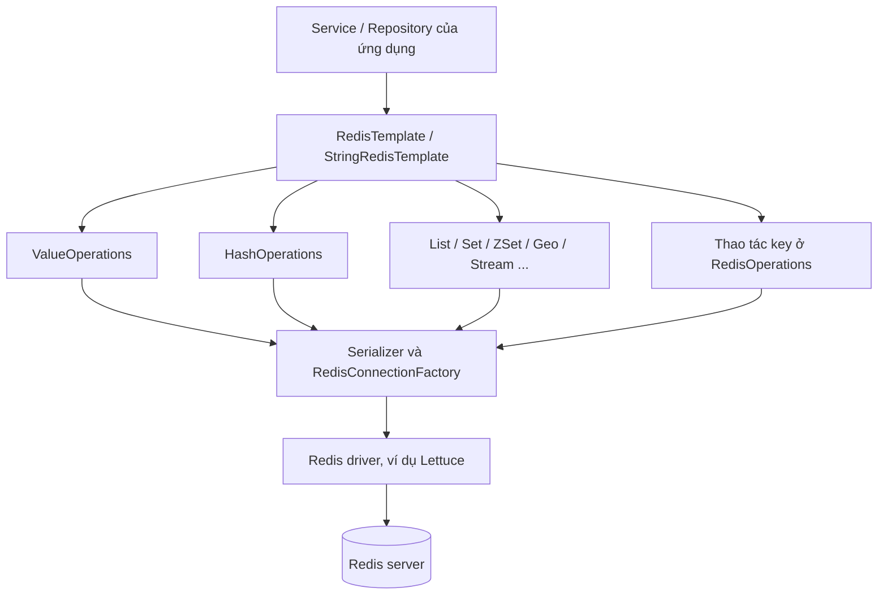

# Các nhóm Operations và thao tác gắn với một khóa

## 1. Operations nằm ở đâu trong kiến trúc Spring Data Redis?

Khi làm việc với Redis trong Spring Boot, ứng dụng thường không gửi trực tiếp chuỗi lệnh `GET`, `HSET` hay `ZADD` qua socket. **Spring Data Redis** cung cấp các lớp truy cập dữ liệu để Java code thao tác theo kiểu dữ liệu và cấu trúc của Redis. Hai thành phần thường gặp là:

- **`RedisTemplate<K, V>`**: điểm truy cập đồng bộ, có thể cấu hình cách chuyển khóa và giá trị Java thành byte để gửi tới Redis.
- **`StringRedisTemplate`**: biến thể dành cho dữ liệu dạng chuỗi, sử dụng serializer chuỗi cho khóa, giá trị và các thành phần của hash. Thuận tiện khi lưu bộ đếm, cờ trạng thái, mã định danh, chuỗi JSON đã chuẩn bị sẵn.

`RedisTemplate` triển khai giao diện `RedisOperations<K, V>`. Từ template, ta chọn nhóm phương thức có tên **`opsFor...`** phù hợp với kiểu dữ liệu cần thao tác. Ví dụ:

```java
StringRedisTemplate redis = /* được Spring inject */;

redis.opsForValue().set("app:status", "ready");
String status = redis.opsForValue().get("app:status");

redis.opsForHash().put("account:42:settings", "language", "vi");
Object language = redis.opsForHash().get("account:42:settings", "language");
```

Đoạn trên minh họa hai nhóm Operations khác nhau, cùng đi qua một template. Chúng **không tạo hai Redis database** hay hai loại kết nối chuyên biệt.

Luồng phụ thuộc có thể hình dung như sau:



**Phân biệt vai trò:**

1. **Template** tổ chức việc gọi lệnh và áp dụng serializer, connection factory cùng các cơ chế truy cập do Spring Data Redis cung cấp.
2. **Operations** là API được nhóm theo kiểu dữ liệu Redis, ví dụ Value, Hash, List hoặc Sorted Set.
3. **Bound Operations** là API đã *gắn sẵn một khóa*, giúp gọi nhiều thao tác liên tiếp mà không phải truyền lại tên khóa ở từng phương thức.
4. **Redis server** thực hiện các lệnh thật. Các giới hạn về nguyên tử, TTL, bộ nhớ, replication và tính bền vững vẫn phụ thuộc Redis và cách triển khai.

Đối với ứng dụng WebFlux dùng lập trình phản ứng, Spring Data Redis còn có `ReactiveRedisTemplate` và `ReactiveStringRedisTemplate` cùng ý tưởng nhóm Operations, nhưng phương thức trả về các publisher như `Mono`/`Flux` và cần reactive connection factory. Những ví dụ dưới đây sử dụng API **đồng bộ**, không trộn reactive API với đồng bộ trong cùng luồng xử lý.

## 2. Tổng quan các nhóm Operations

Một khóa Redis có một kiểu dữ liệu hiện hành. Các nhóm Operations giúp chọn đúng lệnh cho kiểu đó.

| Nhóm Spring Data Redis | Kiểu dữ liệu Redis | Thao tác tiêu biểu | Tình huống sử dụng |
|---|---|---|---|
| `opsForValue()` → `ValueOperations<K,V>` | String (có thể là số, chuỗi hoặc byte đã serialize) | `get`, `set`, `increment`, `setIfAbsent` | Cache theo khóa, cờ, bộ đếm, trạng thái tạm thời |
| `opsForHash()` → `HashOperations<K,HK,HV>` | Hash | `put`, `get`, `increment`, `entries`, `delete` | Nhiều trường nhỏ trong cùng một đối tượng Redis |
| `opsForList()` → `ListOperations<K,V>` | List | `leftPush`, `rightPush`, `leftPop`, `rightPop`, `range` | Danh sách có thứ tự, hàng đợi đơn giản |
| `opsForSet()` → `SetOperations<K,V>` | Set | `add`, `remove`, `isMember`, `intersect` | Tập phần tử không trùng, kiểm tra thành viên |
| `opsForZSet()` → `ZSetOperations<K,V>` | Sorted Set | `add`, `incrementScore`, `reverseRange`, `rank` | Xếp hạng, điểm số, tập hợp có sắp thứ tự |
| `opsForGeo()` → `GeoOperations<K,V>` | Cấu trúc GEO (được Redis triển khai trên sorted set) | `add`, `distance`, `search` | Tọa độ, tra cứu vị trí gần nhau |
| `opsForHyperLogLog()` → `HyperLogLogOperations<K,V>` | HyperLogLog | `add`, `size`, `union` | Ước lượng số lượng phần tử phân biệt trên tập rất lớn |
| `opsForStream()` → `StreamOperations` | Stream | `add`, `read`, `createGroup`, `acknowledge` | Dòng sự kiện, nhóm consumer |

Các tên và chữ ký chi tiết có thể khác theo phiên bản Spring Data Redis/Redis đang sử dụng. Một số lệnh mới hơn yêu cầu phiên bản Redis hoặc client hỗ trợ. Bảng thể hiện các nhóm API quan trọng để chọn đúng hướng truy cập.

Điểm dễ nhầm: **`opsForValue()` không có nghĩa mỗi giá trị phải là một `String` Java**. Redis lưu giá trị cuối cùng dưới dạng byte; `RedisTemplate<String, ProductDto>` có thể serialize đối tượng thành chuỗi JSON/byte rồi lưu bằng cấu trúc String của Redis. Ngược lại, `HashOperations` chia *một khóa Redis* thành nhiều cặp field–value.

## 3. Cách gọi thông thường: Operations nhận khóa mỗi lần

Trên API thông thường, mỗi thao tác chỉ rõ khóa Redis:

```java
@Service
public class ProductViewCounter {
    private final StringRedisTemplate redis;

    public ProductViewCounter(StringRedisTemplate redis) {
        this.redis = redis;
    }

    public long recordView(String productId) {
        String key = "product:view-count:v1:" + productId;

        Long newCount = redis.opsForValue().increment(key);
        if (newCount == null) {
            throw new IllegalStateException("Không nhận được giá trị bộ đếm");
        }
        return newCount;
    }

    public String readCount(String productId) {
        return redis.opsForValue().get(
                "product:view-count:v1:" + productId);
    }
}
```

`increment(key)` ánh xạ tới hành vi tăng giá trị số bằng lệnh Redis tương ứng, có tính nguyên tử cho thao tác trên khóa. Nếu khóa chưa tồn tại, Redis có thể khởi tạo bộ đếm từ 0 trước khi tăng. **Không** thực hiện `get` rồi `set(count + 1)` để tăng số trong môi trường có nhiều request đồng thời: hai request có thể đọc cùng giá trị cũ và làm mất lượt tăng.

Phương thức `increment` trả về `Long` có thể là `null` trong một số ngữ cảnh như pipeline/transaction; ví dụ xử lý `null` vì đang minh họa lệnh đồng bộ bình thường.

Một mẫu lưu giá trị tạm có TTL:

```java
String key = "verification:state:v1:" + requestId;
redis.opsForValue().set(key, "PENDING", Duration.ofMinutes(3));

String state = redis.opsForValue().get(key);
```

Lệnh `set(key, value, Duration)` yêu cầu Redis lưu giá trị với thời hạn ngay trong thao tác ghi, phù hợp hơn việc gọi `set` và `expire` thành hai lệnh riêng cho cùng mục đích.

## 4. Cách gọi gắn khóa: Bound Operations

Khi một service làm việc nhiều lần với **cùng một khóa Redis**, Spring Data Redis có các phương thức `bound...Ops(key)`. Chúng trả về đối tượng **`Bound*Operations`** đã lưu khóa cần tác động:

```java
String key = "job:status:v1:job-17";

// Cách truyền khóa mỗi lần
redis.opsForValue().set(key, "RUNNING", Duration.ofMinutes(10));
String before = redis.opsForValue().get(key);

// Cách gắn khóa một lần
BoundValueOperations<String, String> job =
        redis.boundValueOps(key);
job.set("DONE", Duration.ofMinutes(10));
String after = job.get();
```

Hai cách đều truy cập cùng khóa `job:status:v1:job-17` và cùng một giá trị trên Redis. `boundValueOps` chỉ đơn giản cung cấp giao diện để gọi `set(value)`, `get()`, `increment()` mà không phải nhập `key` lặp lại.

| Chức năng | Operations thông thường | Bound Operations tương ứng |
|---|---|---|
| Giá trị đơn | `redis.opsForValue().get(key)` | `redis.boundValueOps(key).get()` |
| Các field của hash | `redis.opsForHash().get(key, field)` | `redis.boundHashOps(key).get(field)` |
| Danh sách | `redis.opsForList().range(key, 0, 9)` | `redis.boundListOps(key).range(0, 9)` |
| Tập không trùng | `redis.opsForSet().isMember(key, element)` | `redis.boundSetOps(key).isMember(element)` |
| Tập có xếp hạng | `redis.opsForZSet().reverseRange(key, 0, 9)` | `redis.boundZSetOps(key).reverseRange(0, 9)` |
| Tọa độ | `redis.opsForGeo().position(key, member)` | `redis.boundGeoOps(key).position(member)` |

Một số phiên bản Spring Data Redis còn cung cấp giao diện bound cho Stream. Khi làm việc với Stream, kiểm tra chữ ký `boundStreamOps` theo API của phiên bản hiện tại; về nguyên tắc thao tác `opsForStream()` luôn có thể chỉ định khóa stream trực tiếp.

**Bound không có nghĩa là:**

- Một *Redis connection* luôn bị giữ riêng cho đối tượng đó.
- Một khóa Redis bị khóa độc quyền để ngăn request khác truy cập.
- Nhiều phương thức tự động tạo thành transaction hoặc pipeline.
- Dữ liệu được cache trong JVM, không cần truy cập Redis nữa.
- Khóa có TTL mặc định hay tự được tạo trước khi gọi lệnh.

Mỗi phương thức vẫn có ngữ nghĩa lệnh Redis tương ứng. Bound Operations thường là lựa chọn để **gom thao tác trong service/repository quanh một khóa cụ thể**, giúp API dễ đọc và giảm việc truyền nhầm khóa.

### Ví dụ: quản lý giỏ hàng trong Redis Hash

```java
@Service
public class CartStateService {
    private final StringRedisTemplate redis;

    public CartStateService(StringRedisTemplate redis) {
        this.redis = redis;
    }

    public void setQuantity(String cartId, String sku, int quantity) {
        String key = "cart:items:v1:" + cartId;
        BoundHashOperations<String, String, String> cart =
                redis.boundHashOps(key);

        if (quantity <= 0) {
            cart.delete(sku);
        } else {
            cart.put(sku, Integer.toString(quantity));
        }

        redis.expire(key, Duration.ofHours(1));
    }

    public int getQuantity(String cartId, String sku) {
        BoundHashOperations<String, String, String> cart =
                redis.boundHashOps("cart:items:v1:" + cartId);

        String stored = cart.get(sku);
        return stored == null ? 0 : Integer.parseInt(stored);
    }
}
```

Trong ví dụ này, **`key`** là khóa Redis của cả giỏ hàng; **`sku`** là *field* bên trong Hash. `cart.put(sku, ...)` là thao tác `HSET`-like, khác `redis.opsForValue().set(key, ...)` vì lệnh sau có thể thay kiểu/nội dung của toàn bộ khóa.

`expire(key, ...)` đặt thời hạn cho **toàn bộ Hash**, không đặt riêng cho một field SKU. Đặc biệt, `put/delete` và `expire` trong ví dụ là **hai lệnh độc lập**; nếu chương trình lỗi giữa chừng, TTL có thể không được thiết lập/cập nhật như mong muốn. Với dữ liệu bắt buộc phải có TTL ngay khi tạo, cần thiết kế thao tác nguyên tử phù hợp, chẳng hạn script Redis, hoặc cơ chế thu dọn/giám sát. Giỏ hàng ví dụ này cũng chỉ là trạng thái tạm; đơn hàng đã chốt nên được lưu vào nguồn dữ liệu nghiệp vụ bền vững.

## 5. Hiểu từng nhóm qua truy cập một khóa

### 5.1. ValueOperations: một khóa, một giá trị

Đây là nhóm gần nhất với mô hình key–value truyền thống:

```java
ValueOperations<String, String> values = redis.opsForValue();

values.set("feature:maintenance:v1", "off");
String maintenance = values.get("feature:maintenance:v1");

values.set("otp:attempts:v1:user-42", "0", Duration.ofMinutes(5));
Long attempts = values.increment("otp:attempts:v1:user-42");

Boolean created = values.setIfAbsent(
        "request:dedup:v1:req-123",
        "PROCESSING",
        Duration.ofMinutes(2));
```

- `get`: đọc giá trị, có thể `null` khi khóa không tồn tại.
- `set`: ghi hoặc ghi đè; khi ghi đè bằng `SET` thông thường, TTL trước đó có thể mất nếu lệnh không yêu cầu giữ/đặt lại TTL.
- `increment`: tăng số nguyên tử, phù hợp cho bộ đếm.
- `setIfAbsent(key, value, timeout)`: chỉ tạo khi khóa chưa tồn tại, kèm thời hạn; hữu ích cho bước nhận diện yêu cầu trùng lặp ngắn hạn. Không tự mang lại bảo đảm giao dịch nghiệp vụ *exactly once*.

Bound Value tương ứng:

```java
BoundValueOperations<String, String> attempts =
        redis.boundValueOps("otp:attempts:v1:user-42");
Long count = attempts.increment();
```

**Khi chọn:** cache theo ID, bộ đếm, trạng thái đơn giản, token ngẫu nhiên đã được bảo vệ đúng cách. Nếu cần sửa từng thuộc tính nhỏ trong một đối tượng, xem Hash thay vì serialize lại toàn bộ một chuỗi JSON mỗi lần.

### 5.2. HashOperations: một khóa, nhiều cặp field–value

Ví dụ lưu trạng thái công việc:

```text
Key: jobs:detail:v1:42       (Redis Hash)
  status     -> RUNNING
  percent    -> 70
  owner      -> worker-a
```

```java
HashOperations<String, String, String> hashes =
        redis.opsForHash();

String key = "jobs:detail:v1:42";
hashes.put(key, "status", "RUNNING");
hashes.put(key, "owner", "worker-a");
hashes.put(key, "percent", "70");

String status = hashes.get(key, "status");
Long currentPercent = hashes.increment(key, "percent", 5L);
Map<String, String> allFields = hashes.entries(key);
```

`increment(key, field, delta)` tăng trường có giá trị dạng số; thao tác trên field đó được xử lý nguyên tử ở Redis. `entries(key)` trả về toàn bộ fields của Hash, nên không nên dùng vô điều kiện với Hash rất lớn. Redis cũng có cơ chế duyệt bằng scan cho trường hợp cần đọc theo đợt.

Sử dụng `boundHashOps(key)` khi một repository thao tác nhiều field thuộc cùng một đối tượng. Nhớ phân biệt tham số `key` (định danh bản ghi Hash trong Redis) và `field` (định danh thuộc tính bên trong Hash).

### 5.3. ListOperations: thứ tự chèn và lấy phần tử

```java
String key = "notifications:pending:v1:user-42";
redis.opsForList().leftPush(key, "notification-1");
redis.opsForList().leftPush(key, "notification-2");

String next = redis.opsForList().rightPop(key);
List<String> firstPage = redis.opsForList().range(key, 0, 9);
```

Kết hợp `leftPush` và `rightPop` xử lý theo một dạng FIFO đơn giản. `range` lấy vị trí theo chỉ số; với Redis, đoạn `0..9` bao gồm cả hai đầu. Phần tử có thể lặp, khác Set.

List hữu ích cho danh sách/ngăn xếp/hàng đợi đơn giản nhưng **một thao tác pop có thể bỏ mất dữ liệu nếu consumer lỗi trước khi xử lý xong**. Khi cần ack, retry, nhóm consumer và theo dõi pending, hãy xem Redis Streams hoặc message broker chuyên dụng. Dùng `boundListOps(key)` để cố định danh sách.

### 5.4. SetOperations: tập hợp không trùng

```java
String key = "course:members:v1:java";
redis.opsForSet().add(key, "user-1", "user-2", "user-1");

Boolean joined = redis.opsForSet().isMember(key, "user-2");
Long memberCount = redis.opsForSet().size(key);
```

Redis Set chỉ giữ một bản của cùng một phần tử và hỗ trợ kiểm tra thành viên, hợp/giao/hiệu tập hợp. Nó **không bảo đảm thứ tự trình bày**. Nếu cần toàn bộ phần tử, `members(key)` có thể tốn RAM và băng thông khi tập lớn; dùng chiến lược duyệt có kiểm soát khi cần. `boundSetOps(key)` giữ sẵn khóa của tập.

### 5.5. ZSetOperations: phần tử duy nhất kèm điểm số

```java
String key = "leaderboard:weekly:v1:2026-W46";
redis.opsForZSet().add(key, "user-1", 120.0);
redis.opsForZSet().add(key, "user-2", 85.0);
redis.opsForZSet().incrementScore(key, "user-2", 40.0);

Set<String> topTen = redis.opsForZSet()
        .reverseRange(key, 0, 9);
```

Sorted Set giữ phần tử không trùng, sắp thứ tự dựa trên **score**; `reverseRange` lấy thứ tự score giảm dần. Thao tác `incrementScore` hữu ích cho bảng xếp hạng. Nếu muốn hiển thị cả score, tham khảo `reverseRangeWithScores`, kết quả gồm các cặp phần tử–điểm.

`boundZSetOps(key)` phù hợp khi xây dựng service quản lý một leaderboard. Các toán tử trên nhiều khóa, nếu dùng Redis Cluster, còn phải tuân thủ ràng buộc các khóa thuộc slot phù hợp.

### 5.6. GeoOperations: truy cập vị trí dựa trên một khóa

Một khóa có thể chứa nhiều thành viên gắn tọa độ địa lý. `GeoOperations` có thể thêm thành viên, đo khoảng cách, truy vấn phần tử trong phạm vi. Redis biểu diễn dữ liệu địa lý dựa trên sorted set, nhưng Spring Data Redis cung cấp API Geo để ý nghĩa của thao tác rõ ràng.

Ví dụ lưu trạm giao hàng dưới khóa `delivery:stations:v1:city-01`; mỗi thành viên là một ID trạm với kinh độ/vĩ độ. Truy vấn bán kính sử dụng `opsForGeo()` với các đối tượng `Point`, `Distance`, `GeoReference` và tùy chọn tìm kiếm do Spring Data Redis hỗ trợ. Nếu một ứng dụng cần phép toán GIS phức tạp, hình học đa giác, nhiều hệ tọa độ hoặc quan hệ không gian chuyên sâu, cân nhắc PostGIS thay vì chỉ dựa vào Redis Geo.

### 5.7. HyperLogLogOperations: ước lượng số phần tử phân biệt

HyperLogLog dùng để ước lượng cardinality với bộ nhớ nhỏ:

```java
String key = "visitors:unique:v1:2026-11-12";
redis.opsForHyperLogLog().add(key, "user-1", "user-2", "user-1");
Long estimatedUniqueVisitors = redis.opsForHyperLogLog().size(key);
```

Kết quả là **ước lượng**, không phải số chính xác cho kiểm toán hoặc thanh toán. Không dùng HyperLogLog để hỏi một người cụ thể có tồn tại trong tập hay không; nó không cung cấp thao tác `isMember` như Set. Có thể dùng `opsForHyperLogLog()` trực tiếp khi cần một khóa có số lượng phần tử phân biệt lớn.

### 5.8. StreamOperations: khóa của một dòng sự kiện

Một Redis Stream lưu nhiều record có ID, hỗ trợ đọc, nhóm consumer và xác nhận xử lý. Ví dụ khóa `events:orders:v1` chứa các record `created`, `paid`, `cancelled` với trường dữ liệu tương ứng.

API thường dùng là `opsForStream()`. Khác List, Streams có khái niệm consumer group và pending entry; tuy nhiên **không tự cung cấp xử lý đúng một lần ở cấp nghiệp vụ**. Consumer có thể phải xử lý lại record; cần idempotency, retry, chính sách giữ/xóa record, kiểm soát backlog và giám sát. Trước khi chọn Streams, xác định các yêu cầu về dung lượng, retention, replay và độ bền.

## 6. Các thao tác dành cho chính khóa Redis

Ngoài `opsForValue()`, `opsForHash()`..., bản thân template có các phương thức quản lý **khóa**. Chúng không phụ thuộc khóa đang giữ String, List, Hash hay Sorted Set.

| Phương thức thường gặp | Ý nghĩa |
|---|---|
| `hasKey(key)` | Kiểm tra khóa có đang tồn tại hay không |
| `delete(key)` | Xóa khóa và nội dung |
| `unlink(key)` | Yêu cầu xóa khóa theo cơ chế giải phóng bộ nhớ bất đồng bộ của Redis |
| `expire(key, Duration)` | Thiết lập thời gian sống tương đối của toàn khóa |
| `expireAt(key, Date)` | Đặt thời điểm hết hạn tuyệt đối |
| `getExpire(key)` hoặc `getExpire(key, TimeUnit)` | Đọc TTL còn lại |
| `persist(key)` | Bỏ quy tắc hết hạn, để khóa tồn tại cho tới khi bị xóa hoặc bị eviction |
| `type(key)` | Xác định kiểu dữ liệu Redis của khóa |
| `rename(oldKey, newKey)` | Đổi tên khóa; phải xét việc ghi đè khóa đích và ràng buộc triển khai |
| `scan(ScanOptions)` | Duyệt khóa theo đợt qua cursor, hạn chế việc tải toàn bộ keyspace |

Ví dụ theo dõi TTL một trạng thái tạm:

```java
String key = "job:status:v1:job-17";

Boolean exists = redis.hasKey(key);
Boolean ttlSet = redis.expire(key, Duration.ofMinutes(5));
Long secondsRemaining = redis.getExpire(key, TimeUnit.SECONDS);

if (Boolean.TRUE.equals(exists)) {
    System.out.println("Còn sống: " + secondsRemaining + " giây");
}
```

Redis quy ước TTL trả về **`-1`** cho khóa tồn tại nhưng không có hạn và **`-2`** cho khóa không tồn tại; Spring Data Redis có thể biểu diễn kết quả dạng `Long`, đôi khi `null` trong ngữ cảnh pipeline/transaction. Cần phân biệt chúng với TTL thực sự còn lại. Một lần kiểm tra `hasKey` rồi thao tác tiếp **không bảo đảm khóa vẫn tồn tại**, vì request khác có thể xóa khóa giữa hai lệnh.

### TTL áp dụng cho khóa, không tự động cho mọi phần tử con

Ví dụ:

```text
Hash key "cart:v1:42"       -> expire sau 1 giờ
  field "sku-A"             -> quantity = 2
  field "sku-B"             -> quantity = 1
```

Theo mô hình TTL thông thường, hết hạn khóa sẽ xóa toàn bộ giỏ hàng; **không có nghĩa mỗi field `sku-A` và `sku-B` tự có TTL riêng**. Một số phiên bản Redis hiện đại đã bổ sung khả năng hết hạn field của Hash, nhưng chỉ sử dụng khi đã xác nhận chính xác phiên bản server và Spring Data Redis hỗ trợ API cần thiết. Tương tự, việc có thể đọc từng member của Set hoặc ZSet không đồng nghĩa mỗi member tự có TTL độc lập.

**Không dùng `keys("*")` để duyệt keyspace lớn trong luồng request production**: lệnh `KEYS` có thể chặn Redis trong lúc quét lượng khóa lớn; với Redis Cluster việc duyệt còn có đặc điểm phân tán theo các node. Ưu tiên key namespace, truy cập trực tiếp bằng ID, hoặc scan theo đợt khi thực sự phải liệt kê.

## 7. Serialization ảnh hưởng trực tiếp đến kết quả Operations

`RedisTemplate` chuyển các đối tượng Java thành byte để gửi tới Redis:

```text
Java String / Object
      |
      v
RedisSerializer
      |
      v
Redis bytes: key / value / hash field / hash value
      |
      v
Redis server
```

Các nhóm serializer thường được cấu hình riêng:

- **Key serializer**: biểu diễn khóa Redis.
- **Value serializer**: biểu diễn giá trị cho `ValueOperations` và phần tử của nhiều collection.
- **Hash key serializer**: biểu diễn field trong Hash.
- **Hash value serializer**: biểu diễn giá trị của field.

Chẳng hạn cùng một chuỗi Java `"user:42"`, nếu một template dùng `StringRedisSerializer` còn template khác dùng cách serialize nhị phân khác, chúng có thể tạo byte key khác nhau. Hai template nhìn giống tên khóa trong Java nhưng **không nhất thiết trỏ tới cùng một khóa trên Redis**.

Vì vậy:

1. Dùng `StringRedisTemplate` khi thao tác thống nhất bằng chuỗi là đủ.
2. Nếu dùng `RedisTemplate<String, MyDto>`, chọn serializer rõ ràng, có phương án tương thích khi nâng cấp schema dữ liệu.
3. Với Redis Hash, kiểm tra riêng `hashKeySerializer` và `hashValueSerializer`; generic Java không tự giải quyết việc serialize.
4. Tránh lưu trữ Java native serialization hoặc polymorphic deserialization không kiểm soát nguồn và loại dữ liệu; dữ liệu cache chịu đầu vào không tin cậy cần được xử lý như dữ liệu không tin cậy.

Một mâu thuẫn kiểu dữ liệu cũng gây lỗi ngay tại Redis: nếu `cart:v1:42` đang là Hash, gọi `opsForList().leftPush("cart:v1:42", ...)` sẽ không biến nó thành List mà có thể trả lỗi `WRONGTYPE`. Thiết kế namespace khóa theo công dụng và kiểu dữ liệu giúp ngăn va chạm.

## 8. Khi nào nên dùng Bound Operations?

**Nên dùng `opsFor...` khi:**

- Phương thức thao tác trên nhiều khóa khác nhau trong một vòng lặp hoặc luồng xử lý.
- Bạn muốn đối tượng Operations được inject/lưu lại và truyền khóa rõ ràng ở mỗi lần gọi.
- Chỉ thực hiện một thao tác và việc tạo một biến Bound không làm code dễ hiểu hơn.

**Nên dùng `bound...Ops(key)` khi:**

- Một phương thức đọc, ghi, tăng/giảm, lấy các phần tử **nhiều lần trên cùng một khóa**.
- Một service hoặc đối tượng thao tác có một đối tượng Redis cụ thể làm phạm vi.
- Muốn làm rõ rằng nhiều field của Hash hoặc nhiều member của Set đều thuộc cùng một khóa.

Ví dụ so sánh dễ đọc:

```java
String key = "ranking:weekly:v1:2026-W46";

// Operations: khóa xuất hiện ở từng lệnh
redis.opsForZSet().add(key, "alice", 10);
redis.opsForZSet().incrementScore(key, "alice", 5);
redis.opsForZSet().reverseRange(key, 0, 9);

// Bound Operations: tập trung vào một leaderboard
BoundZSetOperations<String, String> ranking =
        redis.boundZSetOps(key);
ranking.add("alice", 10);
ranking.incrementScore("alice", 5);
Set<String> topTen = ranking.reverseRange(0, 9);
```

Đừng lưu một Bound Operations gắn với `userId` cụ thể làm singleton service dùng chung cho mọi người dùng. Nó có **khóa cố định**, nên hãy tạo theo khóa của mỗi tác vụ/người dùng ở đúng phạm vi cần thiết. Bản thân template có thể được Spring quản lý như bean dùng lại.

## 9. Tính nguyên tử, TTL và transaction: giới hạn của API

### 9.1. Một lệnh Redis có thể nguyên tử nhưng hai lời gọi Java chưa chắc

Với cùng một khóa, `increment` xử lý một bước tăng nguyên tử. Ngược lại:

```java
String previous = redis.opsForValue().get(key);
redis.opsForValue().set(key, nextValue(previous));
```

Hai câu lệnh riêng rẽ có thể bị request khác xen vào. **Bound Operations không thay đổi điều này**:

```java
BoundValueOperations<String, String> bound = redis.boundValueOps(key);
String previous = bound.get();
bound.set(nextValue(previous)); // vẫn là hai lệnh Redis độc lập
```

Khi cần một cập nhật dạng read–modify–write nguyên tử, cân nhắc lệnh Redis đã có sẵn, `SET ... NX ...` kèm TTL, Redis script/functions hoặc các cơ chế transaction phù hợp. Phải hiểu chính xác ngữ nghĩa của giải pháp trước khi áp dụng cho nghiệp vụ quan trọng.

### 9.2. Transaction và pipeline là các cơ chế riêng

- **Pipelining**: gom việc gửi nhiều lệnh để giảm lượt đi mạng, không tự biến tất cả các lệnh thành một transaction.
- **Redis transaction**: dùng `MULTI`/`EXEC` để xếp lệnh thực thi theo quy tắc Redis; không tương đương cơ chế rollback quan hệ của RDBMS.
- **Spring transaction**: tích hợp Redis với transaction của Spring cần cấu hình/cơ chế cụ thể; không mặc định có một ACID transaction xuyên PostgreSQL và Redis.

Các lựa chọn này không phát sinh chỉ vì dùng `boundHashOps` hoặc `boundValueOps`. Trong Redis Cluster, lệnh đa khóa thường phải tuân thủ ràng buộc hash slot; một service có nhiều Bound Operations không bảo đảm mọi khóa nằm cùng slot.

### 9.3. Mọi cấu trúc có chi phí bộ nhớ và độ lớn khác nhau

Redis chạy chủ yếu trên RAM. Những thao tác lấy toàn bộ nội dung như `entries` của Hash lớn, `members` của Set lớn, `range(key, 0, -1)` của List lớn có thể gây tải bộ nhớ Java, mạng và Redis. Thiết kế nên có giới hạn kích thước cấu trúc, thời gian sống, cơ chế phân trang/scan thích hợp và chỉ số giám sát.

Trường hợp nhiều khóa cùng đến hạn hết hạn hoặc cache bị evict, tải có thể đổ về hệ thống dữ liệu gốc. TTL phải được đặt theo yêu cầu nghiệp vụ, không chỉ theo con số mặc định tiện tay.

## 10. Thiết kế lớp truy cập Redis trong ứng dụng Spring

Một cách tổ chức dễ duy trì:

```text
Controller
    |
    v
Application Service
    |
    +--> Domain Repository --> Database bền vững
    |
    +--> Redis State/Cache Adapter
             |
             v
     StringRedisTemplate / RedisTemplate
             |
             v
     Operations hoặc Bound Operations
```

Service nên cung cấp **phương thức theo mục đích nghiệp vụ** như `incrementViewCount(productId)`, `findCartQuantity(cartId, sku)` hay `markRequestSeen(requestId)`, thay vì để controller biết tên key Redis, kiểu Hash hay TTL cụ thể.

Ví dụ adapter quản lý một trạng thái công việc:

```java
@Repository
public class JobStatusRedisStore {
    private static final Duration TTL = Duration.ofMinutes(20);
    private final StringRedisTemplate redis;

    public JobStatusRedisStore(StringRedisTemplate redis) {
        this.redis = redis;
    }

    private BoundValueOperations<String, String> statusOf(String jobId) {
        return redis.boundValueOps("jobs:status:v1:" + jobId);
    }

    public void save(String jobId, String status) {
        statusOf(jobId).set(status, TTL);
    }

    public String find(String jobId) {
        return statusOf(jobId).get();
    }

    public void remove(String jobId) {
        redis.delete("jobs:status:v1:" + jobId);
    }
}
```

Ở đây, `statusOf(jobId)` diễn đạt quan hệ *một job tương ứng một Redis key*. `save` đảm bảo trạng thái tạm có TTL ngay trong lệnh set; `remove` dùng Key Operation vì xóa cả khóa. `find` có thể trả `null` khi chưa có trạng thái hoặc TTL đã hết: tầng ứng dụng cần định nghĩa `null` có ý nghĩa gì, thay vì nhầm với trạng thái công việc thất bại.

Nếu ứng dụng có nhiều instance, mẫu lưu trạng thái chia sẻ như trên hữu ích hơn biến `Map` riêng trong từng JVM; tuy nhiên cần cấu hình connection timeout, hành vi khi Redis gián đoạn và phạm vi dữ liệu nào có thể khôi phục.

## 11. Các lỗi phổ biến và cách suy luận đúng

| Hiện tượng | Nguyên nhân thường gặp | Hướng xử lý |
|---|---|---|
 `WRONGTYPE` khi gọi Operations | Cùng một Redis key đã lưu bằng kiểu dữ liệu khác | Kiểm tra `type(key)`, namespace, cách tạo key và migration |
| Java đọc ra `null` dù Redis có dữ liệu | Sai key/serializer, key đã hết TTL, đọc sai Redis DB/cluster, hoặc thiếu dữ liệu | Xác nhận byte key/serializer, kết nối, TTL và thao tác ghi |
| Bộ đếm ít hơn số request | Code dùng cặp `GET` rồi `SET` | Dùng `increment`/lệnh nguyên tử |
| Dữ liệu Hash biến mất đồng loạt | TTL đặt cho key Hash, không phải từng field | Thiết kế vòng đời dữ liệu và TTL toàn khóa |
| Vài request đầu tiên chậm, sau đó nhanh | Cache miss rồi mới lưu trong Redis | Theo dõi hit rate và tải lên database gốc |
| Redis dùng quá nhiều RAM | Key không có TTL, value/collection quá lớn, namespace tăng không kiểm soát | Giới hạn dung lượng/tuổi thọ, đo memory và dùng scan có kiểm soát |
| `Bound*Operations` vẫn có race condition | Bound chỉ cố định key, không tạo transaction | Sử dụng lệnh nguyên tử, script hoặc giải pháp đồng bộ phù hợp |
| Hai `RedisTemplate` không đọc được cùng tên key Java | Cấu hình serializer khác nhau | Thống nhất serializer và version dữ liệu |

## 12. Cách lựa chọn API trong một yêu cầu mới

Ví dụ cần xây dựng tính năng “thống kê số lượt đọc bài viết theo ngày”:

1. **Dữ liệu Redis nào cần lưu?** Một bộ đếm số nguyên theo `articleId` và ngày.
2. **Chọn kiểu dữ liệu nào?** Redis String là đủ, không cần Hash/List/Stream.
3. **Chọn Operations nào?** `ValueOperations.increment(key)` nếu chỉ tăng một lần; `BoundValueOperations.increment()` nếu liên tục thao tác trên một khóa.
4. **TTL bao lâu?** Nếu chỉ giữ số liệu hoạt động 7 ngày, đặt và quản lý TTL với chính sách rõ ràng. Lưu ý `INCR` và `EXPIRE` là hai lệnh riêng; nếu cần bảo đảm tạo mới luôn đi kèm TTL, thiết kế cập nhật nguyên tử thay vì dựa vào hai lời gọi độc lập.
5. **Có cần giữ lịch sử lâu dài không?** Nếu số lượt đọc là dữ liệu phục vụ báo cáo chính thức, ghi nhận/đồng bộ đến kho lưu trữ bền vững; Redis chỉ giữ phần đang cập nhật nhanh.
6. **Service nào sở hữu key?** Đặt tên như `article:views:daily:v1:<date>:<id>` trong một adapter, không trải chuỗi key qua nhiều controller.

Từ một bài toán cụ thể, lựa chọn nhóm Operations trở nên rõ ràng hơn: **Value cho một giá trị; Hash cho nhiều field; List cho dãy có thứ tự; Set cho thành viên duy nhất; ZSet cho thứ hạng; Geo cho tọa độ; HyperLogLog cho ước lượng cardinality; Stream cho dòng record**. Khi liên tiếp thao tác trên cùng khóa, dùng **Bound Operations** để mã nguồn thể hiện rõ phạm vi dữ liệu. Dù chọn API nào, hãy tách bạch *khóa Redis*, *field/member bên trong*, *serializer*, *TTL* và *tính nguyên tử* của từng lời gọi.
