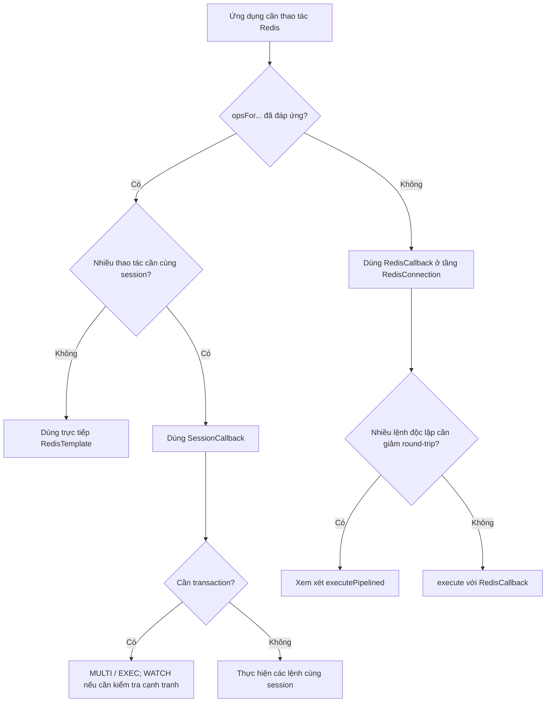

# RedisCallback và SessionCallback trong Spring Data Redis

Trong Spring Data Redis, `RedisTemplate` và `StringRedisTemplate` cung cấp sẵn những thao tác thuận tiện như `opsForValue()`, `opsForHash()`, `opsForSet()` và `opsForList()`. Tuy nhiên, có những tình huống cần kiểm soát trực tiếp lệnh Redis, phối hợp nhiều lệnh trên một kết nối hoặc thực hiện một giao dịch với `MULTI`/`EXEC`. Hai giao diện mở rộng quan trọng trong kiến trúc này là **`RedisCallback<T>`** và **`SessionCallback<T>`**.

Hai callback cùng được truyền vào phương thức `execute(...)` của template, nhưng nhận **hai đối tượng làm việc khác nhau**:

- `RedisCallback<T>` nhận **`RedisConnection`**: giao diện mức thấp, làm việc với các lệnh và dữ liệu đã tuần tự hóa.
- `SessionCallback<T>` nhận **`RedisOperations<K, V>`**: giao diện mức cao giống template, được thực thi trong cùng một Redis session/kết nối, phù hợp để nhóm các thao tác và quản lý giao dịch.

Mục tiêu của bài học là hiểu chính xác trách nhiệm của từng callback, biết lựa chọn đúng API và tránh các lỗi phổ biến khi sử dụng connection, serializer, transaction và pipeline.

## 1. Vị trí của callback trong kiến trúc Spring Data Redis

### 1.1. Các tầng thao tác

```text
Application Service / Repository
              |
              v
     RedisTemplate<K, V>          StringRedisTemplate
              |                          |
              +--------------------------+
              |
        +-----+-----------------------------+
        |                                   |
        v                                   v
  API thao tác thông dụng              Callback API
  opsForValue/Set/Hash/...              execute(...)
                                            |
                           +----------------+----------------+
                           |                                 |
                           v                                 v
                     RedisCallback<T>                 SessionCallback<T>
                     RedisConnection                  RedisOperations<K,V>
                     lệnh cấp thấp                    các lệnh qua template API
                           |                                 |
                           +----------------+----------------+
                                            |
                                            v
                                  RedisConnectionFactory
                                            |
                                            v
                                     Redis Server
```

`RedisConnectionFactory` tạo hoặc cung cấp các kết nối Redis thông qua driver, chẳng hạn Lettuce. `RedisTemplate` quản lý quy trình sử dụng connection và chuyển đổi exception theo mô hình Spring Data. Người viết callback tập trung vào thao tác với dữ liệu, **không tự gọi `close()` trên connection mà template cấp**.

`RedisTemplate` có thể được dùng đồng thời bởi nhiều luồng sau khi cấu hình xong, nhưng mỗi lần gọi phương thức không mặc nhiên dùng chung cùng một connection. Đây là lý do `SessionCallback` có vai trò riêng khi các thao tác cần cùng ngữ cảnh kết nối.

### 1.2. So sánh nhanh

| Tiêu chí | `RedisCallback<T>` | `SessionCallback<T>` |
|---|---|---|
| Phương thức chức năng | `T doInRedis(RedisConnection connection)` | `<K,V> T execute(RedisOperations<K,V> operations)` |
| Đối tượng nhận | Connection cấp thấp | API thao tác Redis mức template |
| Kiểu tham số lệnh | Thường là `byte[]` hoặc các kiểu thấp hơn | Key/value theo `K`, `V`, qua serializer cấu hình trong template |
| Nhu cầu chính | Dùng lệnh cấp thấp, truy cập trực tiếp connection, một số kiểu pipeline | Đảm bảo nhiều thao tác template-level dùng chung một session, đặc biệt `WATCH`/`MULTI`/`EXEC` |
| Quản lý connection | Do template thực hiện | Do template thực hiện |
| Tự tạo transaction? | Không | **Không**; phải chủ động gọi `multi()`/`exec()` hoặc dùng cơ chế transaction được cấu hình |
| Tự làm mọi lệnh thành nguyên tử? | Không | Không; cần hiểu cơ chế nguyên tử của Redis |

Không nên hiểu rằng chỉ `SessionCallback` mới dùng được một connection: một lần `RedisCallback` đã nhận một `RedisConnection` cụ thể. Khác biệt quan trọng là **mức API được cung cấp** và khả năng nhóm các thao tác thông thường của `RedisOperations` trong cùng một session.

## 2. `RedisCallback<T>`: thao tác trực tiếp với RedisConnection

### 2.1. Hình dạng API

```java
@FunctionalInterface
public interface RedisCallback<T> {
    T doInRedis(RedisConnection connection) throws DataAccessException;
}
```

Ví dụ trên minh họa chữ ký cơ bản của giao diện; annotation nullability và chi tiết declaration có thể thay đổi theo phiên bản thư viện. Trong code ứng dụng, các import tương ứng là:

```java
import org.springframework.data.redis.connection.RedisConnection;
import org.springframework.data.redis.core.RedisCallback;
import org.springframework.dao.DataAccessException;
```

Template nhận callback và cung cấp một `RedisConnection` đang hoạt động:

```java
T result = redisTemplate.execute((RedisCallback<T>) connection -> {
    // Gọi trực tiếp các lệnh thông qua connection.
    return resultFromRedis;
});
```

Đây là sơ đồ khái niệm, trong đó `T` và `resultFromRedis` được thay bằng kiểu và giá trị cụ thể. Java cho phép viết `RedisCallback` bằng lambda vì giao diện có một phương thức trừu tượng.

### 2.2. Ví dụ: tăng bộ đếm bằng RedisConnection

Giả sử một service cần gọi trực tiếp lệnh Redis `INCR` để tăng số lượt truy cập:

```java
import org.springframework.data.redis.core.RedisCallback;
import org.springframework.data.redis.core.StringRedisTemplate;
import org.springframework.data.redis.serializer.StringRedisSerializer;
import org.springframework.stereotype.Service;

@Service
public class VisitCounterService {

    private final StringRedisTemplate redisTemplate;
    private final StringRedisSerializer stringSerializer;

    public VisitCounterService(StringRedisTemplate redisTemplate) {
        this.redisTemplate = redisTemplate;
        this.stringSerializer = new StringRedisSerializer();
    }

    public Long countVisit(String pageId) {
        String key = "page:" + pageId + ":views";
        byte[] rawKey = stringSerializer.serialize(key);

        return redisTemplate.execute((RedisCallback<Long>) connection ->
                connection.stringCommands().incr(rawKey));
    }
}
```

Ở đây:

1. Ứng dụng tạo tên khóa dạng String để dễ hiểu về nghiệp vụ.
2. `StringRedisSerializer` chuyển key thành `byte[]` vì API của `RedisConnection` nhận dữ liệu nhị phân.
3. `connection.stringCommands().incr(rawKey)` gửi lệnh tương đương `INCR page:<id>:views`.
4. Giá trị `Long` từ Redis được trả về thông qua `redisTemplate.execute(...)`.

Khi chỉ muốn tăng một số, cách ngắn hơn thường là:

```java
Long views = redisTemplate.opsForValue()
        .increment("page:" + pageId + ":views");
```

Vì vậy, `RedisCallback` là **cơ chế mở rộng khi cần**, không phải lựa chọn bắt buộc cho mọi thao tác Redis.

### 2.3. Ví dụ: đọc giá trị String từ tầng thấp

`RedisConnection` không tự chuyển một `byte[]` thành đối tượng Java theo ý nghĩa nghiệp vụ của ứng dụng. Cần giải mã kết quả bằng serializer thích hợp:

```java
public String readRawString(String key) {
    byte[] rawKey = stringSerializer.serialize(key);

    return redisTemplate.execute((RedisCallback<String>) connection -> {
        byte[] rawValue = connection.stringCommands().get(rawKey);
        return rawValue == null ? null : stringSerializer.deserialize(rawValue);
    });
}
```

Điều quan trọng là **cách serialize phải trùng với cách dữ liệu được ghi vào Redis**. Nếu khóa được ghi bởi một `RedisTemplate` sử dụng serializer khác, tự mã hóa bằng UTF-8 có thể dẫn đến đọc sai hoặc không tìm thấy dữ liệu dù tên khóa nhìn bằng mắt giống nhau.

### 2.4. Quyền kiểm soát và trách nhiệm của RedisCallback

`RedisCallback` phù hợp khi cần:

- Gọi trực tiếp một lệnh hoặc tập hợp lệnh qua các nhóm command của `RedisConnection`.
- Làm việc với dữ liệu nhị phân hoặc serializer chuyên biệt.
- Sử dụng API cấp connection mà `opsFor...()` không biểu đạt thuận tiện.
- Thực hiện một chuỗi lệnh cấp thấp bên trong một lượt gọi template hoặc qua `executePipelined(...)`.

Trong callback, **không đóng connection**, không tự điều khiển vòng đời connection do template quản lý và không giả định connection trả về từ mọi lần `execute` là cùng một đối tượng. Nếu mục tiêu là giao dịch trên nhiều thao tác template-level, `SessionCallback` thường rõ nghĩa hơn.

## 3. `SessionCallback<T>`: nhiều thao tác trên cùng một Redis session

### 3.1. Hình dạng API và lý do tồn tại

Giao diện có một phương thức dạng:

```java
public interface SessionCallback<T> {
    <K, V> T execute(RedisOperations<K, V> operations)
            throws DataAccessException;
}
```

Trong đó, `RedisOperations<K,V>` là hợp đồng mà `RedisTemplate` triển khai. Bởi vậy, code bên trong callback có thể tiếp tục dùng:

```java
operations.opsForValue()
operations.opsForHash()
operations.opsForSet()
operations.opsForList()
operations.multi()
operations.exec()
operations.watch(...)
operations.unwatch()
```

`SessionCallback` khiến các thao tác thông qua **đối tượng `operations` được truyền vào** sử dụng chung session/kết nối bên dưới. Đó là điều cần thiết để `WATCH`, `MULTI`, các lệnh được xếp hàng và `EXEC` chạy đúng trên cùng một kết nối Redis.

**Lưu ý Java generics:** phương thức callback khai báo tham số kiểu `<K,V>` ở mức phương thức. Khi cần thao tác với key/value String trong ví dụ học tập, có thể dùng chữ ký thô `execute(RedisOperations operations)` giống ví dụ trong tài liệu Spring Data Redis. Ví dụ bên dưới có `@SuppressWarnings({"rawtypes", "unchecked"})` để khoanh vùng cảnh báo generic. Ứng dụng nên giữ cách sử dụng template và serializer nhất quán, tránh ép kiểu không có cơ sở.

### 3.2. Ví dụ: nhiều thao tác cùng session nhưng không tạo transaction

```java
import org.springframework.data.redis.core.RedisOperations;
import org.springframework.data.redis.core.SessionCallback;

Long size = redisTemplate.execute(new SessionCallback<Long>() {
    @Override
    @SuppressWarnings({"rawtypes", "unchecked"})
    public Long execute(RedisOperations operations) {
        operations.opsForSet().add("online:users", "user-1001");
        return operations.opsForSet().size("online:users");
    }
});
```

Hai thao tác `SADD` và `SCARD` đi qua cùng một session. Tuy nhiên, giữa hai lệnh có thể có thao tác của client khác. `SessionCallback` **không khóa Redis và không tự tạo ranh giới transaction**.

Nếu chỉ cần thao tác đơn giản, gọi `opsForSet()` trực tiếp vẫn dễ đọc hơn; dùng session có chủ đích khi sự liên tục của connection là một yêu cầu của thuật toán.

## 4. Redis transaction với `MULTI`, `EXEC`, `DISCARD`

Redis hỗ trợ nhóm nhiều lệnh vào transaction bằng cặp lệnh:

```text
MULTI
  -> queue command A
  -> queue command B
EXEC
  -> thực thi các lệnh đã xếp hàng
```

- `MULTI` bắt đầu chế độ xếp hàng lệnh.
- Các lệnh sau `MULTI` được Redis đưa vào queue, chưa tạo ra kết quả dữ liệu thông thường cho client.
- `EXEC` thực thi các lệnh đã xếp hàng theo thứ tự và trả về kết quả của chúng.
- `DISCARD` hủy các lệnh đã xếp hàng khi transaction chưa được thực thi.

Redis thực hiện các lệnh của một `EXEC` liền mạch so với các lệnh từ client khác. Tuy vậy, **Redis transaction không phải transaction SQL có rollback tự động cho mọi lỗi thực thi**: nếu một lệnh lỗi trong giai đoạn `EXEC`, các lệnh hợp lệ khác vẫn có thể được thực hiện. `DISCARD` chỉ hủy được những lệnh còn đang xếp hàng trước `EXEC`.

### 4.1. Ví dụ đầy đủ: xác nhận đơn hàng

Giả sử khi xác nhận một đơn hàng, ứng dụng cần ghi trạng thái và thêm mã đơn hàng vào tập các đơn đã xác nhận:

```java
import java.util.List;
import org.springframework.dao.DataAccessException;
import org.springframework.data.redis.core.RedisOperations;
import org.springframework.data.redis.core.SessionCallback;
import org.springframework.data.redis.core.StringRedisTemplate;
import org.springframework.stereotype.Service;

@Service
public class OrderConfirmationService {

    private final StringRedisTemplate redisTemplate;

    public OrderConfirmationService(StringRedisTemplate redisTemplate) {
        this.redisTemplate = redisTemplate;
    }

    public List<Object> confirm(String orderId) {
        return redisTemplate.execute(new SessionCallback<List<Object>>() {
            @Override
            @SuppressWarnings({"rawtypes", "unchecked"})
            public List<Object> execute(RedisOperations operations)
                    throws DataAccessException {

                operations.multi();
                try {
                    operations.opsForValue()
                            .set("order:" + orderId + ":status", "CONFIRMED");
                    operations.opsForSet()
                            .add("orders:confirmed", orderId);

                    return operations.exec();
                } catch (RuntimeException ex) {
                    // Khi vẫn ở trạng thái MULTI, hủy các lệnh đang chờ.
                    operations.discard();
                    throw ex;
                }
            }
        });
    }
}
```

Ở ví dụ này, `StringRedisTemplate` xử lý key/value và member dạng String. `operations.multi()` / `operations.exec()` ở **cùng callback** sử dụng một session, nên các lệnh thuộc cùng transaction Redis. Lệnh `SADD` xuất hiện giữa `MULTI` và `EXEC` thường trả về `null` ở API Spring Data Redis do kết quả chưa có ngay; kết quả thật được trả theo danh sách `List<Object>` của `exec()`.

Một số trạng thái kết quả có thể phụ thuộc vào phiên bản driver và cách chuyển đổi kết quả giao dịch; code nghiệp vụ cần hiểu kiểu phần tử trong `List<Object>` trước khi ép kiểu.

Với đường lỗi đặc biệt như mất kết nối hay timeout, việc gọi `discard()` cũng có thể thất bại; lúc này nên giữ lại exception gốc và để tầng kết nối quản lý việc loại bỏ connection lỗi. Không nên hiểu đoạn `catch` là bảo đảm rollback sau khi `EXEC` đã chạy thành công trên Redis.

### 4.2. Vì sao không gọi `multi()` và `exec()` bằng các lệnh rời?

Đoạn sau **không bảo đảm dùng cùng một connection** nếu template không có ngữ cảnh transaction/session phù hợp:

```java
redisTemplate.multi();
redisTemplate.opsForValue().set("order:42:status", "CONFIRMED");
redisTemplate.exec();
```

Khi không có cơ chế ràng buộc connection, các lệnh riêng lẻ của template có thể lấy những connection khác nhau. Transaction Redis đòi hỏi các lệnh `MULTI`/`EXEC` và các thao tác liên quan chạy trên cùng connection. Bọc nhóm lệnh trong `SessionCallback` là cách trực tiếp để xác lập điều kiện đó.

### 4.3. Không đọc kết quả vừa ghi khi vẫn đang xếp hàng

Ví dụ:

```java
operations.multi();
operations.opsForValue().set("demo:key", "new-value");
Object value = operations.opsForValue().get("demo:key");
List<Object> results = operations.exec();
```

Ở đây `get(...)` không cung cấp giá trị `"new-value"` để code Java sử dụng ngay khi đang nằm trong giai đoạn queue. Các API đọc thường trả về `null` trong transaction ở giai đoạn này; kết quả các lệnh nằm trong `results` sau `EXEC`. Không viết nhánh xử lý nghiệp vụ dựa trên một giá trị mong chờ có sẵn trước `EXEC`.

## 5. `WATCH`: kiểm soát cập nhật cạnh tranh

Transaction `MULTI/EXEC` đảm bảo thực thi một nhóm lệnh mà không bị chen lệnh từ client khác ở giữa, nhưng không tự giải quyết một thuật toán kiểu **đọc → tính toán → ghi** nếu các client cùng đọc trạng thái trước đó. Redis cung cấp `WATCH` để triển khai **optimistic locking**.

Quy trình:

```text
Client A                             Client B
  |                                     |
  | WATCH stock:sku-42                  |
  | GET stock:sku-42  -> 10             |
  |                                     | SET stock:sku-42 8
  | MULTI                               |
  | SET stock:sku-42 9                  |
  | EXEC  -> bị hủy vì key đã thay đổi  |
  |                                     |
  v                                     v
Thử đọc và tính lại, nếu phù hợp
```

`WATCH` phải gọi **trước `MULTI`** trên chính connection được dùng cho transaction. Nếu một key đang được theo dõi bị thay đổi trước khi `EXEC`, Redis hủy transaction thay vì dùng dữ liệu cũ để ghi đè. Ứng dụng nhận kết quả aborted và có thể thử lại theo chính sách của mình.

### 5.1. Ví dụ: giảm tồn kho có điều kiện

Ví dụ dưới đây minh họa thao tác giảm tồn kho khi số lượng hiện tại đủ đáp ứng. Mỗi lần thử đều bắt đầu bằng `WATCH`, đọc dữ liệu, rồi mới `MULTI`:

```java
public boolean reserveStock(String productId, long requested) {
    if (requested <= 0) {
        throw new IllegalArgumentException("requested must be positive");
    }

    String key = "stock:" + productId;

    Boolean reserved = redisTemplate.execute(new SessionCallback<Boolean>() {
        @Override
        @SuppressWarnings({"rawtypes", "unchecked"})
        public Boolean execute(RedisOperations operations) {
            for (int attempt = 0; attempt < 3; attempt++) {
                operations.watch(key);

                String raw = (String) operations.opsForValue().get(key);
                long available = raw == null ? 0 : Long.parseLong(raw);

                if (available < requested) {
                    operations.unwatch();
                    return false;
                }

                operations.multi();
                try {
                    operations.opsForValue()
                            .set(key, Long.toString(available - requested));

                    List<Object> txResult = operations.exec();
                    if (txResult != null) {
                        return true;
                    }
                    // WATCH phát hiện cạnh tranh: bắt đầu lượt thử khác.
                } catch (RuntimeException ex) {
                    operations.discard();
                    throw ex;
                }
            }
            return false;
        }
    });

    return Boolean.TRUE.equals(reserved);
}
```

Ví dụ này dùng `StringRedisTemplate` như ở service phần trước, các giá trị tồn kho được lưu dưới dạng chuỗi số. `exec()` có thể trả về `null` khi transaction bị hủy do `WATCH`. Trong hệ thống thật cần có cách phân biệt rõ lỗi xung đột (có thể retry) với thiếu tồn kho (không retry), cũng như chiến lược xử lý retry quá số lần cho phép.

Khi chỉ cần một phép trừ nguyên tử trên một key, có thể dùng `DECRBY`/`increment(key, -requested)`. Nhưng điều kiện **chỉ trừ nếu còn đủ tồn kho** đòi hỏi phối hợp giữa đọc và cập nhật; `WATCH` hoặc một Redis Lua script là lựa chọn để bảo vệ điều kiện này. Cần xem xét thêm những thay đổi ngoài Redis và tính nhất quán với cơ sở dữ liệu chính nếu có.

## 6. Callback và pipeline: mục đích khác transaction

Redis **pipelining** gửi nhiều lệnh liên tiếp mà không cần đợi từng phản hồi, rồi thu thập kết quả khi pipeline hoàn tất. Tính năng này giúp giảm chi phí round-trip giữa ứng dụng và Redis trong các thao tác hàng loạt. Pipeline **không tự mang ý nghĩa transaction** và không cam kết nhóm lệnh cùng thực thi nguyên tử.

Spring Data Redis có hai overload phổ biến:

```java
List<Object> results = redisTemplate.executePipelined(RedisCallback<?> action);
List<Object> results = redisTemplate.executePipelined(SessionCallback<?> session);
```

Đây là ký hiệu API, không phải hai dòng Java có thể khai báo đồng thời trong một phương thức như ví dụ ứng dụng. Với `executePipelined`, giá trị trả về của **chính callback phải là `null`**; phương thức `executePipelined(...)` trả về `List<Object>` chứa các kết quả lệnh Redis.

Ví dụ gửi nhiều lệnh tăng bộ đếm:

```java
import java.util.List;
import org.springframework.data.redis.core.RedisCallback;

public List<Object> addVisitsInPipeline(String pageId, int count) {
    if (count < 0) {
        throw new IllegalArgumentException("count cannot be negative");
    }

    byte[] rawKey = stringSerializer.serialize("page:" + pageId + ":views");

    return redisTemplate.executePipelined((RedisCallback<Object>) connection -> {
        for (int i = 0; i < count; i++) {
            connection.stringCommands().incr(rawKey);
        }
        return null;
    });
}
```

Ở đây, danh sách kết quả tương ứng các lần `INCR` có thể được trả lại sau khi pipeline hoàn tất. Trong pipeline, đừng dựa vào giá trị trả về trực tiếp từ từng lệnh của connection để điều khiển các lệnh sau; lệnh có thể chưa nhận phản hồi tại thời điểm gọi.

Pipeline tối ưu hành trình giao tiếp; transaction điều phối việc thực thi. Hai cơ chế có thể kết hợp trong một số trường hợp được driver hỗ trợ, nhưng cần hiểu rõ thứ tự kết quả, serializer và ranh giới giao dịch. Đối với bài toán chỉ cập nhật một bộ đếm, một lệnh `INCRBY` đơn lẻ thường đơn giản hơn gửi hàng trăm lệnh `INCR` trong pipeline.

## 7. Serialization: điểm dễ sai khi chuyển giữa hai callback

Khi dùng `StringRedisTemplate`:

```java
redisTemplate.opsForValue().set("demo:name", "Lan");
```

Template chuyển key/value String thành byte qua serializer được cấu hình. Nhưng khi dùng `RedisCallback`:

```java
byte[] key = stringSerializer.serialize("demo:name");
byte[] value = redisTemplate.execute((RedisCallback<byte[]>) connection ->
        connection.stringCommands().get(key));
```

Giá trị nhận trực tiếp từ `RedisConnection` là `byte[]`. Muốn thành String:

```java
String name = value == null ? null : stringSerializer.deserialize(value);
```

Trong `SessionCallback`, vì thao tác đi qua `RedisOperations` của template, cách serialize key/value nhìn chung vẫn theo cấu hình của template:

```java
Object name = operations.opsForValue().get("demo:name");
```

Đoạn trên minh họa bên trong phương thức có tham số `RedisOperations` thô. Nếu sử dụng `RedisTemplate<String, MyObject>` với JSON serializer, kết quả là đối tượng phù hợp với serializer đó, **không phải mặc nhiên một String**.

Nên kiểm tra rõ bốn nhóm serializer nếu sử dụng Hash hoặc đối tượng phức tạp: `keySerializer`, `valueSerializer`, `hashKeySerializer`, `hashValueSerializer`. Việc dùng sai serializer có thể khiến dữ liệu trông như hai khóa khác nhau hoặc khiến `EXEC`/pipeline trả về kiểu khác với kỳ vọng.

## 8. Mối liên hệ với `@Transactional` trong Spring

`SessionCallback` thực hiện transaction Redis bằng cách gọi `multi()`/`exec()` rõ ràng. Đây **không đồng nghĩa** với annotation `@Transactional` của Spring.

Mặc định, `RedisTemplate` **không tự tham gia** transaction do Spring quản lý. Khi muốn template tham gia một transaction hiện hành, cần bật hỗ trợ transaction cho template:

```java
@Bean
StringRedisTemplate stringRedisTemplate(RedisConnectionFactory factory) {
    StringRedisTemplate template = new StringRedisTemplate(factory);
    template.setEnableTransactionSupport(true);
    return template;
}
```

Với cấu hình transaction manager thích hợp, Spring có thể liên kết Redis connection với transaction hiện hành và sử dụng `EXEC` khi commit hoặc `DISCARD` khi rollback. Spring Data Redis không cung cấp sẵn một `PlatformTransactionManager` riêng chỉ dành cho Redis theo cách của JDBC. Việc bật Redis transaction support cũng **không tạo ra transaction phân tán nguyên tử** giữa Redis và SQL; nếu cả hai là nguồn ghi quan trọng, cần thiết kế chiến lược nhất quán dữ liệu phù hợp.

Trong transaction Spring đã được ràng buộc, các thao tác đọc có thể được định tuyến sang connection khác và không nhìn thấy giá trị vừa được xếp hàng để ghi. Khi cần transaction Redis trực tiếp, `SessionCallback` giúp phạm vi connection hiện rõ trong code. Không trộn cơ chế `@Transactional` và `MULTI/EXEC` thủ công một cách tùy tiện, vì có thể tạo ngữ cảnh transaction khó dự đoán.

## 9. Một số sai lầm phổ biến và hướng xử lý

| Sai lầm | Vì sao sai | Cách xử lý |
|---|---|---|
| Dùng `RedisCallback` và truyền `String` trực tiếp vào lệnh binary | Nhiều lệnh `RedisConnection` yêu cầu `byte[]` | Serialize key/value theo đúng cấu hình |
| Gọi `connection.close()` trong callback | Template sở hữu vòng đời connection | Để template quản lý việc giải phóng connection |
| Gọi `multi()` và `exec()` thành các lời gọi template tách rời | Không mặc nhiên dùng chung connection | Bọc trong `SessionCallback` hoặc thiết lập transaction context đúng |
| Cho rằng `SessionCallback` tự làm mọi lệnh nguyên tử | Session chỉ giữ ngữ cảnh connection | Dùng `MULTI/EXEC`, `WATCH`, Lua hoặc lệnh nguyên tử phù hợp |
| Đọc giá trị bên trong `MULTI` rồi xử lý như kết quả đã có | Lệnh còn đang queue | Đọc trước `MULTI` khi dùng `WATCH`, hoặc xem kết quả `EXEC` |
| Quên `DISCARD` khi lỗi trước `EXEC` | Connection có thể còn ở trạng thái transaction | Có nhánh dọn dẹp trạng thái transaction và xử lý lỗi kết nối |
| Mong pipeline tự bảo đảm transaction | Pipeline chỉ tối ưu truyền lệnh | Dùng transaction nếu cần ranh giới thực thi nguyên tử |
| Trả một giá trị khác `null` từ callback trong `executePipelined` | API dùng kết quả pipeline, không dùng giá trị trả về callback | `return null` và đọc `List<Object>` từ `executePipelined(...)` |
| Gọi template bên ngoài thay cho tham số `operations` trong `SessionCallback` | Có thể thoát khỏi session đang được kiểm soát | Chỉ sử dụng đối tượng `operations` được truyền vào callback |
| Giả định kết quả transaction giống kết quả lệnh đơn | `MULTI` queue lệnh, serializer/converter xử lý khi `EXEC` | Diễn giải kết quả `List<Object>` sau `exec()` |

## 10. Chọn API phù hợp khi thiết kế service

Một vài tình huống trong ứng dụng:

**Tình huống A – Cache tên sản phẩm:**

```java
redisTemplate.opsForValue().set("product:42:name", "Keyboard");
```

Nhu cầu này đơn giản; không cần callback.

**Tình huống B – Gọi một lệnh ở tầng kết nối:**

```java
Long value = redisTemplate.execute((RedisCallback<Long>) conn ->
        conn.stringCommands().incr(rawKey));
```

Sử dụng `RedisCallback` khi cần trực tiếp điều khiển connection hoặc thao tác trên binary data. Trong ví dụ, `rawKey` là byte array đã được serializer mã hóa.

**Tình huống C – Hai thay đổi Redis cần được thực hiện trong một transaction:**

```java
redisTemplate.execute(new SessionCallback<List<Object>>() {
    @Override
    @SuppressWarnings({"rawtypes", "unchecked"})
    public List<Object> execute(RedisOperations ops) {
        ops.multi();
        try {
            ops.opsForValue().set("a", "1");
            ops.opsForValue().set("b", "2");
            return ops.exec();
        } catch (RuntimeException ex) {
            ops.discard();
            throw ex;
        }
    }
});
```

Sử dụng `SessionCallback` vì cần giữ các thao tác trên cùng một session trong suốt `MULTI`/`EXEC`.

**Tình huống D – Gửi hàng loạt lệnh khi không phụ thuộc kết quả từng lệnh:**

`executePipelined(...)` giúp gửi nhiều lệnh trong một lượt. Chọn callback theo tầng API mong muốn; chỉ chọn pipeline khi chi phí truyền lệnh và khối lượng thao tác cho thấy lợi ích.

### Sơ đồ quyết định



Đây là sơ đồ lựa chọn theo mục đích. Các phương pháp không loại trừ nhau hoàn toàn: ví dụ `SessionCallback` vẫn có thể được chạy qua overload `executePipelined`, còn một `RedisCallback` có thể thực hiện nhiều lệnh cấp thấp trên connection nhận được. Điều quan trọng là đọc rõ ranh giới API và đặc tính thực thi.

## 11. Kết luận và các ý cần ghi nhớ

`RedisCallback` và `SessionCallback` đều là điểm mở rộng của `RedisTemplate`, nhưng phục vụ hai nhu cầu kiến trúc khác nhau:

1. **`RedisCallback`** thích hợp khi cần `RedisConnection` và thao tác mức thấp. Phải chủ động mã hóa/giải mã `byte[]` khi làm việc với dữ liệu theo serializer.
2. **`SessionCallback`** thích hợp khi nhiều lệnh `RedisOperations` cần cùng session; đặc biệt hữu ích cho `WATCH`, `MULTI`, `EXEC` và `DISCARD`.
3. **Session không tự có nghĩa là transaction.** Muốn transaction cần cơ chế tương ứng; muốn kiểm tra và cập nhật dựa trên dữ liệu đọc trước đó cần xử lý cạnh tranh bằng `WATCH`, lệnh nguyên tử hoặc script.
4. **Transaction khác pipeline.** Transaction xác định cách nhóm lệnh thực thi; pipeline chủ yếu giảm thời gian trao đổi mạng.
5. **Template sở hữu connection.** Callback không đóng connection; cần dùng đúng serializer, nắm rõ thời điểm lệnh trả kết quả và tránh dùng các lời gọi template rời rạc ngoài session.

Khi chọn đúng callback, code Spring Data Redis vừa giữ được sự tiện lợi của abstraction do Spring cung cấp, vừa cho phép kiểm soát chi tiết thao tác Redis tại những nơi thực sự cần thiết.

## Tài liệu tham khảo

- [Spring Data Redis – Working with Objects through RedisTemplate](https://docs.spring.io/spring-data/redis/reference/redis/template.html)
- [Spring Data Redis – Redis Transactions](https://docs.spring.io/spring-data/redis/reference/redis/transactions.html)
- [Spring Data Redis – Pipelining](https://docs.spring.io/spring-data/redis/reference/redis/pipelining.html)
- [API: RedisCallback](https://docs.spring.io/spring-data/redis/reference/api/java/org/springframework/data/redis/core/RedisCallback.html)
- [API: SessionCallback](https://docs.spring.io/spring-data/redis/reference/api/java/org/springframework/data/redis/core/SessionCallback.html)
