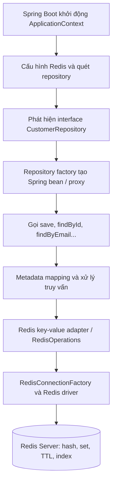

# Cơ chế tạo Redis Repository trong Spring Data Redis

Khi làm việc với Redis trong ứng dụng Spring, lập trình viên có thể dùng `RedisTemplate` để gửi lệnh trực tiếp, hoặc khai báo một **Redis Repository** để thao tác với đối tượng Java thông qua các phương thức như `save()`, `findById()`, `findAll()` và `deleteById()`. Với cách thứ hai, ta thường chỉ viết một interface:

```java
public interface CustomerRepository extends CrudRepository<Customer, String> {
    List<Customer> findByEmail(String email);
}
```

Không có lớp `CustomerRepositoryImpl` nào do lập trình viên viết, nhưng Spring vẫn có thể tiêm `CustomerRepository` vào service và gọi các phương thức đó. **Điều gì tạo ra đối tượng thực thi interface này, và dữ liệu đi từ Java đến Redis như thế nào?** Đây chính là cơ chế tạo Redis Repository.

Trong ngữ cảnh **Spring Data Redis**, cần phân biệt ba hoạt động:

1. **Khai báo repository:** Lập trình viên định nghĩa interface và entity cùng metadata ánh xạ.
2. **Tạo Spring bean:** Spring Data phát hiện interface, dựng cơ sở hạ tầng repository và tạo proxy thực thi các phương thức tại runtime.
3. **Lưu dữ liệu vào Redis:** Khi phương thức được gọi, các thành phần ánh xạ và Redis adapter chuyển thao tác repository thành những lệnh trên các key, hash, set và index trong Redis Server.

Repository được Spring tạo trong `ApplicationContext`; Redis Server **không tự tạo một “repository” Java**. Redis chỉ lưu các cấu trúc dữ liệu mà repository sử dụng.

## 1. Redis Repository đứng ở đâu trong kiến trúc Spring?

Spring Data cung cấp một mô hình repository chung cho nhiều loại cơ sở dữ liệu. Spring Data Redis là một phần triển khai của mô hình này, dựa trên cơ chế **key-value repository**.

Các thành phần thường gặp:

| Thành phần | Vai trò |
|---|---|
| `CrudRepository<T, ID>` | Khai báo hợp đồng CRUD chung: `save`, `findById`, `findAll`, `deleteById`... |
| `RedisRepository<T, ID>` | Giao diện repository chuyên biệt cho Redis, kế thừa các thao tác repository dạng key-value |
| `@RedisHash` | Đánh dấu kiểu đối tượng được lưu trong Redis hash và khai báo keyspace |
| `@Id` | Xác định thuộc tính định danh của entity |
| `@Indexed` | Yêu cầu duy trì secondary index để hỗ trợ tìm kiếm theo thuộc tính |
| `@EnableRedisRepositories` | Bật và cấu hình quét các interface Redis Repository khi cấu hình tường minh |
| Repository factory / factory bean | Tạo bean repository và proxy thực thi interface |
| Mapping context / converter | Đọc metadata entity, chuyển đối tượng Java thành dữ liệu Redis và ngược lại |
| Redis key-value adapter / template | Chuyển thao tác CRUD và query thành các tác vụ trên Redis |
| `RedisConnectionFactory` | Cung cấp kết nối Redis thông qua driver, thường là Lettuce trong ứng dụng Spring Boot |

Luồng tổng quát:



Hình trên biểu diễn trách nhiệm ở mức khái niệm. Các thành phần nội bộ cụ thể có thể thay đổi giữa các phiên bản Spring Data Redis, nhưng nguyên tắc **interface → repository proxy → ánh xạ → thao tác Redis** được giữ nguyên.

## 2. Chuẩn bị để Spring có thể tạo Redis Repository

### 2.1. Thêm Spring Data Redis vào ứng dụng

Với một dự án Spring Boot dùng Gradle, dependency thường được khai báo như sau:

```groovy
dependencies {
    implementation 'org.springframework.boot:spring-boot-starter-data-redis'
}
```

Starter cung cấp các thành phần Spring Data Redis và cơ chế kết nối cần thiết. Ví dụ cấu hình kết nối trong `application.yml`:

```yaml
spring:
  data:
    redis:
      host: localhost
      port: 6379
```

Redis Server phải có thể được truy cập qua host/port và thông tin xác thực phù hợp. Đối với ứng dụng dùng Spring Boot, `RedisConnectionFactory` thường được auto-configure từ cấu hình và các dependency trên classpath.

### 2.2. Khai báo entity bằng `@RedisHash` và `@Id`

Giả sử muốn lưu thông tin khách hàng vào Redis:

```java
package com.example.redis.customer;

import org.springframework.data.annotation.Id;
import org.springframework.data.redis.core.RedisHash;
import org.springframework.data.redis.core.index.Indexed;

@RedisHash("customers")
public class Customer {

    @Id
    private String id;

    @Indexed
    private String email;

    private String displayName;

    protected Customer() {
        // Constructor cho cơ chế ánh xạ dữ liệu.
    }

    public Customer(String id, String email, String displayName) {
        this.id = id;
        this.email = email;
        this.displayName = displayName;
    }

    public String getId() {
        return id;
    }

    public void setId(String id) {
        this.id = id;
    }

    public String getEmail() {
        return email;
    }

    public void setEmail(String email) {
        this.email = email;
    }

    public String getDisplayName() {
        return displayName;
    }

    public void setDisplayName(String displayName) {
        this.displayName = displayName;
    }
}
```

Ba annotation có mục đích khác nhau:

- `@RedisHash("customers")` chỉ ra entity được quản lý theo cơ chế Redis hash; chuỗi `customers` là **keyspace**, thường trở thành phần đầu của tên Redis key.
- `@Id` dùng `org.springframework.data.annotation.Id` để xác định ID trong mô hình Spring Data. Trong ví dụ này, ta gán ID rõ ràng để dễ quan sát.
- `@Indexed` yêu cầu Spring Data Redis duy trì một cấu trúc index phụ dựa trên giá trị `email`. Có index này, repository mới có cơ sở thực hiện truy vấn tìm khách hàng theo email.

Một class Java bình thường không tự động trở thành Redis entity chỉ vì có cùng tên với key trong Redis. Spring Data cần metadata của entity và cấu hình repository phù hợp để định tuyến thao tác đến Redis.

### 2.3. Khai báo interface repository

```java
package com.example.redis.customer;

import java.util.List;
import org.springframework.data.repository.CrudRepository;

public interface CustomerRepository
        extends CrudRepository<Customer, String> {

    List<Customer> findByEmail(String email);
}
```

`CrudRepository<Customer, String>` cho biết:

- Kiểu aggregate được lưu là `Customer`.
- Kiểu ID là `String`, trùng với trường `id` của entity.
- Các phương thức CRUD cơ bản do cơ sở hạ tầng Spring Data cung cấp.
- `findByEmail` là phương thức truy vấn dẫn xuất từ tên (*derived query method*). Trong Redis Repository, điều này cần metadata và secondary index phù hợp; nó không trở thành truy vấn SQL.

Không cần viết `CustomerRepositoryImpl`, và cũng không bắt buộc đặt `@Repository` trên interface đã được cơ chế quét Spring Data Repository nhận diện.

### 2.4. Kích hoạt cơ chế quét

Khi muốn cấu hình tường minh phạm vi quét Redis Repository:

```java
package com.example.redis.config;

import com.example.redis.customer.CustomerRepository;
import org.springframework.context.annotation.Configuration;
import org.springframework.data.redis.repository.configuration.EnableRedisRepositories;

@Configuration
@EnableRedisRepositories(basePackageClasses = CustomerRepository.class)
public class RedisRepositoryConfiguration {
}
```

`basePackageClasses` giúp Spring xác định package chứa `CustomerRepository` để quét. Ngoài cách này, ứng dụng Spring Boot có thể **tự cấu hình Redis repositories khi điều kiện auto-configuration thỏa mãn**; không phải mọi dự án đều cần annotation tường minh. Chọn một cách phù hợp với cấu trúc ứng dụng, nhất là khi cùng dùng JPA, MongoDB hoặc nhiều Redis connection.

## 3. Spring thực sự tạo bean repository như thế nào?

Việc tạo repository xảy ra trong quá trình Spring xây dựng `ApplicationContext`, trước khi service bắt đầu sử dụng bean đó.

### Giai đoạn 1 — Nhận cấu hình và xác định phạm vi quét

`@EnableRedisRepositories` hoặc cấu hình tự động của Spring Boot kích hoạt cơ chế đăng ký Redis Repository. Spring Data duyệt những package được chỉ định để tìm interface phù hợp với hợp đồng repository, ví dụ `CustomerRepository`.

Nếu ứng dụng có nhiều Spring Data module, việc chọn store phù hợp rất quan trọng. Annotation như `@RedisHash` cho phép hạ tầng Redis nhận diện entity thuộc Redis, tránh nhầm sang repository của một store khác. Phạm vi quét và cách gắn entity với store phải rõ ràng.

### Giai đoạn 2 — Đăng ký định nghĩa bean cho interface

Spring không thể khởi tạo trực tiếp một interface bằng `new CustomerRepository()`. Thay vào đó, cơ chế repository đăng ký một **factory bean** với thông tin về interface, entity, ID và những dependency cần thiết.

Factory này sử dụng hạ tầng Spring Data Repository để sinh **proxy** thực thi hợp đồng interface tại runtime. Proxy là một Spring bean bình thường ở góc nhìn của lớp sử dụng nó:

```java
import org.springframework.stereotype.Service;

@Service
public class CustomerService {

    private final CustomerRepository repository;

    public CustomerService(CustomerRepository repository) {
        this.repository = repository;
    }

    public Customer create(String id, String email, String name) {
        return repository.save(new Customer(id, email, name));
    }
}
```

Khi khởi tạo `CustomerService`, Spring tiêm repository proxy vào constructor. Đây là lý do interface có thể được sử dụng mà không cần lớp implementation do người dùng tự viết.

### Giai đoạn 3 — Ghép hành vi cho từng loại phương thức

Proxy nhận lời gọi và chuyển tới đúng cơ chế xử lý:

| Phương thức | Đường xử lý |
|---|---|
| `save(customer)` | Triển khai CRUD dựa trên key-value; ánh xạ entity và ghi vào Redis |
| `findById("c-001")` | Tra cứu key tương ứng với keyspace và ID; ánh xạ hash về entity |
| `findAll()` | Dùng cấu trúc theo dõi các ID của keyspace để tìm các entity |
| `deleteById("c-001")` | Xóa dữ liệu entity và cập nhật các cấu trúc metadata/index liên quan |
| `findByEmail("a@example.com")` | Phân tích tên phương thức rồi tìm ID qua secondary index phù hợp |
| Phương thức mặc định hoặc custom fragment | Dùng logic tương ứng với loại phương thức đã khai báo và cấu hình |

Từ góc nhìn người gọi, tất cả đều là các lệnh gọi Java bình thường. Bên trong, proxy có thể sử dụng các thành phần hỗ trợ repository của Spring Data như repository factory, metadata về phương thức và bộ xử lý truy vấn.

### Giai đoạn 4 — Ánh xạ đối tượng Java thành Redis key/value

Spring Data Redis sử dụng metadata từ `@RedisHash`, `@Id`, `@Indexed` và cấu hình mapping để chuyển đối tượng thành dữ liệu Redis. Các thành phần như `MappingRedisConverter` và Redis key-value adapter hỗ trợ quá trình này.

Khác với cách tự `SET` một chuỗi JSON vào Redis, Redis Repository thông thường **lưu các thuộc tính entity dưới dạng Redis hash**, kèm những key phụ phục vụ repository:

```text
Java:
Customer {
  id          = "c-001"
  email       = "an@example.com"
  displayName = "An Nguyen"
}

Các key Redis có thể quan sát:

customers:c-001
  TYPE: hash
  email     -> "an@example.com"
  displayName -> "An Nguyen"
  ...       -> thông tin kiểu và ánh xạ nếu có

customers
  TYPE: set
  chứa ID của những Customer thuộc keyspace

customers:email:an@example.com
  TYPE: set
  chứa ID các Customer có email tương ứng
```

Đây là mô hình minh họa các cấu trúc chính, không phải cam kết rằng mọi version đều ghi cùng một danh sách field nội bộ hoặc cùng biểu diễn byte. Tên key thực tế còn phụ thuộc keyspace, ID, cấu hình mapping và dữ liệu.

**Vì sao cần các key phụ?** Redis không tự hiểu “tất cả Customer” hay “tất cả Customer có email X” từ một tập hợp hash rời rạc. Spring Data Redis duy trì danh sách ID và secondary index để thực hiện các thao tác repository thường gặp.

### Giai đoạn 5 — Thực hiện lệnh qua kết nối Redis

Cuối cùng, Redis adapter dùng `RedisOperations` và `RedisConnectionFactory` để gửi lệnh thông qua driver tới Redis Server. Các thao tác có thể bao gồm ghi/đọc hash, cập nhật set, quản lý TTL và xóa key.

Một lời gọi `repository.save(customer)` ở phía Java vì thế có thể tương ứng với **nhiều lệnh Redis** để duy trì dữ liệu chính và index. Không nên mặc định toàn bộ các thao tác đa key này có tính giao dịch/atomic giống một câu lệnh SQL; yêu cầu về transaction cần được thiết kế riêng.

## 4. Theo dấu một lượt ghi và đọc dữ liệu

Giả sử service gọi:

```java
Customer saved = repository.save(
    new Customer("c-001", "an@example.com", "An Nguyen")
);

Customer loaded = repository.findById("c-001").orElseThrow();

List<Customer> byEmail = repository.findByEmail("an@example.com");
```

### Khi `save()` chạy

1. Repository proxy tiếp nhận đối tượng và tìm metadata của `Customer`.
2. Metadata xác định keyspace `customers`, ID `c-001` và những thuộc tính cần lưu.
3. Converter ánh xạ dữ liệu Java sang biểu diễn hash.
4. Adapter ghi hash ở key tương ứng, đồng thời cập nhật tập ID thuộc keyspace.
5. Vì `email` có `@Indexed`, adapter duy trì tập index tương ứng. Khi email của một entity được cập nhật bằng thao tác repository, các tham chiếu index liên quan cũng cần được cập nhật.

### Khi `findById()` chạy

Spring Data xác định key từ keyspace và ID, đọc dữ liệu hash rồi tái tạo entity `Customer`. Nếu key không tồn tại, kết quả là `Optional.empty()`.

### Khi `findByEmail()` chạy

Đây không phải thao tác “quét hết mọi hash rồi lọc email” theo cách thông thường:

1. Hạ tầng truy vấn xác định điều kiện tìm kiếm dựa trên thuộc tính `email`.
2. Hạ tầng Redis dùng secondary index tương ứng để lấy những ID khớp.
3. Repository đọc các hash theo ID và ánh xạ thành danh sách `Customer`.

`@Indexed` **không tạo ràng buộc duy nhất**. Hai khách hàng có thể có cùng email và xuất hiện trong cùng kết quả truy vấn. Nếu nghiệp vụ cần unique, ứng dụng phải thiết kế cơ chế bảo đảm tính duy nhất riêng.

### Quan sát trên Redis CLI

Sau khi chạy `save()`, có thể kiểm tra trong Redis của môi trường thực hành:

```redis
TYPE customers:c-001
HGETALL customers:c-001
TYPE customers
SMEMBERS customers
SMEMBERS customers:email:an@example.com
```

Kết quả cho thấy Redis Repository sử dụng **hash cho aggregate** và **set cho metadata/index**. Tên key chính xác và những field nội bộ có thể khác theo cấu hình Spring Data Redis.

Không nên thay đổi trực tiếp các set index này bằng lệnh Redis CLI trong ứng dụng thực tế, vì chúng do repository quản lý. Nếu ghi hash trực tiếp và bỏ qua adapter, những index tương ứng có thể không được cập nhật.

## 5. Repository query được tạo từ tên phương thức ra sao?

Một interface repository có thể khai báo những phương thức tìm kiếm theo quy ước đặt tên. Spring Data phân tích tên phương thức để xác định thuộc tính và điều kiện cần truy vấn. Tuy nhiên, **Redis Repository có tập khả năng truy vấn khác với JPA Repository** vì Redis không phải cơ sở dữ liệu quan hệ.

Ví dụ:

```java
public interface CustomerRepository extends CrudRepository<Customer, String> {
    List<Customer> findByEmail(String email);
}
```

Phần `findByEmail` thể hiện truy vấn theo thuộc tính `email`, và Spring Data Redis có thể xử lý nhờ `@Indexed` trên thuộc tính này.

Một số điểm giới hạn quan trọng:

- Không có bảng quan hệ, SQL `JOIN` hay query optimizer kiểu RDBMS ở phía Redis Repository.
- Không phải mọi phương thức phức tạp mà Spring Data JPA hỗ trợ đều được hỗ trợ hoặc có cùng ngữ nghĩa ở Redis.
- Các truy vấn dẫn xuất của Redis thường dựa vào **secondary index đã khai báo** và khả năng của tầng key-value.
- Với các nhu cầu như phân tích, tìm kiếm toàn văn, sắp xếp/phân trang phức tạp hay truy vấn trên nhiều điều kiện không được index phù hợp, cần đánh giá cấu trúc dữ liệu hoặc một giải pháp tìm kiếm/truy vấn chuyên biệt.

Nói cách khác, cơ chế Spring Data có thể **tạo thực thi phương thức repository**, nhưng không thể tự phát minh index hoặc năng lực truy vấn mà Redis không có.

## 6. TTL của Redis Repository được thiết lập ở đâu?

Redis Repository có thể quản lý thời gian sống của cả aggregate thông qua metadata.

### TTL cố định trên loại entity

```java
@RedisHash(value = "temporaryCustomers", timeToLive = 600)
public class TemporaryCustomer {

    @Id
    private String id;

    private String name;

    // Constructor, getter và setter.
}
```

Giá trị `timeToLive = 600` đặt thời hạn mặc định **600 giây** cho key đại diện entity sau khi lưu. Redis có thể xóa key khi thời gian này kết thúc.

### TTL thay đổi theo từng entity

Có thể dùng `@TimeToLive` trên một thuộc tính biểu diễn TTL, ví dụ:

```java
import org.springframework.data.annotation.Id;
import org.springframework.data.redis.core.RedisHash;
import org.springframework.data.redis.core.TimeToLive;

@RedisHash("loginSessions")
public class LoginSession {

    @Id
    private String id;

    private String userId;

    @TimeToLive
    private Long ttlSeconds;

    public LoginSession() {}

    public LoginSession(String id, String userId, Long ttlSeconds) {
        this.id = id;
        this.userId = userId;
        this.ttlSeconds = ttlSeconds;
    }

    public String getId() { return id; }
    public void setId(String id) { this.id = id; }
    public String getUserId() { return userId; }
    public void setUserId(String userId) { this.userId = userId; }
    public Long getTtlSeconds() { return ttlSeconds; }
    public void setTtlSeconds(Long ttlSeconds) { this.ttlSeconds = ttlSeconds; }
}
```

`@TimeToLive` trên kiểu số như `Long` thường biểu diễn số giây; các phiên bản Spring Data Redis hỗ trợ cách đọc/lưu metadata TTL tương ứng. Sau khi lưu một `LoginSession` có `ttlSeconds = 120L`, có thể kiểm tra:

```redis
TTL loginSessions:session-123
```

**Phân biệt TTL với tuổi thọ bảo đảm:** Dù repository đặt TTL, Redis vẫn có thể eviction key trước thời hạn nếu server cấu hình `maxmemory` và một eviction policy phù hợp. Khi key đã mất, repository đọc sẽ không trả được entity như trước.

### Sự kiện hết hạn và tính nhất quán của index

Khi Redis tự làm hết hạn một key, việc xóa hash được thực hiện ở Redis Server. Dữ liệu trong các set index phụ do Spring Data Redis tạo có thể cần được đồng bộ thông qua **Redis keyspace notifications** và listener quản lý sự kiện hết hạn.

Điều này có những hệ quả thực tế:

- Redis Pub/Sub không lưu bền vững sự kiện cho subscriber vắng mặt; nếu ứng dụng không lắng nghe hoặc mất kết nối, sự kiện có thể bị bỏ lỡ.
- Cấu hình keyspace notifications phụ thuộc Redis Server và hạ tầng triển khai. Một số dịch vụ managed Redis giới hạn thao tác cấu hình.
- Việc dọn index sau expiration không nên được xem là bảo đảm luôn xảy ra tức thời trong mọi tình huống lỗi/kết nối.
- Redis key-value repository có những cơ chế hỗ trợ xử lý expired key, nhưng cần hiểu cấu hình listener nếu tính nhất quán của index hoặc xử lý sự kiện hết hạn là yêu cầu nghiệp vụ.

Vì thế, không nên dùng thông báo hết hạn kiểu Pub/Sub làm nguồn sự kiện duy nhất cho một nghiệp vụ bắt buộc xử lý chính xác một lần.

## 7. Redis Repository khác `RedisTemplate` như thế nào?

`RedisTemplate` và Redis Repository đều truy cập Redis, nhưng ở hai mức trừu tượng khác nhau.

| Khía cạnh | Redis Repository | `RedisTemplate` / `StringRedisTemplate` |
|---|---|---|
| Mô hình lập trình | Entity và interface repository | Chủ động thao tác theo command / data structure |
| Cách bắt đầu | `@RedisHash`, `@Id`, interface extends repository | Gọi `opsForValue()`, `opsForHash()`, `opsForSet()`... |
| Ánh xạ object | Mapping metadata do Spring Data quản lý | Lập trình viên chọn serializer, cấu trúc và chuyển đổi |
| CRUD thông dụng | `save`, `findById`, `deleteById`... | `get`, `set`, `put`, `delete`... tùy API |
| Secondary index | Có thể duy trì từ `@Indexed` | Tự thiết kế và cập nhật |
| Truy vấn | Phụ thuộc năng lực Redis Repository và index | Tùy tập lệnh Redis được sử dụng |
| Mức kiểm soát Redis | Đơn giản cho aggregate phù hợp | Linh hoạt với các kiểu dữ liệu/câu lệnh Redis cụ thể |

Ví dụ, `StringRedisTemplate` có thể ghi:

```java
stringRedisTemplate.opsForValue()
    .set("customer:plain:c-001", "{\"name\":\"An Nguyen\"}");
```

Lệnh trên tạo một **Redis string**, không phải hash, keyspace set hay secondary index theo cơ chế Redis Repository. Vì thế, `CustomerRepository.findById("c-001")` sẽ không tự biết cách lấy dữ liệu này.

Ngược lại, khi Redis Repository lưu một object thành hash, dùng `StringRedisTemplate.opsForValue().get(...)` trên key hash có thể dẫn đến lỗi sai kiểu Redis. Cần chọn API thích hợp với cấu trúc dữ liệu thực tế.

### Khi nào nên chọn cách nào?

- **Redis Repository** hợp lý khi đối tượng có ID rõ ràng, CRUD theo entity là chính, nhu cầu truy vấn nằm trong phạm vi được hỗ trợ và muốn tận dụng mapping/index.
- **RedisTemplate** hợp lý khi cần điều khiển cụ thể cấu trúc Redis như string, list, set, sorted set, stream, counter, lệnh atomic, pipeline hoặc dữ liệu cache có format riêng.
- Trong cùng một ứng dụng có thể dùng cả hai, nhưng cần quy định rõ **ai sở hữu key và cấu trúc index** để tránh ghi đè không tương thích.

## 8. Các lỗi thường gặp khi Spring không tạo được repository

### 8.1. Interface nằm ngoài phạm vi quét

Nếu Spring không tìm thấy `CustomerRepository` trong phạm vi cấu hình repository, việc tiêm bean có thể thất bại.

**Cách xử lý:** Đặt interface trong package được quét bởi cấu hình Spring Boot hoặc chỉ định `basePackages` / `basePackageClasses` phù hợp trong `@EnableRedisRepositories`.

### 8.2. Không phân biệt được Redis với store khác

Ứng dụng dùng đồng thời Spring Data JPA, MongoDB và Redis có thể phải chạy ở chế độ phân biệt repository nghiêm ngặt. Interface mở rộng hợp đồng CRUD chung nhưng entity thiếu metadata nhận diện store có thể không được gán đúng cho Redis.

**Cách xử lý:** Dùng `@RedisHash` với Redis entity, tổ chức package và cấu hình quét riêng cho từng store; tránh sử dụng chung một domain class mang nhiều annotation persistence gây nhập nhằng.

### 8.3. Nhầm annotation `@Id`

`@Id` trong ví dụ phải lấy từ `org.springframework.data.annotation.Id`. Nếu tùy tiện thay bằng annotation dùng cho cơ chế khác, quá trình ánh xạ ID có thể không diễn ra như mong muốn.

**Cách xử lý:** Kiểm tra import và kiểu ID trong repository có khớp entity.

### 8.4. Có repository bean nhưng không kết nối được Redis

Spring có thể tạo repository bean thành công trong khi Redis Server chưa sẵn sàng. Khi gọi `save` hoặc `findById`, lỗi kết nối mới xuất hiện.

**Cách xử lý:** Kiểm tra host, port, password, TLS, network, cấu hình `RedisConnectionFactory` và trạng thái Redis Server. Việc tạo bean Spring không đồng nghĩa kiểm tra kết nối Redis luôn thành công trước đó.

### 8.5. `findById()` thành công nhưng `findByEmail()` không như mong đợi

Nếu trường email thiếu `@Indexed` hoặc dữ liệu trước đó được ghi trực tiếp bằng `RedisTemplate` mà không cập nhật index, phương thức tra cứu qua index có thể không tìm được các đối tượng cần thiết.

**Cách xử lý:** Xem annotation và các set index hiện có; thống nhất một cơ chế quản lý dữ liệu. Việc bổ sung `@Indexed` vào code **không mặc nhiên xây lại toàn bộ index cho dữ liệu đã tồn tại**.

### 8.6. Key biến mất dù vừa lưu

Nguyên nhân có thể là TTL, Redis eviction policy, thao tác xóa, reset môi trường hoặc dùng sai Redis database/keyspace. Repository không bảo vệ dữ liệu khỏi các sự kiện hạ tầng này.

**Cách xử lý:** Kiểm tra `TTL`, `INFO stats`, `INFO memory`, `maxmemory-policy` và log ứng dụng; không quy kết một lần `findById()` trả rỗng thành lỗi tạo proxy.

## 9. Sơ đồ trách nhiệm: Spring quản lý gì, Redis quản lý gì?

| Việc cần làm | Bên chịu trách nhiệm chính |
|---|---|
| Phát hiện interface `CustomerRepository` | Spring Data repository scanning |
| Đăng ký bean cho interface | Spring container và repository factory |
| Tạo proxy xử lý `save`, `findById`, `findByEmail` | Hạ tầng Spring Data Repository |
| Ánh xạ `Customer` sang hash | Spring Data Redis mapping |
| Duy trì ID set và secondary index theo metadata | Spring Data Redis key-value adapter |
| Gửi/nhận lệnh Redis | RedisOperations / RedisConnectionFactory / driver |
| Lưu hash, set, TTL và thực thi lệnh | Redis Server |
| Expiration và eviction theo cấu hình server | Redis Server |
| Tổ chức nghiệp vụ, kiểm soát tính nhất quán và xử lý lỗi | Ứng dụng |

Tách đúng trách nhiệm giúp chẩn đoán vấn đề dễ hơn: **không tìm thấy repository bean** là vấn đề đăng ký trong Spring; **có bean nhưng thao tác Redis lỗi** có thể là kết nối, mapping, keyspace, dữ liệu hay giới hạn Redis; **truy vấn theo thuộc tính không ra dữ liệu** thường cần xem metadata và index.

## 10. Bài thực hành ngắn

Để nhìn thấy cơ chế hoạt động, có thể thực hiện trên một Redis dành riêng cho học tập:

1. Tạo `Customer`, `CustomerRepository` và service theo các ví dụ phía trên.
2. Khởi động Spring Boot với cấu hình Redis đúng; tiêm repository vào service.
3. Gọi `repository.save(new Customer("c-001", "an@example.com", "An Nguyen"))`.
4. Dùng Redis CLI chạy `HGETALL customers:c-001` và `SMEMBERS customers:email:an@example.com`.
5. Gọi `findById("c-001")` và `findByEmail("an@example.com")` để đối chiếu dữ liệu với các key được lưu.
6. Sửa email rồi gọi `save()` với cùng ID, quan sát index email cũ/mới.
7. Gọi `deleteById("c-001")`, kiểm tra hash và các set liên quan; nếu có cấu hình TTL, quan sát thêm `TTL` và hành vi hết hạn.

Lưu ý các lệnh này chỉ dành cho Redis thử nghiệm vì việc ghi/xóa entity và index sẽ thay đổi dữ liệu.

## 11. Câu hỏi tự kiểm tra

**1. Vì sao một interface `CustomerRepository` không có lớp implementation vẫn gọi được `save()`?**  
Vì Spring Data đăng ký repository factory, tạo proxy triển khai hợp đồng interface và chuyển lời gọi đến cơ sở hạ tầng repository tại runtime.

**2. `@RedisHash("customers")` có tạo một bảng `customers` như trong database quan hệ không?**  
Không. Nó khai báo keyspace cho dữ liệu được ánh xạ thành Redis hash; Spring Data Redis có thể tạo thêm những key set/index phục vụ các phép toán repository.

**3. Có thể tự `SET customers:c-001` thành một chuỗi JSON rồi dùng `findById("c-001")` đọc như bình thường không?**  
Không thể giả định như vậy. Redis Repository sử dụng cách ánh xạ và cấu trúc dữ liệu riêng; Redis string tự tạo bằng `SET` không tương đương Redis hash do repository quản lý.

**4. Nếu có `findByEmail()` thì Redis có tự quét mọi khách hàng không?**  
Phương thức tìm kiếm phù hợp thường dựa vào secondary index, chẳng hạn `@Indexed` trên `email`. Không nên coi Redis Repository như bộ máy truy vấn SQL tự do.

**5. Cấu hình `@RedisHash(timeToLive = 600)` có giúp Spring tạo proxy repository không?**  
`@RedisHash` giúp mô tả entity/keyspace; thuộc tính TTL điều khiển thời hạn dữ liệu được lưu. Cơ chế tạo proxy còn phụ thuộc cấu hình quét, repository factory và các bean hạ tầng. Một entity có TTL không đồng nghĩa repository chắc chắn đã được đăng ký.

Điểm cốt lõi của bài: **Redis Repository là một Spring bean được tạo bởi hạ tầng Spring Data dựa trên interface**, dùng metadata của entity để chuyển CRUD và một số truy vấn thành các thao tác Redis trên hash, ID set và secondary index. Hiểu đường đi này giúp lựa chọn đúng giữa repository và template, đồng thời phân biệt rõ lỗi cấu hình Spring với hành vi lưu trữ thực tế của Redis.
