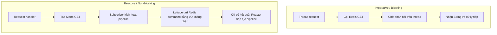

# Mô hình không chặn và điều kiện hỗ trợ của trình điều khiển trong Spring Data Redis Reactive

## 1. Mục tiêu của bài học

Spring Data Redis cung cấp cả API **đồng bộ (imperative)** và API **phản ứng (reactive)**. Cả hai đều thao tác trên Redis, nhưng khác đáng kể ở cách thread chờ kết quả, cách biểu diễn dữ liệu, cách xử lý lỗi và yêu cầu đối với Redis driver.

Ví dụ một ứng dụng cần đọc mô tả sản phẩm từ Redis:

- Với `StringRedisTemplate`, lời gọi `get(key)` thường chặn thread đang gọi cho đến khi nhận kết quả hoặc lỗi.
- Với `ReactiveStringRedisTemplate`, `get(key)` trả về một `Mono<String>`. Công việc I/O được tổ chức bằng API phản ứng và driver không chặn; thread gọi không cần giữ nguyên ở trạng thái chờ socket để nhận dữ liệu.
- Nhưng nếu mã ứng dụng gọi `.block()` trên `Mono` hoặc chạy JDBC đồng bộ ngay trong luồng WebFlux, hệ thống vẫn có thể bị chặn thread, dù đang dùng một Redis API reactive.

Ngoài cách viết code, **reactive Redis đòi hỏi driver có khả năng reactive I/O**. Trong Spring Data Redis, **Lettuce** hỗ trợ truy cập reactive, còn **Jedis** chủ yếu phục vụ API imperative và không phải lựa chọn để tạo `ReactiveRedisConnectionFactory` theo cơ chế Spring Data Redis thông dụng.

Bài này giúp bạn:

1. Giải thích sự khác nhau giữa blocking I/O và non-blocking I/O.
2. Hiểu `Mono`, `Flux`, subscription, backpressure và Reactor trong quá trình gọi Redis.
3. Khai báo `ReactiveRedisConnectionFactory` và `ReactiveRedisTemplate` hoặc `ReactiveStringRedisTemplate`.
4. Xác định điều kiện hỗ trợ của driver Lettuce/Jedis và những sai lầm khi chuyển đổi từ code imperative.
5. Thiết kế luồng đọc/ghi reactive, fallback và giới hạn tải phù hợp.
6. Nhận biết những tình huống không nên dùng reactive chỉ vì có sẵn API.

## 2. Redis không chặn nghĩa là gì?

### 2.1. Lời gọi blocking

Trong chương trình đồng bộ:

```java
String value = stringRedisTemplate.opsForValue().get("catalog:sku:1001");
System.out.println(value);
```

Thread gọi `get(...)` phải chờ thao tác Redis hoàn thành trước khi chạy dòng kế tiếp. Khi Redis phản hồi nhanh, thời gian chờ nhỏ; khi mạng chậm hoặc Redis quá tải, thread có thể chờ lâu hơn.

Một hệ thống có nhiều request đồng thời có thể phải duy trì nhiều thread để chờ kết quả I/O. Thread tiêu thụ tài nguyên lập lịch, stack và cơ chế điều phối của JVM.

### 2.2. Lời gọi reactive

Với API reactive:

```java
Mono<String> result =
        reactiveStringRedisTemplate.opsForValue()
                .get("catalog:sku:1001");
```

`result` không phải `String` đã đọc. Nó là một **Publisher** theo mô hình Reactive Streams, biểu diễn thao tác có thể phát ra một giá trị, hoàn tất rỗng hoặc phát lỗi.

Phần xử lý tiếp theo được nối bằng operator:

```java
Mono<String> upperCase =
        reactiveStringRedisTemplate.opsForValue()
                .get("catalog:sku:1001")
                .map(String::toUpperCase);
```

Ở đây, hàm `map(...)` nhận giá trị sau khi kết quả Redis sẵn sàng; thread ứng dụng không cần bị giữ tại một lời gọi `get` đang đợi dữ liệu.

### 2.3. Sơ đồ sự khác biệt



Điểm nhấn: **non-blocking là cách tổ chức việc chờ I/O**. Nó không làm Redis thực thi lệnh nhanh hơn, không loại bỏ độ trễ mạng và không đảm bảo throughput cao hơn trong mọi workload.

Nếu một tác vụ chỉ có rất ít I/O, code đồng bộ có thể dễ đọc và đủ đáp ứng. Reactive thường có ích hơn khi hệ thống có **nhiều kết nối/yêu cầu đồng thời cần chờ I/O** và toàn bộ chuỗi xử lý có thể giữ đặc tính không chặn.

## 3. Mono và Flux biểu diễn kết quả Redis

Spring Data Redis Reactive sử dụng **Project Reactor** với hai kiểu chính.

| Kiểu | Số phần tử có thể phát ra | Ví dụ Redis |
|---|---|---|
| `Mono<T>` | 0 hoặc 1 phần tử; cũng có thể kết thúc bằng lỗi | `GET` một key, `SET` trả trạng thái, `EXISTS` một key |
| `Flux<T>` | 0 đến nhiều phần tử; cũng có thể kết thúc bằng lỗi | Duyệt nhiều key, đọc nhiều bản ghi Stream, nhận nhiều thông báo Pub/Sub |

Ví dụ:

```java
Mono<String> name =
        reactiveRedis.opsForValue().get("catalog:item:1001");

Mono<Boolean> saved =
        reactiveRedis.opsForValue().set(
                "catalog:item:1001",
                "Bút máy"
        );
```

Với một key chưa tồn tại, `get(...)` thường hoàn tất **rỗng** (`Mono.empty()`) thay vì phát ra một `null`. `Mono` theo Reactive Streams không phát phần tử `null` như giá trị thành công.

Do đó, xử lý cache miss bằng `switchIfEmpty`:

```java
Mono<String> name = reactiveRedis.opsForValue()
        .get("catalog:item:1001")
        .switchIfEmpty(Mono.just("Chưa có dữ liệu"));
```

Phân biệt:

- **Không có key:** có thể dẫn tới Mono rỗng.
- **Redis timeout/mất kết nối:** dẫn tới tín hiệu lỗi (`onError`).
- **Redis có giá trị:** Mono phát phần tử thành công rồi kết thúc.

Không dùng `defaultIfEmpty(...)` để “sửa” một lỗi Redis. Operator này chỉ xử lý luồng **rỗng**, không nuốt exception.

### Operator hữu ích

| Operator | Vai trò |
|---|---|
| `map` | Biến đổi kết quả đồng bộ, không thay publisher |
| `flatMap` | Nối một thao tác bất đồng bộ trả `Mono` |
| `flatMapMany` | Từ một `Mono` mở rộng thành `Flux` |
| `switchIfEmpty` | Chạy nhánh khác khi publisher không có phần tử |
| `onErrorResume` | Phục hồi từ lỗi theo chính sách |
| `timeout` | Giới hạn thời gian chờ publisher |
| `retryWhen` | Thử lại có điều kiện và chính sách |
| `then` | Chờ publisher trước hoàn tất, bỏ qua kết quả của nó |
| `doOnNext` / `doOnError` | Quan sát dữ liệu/lỗi, không phải nơi chính để thực hiện luồng nghiệp vụ |
| `collectList` | Gom Flux thành một danh sách trong Mono, tiêu tốn bộ nhớ theo số phần tử |

**Không nhầm `flatMap` với `map`:** nếu hàm xử lý trả thêm một `Mono`, dùng `flatMap` để nối publisher; nếu dùng `map` sẽ tạo `Mono<Mono<T>>` và không tạo đúng luồng dữ liệu mong muốn.

## 4. Điều kiện hỗ trợ của Redis driver: Lettuce và Jedis

Spring Data Redis có abstraction kết nối cho hai mô hình:

- `RedisConnectionFactory`: cung cấp kết nối cho API Redis imperative.
- `ReactiveRedisConnectionFactory`: cung cấp kết nối cho API Redis reactive.

Mỗi API cần được triển khai bởi driver thích hợp. Trong cách tích hợp Spring Data Redis thông dụng, **LettuceConnectionFactory** là factory quan trọng có thể hỗ trợ cả API đồng bộ và API reactive.

### So sánh driver

| Đặc điểm | Lettuce | Jedis |
|---|---|---|
| Truy cập Redis imperative qua Spring Data Redis | Có | Có |
| Cơ chế I/O dựa trên Netty và các API asynchronous/reactive | Có | Không phải cơ sở reactive của Spring Data Redis |
| Hỗ trợ `ReactiveRedisConnectionFactory` trong Spring Data Redis | Có, qua Lettuce | Không theo tích hợp reactive thông dụng |
| Dùng với `ReactiveRedisTemplate` | Có | Không dùng `JedisConnectionFactory` để cung cấp reactive connection |
| Khi chỉ dùng `RedisTemplate` đồng bộ | Có thể dùng | Có thể dùng |
| Khi làm việc với WebFlux/reactive Redis end-to-end | Lựa chọn phù hợp | Không phải lựa chọn cho reactive Redis API |
| Standalone, Sentinel, Cluster | Phụ thuộc cấu hình driver và Redis topology | Phụ thuộc cấu hình driver và Redis topology |

Tóm lại: **đổi kiểu trả về của service sang `Mono` không biến một client Jedis blocking thành driver không chặn**.

Nếu ứng dụng đang cấu hình `JedisConnectionFactory` và cố inject `ReactiveRedisConnectionFactory`, có thể không tìm thấy bean reactive factory phù hợp. Trường hợp đó cần xem lại driver đang sử dụng thay vì tự bọc lời gọi Jedis trong `Mono.just(...)` rồi gọi là reactive.

### Vì sao Lettuce thích hợp?

Lettuce sử dụng Netty và mô hình I/O không chặn để gửi/nhận lệnh Redis. Spring Data Redis tích hợp với driver này để cung cấp các kiểu `Mono` và `Flux`, giúp lệnh Redis có thể tham gia pipeline Reactor.

Lettuce cũng dùng được cho API blocking/imperative. Điều này có nghĩa việc thấy dependency Lettuce **chưa đủ chứng minh service đang non-blocking**; service phải sử dụng đúng `ReactiveRedisTemplate` và không chặn thread trong các phần còn lại của pipeline.

### Lưu ý về phiên bản

Tập API, điều kiện hỗ trợ cụ thể của driver, tính năng Redis Cluster hoặc reactive transaction có thể thay đổi giữa các phiên bản Spring Boot, Spring Data Redis và Redis driver.

Khi triển khai thực tế, cần xem bộ phiên bản dependency **đang có trong ứng dụng**, thay vì chỉ tham khảo ví dụ của một phiên bản khác. Bài học này tập trung vào cơ chế Spring Data Redis Reactive với Lettuce và Project Reactor.

## 5. Chuẩn bị dự án Spring Boot Reactive Redis

Nếu dự án dùng Spring Boot với Gradle, có thể khai báo:

```kotlin
dependencies {
    implementation("org.springframework.boot:spring-boot-starter-data-redis-reactive")
    implementation("org.springframework.boot:spring-boot-starter-webflux")
}
```

Starter Redis reactive đưa vào các thành phần liên quan đến Spring Data Redis và client được hỗ trợ; WebFlux cần khi triển khai endpoint HTTP reactive, nhưng **không phải điều kiện bắt buộc** nếu chỉ dùng Redis reactive trong một worker hoặc service không có HTTP.

Ví dụ Maven:

```xml
<dependencies>
    <dependency>
        <groupId>org.springframework.boot</groupId>
        <artifactId>spring-boot-starter-data-redis-reactive</artifactId>
    </dependency>
    <dependency>
        <groupId>org.springframework.boot</groupId>
        <artifactId>spring-boot-starter-webflux</artifactId>
    </dependency>
</dependencies>
```

Nếu dự án Spring Boot đang quản lý phiên bản dependencies, thông thường không đặt phiên bản riêng cho starter.

Kết nối Redis local trong `application.yml`:

```yaml
spring:
  data:
    redis:
      host: localhost
      port: 6379
      timeout: 2s
```

Các giá trị chỉ để minh họa. Hệ thống production cần xác định lại host, xác thực, TLS, timeout, topology, các cấu hình reconnect và giới hạn tài nguyên theo môi trường.

### Auto-configuration hoạt động ra sao?

Khi starter reactive Redis và Lettuce có mặt, Spring Boot có thể tự tạo:

- `RedisConnectionFactory` thông qua `LettuceConnectionFactory`.
- `ReactiveRedisConnectionFactory` từ factory hỗ trợ reactive.
- `ReactiveRedisTemplate` và/hoặc `ReactiveStringRedisTemplate` phù hợp với điều kiện auto-configuration.
- Các component Reactor cần thiết cho luồng xử lý reactive.

Không cần tự khai báo tất cả bean khi cấu hình mặc định đã đáp ứng.

Trong ứng dụng có nhiều Redis connection hoặc tùy chỉnh serializer, có thể cần cấu hình bean cụ thể. Khi đó phải phân biệt bean connection factory cho API synchronous và reactive, cũng như tên bean khi có nhiều template.

## 6. Cấu hình ReactiveStringRedisTemplate tường minh

Khi key và value là chuỗi, `ReactiveStringRedisTemplate` là lựa chọn dễ bắt đầu vì đã có serializer chuỗi phù hợp.

Ví dụ khi cần khai báo template riêng:

**`ReactiveRedisConfig.java`**

```java
package com.example.reactive.config;

import org.springframework.context.annotation.Bean;
import org.springframework.context.annotation.Configuration;
import org.springframework.data.redis.connection.ReactiveRedisConnectionFactory;
import org.springframework.data.redis.core.ReactiveStringRedisTemplate;

@Configuration
public class ReactiveRedisConfig {

    @Bean("productReactiveRedis")
    public ReactiveStringRedisTemplate productReactiveRedis(
            ReactiveRedisConnectionFactory factory
    ) {
        return new ReactiveStringRedisTemplate(factory);
    }
}
```

Ý nghĩa:

- `ReactiveRedisConnectionFactory` là bean kết nối Redis **có hỗ trợ reactive**.
- `ReactiveStringRedisTemplate` cung cấp các nhóm lệnh Redis trả về `Mono`/`Flux`.
- Tên bean `productReactiveRedis` giúp chọn chính xác template trong hệ thống có nhiều template.
- Với Spring Boot đã auto-configure template tương ứng, đây là cấu hình **tùy chọn**, không bắt buộc phải nhân bản bean mặc định.

Không nên tạo `new LettuceConnectionFactory(...)` thủ công trong mỗi service hoặc mỗi request. Connection factory cần được quản lý theo lifecycle của Spring để dùng lại tài nguyên, áp dụng cấu hình server và tránh tạo thêm Netty/client resources ngoài kiểm soát.

### Kiểm tra loại factory trong kiến trúc

Nếu ứng dụng đã cấu hình:

```java
@Bean
public RedisConnectionFactory redisConnectionFactory() {
    return new JedisConnectionFactory();
}
```

thì factory này phục vụ API imperative; không nên coi nó tự đáp ứng constructor:

```java
new ReactiveStringRedisTemplate(reactiveConnectionFactory)
```

`ReactiveStringRedisTemplate` cần một `ReactiveRedisConnectionFactory` thực sự. Để có nó trong tích hợp reactive thông dụng của Spring Data Redis, dùng Lettuce phù hợp.

Không chuyển kiểu `RedisConnectionFactory` thành `ReactiveRedisConnectionFactory` bằng ép kiểu nếu factory không hỗ trợ interface đó.

## 7. Ví dụ đọc/ghi không chặn với ReactiveStringRedisTemplate

Giả sử ứng dụng lưu một chuỗi mô tả sản phẩm trong Redis dưới key `catalog:v1:description:<sku>`.

**`ReactiveProductCache.java`**

```java
package com.example.reactive.service;

import java.time.Duration;

import org.springframework.beans.factory.annotation.Qualifier;
import org.springframework.data.redis.core.ReactiveStringRedisTemplate;
import org.springframework.stereotype.Service;

import reactor.core.publisher.Mono;

@Service
public class ReactiveProductCache {

    private final ReactiveStringRedisTemplate redis;

    public ReactiveProductCache(
            @Qualifier("productReactiveRedis")
            ReactiveStringRedisTemplate redis
    ) {
        this.redis = redis;
    }

    public Mono<Boolean> saveDescription(
            String sku,
            String description
    ) {
        return redis.opsForValue()
                .set(key(sku), description, Duration.ofMinutes(10));
    }

    public Mono<String> findDescription(String sku) {
        return redis.opsForValue().get(key(sku));
    }

    public Mono<Long> deleteDescription(String sku) {
        return redis.delete(key(sku));
    }

    private String key(String sku) {
        return "catalog:v1:description:" + sku;
    }
}
```

Service không gọi `.subscribe()` hoặc `.block()`. Nó trả publisher để **caller quyết định khi nào đăng ký và điều phối lifecycle**.

Ví dụ một handler WebFlux:

```java
package com.example.reactive.web;

import com.example.reactive.service.ReactiveProductCache;
import org.springframework.web.bind.annotation.GetMapping;
import org.springframework.web.bind.annotation.PathVariable;
import org.springframework.web.bind.annotation.RequestMapping;
import org.springframework.web.bind.annotation.RestController;
import reactor.core.publisher.Mono;

@RestController
@RequestMapping("/api/products")
public class ProductController {

    private final ReactiveProductCache cache;

    public ProductController(ReactiveProductCache cache) {
        this.cache = cache;
    }

    @GetMapping("/{sku}/description")
    public Mono<String> description(@PathVariable String sku) {
        return cache.findDescription(sku);
    }
}
```

Spring WebFlux đăng ký subscription và ghi kết quả HTTP theo vòng đời request. Nếu key không có dữ liệu, publisher có thể hoàn tất rỗng; ứng dụng nên quy định cách trả 404 hoặc lấy dữ liệu từ nguồn chính khi phù hợp. Đoạn minh họa chỉ tập trung vào pipeline không chặn.

### Tại sao không gọi subscribe() trong service?

Ví dụ không nên dùng trong service đọc dữ liệu:

```java
public Mono<String> wrongGet(String sku) {
    redis.opsForValue()
            .get(key(sku))
            .subscribe(value -> System.out.println(value));

    return Mono.empty();
}
```

Ở đây, service khởi chạy một tác vụ độc lập rồi trả một Mono rỗng, khiến caller không biết khi nào tác vụ hoàn tất, không nhận được giá trị hoặc lỗi của nó. Với HTTP, tác vụ có thể tiếp tục chạy sau khi request đã kết thúc, trái mong muốn.

Thay vào đó:

```java
public Mono<String> correctGet(String sku) {
    return redis.opsForValue().get(key(sku));
}
```

Trong pipeline thông thường, để framework hoặc thành phần ở ranh giới hệ thống quản lý subscription. Chỉ gọi `subscribe()` trực tiếp khi thành phần đó thật sự chịu trách nhiệm sở hữu lifecycle của một luồng dài hạn và có quản lý lỗi/hủy.

## 8. Composition: nối nhiều lệnh Redis bằng flatMap

Giả sử cần lưu mô tả, sau đó đọc lại để xác nhận kết quả:

```java
public Mono<String> saveThenRead(String sku, String description) {
    String key = "catalog:v1:description:" + sku;

    return redis.opsForValue()
            .set(key, description)
            .flatMap(saved -> {
                if (!Boolean.TRUE.equals(saved)) {
                    return Mono.error(
                            new IllegalStateException("Redis SET failed")
                    );
                }

                return redis.opsForValue().get(key);
            });
}
```

`set(...)` trả `Mono<Boolean>`, nên `flatMap` là lựa chọn thích hợp khi kết quả bước đầu quyết định **một lời gọi Redis tiếp theo**.

Một cú pháp gọn khi chỉ quan tâm thao tác ghi hoàn tất trước bước đọc:

```java
public Mono<String> saveThenRead(String sku, String value) {
    String key = "catalog:v1:description:" + sku;

    return redis.opsForValue()
            .set(key, value)
            .then(redis.opsForValue().get(key));
}
```

`then(...)` đợi publisher trước kết thúc thành công rồi chuyển sang publisher sau. Nó không tự biến hai lệnh thành một Redis transaction; nếu có client khác ghi vào key giữa hai lệnh, lần đọc sau có thể quan sát giá trị khác.

### Dùng map cho biến đổi không I/O

```java
public Mono<String> formatted(String sku) {
    return redis.opsForValue()
            .get("catalog:v1:description:" + sku)
            .map(value -> "Description: " + value);
}
```

Hàm `map` chỉ biến đổi chuỗi bằng Java, không cần một publisher mới.

### Khi cần nhiều lệnh độc lập

Có thể kết hợp hai lần đọc:

```java
public Mono<String> productLine(String sku) {
    Mono<String> name = redis.opsForValue()
            .get("catalog:v1:name:" + sku);

    Mono<String> price = redis.opsForValue()
            .get("catalog:v1:price:" + sku);

    return Mono.zip(name, price)
            .map(tuple -> tuple.getT1() + ": " + tuple.getT2());
}
```

`Mono.zip` đợi cả hai publisher phát giá trị. Nếu một key không tồn tại và publisher hoàn tất rỗng, kết quả zip có thể rỗng; cần `defaultIfEmpty` hoặc quy tắc dữ liệu thiếu nếu nghiệp vụ muốn tiếp tục.

Hai lệnh đọc độc lập có thể được phát cùng thời điểm tùy subscription/scheduling. Chúng **không được đảm bảo là một snapshot nguyên tử** tại một thời điểm của Redis.

## 9. Reactive không có nghĩa gọi API là đã thực thi lệnh

Một đặc tính quan trọng của Reactor: publisher mô tả pipeline. Đối với các thao tác Redis reactive thông thường, việc đăng ký subscription mới kích hoạt luồng I/O liên quan.

Ví dụ:

```java
Mono<Boolean> setPublisher =
        reactiveRedis.opsForValue().set("demo:reactive:flag", "ON");
```

Nếu method chỉ tạo `setPublisher` rồi bỏ qua, không có caller subscribe thì không thể dựa vào giả định lệnh đã hoàn tất.

Ngược lại, nếu cùng một publisher được subscribe nhiều lần, thao tác I/O có thể được kích hoạt nhiều lần:

```java
Mono<Boolean> operation =
        reactiveRedis.opsForValue().set("demo:reactive:flag", "ON");

// Hai subscription có thể dẫn đến hai lần thực hiện thao tác.
operation.subscribe();
operation.subscribe();
```

Không dùng hành vi này để tạo hai bản ghi hoặc đánh dấu giao dịch đã hoàn tất; đây chỉ là ví dụ về subscription. Khi cần chia sẻ một kết quả giữa nhiều subscriber, cân nhắc operator chia sẻ/cache của Reactor theo semantics mong muốn, đồng thời hiểu thời gian sống và chính sách lỗi của publisher đó.

### Đặt side effect đúng chỗ

Không thực hiện lệnh Redis trong `map` rồi bỏ qua Mono trả về:

```java
// Sai: Mono do set(...) trả ra bị bỏ qua.
return source.getValue()
        .map(value -> {
            redis.opsForValue().set("demo:key", value);
            return value;
        });
```

Thay bằng `flatMap`:

```java
return source.getValue()
        .flatMap(value ->
                redis.opsForValue()
                        .set("demo:key", value)
                        .thenReturn(value)
        );
```

Đây là cách giữ thao tác ghi Redis **nằm trong** luồng reactive để caller nhận tín hiệu hoàn tất hoặc lỗi.

## 10. Tránh block() và thao tác đồng bộ trong WebFlux

Một sai lầm phổ biến khi chuyển từ Spring MVC sang WebFlux:

```java
@GetMapping("/bad")
public String bad() {
    return reactiveRedis.opsForValue()
            .get("demo:key")
            .block();
}
```

`block()` chặn thread cho đến khi có kết quả hoặc lỗi. Nếu chạy trên một thread event-loop không cho phép blocking, Reactor có thể phát lỗi; ngay cả nơi phép chặn được cho phép, cách này cũng loại bỏ lợi ích non-blocking.

Phiên bản phù hợp:

```java
@GetMapping("/good")
public Mono<String> good() {
    return reactiveRedis.opsForValue().get("demo:key");
}
```

Các phép gọi có thể chặn khác cần tránh ngay trong callback event-loop:

- `Thread.sleep(...)`.
- JDBC/JPA đồng bộ và những lời gọi HTTP client blocking.
- Đọc file theo API blocking với khối lượng lớn.
- Thao tác `Future.get()` hay `CountDownLatch.await()`.
- `redisTemplate.opsForValue().get(...)` (template imperative) trong pipeline reactive.
- Công việc CPU nặng kéo dài trên event-loop.

### Nếu bắt buộc phải gọi một thư viện blocking

Không phải mọi thành phần hạ tầng đều có API reactive. Khi cần tích hợp một thao tác blocking, có thể chuyển nó khỏi event-loop bằng scheduler phù hợp:

```java
import reactor.core.publisher.Mono;
import reactor.core.scheduler.Schedulers;

public Mono<String> readLegacyBlocking(String key) {
    return Mono.fromCallable(
            () -> legacyStringRedisTemplate.opsForValue().get(key)
    ).subscribeOn(Schedulers.boundedElastic());
}
```

Điều này giúp tránh chặn event-loop trực tiếp, nhưng **bản thân Redis I/O vẫn blocking** và tiêu tốn một thread của scheduler trong lúc chờ. Đây là biện pháp tương thích khi chưa thể thay thế thư viện, không tương đương một driver Redis reactive thật sự.

Không dùng `Schedulers.parallel()` để bọc một lượng lớn I/O blocking; scheduler này thường dành cho công việc CPU, không phải chờ socket/file blocking kéo dài.

## 11. Giới hạn của backpressure khi làm việc với Redis

Reactive Streams cho phép subscriber biểu diễn nhu cầu tiêu thụ dữ liệu thông qua cơ chế **backpressure**. Với `Flux` có nhiều phần tử, điều này giúp các phần trong pipeline phối hợp tốc độ phát và tốc độ xử lý.

Ví dụ:

```java
Flux<String> values = Flux.fromIterable(
        List.of("a", "b", "c", "d")
);

Flux<String> processed = values
        .map(String::toUpperCase)
        .limitRate(2);
```

`limitRate(2)` thay đổi cách downstream yêu cầu phần tử upstream. Nhưng một điểm rất quan trọng: **backpressure của Reactor không tự làm Redis server ngừng tạo dữ liệu hoặc dừng toàn bộ câu lệnh đã được gửi tới Redis**.

### Với mỗi lệnh GET/SET

Một lần `GET` thường trả một phần tử. Backpressure không có nhiều ý nghĩa ở mức số phần tử của một `Mono`, nhưng vẫn giúp phối hợp subscriber và hủy subscription theo pipeline.

### Với nhiều lệnh Redis đồng thời

Nếu ứng dụng tạo 100.000 Mono GET rồi `flatMap` với mức đồng thời không giới hạn hoặc quá cao, driver có thể chịu tải lớn dù mỗi Mono riêng lẻ không blocking.

Ví dụ giới hạn concurrency:

```java
import reactor.core.publisher.Flux;

public Flux<String> loadDescriptions(List<String> skuList) {
    return Flux.fromIterable(skuList)
            .flatMap(
                    sku -> reactiveRedis.opsForValue()
                            .get("catalog:v1:description:" + sku),
                    16
            );
}
```

Tham số `16` giới hạn số publisher inner được subscribe đồng thời trong operator này. Đây là lựa chọn minh họa; giá trị production cần được điều chỉnh dựa vào Redis latency, kết nối, tải và SLO.

Lưu ý: vì GET key không tồn tại trả Mono rỗng, kết quả `Flux<String>` có thể có **ít phần tử hơn số SKU đầu vào**. Nếu cần giữ mapping SKU–value, phải thiết kế một kiểu kết quả chứa cả SKU và trạng thái miss.

### Với Streams và Pub/Sub

- Redis Stream chứa dữ liệu tồn tại trên server, có thể đọc theo lô với offset và giới hạn số record để khống chế khối lượng mỗi lượt.
- Redis Pub/Sub không lưu bền vững message cho subscriber ngắt kết nối; subscriber không thể dùng demand của Reactor để yêu cầu Redis phát lại message đã bỏ lỡ.
- Với các Flux dài hạn, cần kế hoạch buffer, backpressure policy và xử lý downstream chậm; nếu upstream đã gửi dữ liệu mà không thể pause, ứng dụng có nguy cơ tăng bộ nhớ hoặc phải bỏ bớt message theo chính sách.

**Không dùng `collectList()` vô điều kiện trên một Flux dài hạn.** Nếu Flux không kết thúc, Mono kết quả của `collectList` không phát danh sách và bộ nhớ có thể tăng liên tục.

## 12. Quản lý kết nối và tài nguyên của Lettuce

Non-blocking I/O giảm nhu cầu giữ một thread cho mỗi lệnh chờ Redis, nhưng hệ thống vẫn cần quản lý các tài nguyên khác:

- Socket/kết nối mạng tới Redis.
- Netty event loops và thread xử lý tín hiệu.
- Bộ nhớ buffer, serialization/deserialization.
- Những Redis command đang chờ phản hồi.
- Giới hạn phía server, kết nối Pub/Sub và Stream reader.
- Cơ chế reconnect, TLS, authentication và Redis topology.

`LettuceConnectionFactory` có thể sử dụng connection native dùng chung phù hợp với các thao tác thông thường. Nhưng không nên suy ra rằng mọi lệnh, mọi chế độ giao dịch hoặc blocking command đều có thể vô hạn chia sẻ cùng một connection mà không cần xem cấu hình driver.

Ví dụ những tác vụ giữ kết nối lâu:

- Theo dõi Redis Pub/Sub.
- Đọc Stream với `BLOCK`.
- Thao tác blocking Redis command.
- Transaction/pipeline có trạng thái kết nối.
- Kết nối đến nhiều node Redis Cluster.

Một tác vụ “reactive” vẫn có thể cần giữ socket hoặc một subscription dài hạn. Mô hình không chặn không có nghĩa **không tốn connection**.

### Timeout và reconnect

Cấu hình timeout cần phân biệt:

1. **Connect timeout:** thời gian thiết lập kết nối.
2. **Command timeout:** thời gian một lệnh được phép chờ kết quả theo driver/client.
3. **Reactor timeout:** giới hạn thời gian xử lý ở một pipeline.
4. **Blocking read timeout:** thời gian Redis giữ lệnh chờ dữ liệu mới, ví dụ `XREAD BLOCK`.

Nếu Reactor timeout nhỏ hơn thời gian cần thiết cho một lệnh Redis blocking read, pipeline có thể báo lỗi hoặc bị hủy trong khi bạn chỉ mong đang chờ bình thường.

Ngược lại, để command timeout quá dài trên các API HTTP có ngân sách độ trễ ngắn sẽ khiến request bị giữ lâu dù xử lý non-blocking. Non-blocking **không thay thế** chính sách timeout và circuit breaker.

## 13. Xử lý lỗi trong pipeline reactive

Redis có thể gặp những lỗi như timeout, mất kết nối, xác thực sai, Redis Cluster đang failover hoặc serialization không tương thích.

Một cách xử lý là để lỗi lan lên caller:

```java
public Mono<String> loadCriticalValue(String key) {
    return reactiveRedis.opsForValue().get(key);
}
```

Nếu key bắt buộc phải tồn tại, có thể chuyển miss thành lỗi nghiệp vụ:

```java
public Mono<String> loadRequiredValue(String key) {
    return reactiveRedis.opsForValue()
            .get(key)
            .switchIfEmpty(Mono.error(
                    new IllegalArgumentException("Missing Redis key")
            ));
}
```

Đoạn này **không chuyển timeout Redis thành “key không tồn tại”**. Lỗi kết nối vẫn được giữ riêng.

### Fallback khi Redis chỉ là cache tùy chọn

Giả sử `ProductSource` cung cấp dữ liệu chính bằng API reactive:

```java
public interface ProductSource {
    Mono<String> loadDescription(String sku);
}
```

Có thể thiết kế cache-aside:

```java
package com.example.reactive.service;

import java.time.Duration;

import org.springframework.dao.DataAccessResourceFailureException;
import org.springframework.data.redis.core.ReactiveStringRedisTemplate;
import reactor.core.publisher.Mono;

public class ProductDescriptionService {

    private final ReactiveStringRedisTemplate cache;
    private final ProductSource source;

    public ProductDescriptionService(
            ReactiveStringRedisTemplate cache,
            ProductSource source
    ) {
        this.cache = cache;
        this.source = source;
    }

    public Mono<String> getDescription(String sku) {
        String key = "catalog:v1:description:" + sku;

        Mono<String> cacheRead = cache.opsForValue()
                .get(key)
                .onErrorResume(
                        DataAccessResourceFailureException.class,
                        ex -> Mono.empty()
                );

        return cacheRead.switchIfEmpty(
                Mono.defer(() ->
                        source.loadDescription(sku)
                                .flatMap(value ->
                                        cache.opsForValue()
                                                .set(
                                                        key,
                                                        value,
                                                        Duration.ofMinutes(10)
                                                )
                                                .onErrorResume(
                                                        DataAccessResourceFailureException.class,
                                                        ex -> Mono.just(false)
                                                )
                                                .thenReturn(value)
                                )
                )
        );
    }
}
```

Trong ví dụ, `ProductSource` là abstraction do ứng dụng định nghĩa. Nó **phải thực sự không chặn** nếu muốn giữ lợi ích reactive end-to-end.

Chính sách trên chỉ minh họa bỏ qua một **nhóm lỗi khả dụng** từ Spring Data. Tùy driver và phiên bản, exception kết nối có thể có kiểu khác hoặc được bọc bên trong; production cần phân loại lỗi theo stack thực tế và tránh nuốt mọi lỗi lập trình/serializer như thể cache miss.

Ngoài ra, khi có nhiều request miss cùng lúc, fallback có thể làm nguồn chính quá tải. Cần giới hạn đồng thời, timeout và circuit breaker khi phù hợp. Nếu Redis là nguồn dữ liệu bắt buộc hoặc đang giữ quyền truy cập/idempotency, không được mặc định bỏ qua lỗi như cache catalog.

## 14. Retry cần kiểm soát side effect

Có thể thêm retry cho những lỗi tạm thời:

```java
import java.time.Duration;
import reactor.util.retry.Retry;

Mono<String> result = reactiveRedis.opsForValue()
        .get("catalog:v1:description:SKU-1001")
        .retryWhen(
                Retry.backoff(2, Duration.ofMillis(100))
                        .maxBackoff(Duration.ofSeconds(1))
        );
```

Ví dụ này minh họa cú pháp, **không phải chính sách retry phù hợp với mọi exception**. Trong hệ thống thật phải lọc loại lỗi có thể retry; retry lỗi xác thực, lỗi kiểu dữ liệu Redis hoặc sai serializer chỉ tạo thêm tải.

Đặc biệt với lệnh **ghi**:

- Một timeout không phải bằng chứng chắc chắn Redis chưa thực thi lệnh.
- Retry `INCR`, `LPUSH` hoặc thao tác tạo event có thể làm tác động xảy ra hai lần.
- `SET key value` với cùng giá trị có thể dễ retry hơn về mặt dữ liệu cuối cùng, nhưng vẫn phải xét TTL, side effect và cơ chế ghi đồng thời.
- Tính idempotent phải được thiết kế theo nghiệp vụ, không suy ra chỉ từ tên operator `retryWhen`.

Có thể dùng key nghiệp vụ, request ID, lệnh có điều kiện hoặc logic server-side nguyên tử khi cần tránh thực hiện trùng.

## 15. Redis reactive và Spring WebFlux

Nếu controller trả `Mono<T>` hoặc `Flux<T>`, Spring WebFlux có thể giữ toàn bộ request pipeline không chặn cho tới khi chuẩn bị phản hồi HTTP, miễn những thành phần tham gia cũng không chặn.

Ví dụ:

```java
@RestController
@RequestMapping("/api/catalog")
public class CatalogController {

    private final ReactiveProductCache cache;

    public CatalogController(ReactiveProductCache cache) {
        this.cache = cache;
    }

    @GetMapping("/{sku}")
    public Mono<org.springframework.http.ResponseEntity<String>> get(
            @PathVariable String sku
    ) {
        return cache.findDescription(sku)
                .map(org.springframework.http.ResponseEntity::ok)
                .defaultIfEmpty(
                        org.springframework.http.ResponseEntity.notFound()
                                .build()
                );
    }
}
```

Luồng không cần gọi `block()`, và WebFlux quản lý subscription khi có request.

Một số điều không tự động đúng chỉ vì controller trả Mono:

- Source truy vấn dữ liệu chính dùng JDBC đồng bộ vẫn chặn thread nếu gọi trực tiếp.
- `map(...)` chứa CPU-intensive processing vẫn tiêu tốn thời gian của thread chạy callback.
- Thực hiện xử lý file với API blocking vẫn là blocking.
- Controller/Service dùng `StringRedisTemplate` thay vì `ReactiveStringRedisTemplate` vẫn dùng Redis API imperative.

Mô hình reactive hiệu quả khi **end-to-end non-blocking**, không phải chỉ bọc một vài lời gọi bằng `Mono.just(...)`.

### Mono.just và Mono.fromCallable khác nhau thế nào?

`Mono.just(value)` nhận một giá trị đã có tại thời điểm gọi. Nếu viết:

```java
Mono.just(blockingRedisTemplate.opsForValue().get("demo:key"))
```

lệnh blocking `get` đã thực thi **trước khi** Mono được tạo xong. Không có đặc tính non-blocking nào được thêm vào.

Nếu bắt buộc dùng một API blocking, `Mono.fromCallable(...).subscribeOn(Schedulers.boundedElastic())` trì hoãn lời gọi đến subscription và chuyển công việc sang scheduler phù hợp hơn, nhưng vẫn tiêu tốn thread blocking. Thay sang `ReactiveRedisTemplate` với Lettuce mới là cách dùng Redis reactive thực sự.

## 16. Redis reactive có thay thế Redis Repository không?

Trong Spring Data Redis, **Redis Repository** với `@RedisHash` và `CrudRepository` tập trung vào mapping entity, các thao tác CRUD và secondary index của repository.

`ReactiveRedisTemplate` tập trung vào các thao tác Redis có API reactive dựa trên connection factory hỗ trợ Reactor.

Không nên cho rằng vì `CrudRepository<Entity, ID>` đang hoạt động nên chỉ cần đổi thành `ReactiveCrudRepository<Entity, ID>` và ứng dụng sẽ tự có một Redis Repository reactive tương đương. Mức độ hỗ trợ repository của từng Spring Data store khác nhau, và các tính năng repository Redis imperative không tự chuyển sang ReactiveRedisTemplate.

Nếu mục tiêu là reactive I/O với Redis, cách thông thường là xây dựng **service hoặc adapter reactive dựa trên ReactiveRedisTemplate** và định nghĩa rõ serializer, key schema và thao tác Redis cần dùng. Khi thực sự cần truy vấn entity với index và mapping repository, phải đối chiếu giới hạn hỗ trợ của phiên bản Spring Data Redis hiện tại thay vì mặc định feature parity.

### Khi nào chọn RedisTemplate imperative?

`RedisTemplate` vẫn phù hợp nếu:

- Ứng dụng chủ yếu sử dụng Spring MVC đồng bộ.
- Quy mô concurrent I/O thấp và độ phức tạp reactive không đem lại giá trị rõ ràng.
- Dự án đang dùng Jedis và không có mục tiêu chuyển driver.
- Có API Redis/transaction/repository đặc thù được hỗ trợ tốt hơn ở nhánh imperative.
- Nhóm phát triển chưa cần xây dựng pipeline Reactor trong toàn bộ hệ thống.

Reactive là một **lựa chọn kiến trúc**, không phải bắt buộc cho mọi ứng dụng dùng Redis.

## 17. Reactive transaction và thứ tự lệnh

Việc dùng publisher cho nhiều lệnh Redis không tự tạo transaction:

```java
Mono<Boolean> saveA = redis.opsForValue().set("demo:a", "1");
Mono<Boolean> saveB = redis.opsForValue().set("demo:b", "2");

return saveA.then(saveB);
```

`then` đảm bảo **thứ tự trong pipeline**: hoàn thành `saveA` rồi mới đăng ký `saveB`. Nhưng nó không đảm bảo hai lệnh sẽ cùng thành công hoặc cùng thất bại như một transaction Redis `MULTI`/`EXEC`.

Tương tự:

```java
Mono.when(saveA, saveB)
```

đợi cả hai publisher và có thể cho phép thực thi đồng thời, không phải một transaction.

### Khác biệt với RedisTemplate đồng bộ

Trong API imperative, `RedisTemplate` có cơ chế transaction support và có thể tham gia ngữ cảnh Spring transaction khi cấu hình thích hợp.

Với Redis reactive, **không mặc định tái sử dụng nguyên xi** cấu hình `setEnableTransactionSupport(true)` của imperative template hoặc dùng một `@Transactional` thông thường để kỳ vọng mọi publisher Redis được gom thành một giao dịch Redis.

Reactive transaction cần sự hỗ trợ rõ ràng của connection/API và ngữ cảnh giao dịch reactive phù hợp. Khi nghiệp vụ cần nguyên tử nhiều thao tác, cần xem API Spring Data Redis đang dùng có hỗ trợ hay không, hoặc chọn lệnh Redis nguyên tử, Lua script/Redis Function và thiết kế key phù hợp.

Không coi `Mono.when`, `flatMap` hay `then` là tương đương `MULTI/EXEC`. Chúng điều phối publisher, không trực tiếp thay đổi semantics transaction của Redis server.

## 18. Redis Streams, Pub/Sub và reactive consumption

Reactive Redis không chỉ dành cho `GET`/`SET`.

### Reactive Streams

Redis Streams lưu lại entry có ID, hỗ trợ đọc tiếp theo offset và consumer group. API reactive có thể giúp xây dựng một Flux xử lý entry theo luồng, với cơ chế quản lý subscription và hạn mức xử lý.

Tuy nhiên:

- Vẫn cần định nghĩa offset hoặc consumer group.
- Vẫn cần xử lý ack, retry, pending và khả năng nhận trùng ở tầng nghiệp vụ.
- Blocking read trên server có thời gian chờ và giữ tài nguyên kết nối dù phía Java không chặn thread theo lệnh Redis đồng bộ.
- Backpressure không làm biến mất nhu cầu giới hạn batch, concurrency và retention.

### Reactive Pub/Sub

Redis Pub/Sub là cơ chế nhận message khi subscriber đang kết nối. Một luồng `Flux` biểu diễn message đến liên tục khá tự nhiên, nhưng **không biến Pub/Sub thành queue bền vững**.

Nếu subscriber ngắt kết nối, message được phát trong khoảng đó không được Redis tự lưu lại để replay. Nếu downstream xử lý chậm, phải xác định buffer/drop strategy và biện pháp bảo vệ bộ nhớ.

Khi cần theo dõi thay đổi key hoặc `expired` notifications, cần cấu hình Redis server và lựa chọn channel phù hợp. Reactive listener không tự làm Redis keyspace notifications trở thành sự kiện đúng một lần hoặc không bỏ sót.

## 19. Những giới hạn riêng của Redis Cluster, Sentinel và driver

Trong Redis standalone, một connection có thể truy cập một keyspace trên một Redis server. Với Sentinel hoặc Redis Cluster, driver cần xử lý topology phức tạp hơn.

### Redis Sentinel

Sentinel giúp client khám phá primary và phục vụ failover. Khi primary thay đổi, connection có thể bị ngắt, Redis command có thể lỗi và client cần kết nối lại.

Reactive không tự loại bỏ lỗi failover. Các publisher vẫn cần timeout, chính sách retry và idempotency.

### Redis Cluster

Redis Cluster chia key theo hash slot và node. Một số lệnh đa key cần những key nằm cùng slot hoặc cách xử lý cụ thể từ driver. Một pipeline Reactor có hai lệnh `GET` độc lập không tự biến chúng thành lệnh đa key nguyên tử.

Khi dùng:

- Lệnh đa key.
- Lua script với nhiều key.
- Redis transaction.
- Redis Streams đa key.
- Pub/Sub hoặc thông báo liên quan nhiều node.

cần xác nhận hành vi driver với topology thực tế. Khả năng reactive I/O không đồng nghĩa driver hỗ trợ tự động mọi phép toán cluster theo cùng semantics như Redis standalone.

### Khi dùng nhiều driver trong classpath

Ứng dụng có thể vô tình đưa cả Lettuce và Jedis vào dependency tree. Quan trọng là **factory đang được Spring tạo và inject**, không chỉ tên thư viện xuất hiện trong build file.

Nếu dependency có Lettuce nhưng cấu hình tự tạo `JedisConnectionFactory`, việc inject `ReactiveRedisConnectionFactory` vẫn có thể thất bại. Hãy giữ một cấu hình kết nối rõ ràng và tách bean bằng tên khi ứng dụng thực sự dùng nhiều Redis client.

## 20. Quan sát hiệu năng khi dùng API không chặn

Một mô hình reactive vận hành tốt cần đo đúng chỉ số. Nhìn thấy ít thread hơn không đủ để kết luận hệ thống nhanh hơn.

Các thước đo hữu ích:

| Nhóm chỉ số | Cần quan sát |
|---|---|
| Độ trễ Redis | Thời gian thực thi `GET`/`SET` và phân vị độ trễ |
| HTTP latency | Độ trễ từ khi nhận request đến khi trả phản hồi |
| Redis server | CPU, memory, network, slowlog, số client |
| Client/driver | Command timeout, reconnect, queue/lệnh đang chờ |
| Reactor pipeline | Tỷ lệ lỗi, số subscription, thời gian hoàn tất, hủy |
| Downstream | Thông lượng xử lý, queue backlog, mức concurrency |
| Nguồn fallback | Số request chạm database khi Redis miss/lỗi |
| Tài nguyên JVM | Thread, heap, GC, Netty event-loop responsiveness |

Khi Redis rất chậm, không blocking không có nghĩa request trả nhanh: publisher vẫn chờ dữ liệu hoặc timeout. Lợi ích chính là ứng dụng không phải giữ một thread chờ socket cho mỗi request theo cùng cách imperative, nhưng **số command in-flight và tài nguyên server vẫn cần được giới hạn**.

### Lỗi tài nguyên do tạo quá nhiều luồng

Một ví dụ rủi ro:

```java
return Flux.fromIterable(largeSkuList)
        .flatMap(sku ->
                reactiveRedis.opsForValue().get("catalog:" + sku)
        );
```

Với đầu vào rất lớn, cách tổ chức flatMap và mức concurrency mặc định có thể tạo nhiều lệnh cùng lúc hơn khả năng hệ thống mong muốn. Nên chỉ định giới hạn phù hợp và tránh load một tập ID không giới hạn vào bộ nhớ trước khi tạo Flux.

**Reactive không thay thế tối ưu cách truy cập Redis:** dùng thao tác batch/pipeline phù hợp khi có hỗ trợ, tổ chức key schema tốt, chọn TTL hợp lý và tránh lệnh gây chặn Redis server như quét rộng hoặc script xử lý lâu.

## 21. Kiểm soát lỗi và hủy subscription

Trong Reactor, pipeline có ba dạng tín hiệu kết thúc quan trọng:

- **Complete:** xử lý thành công, có thể không có phần tử.
- **Error:** có lỗi và publisher dừng theo semantics của luồng.
- **Cancel:** subscriber không còn cần kết quả, ví dụ HTTP client ngắt kết nối hoặc timeout ở upstream.

Khi hủy subscription, framework/driver có thể ngừng tiếp tục luồng xử lý ở client, nhưng **không được mặc định rằng Redis đã hủy lệnh đang thực thi hoặc rollback side effect**.

Ví dụ:

```java
Mono<Boolean> write = reactiveRedis.opsForValue()
        .set("demo:order:confirmed", "true");
```

Nếu request bị timeout sau khi lệnh đã được gửi đi, ứng dụng có thể không biết chắc Redis đã ghi key hay chưa. Việc retry sau timeout phải xét khả năng side effect đã thành công.

### Không nuốt lỗi ở mọi nơi

Một anti-pattern:

```java
return reactiveRedis.opsForValue()
        .get("security:authorization:" + userId)
        .onErrorResume(ex -> Mono.just("ALLOW"));
```

Khi Redis lỗi, đoạn code trên **tự cho phép quyền truy cập** mà không có nguồn kiểm tra đáng tin cậy. Đây là lỗi bảo mật, không phải fail-open cache an toàn.

Chính sách tốt hơn:

- Với **cache dữ liệu tùy chọn**: có thể fallback sang nguồn chính.
- Với **quyết định quyền/idempotency/rate-limit quan trọng**: cần kiểm tra từ nguồn có độ tin cậy tương đương; nếu không có, từ chối thao tác hoặc suy giảm an toàn.
- Với **lỗi serializer/schema**: không âm thầm coi như cache miss nếu có thể che giấu lỗi dữ liệu.
- Với **lệnh ghi có side effect**: cần idempotency và trạng thái bền vững nếu phải retry.

## 22. Bài toán nâng cao: tránh dùng Flux vô hạn không kiểm soát

Một listener nhận Pub/Sub liên tục có thể tạo Flux không kết thúc:

```java
Flux<Event> events = eventSource.receive();
```

Với stream kiểu này, những thao tác như:

```java
events.collectList()
```

không phù hợp nếu không có giới hạn kết thúc: chúng chờ toàn bộ stream complete và có thể tích trữ dữ liệu không giới hạn.

Các cách tổ chức thay thế tùy mục đích:

- Xử lý từng event với concurrency giới hạn.
- Gom các cửa sổ ngắn bằng `bufferTimeout(...)` nếu nghiệp vụ chấp nhận batch và kiểm soát bộ nhớ.
- Dừng có điều kiện khi shutdown.
- Chuyển các sự kiện bắt buộc xử lý sang kho/queue có cơ chế lưu và ack phù hợp.
- Khi downstream chậm, đặt chính sách drop/buffer/backpressure rõ ràng thay vì mặc định không có giới hạn.

Đối với Redis Stream, dùng offset và kích thước batch để có thể điều chỉnh tốc độ đọc; đối với Redis Pub/Sub, không được suy ra rằng demand thấp của Flux sẽ khiến Redis lưu lại những message chưa gửi.

## 23. Quy trình quyết định có nên dùng Reactive Redis

Trước khi chuyển sang API reactive, nên trả lời những câu hỏi sau:

1. **Ứng dụng có pipeline reactive thật sự không?** Nếu controller dùng WebFlux nhưng service gọi JDBC blocking hoặc `RedisTemplate` đồng bộ, lợi ích non-blocking không đầy đủ.
2. **Driver có hỗ trợ `ReactiveRedisConnectionFactory` không?** Với Spring Data Redis reactive thông dụng, chọn Lettuce và cấu hình factory phù hợp.
3. **Dữ liệu cần xử lý theo luồng hay theo giá trị đơn?** Dùng `Mono` cho lệnh đơn và `Flux` cho nguồn nhiều phần tử.
4. **Chỗ nào khởi tạo subscription?** Để WebFlux/container/consumer boundary quản lý, không `subscribe()` tùy tiện trong service.
5. **Có nguồn I/O blocking nào bị ẩn trong pipeline không?** Nếu có, thay bằng adapter reactive hoặc cách ly bằng scheduler phù hợp.
6. **Mức concurrency tối đa bao nhiêu?** Giới hạn command in-flight, số reader, buffer và kết nối để bảo vệ Redis.
7. **Lỗi và timeout được xử lý ra sao?** Chọn retry theo loại lỗi, timeout hợp lý và đảm bảo idempotency.
8. **Có cần giao dịch nhiều lệnh hay tính nhất quán mạnh không?** Reactor composition không tự thay cho Redis transaction hoặc thiết kế nghiệp vụ.
9. **Redis topology ra sao?** Standalone, Sentinel, Cluster có yêu cầu cấu hình và hành vi khác nhau.
10. **Cách chứng minh hiệu quả là gì?** Quan sát thread, độ trễ, throughput, lỗi, memory và tải Redis trước/sau thay đổi.

### Ma trận lựa chọn nhanh

| Bối cảnh | Gợi ý |
|---|---|
| Spring MVC đồng bộ, Redis GET/SET đơn giản | `StringRedisTemplate` có thể đủ |
| Spring WebFlux, nhiều request chờ Redis I/O | `ReactiveStringRedisTemplate` với Lettuce |
| Nhiều trường dữ liệu kiểu object | `ReactiveRedisTemplate<K, V>` với serialization context phù hợp |
| Hệ thống đang chỉ dùng Jedis | Không giả định reactive factory; đánh giá chuyển sang Lettuce nếu cần non-blocking |
| Source nghiệp vụ vẫn là JDBC blocking | Có thể cần cách ly blocking hoặc lựa chọn mô hình imperative; reactive Redis riêng không giải quyết toàn bộ |
| Pub/Sub hoặc Redis Stream | Reactive Flux hữu ích, nhưng cần lifecycle, backpressure và xử lý mất/nhận trùng |
| Cần Redis Repository entity/index như API imperative | Không suy ra tự có ReactiveCrudRepository tương đương |
| Cần atomic update hoặc chống ghi trùng | Chọn lệnh nguyên tử/server-side và thiết kế idempotency; không dựa vào `then` hoặc `zip` |

## 24. Những lỗi thường gặp và cách xử lý

| Triệu chứng | Nguyên nhân điển hình | Hướng xử lý |
|---|---|---|
| Không tìm thấy bean `ReactiveRedisConnectionFactory` | Dùng JedisConnectionFactory hoặc thiếu cấu hình reactive phù hợp | Sử dụng Lettuce và kiểm tra auto-configuration |
| Có Lettuce nhưng code vẫn block | Gọi `StringRedisTemplate` hoặc `.block()` | Dùng reactive API end-to-end |
| Controller trả Mono rỗng dù Redis có giá trị | Service tự `subscribe()` rồi trả Mono không liên quan | Trả publisher trực tiếp cho WebFlux |
| Không thấy lệnh SET được chạy | Tạo Mono rồi không có subscription | Đưa publisher vào luồng được framework/consumer subscribe |
| SET chạy nhiều lần | Cùng publisher được subscribe nhiều lần | Kiểm tra nguồn subscription và semantics dùng lại publisher |
| Kết quả cache miss bị hiểu là lỗi | `Mono.empty()` thay vì `Mono.error` | Phân biệt `switchIfEmpty` và `onErrorResume` |
| Application timeout khi Redis blocking read | Client timeout nhỏ hơn khoảng BLOCK | Điều chỉnh timeout phù hợp và lifecycle listener |
| API WebFlux chậm dù Redis reactive | Downstream JDBC/blocking/CPU nặng | Phân tích toàn pipeline, thay hoặc cách ly blocking |
| Tăng memory khi đọc Flux rất lớn | `collectList()` hoặc buffer không giới hạn | Dùng batch/window/concurrency có giới hạn |
| Retry gây tăng counter hoặc ghi trùng | Lệnh ghi có side effect đã chạy trước timeout | Thiết kế idempotency và điều kiện ghi |
| Redis lỗi kéo database quá tải | Fail-open không kiểm soát | Bulkhead, circuit breaker, rate limit, fallback an toàn |
| Mong `Mono.when` rollback nhiều Redis lệnh | Reactor coordination không phải transaction | Dùng thao tác nguyên tử/transaction được hỗ trợ |
| Dùng Jedis trong reactive pipeline bằng `Mono.just(jedis.get(...))` | Lệnh blocking thực thi trước khi tạo Mono | Chuyển sang Lettuce reactive hoặc cách ly rõ ràng |
| Redis Cluster lệnh đa key lỗi | Hash slot/topology không phù hợp | Thiết kế key placement và kiểm tra driver |
| Listener Pub/Sub mất message | Redis Pub/Sub không có replay | Dùng Redis Streams/queue khi cần xử lý bền vững |

## 25. Câu hỏi luyện tập

**Tình huống 1:** Ứng dụng dùng Spring WebFlux, controller trả `Mono<String>` nhưng bên trong gọi `StringRedisTemplate.opsForValue().get(...)`. Có phải Redis I/O đang non-blocking không?

**Phân tích:** không. Return type Mono ở controller không thay đổi cách Redis template imperative chờ kết quả. Để giữ non-blocking, cần sử dụng `ReactiveStringRedisTemplate` với driver reactive phù hợp và không chặn trong các phần khác của pipeline.

**Tình huống 2:** Dự án dùng Jedis, muốn inject `ReactiveRedisConnectionFactory`. Có nên ép kiểu `JedisConnectionFactory` sang interface reactive?

**Phân tích:** không. API reactive cần factory thực sự có khả năng hỗ trợ reactive; trong Spring Data Redis thông dụng lựa chọn là `LettuceConnectionFactory`.

**Tình huống 3:** Service tạo `Mono<Boolean>` từ `redis.opsForValue().set(...)` rồi không trả Mono, không subscribe, không nối vào publisher khác. Có thể xem là đã lưu thành công?

**Phân tích:** không. Phải đưa thao tác vào pipeline được subscription phù hợp để thực thi và nhận tín hiệu thành công/lỗi.

**Tình huống 4:** Dùng `Mono.just(jedis.get("k"))` trong controller. Redis đã được gọi bất đồng bộ chưa?

**Phân tích:** chưa. `jedis.get(...)` được đánh giá trước khi `Mono.just(...)` nhận đối số; nếu nó blocking thì thread đã bị chặn. Bọc trong `Mono.fromCallable(...).subscribeOn(boundedElastic())` chỉ cách ly blocking chứ không tạo client reactive thực sự.

**Tình huống 5:** Một Redis GET trả Mono rỗng khi key không tồn tại. Thêm `onErrorResume` có chắc xử lý miss không?

**Phân tích:** không. Mono rỗng là tín hiệu complete không có phần tử; cần `switchIfEmpty` hoặc `defaultIfEmpty` theo ngữ nghĩa mong muốn.

**Tình huống 6:** Mỗi request dùng `flatMap` để gửi rất nhiều GET cùng lúc. Redis bắt đầu timeout nhưng ứng dụng có ít thread hơn trước. Đã đủ để coi thiết kế thành công?

**Phân tích:** chưa. Non-blocking giảm thời gian thread chờ, không tạo năng lực vô hạn cho Redis server. Cần giới hạn concurrency và đo latency, command in-flight, connection và tải server.

**Tình huống 7:** Muốn dùng `Mono.when(saveA, saveB)` để cập nhật hai key theo kiểu hoặc cả hai thành công hoặc không thay đổi gì. Có bảo đảm đó không?

**Phân tích:** không. `Mono.when` phối hợp hoàn tất publisher, không cung cấp transaction Redis. Phải dùng cơ chế nguyên tử được hỗ trợ và hiểu lỗi runtime của Redis.

**Tình huống 8:** Một Flux nhận Redis Pub/Sub và downstream chậm. Có thể tin rằng backpressure sẽ khiến Redis giữ mọi thông điệp chưa xử lý để phát lại sau?

**Phân tích:** không. Redis Pub/Sub không phải queue bền vững. Cần buffer/drop policy rõ ràng hoặc chuyển sang Stream/queue có cơ chế lưu trữ khi không được phép mất event.

**Tình huống 9:** Một người dùng muốn chuyển toàn bộ `CrudRepository` entity Redis thành `ReactiveCrudRepository`. Có thể suy ra tính năng mapping/index của Redis Repository tự động tương đương?

**Phân tích:** không. Khả năng reactive repository không mặc định giống giữa các Spring Data module. Cần chọn API hỗ trợ thực sự và thiết kế adapter reactive theo nhu cầu.

**Tình huống 10:** Với một ứng dụng nội bộ nhỏ chạy Spring MVC, lượng truy cập thấp, chuyển từ `StringRedisTemplate` sang ReactiveRedisTemplate có chắc cải thiện thời gian phản hồi?

**Phân tích:** không. Redis command vẫn có độ trễ server và mạng. Reactive có lợi chủ yếu trong mô hình đồng thời cao và non-blocking end-to-end; ở ứng dụng nhỏ, chi phí kiến trúc tăng có thể không mang lại lợi ích đáng kể.

## 26. Kết luận

**Mô hình Redis Reactive trong Spring Data Redis** dựa trên hai điều kiện quan trọng:

1. **Driver và connection factory thực sự hỗ trợ I/O không chặn.** Trong tích hợp Spring Data Redis thông dụng, dùng Lettuce thông qua `LettuceConnectionFactory`/`ReactiveRedisConnectionFactory`, không coi Jedis imperative là driver reactive tương đương.
2. **Ứng dụng giữ pipeline Reactor không chặn.** Dùng `ReactiveRedisTemplate`/`ReactiveStringRedisTemplate`, trả `Mono` hoặc `Flux` tới caller, nối các thao tác bằng operator và tránh `block()`, `subscribe()` tùy tiện hoặc gọi thư viện blocking trên event-loop.

Sau khi đáp ứng hai điều kiện này, vẫn phải giải quyết các vấn đề vận hành: timeout, kết nối, concurrency, serialization, Redis topology, backpressure, error handling, retry/idempotency và tính nhất quán nghiệp vụ. Reactive giúp sử dụng thread hiệu quả khi có nhiều thao tác I/O đồng thời, **không thay thế tối ưu Redis hoặc thiết kế an toàn của hệ thống**.

### Tài liệu tham khảo

- [Spring Data Redis — Reactive Redis](https://docs.spring.io/spring-data/redis/reference/redis/redis-reactive.html)
- [Spring Data Redis — Redis Drivers](https://docs.spring.io/spring-data/redis/reference/redis/drivers.html)
- [Spring Data Redis — ReactiveRedisTemplate API](https://docs.spring.io/spring-data/redis/reference/api/java/org/springframework/data/redis/core/ReactiveRedisTemplate.html)
- [Spring Data Redis — ReactiveStringRedisTemplate API](https://docs.spring.io/spring-data/redis/reference/api/java/org/springframework/data/redis/core/ReactiveStringRedisTemplate.html)
- [Spring Data Redis — ReactiveRedisConnectionFactory API](https://docs.spring.io/spring-data/redis/reference/api/java/org/springframework/data/redis/connection/ReactiveRedisConnectionFactory.html)
- [Project Reactor — Reactor Core Reference Guide](https://projectreactor.io/docs/core/release/reference/)
- [Spring Framework — WebFlux](https://docs.spring.io/spring-framework/reference/web/webflux.html)
- [Lettuce — Redis Java Client](https://redis.github.io/lettuce/)
