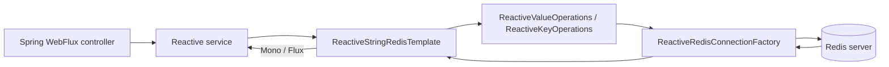

# ReactiveStringRedisTemplate và dữ liệu chuỗi trong Spring Data Redis

## 1. Mục tiêu: làm việc với String trên Redis theo mô hình phản ứng

Spring Data Redis cung cấp **`ReactiveStringRedisTemplate`** để thao tác với Redis bằng API dựa trên **Project Reactor**. Đối tượng này chuyên dùng cho trường hợp **khóa và giá trị ở dạng chuỗi**: tên key được mã hóa bằng String serializer, nội dung value cũng là String, và các thao tác trả về `Mono<T>` hoặc `Flux<T>` thay vì chờ kết quả đồng bộ.

Ví dụ quen thuộc trong ứng dụng imperative:

```java
StringRedisTemplate redis = ...;
redis.opsForValue().set("profile:42:status", "ACTIVE");
String status = redis.opsForValue().get("profile:42:status");
```

Phiên bản reactive:

```java
ReactiveStringRedisTemplate redis = ...;

Mono<Boolean> write =
        redis.opsForValue().set("profile:42:status", "ACTIVE");

Mono<String> read =
        redis.opsForValue().get("profile:42:status");
```

Hai dòng Java trên chỉ tạo ra các **publisher mô tả công việc**. Redis operation được khởi chạy khi có subscriber thực sự yêu cầu dữ liệu, chẳng hạn khi Spring WebFlux subscribe vào publisher trả về từ controller.

Ý nghĩa chính: **chuyển từ lệnh chờ kết quả sang pipeline xử lý bất đồng bộ, không chặn luồng gọi trong khi chờ I/O**. Redis server vẫn thực thi các command Redis thông thường; “reactive” là cách client Spring kết nối và xử lý kết quả, không phải một chế độ lưu trữ mới của Redis.

### Bài toán điển hình

Một dịch vụ quản lý trạng thái phiên tạm thời:

- Key: `session:42:status`
- Value: `ONLINE`
- TTL: 15 phút
- Khi có người truy cập, ứng dụng đọc qua WebFlux và trả kết quả không blocking.
- Khi đổi trạng thái, ứng dụng ghi String và có thể làm mới TTL.

Phần tiếp theo xây dựng pipeline đúng thứ tự, xử lý cache miss, lỗi kết nối, serialization và TTL cho bài toán này.

## 2. ReactiveStringRedisTemplate nằm ở đâu trong kiến trúc?

Các thành phần:

| Thành phần | Vai trò |
| --- | --- |
| `ReactiveRedisConnectionFactory` | Tạo kết nối Redis hỗ trợ reactive API, ví dụ dựa trên Lettuce. |
| `ReactiveRedisTemplate<K,V>` | Template tổng quát làm việc với nhiều kiểu key/value bằng serialization context. |
| `ReactiveStringRedisTemplate` | Template chuyên biệt cho `String` key và `String` value. |
| `ReactiveValueOperations<String,String>` | Các operation với Redis String, như `GET`, `SET`, `INCR`. |
| `ReactiveKeyOperations<String>` | Các operation liên quan đến key: xóa, kiểm tra tồn tại, TTL... |
| `Mono<T>` | Một kết quả hoặc không có kết quả, kèm tín hiệu hoàn tất/lỗi. |
| `Flux<T>` | Luồng nhiều kết quả, ví dụ đọc nhiều entry hoặc quét khóa theo yêu cầu. |

Sơ đồ:



`ReactiveStringRedisTemplate` vẫn dựa trên các primitive Redis: String là **kiểu dữ liệu Redis**, không có nghĩa chỉ hỗ trợ Java String API. Nếu muốn thao tác Hash, Set, List hoặc Stream, reactive template cũng có các nhóm operation tương ứng; nhưng bài này tập trung vào **String value** được lưu dưới một Redis key.

## 3. Điều kiện cấu hình trong Spring Boot và Spring Data Redis

Một dự án Spring Boot reactive thường dùng các dependency:

```xml
<dependencies>
    <dependency>
        <groupId>org.springframework.boot</groupId>
        <artifactId>spring-boot-starter-webflux</artifactId>
    </dependency>
    <dependency>
        <groupId>org.springframework.boot</groupId>
        <artifactId>spring-boot-starter-data-redis-reactive</artifactId>
    </dependency>
</dependencies>
```

Starter Redis reactive cung cấp tích hợp Spring Data Redis và driver hỗ trợ reactive, thường là **Lettuce**. Không được giả định bất kỳ Redis driver nào cũng hỗ trợ cùng bộ API reactive. `Jedis` truyền thống được dùng chủ yếu qua đường imperative; khi thiết kế ứng dụng phản ứng, hãy chọn và xác minh connection factory phù hợp.

Ví dụ cấu hình kết nối trong `application.yml` của Spring Boot dùng namespace cấu hình `spring.data.redis`:

```yaml
spring:
  data:
    redis:
      host: localhost
      port: 6379
      timeout: 3s
```

Đây là ví dụ cho môi trường phát triển. Trong môi trường khác, cần bổ sung TLS, authentication, topology standalone/sentinel/cluster và các giới hạn connection theo chính sách triển khai.

Khi auto-configuration phù hợp, Spring Boot có thể cung cấp bean `ReactiveStringRedisTemplate`. Nếu muốn khai báo tường minh:

```java
import org.springframework.context.annotation.Bean;
import org.springframework.context.annotation.Configuration;
import org.springframework.data.redis.connection.ReactiveRedisConnectionFactory;
import org.springframework.data.redis.core.ReactiveStringRedisTemplate;

@Configuration
public class ReactiveRedisConfig {

    @Bean
    ReactiveStringRedisTemplate reactiveStringRedisTemplate(
            ReactiveRedisConnectionFactory connectionFactory) {
        return new ReactiveStringRedisTemplate(connectionFactory);
    }
}
```

Không tạo hai bean cùng chức năng nếu auto-configuration đã cấp template phù hợp và ứng dụng không có lý do cụ thể. Nếu hệ thống có nhiều Redis connection factory, cần chọn factory bằng qualifier hoặc cấu hình bean name rõ ràng.

### Vì sao chọn String template?

`ReactiveStringRedisTemplate` sử dụng serialization context dành cho chuỗi, thường dựa trên `StringRedisSerializer`. Điều này giúp:

- Dễ kiểm tra key/value từ `redis-cli`.
- Tránh việc vô tình lưu byte stream theo Java native/JDK serialization.
- Dễ tương tác với dịch vụ viết bằng ngôn ngữ khác khi cả hai thống nhất UTF-8 và schema.
- Phù hợp với session token có dạng text, trạng thái, mã OTP **được lưu an toàn theo policy**, feature flag và counter biểu diễn số nguyên.

Tuy nhiên, **String template không tự mã hóa bảo mật hay che giấu dữ liệu**. Value vẫn là dữ liệu trong Redis; bảo vệ bằng TLS, ACL, chính sách lưu giữ và không log bí mật.

## 4. Thao tác cơ bản: `SET` và `GET`

Định nghĩa service:

```java
import org.springframework.data.redis.core.ReactiveStringRedisTemplate;
import org.springframework.stereotype.Service;
import reactor.core.publisher.Mono;

@Service
public class ProfileStatusService {

    private final ReactiveStringRedisTemplate redis;

    public ProfileStatusService(ReactiveStringRedisTemplate redis) {
        this.redis = redis;
    }

    public Mono<Boolean> saveStatus(String profileId, String status) {
        String key = "profile:" + profileId + ":status";
        return redis.opsForValue().set(key, status);
    }

    public Mono<String> findStatus(String profileId) {
        String key = "profile:" + profileId + ":status";
        return redis.opsForValue().get(key);
    }
}
```

Tương ứng command:

```redis
SET profile:42:status ACTIVE
GET profile:42:status
```

Ý nghĩa result:

- `opsForValue().set(key, value)` thường trả `Mono<Boolean>`, biểu diễn kết quả của `SET`.
- `opsForValue().get(key)` trả `Mono<String>`.
- Khi key không tồn tại, `get(...)` thường hoàn tất **rỗng** (`Mono.empty()`), thay vì phát ra `null`.

Project Reactor không cho phép `null` là giá trị `onNext`. Vì vậy phải phân biệt **publisher rỗng** với một publisher phát String rỗng `""`. Chuỗi rỗng vẫn là value hợp lệ của Redis String.

Đoạn code trên còn thiếu bước kiểm tra ID và status. Trong ứng dụng thực tế không nên ghép một user input tùy ý vào tên key vì có thể tạo namespace ngoài dự kiến hoặc gây xung đột với key của thành phần khác. Có thể validate ID bằng pattern/độ dài trước khi tạo key.

## 5. Subscription: vì sao tạo `Mono` chưa phải đã ghi Redis?

Ví dụ:

```java
public void updateWithoutSubscription() {
    redis.opsForValue().set("profile:42:status", "ACTIVE");
}
```

Method này **không trả publisher** và cũng không có ai subscribe. Vì thế không được kỳ vọng `SET` sẽ được gửi tới Redis như một hiệu ứng phụ chắc chắn.

Cách đúng trong reactive service là **trả Mono/Flux cho caller**:

```java
public Mono<Boolean> updateStatus(String key, String value) {
    return redis.opsForValue().set(key, value);
}
```

Sau đó tại controller WebFlux:

```java
@PostMapping("/profiles/{id}/status")
public Mono<Boolean> update(
        @PathVariable String id,
        @RequestBody String status) {
    return service.updateStatus("profile:" + id + ":status", status);
}
```

Khi xử lý HTTP, Spring WebFlux subscribe vào publisher được trả về và gửi response khi pipeline hoàn tất.

Có thể subscribe thủ công ở tầng entry point, test hoặc tác vụ nền có quản lý vòng đời, nhưng service thông thường **không nên gọi `.subscribe()` rồi bỏ qua kết quả**:

```java
// Không phù hợp trong service thông thường:
redis.opsForValue().set(key, value).subscribe();
return Mono.just("Đã lưu");
```

Đoạn code này trả kết quả “đã lưu” mà không đợi Redis xác nhận. Lỗi bất đồng bộ có thể không được chuyển đến request và tác vụ có thể chưa hoàn tất khi response đã gửi.

Thay vào đó:

```java
return redis.opsForValue()
        .set(key, value)
        .flatMap(success ->
                success
                        ? Mono.just("Đã lưu")
                        : Mono.error(new IllegalStateException(
                                "Redis không xác nhận thao tác SET")));
```

Lỗi từ Redis sẽ đi qua đường lỗi Reactor để caller có thể xử lý.

### Reactive không có nghĩa “thực thi đúng một lần”

Publisher của Redis thường là **cold publisher**: mỗi lần subscribe có thể thực hiện lại command. Ví dụ:

```java
Mono<Long> increment =
        redis.opsForValue().increment("metrics:visits");
```

Nếu subscribe hai lần, Redis có thể tăng counter hai lần. Đừng subscribe lặp một publisher có side effect chỉ vì muốn log hoặc kiểm tra:

```java
// Không nên nếu không chủ đích tăng hai lần:
increment.subscribe();
increment.subscribe();
```

Khi muốn quan sát kết quả, thêm `doOnNext` hoặc `doOnError` vào cùng pipeline và chỉ để entry point subscribe một lần. Nếu thật sự cần chia sẻ một phép thực thi giữa nhiều subscriber, phải chọn chiến lược sharing/caching Reactor đúng vòng đời và cân nhắc tác động của dữ liệu lỗi/hủy.

## 6. Ghép thao tác theo thứ tự bằng `flatMap` và `then`

Một yêu cầu thường gặp: lưu trạng thái mới rồi đọc lại. Điều quan trọng là phải **xác định thứ tự**, không tạo hai publisher độc lập rồi giả định chúng luôn thực hiện tuần tự.

### 6.1. Ghi xong mới đọc

```java
public Mono<String> writeAndRead(String key, String newValue) {
    return redis.opsForValue()
            .set(key, newValue)
            .flatMap(success -> {
                if (!Boolean.TRUE.equals(success)) {
                    return Mono.error(new IllegalStateException(
                            "SET không thành công"));
                }
                return redis.opsForValue().get(key);
            });
}
```

Ở đây `flatMap` chỉ thực hiện phần đọc sau khi publisher `SET` phát kết quả. Kết quả có thể là value mới nếu không có writer khác ghi xen vào hoặc key hết hạn; **chuỗi hai lệnh vẫn không phải transaction nguyên tử**.

Cách viết ngắn với `then`:

```java
public Mono<String> writeAndRead(String key, String value) {
    return redis.opsForValue()
            .set(key, value)
            .then(redis.opsForValue().get(key));
}
```

`then(...)` đợi publisher `SET` hoàn tất rồi subscribe vào publisher đọc; nó **bỏ qua** Boolean result của `SET`. Khi cần kiểm tra `false`, dùng cách đầu tiên.

### 6.2. Đừng dùng `Mono.zip` để diễn đạt ghi rồi đọc

```java
Mono<Boolean> write = redis.opsForValue().set(key, "NEW");
Mono<String> read = redis.opsForValue().get(key);

// Không đảm bảo GET xảy ra sau SET:
Mono<Tuple2<Boolean, String>> both = Mono.zip(write, read);
```

`zip` phối hợp hai nguồn và có thể subscribe chúng gần như đồng thời. Nếu nghiệp vụ yêu cầu lệnh trước hoàn tất rồi mới chạy lệnh sau, cần ghép tuần tự bằng `flatMap` hoặc `then`.

### 6.3. Nhiều key độc lập có thể xử lý đồng thời

Khi các thao tác không có phụ thuộc thứ tự, có thể tận dụng `flatMap` với giới hạn concurrency:

```java
public Flux<String> getStatuses(List<String> ids) {
    return Flux.fromIterable(ids)
            .flatMap(
                    id -> redis.opsForValue()
                            .get("profile:" + id + ":status")
                            .map(value -> id + "=" + value),
                    8
            );
}
```

Đoạn này trả các entry tìm thấy; key không tồn tại tạo `Mono.empty()` nên không phát ra dòng cho key ấy. `flatMap` không giữ chắc thứ tự input; nếu cần thứ tự nhất quán, cân nhắc `concatMap` hoặc `flatMapSequential`.

Không tăng concurrency vô hạn cho danh sách hàng triệu ID. Cần giới hạn số key, batch/cursor hoặc phân trang, tránh khiến Redis và network quá tải.

## 7. Xử lý key không tồn tại: `Mono.empty()`, `defaultIfEmpty` và `switchIfEmpty`

Khi `GET` không có value, pipeline có thể hoàn tất mà không phát phần tử nào:

```java
Mono<String> status =
        redis.opsForValue().get("profile:missing:status");
```

Nếu muốn giá trị mặc định:

```java
Mono<String> safeStatus =
        status.defaultIfEmpty("UNKNOWN");
```

Nếu muốn đi tới nguồn dữ liệu khác:

```java
public Mono<String> findStatusOrLoad(String id) {
    String key = "profile:" + id + ":status";

    return redis.opsForValue()
            .get(key)
            .switchIfEmpty(
                    Mono.defer(() -> databaseStatusService.load(id))
            );
}
```

`Mono.defer(...)` trì hoãn tạo publisher dự phòng cho đến lúc nhánh cache miss được subscribe. Lưu ý service database phải thật sự reactive hoặc được tích hợp an toàn; không nhét lời gọi JDBC blocking trực tiếp vào event-loop rồi coi là reactive.

Muốn lưu lại kết quả tải từ database:

```java
public Mono<String> findThroughCache(String id) {
    String key = "profile:" + id + ":status";

    return redis.opsForValue()
            .get(key)
            .switchIfEmpty(
                    Mono.defer(() ->
                            databaseStatusService.load(id)
                                    .flatMap(value ->
                                            redis.opsForValue()
                                                    .set(key, value, Duration.ofMinutes(5))
                                                    .thenReturn(value))
                    )
            );
}
```

Ví dụ này ưu tiên chỉ trả dữ liệu sau khi `SET` hoàn tất, nhưng dùng `thenReturn` nên không kiểm tra Boolean `false`. Trong ứng dụng thực tế cần quyết định lỗi Redis có làm request lỗi hay chỉ bỏ qua cache và vẫn trả dữ liệu nguồn, theo yêu cầu nghiệp vụ.

**Cache stampede:** khi nhiều request cùng cache miss, nhiều lần `load(id)` có thể được thực hiện đồng thời. `switchIfEmpty` tự nó không tạo single-flight hay distributed lock.

## 8. TTL cho String: lưu cùng hạn dùng, không tách lệnh nếu không cần

Redis là kho key/value có thể đặt thời gian hết hạn cho key. Trong Spring Data Redis:

```java
Mono<Boolean> saved =
        redis.opsForValue().set(
                "session:42:status",
                "ONLINE",
                Duration.ofMinutes(15)
        );
```

Ý nghĩa: ghi String kèm expiration, tương đương semantics của một lệnh Redis `SET` với thời hạn phù hợp. Khi dùng overload này, tránh khoảng trống giữa “ghi key” và “đặt TTL” của hai lệnh riêng.

Cách kém an toàn hơn khi có lỗi giữa hai lệnh:

```java
// Hai thao tác riêng:
redis.opsForValue().set(key, value)
        .then(redis.expire(key, Duration.ofMinutes(15)));
```

Nếu `SET` thành công nhưng `EXPIRE` thất bại, key có thể tồn tại lâu hơn dự kiến. Khi nghiệp vụ cần hạn dùng, ưu tiên đặt TTL cùng thao tác ghi theo API hỗ trợ.

### Đọc không tự gia hạn TTL

```java
redis.opsForValue().get("session:42:status");
```

Gọi `GET` thông thường không làm mới thời hạn. Nếu muốn *time-to-idle*, cần đường đọc làm mới expiration như `GETEX` (nếu driver và Redis server hỗ trợ) hoặc một thiết kế phù hợp. Không đồng nhất TTL của String template với cấu hình TTI của Spring Cache: đó là abstraction khác.

### Kiểm tra thời hạn

Reactive template có key operations để thao tác và quan sát expiration. Ví dụ:

```java
Mono<Duration> remaining =
        redis.getExpire("session:42:status");
```

Cần xét semantics cho key không có thời hạn hoặc không tồn tại; Redis `TTL` có các giá trị đặc biệt (-1 khi key tồn tại nhưng không có expiration, -2 khi key không tồn tại), còn ánh xạ sang `Duration` phụ thuộc API. Không tùy tiện coi `Duration.ZERO` là “key không tồn tại” ở mọi phiên bản; nên kiểm tra theo hợp đồng phương thức và kết quả thực tế khi cần phân nhánh nghiệp vụ.

### Tạo phiên chỉ khi chưa tồn tại

Redis `SET ... NX` dùng để tạo key khi không có. Reactive API:

```java
public Mono<Boolean> createIfAbsent(String id, String value) {
    return redis.opsForValue()
            .setIfAbsent(
                    "session:" + id + ":token",
                    value,
                    Duration.ofMinutes(15)
            );
}
```

`true` thường nghĩa là tạo thành công; `false` nghĩa là key đã tồn tại. Đặt TTL cùng lệnh tránh tạo key bảo mật không có hạn dùng khi bước `EXPIRE` bị bỏ qua.

Không dùng một token dễ đoán hoặc dùng lại token làm khóa phân tán. Nếu nghiệp vụ cần lock, cần có token độc nhất, TTL và giải phóng có điều kiện (ví dụ Lua compare-and-delete), không gọi `delete(key)` mù quáng sau khi lease đã hết hạn và được owner khác tạo lại.

## 9. Thao tác key: kiểm tra tồn tại và xóa

Các method trên reactive template thường dùng:

```java
Mono<Boolean> exists =
        redis.hasKey("profile:42:status");

Mono<Long> removed =
        redis.delete("profile:42:status");
```

`hasKey` trả kết quả tồn tại của key; `delete` trả số key bị xóa. Lưu ý Redis `DEL` xóa key bất kể kiểu dữ liệu: nếu cùng key được dùng cho Hash/Set bởi thành phần khác, xóa vẫn có tác dụng.

Đừng làm thế này để bảo đảm xóa có điều kiện:

```java
return redis.hasKey(key)
        .flatMap(exists ->
                exists ? redis.delete(key) : Mono.just(0L));
```

Giữa hai lệnh `EXISTS` và `DEL`, client khác có thể thay đổi key. Khi mục tiêu chỉ là xóa bất kể tồn tại, gọi `delete` trực tiếp đơn giản và an toàn hơn. Khi cần điều kiện dựa trên value/version, phải có thao tác nguyên tử phù hợp như Lua script.

Nếu xóa nhiều key, cần cẩn thận về tên và phạm vi; tránh dùng `KEYS *` hoặc thao tác xóa diện rộng trên môi trường sản xuất. API quét key theo cursor có thể phát `Flux`, nhưng đó là một quy trình vận hành khác với thao tác value theo key xác định.

## 10. Cập nhật bộ đếm chuỗi bằng các lệnh nguyên tử

Redis String có thể chứa số nguyên ở dạng văn bản. Các lệnh như `INCR`/`INCRBY` thực hiện tăng atomically tại Redis.

```java
public Mono<Long> nextSequence() {
    return redis.opsForValue()
            .increment("sequence:orders");
}
```

Đồng thời nhiều client gọi `INCR` trên cùng key vẫn có từng lần tăng nguyên tử tại Redis. Không cần `GET` rồi `SET` để tính giá trị tiếp theo.

Không nên làm:

```java
// Không nguyên tử giữa GET và SET:
return redis.opsForValue()
        .get("counter:visits")
        .defaultIfEmpty("0")
        .flatMap(current ->
                redis.opsForValue()
                        .set(
                                "counter:visits",
                                Long.toString(Long.parseLong(current) + 1)
                        )
                        .thenReturn(Long.parseLong(current) + 1));
```

Hai request có thể cùng đọc giá trị cũ, cùng tính một giá trị mới, rồi ghi đè kết quả của nhau (*lost update*). Sử dụng `increment` phù hợp hơn cho counter.

Lưu ý:

- Value phải biểu diễn số nguyên mà Redis chấp nhận; `INCR` sẽ lỗi với chuỗi không phải số.
- Có giới hạn số nguyên; khi tăng vượt phạm vi Redis hỗ trợ, command báo lỗi.
- Lệnh tăng không mặc định đặt TTL. Nếu counter cần hết hạn theo cửa sổ thời gian, phải thiết kế TTL và thao tác nguyên tử/kiểm soát điều kiện tạo mới cho đúng.

## 11. String serializer: tránh đọc nhầm dữ liệu nhị phân

`ReactiveStringRedisTemplate` thường dùng `StringRedisSerializer` cho key và value. Dữ liệu:

```java
redis.opsForValue().set("flags:checkout", "enabled");
```

có thể kiểm tra qua Redis CLI:

```redis
GET flags:checkout
TYPE flags:checkout
```

`TYPE` trả `string`. Với text thông thường, `GET` hiển thị nội dung tương ứng.

Ngược lại, nếu một service khác đã lưu key bằng JDK serialization, JSON serialization, gzip hoặc mã hóa tùy biến, dùng `ReactiveStringRedisTemplate` để đọc không đảm bảo trả value theo ý nghĩa nghiệp vụ. Cùng một tên key logic nhưng khác key serializer cũng có thể trỏ tới các byte key khác nhau.

### Khi cần JSON trong String value

Có thể lưu JSON dưới dạng String:

```java
public record FeatureFlag(
        String name,
        boolean enabled,
        int version) {
}
```

```java
public Mono<Boolean> saveFlag(FeatureFlag flag) {
    return Mono.fromCallable(() -> objectMapper.writeValueAsString(flag))
            .flatMap(json ->
                    redis.opsForValue().set(
                            "flags:" + flag.name(),
                            json,
                            Duration.ofMinutes(5)));
}
```

`ObjectMapper` là dependency của service; mã hóa JSON ở đây được thực hiện khi subscribe. Việc chuyển object sang JSON trong Java không phải Redis I/O. Với payload nhỏ và thao tác CPU nhẹ, nó thường phù hợp; với chuyển đổi CPU nặng, cần kiểm soát scheduler, không chặn event-loop bằng công việc tốn nhiều thời gian.

Đọc và giải mã:

```java
public Mono<FeatureFlag> findFlag(String name) {
    return redis.opsForValue()
            .get("flags:" + name)
            .flatMap(json ->
                    Mono.fromCallable(() ->
                            objectMapper.readValue(
                                    json,
                                    FeatureFlag.class)));
}
```

Cần có handling cho JSON không hợp lệ và version schema. String template không tự xác thực JSON, cũng không biến Redis String thành Redis Hash.

### Không tùy tiện trộn các template

| Template | Key serialization | Value serialization | Phù hợp |
| --- | --- | --- | --- |
| `ReactiveStringRedisTemplate` | Chuỗi | Chuỗi | Status, token dạng text, numeric counter, JSON text được quản lý rõ |
| `ReactiveRedisTemplate<String, MyType>` | Theo cấu hình serialization context | Theo cấu hình custom | Object có hợp đồng serializer riêng |
| `StringRedisTemplate` | Chuỗi | Chuỗi | Đường imperative/blocking |
| `RedisTemplate<String, Object>` | Theo cấu hình cụ thể | Theo cấu hình cụ thể | Ứng dụng imperative có nhiều kiểu dữ liệu |

Một key được ghi bằng String template có thể được đọc từ một reactive template khác nếu các serializer tương thích. Còn “cùng là Java String” không đủ để bảo đảm bytes lưu trên Redis giống nhau nếu cấu hình mã hóa khác.

## 12. WebFlux controller: để framework subscribe

Ví dụ controller đọc/trả trạng thái:

```java
import org.springframework.http.ResponseEntity;
import org.springframework.web.bind.annotation.GetMapping;
import org.springframework.web.bind.annotation.PathVariable;
import org.springframework.web.bind.annotation.RestController;
import reactor.core.publisher.Mono;

@RestController
public class ProfileStatusController {

    private final ProfileStatusService service;

    public ProfileStatusController(ProfileStatusService service) {
        this.service = service;
    }

    @GetMapping("/profiles/{id}/status")
    public Mono<ResponseEntity<String>> getStatus(
            @PathVariable String id) {

        return service.findStatus(id)
                .map(ResponseEntity::ok)
                .defaultIfEmpty(ResponseEntity.notFound().build());
    }
}
```

Với key tồn tại, publisher phát String và Spring trả HTTP 200. Với cache miss, `Mono.empty()` được thay bằng `ResponseEntity.notFound().build()`, trả HTTP 404.

Khi Spring WebFlux xử lý controller trả `Mono<ResponseEntity<String>>`, framework quản lý subscription và lifecycle của request. **Controller không cần gọi `block()` hoặc `subscribe()`.**

### Không dùng `block()` trong WebFlux event-loop

Sai khi ở reactive request handler:

```java
@GetMapping("/unsafe/{id}")
public String unsafe(@PathVariable String id) {
    return service.findStatus(id).block();
}
```

`block()` đồng bộ chờ kết quả, có thể gây chặn luồng điều phối reactive. Trong môi trường Reactor non-blocking, nó còn có thể bị phát hiện và từ chối bởi runtime. Đây là anti-pattern điển hình khi đã chọn WebFlux.

Cách đúng là trả publisher và dùng toán tử để xử lý kết quả:

```java
@GetMapping("/safe/{id}")
public Mono<String> safe(@PathVariable String id) {
    return service.findStatus(id)
            .defaultIfEmpty("UNKNOWN");
}
```

Nếu một legacy library có API blocking không thể thay ngay, cần tách nó khỏi event-loop bằng chiến lược scheduler phù hợp, giới hạn tài nguyên và kiểm soát concurrency. Nhưng ưu tiên sử dụng driver/abstraction có reactive API thật cho Redis I/O.

## 13. Xử lý lỗi kết nối, timeout và fallback

Với reactive pipeline, lỗi từ Redis được phát qua tín hiệu `onError`. Ví dụ:

```java
public Mono<String> findStatus(String id) {
    return redis.opsForValue()
            .get("profile:" + id + ":status")
            .timeout(Duration.ofSeconds(2));
}
```

`timeout` giới hạn thời gian chờ kết quả từ publisher, nhưng không có nghĩa Redis command chắc chắn chưa được server thực hiện nếu client hủy subscription hoặc timeout. Với các thao tác ghi, phải tính đến trạng thái “không rõ Redis đã thực hiện hay chưa”.

### Fallback có kiểm soát

Nếu status chỉ là cache và có nguồn dữ liệu khác:

```java
public Mono<String> findStatusResilient(String id) {
    return redis.opsForValue()
            .get("profile:" + id + ":status")
            .timeout(Duration.ofSeconds(2))
            .onErrorResume(ex ->
                    statusRepository.findFromPrimaryStore(id))
            .switchIfEmpty(
                    Mono.defer(() ->
                            statusRepository.findFromPrimaryStore(id)));
}
```

Cần xác định rõ lỗi nào được phép fallback. Một số lỗi như sai serializer, invalid key hoặc lỗi authorization có thể là lỗi cấu hình cần phát hiện, không nên bị che hoàn toàn bằng `onErrorResume` bắt mọi exception.

Nếu Redis giữ **nguồn dữ liệu chính**, fallback sang "UNKNOWN" khi lỗi có thể làm sai nghiệp vụ. Phân biệt:

- **Cache miss**: key không tồn tại; `Mono.empty()` thường là tín hiệu hợp lệ.
- **Redis error**: lỗi kết nối, timeout, ACL, sai kiểu key...; là `onError`.
- **Kết quả String rỗng**: key tồn tại với value `""`; khác cache miss.

### Retry không phải lúc nào cũng an toàn

Đối với `GET`, retry có kiểm soát thường ít rủi ro hơn. Với `INCR` hoặc các lệnh có side effect, kết nối có thể mất sau khi server thực hiện lệnh nhưng trước khi phản hồi. Retry có thể tăng counter lần nữa.

```java
// Chỉ dùng khi đã đánh giá idempotency:
redis.opsForValue().increment("counter:orders")
        .retry(1);
```

Cách trên có nguy cơ tăng hai lần nếu response lần đầu bị mất. Cần idempotency token, logic nguyên tử phía server hoặc hợp đồng chấp nhận retry trùng tùy bài toán.

## 14. Redis là nguồn dữ liệu gì: cache, session hay nguồn sự thật?

Cùng một API `ReactiveStringRedisTemplate` có thể được dùng cho:

1. **Cache**: value có thể tái tạo từ database; miss/Redis downtime có thể được fallback.
2. **Session/temporary state**: value có TTL; cần hiểu thời gian hết hạn và chính sách xóa.
3. **Feature flag/config**: value nhỏ, cần invalidation/version; không nên coi Pub/Sub event là nguồn duy nhất để đồng bộ.
4. **Counter**: cần `INCR`/`DECR` nguyên tử; phải xác định độ bền và retention.
5. **Coordination marker**: cần NX/TTL/Lua để bảo đảm điều kiện và xử lý retry.

Không mặc định "Redis reactive = cache". Dữ liệu String có thể rất quan trọng; thiết kế và vận hành phải tương ứng với mức độ quan trọng đó.

Ví dụ key naming:

```text
profile:42:status
session:abc123:state
feature:checkout:enabled
counter:requests:2026-11-13
lease:resource:42
```

Đặt prefix rõ ràng giúp phân vùng quyền Redis ACL, quan sát, dọn dẹp và tránh key collision. Không đưa token bí mật vào key name nếu không cần; tên key có thể xuất hiện trong log, metrics, keyspace notifications và công cụ quản trị.

## 15. Nhiều lệnh reactive không tự trở thành transaction

Ví dụ:

```java
public Mono<Void> writeTwoKeys(String id) {
    Mono<Boolean> first =
            redis.opsForValue().set("profile:" + id + ":a", "A");
    Mono<Boolean> second =
            redis.opsForValue().set("profile:" + id + ":b", "B");

    return first.then(second).then();
}
```

Hai lệnh này chạy tuần tự theo pipeline nhưng **không nguyên tử với nhau**. Nếu lệnh thứ hai lỗi, lệnh thứ nhất có thể đã ghi xong.

Khi cần cập nhật nhiều giá trị có điều kiện như một thao tác nguyên tử, cân nhắc:

- Gộp dữ liệu vào một Redis String/Hash key khi hợp đồng dữ liệu cho phép.
- Dùng Lua script để Redis thực hiện logic kiểm tra rồi ghi không bị command khác xen giữa.
- Dùng command nguyên tử sẵn có như `INCR`, `SET NX EX`, `GETSET`/`GETEX` nếu phù hợp và phiên bản hỗ trợ.
- Thiết kế workflow có retry và idempotency khi phải cập nhật nhiều hệ thống.

Không giả định `@Transactional` của Spring JDBC/JPA tự bao trùm mọi command Redis reactive thành giao dịch phân tán. Cần xác định rõ transaction API hỗ trợ cho stack và phiên bản đang sử dụng; không tự trộn imperative Redis transaction với reactive pipeline.

## 16. Khác nhau giữa reactive Redis và Spring Cache

Spring Cache thường thể hiện kết quả method qua caching abstraction, chẳng hạn `@Cacheable` với `RedisCacheManager`. `ReactiveStringRedisTemplate` lại là API trực tiếp thao tác Redis String.

Một method:

```java
return reactiveStringRedisTemplate
        .opsForValue()
        .get("catalog::sku-42");
```

không tự áp dụng chính sách TTL/TTI của một `RedisCacheManager` khác. Nếu cùng truy cập key do Spring Cache tạo, cần thống nhất serializer và key prefix; tránh tự giả định rằng một đường đọc `GET` sẽ làm mới TTL theo cấu hình TTI của CacheManager.

Reactive Redis I/O cũng không đồng nghĩa tự có distributed cache stampede protection, cache invalidation hoặc tính nhất quán đa instance. Các cơ chế ấy vẫn phải được thiết kế riêng.

## 17. Quy tắc về tài nguyên và backpressure

Lợi ích của reactive programming là có thể phục vụ nhiều tác vụ I/O đồng thời mà không giữ một thread chờ mỗi response. Tuy nhiên Redis server, network, pool kết nối và bộ nhớ đều có giới hạn.

### Mono và Flux

- `Mono<T>`: phù hợp cho một lệnh `GET`/`SET` hay một kết quả của command.
- `Flux<T>`: phù hợp cho nhiều kết quả hoặc các quy trình duyệt dữ liệu.

Một `Flux` có backpressure ở tầng Reactor không bảo đảm mọi command Redis được pause theo cùng cách. Đặc tính phát dữ liệu và mức độ đọc trước phụ thuộc implementation/driver. Do đó cần giới hạn concurrency, batch size, số phần tử tải về và timeout theo khối lượng thật.

Ví dụ giới hạn concurrency:

```java
Flux.fromIterable(keys)
    .flatMap(
        key -> redis.opsForValue().get(key)
                    .map(value -> new KeyValue(key, value)),
        16
    );
```

`KeyValue` là record Java do ứng dụng định nghĩa, ví dụ `record KeyValue(String key, String value) {}`.

Không gọi hàng triệu `GET` cùng lúc thông qua `flatMap` không giới hạn. Nếu cần tìm key theo pattern trên dataset lớn, ưu tiên `SCAN` theo cursor thông qua API phù hợp, không dùng `KEYS *` trong đường request production.

### Chặn event-loop làm mất lợi ích reactive

Bên trong operator như `map`, `flatMap` hoặc `doOnNext`, tránh:

- Gọi JDBC blocking hoặc HTTP blocking ngay trên event-loop.
- Gọi `Thread.sleep`.
- Gọi `Mono.block()`/`Flux.blockFirst()`.
- Chạy CPU-bound task quá lâu mà không bố trí scheduler phù hợp.
- Gọi đồng bộ một Redis client imperative trong chính pipeline mà không có chiến lược tách.

Reactive stack cần đồng bộ từ controller qua các dependency I/O, hoặc có ranh giới rõ ràng với các thành phần blocking.

## 18. Kiểm thử service reactive

Dùng **Reactor Test** và Redis thử nghiệm độc lập. Ví dụ unit/integration test tương tác với Redis thật thông qua Testcontainers hoặc môi trường test đã khởi động sẵn, không dùng key trong Redis sản xuất.

### 18.1. Kiểm tra lưu và đọc

```java
import org.junit.jupiter.api.Test;
import reactor.test.StepVerifier;

class ProfileStatusServiceTest {

    private final ProfileStatusService service = ...;

    @Test
    void savesAndReadsStatus() {
        StepVerifier.create(
                service.saveStatus("demo-1", "ACTIVE")
                        .flatMap(saved ->
                                saved
                                        ? service.findStatus("demo-1")
                                        : Mono.error(new IllegalStateException(
                                                "SET failed")))
        )
        .expectNext("ACTIVE")
        .verifyComplete();
    }
}
```

`StepVerifier` subscribe vào publisher của test, vì thế command Redis thật sự được thực thi. Import `reactor.core.publisher.Mono` nếu dùng đoạn code trong class riêng.

### 18.2. Kiểm tra key không tồn tại

```java
StepVerifier.create(service.findStatus("missing-id"))
        .verifyComplete();
```

Test này kỳ vọng Mono hoàn tất rỗng. Để tránh đụng key do test khác tạo, dùng namespace riêng và ID test không trùng, dọn dữ liệu test khi hoàn tất.

### 18.3. Kiểm tra TTL

Lưu với thời hạn ngắn nhưng đủ để tránh test phụ thuộc timing quá sát:

```java
Mono<Boolean> write =
        redis.opsForValue().set(
                "demo:ttl:1",
                "TEMP",
                Duration.ofSeconds(30));

StepVerifier.create(write)
        .expectNext(true)
        .verifyComplete();

StepVerifier.create(redis.getExpire("demo:ttl:1"))
        .expectNextMatches(ttl ->
                ttl != null && !ttl.isNegative())
        .verifyComplete();
```

Ở test trên, thời hạn cần được kiểm tra theo contract TTL của phiên bản thực tế. Khi test thời điểm expiration, tránh phụ thuộc “key mất đúng sau 30.000 ms”; Redis có granularity và thời gian xử lý, test runner cũng có độ trễ.

### 18.4. Kiểm tra lỗi Redis

Có thể giả lập Redis không kết nối được hoặc sử dụng fake/mocked reactive operations để kiểm tra `timeout`/`onErrorResume`. Test phải phân biệt cache miss (Mono.empty) với lỗi kết nối (Mono.error) và String rỗng (Mono.just("")).

## 19. Quan sát trong Redis CLI

Sau khi service ghi key trong môi trường test, có thể kiểm tra:

```redis
TYPE profile:demo-1:status
GET profile:demo-1:status
TTL profile:demo-1:status
EXISTS profile:demo-1:status
```

Kết quả kỳ vọng:

- `TYPE` là `string` khi key tồn tại và được ghi bởi String template.
- `GET` trả nội dung String.
- `TTL` trả `-1` nếu key tồn tại mà không có expiration, hoặc thời gian còn lại nếu có TTL.
- `EXISTS` trả 1 khi key tồn tại, 0 khi không.

Không dùng `KEYS *` trong Redis production để kiểm tra. Khi muốn quan sát một namespace lớn, dùng `SCAN` với pattern hẹp và giới hạn nhịp quét.

### Những metric cần theo dõi

| Metric | Lý do |
| --- | --- |
| Redis command latency | Phát hiện độ trễ mạng/server khi pipeline tăng concurrency |
| Connection errors/timeouts | Phân biệt lỗi Redis với cache miss |
| GET hit/miss | Hiểu tỷ lệ giá trị tồn tại |
| SET/increment rate | Phát hiện tải ghi và thao tác lặp do retry/subscription |
| Keyspace memory/evictions | Theo dõi TTL và chính sách bộ nhớ |
| Reactor pipeline latency | Thấy độ trễ từ request đến hoàn tất publisher |
| Pending/in-flight operations | Phát hiện quá nhiều Redis request đồng thời |

Các metric này cần được instrumentation thích hợp; không mặc định mọi metric nghiệp vụ tự xuất hiện chỉ vì dự án thêm starter Redis reactive.

## 20. Lỗi phổ biến và cách xử lý

| Hiện tượng | Nguyên nhân có thể gặp | Hướng xử lý |
| --- | --- | --- |
| Gọi `set(...)` nhưng Redis không đổi | Publisher không được subscribe | Trả Mono cho WebFlux hoặc subscribe có quản lý ở entry point |
| Giá trị thay đổi hai lần sau một action | Publisher có side effect bị subscribe hai lần hoặc retry không idempotent | Kiểm soát subscription, operator và idempotency |
| Redis trả String không đọc được | Value được lưu bằng serializer khác | Thống nhất serialization context |
| `GET` key không có trả `null`? | Reactive stream không phát null; Mono hoàn tất rỗng | Dùng `defaultIfEmpty` hoặc `switchIfEmpty` |
| `flatMap` nhiều lần cho kết quả sai thứ tự | Thao tác chạy đồng thời hoặc completion khác nhau | Dùng `concatMap`/`flatMapSequential` khi yêu cầu giữ thứ tự |
| `Mono.zip(write, read)` trả dữ liệu cũ | Read không có phụ thuộc hoàn tất của write | Dùng `flatMap`/`then` |
| WebFlux request bị chặn hoặc lỗi blocking | Gọi `block()` hoặc I/O blocking trên event-loop | Trả publisher, loại bỏ blocking dependency |
| Key sống mãi dù đáng lẽ có TTL | Dùng `set(key,value)` không có expiration hoặc lệnh EXPIRE tách bị lỗi | Dùng `set(key,value,Duration)` |
| Counter tăng hai lần khi retry | Redis đã thực hiện `INCR` nhưng response thất lạc | Thiết kế idempotency, tránh retry mù |
| Redis timeout nhưng app trả dữ liệu “UNKNOWN” | `onErrorResume` bắt tất cả lỗi và che lỗi hệ thống | Chỉ fallback theo đúng vai trò cache, ghi metric |
| `WRONGTYPE` | Một key được service khác lưu với Redis data type khác | Quản lý namespace và chủ sở hữu key |
| `NOPERM` | Redis ACL thiếu command/key pattern | Cấp quyền tối thiểu đúng command/namespace |

## 21. Quy tắc thiết kế cho ReactiveStringRedisTemplate

1. Chọn `ReactiveStringRedisTemplate` khi **key và value thực sự được thiết kế dưới dạng String**; không giả định mọi object lưu được trực tiếp như String.
2. **Trả `Mono`/`Flux` từ service**, để entry point như WebFlux quản lý subscription và phản hồi.
3. Tránh `block()`, `subscribe()` tự do và các lời gọi I/O blocking trong reactive request path.
4. Dùng `flatMap` hoặc `then` khi cần thứ tự; không coi `zip` là lệnh “ghi xong rồi đọc”.
5. Xử lý `Mono.empty()` (key không tồn tại) riêng với `Mono.error()` (lỗi Redis) và `Mono.just("")` (String rỗng).
6. Khi dữ liệu cần hết hạn, ưu tiên overload `set(key, value, Duration)` để TTL đi cùng thao tác ghi.
7. Dùng Redis command nguyên tử như `INCR` hoặc `SET NX EX` cho yêu cầu phù hợp; không dựng read-modify-write từ nhiều lệnh rồi xem như transaction.
8. Thống nhất key prefix, serializer, encoding, ACL và mục đích của từng namespace.
9. Giới hạn concurrency, kích thước payload, batch và thời gian chờ để bảo vệ Redis server.
10. Xác định chính sách retry theo idempotency; timeout của client không khẳng định Redis chưa thực hiện side effect.
11. Kiểm thử bằng `StepVerifier` hoặc mô hình kiểm thử reactive tương đương, trên Redis riêng.
12. Không nhầm cấu hình Spring Cache với API direct String template, và không đồng nhất reactive API với bảo đảm consistency/transaction cao hơn.

## 22. Câu hỏi tự kiểm tra

1. `ReactiveStringRedisTemplate` khác `StringRedisTemplate` ở kiểu trả về và cách thực thi thao tác như thế nào?
2. Vì sao tạo `Mono<Boolean> save = redis.opsForValue().set(...)` chưa chắc đã ghi Redis ngay?
3. Nếu key không tồn tại, `opsForValue().get(key)` trả publisher như thế nào, và tại sao không được phát `null`?
4. Khi cần `SET` xong rồi `GET`, vì sao `flatMap`/`then` phù hợp hơn `zip`?
5. Có hai subscriber trên cùng publisher `increment(...)` thì counter có thể thay đổi ra sao?
6. Cách lưu String có TTL trong một operation khác gì với gọi `SET` rồi `EXPIRE` riêng?
7. Vì sao `StringRedisSerializer` rất quan trọng khi nhiều service cùng dùng Redis?
8. Làm sao tránh *lost update* khi hai request cùng tăng một counter?
9. Vì sao `.block()` trong WebFlux request handler là anti-pattern?
10. Khi `timeout` xảy ra sau một thao tác ghi, ứng dụng có được chắc chắn lệnh chưa chạy trên Redis không?
11. Khi nào nên dùng `defaultIfEmpty`, khi nào nên dùng `onErrorResume`?
12. Reactive Redis pipeline có tự cung cấp transaction cho nhiều lệnh hoặc nhiều hệ thống lưu trữ không?

**Ghi nhớ:** `ReactiveStringRedisTemplate` là cầu nối giữa **Redis String key/value** và **pipeline Reactor bất đồng bộ**. Các method như `opsForValue().set(...)`, `get(...)`, `increment(...)` và thao tác TTL tạo `Mono`/`Flux`; lệnh được thực hiện khi publisher được subscribe. Dùng đúng serialization, ghép pipeline theo thứ tự có chủ đích, xử lý cache miss khác lỗi, kiểm soát TTL và retry để khai thác tính phản ứng mà không đánh đổi tính đúng đắn của dữ liệu.

## Tài liệu tham khảo

- [Spring Data Redis — Reactive Redis support](https://docs.spring.io/spring-data/redis/reference/redis/reactive.html): tổng quan Redis reactive API, template và operations.
- [Spring Data Redis — ReactiveStringRedisTemplate API](https://docs.spring.io/spring-data/redis/docs/current/api/org/springframework/data/redis/core/ReactiveStringRedisTemplate.html): template dành cho String key/value.
- [Spring Data Redis — ReactiveValueOperations API](https://docs.spring.io/spring-data/redis/docs/current/api/org/springframework/data/redis/core/ReactiveValueOperations.html): GET, SET, TTL và counter operations.
- [Project Reactor — Reference Guide](https://projectreactor.io/docs/core/release/reference/): Mono, Flux, subscription, operators và backpressure.
- [Redis — String data type](https://redis.io/docs/latest/develop/data-types/strings/): Redis String, counter và các trường hợp sử dụng.
- [Redis — SET command](https://redis.io/docs/latest/commands/set/): điều kiện NX/XX và expiration.
- [Redis — INCR command](https://redis.io/docs/latest/commands/incr/): tăng số nguyên nguyên tử.
