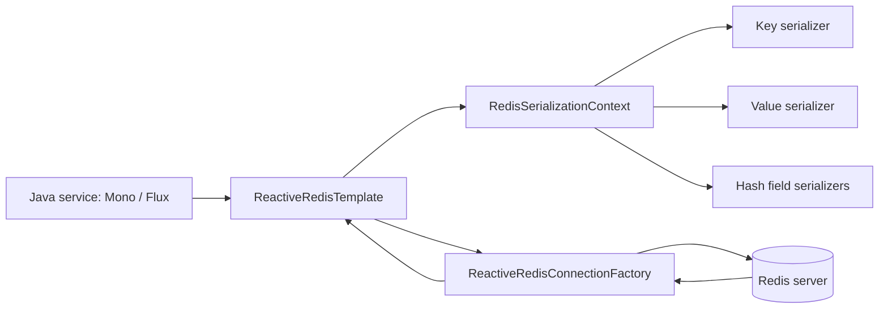
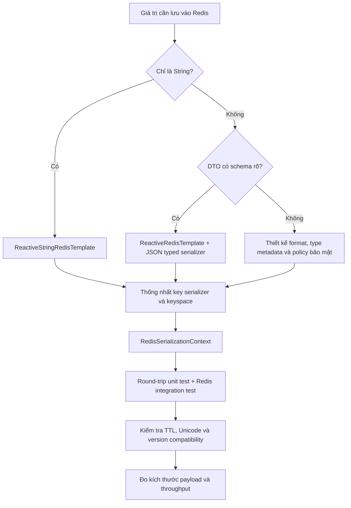

# RedisSerializationContext và serializer cho luồng phản ứng trong Spring Data Redis

## 1. Vấn đề: Redis chỉ lưu byte, còn ứng dụng xử lý object

Giả sử một ứng dụng Spring WebFlux muốn lưu hồ sơ người dùng trong Redis. Ở phía Java, dữ liệu là một object:

```java
public record UserProfile(
    String userId,
    String displayName,
    int loyaltyPoints
) {}
```

Trong khi đó, Redis lưu key và value dưới dạng dãy byte. Nó không tự biết `UserProfile` là một Java record, không biết phải biểu diễn số `loyaltyPoints` như thế nào và cũng không tự giải mã JSON thành object khi trả kết quả.

Ứng dụng cần hai chiều chuyển đổi:

```text
Java key:   "profile:u-42"
Java value: UserProfile("u-42", "Linh", 120)
                 |
                 | serialize
                 v
Redis key bytes:   UTF-8("profile:u-42")
Redis value bytes: UTF-8('{"userId":"u-42","displayName":"Linh","loyaltyPoints":120}')
                 |
                 | Redis lưu trữ, rồi trả về bytes
                 v
             deserialize
                 |
                 v
Java value: UserProfile("u-42", "Linh", 120)
```

Trong Spring Data Redis, **serializer** thực hiện chuyển đổi giữa giá trị Java và bytes; **`RedisSerializationContext<K,V>`** gom các quy tắc chuyển đổi cần thiết cho các thao tác Redis **reactive**. Nó được truyền khi tạo `ReactiveRedisTemplate<K,V>`.

Việc dùng Reactor `Mono`/`Flux` không loại bỏ khâu serialization. Trái lại, nếu producer và consumer dùng serializer khác nhau, hệ thống có thể trả `Mono.empty()` khi key không tìm thấy, báo lỗi deserialize, đọc sai kiểu hoặc mất khả năng tương thích sau một lần triển khai phiên bản mới.

Mục tiêu của bài học:

1. Hiểu vai trò của `RedisSerializer`, `SerializationPair` và `RedisSerializationContext`.
2. Phân biệt cách mã hóa **key**, **value**, **hash key**, **hash value** và **String**.
3. Tạo `ReactiveRedisTemplate<String, UserProfile>` dùng key UTF-8 và value JSON.
4. Dùng `ReactiveStringRedisTemplate` khi chỉ xử lý dữ liệu dạng String.
5. Hiểu thời điểm serialize/deserialize trong một pipeline Reactor và cách kiểm tra round-trip.
6. Thiết kế an toàn khi thay đổi schema, serializer, kiểu dữ liệu hoặc phiên bản ứng dụng.

## 2. Vị trí của RedisSerializationContext trong kiến trúc reactive

Spring Data Redis cung cấp hai phong cách truy cập dữ liệu:

| API | Phong cách | Ví dụ |
|---|---|---|
| `RedisTemplate<K,V>` | Imperative | `opsForValue().get(key)` trả kết quả trực tiếp |
| `StringRedisTemplate` | Imperative, key/value String | Các lệnh Redis với String serializer |
| `ReactiveRedisTemplate<K,V>` | Reactive | `opsForValue().get(key)` trả `Mono<V>` |
| `ReactiveStringRedisTemplate` | Reactive, key/value String | `Mono<String>` / `Flux<...>` với chuỗi |

Trong `ReactiveRedisTemplate<K,V>`:



Khi ứng dụng ghi:

```java
Mono<Boolean> stored =
    template.opsForValue().set("profile:u-42", profile);
```

template dùng context để serialize key và value, rồi gửi Redis command qua kết nối reactive. Khi đọc:

```java
Mono<UserProfile> loaded =
    template.opsForValue().get("profile:u-42");
```

context giúp template diễn giải bytes trả về thành `UserProfile`.

**Phân biệt:** `RedisSerializationContext` không quản lý threading, không tạo transaction, không đảm bảo cache hit, không lưu schema vào Redis và không tự làm một đoạn code blocking trở thành non-blocking. Nó mô tả **cách chuyển đổi dữ liệu** giữa Java và Redis trong các thao tác hỗ trợ.

## 3. Những thành phần cốt lõi

### 3.1. `RedisSerializer<T>`

`RedisSerializer<T>` mô tả cách mã hóa một giá trị Java thành `byte[]` và giải mã bytes trở lại thành đối tượng Java.

Một số serializer phổ biến:

| Serializer | Dữ liệu Java thường dùng | Định dạng trong Redis |
|---|---|---|
| `StringRedisSerializer` | `String` | Chuỗi byte UTF-8 |
| `JdkSerializationRedisSerializer` | Java object có thể serialize | Định dạng Java serialization nhị phân |
| `Jackson2JsonRedisSerializer<T>` | DTO có kiểu xác định | JSON |
| `GenericJackson2JsonRedisSerializer` | Object đa hình/tổng quát, theo cấu hình | JSON có cơ chế type metadata tùy cấu hình |
| `ByteArrayRedisSerializer` | `byte[]` | Bytes giữ nguyên |

Tên class và các factory method có thể thay đổi hoặc bị đánh dấu deprecated ở những dòng Spring Data Redis khác nhau; ví dụ Java trong bài sử dụng hệ API Spring Data Redis **3.x**. Khi triển khai ở dòng 4.x hoặc mới hơn, cần đối chiếu Javadoc và cấu hình JSON serialization tương ứng.

Điểm cốt lõi không phụ thuộc vào tên class: **serializer để ghi và serializer để đọc phải thống nhất về bytes, charset, schema và kiểu dữ liệu**.

### 3.2. `SerializationPair<T>`

Reactive Redis operations làm việc nhiều với `ByteBuffer`. Spring Data Redis dùng `RedisSerializationContext.SerializationPair<T>` để mô tả cặp thao tác mã hóa và giải mã phù hợp với ngữ cảnh này.

Khái niệm:

```text
Java T --SerializationPair.write(T)--> ByteBuffer
Java T <--SerializationPair.read(buf)--- ByteBuffer
```

Spring Data Redis có thể tạo một pair từ `RedisSerializer<T>`:

```java
import java.nio.ByteBuffer;

import org.springframework.data.redis.serializer.StringRedisSerializer;
import org.springframework.data.redis.serializer.RedisSerializationContext;

RedisSerializationContext.SerializationPair<String> pair =
    RedisSerializationContext.SerializationPair.fromSerializer(
        new StringRedisSerializer()
    );

ByteBuffer bytes = pair.write("profile:u-42");
String roundTrip = pair.read(bytes);
```

Mẫu trên thể hiện **chuyển đổi qua pair**, không có lệnh Redis. Nếu tự làm việc trực tiếp với `ByteBuffer`, cần lưu ý vị trí đọc/ghi và cách một API tiêu thụ buffer; không dùng lại một buffer đã bị thay đổi vị trí mà mặc định nó còn nguyên trạng thái.

### 3.3. `RedisSerializationContext<K,V>`

Một context chứa các `SerializationPair` phù hợp cho nhiều vị trí trong Redis:

```text
RedisSerializationContext<K,V>
    |
    +-- key       : Java K -> Redis key bytes
    +-- value     : Java V -> Redis value bytes
    +-- hashKey   : Java hash field name -> field bytes
    +-- hashValue : Java hash field value -> value bytes
    +-- string    : String -> byte representation cho các thao tác chuỗi liên quan
```

Không được đồng nhất:

- **Redis key:** ví dụ `profile:u-42`.
- **Redis Hash field:** ví dụ `displayName` bên trong Hash `profile:u-42`.
- **Redis value:** bytes lưu ở một Redis String key.
- **Redis Hash value:** bytes tương ứng field bên trong Redis Hash.

Key serializer và hash key serializer có thể đều là `StringRedisSerializer` nhưng đó là **hai vai trò** khác nhau. Value serializer và hash value serializer cũng không bắt buộc giống nhau.

## 4. Cấu hình tối thiểu với ReactiveStringRedisTemplate

Nếu toàn bộ dữ liệu chỉ là chuỗi, hãy bắt đầu với `ReactiveStringRedisTemplate`. Template này chuyên dùng String serialization cho key và value, giúp giảm nguy cơ vô tình lưu JDK binary hoặc JSON nơi chỉ cần text.

Ví dụ cấu hình Redis local trong Spring Boot 3.x:

```groovy
dependencies {
    implementation 'org.springframework.boot:spring-boot-starter-data-redis-reactive'
}
```

```yaml
spring:
  data:
    redis:
      host: localhost
      port: 6379
```

Một service reactive:

```java
import java.time.Duration;

import org.springframework.data.redis.core.ReactiveStringRedisTemplate;
import org.springframework.stereotype.Service;

import reactor.core.publisher.Mono;

@Service
public class ReactiveStatusStore {

    private final ReactiveStringRedisTemplate redis;

    public ReactiveStatusStore(ReactiveStringRedisTemplate redis) {
        this.redis = redis;
    }

    public Mono<Boolean> setStatus(String orderId, String status) {
        String key = "order:status:" + orderId;
        return redis.opsForValue().set(
            key,
            status,
            Duration.ofMinutes(5)
        );
    }

    public Mono<String> getStatus(String orderId) {
        return redis.opsForValue()
            .get("order:status:" + orderId);
    }
}
```

Ở phía Redis:

```redis
GET order:status:o-101
TTL order:status:o-101
```

Với value `"PAID"`, Redis trả nội dung chuỗi tương ứng và key có TTL khoảng 300 giây ngay sau khi ghi.

`getStatus(...)` trả `Mono<String>`. Khi key không tồn tại, kết quả thường là một Mono không phát value (*empty*), **không phải** chuỗi `"null"` và cũng không phải lỗi deserialize.

Nếu ứng dụng cần lưu nguyên một DTO có nhiều field, dùng `ReactiveRedisTemplate<String, DTO>` và một value serializer phù hợp thay vì tự nối chuỗi JSON trên từng lời gọi.

## 5. Ví dụ hoàn chỉnh: key String, value JSON

Giả sử muốn lưu hồ sơ người dùng theo:

```text
Key:   profile:u-42
Value: JSON của UserProfile("u-42", "Linh", 120)
TTL:   10 phút
```

### 5.1. Khai báo DTO

Với Spring Boot 3.x/Java 17+, có thể sử dụng record:

```java
package com.example.redis.model;

import com.fasterxml.jackson.annotation.JsonIgnoreProperties;

@JsonIgnoreProperties(ignoreUnknown = true)
public record UserProfile(
    String userId,
    String displayName,
    int loyaltyPoints
) {}
```

`@JsonIgnoreProperties(ignoreUnknown = true)` giúp bộ giải mã bỏ qua field chưa biết khi đọc một số payload JSON mới hơn. Đây không phải chiến lược migration đầy đủ: field bị đổi tên, đổi kiểu hoặc bắt buộc vẫn có thể cần xử lý riêng.

### 5.2. Tạo RedisSerializationContext

Ví dụ theo API Spring Data Redis 3.x:

```java
package com.example.redis.config;

import com.example.redis.model.UserProfile;

import org.springframework.context.annotation.Bean;
import org.springframework.context.annotation.Configuration;
import org.springframework.data.redis.connection.ReactiveRedisConnectionFactory;
import org.springframework.data.redis.core.ReactiveRedisTemplate;
import org.springframework.data.redis.serializer.Jackson2JsonRedisSerializer;
import org.springframework.data.redis.serializer.RedisSerializationContext;
import org.springframework.data.redis.serializer.StringRedisSerializer;

@Configuration
public class ReactiveRedisSerializationConfig {

    @Bean
    ReactiveRedisTemplate<String, UserProfile> userProfileRedisTemplate(
            ReactiveRedisConnectionFactory connectionFactory) {

        StringRedisSerializer strings = new StringRedisSerializer();

        Jackson2JsonRedisSerializer<UserProfile> profiles =
            new Jackson2JsonRedisSerializer<>(UserProfile.class);

        RedisSerializationContext<String, UserProfile> context =
            RedisSerializationContext
                .<String, UserProfile>newSerializationContext(strings)
                .value(profiles)
                .hashKey(strings)
                .hashValue(strings)
                .string(strings)
                .build();

        return new ReactiveRedisTemplate<>(connectionFactory, context);
    }
}
```

Diễn giải cấu hình:

| Thành phần | Serializer | Lý do |
|---|---|---|
| Key | `StringRedisSerializer` | Key `profile:u-42` đọc được bằng Redis CLI |
| Value | `Jackson2JsonRedisSerializer<UserProfile>` | JSON typed thành `UserProfile` khi đọc |
| Hash key | `StringRedisSerializer` | Tên field Hash được mã hóa bằng UTF-8 |
| Hash value | `StringRedisSerializer` | Nếu có thao tác Hash chuỗi riêng trên template |
| String | `StringRedisSerializer` | Những giá trị String phụ trợ trong các thao tác hỗ trợ |

Đây là **cách cấu hình có chủ đích**, không phải yêu cầu mọi ứng dụng dùng năm serializer khác nhau. Với workload chỉ dùng Redis String key/value, phần key và value là quan trọng nhất; các cấu hình Hash có thể để mặc định hoặc thiết kế theo nhu cầu.

**Lưu ý quan trọng về hash value:** việc cấu hình `hashValue(strings)` không có nghĩa một `UserProfile` sẽ tự được tách thành các field của Redis Hash. Trong ví dụ, `opsForValue()` lưu **toàn bộ object JSON** như một Redis String value. Muốn lưu Hash từng field, cần dùng `opsForHash()` với kiểu field/value nhất quán hoặc Redis Repository mapping riêng.

### 5.3. Service sử dụng ReactiveRedisTemplate

```java
package com.example.redis.service;

import java.time.Duration;

import com.example.redis.model.UserProfile;

import org.springframework.data.redis.core.ReactiveRedisTemplate;
import org.springframework.stereotype.Service;

import reactor.core.publisher.Mono;

@Service
public class UserProfileStore {

    private final ReactiveRedisTemplate<String, UserProfile> redis;

    public UserProfileStore(
            ReactiveRedisTemplate<String, UserProfile> redis) {
        this.redis = redis;
    }

    public Mono<Boolean> save(UserProfile profile) {
        String key = "profile:" + profile.userId();
        return redis.opsForValue()
            .set(key, profile, Duration.ofMinutes(10));
    }

    public Mono<UserProfile> findById(String userId) {
        return redis.opsForValue()
            .get("profile:" + userId);
    }

    public Mono<Long> remove(String userId) {
        return redis.delete("profile:" + userId);
    }
}
```

Ví dụ gọi theo Reactor:

```java
UserProfile profile = new UserProfile("u-42", "Linh", 120);

Mono<UserProfile> savedThenLoaded =
    userProfileStore.save(profile)
        .flatMap(ok -> {
            if (!Boolean.TRUE.equals(ok)) {
                return Mono.error(
                    new IllegalStateException("Redis SET was not successful")
                );
            }
            return userProfileStore.findById("u-42");
        });
```

Khi subscribe `savedThenLoaded`, luồng ghi trước rồi mới đọc theo thứ tự đã khai báo. Đây là một *reactive composition*; không nên dùng `block()` bên trong controller/event-loop WebFlux chỉ để lấy object ra khỏi Mono.

### 5.4. Nhìn bytes thật trong Redis

Sau khi lưu thành công, trong `redis-cli`:

```redis
TYPE profile:u-42
GET profile:u-42
TTL profile:u-42
```

Với cấu hình trên, `TYPE` dự kiến là `string`, còn `GET` trả payload JSON tương tự:

```json
{"userId":"u-42","displayName":"Linh","loyaltyPoints":120}
```

Thứ tự các field JSON không phải một hợp đồng bắt buộc. Điều quan trọng là serializer có thể tái tạo đúng `UserProfile` và nội dung được mã hóa phù hợp.

## 6. Vì sao phải chọn key serializer trước?

Redis so sánh key theo **bytes**, không theo giá trị Java có vẻ giống nhau. Ví dụ ứng dụng A ghi:

```text
Java key: "profile:u-42"
Serializer: StringRedisSerializer
Redis bytes: UTF-8("profile:u-42")
```

Ứng dụng B cũng dùng Java key `"profile:u-42"` nhưng lại dùng JDK serialization để mã hóa key. Bytes Redis tạo ra **khác hoàn toàn** với UTF-8 của chuỗi, dù in Java debugger cùng một text.

Kết quả:

- A ghi key thành công.
- B gọi `GET` cùng Java string nhưng byte key khác.
- Redis coi đó là **một key khác**, trả không tìm thấy.
- Trong Reactor, ứng dụng B có thể nhận `Mono.empty()` và tưởng key đã hết hạn.

Đây là lỗi cấu hình phổ biến vì ở các API Java, `get("profile:u-42")` nhìn hệt nhau. Khi debug, phải kiểm tra **bytes được serializer tạo ra**, không chỉ giá trị Java.

### 6.1. Quy ước keyspace

Một nhóm quy ước giúp giảm lỗi:

```text
profile:v1:u-42
profile:v1:u-43
session:v2:s-101
order:status:v1:o-101
```

- Dùng prefix theo domain để không đụng key của ứng dụng khác.
- Chỉ định version khi schema key hoặc value không tương thích.
- Giữ key serializer thống nhất giữa producer và consumer.
- Không đưa thông tin nhạy cảm không cần thiết vào tên key.
- Với Redis Cluster, cân nhắc hash tags chỉ khi có yêu cầu multi-key cùng slot.

**Namespace theo version** giúp thay serializer hoặc schema mà không cố deserialize dữ liệu cũ bằng type mới. Tuy nhiên, nó cũng tạo key cũ cần TTL hoặc chiến lược cleanup.

## 7. Value serializer: JSON, JDK hay chuỗi?

Không có một serializer tốt nhất cho mọi hệ thống. Chọn dựa trên khả năng đọc chéo ngôn ngữ, kích thước, tốc độ, bảo mật và nhu cầu tiến hóa schema.

| Tiêu chí | String UTF-8 | JSON typed | JDK serialization |
|---|---|---|---|
| Giá trị đơn giản | Rất phù hợp | Được nhưng có thể thừa | Thường không cần |
| Object Java có nhiều field | Cần tự mã hóa | Phù hợp | Có thể sử dụng |
| Tương tác với hệ thống ngoài Java | Dễ | Dễ nếu thống nhất schema | Khó |
| Đọc bằng redis-cli | Dễ | Tương đối dễ | Nhị phân khó đọc |
| Tương thích khi thay đổi Java class | Tùy ứng dụng | Có thể kiểm soát bằng schema | Dễ phụ thuộc tên/class và serial form |
| Kích thước payload | Nhỏ với text | Có overhead field name | Có overhead serialization |
| Yêu cầu bảo mật khi deserialize | Cần validate nội dung | Cần kiểm soát type và JSON input | Rủi ro đáng kể với dữ liệu không tin cậy |

### 7.1. `Jackson2JsonRedisSerializer<T>` cho một kiểu rõ ràng

Nếu template chỉ lưu `UserProfile`, typed JSON serializer giúp giới hạn kiểu mong đợi:

```java
RedisSerializer<UserProfile> serializer =
    new Jackson2JsonRedisSerializer<>(UserProfile.class);
```

Với giá trị trong Redis:

```json
{"userId":"u-42","displayName":"Linh","loyaltyPoints":120}
```

serializer giải mã thành `UserProfile` tương ứng. Nó không tự thực hiện validation nghiệp vụ như "loyaltyPoints không được âm" hoặc "userId phải có trong hệ thống".

### 7.2. Serializer generic và type metadata

Khi cùng một cache hoặc keyspace có nhiều kiểu object, có thể cân nhắc serializer hỗ trợ type metadata. Nhưng cần hiểu:

- Type metadata có thể tiết lộ tên class Java và làm payload dài hơn.
- Thay package/class có thể làm dữ liệu cũ không đọc được.
- Cấu hình polymorphic deserialization quá rộng trên dữ liệu không đáng tin có thể nguy hiểm.
- Hệ thống nhiều ngôn ngữ thường không muốn phụ thuộc tên class Java trong JSON.

Nếu ứng dụng kiểm soát được schema, **DTO typed và keyspace phân loại rõ** thường dễ duy trì hơn một kho tổng quát chứa bất kỳ object Java nào.

### 7.3. Không dùng JDK serialization theo thói quen

`JdkSerializationRedisSerializer` có thể thuận tiện cho dữ liệu nội bộ nhưng gây các vấn đề:

- Payload không dễ xem hoặc dùng từ ngôn ngữ khác.
- Thay đổi class, `serialVersionUID` hoặc package có thể làm entry cũ không tương thích.
- Deserialization object từ nguồn không đáng tin có nguy cơ bảo mật.

Chỉ chọn khi đã hiểu nhu cầu tương thích, kiểm soát nguồn bytes và vòng đời dữ liệu. Không nên mặc định đây là serializer an toàn cho mọi cache hoặc mọi service.

## 8. Hash key và hash value là hai serializer riêng

Redis Hash lưu một tập field/value bên dưới một Redis key:

```redis
HSET profile:meta:u-42 displayName Linh lastSeen 2026-11-13
HGET profile:meta:u-42 displayName
HGETALL profile:meta:u-42
```

Trong một operation Hash:

```text
profile:meta:u-42  <-- Redis key serializer
    displayName     <-- Redis hash key serializer
    Linh            <-- Redis hash value serializer
    lastSeen        <-- Redis hash key serializer
    2026-11-13      <-- Redis hash value serializer
```

Vì vậy, context khai báo:

```java
RedisSerializationContext<String, UserProfile> context =
    RedisSerializationContext
        .<String, UserProfile>newSerializationContext(
            new StringRedisSerializer()
        )
        .value(new Jackson2JsonRedisSerializer<>(UserProfile.class))
        .hashKey(new StringRedisSerializer())
        .hashValue(new StringRedisSerializer())
        .build();
```

cho phép dùng value JSON trên Redis String operations trong khi các hash field/value cơ bản vẫn là UTF-8 String.

### 8.1. Hai cách lưu một hồ sơ

**Cách A — Một value JSON:**

```redis
SET profile:u-42 '{"userId":"u-42","displayName":"Linh","loyaltyPoints":120}'
```

Ưu điểm: lấy hoặc ghi toàn bộ DTO bằng một value. Nhược điểm: muốn sửa một field thường phải đọc và serialize lại cả object, trừ khi có cách cập nhật payload phù hợp.

**Cách B — Redis Hash:**

```redis
HSET profile:hash:u-42 userId u-42 displayName Linh loyaltyPoints 120
```

Ưu điểm: có thể đọc/sửa từng field bằng `HGET`/`HSET`. Nhược điểm: code mapping giữa String field/value và Java DTO phải rõ ràng; số được lưu như text cần parse, và các kiểu dữ liệu phức tạp cần quy tắc riêng.

Hai cách là **hai mô hình dữ liệu khác nhau**. Chỉ sửa `RedisSerializationContext` không làm Redis tự chuyển entry String JSON thành Hash, hoặc ngược lại.

### 8.2. Không nhầm với Redis Repository

Redis Repository dùng `@RedisHash` và cơ chế mapping/indexing của framework. Một `ReactiveRedisTemplate` tự cấu hình serializer **không tự cập nhật các secondary indexes hoặc metadata do repository quản lý**.

Nếu dùng template raw để ghi key thuộc sở hữu repository, có nguy cơ bỏ qua TTL, index hoặc lifecycle entity. Hãy xác định rõ ứng dụng đang dùng mô hình Redis String/Hash trực tiếp hay Redis Repository mapping.

## 9. Tại sao ByteBuffer xuất hiện trong reactive serializer?

Spring Data Redis dùng `ByteBuffer` ở một số API reactive để biểu diễn dãy byte. `ByteBuffer` cho phép làm việc với vùng nhớ có vị trí, giới hạn và có thể là view trên dữ liệu khác.

Một `SerializationPair<T>` cho phép:

```java
RedisSerializationContext.SerializationPair<String> stringPair =
    RedisSerializationContext.SerializationPair.fromSerializer(
        new StringRedisSerializer()
    );

ByteBuffer wireBytes = stringPair.write("hello");
String javaValue = stringPair.read(wireBytes);
```

Mặc dù ứng dụng thường không cần tự gọi `write/read`, hiểu bước này giúp xử lý:

- Giá trị bytes bị mã hóa bằng charset khác.
- Custom serializer đọc thiếu bytes do xử lý sai position/limit.
- Trộn serializer chạy qua `byte[]` với đường sử dụng `ByteBuffer`.
- Nhu cầu giảm thao tác copy với dữ liệu lớn.

### 9.1. Custom serializer không chỉ là viết một phương thức chuyển String

Nếu xây bộ mã hóa riêng, cần xác định:

1. Định dạng bytes ổn định và cách nhận biết version.
2. Cách xử lý `null` hoặc dữ liệu rỗng theo hợp đồng API.
3. Type được trả khi deserialize.
4. Charset và thứ tự byte khi dùng dữ liệu nhị phân.
5. An toàn thread nếu serializer được dùng đồng thời.
6. Cách xử lý payload lỗi, dữ liệu cắt cụt và kích thước quá lớn.

Đừng dựa vào `toString()` của object để serialize một mô hình cần đọc lại; phần lớn `toString()` không có định dạng đảo ngược được.

## 10. Reactor lazy execution và lỗi serialization

Với:

```java
Mono<Boolean> operation =
    redis.opsForValue().set("profile:u-42", profile);
```

ứng dụng vừa tạo một Publisher. Tùy đường code và serializer, công việc tạo request và chuyển bytes có thể xảy ra khi luồng được subscribe; **không được mặc định chỉ tạo Mono đã đồng nghĩa lệnh SET hoàn tất**.

Ví dụ:

```java
Mono<UserProfile> savedAndRead =
    redis.opsForValue()
        .set("profile:u-42", profile)
        .flatMap(saved -> {
            if (!Boolean.TRUE.equals(saved)) {
                return Mono.error(
                    new IllegalStateException("SET did not succeed")
                );
            }
            return redis.opsForValue().get("profile:u-42");
        });
```

`flatMap` ở đây chỉ thực hiện lượt đọc sau khi lượt ghi đã phát kết quả thành công.

### 10.1. Các lỗi nằm ở đâu?

| Giai đoạn | Lỗi thường gặp |
|---|---|
| Trước khi gửi request | Serializer không hỗ trợ object hoặc field lỗi |
| Lúc gửi Redis command | Kết nối thất bại, timeout, Redis unavailable |
| Lúc Redis thực thi | Sai kiểu Redis key, lỗi quyền truy cập, giới hạn server |
| Lúc nhận response | Dữ liệu bytes không đúng định dạng, deserialize lỗi |
| Lúc xử lý tiếp | Class/type mismatch, field thiếu, validation nghiệp vụ lỗi |

Trong pipeline Reactor, nhiều lỗi có thể được chuyển thành tín hiệu `onError`. Một `Mono.empty()` khi key không tồn tại là tình huống khác với `onError(SerializationException)` khi đọc bytes lỗi.

Đừng dùng `onErrorResume(error -> Mono.empty())` cho mọi lỗi mà không ghi nhận, vì như vậy có thể biến **hỏng dữ liệu hoặc lỗi serializer** thành "cache miss" im lặng.

### 10.2. Chủ động mô tả quy tắc fallback

Với cache-aside, có thể chấp nhận đọc nguồn khi Redis không có key:

```java
Mono<UserProfile> result =
    redis.opsForValue()
        .get("profile:" + userId)
        .switchIfEmpty(Mono.defer(() -> gateway.fetchProfile(userId)));
```

Nhưng nếu Redis chứa bytes không tương thích serializer, `get(...)` có thể phát lỗi thay vì empty. Khi đó, chính sách có thể là:

- Báo lỗi và điều tra vì dữ liệu có thể bị ghi sai.
- Ghi metric, xóa entry không tương thích nếu đúng quyền sở hữu, rồi tải lại từ nguồn tin cậy.
- Dùng keyspace version để tránh đọc dữ liệu cũ ngay từ đầu.

Không xóa bừa một key do ứng dụng khác quản lý chỉ để xử lý exception.

## 11. Kiểm thử round-trip: ghi rồi đọc phải ra cùng object

Một bộ kiểm thử serializer cần xác nhận **round-trip**:

```text
UserProfile Java
    -> serialize
    -> bytes Redis
    -> deserialize
    -> UserProfile Java
```

Với test Spring có Redis test riêng:

```java
import static org.assertj.core.api.Assertions.assertThat;

import java.time.Duration;
import java.util.UUID;

import org.junit.jupiter.api.Test;
import org.springframework.beans.factory.annotation.Autowired;
import org.springframework.boot.test.context.SpringBootTest;
import org.springframework.data.redis.core.ReactiveRedisTemplate;

import reactor.test.StepVerifier;

@SpringBootTest
class UserProfileRedisRoundTripTest {

    @Autowired
    ReactiveRedisTemplate<String, UserProfile> redis;

    @Test
    void writesAndReadsTypedJson() {
        String key = "test:profile:" + UUID.randomUUID();
        UserProfile expected =
            new UserProfile("u-42", "Linh", 120);

        StepVerifier.create(
                redis.opsForValue()
                    .set(key, expected, Duration.ofMinutes(1))
                    .then(redis.opsForValue().get(key))
            )
            .assertNext(actual -> assertThat(actual).isEqualTo(expected))
            .verifyComplete();
    }
}
```

Nếu dùng `StepVerifier`, cần dependency test tương ứng, ví dụ:

```groovy
testImplementation 'io.projectreactor:reactor-test'
testImplementation 'org.springframework.boot:spring-boot-starter-test'
```

Test trên là một **mẫu minh họa**; cần cấu hình Redis test thật hoặc Testcontainers. Key ngẫu nhiên và TTL giúp hạn chế xung đột giữa lượt chạy. Để làm test hoàn chỉnh, có thể cleanup ở cuối test khi cần và không dùng Redis production.

### 11.1. Kiểm thử thêm các trường hợp biên

| Input/tình huống | Điều cần xác nhận |
|---|---|
| Unicode tiếng Việt trong `displayName` | UTF-8 và JSON round-trip không làm hỏng ký tự |
| Chuỗi rỗng | Không nhầm với key không tồn tại |
| Số âm hoặc cực lớn | Type conversion phù hợp với schema |
| Field mới trong JSON | Reader cũ xử lý theo policy |
| Field bị đổi tên | Có migration/adapter hay không |
| Byte payload hỏng | Báo deserialize error rõ ràng |
| Key hết TTL | `get` phát empty theo semantics |
| Dùng sai template đọc key | Phát hiện mismatch serializer |
| Các thao tác đồng thời | Serializer có an toàn thread không |
| Redis mất kết nối | Phân biệt network error với serialization error |

**Điều cần tránh:** test chỉ gọi `set(...)` rồi không subscribe, sau đó nhìn Redis và kết luận ghi không thành công. Trong Reactor, phải để Publisher được thực thi bằng StepVerifier hoặc một subscriber tương ứng.

## 12. Kiểm tra serializer độc lập với Redis server

Không phải mọi lỗi đều cần một Redis integration test để phát hiện. Có thể kiểm tra serializer trực tiếp:

```java
import static org.assertj.core.api.Assertions.assertThat;

import org.junit.jupiter.api.Test;
import org.springframework.data.redis.serializer.Jackson2JsonRedisSerializer;

class UserProfileSerializerTest {

    @Test
    void jsonSerializerRoundTrips() {
        Jackson2JsonRedisSerializer<UserProfile> serializer =
            new Jackson2JsonRedisSerializer<>(UserProfile.class);

        UserProfile expected =
            new UserProfile("u-42", "Nguyễn Linh", 120);

        byte[] encoded = serializer.serialize(expected);
        UserProfile decoded = serializer.deserialize(encoded);

        assertThat(encoded).isNotEmpty();
        assertThat(decoded).isEqualTo(expected);
    }
}
```

Ưu điểm:

- Chạy nhanh, không cần Redis.
- Phát hiện nhiều lỗi JSON/ObjectMapper/type.
- Có thể dùng cùng payload mẫu từ phiên bản ứng dụng trước để kiểm tra backward compatibility.

Giới hạn: unit test serializer **chưa chứng minh Redis key serializer, TTL, connection, routing hoặc Reactor subscription hoạt động đúng**. Vì thế, một hệ thống nên có cả unit test serializer và integration test round-trip.

## 13. Hai ứng dụng cùng truy cập Redis: phải có hợp đồng dữ liệu

Giả sử Order Service viết:

```text
Redis key:    profile:u-42
Redis value:  JSON encoded UserProfile
```

Nhưng Billing Service dùng:

```java
ReactiveStringRedisTemplate redis;
```

để đọc key đó. Billing sẽ nhận **chuỗi JSON**, không tự nhận `UserProfile`. Nếu Billing cần object typed, nó phải dùng JSON parser phù hợp; nếu đọc bằng `ReactiveRedisTemplate<String, UserProfile>`, serializer phải đồng nhất.

Ngược lại, nếu một service dùng JDK serialization và service còn lại dùng JSON, bytes không tương thích. Mỗi service **không thể tự chọn serializer một cách độc lập** khi chúng đọc/ghi cùng keyspace.

### 13.1. Hợp đồng cross-service tối thiểu

Nên thống nhất:

1. Tên keyspace và format ID/key.
2. Charset và quy tắc encode key.
3. Redis data type: String, Hash, Set, List, Stream, v.v.
4. Định dạng value và schema version.
5. Chính sách field optional/required.
6. TTL, refresh, invalidation và quyền sở hữu key.
7. Quy tắc migration khi đổi serializer.
8. Quy tắc bảo mật và kiểm soát dữ liệu nhạy cảm.

Một context giống nhau về class Java nhưng khác `ObjectMapper`, naming strategy hoặc type metadata vẫn có thể tạo JSON khác nhau. Cần thống nhất cấu hình thực tế, không chỉ tên serializer.

## 14. Schema evolution: dữ liệu cũ không tự biến mất khi deploy

Redis thường giữ dữ liệu cache/session lâu hơn một lần restart của ứng dụng. Khi đổi mã Java:

```java
// Version 1
public record UserProfile(
    String userId,
    String displayName,
    int loyaltyPoints
) {}
```

Sang:

```java
// Version 2, thêm trường locale
public record UserProfile(
    String userId,
    String displayName,
    int loyaltyPoints,
    String locale
) {}
```

entry cũ vẫn có JSON như version 1. Reader mới phải có quy tắc khi `locale` không tồn tại, hoặc dùng DTO version rõ. Với record, field không có có thể được gán giá trị mặc định từ cơ chế Jackson nhưng việc ấy **không thay thế validation nghiệp vụ**.

### 14.1. Ba chiến lược phổ biến

**A. Tương thích ngược ở serializer/DTO.** Dùng field optional, default có kiểm soát và reader chấp nhận payload cũ.

**B. Version hóa keyspace.**

```text
profile:v1:u-42
profile:v2:u-42
```

Reader mới đọc v2, còn v1 hết hạn theo TTL hoặc được cleanup. Phù hợp với cache có thể tái tạo từ nguồn sự thật.

**C. Migration có kiểm soát.** Đọc theo schema cũ, chuyển đổi sang schema mới, ghi key mới rồi chuyển traffic; có rollback plan.

Không nên để hai phiên bản ứng dụng rolling deploy **ghi đè cùng một key bằng hai serialization formats không tương thích**. Một phương án an toàn là dùng prefix phiên bản hoặc giữ một format đọc/ghi chung trong cửa sổ nâng cấp.

### 14.2. Đổi serializer khác đổi một thuộc tính trong Java config

Nếu trước đây Redis lưu Java serialized bytes, sau đó đổi sang JSON:

```text
Trước upgrade:
  profile:u-42 -> JDK binary

Sau upgrade:
  cùng key, RedisSerializationContext đọc JSON
                   |
                   v
           deserialize thất bại
```

Framework không tự di trú bytes cũ. Cần kế hoạch xử lý cache cũ: TTL, namespace mới, migration hoặc xóa key được xác định rõ. Đặc biệt tránh xóa nguyên database Redis vì một module thay format lưu trữ.

## 15. Serialization không phải encryption

JSON, UTF-8, JDK binary, MessagePack hay định dạng nén đều là cách biểu diễn dữ liệu. Chúng **không mặc định mã hóa bảo mật**.

Nếu lưu token, PII hoặc dữ liệu nhạy cảm:

- Hạn chế dữ liệu cần đưa vào Redis.
- Dùng Redis ACL, TLS, network isolation và chính sách truy cập phù hợp.
- Không log toàn bộ bytes, object hoặc credentials.
- Xác định TTL và retention cho dữ liệu nhạy cảm.
- Nếu cần encryption at application layer, dùng một cơ chế mã hóa và quản lý khóa đã được thiết kế riêng; serializer tự viết không thay thế thiết kế bảo mật.

Với JSON có type metadata, tránh deserialization đa hình không giới hạn cho dữ liệu có thể bị client không tin cậy sửa đổi. Dữ liệu trong Redis không nên mặc nhiên được coi là an toàn nếu nhiều service hoặc người vận hành có quyền ghi cùng keyspace.

## 16. Reactive batch: serializer chạy cho nhiều giá trị

Giả sử cần ghi 100 hồ sơ người dùng:

```java
import java.time.Duration;
import java.util.List;

import reactor.core.publisher.Flux;
import reactor.core.publisher.Mono;

public Mono<Void> saveAll(List<UserProfile> profiles) {
    return Flux.fromIterable(profiles)
        .flatMap(profile ->
            redis.opsForValue().set(
                "profile:" + profile.userId(),
                profile,
                Duration.ofMinutes(10)
            ),
            8
        )
        .then();
}
```

Ở đây `flatMap(..., 8)` giới hạn số operation đồng thời ở tầng Reactor. Mỗi value vẫn phải được serializer chuyển sang JSON. Đừng suy diễn rằng dùng `Flux` nghĩa là Redis tự thực hiện một lệnh multi-key, một transaction hoặc một pipeline duy nhất.

Nếu danh sách có nhiều bản ghi trùng userId, `flatMap` có thể dẫn tới thứ tự ghi không xác định, khiến trạng thái cuối không phản ánh thứ tự trong danh sách. Trong trường hợp cần tuần tự theo key, cân nhắc `concatMap`, versioning hoặc thao tác nguyên tử được thiết kế riêng.

### 16.1. Chi phí serialization có thể trở thành bottleneck

Ngay khi Redis I/O không chặn, việc serialize payload JSON lớn vẫn dùng CPU và có thể tạo nhiều object/byte buffer. Nếu payload nhiều MB hoặc tốc độ ghi rất cao, cần đo:

- Tổng bytes mỗi entry.
- Thời gian serialize/deserialize.
- Heap allocation và GC.
- Số operation đang đồng thời.
- Network bandwidth và Redis latency.
- Lỗi khi payload vượt giới hạn ứng dụng.

Không mặc định "reactive" nghĩa là mọi xử lý CPU đều miễn phí. JSON serialization, validation và mapping cũng cần được thiết kế theo tải.

## 17. Khi dùng Redis Streams hoặc Pub/Sub cùng reactive template

Một ứng dụng reactive có thể sử dụng cùng Redis connection factory cho nhiều cấu trúc dữ liệu. Tuy nhiên, **serialization cho mỗi kiểu Redis có ý nghĩa riêng**.

### 17.1. Redis Streams

Stream record có tên stream, field name và field value:

```redis
XADD orders.events * eventType ORDER_CREATED orderId o-101
```

Nếu ứng dụng dùng MapRecord với String field/value, cấu hình serialization phải đảm bảo các field như `eventType` và `orderId` được biểu diễn bằng bytes phù hợp, thường là UTF-8.

**Không tự suy ra** rằng vì value serializer của `ReactiveRedisTemplate<String, UserProfile>` là JSON thì mọi field của Stream cũng sẽ được mã hóa dưới dạng JSON UserProfile. Stream operations có kiểu record và cơ chế mapping riêng; cần đối chiếu `RedisSerializationContext` và cấu hình chuyển đổi của `ReactiveStreamOperations` đang dùng.

### 17.2. Redis Pub/Sub

Redis Pub/Sub truyền payload dạng bytes theo channel. Publisher và subscriber phải thống nhất serializer, ví dụ cả hai cùng dùng String UTF-8 hoặc JSON schema rõ. Một reactive listener nhận message vẫn cần giải mã payload như mọi client Redis khác.

Do đó, khi một ứng dụng dùng nhiều mô hình dữ liệu, nên **khai báo template theo domain và format**, tránh dùng một context object tổng quát cho tất cả các key/String/Hash/Stream/Message khi semantics không đồng nhất.

## 18. Phân biệt RedisSerializationContext với Spring Cache và Redis Repository

Ba mô hình hay bị gộp:

### 18.1. ReactiveRedisTemplate

```java
redis.opsForValue().set("profile:u-42", profile);
```

Serializer được lấy từ `RedisSerializationContext` của template. Đây là truy cập trực tiếp vào Redis theo API reactive.

### 18.2. Spring Cache

```java
@Cacheable(cacheNames = "profiles", key = "#p0")
public Mono<UserProfile> getProfile(String id) {
    return gateway.fetchProfile(id);
}
```

Spring Cache có `CacheManager` và cache configuration riêng; khi dùng `RedisCacheManager`, serializer cache value thường được cấu hình qua `RedisCacheConfiguration`. Nó **không tự động lấy RedisSerializationContext từ một ReactiveRedisTemplate bất kỳ**.

### 18.3. Redis Repository

```java
@RedisHash("profiles")
public class ProfileEntity {
    @Id
    private String id;
    // ...
}
```

Repository có cơ chế object-to-Hash mapping, keyspace và index riêng. Một `RedisSerializationContext<String, UserProfile>` dùng JSON value **không làm Repository chuyển sang lưu toàn bộ entity như một JSON String**.

**Kết luận:** chọn serializer đúng cho **đúng abstraction**. Sự hiện diện của cùng một `RedisConnectionFactory` không khiến Redis Cache, Repository và ReactiveRedisTemplate dùng chung một chính sách serialization.

## 19. Thực hành: phát hiện lỗi không khớp serializer

Thực hiện trên Redis dành cho phát triển hoặc test.

### Bước 1: ghi String bằng redis-cli

```redis
SET demo:serde:key "hello"
GET demo:serde:key
```

`ReactiveStringRedisTemplate` sẽ đọc `"hello"` nếu key và value dùng UTF-8 mặc định.

### Bước 2: thử đọc một key JSON typed

Ghi bằng template typed:

```java
UserProfile expected = new UserProfile("u-42", "Linh", 120);

Mono<Boolean> saved = profileRedis.opsForValue().set(
    "demo:serde:profile:u-42",
    expected,
    Duration.ofMinutes(5)
);
```

Phải subscribe `saved` hoặc đưa vào pipeline được thực thi.

Quan sát trong CLI:

```redis
TYPE demo:serde:profile:u-42
GET demo:serde:profile:u-42
TTL demo:serde:profile:u-42
```

Với JSON typed, payload có thể đọc được dưới dạng JSON. Khi dùng `ReactiveStringRedisTemplate` đọc chính key này, kết quả thường là **chuỗi JSON**, không phải object `UserProfile`.

### Bước 3: dùng sai serializer để giải mã

Tạo một reader khác dùng JDK serializer cho value, nhưng cùng key serializer UTF-8. Reader này tìm được key vì bytes key giống nhau, nhưng value JSON không phải JDK serialization stream:

```text
GET bytes: JSON UTF-8
Reader expects: JDK serialized bytes
Result: deserialization error (theo exception cụ thể)
```

Đừng "sửa" bằng cách đổi key để trùng format value: key và value là hai vấn đề khác nhau. Cần dùng đúng reader hoặc chủ động migration dữ liệu.

### Bước 4: đổi key serializer

Nếu writer dùng key UTF-8 nhưng reader dùng JDK serialization cho key, dù value serializer cùng JSON:

```text
Writer: Redis key bytes = UTF-8("demo:serde:profile:u-42")
Reader: Redis key bytes = JavaSerialized("demo:serde:profile:u-42")
Result: hai key hoàn toàn khác nhau
```

Reader có thể nhận empty, không phải lỗi deserialize. Điều này giải thích vì sao cùng một lỗi cấu hình serializer có thể biểu hiện khác nhau tùy nó nằm ở **key** hay **value**.

### Bước 5: kiểm tra Unicode và schema

Ghi:

```java
new UserProfile("u-42", "Nguyễn Thị Linh", 120)
```

Sau đó đọc lại bằng đúng template và so sánh giá trị. Thử thêm field chưa biết vào JSON trên Redis test để quan sát chính sách của DTO/serializer. Không tùy tiện chỉnh key production để thử compatibility.

## 20. Chẩn đoán sự cố thường gặp

| Biểu hiện | Nguyên nhân có thể | Hướng điều tra |
|---|---|---|
| `Mono.empty()` dù tưởng key tồn tại | Key serializer khác bytes hoặc TTL đã hết | Kiểm tra key byte format, namespace, `EXISTS`/`TTL` |
| `SerializationException` khi đọc | Value bytes không hợp reader | Xác định serializer ghi thật, schema và version |
| `ClassCastException` sau deserialize | Kiểu trả về không như template mong đợi | Kiểm tra context generic, type metadata và reader |
| JSON có field lạ | Producer mới hơn consumer | Dùng schema compatibility hoặc version hóa |
| Số bị đọc sai kiểu | Type mapping JSON không thống nhất | Kiểm tra type DTO, số lớn, null/default |
| Chữ tiếng Việt bị lỗi | Charset không thống nhất | Kiểm tra UTF-8 và custom serializer |
| Redis GET trả bytes khó đọc | JDK hoặc binary serializer | Dùng đúng serializer để decode |
| Ghi không xảy ra | Reactive Publisher chưa được subscribe | Kiểm tra luồng Reactor và subscription |
| Đọc/ghi quá chậm | Payload lớn, serialization CPU, kết nối hoặc Redis latency | Đo từng tầng thay vì đổ lỗi cho Reactor |
| Payload từ service khác đọc không được | Hai service dùng format khác nhau | Thống nhất hợp đồng key/value và kế hoạch migration |
| Test memory pass nhưng Redis fail | Test chưa chạm serializer/network thật | Thêm integration test với Redis |
| Lỗi sau rolling update | Hai phiên bản ghi cùng key khác schema | Tách namespace/version và điều phối rollout |

### 20.1. Các lệnh Redis hỗ trợ quan sát

```redis
TYPE profile:u-42
EXISTS profile:u-42
TTL profile:u-42
PTTL profile:u-42
GET profile:u-42
MEMORY USAGE profile:u-42
```

Trong môi trường production, tránh dùng `KEYS *` chỉ để tìm các key. Nếu cần duyệt, dùng `SCAN` với giới hạn và pattern phù hợp; biết rằng việc quét và đọc payload vẫn tạo tải.

Khi dữ liệu có thể chứa thông tin nhạy cảm, không paste toàn bộ output `GET` vào log hoặc công cụ chia sẻ không được kiểm soát.

## 21. Những hiểu nhầm dễ gặp

### "RedisSerializationContext tự serialize tất cả object trong ứng dụng"

Không. Nó chỉ áp dụng cho các thao tác template/abstraction sử dụng context đó. Một `ReactiveRedisTemplate` khác có context khác vẫn có thể tạo bytes khác.

### "Mono và Flux không cần serializer vì chúng đã là reactive"

Sai. Reactor mô tả luồng bất đồng bộ, còn Redis vẫn nhận và trả bytes. Những object đi vào Redis phải được chuyển đổi theo định dạng rõ ràng.

### "Chỉ cần đổi value serializer, key cũ tự đọc được"

Không. Thay key serializer có thể khiến client tìm tới một key byte khác, kể cả khi Java string giống nhau.

### "JSON luôn tương thích giữa các phiên bản"

Không. Thêm field có thể tương thích nếu reader cho phép, nhưng đổi tên, đổi kiểu, bỏ field bắt buộc hoặc thay polymorphic metadata có thể phá vỡ khả năng đọc.

### "RedisSerializationContext tạo Redis Hash cho DTO"

Không. `opsForValue()` lưu value theo Redis String. Muốn Hash phải dùng Hash operations và quy tắc mapping riêng.

### "StringRedisSerializer an toàn để lưu mọi kiểu object"

Nó phù hợp cho String. Nếu muốn lưu DTO, phải chuyển DTO thành String bằng một format ổn định và có reader tương ứng, hoặc dùng serializer typed như JSON.

### "GET bằng redis-cli không thấy JSON nghĩa là Redis bị hỏng"

Có thể entry đang dùng serializer nhị phân. Redis không yêu cầu value phải là text đọc được.

### "Tạo Mono là đã thực hiện SET"

Không nên giả định như vậy. Reactive operations được thực thi khi có subscription/terminal operation phù hợp.

### "Tắt mọi lỗi deserialize bằng onErrorResume empty là một giải pháp ổn"

Điều đó có thể che giấu dữ liệu hỏng hoặc mismatch schema thành cache miss. Nên phân loại lỗi, quan sát và áp dụng fallback có chủ đích.

### "Spring Cache, Redis Repository và ReactiveRedisTemplate dùng cùng serializer vì cùng connection factory"

Không. Chúng có abstraction và cấu hình serialization khác nhau. Phải cấu hình đúng nơi thực hiện thao tác.

## 22. Quy trình lựa chọn serializer cho ứng dụng reactive



Một checklist thiết kế thực tế:

1. Chọn Redis data type rõ ràng: String, Hash hoặc cấu trúc khác.
2. Quy định format **key** trước, thường là String UTF-8 với namespace ổn định.
3. Chọn format **value** theo nhu cầu sử dụng: String cho text, JSON typed cho DTO, binary khi có yêu cầu riêng.
4. Khai báo `RedisSerializationContext` cho đúng template.
5. Đồng bộ serializer giữa tất cả các bên cùng đọc/ghi keyspace.
6. Dùng `Mono`/`Flux` đúng cách và không block event-loop.
7. Kiểm tra ghi/đọc round-trip, trường hợp mất key, bytes sai định dạng và schema cũ.
8. Chuẩn bị migration khi thay đổi serializer hoặc model.
9. Giám sát latency, payload, lỗi deserialize và memory Redis.

## 23. Tổng kết

`RedisSerializationContext<K,V>` là một phần trung tâm khi dùng `ReactiveRedisTemplate<K,V>` trong Spring Data Redis. Nó tập hợp các quy tắc biến đổi giữa **Java object** và **Redis bytes** cho key, value và các thành phần của Hash. Các serializer có thể được biểu diễn dưới dạng `SerializationPair<T>` để phục vụ các API dựa trên `ByteBuffer`.

Những nguyên tắc cần nhớ:

- **Reactive không thay thế serialization.** `Mono`/`Flux` kiểm soát luồng thực thi; context kiểm soát biểu diễn dữ liệu.
- **Key và value phải được xét riêng.** Sai key serializer thường dẫn tới không tìm thấy key; sai value serializer thường dẫn tới lỗi deserialize hoặc sai kiểu.
- **Dùng template phù hợp:** `ReactiveStringRedisTemplate` cho String, `ReactiveRedisTemplate<K,V>` với context typed khi lưu object.
- **Không lẫn abstraction:** Spring Cache và Redis Repository không mặc nhiên dùng context của một ReactiveRedisTemplate bất kỳ.
- **Định dạng bytes là hợp đồng lâu dài.** Mọi service, test và phiên bản ứng dụng cùng dùng keyspace phải thống nhất codec/schema và có kế hoạch migration.
- **Kiểm chứng round-trip và behavior thực tế.** Ghi rồi đọc qua Redis test, kiểm tra Unicode, TTL, loại Redis key, serialization error và subscription.

Một hệ thống reactive được thiết kế tốt không chỉ có pipeline bất đồng bộ, mà còn có **hợp đồng serialization ổn định**, để những byte được ghi hôm nay vẫn có thể được đọc đúng trong những request và phiên bản ứng dụng về sau.

## Tài liệu tham khảo

- [Spring Data Redis Reference — Reactive Redis Support](https://docs.spring.io/spring-data/redis/reference/redis/reactive.html)
- [Spring Data Redis Reference — Serialization](https://docs.spring.io/spring-data/redis/reference/redis/redis-repositories/mapping.html)
- [Spring Data Redis Reference — RedisTemplate](https://docs.spring.io/spring-data/redis/reference/redis/template.html)
- [Spring Data Redis API — RedisSerializationContext](https://docs.spring.io/spring-data/redis/docs/current/api/org/springframework/data/redis/serializer/RedisSerializationContext.html)
- [Spring Data Redis API — ReactiveRedisTemplate](https://docs.spring.io/spring-data/redis/docs/current/api/org/springframework/data/redis/core/ReactiveRedisTemplate.html)
- [Spring Data Redis API — ReactiveStringRedisTemplate](https://docs.spring.io/spring-data/redis/docs/current/api/org/springframework/data/redis/core/ReactiveStringRedisTemplate.html)
- [Spring Data Redis API — RedisSerializer](https://docs.spring.io/spring-data/redis/docs/current/api/org/springframework/data/redis/serializer/RedisSerializer.html)
- [Spring Data Redis API — StringRedisSerializer](https://docs.spring.io/spring-data/redis/docs/current/api/org/springframework/data/redis/serializer/StringRedisSerializer.html)
- [Spring Data Redis API — Jackson2JsonRedisSerializer](https://docs.spring.io/spring-data/redis/docs/3.3.7/api/org/springframework/data/redis/serializer/Jackson2JsonRedisSerializer.html)
- [Project Reactor — Reference Guide](https://projectreactor.io/docs/core/release/reference/)
- [Redis Documentation — Data Types](https://redis.io/docs/latest/develop/data-types/)
