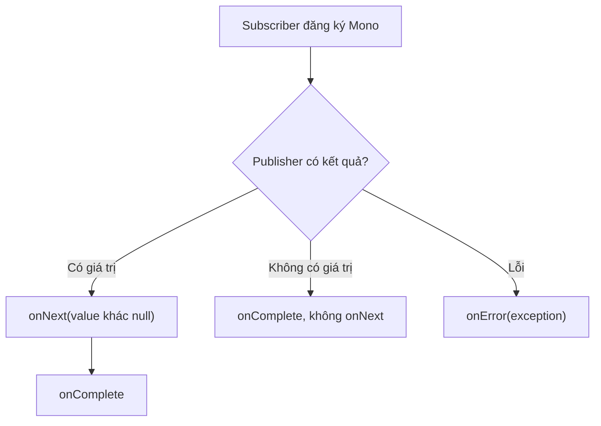
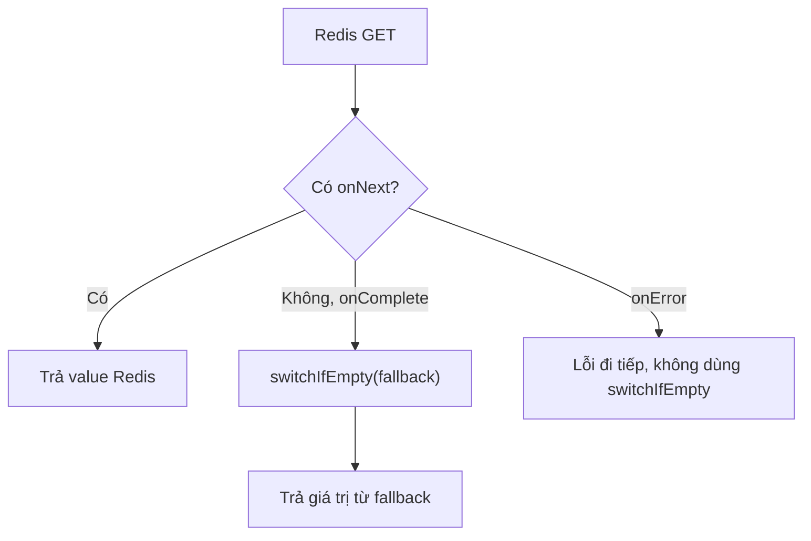

# Biểu diễn không có dữ liệu mà không phát phần tử null trong Spring Data Redis phản ứng

Khi viết ứng dụng Java theo kiểu đồng bộ, một lời gọi đọc Redis thường được xử lý bằng cách nhận một giá trị hoặc `null`:

```java
// RedisTemplate đồng bộ: một key vắng mặt có thể dẫn tới null.
String value = stringRedisTemplate.opsForValue().get("profile:42:name");
if (value == null) {
    // Không tìm thấy dữ liệu.
}
```

Khi chuyển sang **Spring Data Redis Reactive** với `ReactiveRedisTemplate`, `ReactiveStringRedisTemplate` và Project Reactor, không được chuyển nguyên cách nghĩ đó thành “`Mono` phát ra một giá trị `null`”. Theo quy tắc Reactive Streams, **`null` không phải một phần tử hợp lệ của luồng tín hiệu**. Thay vào đó, kết quả vắng mặt thường được biểu diễn bằng một publisher **hoàn tất bình thường mà không phát phần tử nào**, chẳng hạn `Mono.empty()`.

Ví dụ:

```java
Mono<String> value =
        reactiveStringRedisTemplate.opsForValue()
                .get("profile:42:name");
```

Nếu key có giá trị `"Lan"`, publisher có thể phát `"Lan"` rồi hoàn tất. Nếu key không tồn tại, publisher **hoàn tất rỗng**. Cả hai trường hợp đều không phát `null`.

Đây không chỉ là quy tắc cú pháp. Nó ảnh hưởng đến cách sử dụng `map`, `flatMap`, `switchIfEmpty`, `defaultIfEmpty`, `onErrorResume`, API WebFlux, negative caching, kiểm thử với `StepVerifier`, và cách phân biệt “không có bản ghi” với “Redis đang lỗi”.

Bài học này tập trung vào cách biểu diễn và xử lý **không có dữ liệu mà không phát phần tử null**, trong ngữ cảnh Redis phản ứng của Spring Data Redis.

## 1. Reactive Streams sử dụng tín hiệu, không sử dụng null làm phần tử

Project Reactor cung cấp hai kiểu publisher thường gặp:

- `Mono<T>`: phát **tối đa một** phần tử kiểu `T` rồi hoàn tất, hoặc chỉ hoàn tất rỗng, hoặc kết thúc bằng lỗi.
- `Flux<T>`: phát **không, một hoặc nhiều** phần tử kiểu `T`, sau đó hoàn tất hoặc kết thúc bằng lỗi.

Các tín hiệu cơ bản của một publisher:

| Tín hiệu | Ý nghĩa |
|---|---|
| `onSubscribe` | Subscriber nhận thông tin subscription để yêu cầu dữ liệu hoặc hủy |
| `onNext(value)` | Một phần tử dữ liệu thực sự được phát; `value` không được là `null` |
| `onComplete()` | Luồng kết thúc bình thường, không còn phần tử |
| `onError(error)` | Luồng kết thúc do lỗi |

Với `Mono<T>`, một số kịch bản có thể xảy ra:

```text
Kịch bản A - có một giá trị:

subscribe -> onNext("Lan") -> onComplete

Kịch bản B - không có giá trị:

subscribe -> onComplete

Kịch bản C - lỗi:

subscribe -> onError(RedisConnectionFailureException)
```

Không có kịch bản hợp lệ:

```text
subscribe -> onNext(null) -> onComplete
```

Sơ đồ:



Khi một Redis key không tồn tại, **không phát phần tử** là cách biểu diễn tự nhiên. Điều này cho phép publisher truyền cả các giá trị như chuỗi rỗng, số `0` hoặc `false` mà không nhầm chúng với dữ liệu vắng mặt.

## 2. Mono.empty() là gì?

`Mono.empty()` là một publisher hoàn tất thành công mà không phát giá trị.

```java
Mono<String> missing = Mono.empty();
```

Khi subscribe:

```java
missing.subscribe(
        value -> System.out.println("Có: " + value),
        error -> System.err.println("Lỗi: " + error),
        () -> System.out.println("Hoàn tất")
);
```

Kết quả khái niệm:

```text
Hoàn tất
```

Không có lời gọi consumer nhận giá trị. Đó **không phải** vì consumer nhận một `null` rồi bỏ qua; đơn giản là publisher không gửi `onNext`.

### 2.1. Mono.just(value) khác Mono.empty()

```java
Mono<String> found = Mono.just("Lan");
Mono<String> missing = Mono.empty();
```

| Publisher | `onNext` | Tín hiệu kết thúc |
|---|---|---|
| `Mono.just("Lan")` | `"Lan"` | `onComplete` |
| `Mono.just("")` | Chuỗi rỗng `""` | `onComplete` |
| `Mono.just("null")` | Bốn ký tự `n-u-l-l` | `onComplete` |
| `Mono.empty()` | Không có | `onComplete` |
| `Mono.error(ex)` | Không có | `onError(ex)` |

Chuỗi rỗng và chuỗi `"null"` là **những giá trị có thật**. Không được tự coi chúng là thiếu dữ liệu nếu không có hợp đồng nghiệp vụ rõ ràng.

### 2.2. Vì sao Mono.just(null) sai?

```java
Mono<String> broken = Mono.just(null); // Không hợp lệ.
```

`Mono.just(...)` yêu cầu giá trị khác `null`. Trường hợp trên sẽ gây `NullPointerException`, không tạo ra một publisher phát giá trị null hợp lệ.

Thay thế:

```java
String nullableValue = loadNullableValue();

Mono<String> safe = Mono.justOrEmpty(nullableValue);
```

Khi `nullableValue == null`, `Mono.justOrEmpty(...)` tạo publisher rỗng; khi khác null, nó phát chính giá trị đó.

Nếu nguồn là `Optional<String>`:

```java
Optional<String> optionalValue = findMaybe();
Mono<String> safe = Mono.justOrEmpty(optionalValue);
```

Đây là cách chuyển từ API Java có thể trả null/Optional sang Reactive Streams **tại ranh giới tích hợp**, không phải lời khuyên đưa nullable value xuyên suốt chuỗi reactive.

## 3. Redis GET trả về gì khi key không tồn tại?

Trong API đồng bộ:

```java
String result = stringRedisTemplate.opsForValue()
        .get("catalog:product:42:name");

// result có thể null.
```

Trong API phản ứng:

```java
Mono<String> result = reactiveStringRedisTemplate
        .opsForValue()
        .get("catalog:product:42:name");
```

Giả sử Redis có:

```redis
SET catalog:product:42:name "Keyboard"
```

Publisher kết quả có thể phát:

```text
onNext("Keyboard")
onComplete()
```

Nếu key không tồn tại:

```redis
DEL catalog:product:42:name
```

Publisher `get(...)` hoàn tất rỗng:

```text
onComplete()
```

Trong thực hành, ta xử lý cả hai trường hợp bằng **các toán tử Reactor**, thay vì kiểm tra `value == null` ngay sau lời gọi. Biến `result` là một `Mono<String>`, không phải String.

### 3.1. Redis không trả một Java null như một value

Redis `GET` đối với key vắng mặt có phản hồi nil ở giao thức Redis. Spring Data Redis reactive chuyển semantics đó thành **publisher hoàn tất rỗng** đối với các lời gọi phù hợp. Điều này khác với ứng dụng cố ý lưu chuỗi `"null"`:

```redis
SET sample:word "null"
```

Ở trường hợp sau, Redis thực sự có một chuỗi. Reactive GET phát chuỗi đó; không thể coi nó là missing chỉ vì nội dung giống chữ `null`.

### 3.2. Thời điểm subscribe mới quan trọng

```java
Mono<String> value = reactiveRedis.opsForValue()
        .get("catalog:product:42:name");
```

Việc tạo biến `value` chỉ tạo một pipeline phản ứng. Với một publisher cold thông thường, hoạt động đọc Redis diễn ra khi có **subscription** từ WebFlux, một subscriber khác hoặc operator ở cuối chuỗi.

Vì vậy “chưa có giá trị tại thời điểm tạo Mono” **không đồng nghĩa** “publisher là `Mono.empty()`”. Muốn biết kết quả phải quan sát tín hiệu khi publisher được chạy.

## 4. Bốn trạng thái dễ nhầm khi đọc dữ liệu phản ứng

Một API đọc Redis có thể rơi vào các tình huống:

| Trạng thái | Ví dụ | Tín hiệu/giá trị |
|---|---|---|
| Có dữ liệu | `GET key` → `"Lan"` | `Mono.just("Lan")` về mặt semantics |
| Không có dữ liệu | `GET missing` | `Mono.empty()` về mặt semantics |
| Có giá trị false hoặc 0 | `hasKey(key)` → false; bộ đếm 0 | `Mono.just(false)` hoặc `Mono.just(0L)` |
| Có lỗi | Redis timeout, connection failure, serializer hỏng | `Mono.error(exception)` |

Những tình huống này khác nhau về nghiệp vụ:

- **Missing** có thể trả 404 hoặc đọc fallback từ DB.
- **False** có thể là kết quả hợp lệ của phép kiểm tra.
- **Error** thường cần log, retry có giới hạn, degrade có chủ đích hoặc trả lỗi upstream.

Không được chuyển mọi thứ thành `null` hoặc `Mono.empty()` vì sẽ mất thông tin.

## 5. Các thao tác Reactive Redis thường trả Mono.empty hay Flux.empty

Hình thức phản hồi phụ thuộc *loại lệnh*, không chỉ key có tồn tại hay không.

| Thao tác Spring Data Redis reactive | Kiểu dữ liệu logic | Khi không có dữ liệu |
|---|---|---|
| `opsForValue().get(key)` | `Mono<V>` | Thường hoàn tất rỗng khi GET không có value |
| `opsForHash().get(key, field)` | `Mono<HV>` | Thường rỗng nếu field/key không có |
| `opsForList().leftPop(key)` | `Mono<V>` | Rỗng nếu không có phần tử có thể pop |
| `opsForList().range(key, start, end)` | `Flux<V>` | `Flux` hoàn tất mà không có phần tử |
| `opsForSet().members(key)` | `Flux<V>` | Không phát phần tử khi tập rỗng/vắng |
| `hasKey(key)` | `Mono<Boolean>` | Thường phát `false` khi key không tồn tại |
| `opsForValue().set(key, value)` | `Mono<Boolean>` | Phát kết quả lệnh ghi, không biểu diễn miss như GET |
| `delete(key)` | Publisher kết quả xóa | Trả kết quả lệnh xóa (ví dụ số key), không phải kết quả đọc |

Điểm cần nhớ: **không có một quy tắc “key vắng thì mọi Redis operation đều Mono.empty()”**. Các lệnh trả Boolean, số lượng hoặc status có kết quả tường minh ngay cả khi không có key để thao tác.

Ví dụ:

```java
Mono<String> value = redis.opsForValue().get("missing:key");
Mono<Boolean> exists = redis.hasKey("missing:key");
```

Nếu key không có:

```text
value:  onComplete()                    // Không onNext
exists: onNext(false) -> onComplete()   // Có một giá trị Boolean
```

Không thể dùng `switchIfEmpty(...)` để xử lý `false` như thể đó là empty. Khi source phát `false`, publisher **không rỗng**.

### 5.1. Hash: không có field hay không có key?

```java
Mono<String> city = redis.opsForHash()
        .get("user:42:profile", "city");
```

Nếu field `city` vắng mặt, kết quả có thể hoàn tất rỗng. Nhưng một kết quả rỗng riêng lẻ **không phân biệt được**:

- Cả Redis Hash key không tồn tại.
- Hash tồn tại nhưng field `city` không tồn tại.

Nếu nghiệp vụ cần phân biệt, phải thiết kế thêm bước kiểm tra hoặc mô hình lưu trữ phù hợp. Chỉ gọi thêm `hasKey` sau đó **không tạo snapshot nguyên tử** với lệnh `HGET`; một client khác có thể sửa Redis giữa hai lần đọc. Với yêu cầu nhất quán mạnh, cần cân nhắc Lua hoặc dữ liệu được thiết kế để trả đủ trạng thái trong một thao tác server-side.

### 5.2. Set và List: không có phần tử là một Flux rỗng

```java
Flux<String> tags = redis.opsForSet().members("product:42:tags");
```

Nếu Redis không có member nào để trả, luồng có thể hoàn tất mà không phát phần tử:

```text
onComplete()
```

Điều đó không phát một collection Java rỗng như phần tử. Nếu caller muốn một `List<String>` thực sự, có thể gọi `collectList()`; lúc này semantics đổi như mục sau.

## 6. Mono.empty và Mono.just(Collections.emptyList()) không giống nhau

Hai biểu thức:

```java
Mono<List<String>> a = Mono.empty();

Mono<List<String>> b = Mono.just(List.of());
```

khác nhau:

```text
a:
    onComplete()

b:
    onNext([])
    onComplete()
```

Đặc biệt:

```java
Mono<List<String>> list = Flux.<String>empty()
        .collectList();
```

`collectList()` trả một `Mono` **phát một List rỗng**, không phải `Mono.empty()`.

Điều này có hệ quả:

```java
Mono<List<String>> result = redis.opsForSet()
        .members("product:42:tags")
        .collectList()
        .defaultIfEmpty(List.of("unknown"));
```

Nếu không có member, `collectList()` vẫn phát `List.of()`. Vì publisher đã phát một phần tử, `defaultIfEmpty(...)` **không kích hoạt**. Muốn thay thế *collection rỗng*, cần kiểm tra nội dung collection:

```java
Mono<List<String>> result = redis.opsForSet()
        .members("product:42:tags")
        .collectList()
        .map(values -> values.isEmpty()
                ? List.of("unknown")
                : values);
```

Ba khái niệm khác nhau:

1. Không có một phần tử nào trong luồng (`Flux.empty()`).
2. Có đúng một phần tử, và phần tử đó là một List rỗng.
3. Có một phần tử String rỗng `""`.

Khi thiết kế REST API hoặc DTO, xác định rõ semantics nào là mong muốn.

## 7. Dùng switchIfEmpty để xử lý cache miss

`switchIfEmpty(...)` chuyển sang publisher khác **chỉ khi source hoàn tất mà chưa phát phần tử**.

Giả sử muốn đọc cache rồi trả một nhãn mặc định:

```java
Mono<String> name = redis.opsForValue()
        .get("catalog:product:42:name")
        .switchIfEmpty(Mono.just("Unknown product"));
```

Nếu Redis phát `"Keyboard"`, kết quả cuối vẫn là `"Keyboard"`. Nếu Redis đọc được một key vắng mặt, kết quả cuối phát `"Unknown product"`.

Sơ đồ:



### 7.1. Fallback đọc từ database

Với cache-aside, fallback thường là một truy vấn DB:

```java
Mono<String> productName(String productId) {
    String key = "cache:product:" + productId + ":name";

    return redis.opsForValue()
            .get(key)
            .switchIfEmpty(Mono.defer(
                    () -> productRepository.findNameById(productId)));
}
```

`productRepository.findNameById(...)` ở đây là một method giả định **trả `Mono<String>`** từ một repository reactive. Khi cache miss, nó đọc DB. Nếu DB cũng không có sản phẩm, kết quả cuối vẫn là `Mono.empty()`.

**Lưu ý:** ví dụ này chưa ghi kết quả DB trở lại Redis. Nó minh họa sự khác nhau giữa một Redis miss và một publisher DB fallback.

### 7.2. Vì sao thường dùng Mono.defer cho fallback?

Xét:

```java
Mono<String> result = redis.opsForValue()
        .get(key)
        .switchIfEmpty(loadFromDatabase(id));
```

Nếu `loadFromDatabase(id)` là một **hàm Java tạo publisher đồng thời có side effect tại thời điểm gọi**, side effect đó xảy ra ngay lúc xây pipeline, dù Redis có cache hit. Những publisher reactive thông thường thường *cold*, nên phần truy vấn DB bên trong chưa chạy trước subscription; tuy vậy **chính method Java tạo fallback vẫn đã được gọi**.

Dùng:

```java
Mono<String> result = redis.opsForValue()
        .get(key)
        .switchIfEmpty(
                Mono.defer(() -> loadFromDatabase(id)));
```

giúp hoãn **việc gọi factory fallback** tới khi thật sự cần. Điều này quan trọng nếu code tạo fallback có đếm metric, tạo timestamp, thực hiện validation, chuẩn bị statement hoặc phụ thuộc vào context của lần subscription.

`Mono.defer(...)` không có nghĩa tự động chuyển một thao tác blocking thành non-blocking; method fallback vẫn phải được thiết kế đúng cho môi trường reactive.

### 7.3. switchIfEmpty không bắt lỗi Redis

Nếu Redis timeout:

```text
Redis GET -> onError(timeout)
```

thì `switchIfEmpty(...)` **không chạy**. Nó chỉ xử lý completion rỗng, không xử lý lỗi.

Đây là hành vi mong muốn trong nhiều hệ thống: thiếu key là điều kiện bình thường; Redis mất kết nối là lỗi hạ tầng cần được nhận biết.

## 8. Dùng defaultIfEmpty cho giá trị mặc định

`defaultIfEmpty(value)` là một phiên bản đơn giản khi fallback chỉ là **một giá trị có sẵn**:

```java
Mono<String> result = redis.opsForValue()
        .get("ui:welcome")
        .defaultIfEmpty("Welcome!");
```

Khác nhau:

| Toán tử | Dùng khi | Ví dụ |
|---|---|---|
| `defaultIfEmpty(value)` | Muốn phát một giá trị cụ thể nếu rỗng | Chuỗi mặc định |
| `switchIfEmpty(otherPublisher)` | Muốn subscribe một nguồn khác | Đọc database khi cache miss |
| `Mono.justOrEmpty(nullable)` | Chuyển dữ liệu nullable/Optional sang publisher hợp lệ | Tích hợp API cũ |
| `Mono.empty()` | Cố ý biểu diễn không có dữ liệu | Không tìm thấy bản ghi |

**Không truyền null vào `defaultIfEmpty`**:

```java
Mono<String> invalid = Mono.<String>empty()
        .defaultIfEmpty(null);  // Không hợp lệ.
```

Nếu muốn giữ trạng thái vắng mặt, không cần thêm `defaultIfEmpty(null)`. Cứ để publisher hoàn tất rỗng.

### 8.1. Tránh sentinel trùng với dữ liệu thật

Ví dụ:

```java
.defaultIfEmpty("NOT_FOUND")
```

có thể gây nhập nhằng nếu `"NOT_FOUND"` cũng là một giá trị hợp lệ được lưu trong Redis. Với API cần phân biệt rõ trạng thái, nên dùng DTO kết quả có loại rõ ràng, `Optional` trong một giá trị wrapper, hoặc xử lý vắng mặt ở ranh giới HTTP.

Không nên dùng một chuỗi đặc biệt tự chọn làm thay thế cho absence nếu hợp đồng dữ liệu không bảo đảm chuỗi đó không bao giờ là giá trị thật.

## 9. map và flatMap hoạt động thế nào với Mono rỗng?

Toán tử `map` chỉ chạy khi source có `onNext`:

```java
Mono<String> uppercase = redis.opsForValue()
        .get("profile:42:name")
        .map(String::toUpperCase);
```

Nếu Redis GET trả publisher rỗng, hàm `String::toUpperCase` **không được gọi**; Mono kết quả vẫn hoàn tất rỗng.

Tương tự:

```java
Mono<UserDto> user = redis.opsForValue()
        .get("profile:42:name")
        .flatMap(name -> lookupUserByName(name));
```

Nếu thiếu key, `lookupUserByName(...)` không chạy.

### 9.1. map không được trả null

Code sai:

```java
Mono<String> broken = Mono.just("Lan")
        .map(name -> null);
```

Reactor không xem giá trị null do mapper trả là một phần tử hợp lệ. Pipeline sẽ thất bại, thay vì âm thầm chuyển thành một `onNext(null)`.

Khi logic điều kiện có thể quyết định không trả kết quả, dùng `flatMap` với `Mono.empty()`:

```java
Mono<String> approved = Mono.just("Lan")
        .flatMap(name -> name.length() >= 5
                ? Mono.just(name)
                : Mono.empty());
```

Hoặc dùng `filter`:

```java
Mono<String> approved = Mono.just("Lan")
        .filter(name -> name.length() >= 5);
```

Vì điều kiện không thỏa, publisher hoàn tất rỗng, không phát null.

### 9.2. filter tạo absence theo chính sách, không chỉ vì Redis miss

Giả sử Redis có key trả `"DISABLED"`:

```java
Mono<String> activeState = redis.opsForValue()
        .get("account:42:state")
        .filter("ACTIVE"::equals);
```

Mono kết quả rỗng có thể có hai nguyên nhân:

1. Redis không có key.
2. Redis có value nhưng value khác `ACTIVE` nên bị filter loại.

Khi thiết kế API, đừng tự diễn giải *mọi* completion rỗng là “key không tồn tại”. Một toán tử phía trước cũng có thể chủ động lọc dữ liệu.

## 10. Flux.empty(): không phát phần tử nào nhưng vẫn hoàn tất

`Flux.empty()` có semantics tương ứng cho chuỗi có 0..N phần tử:

```java
Flux<String> noTags = Flux.empty();
```

Tín hiệu:

```text
subscribe -> onComplete
```

Ví dụ Redis Set:

```java
Flux<String> tags = redis.opsForSet()
        .members("catalog:product:42:tags");
```

Nếu không có tag nào, `Flux` không cần phát một phần tử null để biểu diễn “không có thành viên”.

### 10.1. Tạo một danh sách cuối cùng

```java
Mono<List<String>> tagsList = redis.opsForSet()
        .members("catalog:product:42:tags")
        .collectList();
```

Nếu Set rỗng:

```text
tagsList -> onNext([]) -> onComplete
```

Điều đó rất hữu ích ở API trả JSON array:

```json
[]
```

Nó cho phép phân biệt: “đã đọc danh sách và danh sách không có phần tử” với “không tìm thấy một đối tượng cụ thể”. Cách phân biệt cần do hợp đồng nghiệp vụ quyết định.

### 10.2. count và hasElements cũng phát giá trị

```java
Mono<Long> count = redis.opsForSet()
        .members("catalog:product:42:tags")
        .count();

Mono<Boolean> hasAny = redis.opsForSet()
        .members("catalog:product:42:tags")
        .hasElements();
```

Khi Flux không phát member nào:

```text
count  -> onNext(0L)   -> onComplete
hasAny -> onNext(false) -> onComplete
```

Nói cách khác, **Flux rỗng sau khi được aggregate** có thể trở thành một Mono phát giá trị `0`, `false` hoặc collection rỗng. Không phải mọi thứ bắt nguồn từ một Flux không có phần tử đều tiếp tục là `Mono.empty()`.

### 10.3. next tạo Mono có hoặc không có phần tử

```java
Mono<String> firstTag = redis.opsForSet()
        .members("catalog:product:42:tags")
        .next();
```

Nếu Flux phát ít nhất một phần tử, `next()` lấy phần tử đầu tiên mà nó nhận. Nếu Flux rỗng, Mono kết quả cũng rỗng.

Không nên dùng phần tử đầu tiên của Set để diễn giải một thứ tự nghiệp vụ: Redis Set không có thứ tự ổn định như List hoặc Sorted Set.

## 11. Phân biệt empty, never và chưa có message

Một publisher có thể **chưa phát phần tử** vì nhiều lý do:

```java
Mono<String> empty = Mono.empty();
Mono<String> never = Mono.never();
```

Khác biệt:

| Publisher | Có phát phần tử? | Có hoàn tất? |
|---|---|---|
| `Mono.empty()` | Không | Có, ngay theo semantics của nó |
| `Mono.never()` | Không | Không |
| `Mono.error(ex)` | Không | Kết thúc bằng lỗi, không onComplete |
| `Mono.just("x")` | Có một | Có |

Một subscription lâu dài như Redis Pub/Sub hoặc Redis Streams listener **có thể chưa nhận message nhưng vẫn đang chờ**, chứ không phải đã hoàn tất rỗng.

Ví dụ:

```text
Redis Pub/Sub Flux:
subscribe -> (chờ message) -> onNext(message1) -> (chờ message2) ...
```

Đừng sử dụng `switchIfEmpty` với giả định “nếu 5 giây chưa có message thì fallback” trên một Flux chưa hoàn tất. `switchIfEmpty` chỉ quan sát được **empty completion**, không phải “chưa có dữ liệu trong một khoảng thời gian”.

Nếu nghiệp vụ cần timeout, dùng các toán tử timeout hoặc cơ chế polling có deadline rõ ràng rồi quyết định xử lý timeout như một trạng thái riêng.

## 12. Mono<Void> biểu diễn thành công không có payload

Một trường hợp khác của publisher không phát giá trị là thao tác mà API chỉ cần **báo hoàn tất**:

```java
Mono<Void> operation = redis.opsForValue()
        .set("demo:flag", "ready")
        .then();
```

`then()` bỏ qua giá trị Boolean từ kết quả lệnh `SET` và chuyển thành một publisher chỉ quan tâm đến completion/error.

Nếu Redis SET thành công, `operation` hoàn tất rỗng. Nhưng đó là:

> “Đã thực hiện thao tác theo chuỗi và không cần trả payload.”

Không phải:

> “Không tìm thấy dữ liệu.”

### 12.1. Bẫy switchIfEmpty trên Mono<Void>

Đoạn sau dễ gây lỗi:

```java
Mono<Void> write = redis.opsForValue()
        .set("demo:flag", "ready")
        .then();

Mono<Void> followed = write.switchIfEmpty(
        Mono.defer(() -> doSomethingElse()));
```

Vì `write` là `Mono<Void>`, nó hoàn tất mà không phát `onNext` ngay cả khi lệnh ghi thành công. `switchIfEmpty(...)` có thể được subscribe như fallback sau **một thao tác thành công**.

Nếu muốn chạy một bước **sau khi hoàn tất thành công**, nên dùng `then(...)`:

```java
Mono<Void> followed = write
        .then(doSomethingElse());
```

Nếu cần biết lệnh SET trả `true` hay `false`, **đừng bỏ giá trị Boolean quá sớm** bằng `then()`. Hãy quan sát và xử lý kết quả trước, rồi mới chuyển thành `Mono<Void>` nếu API yêu cầu.

### 12.2. Completion không đồng nghĩa cache miss

Trong một service reactive, các method như:

```java
Mono<Void> invalidateCache(String key)
Mono<Void> sendNotification(String userId)
Mono<Void> recordMetric(String name)
```

có thể hoàn tất rỗng trên thành công. Quy ước “mọi Mono rỗng đều mang nghĩa không tìm thấy bản ghi” là sai. **Loại kết quả của API và ngữ cảnh của thao tác** mới xác định ý nghĩa completion rỗng.

## 13. Không nên ép Mono.empty thành một exception trong mọi API

Khi tìm một đối tượng, có hai hợp đồng phổ biến:

**Hợp đồng A — dữ liệu có thể vắng mặt bình thường:**

```java
public Mono<String> findName(String id) {
    return redis.opsForValue().get("name:" + id);
}
```

Caller quyết định có dùng fallback, trả 404 hay hiển thị trạng thái rỗng.

**Hợp đồng B — bắt buộc phải có dữ liệu:**

```java
public Mono<String> requireName(String id) {
    return redis.opsForValue()
            .get("name:" + id)
            .switchIfEmpty(
                    Mono.error(() ->
                            new NameNotFoundException(id)));
}
```

Ở hợp đồng B, absence được nâng thành một lỗi theo chính sách của method. Lúc này downstream nhận `onError` chứ không còn nhận empty completion.

Không có cách nào đúng cho mọi trường hợp:

- Một truy vấn tìm kiếm có thể trả kết quả rỗng mà không phải lỗi.
- Một lệnh cần xử lý một tài khoản tồn tại bắt buộc có thể coi missing là lỗi nghiệp vụ.
- Một endpoint REST tra cứu resource theo ID thường chuyển thành 404.
- Một thao tác đọc cache để fallback database thường **không** coi cache miss là lỗi.

Đặt ranh giới chuyển absence thành error tại nơi hiểu **hợp đồng nghiệp vụ**, không tự làm điều đó trong mọi tầng Redis.

## 14. Mono.empty trong một REST API WebFlux

Giả sử muốn đọc một chuỗi từ Redis và trả HTTP 404 khi không tồn tại.

```java
package com.example.redis.reactive;

import org.springframework.http.HttpStatus;
import org.springframework.http.ResponseEntity;
import org.springframework.web.bind.annotation.GetMapping;
import org.springframework.web.bind.annotation.PathVariable;
import org.springframework.web.bind.annotation.RequestMapping;
import org.springframework.web.bind.annotation.RestController;

import reactor.core.publisher.Mono;

@RestController
@RequestMapping("/api/display-names")
public class DisplayNameController {

    private final ReactiveDisplayNameService service;

    public DisplayNameController(ReactiveDisplayNameService service) {
        this.service = service;
    }

    @GetMapping("/{id}")
    public Mono<ResponseEntity<String>> getName(
            @PathVariable String id) {

        return service.findName(id)
                .map(ResponseEntity::ok)
                .switchIfEmpty(Mono.just(
                        ResponseEntity.status(HttpStatus.NOT_FOUND)
                                .body("Display name not found")));
    }
}
```

Ý nghĩa:

- Có tên → `map(ResponseEntity::ok)` tạo HTTP 200 với body là giá trị String.
- Không có tên → source hoàn tất rỗng, `switchIfEmpty(...)` tạo HTTP 404.
- Redis bị lỗi → lỗi được truyền đi; không bị âm thầm biến thành 404.

Ở WebFlux còn có cách trả `Mono<T>` trực tiếp và dựa vào cách framework xử lý publisher rỗng. Nhưng khi **status 404 là một phần hợp đồng API**, viết `Mono<ResponseEntity<T>>` như trên giúp thể hiện rõ quyết định HTTP.

### 14.1. Khi nào trả 200 với danh sách rỗng?

Với API liệt kê tags:

```java
@GetMapping("/{id}/tags")
public Mono<List<String>> getTags(
        @PathVariable String id) {
    return redis.opsForSet()
            .members("product:" + id + ":tags")
            .collectList();
}
```

Nếu không có tag, API có thể trả:

```json
[]
```

Đó là một quyết định hợp lý nếu hợp đồng xem “không có tag” là một collection rỗng hợp lệ. Nếu ứng dụng cần phân biệt “product không tồn tại” với “product có nhưng không có tag”, chỉ kết quả Redis Set rỗng chưa đủ; cần một bước xác minh hoặc mô hình dữ liệu đảm bảo trạng thái phân biệt.

### 14.2. Không trả JSON null để thay cho HTTP 404

Nếu API muốn 404, đừng tạo publisher phát chuỗi `"null"` hoặc một object giả để né `Mono.empty()`. Tầng HTTP có thể biểu diễn missing rõ bằng status code, còn tầng dữ liệu nên giữ đúng semantics của kết quả đọc.

## 15. Cache-aside reactive: Redis miss -> DB -> điền cache

Một ví dụ gần với ứng dụng thực tế:

```text
Client
   |
   v
Reactive Redis GET
   |
   +-- Có giá trị --> trả luôn
   |
   +-- Mono.empty()
          |
          v
      Reactive DB lookup
          |
          +-- Có tên --> Redis SET + TTL --> trả tên
          |
          +-- Mono.empty() --> không tìm thấy ở cả hai nguồn
```

### 15.1. Service hoàn chỉnh minh họa

Trong ví dụ này, `ReactiveProductNameRepository` là interface nghiệp vụ giả định dùng một nguồn dữ liệu **non-blocking** như R2DBC. Cách triển khai interface phụ thuộc dự án.

```java
package com.example.catalog;

import reactor.core.publisher.Mono;

public interface ReactiveProductNameRepository {
    Mono<String> findNameById(String productId);
}
```

Service:

```java
package com.example.catalog;

import java.time.Duration;

import org.springframework.data.redis.core.ReactiveStringRedisTemplate;
import org.springframework.stereotype.Service;
import reactor.core.publisher.Mono;

@Service
public class ReactiveProductNameService {

    private static final Duration CACHE_TTL =
            Duration.ofMinutes(5);

    private final ReactiveStringRedisTemplate redis;
    private final ReactiveProductNameRepository repository;

    public ReactiveProductNameService(
            ReactiveStringRedisTemplate redis,
            ReactiveProductNameRepository repository) {
        this.redis = redis;
        this.repository = repository;
    }

    public Mono<String> findName(String productId) {
        if (productId == null || productId.isBlank()) {
            return Mono.error(
                    new IllegalArgumentException("productId is blank"));
        }

        String cacheKey = "cache:product:name:" + productId;

        return redis.opsForValue()
                .get(cacheKey)
                .switchIfEmpty(Mono.defer(() ->
                        repository.findNameById(productId)
                                .flatMap(name ->
                                        redis.opsForValue()
                                                .set(cacheKey, name, CACHE_TTL)
                                                .thenReturn(name))));
    }
}
```

Khi cache miss:

1. Redis GET hoàn tất rỗng.
2. `switchIfEmpty` subscribe publisher đọc DB.
3. Nếu DB có tên, `flatMap` gửi Redis SET với TTL.
4. Khi thao tác SET hoàn tất thành công, `thenReturn(name)` phát tên đó.
5. Nếu DB cũng hoàn tất rỗng, `flatMap` không chạy; kết quả cuối vẫn rỗng.

Đoạn code minh họa **chọn chính sách chờ Redis cache fill thành công** rồi mới trả tên. Nếu Redis SET lỗi, request có thể thất bại dù DB đã trả dữ liệu. Một hệ thống coi cache là tối ưu hóa best-effort có thể chọn chính sách khác, nhưng phải chủ động phân biệt lỗi cache với lỗi DB.

### 15.2. Nếu muốn Redis SET lỗi vẫn trả DB value?

Một lựa chọn có kiểm soát:

```java
return redis.opsForValue()
        .set(cacheKey, name, CACHE_TTL)
        .onErrorResume(cacheError -> {
            log.warn("Cache fill failed for key {}", cacheKey, cacheError);
            return Mono.just(false);
        })
        .thenReturn(name);
```

Đoạn này cho phép trả `name` dù thao tác ghi cache lỗi, nhưng **chỉ xử lý lỗi của nhánh cache SET**. Nếu đặt `onErrorResume` bao ngoài toàn bộ pipeline mà không phân loại, lỗi Redis GET hoặc lỗi DB có thể bị che khuất một cách ngoài ý muốn.

Một số hệ thống lựa chọn fail-open với cache read: khi Redis GET lỗi, chúng fallback tới DB. Đây là **quyết định về độ sẵn sàng**, không phải chuyển mọi Redis error thành một cache miss tự nhiên.

### 15.3. Không làm blocking DB call trong event loop

Sai về tinh thần reactive:

```java
return redis.opsForValue()
        .get(cacheKey)
        .switchIfEmpty(Mono.just(
                jdbcRepository.loadNameBlocking(productId)));
```

Phương thức blocking đã được gọi trong lúc tạo fallback và có thể chặn thread; `Mono.just(...)` không biến JDBC blocking thành non-blocking.

Nếu bắt buộc tích hợp nguồn blocking cũ, cần cách ly có kiểm soát bằng `Mono.fromCallable(...)` và scheduler phù hợp như `Schedulers.boundedElastic()`:

```java
Mono<String> fallback = Mono.fromCallable(
        () -> jdbcRepository.loadNameBlocking(productId))
        .subscribeOn(Schedulers.boundedElastic());
```

Nếu callback trả `null`, `Mono.fromCallable(...)` sẽ hoàn tất rỗng. Dù vậy, cách sử dụng boundedElastic chỉ là cầu nối cho hệ thống cũ, không thay thế việc đánh giá giới hạn thread pool và tải JDBC.

## 16. Mono.justOrEmpty khi bọc API Java trả nullable

Giả sử một thư viện cũ có:

```java
@Nullable
String lookupLocal(String key);
```

Một cách bọc:

```java
public Mono<String> lookup(String key) {
    return Mono.defer(
            () -> Mono.justOrEmpty(lookupLocal(key)));
}
```

Nếu `lookupLocal(key)` trả null, kết quả hoàn tất rỗng. Nếu trả String thật, giá trị được phát bình thường.

Nhưng cần lưu ý:

- `Mono.defer` hoãn lời gọi tới subscription, **không làm lời gọi trở nên non-blocking**.
- Nếu `lookupLocal` truy vấn disk, network hoặc JDBC đồng bộ, dùng scheduler phù hợp và đánh giá tải.
- Nếu thư viện ném exception, Reactor chuyển thành error signal; không tự coi lỗi là missing.

Với một method vừa có thể vắng mặt vừa có thể lỗi, nên phân biệt rõ bằng contract Java thay vì mọi nơi trả null rồi để downstream đoán.

### 16.1. Optional ở ranh giới imperative

```java
Optional<String> optional = findFromLegacyCode();
Mono<String> reactive = Mono.justOrEmpty(optional);
```

Với `Optional.empty()`, reactive kết quả là `Mono.empty()`.

Ở phần lớn chuỗi reactive, không cần dùng `Optional` chỉ để biểu diễn missing, vì **chính Mono.empty đã biểu diễn trạng thái đó**. Tuy nhiên, có những trường hợp ta cần biến absence thành một phần tử hữu hình; đó là chủ đề tiếp theo.

## 17. Khi cần giữ absence như một giá trị: Mono<Optional<T>>

Đôi khi caller cần **một tín hiệu onNext dù kết quả tìm kiếm vắng mặt**, ví dụ muốn ghép với một publisher khác bằng `zip` hoặc gửi một DTO thể hiện trạng thái.

Khi đó có thể chủ động dùng:

```java
Mono<Optional<String>> result = redis.opsForValue()
        .get("profile:42:name")
        .map(Optional::of)
        .defaultIfEmpty(Optional.empty());
```

Hai trường hợp:

```text
Redis có "Lan":
    onNext(Optional["Lan"]) -> onComplete

Redis không có:
    onNext(Optional.empty()) -> onComplete
```

Lưu ý: ở publisher thứ hai, **không có onNext(null)**. Phần tử được phát là một **Optional object khác null**, bên trong biểu diễn không có giá trị.

### 17.1. Có nên dùng Mono<Optional<T>> mọi nơi?

Không nhất thiết. `Mono<T>` đã có trường hợp completion rỗng, nên `Mono<Optional<T>>` tạo ra **hai lớp biểu diễn vắng mặt**:

1. Mono không phát gì.
2. Mono phát `Optional.empty()`.

Điều đó có thể gây khó hiểu nếu API không định nghĩa rõ. Chỉ dùng khi caller thực sự cần quan sát absence như một **giá trị** chứ không phải một completion rỗng.

Với API tìm kiếm thông thường:

```java
Mono<String> findName(String id);
```

đã đủ gọn và tự nhiên.

## 18. Biểu diễn missing bằng một kiểu kết quả miền nghiệp vụ

Khi muốn phân biệt “tìm thấy”, “không tìm thấy” và một trạng thái nghiệp vụ khác mà không dùng giá trị giả, có thể thiết kế một kiểu có tên rõ ràng.

Java 17:

```java
public sealed interface LookupResult
        permits LookupResult.Found, LookupResult.Missing {

    record Found(String value) implements LookupResult {}

    record Missing(String reason) implements LookupResult {}
}
```

Chuyển Redis result sang kiểu miền:

```java
Mono<LookupResult> lookup = redis.opsForValue()
        .get("profile:42:name")
        .map(value ->
                (LookupResult) new LookupResult.Found(value))
        .defaultIfEmpty(
                new LookupResult.Missing("name_not_available"));
```

Khi tìm thấy, publisher phát `LookupResult.Found`. Khi vắng, publisher phát `LookupResult.Missing`. Cả hai đều là các object Java khác null.

Ưu điểm:

- Không có sentinel chuỗi khó phân biệt.
- Có thể mã hóa reason hoặc metadata của absence.
- Phù hợp khi WebFlux cần một response object có trạng thái rõ.
- Caller có thể dùng pattern matching / `instanceof` để phân nhánh.

Nhược điểm là thêm kiểu dữ liệu và mapping. Không cần làm phức tạp một lookup đơn giản nếu empty completion đã diễn đạt đủ.

## 19. Bẫy quan trọng: Mono.zip với một source rỗng

Giả sử lấy đồng thời tên và email của người dùng:

```java
Mono<String> name = redis.opsForValue().get("user:42:name");
Mono<String> email = redis.opsForValue().get("user:42:email");

Mono<UserView> view = Mono.zip(
        name,
        email,
        (n, e) -> new UserView(n, e));
```

Với `Mono.zip`, kết quả cần **một giá trị từ mỗi publisher**. Nếu `name` hoặc `email` hoàn tất rỗng, publisher kết quả cũng có thể hoàn tất rỗng và hàm tạo `UserView` không chạy.

Điều này có thể phù hợp nếu nghiệp vụ quy định:

> Thiếu một trường bắt buộc thì không thể tạo UserView.

Nhưng sẽ sai nếu mục tiêu là:

> Luôn tạo UserView, trong đó email có thể không tồn tại.

### 19.1. Dùng Optional để zip khi absence là dữ liệu cần giữ

```java
Mono<Optional<String>> nameValue = name
        .map(Optional::of)
        .defaultIfEmpty(Optional.empty());

Mono<Optional<String>> emailValue = email
        .map(Optional::of)
        .defaultIfEmpty(Optional.empty());

Mono<UserSummary> summary = Mono.zip(
        nameValue,
        emailValue,
        (n, e) -> new UserSummary(n, e));
```

DTO:

```java
record UserSummary(
        Optional<String> name,
        Optional<String> email
) {}
```

Cả hai source `Mono<Optional<String>>` đều phát một phần tử, kể cả khi Optional bên trong rỗng. Điều đó cho phép `zip` chạy hàm kết hợp.

Tùy hợp đồng API, có thể dùng một record kết quả khác thay Optional, hoặc dùng `defaultIfEmpty(...)` với các giá trị mặc định nghiệp vụ có nghĩa rõ.

### 19.2. Đừng cố zip bằng Mono.just(null)

Sai:

```java
Mono.zip(
        name.defaultIfEmpty(null),
        email.defaultIfEmpty(null));
```

Mỗi phần tử phát qua Reactor đều phải khác null. Hãy biểu diễn absence bằng empty completion nếu chấp nhận không có kết quả tổng, hoặc bằng wrapper/DTO nếu cần giữ trạng thái missing trong phép kết hợp.

## 20. doOnNext và doOnSuccess có semantics khác nhau

Khi debug reactive pipeline, có thể dùng:

```java
Mono<String> source = redis.opsForValue().get(key);

source.doOnNext(value ->
        log.debug("Có giá trị: {}", value));
```

Nếu source hoàn tất rỗng, `doOnNext` không được gọi vì không có phần tử.

Nhưng `Mono.doOnSuccess(...)` có một hành vi dễ gây nhầm:

```java
source.doOnSuccess(value -> {
    if (value == null) {
        log.debug("Mono hoàn tất thành công nhưng rỗng");
    }
});
```

Đối với **Mono**, callback `doOnSuccess` có thể nhận tham số `null` để **báo việc Mono hoàn tất mà không có giá trị**. Đây là hành vi của callback quan sát completion, **không phải một `onNext(null)`**.

Phân biệt:

| Công cụ quan sát | Khi Mono có giá trị | Khi Mono hoàn tất rỗng |
|---|---|---|
| `doOnNext(v)` | Được gọi với giá trị | Không được gọi |
| `doOnSuccess(v)` | Được gọi với giá trị | Được gọi với `null` trong callback |
| `doOnComplete` của Flux | Không xem payload | Được gọi khi Flux hoàn tất |
| `doOnError(e)` | Không nếu thành công | Không nếu hoàn tất rỗng |

`doOnSuccess` có tên là “success”, nên nhiều người tưởng nó chỉ chạy khi có dữ liệu. Thực tế, completion rỗng cũng là một **thành công** về mặt reactive protocol.

### 20.1. Dùng switchIfEmpty để đếm cache miss

```java
Mono<String> observed = redis.opsForValue()
        .get(key)
        .switchIfEmpty(Mono.defer(() -> {
            metrics.incrementCacheMiss();
            return Mono.empty();
        }));
```

Đây là cách biểu diễn: khi source rỗng, tăng metric rồi **giữ kết quả rỗng**. Nếu metric tự nó blocking hoặc có side effect phức tạp, vẫn phải quản lý cách chạy phù hợp với hệ reactive.

Đặc biệt, không suy ra rằng một cache miss là một lỗi Redis; metric lỗi nên được thu ở nhánh error riêng.

## 21. onErrorResume không phải switchIfEmpty

Ba loại kết quả cần được xử lý riêng:

```java
Mono<String> value = redis.opsForValue().get(key);
```

**Có dữ liệu:**

```text
onNext("value") -> onComplete
```

**Không có key:**

```text
onComplete
```

**Redis lỗi:**

```text
onError(RedisConnectionFailureException)
```

Chọn toán tử:

| Toán tử | Tín hiệu mà nó xử lý |
|---|---|
| `switchIfEmpty` | Completion không có `onNext` |
| `defaultIfEmpty` | Completion không có `onNext`, thay bằng value |
| `onErrorResume` | `onError`, thay bằng publisher khác |
| `onErrorReturn` | `onError`, thay bằng giá trị cố định |
| `retryWhen` | Lỗi theo chiến lược retry |

### 21.1. Anti-pattern: che mọi lỗi Redis như thể thiếu key

```java
Mono<String> risky = redis.opsForValue()
        .get(key)
        .onErrorResume(error -> Mono.empty());
```

Ở đây, mất kết nối, timeout hoặc lỗi serializer đều bị biến thành một kết quả “không có dữ liệu”. Tầng API có thể trả 404 dù dữ liệu thật vẫn tồn tại trong Redis/DB.

Nếu hệ thống cố tình **fail-open** khi Redis cache không sẵn sàng, hãy triển khai có chủ đích:

```java
Mono<String> value = redis.opsForValue()
        .get(cacheKey)
        .onErrorResume(
                RedisConnectionFailureException.class,
                error -> {
                    log.warn("Redis cache unavailable", error);
                    return Mono.empty();
                })
        .switchIfEmpty(
                Mono.defer(() -> repository.findNameById(id)));
```

Đoạn này chỉ minh họa một chính sách cụ thể: **lỗi kết nối Redis được coi như không dùng được cache để fallback DB**. Nó không có nghĩa error thực sự là missing. Với timeout hoặc các exception khác, phải xem xét loại lỗi muốn xử lý, độ sẵn sàng của DB và logging/metrics.

Không nên dùng `onErrorContinue` như một cách tổng quát để biến lỗi Redis thành empty; hành vi của nó phụ thuộc operator và có thể khó dự đoán, nhất là với các luồng có side effect.

## 22. Mono.empty có tự thực thi Redis command không?

Nếu method trả trực tiếp:

```java
public Mono<String> find(String id) {
    if (id.isBlank()) {
        return Mono.empty();
    }
    return redis.opsForValue().get("name:" + id);
}
```

với input rỗng, method không tạo bước đọc Redis. `Mono.empty()` chỉ phát completion rỗng khi subscribe.

Ngược lại:

```java
return redis.opsForValue()
        .get("name:" + id)
        .filter(name -> name.length() >= 3);
```

ở đây Redis GET vẫn được gọi khi subscribe, rồi có thể bị filter loại bỏ. Hai luồng có kết quả empty giống nhau từ góc nhìn cuối, nhưng **chi phí và nguyên nhân khác nhau**.

Nếu caller cần biết “input không hợp lệ” thay vì “không có dữ liệu”, trả `Mono.error(new IllegalArgumentException(...))` hoặc một domain result thể hiện invalid input rõ ràng; đừng lạm dụng `Mono.empty()` cho mọi trạng thái bất thường.

## 23. Read-your-writes, cache miss và concurrency

Một kết quả rỗng từ Redis GET chỉ nói rằng **tại lần đọc đó**, key không có giá trị phù hợp. Nó không bảo đảm:

- Key vẫn vắng mặt khi caller bắt đầu fallback DB.
- Không có client khác sẽ tạo key ngay sau đó.
- DB cũng không có bản ghi.
- Người khác không xóa key giữa `hasKey` và `get`.

Ví dụ:

```text
T1  Request A: Redis GET -> empty
T2  Request B: Redis SET "Lan"
T3  Request A: fallback DB -> "Linh"
T4  Request A: Redis SET "Linh"
```

Chính sách cache-aside có thể dẫn đến stale cache fill nếu dữ liệu nguồn được cập nhật trong lúc một request đọc cũ đang xử lý. `Mono.empty()` biểu diễn chính xác cache miss, nhưng **không giải quyết race condition** giữa các request.

Nếu dữ liệu cần nhất quán mạnh, cần cơ chế ràng buộc ở DB, version-aware cache fill, Lua hoặc chiến lược invalidate phù hợp. Những cơ chế đó là lớp thiết kế riêng, không phải thay thế việc biểu diễn missing một cách đúng trong Reactor.

### 23.1. Đừng dùng hasKey rồi get để “tránh Mono.empty”

Một cách thừa và có race:

```java
return redis.hasKey(key)
        .flatMap(exists -> {
            if (exists) {
                return redis.opsForValue().get(key);
            }
            return Mono.empty();
        });
```

Trong lúc `hasKey` trả true và `GET` chạy, một client khác có thể xóa key. Kết quả vẫn có thể là empty, lại tốn thêm một round trip.

Khi chỉ muốn lấy giá trị, gọi `GET` trực tiếp rồi xử lý completion rỗng. Chỉ dùng thêm `hasKey` nếu nghiệp vụ thực sự cần biết trạng thái tồn tại, và chấp nhận hoặc giải quyết tính không nguyên tử của nhiều lệnh.

## 24. Cache negative result: có nên lưu “không tìm thấy” không?

Nếu DB không có dữ liệu và Redis cũng không có cache, mỗi request có thể tiếp tục gọi DB. Khi ID không tồn tại được truy vấn nhiều lần, đó có thể là nguồn tải đáng kể.

Một số hệ thống dùng **negative caching**: lưu tạm trạng thái “không tồn tại”.

Nhưng Redis không có “giá trị null” mặc định cho lệnh GET. Nếu muốn cache absence, phải chọn một **representation hữu hình** có hợp đồng:

1. Một sentinel string không thể trùng dữ liệu thật, được đặt TTL ngắn.
2. Một JSON envelope: `{"state":"missing"}`.
3. Một key riêng đánh dấu trạng thái missing.
4. Một cache abstraction hỗ trợ null sentinel theo serializer phù hợp.

Ví dụ envelope:

```json
{"state":"missing","schemaVersion":1}
```

hoặc:

```json
{"state":"found","schemaVersion":1,"value":"Lan"}
```

Khi đọc Redis, producer và consumer giải mã envelope thành **một domain result**, không phát Java null.

Rủi ro của negative caching:

- Bản ghi có thể được tạo ngay sau khi cache “missing” được ghi.
- Event invalidate có thể bị mất.
- Một request đọc cũ có thể ghi lại sentinel sau khi bản ghi đã được tạo.
- TTL của sentinel cần ngắn hơn hoặc có chiến lược invalidation phù hợp.

Không nên lưu chuỗi `"null"` tùy tiện rồi coi nó là một Redis nil. Nil của lệnh GET và chuỗi có nội dung `"null"` hoàn toàn khác nhau.

## 25. Mono.cache() không phải Redis Cache

Project Reactor có toán tử `Mono.cache()`:

```java
Mono<String> shared = redis.opsForValue()
        .get("profile:42:name")
        .cache();
```

Toán tử này có thể ghi nhớ **tín hiệu của publisher** để các subscriber tiếp theo dùng lại. Một tín hiệu completion rỗng cũng có thể được cache trong phạm vi publisher đó.

Điều này khác với:

```java
reactiveRedis.opsForValue().get(key)
```

đọc một Redis key thực sự, và khác với Spring Cache annotation/`RedisCacheManager`.

Ví dụ:

```text
Subscription 1 -> Redis GET missing -> empty completion
Mono.cache() ghi nhớ empty completion
Subscription 2 -> nhận empty completion đã cache,
                  không nhất thiết truy vấn Redis lần nữa
```

Nếu key được tạo sau lần subscription đầu, publisher `shared` ở ví dụ có thể tiếp tục trả empty signal từ bộ nhớ theo semantics caching của Reactor, cho đến khi cache signal được làm mới hoặc publisher được tạo lại.

Đây là lý do không nên mặc định dùng `Mono.cache()` cho một read Redis muốn phản ánh dữ liệu mới trên mỗi lần subscribe. Khi cần cache tín hiệu, phải định nghĩa TTL của Reactor cache operator và phạm vi sống của publisher.

## 26. Cách biểu diễn absence trong một pipeline phức hợp

Xét thao tác tạo trang sản phẩm gồm:

- Tên sản phẩm bắt buộc.
- Mô tả có thể không có.
- Danh sách tag có thể rỗng.

Một hợp đồng rõ ràng:

```java
record ProductView(
        String name,
        Optional<String> description,
        List<String> tags
) {}
```

Xây pipeline:

```java
Mono<String> name = redis.opsForValue()
        .get("product:42:name");

Mono<Optional<String>> description = redis.opsForValue()
        .get("product:42:description")
        .map(Optional::of)
        .defaultIfEmpty(Optional.empty());

Mono<List<String>> tags = redis.opsForSet()
        .members("product:42:tags")
        .collectList();

Mono<ProductView> view = Mono.zip(
        name,
        description,
        tags,
        ProductView::new);
```

Semantics:

1. Nếu `name` vắng, toàn bộ `view` hoàn tất rỗng vì tên là bắt buộc.
2. Nếu `description` vắng, nó được biểu diễn bằng `Optional.empty()`, nhưng vẫn là một phần tử hợp lệ để `zip` ghép.
3. Nếu không có tag, `collectList()` phát `List.of()`, nên `zip` vẫn nhận được một List.
4. Không có chỗ nào cần phát phần tử null.

Đây là một ví dụ lý giải vì sao không nên cưỡng ép mọi missing value thành cùng một sentinel. **Ngữ nghĩa của trường bắt buộc và trường tùy chọn khác nhau.**

## 27. Quan sát completion rỗng trong log và metric

Khi API trả thiếu dữ liệu, hệ thống cần biết đó là:

- Cache miss.
- DB miss.
- Kết quả bị filter loại.
- Lỗi hạ tầng được chủ đích fallback.
- Publisher bị hủy trước khi hoàn tất.

Một vài quy tắc vận hành:

1. Đếm cache hit ở nhánh có `onNext`.
2. Đếm cache miss ở nhánh empty completion trước DB fallback.
3. Đếm Redis errors ở nhánh `onError` riêng.
4. Không gọi subscriber callbacks chỉ để đo trạng thái; có thể dùng `doOnNext`, `doOnError` và nhánh `switchIfEmpty` có kiểm soát.
5. Không log payload nhạy cảm chỉ để phân biệt hit/miss.
6. Nếu một request bị cancel, không tự kết luận nó đã empty; cancellation khác completion.

Ví dụ:

```java
Mono<String> observed = redis.opsForValue()
        .get(key)
        .doOnNext(value -> metrics.hit())
        .doOnError(error -> metrics.redisError())
        .switchIfEmpty(Mono.defer(() -> {
            metrics.miss();
            return Mono.empty();
        }));
```

Code minh họa đếm event qua các callback nhẹ, không chạy tác vụ blocking trong event-loop. Với hệ thống có retry hoặc nhiều lần subscription, các metric có thể tăng tương ứng mỗi lần subscription; cần hiểu lifecycle để tránh diễn giải sai.

## 28. Kiểm thử publisher rỗng với StepVerifier

Project Reactor cung cấp `reactor-test` và `StepVerifier` để kiểm tra tín hiệu thay vì dựa vào `Thread.sleep` hoặc `block()`.

Dependency Maven ở phạm vi test:

```xml
<dependency>
    <groupId>io.projectreactor</groupId>
    <artifactId>reactor-test</artifactId>
    <scope>test</scope>
</dependency>
```

Ví dụ JUnit:

```java
import org.junit.jupiter.api.Test;
import reactor.core.publisher.Flux;
import reactor.core.publisher.Mono;
import reactor.test.StepVerifier;

import java.util.List;

class EmptyPublisherExamplesTest {

    @Test
    void monoEmptyCompletesWithoutEmittingNull() {
        StepVerifier.create(Mono.<String>empty())
                .verifyComplete();
    }

    @Test
    void justOrEmptyNullCompletesWithoutElement() {
        StepVerifier.create(
                Mono.justOrEmpty((String) null))
                .verifyComplete();
    }

    @Test
    void defaultIfEmptyCreatesRealValue() {
        StepVerifier.create(
                Mono.<String>empty()
                        .defaultIfEmpty("fallback"))
                .expectNext("fallback")
                .verifyComplete();
    }

    @Test
    void emptyFluxCollectsToAnEmptyListValue() {
        StepVerifier.create(
                Flux.<String>empty().collectList())
                .expectNext(List.of())
                .verifyComplete();
    }

    @Test
    void emptyIsDifferentFromFalse() {
        StepVerifier.create(Mono.just(false))
                .expectNext(false)
                .verifyComplete();
    }

    @Test
    void missingAndFailureAreDifferent() {
        StepVerifier.create(
                Mono.<String>error(
                        new IllegalStateException("Redis failed")))
                .expectError(IllegalStateException.class)
                .verify();
    }
}
```

Trong các ví dụ này:

- `verifyComplete()` kiểm tra stream hoàn tất đúng, không có phần tử ngoài các `expectNext` đã mô tả.
- `expectNext(...)` biểu diễn một `onNext` thực sự, không phải giá trị null.
- `expectError(...)` cho biết publisher kết thúc bằng lỗi.

Với integration test đọc Redis, nên tạo key có và không có trong môi trường test riêng, rồi xác nhận `GET` tạo đúng các tín hiệu mà ứng dụng mong đợi. Không cần chạy blocking calls để “ép” Mono thành nullable Java value chỉ nhằm kiểm thử semantics.

### 28.1. Một test cho switchIfEmpty

```java
@Test
void fallbackRunsOnlyWhenSourceIsEmpty() {
    AtomicInteger fallbackCalls = new AtomicInteger();

    Mono<String> value = Mono.just("cached")
            .switchIfEmpty(Mono.defer(() -> {
                fallbackCalls.incrementAndGet();
                return Mono.just("database");
            }));

    StepVerifier.create(value)
            .expectNext("cached")
            .verifyComplete();

    assertEquals(0, fallbackCalls.get());
}
```

Đoạn test minh họa chỉ sử dụng Reactor/JUnit; khi đưa vào file test, import `java.util.concurrent.atomic.AtomicInteger` và static `org.junit.jupiter.api.Assertions.assertEquals`.

Một test bổ sung với `Mono.<String>empty()` có thể xác nhận fallback chạy đúng một lần theo mỗi subscription trong trường hợp source rỗng.

## 29. Không nên dùng block() để kiểm tra null trong luồng reactive

Một anti-pattern:

```java
String value = redis.opsForValue()
        .get(key)
        .block();

if (value == null) {
    // ...
}
```

`block()` có thể trả `null` ở **ranh giới blocking** khi Mono hoàn tất rỗng. Nhưng đây là hành vi của API chuyển từ reactive sang imperative, **không có nghĩa Mono đã phát onNext(null)**.

Trong Spring WebFlux, gọi `block()` trên event-loop có thể gây lỗi hoặc làm nghẽn xử lý. Thay vì chặn để kiểm tra null, hãy dùng:

```java
return redis.opsForValue()
        .get(key)
        .switchIfEmpty(...);
```

Nếu bắt buộc tích hợp một hệ thống đồng bộ ở ranh giới ngoài reactive pipeline, có thể cân nhắc `blockOptional()` để biểu diễn sự vắng mặt dưới dạng `Optional`, nhưng phải kiểm soát thread, timeout và khả năng chặn. Không dùng nó như cách xử lý mặc định trong WebFlux service.

## 30. Những lỗi thường gặp

### Lỗi 1: Mono.just(null) để thể hiện key thiếu

```java
Mono.just(null);
```

Không hợp lệ. Dùng `Mono.empty()` hoặc `Mono.justOrEmpty(nullableValue)`.

### Lỗi 2: map trả null khi dữ liệu không đạt điều kiện

```java
.map(value -> condition(value) ? value : null)
```

Không hợp lệ. Dùng `filter(...)` hoặc `flatMap(value -> ... Mono.empty())`.

### Lỗi 3: switchIfEmpty trên Boolean false

```java
redis.hasKey(key)
        .switchIfEmpty(Mono.just(true));
```

`hasKey` thường phát `false` khi key thiếu; đó là một value, không phải empty. Muốn nhánh khi false, dùng `flatMap(exists -> exists ? ... : ...)` hoặc `filter(Boolean::booleanValue)` khi phù hợp với hợp đồng.

### Lỗi 4: Coi lỗi kết nối Redis là cache miss

```java
.onErrorResume(error -> Mono.empty())
```

có thể che lỗi hạ tầng. Chỉ dùng fallback khi đã xác định loại lỗi và hành vi fail-open là quyết định chủ đích.

### Lỗi 5: Coi Flux có 0 phần tử giống Mono phát List rỗng

`Flux.empty()` không có `onNext`; `Flux.empty().collectList()` phát một List rỗng. `defaultIfEmpty` không hoạt động giống nhau sau khi đã `collectList()`.

### Lỗi 6: Dùng switchIfEmpty trên Mono<Void>

`Mono<Void>` có thể hoàn tất rỗng khi thành công. Fallback có thể chạy dù thao tác trước thành công. Dùng `then(...)` cho chuỗi thao tác theo completion.

### Lỗi 7: Dùng $/chờ không có message để suy ra Flux.empty

Một Flux subscription dài hạn chưa nhận message **không nhất thiết đã hoàn tất rỗng**. `switchIfEmpty` không phải toán tử timeout.

### Lỗi 8: Đưa dữ liệu null vào Flux.fromIterable

```java
List<String> values = Arrays.asList("a", null, "b");
Flux.fromIterable(values);
```

Một phần tử null trong nguồn iterable vi phạm hợp đồng phần tử non-null khi được phát. Hãy lọc, chuyển đổi hoặc biểu diễn vắng mặt bằng một wrapper hợp lệ trước khi tạo luồng.

### Lỗi 9: Coi doOnSuccess(null) là onNext(null)

`doOnSuccess` của Mono có thể nhận callback argument null khi Mono hoàn tất rỗng, nhưng không có emission null nào xảy ra. Phân biệt **callback quan sát** với **Reactive Streams signal**.

### Lỗi 10: Dùng sentinel chuỗi trùng dữ liệu thật

`"UNKNOWN"`, `"NOT_FOUND"` hoặc `"null"` có thể là giá trị thật. Nếu cần trạng thái có cấu trúc, dùng DTO/domain result thay vì quy ước chuỗi dễ nhập nhằng.

### Lỗi 11: Gọi API blocking trong switchIfEmpty

`Mono.just(blockingCall())` có thể thực hiện blocking khi xây pipeline. Dùng fallback reactive đúng nghĩa hoặc bọc nguồn blocking có scheduler thích hợp.

### Lỗi 12: Dùng Mono.zip với source có thể rỗng nhưng vẫn mong kết quả tổng

Nếu một source cần thiết hoàn tất rỗng, `zip` có thể hoàn tất rỗng. Dùng `Optional`/domain wrapper khi absence là một trường cần giữ để ghép dữ liệu.

### Lỗi 13: Nghĩ Mono.empty tự cache kết quả thiếu mãi mãi

`Mono.empty()` chỉ là một completion rỗng. Cache kết quả missing hay không phụ thuộc việc app dùng Redis sentinel, Reactor `Mono.cache()`, Spring Cache hay cơ chế khác.

### Lỗi 14: Suy diễn cache miss là DB miss

Redis GET rỗng chỉ nói về trạng thái cache ở lần đọc đó. DB có thể vẫn có bản ghi; fallback cần đọc nguồn có thẩm quyền khi hợp đồng yêu cầu.

### Lỗi 15: Trả 200 với literal "null" thay vì status phù hợp

Đừng thay absence bằng chuỗi `"null"` để né việc xử lý Mono rỗng. Hãy trả 404, 204, empty list hoặc domain response theo hợp đồng API.

## 31. Bài tập thực hành

### Bài 1 — Phân tích tín hiệu của Mono

Cho:

```java
Mono<String> a = Mono.just("hello");
Mono<String> b = Mono.empty();
Mono<String> c = Mono.just("");
Mono<Boolean> d = Mono.just(false);
```

Hãy xác định từng publisher có bao nhiêu `onNext` và sự khác nhau giữa `b`, `c` và `d`.

### Bài 2 — Phân biệt cache miss với Redis error

Viết một method `findProductName(id)` dùng `ReactiveStringRedisTemplate.opsForValue().get(key)`, fallback sang repository reactive khi publisher rỗng. Đảm bảo Redis timeout không bị diễn giải thành “sản phẩm không tồn tại” ngoài ý muốn.

### Bài 3 — Chuyển Optional sang Mono

Cho một method cũ:

```java
Optional<String> findEmail(String userId);
```

Viết cách chuyển thành `Mono<String>` hợp lệ, sau đó giải thích khi nào `Mono.justOrEmpty(...)` phát giá trị và khi nào hoàn tất rỗng.

### Bài 4 — WebFlux 404

Xây endpoint `GET /products/{id}/name`:

- Nếu tìm được tên, trả `200 OK` và chuỗi tên.
- Nếu source hoàn tất rỗng, trả `404 Not Found`.
- Nếu source phát lỗi hạ tầng, không âm thầm trả 404.

### Bài 5 — Phân biệt Flux.empty với List rỗng

Cho:

```java
Flux<String> tags = Flux.empty();
```

So sánh tín hiệu của `tags`, `tags.collectList()`, `tags.count()` và `tags.hasElements()`.

### Bài 6 — Bắt bẫy Mono<Void>

Cho:

```java
Mono<Void> write = Mono.just(true).then();
```

Giải thích vì sao `write.switchIfEmpty(fallback)` có thể chạy fallback dù thao tác nguồn đã thành công. Viết lại bằng `then(...)` nếu mục tiêu là “sau khi ghi thành công thì làm bước tiếp theo”.

### Bài 7 — Tổng hợp hai field có thể thiếu

Hai Redis key `user:42:name` và `user:42:email` có thể không tồn tại. Viết `Mono<UserView>` cho phép email vắng nhưng name bắt buộc, sử dụng `Mono.zip` cùng `Optional` hoặc domain wrapper.

### Bài 8 — Quan sát với StepVerifier

Viết test xác nhận:

- `Mono.empty()` không phát `onNext`.
- `Mono.justOrEmpty((String) null)` hoàn tất rỗng.
- `defaultIfEmpty("fallback")` phát đúng một chuỗi.
- `Mono.just(false)` khác `Mono.empty()`.
- `Mono.error(...)` đi vào nhánh error.

### Bài 9 — Thiết kế negative cache

Một service có nhiều request cho ID không tồn tại. Hãy đề xuất cách lưu trạng thái missing với TTL mà không dùng `Mono.just(null)`, đồng thời giải thích cách invalidation khi bản ghi được tạo sau đó.

## 32. Bảng ghi nhớ

| Câu hỏi | Trả lời |
|---|---|
| Reactive Streams có cho phép onNext(null) không? | Không |
| Dùng gì để biểu diễn Mono không có kết quả? | `Mono.empty()` |
| Dùng gì để biểu diễn Flux không có phần tử? | `Flux.empty()` |
| Mono.empty có phát phần tử null không? | Không, chỉ `onComplete` |
| `Mono.just(null)` hợp lệ không? | Không |
| Chuyển nullable/Optional thành Mono bằng gì? | `Mono.justOrEmpty(...)` |
| Redis GET không có key thường trả gì ở API reactive? | Mono hoàn tất rỗng |
| `hasKey` với key vắng có phải Mono.empty không? | Không, thường phát `false` |
| Khi source rỗng, lấy fallback thế nào? | `switchIfEmpty(...)` hoặc `defaultIfEmpty(value)` |
| Khi Redis bị lỗi, switchIfEmpty có chạy không? | Không, cần xử lý error theo hợp đồng riêng |
| `Flux.empty().collectList()` là Mono.empty? | Không, nó phát List rỗng |
| `Mono<Void>` hoàn tất rỗng có nghĩa là missing? | Không nhất thiết; có thể là thao tác thành công không trả payload |
| Dùng Mono.zip khi một nguồn vắng mặt nhưng vẫn muốn ghép? | Biểu diễn missing bằng Optional hoặc domain wrapper phát được |
| `doOnSuccess` của Mono có thể nhận tham số null không? | Có với Mono hoàn tất rỗng, nhưng đó không phải onNext(null) |
| Có nên dùng `block()` để kiểm tra null trong WebFlux? | Không; ưu tiên các toán tử reactive |
| Bằng công cụ gì để kiểm tra tín hiệu rỗng? | Reactor `StepVerifier` |

**Kết luận:** trong Spring Data Redis reactive, **không có dữ liệu là một trạng thái của luồng tín hiệu, không phải một phần tử mang giá trị null**. `Mono.empty()` và `Flux.empty()` biểu diễn completion không có `onNext`; `Optional` hoặc domain wrapper được dùng khi cần đưa “missing” thành một giá trị có cấu trúc. Hãy giữ riêng các trường hợp **không tìm thấy**, **giá trị hợp lệ như false/0/chuỗi rỗng**, **thao tác hoàn tất không payload** và **lỗi hạ tầng**, rồi chuyển chúng sang HTTP status, fallback hoặc kết quả nghiệp vụ đúng tại ranh giới phù hợp.

### Tài liệu tham khảo

- [Spring Data Redis — Reactive Redis](https://docs.spring.io/spring-data/redis/reference/redis/reactive.html)
- [Spring Data Redis — ReactiveRedisTemplate API](https://docs.spring.io/spring-data/redis/reference/api/java/org/springframework/data/redis/core/ReactiveRedisTemplate.html)
- [Spring Data Redis — ReactiveValueOperations API](https://docs.spring.io/spring-data/redis/reference/api/java/org/springframework/data/redis/core/ReactiveValueOperations.html)
- [Project Reactor — Reference Guide](https://projectreactor.io/docs/core/release/reference/)
- [Project Reactor — Mono API](https://projectreactor.io/docs/core/release/api/reactor/core/publisher/Mono.html)
- [Project Reactor — Flux API](https://projectreactor.io/docs/core/release/api/reactor/core/publisher/Flux.html)
- [Project Reactor — StepVerifier API](https://projectreactor.io/docs/test/release/api/reactor/test/StepVerifier.html)
- [Reactive Streams — JVM Specification](https://www.reactive-streams.org/)
- [Spring Framework — WebFlux](https://docs.spring.io/spring-framework/reference/web/webflux.html)
- [Redis — GET](https://redis.io/docs/latest/commands/get/)
