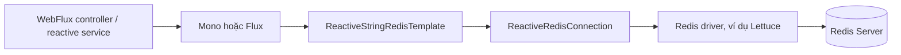
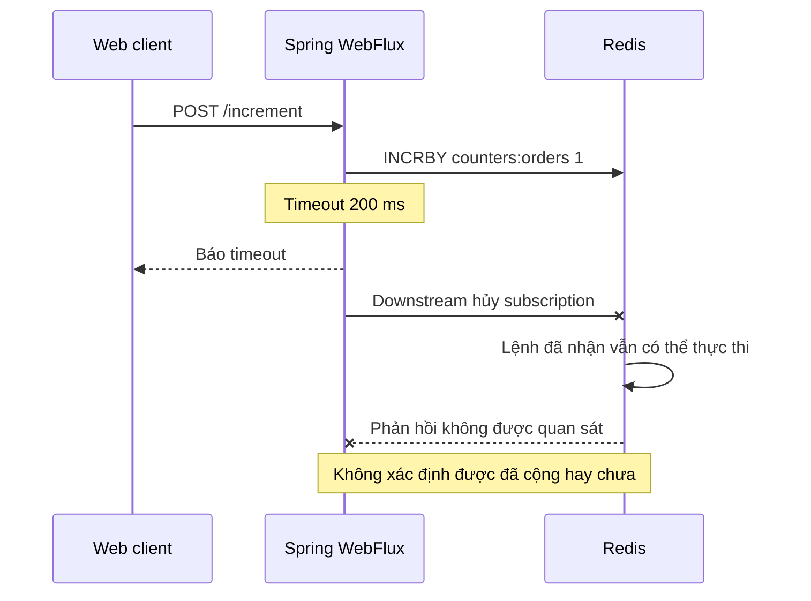
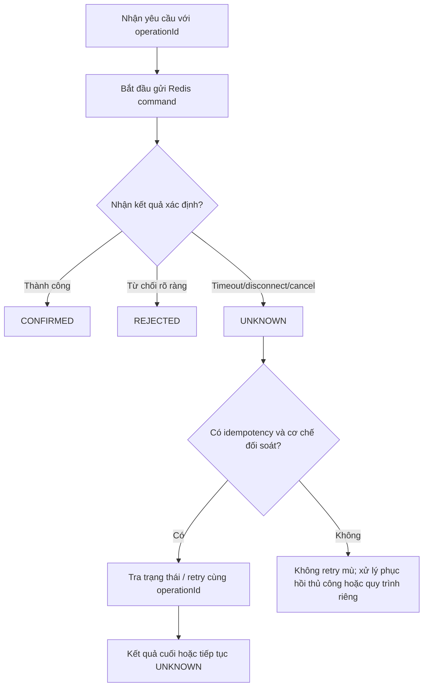
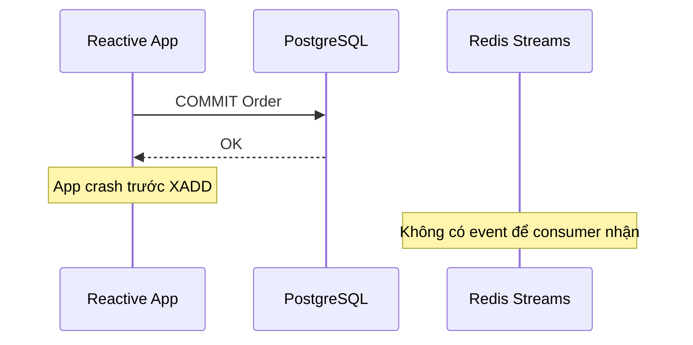
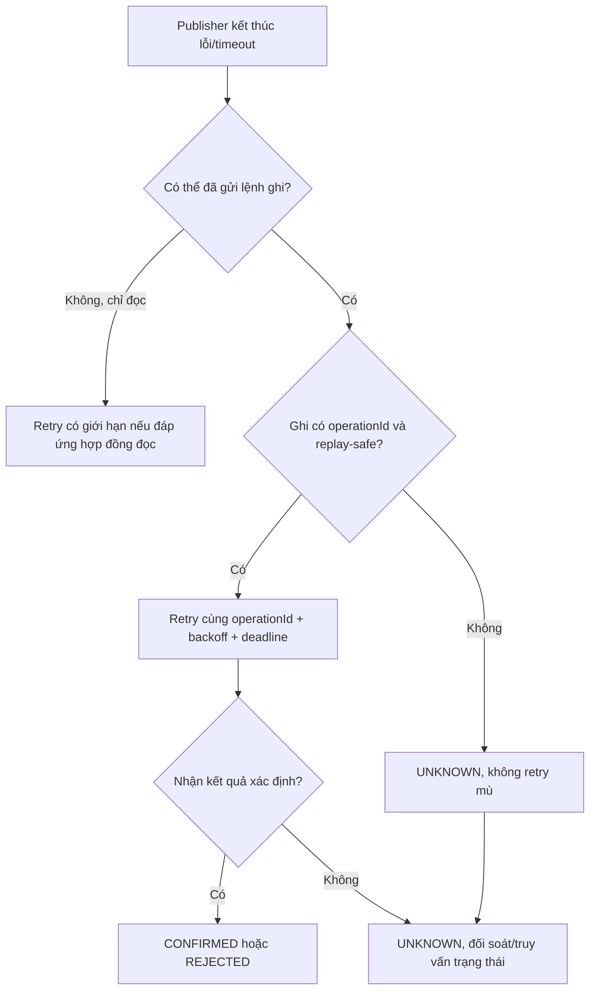

# Hủy đăng ký, timeout, retry và trạng thái ghi không chắc chắn

Với **Spring Data Redis Reactive**, ứng dụng gọi Redis qua các publisher của **Project Reactor**, thường là `Mono<T>` hoặc `Flux<T>`. Những publisher này cho phép kết hợp thao tác bất đồng bộ, giới hạn thời gian, hủy subscription và retry. Tuy nhiên, có một ranh giới rất quan trọng:

> **Hủy subscription hoặc gặp timeout ở phía ứng dụng không chứng minh Redis chưa ghi dữ liệu.**

Một lệnh có thể đã được gửi tới Redis, đã thực thi thành công, nhưng phản hồi bị mất hoặc đến sau khi subscriber không còn quan tâm. Nếu client tưởng lệnh chưa chạy và retry một thao tác như `INCRBY`, `LPUSH` hoặc `XADD`, tác dụng phụ có thể xuất hiện **hai lần**.

Bài học giải thích vòng đời reactive publisher, ý nghĩa của cancellation và timeout, cách phân loại retry theo loại thao tác, nhận diện trạng thái ghi **không chắc chắn** (*unknown write outcome*) và dùng **operation ID/idempotency** để xây dựng cơ chế phục hồi an toàn hơn.

## 1. Các lớp liên quan trong Spring Data Redis Reactive

Spring Data Redis có API bất đồng bộ theo mô hình Reactive Streams:

- `ReactiveRedisTemplate<K, V>`: thao tác Redis với key/value theo serializer được cấu hình.
- `ReactiveStringRedisTemplate`: biến thể thuận tiện cho dữ liệu chuỗi.
- `ReactiveValueOperations<K, V>`: thao tác string value như `get`, `set`, `increment`.
- `ReactiveStreamOperations<K, HK, HV>`: thao tác Redis Streams, ví dụ ghi `XADD`.
- `Mono<T>`: publisher phát tối đa một kết quả hoặc lỗi.
- `Flux<T>`: publisher có thể phát nhiều kết quả hoặc lỗi.

Luồng cơ bản:



Ví dụ truy cập Redis:

```java
import reactor.core.publisher.Mono;
import org.springframework.data.redis.core.ReactiveStringRedisTemplate;

public Mono<String> loadStatus(
        ReactiveStringRedisTemplate redis, String id) {
    return redis.opsForValue().get("status:" + id);
}
```

Khi được subscribe, publisher tiến hành tương tác với Redis và phát kết quả cho downstream. Theo thông lệ Reactive Streams, ứng dụng thường **trả publisher** cho tầng gọi, để WebFlux hoặc một thành phần điều phối quản lý subscription. Không gọi `.block()` trong event loop và không tự `.subscribe()` tùy tiện trong service chỉ để “kích hoạt” một tác vụ quan trọng.

## 2. Hiểu đúng vòng đời của một thao tác reactive

Một publisher có các tín hiệu:

| Tín hiệu / tình huống | Ý nghĩa ở phía Reactor | Có chứng minh trạng thái ghi Redis không? |
| --- | --- | --- |
| `onNext` rồi `onComplete` | Subscriber đã nhận được kết quả và publisher hoàn tất | Có thể xác nhận theo hợp đồng câu lệnh và phản hồi |
| `onError` | Publisher kết thúc với lỗi | **Không phải lúc nào** cũng chứng minh Redis chưa ghi |
| `cancel` / `dispose` | Downstream không muốn nhận thêm tín hiệu | **Không**; lệnh có thể đang hoặc đã được xử lý |
| `timeout` | Không nhận tín hiệu theo hạn đặt ra; Reactor phát lỗi timeout | **Không**; timeout ở phía client không phải rollback |
| `retry` / `retryWhen` | Đăng ký lại vào nguồn sau một lỗi được chọn | Có thể **gửi lại** câu lệnh gây side effect |

Với các publisher Redis thông dụng, lệnh thường được thực hiện khi có subscription. Tuy nhiên, thời điểm câu lệnh thực sự được đưa vào kết nối và các khả năng hủy lệnh phụ thuộc driver, connection và trạng thái pipeline. Không thể suy ra từ việc “đã gọi phương thức Java” rằng server chắc chắn đã thực thi; cũng không thể suy ra từ “subscription đã hủy” rằng server chắc chắn chưa thực thi.

### 2.1. Một ví dụ theo dòng thời gian



Sơ đồ mô tả **một khả năng** xảy ra, không phải thứ tự bắt buộc cho mọi timeout. Trong trường hợp khác, câu lệnh có thể chưa được gửi. Vì ứng dụng không thể phân biệt hai trường hợp chỉ từ tín hiệu timeout, kết quả phải được xem là **không chắc chắn** nếu lệnh có khả năng đã tới Redis.

## 3. Cancellation: dừng quan sát không có nghĩa hủy tác dụng phụ

Trong Reactor, `cancel` là tín hiệu từ downstream thông báo không cần dữ liệu tiếp theo. Nó có thể xảy ra khi:

- Người dùng đóng kết nối HTTP hoặc client ngắt request.
- Một `Mono` bị `timeout(...)` trước khi có kết quả.
- Một operator chọn nhánh khác, ví dụ `take(1)` trên `Flux`.
- Ứng dụng chủ động gọi `Disposable.dispose()` hoặc hủy subscription.
- Một chuỗi reactive kết thúc sớm theo chính sách ứng dụng.

Minh họa:

```java
import reactor.core.publisher.Mono;
import java.util.logging.Logger;

Mono<Boolean> write = redis.opsForValue()
        .set("status:job-101", "PROCESSING")
        .doOnSubscribe(s -> log.info("Redis write subscribed"))
        .doOnCancel(() -> log.info("Subscriber cancelled"))
        .doOnSuccess(ok -> log.info("Received write result: " + ok))
        .doOnError(error -> log.warning("Observed error: " + error));
```

`doOnCancel` chỉ cho biết subscriber hủy luồng ở phía Reactor. **Không được ghi log “Redis write rolled back” trong `doOnCancel`**, vì Redis không biết và không cung cấp rollback cho một lệnh đã thực thi chỉ vì client hủy việc chờ kết quả.

Với request web, framework thường quản lý vòng đời subscription. Nếu cần làm công việc phải hoàn tất ngay cả khi người dùng đóng HTTP connection, không thể chỉ “fire and forget” bằng một `.subscribe()` tách khỏi request rồi hy vọng nó luôn chạy xong. Cần ghi nhận yêu cầu vào một cơ chế bền vững để worker độc lập có thể tiếp tục sau khi tiến trình chết.

### 3.1. Hủy trước hoặc sau lúc gửi lệnh

| Mốc thời gian | Điều có thể xảy ra |
| --- | --- |
| Hủy trước khi publisher thực sự bắt đầu gửi | Driver có thể tránh gửi lệnh |
| Hủy khi lệnh nằm trong hàng đợi client | Có thể loại khỏi hàng đợi, hoặc lệnh vẫn được gửi tùy driver/trạng thái |
| Hủy sau khi Redis đã nhận | Redis vẫn có thể thực thi lệnh |
| Hủy sau khi Redis đã thực thi nhưng trước khi nhận reply | Ghi đã xảy ra, client không biết |
| Hủy sau khi đã quan sát reply thành công | Lệnh đã có kết quả; cancellation sau đó không đảo ngược thao tác |

Vì vậy, chỉ có **kết quả xác nhận đáng tin cậy** hoặc một bước **đối soát trạng thái** mới đủ cơ sở để kết luận tác dụng phụ đã diễn ra theo cách nào.

## 4. Timeout trong Reactor và timeout của Redis driver là hai lớp khác nhau

Một ứng dụng có thể có nhiều ngưỡng thời gian:

| Loại timeout | Ví dụ | Ý nghĩa |
| --- | --- | --- |
| Reactor `Mono.timeout` | `timeout(Duration.ofMillis(300))` | Không có tín hiệu từ publisher theo hạn, Reactor chuyển thành lỗi timeout và hủy upstream |
| Redis command timeout | Cấu hình trong Redis client/Lettuce hoặc Spring Boot | Driver chờ phản hồi Redis trong một khoảng giới hạn |
| Connection timeout | Hạn khi thiết lập kết nối | Có thể biết kết nối không thiết lập được, nhưng cần xét điểm gửi lệnh |
| HTTP request timeout | Gateway, load balancer hoặc WebFlux | Client không còn chờ HTTP response; backend có thể đang tiếp tục một số công việc |
| Business deadline | “Phải xác nhận giữ hàng trước 12:00” | Điều kiện nghiệp vụ, không chỉ là timeout mạng |

Ví dụ Reactor:

```java
import java.time.Duration;
import reactor.core.publisher.Mono;

Mono<Long> updated = redis.opsForValue()
        .increment("counter:requests")
        .timeout(Duration.ofMillis(300));
```

Nếu `updated` phát `TimeoutException`, **không được suy ra** giá trị `counter:requests` chưa tăng. `timeout` giới hạn thời gian chờ của subscriber, không tạo thao tác rollback trên Redis.

Một API có thể quy định:

```text
OK       -> đã nhận xác nhận từ Redis
REJECTED -> Redis trả lỗi rõ ràng trước khi ghi, hoặc quy tắc nghiệp vụ từ chối
UNKNOWN  -> không có xác nhận; lệnh có thể đã thực thi
```

Trong thực tế, cần thận trọng khi đưa một exception vào trạng thái `REJECTED`: nhiều lỗi xảy ra trước khi client nhận reply không cho biết Redis đã xử lý hay chưa. Sử dụng `UNKNOWN` khi kết quả có thể đã được thực thi nhưng không quan sát được.

## 5. Không phải mọi thao tác Redis đều retry giống nhau

Một bước thiết kế bắt buộc là phân loại thao tác theo tính **idempotent**: thực thi lại cùng yêu cầu có tạo tác dụng phụ mới hay không?

| Thao tác | Ví dụ | Nếu gửi lại sau timeout |
| --- | --- | --- |
| Đọc | `GET key`, `HGETALL key` | Thường không tạo side effect; có thể nhận giá trị khác vì dữ liệu đã thay đổi |
| Gán giá trị cố định | `SET key "READY"` | Có thể hội tụ cùng giá trị, nhưng ảnh hưởng TTL, sự kiện và ghi cạnh tranh vẫn phải xem xét |
| Tăng/giảm | `INCRBY counter 1`, `DECRBY stock 2` | **Có thể cộng/trừ thêm lần nữa** |
| Thêm vào list | `LPUSH queue payload` | **Có thể thêm phần tử trùng** |
| Thêm vào Stream | `XADD stream * ...` | **Có thể tạo record mới với ID khác** |
| Thêm vào set | `SADD set member` | Thường không làm tăng số member nếu cùng member; vẫn có race/logic phụ trợ |
| Tạo khi chưa tồn tại | `SET key value NX` | Lần sau có thể nhận “khóa đã tồn tại”, nhưng không tự biết lần trước do mình hay client khác tạo |
| Xóa key | `DEL key` | Xóa lại thường không đổi trạng thái cuối, nhưng kết quả đếm/xung đột và side effect liên quan có thể khác |
| Lua với operation ID | Script kiểm tra ID và ghi nguyên tử | Có thể an toàn hơn khi replay **cùng operation ID**, nếu trạng thái chống trùng vẫn được giữ bền vững |

“Một lệnh Redis nguyên tử” **không đồng nghĩa** “thực thi lặp an toàn”. Ví dụ `INCRBY` nguyên tử nhưng gọi hai lần sẽ tăng hai lần. `XADD` nguyên tử khi thêm record nhưng hai lần gửi tạo hai record nếu dùng ID tự sinh.

Ngược lại, một lệnh `SET` gán giá trị giống nhau có vẻ idempotent về **giá trị cuối cùng**, nhưng vẫn có thể xóa TTL trước đó, ghi đè cập nhật mới hơn hoặc kích hoạt notification. Đánh giá idempotency phải dựa trên **hợp đồng nghiệp vụ**, không chỉ nhìn lệnh Redis.

## 6. Vì sao `retryWhen` có thể làm tăng side effect?

Reactor có thể đăng ký lại publisher khi xảy ra lỗi:

```java
import java.time.Duration;
import reactor.util.retry.Retry;

Mono<Long> risky = redis.opsForValue()
        .increment("counter:requests")
        .timeout(Duration.ofMillis(300))
        .retryWhen(Retry.backoff(2, Duration.ofMillis(50)));
```

`Retry.backoff(2, ...)` cho phép **tối đa hai lần retry**, nghĩa là tối đa **ba subscription/lần thử** tính cả lần đầu. Nếu cả ba lần đều gửi và Redis thực thi `INCRBY`, giá trị có thể tăng ba lần dù người dùng chỉ gửi một yêu cầu.

```text
Attempt 1: INCRBY -> Redis đã tăng, reply bị mất -> timeout
Attempt 2: INCRBY -> Redis lại tăng, reply bị mất -> timeout
Attempt 3: INCRBY -> Redis lại tăng, reply thành công

Ứng dụng quan sát "thành công một request"
Redis đã tăng counter ba lần
```

**Không đặt `retryWhen` vô điều kiện sau mọi lệnh ghi có side effect.** Lọc loại lỗi có thể retry giúp tránh retry `WRONGTYPE`, lỗi dữ liệu hoặc lỗi quyền, nhưng **chỉ lọc lỗi chưa đủ** nếu thao tác không idempotent: ngay cả timeout hợp lệ cũng có thể xảy ra **sau commit**.

### 6.1. Retry của đọc và ghi cần tách riêng

Một truy vấn đọc, chẳng hạn:

```java
Mono<String> status = redis.opsForValue()
        .get("status:job-101")
        .timeout(Duration.ofMillis(300))
        .retryWhen(Retry.backoff(2, Duration.ofMillis(40)));
```

thường có thể thử lại nếu hợp đồng chỉ yêu cầu **giá trị mới nhất tại thời điểm một lần đọc nào đó**. Nhưng không bảo đảm các lần thử cho cùng kết quả: một tiến trình khác có thể sửa hoặc xóa key.

Với ghi, trước tiên phải xác định **có thể lặp cùng thao tác mà không tạo tác dụng phụ mới hay không**. Nếu không, cần idempotency/reconciliation hoặc không retry tự động.

## 7. Thiết kế trạng thái cho một thao tác ghi

Một API ghi dữ liệu quan trọng nên có trạng thái rõ ràng:

```text
NOT_STARTED  -> chưa bắt đầu gửi lệnh
IN_FLIGHT    -> có thể đã gửi, đang chờ xác nhận
CONFIRMED    -> nhận kết quả xác nhận thành công
REJECTED     -> nhận kết quả từ chối rõ ràng theo hợp đồng
UNKNOWN      -> mất xác nhận sau khi lệnh có thể đã được xử lý
```



Điểm quan trọng là `UNKNOWN` **không phải** `FAILED`. Một phản hồi HTTP `504 Gateway Timeout` chỉ cho biết người gọi không nhận kết quả trong thời gian cho phép; nó không chứng minh Redis chưa thực hiện thao tác.

Vì vậy một API tạo lệnh thanh toán, giữ hàng, ghi event hoặc ghi đơn hàng nên có **request/operation ID ổn định** và API tra cứu kết quả. Khi client gặp timeout, nó sử dụng cùng ID để hỏi lại hoặc gửi lại an toàn theo hợp đồng thay vì tạo một request hoàn toàn mới.

## 8. Ví dụ chưa an toàn: đặt hàng bằng `increment` reactive

Giả sử service giữ hàng đơn giản:

```java
import org.springframework.data.redis.core.ReactiveStringRedisTemplate;
import reactor.core.publisher.Mono;

public Mono<Long> decrementStock(
        ReactiveStringRedisTemplate redis,
        String sku,
        long quantity) {
    return redis.opsForValue()
            .increment("stock:" + sku, -quantity);
}
```

Đoạn mã trên có ít nhất hai giới hạn:

1. Không kiểm tra điều kiện `stock >= quantity`, nên có thể làm tồn kho âm.
2. Nếu thao tác đã được Redis thực thi nhưng phản hồi bị mất, **gửi lại cùng lời gọi sẽ trừ tồn kho lần nữa**.

Thêm `.timeout(...).retryWhen(...)` có thể che đi lỗi mạng nhất thời nhưng **không giải quyết** tính đúng đắn của nghiệp vụ. Cần đổi mô hình cập nhật, không chỉ đổi số lần retry.

## 9. Giải pháp có operation ID: kiểm tra và ghi nguyên tử bằng Lua

Một cách xây dựng thao tác có thể replay an toàn hơn là dùng **Lua script** để gắn kết:

1. Kiểm tra `operationId` đã được xử lý hay chưa.
2. Nếu đã có kết quả, trả lại kết quả trước đó, **không trừ tồn kho lần nữa**.
3. Nếu chưa, kiểm tra tồn kho hiện tại.
4. Ghi kết quả từ chối hoặc trừ tồn kho và ghi dấu đã xử lý trong **cùng lượt thực thi nguyên tử** trên Redis.

Ví dụ dùng hai key Redis:

```text
stock:{sku-42}        -> Redis string chứa số lượng hiện có
stock-ops:{sku-42}    -> Redis hash lưu operationId -> kết quả
```

Cặp dấu ngoặc nhọn `{sku-42}` là **Redis Cluster hash tag**, giúp hai key có cùng hash slot khi cần thực thi script nhiều key. Bảng `stock-ops` chỉ là minh họa cho việc lưu idempotency; hệ thống production cần chính sách retention, phân vùng và độ bền phù hợp.

### 9.1. Script Redis

```lua
-- KEYS[1] = stock:{sku-42}
-- KEYS[2] = stock-ops:{sku-42}
-- ARGV[1] = operationId, không thay đổi giữa các retry
-- ARGV[2] = quantity, số nguyên dương

local operationId = ARGV[1]
local quantity = tonumber(ARGV[2])

if not operationId or operationId == '' then
    return redis.error_reply('operationId required')
end

if not quantity or quantity <= 0 or quantity % 1 ~= 0 then
    return redis.error_reply('invalid quantity')
end

local prior = redis.call('HGET', KEYS[2], operationId)
if prior then
    -- 1 trước đây đã trừ thành công: báo ALREADY_APPLIED.
    if prior == '1' then
        return 2
    end
    -- 0: NOT_ENOUGH; -1: NOT_FOUND.
    return tonumber(prior)
end

local raw = redis.call('GET', KEYS[1])
if not raw then
    redis.call('HSET', KEYS[2], operationId, -1)
    return -1
end

local available = tonumber(raw)
if not available or available < 0 or available % 1 ~= 0 then
    return redis.error_reply('invalid stock')
end

if available < quantity then
    redis.call('HSET', KEYS[2], operationId, 0)
    return 0
end

redis.call('DECRBY', KEYS[1], quantity)
redis.call('HSET', KEYS[2], operationId, 1)
return 1
```

Ý nghĩa mã trả về:

| Kết quả | Ý nghĩa | Có trừ kho thêm ở lần gọi này? |
| --- | --- | --- |
| `1` | Lần đầu xử lý thành công | Có |
| `2` | `operationId` từng xử lý thành công | **Không** |
| `0` | Không đủ hàng, đã lưu kết quả từ chối cho ID này | Không |
| `-1` | Không tìm thấy khóa tồn kho, đã lưu kết quả cho ID này | Không |

Kết quả từ chối cũng được lưu cho cùng `operationId`, để một retry sau khi hàng được bổ sung **không âm thầm biến quyết định cũ thành một lần đặt hàng mới**. Nếu nghiệp vụ muốn thử đặt lại sau khi tồn kho thay đổi, phải tạo một **operationId mới** sau quyết định nghiệp vụ mới.

**Giới hạn quan trọng:** Redis script thực thi không bị xen kẽ lệnh khác trong lúc chạy, nhưng **không phải transaction có rollback khi một lệnh ở giữa script gây lỗi**. Ví dụ trên giả định key có đúng kiểu dữ liệu, số lượng nằm trong phạm vi số nguyên Redis/Lua hỗ trợ và Redis có đủ tài nguyên; production cần validate chặt hơn và kiểm soát lỗi bộ nhớ, overflow, dữ liệu sai kiểu. Khả năng replay an toàn còn phụ thuộc dấu `stock-ops` được giữ đủ lâu và không bị mất do chính sách persistence/eviction.

### 9.2. Gọi Lua script bằng `ReactiveStringRedisTemplate`

Với Java 17+ và Spring Boot 3.x, có thể đóng gói lời gọi reactive:

```java
package com.example.inventory;

import java.util.List;
import org.springframework.data.redis.core.ReactiveStringRedisTemplate;
import org.springframework.data.redis.core.script.RedisScript;
import org.springframework.stereotype.Service;
import reactor.core.publisher.Mono;

@Service
public class ReactiveReservationService {

    private static final RedisScript<Long> RESERVE_SCRIPT =
            RedisScript.of("""
                    local id = ARGV[1]
                    local quantity = tonumber(ARGV[2])
                    if not id or id == '' or not quantity
                       or quantity <= 0 or quantity % 1 ~= 0 then
                        return redis.error_reply('invalid request')
                    end
                    local prior = redis.call('HGET', KEYS[2], id)
                    if prior then
                        if prior == '1' then return 2 end
                        return tonumber(prior)
                    end
                    local value = redis.call('GET', KEYS[1])
                    if not value then
                        redis.call('HSET', KEYS[2], id, -1)
                        return -1
                    end
                    local available = tonumber(value)
                    if not available or available < 0
                       or available % 1 ~= 0 then
                        return redis.error_reply('invalid stock')
                    end
                    if available < quantity then
                        redis.call('HSET', KEYS[2], id, 0)
                        return 0
                    end
                    redis.call('DECRBY', KEYS[1], quantity)
                    redis.call('HSET', KEYS[2], id, 1)
                    return 1
                    """, Long.class);

    private final ReactiveStringRedisTemplate redis;

    public ReactiveReservationService(ReactiveStringRedisTemplate redis) {
        this.redis = redis;
    }

    public enum Outcome {
        APPLIED,
        ALREADY_APPLIED,
        INSUFFICIENT_STOCK,
        STOCK_NOT_FOUND
    }

    public Mono<Outcome> reserve(
            String sku, String operationId, long quantity) {

        if (sku == null || sku.isBlank() || sku.contains("{")
                || sku.contains("}")) {
            return Mono.error(new IllegalArgumentException("invalid sku"));
        }
        if (operationId == null || operationId.isBlank()
                || quantity <= 0) {
            return Mono.error(new IllegalArgumentException("invalid request"));
        }

        String stockKey = "stock:{" + sku + "}";
        String ledgerKey = "stock-ops:{" + sku + "}";

        return redis.execute(
                    RESERVE_SCRIPT,
                    List.of(stockKey, ledgerKey),
                    List.of(operationId, Long.toString(quantity)))
                .single()
                .map(result -> switch (result.intValue()) {
                    case 1 -> Outcome.APPLIED;
                    case 2 -> Outcome.ALREADY_APPLIED;
                    case 0 -> Outcome.INSUFFICIENT_STOCK;
                    case -1 -> Outcome.STOCK_NOT_FOUND;
                    default -> throw new IllegalStateException(
                            "Unexpected script reply: " + result);
                });
    }
}
```

`ReactiveStringRedisTemplate.execute(script, keys, args)` trả một `Flux<T>` các kết quả script; với script trả đúng một số nguyên, `.single()` biến kết quả thành `Mono<Long>`. Đây là ví dụ đồng bộ về mặt **ngữ nghĩa ghi** nhưng không chặn luồng Java: kết quả được phát theo Reactor.

Trong production, không dùng `sku` do người dùng tùy ý cung cấp để ghép trực tiếp key mà không xác thực namespace, độ dài, ký tự cho phép và quyền truy cập. Tương tự, cùng `operationId` phải gắn với **cùng bộ tham số nghiệp vụ** (`sku`, `quantity`, chủ thể, v.v.); nếu client gửi lại cùng ID với quantity khác, cần từ chối yêu cầu thay vì trả kết quả cũ mà không kiểm tra. Có thể lưu hash của request cùng trạng thái vào ledger để phát hiện misuse.

### 9.3. Retry an toàn hơn trên cùng operation ID

Với script có dấu chống trùng, có thể chọn retry giới hạn cho các lỗi tạm thời:

```java
import java.time.Duration;
import java.util.concurrent.TimeoutException;
import org.springframework.data.redis.RedisConnectionFailureException;
import reactor.core.publisher.Mono;
import reactor.util.retry.Retry;

public Mono<ReactiveReservationService.Outcome> reserveWithRetry(
        ReactiveReservationService service,
        String sku,
        String operationId,
        long quantity) {

    return Mono.defer(() -> service.reserve(sku, operationId, quantity))
            .timeout(Duration.ofMillis(350))
            .retryWhen(
                    Retry.backoff(2, Duration.ofMillis(40))
                            .maxBackoff(Duration.ofMillis(200))
                            .jitter(0.5)
                            .filter(error ->
                                    error instanceof TimeoutException ||
                                    error instanceof RedisConnectionFailureException));
}
```

Ở đây:

- `Mono.defer` giữ cách diễn đạt “tạo một lần thử mới khi subscribe/retry”.
- Mỗi lần retry **giữ nguyên `operationId`, `sku` và `quantity`**.
- `timeout` giới hạn thời gian chờ của từng attempt, không phải deadline tổng cho cả ba attempt.
- `Retry.backoff(2, ...)` cho phép tối đa **hai lần retry ngoài lần đầu**.
- `filter` tránh retry các lỗi ứng dụng hoặc dữ liệu không thuộc nhóm đã chọn.
- Script dùng operationId ngăn việc trừ tồn kho thêm lần nữa nếu attempt trước đã commit và ledger vẫn còn.

Tuy vậy, **đừng hiểu đoạn mã này là exactly-once tuyệt đối**. Cần xét thêm việc mất dữ liệu ledger khi Redis failover, khả năng key bị eviction, hết hạn ledger, lỗi runtime giữa các lệnh Lua và tình huống cùng ID được dùng cho yêu cầu khác. Với thao tác tác động tới SQL hoặc hệ thống thanh toán, Redis ledger đơn lẻ có thể chưa đủ để bảo đảm toàn bộ nghiệp vụ.

## 10. Bảo vệ operation ID khỏi việc tái sử dụng sai

Với cơ chế idempotency, một `operationId` phải đại diện cho **một ý định nghiệp vụ bất biến**. Ví dụ:

```text
operationId = reserve-req-9
sku         = sku-42
quantity    = 3
userId      = customer-7
```

Nếu request sau gửi lại `reserve-req-9` nhưng `quantity=10`, không nên tự động nhận là cùng một yêu cầu hợp lệ. Một thiết kế mạnh hơn lưu cùng dấu đã xử lý:

```json
{
  "operationId": "reserve-req-9",
  "requestFingerprint": "sha256-cua-sku-quantity-userId",
  "result": "APPLIED",
  "stockAfter": 17
}
```

Khi replay, kiểm tra fingerprint trước khi trả kết quả. Nếu khác, trả lỗi xung đột idempotency key. Fingerprint phải được tính trên một biểu diễn canonical nhất quán của các trường thực sự ảnh hưởng thao tác.

**Thời gian giữ ledger** phải dài ít nhất bằng thời gian các request có thể bị gửi lại, thời gian client phải phục hồi sau timeout và giới hạn của hệ thống. Nếu ledger bị xóa trước khi retry muộn, cùng operationId có thể bị thực thi như mới. Nếu ledger giữ vô hạn, cần có chiến lược phân vùng, làm sạch, dung lượng và giới hạn số operation.

## 11. Đối soát sau timeout: không chỉ đọc giá trị cuối

Giả sử sau timeout của `INCRBY counter 1`, ứng dụng gọi `GET counter`. Nếu nhận `101` thay vì `100`, có thể nghĩ lệnh của mình đã chạy. Nhưng một client khác cũng có thể vừa tăng counter, nên **giá trị cuối không chứng minh thao tác của ai đã commit**.

Đối soát đúng cần một dấu vết gắn với **operationId**, không chỉ trạng thái tổng:

```text
Yêu cầu: operationId=abc123
Redis ledger:
    abc123 -> APPLIED
```

Nếu trạng thái ledger được cập nhật nguyên tử với thay đổi nghiệp vụ, ứng dụng có thể biết thao tác có được áp dụng chưa trong phạm vi bảo đảm của hệ thống đó.

| Kết quả tra cứu | Diễn giải |
| --- | --- |
| Ledger có `APPLIED` | Redis ghi nhận operation đã xử lý theo quy ước script |
| Ledger có `REJECTED` | Trước đó đã từ chối theo điều kiện nghiệp vụ |
| Ledger không có record | **Chưa đủ kết luận** nếu ledger có thể đã bị xóa/mất hoặc còn một attempt đang chạy |
| Redis không thể truy cập | Trạng thái vẫn `UNKNOWN` |

Nếu producer gửi bản ghi `XADD` vào Redis Stream bằng ID tự sinh, việc đọc một record gần nhất cũng không đủ để chứng minh nó thuộc attempt nào. Gắn `eventId` ổn định trong payload và quy định cách tra/dedup là cần thiết khi retry.

## 12. Timeout tổng, deadline nghiệp vụ và backoff

Một `timeout(Duration.ofMillis(350))` ở trong nguồn được retry có thể cho phép ba attempt, mỗi attempt chờ đến 350 ms, cộng backoff. Nếu request HTTP có SLA 500 ms, cấu hình đó có thể vượt budget.

Có thể đặt thêm deadline tổng bên ngoài retry:

```java
Mono<ReactiveReservationService.Outcome> pipeline =
        reserveWithRetry(service, sku, operationId, quantity)
                .timeout(Duration.ofMillis(900));
```

`timeout` ngoài cùng là giới hạn tổng của publisher tại mức đó. Khi hạn đến, nó hủy upstream; dù vậy, **nó vẫn không chứng minh Redis chưa ghi**.

Những yếu tố nên được chọn cùng nhau:

| Tham số | Mục đích |
| --- | --- |
| Redis command timeout | Giới hạn chờ lệnh ở driver |
| Per-attempt Reactor timeout | Không để một attempt chiếm toàn bộ request |
| `maxRetries` | Không thử lại mãi khi Redis gặp sự cố |
| Backoff + jitter | Giảm đợt retry đồng loạt lúc lỗi chung |
| Total request deadline | Đảm bảo request không kéo dài vô hạn |
| Business deadline | Kiểm tra thao tác có còn hợp lệ khi retry muộn không |

**Chú ý:** timeout không luôn “cắt” được một lệnh đã gửi. Với yêu cầu bảo mật hoặc dữ liệu quan trọng, deadline nghiệp vụ phải được kiểm tra ở nơi **thực sự commit** (ví dụ trong Lua/SQL transition), không chỉ trước khi gửi publisher ở Java.

## 13. Hủy HTTP request trong WebFlux

Spring WebFlux sử dụng reactive publisher làm kết quả của request. Ví dụ:

```java
@PostMapping("/inventory/{sku}/reserve")
public Mono<ReservationResponse> reserve(
        @PathVariable String sku,
        @RequestHeader("Idempotency-Key") String operationId,
        @RequestBody Mono<ReservationRequest> request) {

    return request.flatMap(body ->
            reservationService.reserve(
                    sku, operationId, body.quantity()))
            .map(outcome ->
                    new ReservationResponse(operationId, outcome.name()));
}
```

Ví dụ giả định `reservationService` là `ReactiveReservationService` và các DTO `ReservationRequest`, `ReservationResponse` đã được khai báo trong dự án. Mục tiêu là cho thấy controller **trả `Mono`**, không gọi `.subscribe()` bên trong.

Nếu client đóng kết nối hoặc gateway timeout, subscription có thể bị hủy. Với một thao tác giữ hàng có ý nghĩa nghiệp vụ:

1. Client sinh/gửi `Idempotency-Key` ổn định.
2. Server thực thi command có idempotency theo ID.
3. Khi nhận xác nhận, server trả kết quả.
4. Nếu client không nhận được kết quả, nó **gửi lại cùng ID** hoặc gọi endpoint tra cứu trạng thái.
5. Server trả kết quả đã lưu, không tạo một lần giữ hàng mới.

Không nên phát sinh UUID mới trong **mỗi lần subscription** của cùng request ở `Mono.defer`, vì retry khi đó sẽ tạo operation khác. ID phải được tạo hoặc cố định **trước khi bắt đầu chuỗi retry**, rồi dùng lại cho tất cả attempt thuộc cùng một ý định nghiệp vụ.

## 14. `doOnError`, `onErrorResume` và `doFinally` không sửa được trạng thái Redis

Các operator Reactor giúp ứng dụng quan sát và phân loại lỗi:

```java
Mono<Long> task = redis.opsForValue()
        .increment("metrics:processed")
        .timeout(Duration.ofMillis(300))
        .doOnError(ex -> log.warn("Redis write not confirmed", ex))
        .doFinally(signalType ->
                log.info("Publisher terminated: {}", signalType));
```

`doFinally` có thể quan sát tín hiệu hoàn tất, lỗi hoặc cancel ở phía pipeline. Tuy nhiên, giá trị `signalType == CANCEL` **không phải kết quả Redis**.

Một nhánh fallback cũng không làm kết quả ghi trở nên xác định:

```java
Mono<Long> misleading = redis.opsForValue()
        .increment("metrics:processed")
        .timeout(Duration.ofMillis(300))
        .onErrorReturn(0L); // Không nên: 0 có thể bị hiểu là đã ghi 0.
```

Nếu `0` là một giá trị nghiệp vụ hợp lệ, fallback trên làm caller không phân biệt được “Redis trả kết quả 0” với “không nhận được kết quả”. Với write quan trọng, nên trả một kiểu kết quả nêu rõ trạng thái `UNKNOWN` hoặc chuyển lỗi cho tầng điều phối phục hồi.

## 15. Khi dùng Redis Streams trong reactive pipeline

Ví dụ producer ghi sự kiện:

```java
import java.util.Map;
import reactor.core.publisher.Mono;
import org.springframework.data.redis.connection.stream.RecordId;

Mono<RecordId> append = reactiveStringRedisTemplate.opsForStream()
        .add("orders:events", Map.of(
                "eventId", "event-abc",
                "type", "OrderCreated",
                "orderId", "O-1001"));
```

`XADD ... *` tạo `RecordId` mới mỗi lần lệnh được thực thi. Nếu timeout rồi retry lại publisher trên, Redis có thể lưu hai record có **cùng `eventId` nhưng hai `RecordId` khác nhau**. Stream có khả năng đọc lại record, nhưng **không tự dedup theo eventId**.

Vì vậy, đối với producer:

- Cố định `eventId` cho một sự kiện.
- Không mặc định retry `XADD` là idempotent.
- Nếu cần liên kết ghi nghiệp vụ với phát event, dùng transactional outbox hoặc cơ chế atomic phù hợp với nguồn dữ liệu.

Đối với consumer:

- Đọc bằng consumer group theo hợp đồng.
- Ghi dấu `eventId` đã xử lý theo cách bền vững tại hệ thống đích.
- Chỉ `XACK` sau khi xử lý nghiệp vụ hoàn tất.
- Chấp nhận rằng record có thể được giao lại sau khi worker chết hoặc trước khi ACK.

**Hủy subscription của consumer khi đang xử lý** cũng không có nghĩa side effect trước đó chưa xảy ra. Khả năng replay, pending recovery và idempotent handler mới là thành phần giúp khôi phục an toàn.

## 16. Ghi Redis và ghi SQL: hai ranh giới giao dịch

Giả sử quy trình tạo đơn hàng:

```text
1. INSERT orders trong PostgreSQL
2. XADD orders:events trong Redis
```

Ngay cả khi gọi hai bước trong một reactive chain, đây **không tự trở thành giao dịch nguyên tử xuyên SQL và Redis**. Một tiến trình có thể chết giữa bước 1 và bước 2.



**Transactional outbox** giải quyết khoảng trống:

1. Trong transaction của SQL, ghi `Order` và `OutboxEvent` cùng lúc.
2. Một publisher độc lập đọc outbox record chưa phát.
3. Publisher gửi `XADD` với `eventId` ổn định.
4. Nếu kết quả ghi Redis không chắc chắn, publisher có thể retry theo hợp đồng, nhưng cần chấp nhận khả năng duplicate event.
5. Consumer dedup theo `eventId` và xử lý side effect idempotent.

Trong mô hình này, cancellation của request HTTP không làm mất ý định cần phát event, vì outbox đã được commit trong nguồn dữ liệu bền vững. Việc đảm bảo độ bền của stream còn phụ thuộc Redis persistence/replication, failover và retention; outbox không tự thay thế việc thiết kế durability của đích.

## 17. Phân biệt retry của thao tác đọc, ghi idempotent và ghi không idempotent



Một chiến lược phù hợp:

| Loại thao tác | Ví dụ | Phương án khi timeout |
| --- | --- | --- |
| Đọc trạng thái | `GET session:id` | Retry giới hạn nếu chấp nhận dữ liệu có thể thay đổi |
| Ghi cùng giá trị không có phụ thuộc thứ tự | `SET maintenance:flag on` | Có thể retry sau khi xem xét TTL, ghi cạnh tranh và side effect liên quan |
| Tăng số lần xử lý | `INCRBY count 1` | Không retry mù; dùng operationId và phép tăng nguyên tử chống trùng |
| Giữ tồn kho | `DECRBY stock 3` | Kiểm tra điều kiện + idempotency trong cùng đơn vị nguyên tử |
| Append event | `XADD stream * ...` | Giữ `eventId`, xử lý duplicate hoặc dùng outbox/ledger phù hợp |
| Thanh toán/đặt hàng | Thao tác đa hệ thống | Ghi bền vững ý định, idempotency và đối soát; không lấy cache làm transaction |

## 18. Những sai lầm thường gặp

### Sai lầm 1: “Timeout nghĩa là Redis đã rollback”

Redis không rollback một lệnh đã chạy chỉ vì phía Java bỏ chờ. Timeout ở Reactor/driver có thể xảy ra **sau khi server đã thực thi**. Trạng thái cần được đối soát.

### Sai lầm 2: “Dùng retryWhen cho mọi Redis command là an toàn”

`retryWhen` tạo subscription mới; với thao tác tăng, đẩy queue hoặc append stream, nó có thể lặp side effect. Chỉ retry tự động khi thao tác replay-safe hoặc có chiến lược idempotency phù hợp.

### Sai lầm 3: “Chỉ cần Redis command nguyên tử”

`INCRBY` nguyên tử nhưng mỗi lần gọi đều tăng. Một câu lệnh nguyên tử không tự mang dấu “yêu cầu này đã được xử lý”.

### Sai lầm 4: “Subscriber đã cancel thì server không làm gì nữa”

Cancellation truyền vào pipeline ở phía client và có thể không ngăn được một lệnh đã đến Redis. Có thể lệnh đã hoàn tất nhưng phản hồi không được quan sát.

### Sai lầm 5: “GET giá trị sau timeout là biết lần ghi trước đã chạy”

Nếu có nhiều writer, giá trị hiện tại có thể do một request khác thay đổi. Cần operationId, state version hoặc log quyết định gắn với thao tác của chính request.

### Sai lầm 6: “Cùng operationId nhưng thay payload vẫn là retry”

Một retry hợp lệ phải giữ nguyên ý định nghiệp vụ. Nên lưu request fingerprint và trả xung đột khi ID được dùng lại với tham số khác.

### Sai lầm 7: “Idempotency ledger có TTL ngắn vẫn đủ cho mọi retry”

Nếu ID hết hạn trước khi client retry muộn, thao tác có thể được thực thi lần nữa. Retention của ledger phải phù hợp cửa sổ retry, thời gian phục hồi và đặc tính của nghiệp vụ.

### Sai lầm 8: “Ghi thành công vào Redis nghĩa là đã bền vững tuyệt đối”

Redis đã trả OK xác nhận việc thực thi tại server theo hợp đồng của command, nhưng khả năng sống sót qua crash hoặc failover còn phụ thuộc persistence, replication và topology. Khi cần SLA durability nghiêm ngặt, phải thiết kế và kiểm chứng riêng.

### Sai lầm 9: “Có thể bỏ subscribe trong service để xử lý nền”

Một `.subscribe()` tự phát trong request không có lifecycle, retry bền vững hoặc bảo đảm xử lý khi process dừng. Nên để WebFlux điều phối publisher hoặc đưa tác vụ cần hoàn tất vào queue/outbox có thể phục hồi.

### Sai lầm 10: “Lỗi trong Lua script tự rollback mọi lệnh”

Redis script không bị lệnh khác xen kẽ trong lúc chạy, nhưng lỗi runtime không bảo đảm hoàn tác các lệnh đã chạy trước lỗi. Phải validate trước ghi và bảo vệ dữ liệu/tài nguyên.

### Sai lầm 11: “HTTP 504 là thất bại nghiệp vụ chắc chắn”

HTTP timeout nói về việc **không nhận được kết quả kịp thời**. Một endpoint giao dịch nên công bố cách tra cứu theo operationId và phân biệt `UNKNOWN` với `REJECTED`.

## 19. Quan sát vận hành và kiểm tra những tình huống không chắc chắn

Các chỉ số nên có:

| Chỉ số | Ý nghĩa |
| --- | --- |
| `redis_write_attempts` | Số lần gửi lệnh ghi, kể cả retry |
| `redis_write_confirmed` | Số attempt nhận phản hồi xác nhận thành công |
| `redis_write_unknown` | Số thao tác mất xác nhận sau khi có thể đã gửi |
| `redis_write_retries` | Số lần đăng ký lại do retry |
| `redis_write_timeouts` | Số timeout ở tầng Reactor/driver |
| `redis_write_cancelled` | Số subscription bị hủy |
| `idempotency_replayed` | Số lần operationId đã xử lý được đọc lại |
| `idempotency_conflicts` | Cùng operationId được gửi với payload khác |
| `reconciliation_pending` | Số thao tác còn UNKNOWN, chưa đối soát được |
| `reconciliation_latency` | Thời gian chuyển từ UNKNOWN sang kết quả xác định |

Không đưa mật khẩu, token hoặc toàn bộ payload nhạy cảm vào log. Có thể ghi `operationId`, loại operation, trạng thái, số attempt, elapsed time, phiên bản schema và correlation ID đã được chuẩn hóa.

### 19.1. Những kịch bản nên thử trong môi trường học tập

| Kịch bản | Điều cần quan sát |
| --- | --- |
| Gọi `GET` khi Redis phản hồi chậm | Retry có giới hạn, dữ liệu có thể khác lần đầu |
| Gọi `INCRBY` rồi timeout | Có thể không biết counter đã tăng hay chưa |
| Lặp `XADD` sau mất phản hồi | Có thể tạo hai Redis record ID khác nhau |
| Gửi lại cùng operationId bằng script | Không trừ kho hai lần nếu ledger còn hợp lệ |
| Gửi cùng operationId nhưng quantity khác | Cần bị từ chối khi có request fingerprint |
| Hủy HTTP request giữa lúc ghi | Không thể kết luận Redis chưa xử lý |
| Redis failover / ledger bị xóa | Kiểm tra giới hạn của idempotency và phục hồi |

Trong các bài thử gây lỗi mạng, chỉ thao tác trên Redis và dữ liệu **không quan trọng**. Không thử bằng cách cố tình làm mất kết nối production hoặc làm gián đoạn traffic thật.

### 19.2. Thiết kế API cho tình trạng UNKNOWN

Một mẫu response có thể là:

```json
{
  "operationId": "reserve-req-9",
  "status": "UNKNOWN",
  "message": "Chưa xác minh được Redis đã áp dụng yêu cầu hay chưa",
  "statusUrl": "/operations/reserve-req-9"
}
```

`UNKNOWN` không có nghĩa request được phép thực hiện lại bằng **ID mới**. Client nên truy vấn `statusUrl` hoặc retry theo đúng hợp đồng idempotency với **cùng `operationId`**.

HTTP status code cụ thể (`202`, `409`, `503`, `504`, v.v.) phải được thống nhất với API contract; không có một mã duy nhất thay thế được trạng thái nghiệp vụ. Một endpoint `/operations/{id}` phải tra được trạng thái từ hệ thống có khả năng phục hồi, không chỉ từ biến Java trong RAM.

## 20. Checklist khi viết thao tác Redis Reactive có side effect

1. **Xác định lệnh có side effect không.** `GET` khác `INCRBY`, `XADD` và lệnh tạo đơn hàng.
2. **Quy định kết quả `UNKNOWN`.** Timeout, cancellation và lỗi mạng sau khi gửi lệnh có thể khiến commit không xác định.
3. **Dùng `operationId` ổn định.** Không sinh ID mới ở mỗi lần retry.
4. **Chống trùng tại điểm ghi.** Nếu cần, kết hợp kiểm tra ID và cập nhật dữ liệu trong một script/transaction phù hợp.
5. **Lưu cả request fingerprint.** Không cho phép cùng ID đại diện cho hai ý định khác nhau.
6. **Giới hạn retry và timeout.** Chọn per-attempt timeout, total deadline, backoff và jitter.
7. **Không retry toàn bộ exception.** Lỗi dữ liệu/quyền không tự biến mất; một số lỗi mạng không đủ để kết luận an toàn.
8. **Có đường đối soát.** Caller tra cứu được trạng thái theo operationId khi reply mất.
9. **Tách HTTP lifecycle khỏi công việc bắt buộc.** Dùng outbox/queue/worker khi yêu cầu cần tiếp tục sau disconnect.
10. **Kiểm soát độ bền.** Xác định retention của ledger, Redis persistence, failover và chính sách eviction.
11. **Kiểm thử trường hợp khó.** Mô phỏng timeout sau commit, duplicate request, lost reply và hủy subscriber.

## 21. Tổng kết

Trong Spring Data Redis Reactive, **cancellation và timeout là tín hiệu phía client**. Chúng có thể dừng việc chờ hoặc hủy một subscription nhưng **không chứng minh Redis chưa thực thi lệnh ghi**. `retryWhen` sẽ đăng ký lại publisher và có thể gửi lại một lệnh, nên việc retry trực tiếp các thao tác như `INCRBY` hay `XADD` có nguy cơ gây side effect trùng.

Để xử lý an toàn, cần phân biệt `CONFIRMED`, `REJECTED` và **`UNKNOWN`**, dùng **operation ID ổn định**, gắn dấu chống trùng với cập nhật dữ liệu bằng cơ chế nguyên tử phù hợp, đồng thời cung cấp **đối soát** khi kết quả không chắc chắn. Retry phải có giới hạn, backoff và deadline; idempotency cũng cần retention/durability tương ứng với yêu cầu nghiệp vụ.

Với hệ thống nhiều kho dữ liệu hoặc sự kiện quan trọng, hãy bổ sung transactional outbox, consumer idempotent và cơ chế phục hồi độc lập với vòng đời HTTP request. **Không dùng một timeout hoặc một lần hủy subscription làm bằng chứng rằng tác dụng phụ chưa xảy ra.**

### Tài liệu tham khảo

- [Spring Data Redis — Reactive Redis](https://docs.spring.io/spring-data/redis/reference/redis/reactive.html): `ReactiveRedisTemplate`, `ReactiveStringRedisTemplate` và thao tác Redis theo Reactive Streams.
- [Spring Data Redis — `ReactiveRedisTemplate` API](https://docs.spring.io/spring-data/redis/reference/api/java/org/springframework/data/redis/core/ReactiveRedisTemplate.html): thao tác reactive, scripting và serialization.
- [Project Reactor — Error Handling](https://projectreactor.io/docs/core/release/reference/coreFeatures/error-handling.html): `onError`, fallback và ranh giới lỗi.
- [Project Reactor — Retry](https://projectreactor.io/docs/core/release/reference/coreFeatures/error-handling.html#_retrying): `retry`, `retryWhen`, `Retry.backoff`.
- [Project Reactor — Mono API](https://projectreactor.io/docs/core/release/api/reactor/core/publisher/Mono.html): `timeout`, `doOnCancel`, `doFinally` và các operator.
- [Redis — INCRBY](https://redis.io/docs/latest/commands/incrby/): nguyên tử của phép tăng số nguyên, không phải idempotency của request.
- [Redis — XADD](https://redis.io/docs/latest/commands/xadd/): append stream record và ID do Redis sinh.
- [Redis — Scripting with Lua](https://redis.io/docs/latest/develop/programmability/eval-intro/): cơ chế script nguyên tử với giới hạn lỗi và thực thi.
