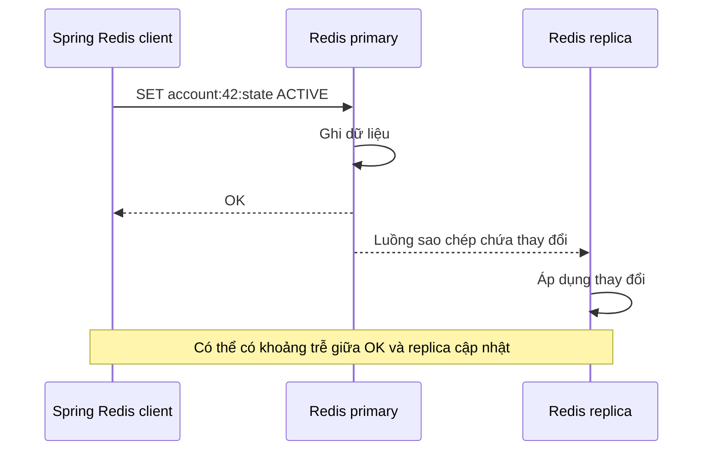
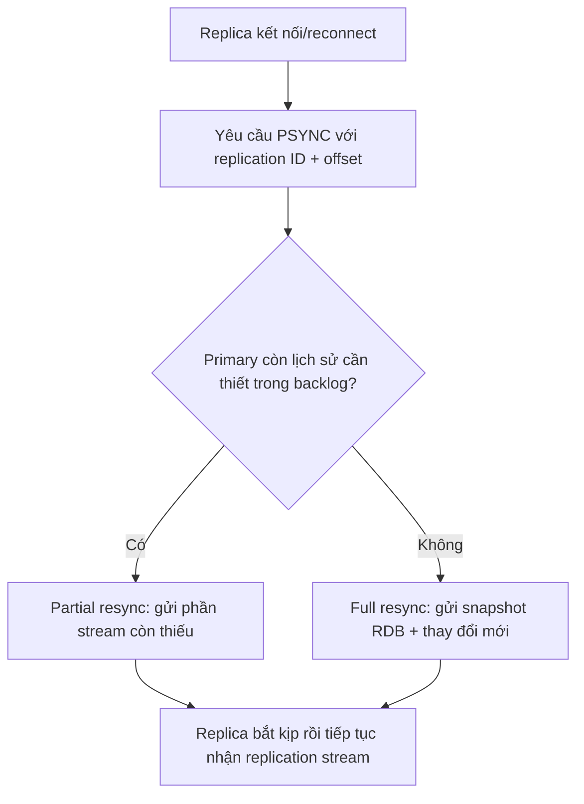
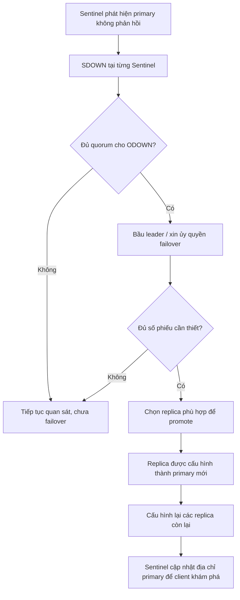

# Vai trò primary, replica và cơ chế sao chép trong Spring Data Redis

## 1. Tổng quan: tại sao Redis cần primary và replica?

Redis có thể vận hành theo mô hình **primary–replica** (trong tài liệu và cấu hình cũ đôi khi gọi là *master–replica* hoặc *master–slave*). Một Redis server đóng vai trò **primary**, nhận các thao tác ghi chính. Một hoặc nhiều Redis server đóng vai trò **replica**, nhận và áp dụng luồng thay đổi từ primary để duy trì bản sao dữ liệu.

Mô hình này có ba mục đích lớn:

- **Tăng khả năng phục hồi:** có bản dữ liệu trên node khác để có thể nâng một replica thành primary khi primary không còn sử dụng được.
- **Phân bổ tải đọc:** những truy vấn cho phép dữ liệu có độ trễ có thể đọc từ replica, giảm một phần tải đọc trên primary.
- **Tạo nền tảng cho Sentinel:** các tiến trình Redis Sentinel giám sát primary/replica, phát hiện lỗi và điều phối quá trình failover.

Ví dụ:

```text
                         Spring Data Redis
                                 |
                           Ghi vào primary
                                 |
                    +------------------------+
                    | Redis primary          |
                    | redis-1:6379           |
                    +------------------------+
                         |              |
                 replication stream   replication stream
                         |              |
                         v              v
               +---------------+ +---------------+
               | Redis replica | | Redis replica |
               | redis-2:6379  | | redis-3:6379  |
               +---------------+ +---------------+
                         ^              ^
                         |              |
                  Các lượt đọc chấp nhận độ trễ
```

**Cảnh báo quan trọng:** dữ liệu trên replica không mặc định đồng bộ tức thì với primary. Redis replication thông thường **bất đồng bộ**, vì vậy một thao tác `SET` đã thành công ở primary có thể chưa hiện diện trên replica ngay sau đó. Việc có replica không biến Redis thành kho dữ liệu đồng bộ mạnh hoặc bảo đảm không mất một ghi đã được xác nhận trong mọi tình huống failover.

Bài này tập trung vào vai trò primary/replica và cơ chế sao chép trong ngữ cảnh Spring Data Redis, sau đó đặt chúng vào bài toán phát hiện lỗi và chuyển vai trò bằng Sentinel.

## 2. Phân biệt primary, replica và Sentinel

| Thành phần | Chức năng | Điều cần ghi nhớ |
| --- | --- | --- |
| **Primary** | Nhận thao tác ghi từ client, duy trì trạng thái dữ liệu chính và phát luồng replication | Là điểm ghi thông thường trong mô hình một primary. |
| **Replica** | Kết nối với primary, nhận snapshot/luồng lệnh rồi áp dụng thay đổi | Thường là read-only đối với client; dữ liệu có thể trễ. |
| **Redis Sentinel** | Giám sát tình trạng các Redis instance, phát hiện primary lỗi, chọn replica để promote và giúp client tìm primary mới | Sentinel không thay thế primary và không phải proxy chuyển tiếp mọi lệnh GET/SET. |
| **Spring Data Redis client** | Dùng connection factory/driver để kết nối, thực hiện lệnh Redis, có thể khám phá primary qua Sentinel | Phải chọn chính sách read routing và xử lý lỗi/đổi kết nối phù hợp. |

Một primary có thể có nhiều replica. Replica cũng có thể lấy dữ liệu từ replica khác (replication theo chuỗi) trong một số cấu hình, nhưng mô hình đơn giản và phổ biến nhất là các replica nối trực tiếp primary.

Sentinel là một nhóm tiến trình độc lập, kết nối tới các Redis instance để theo dõi và điều phối failover. Mỗi Sentinel có thể giám sát nhiều master group; để failover đáng tin cậy, thường triển khai nhiều Sentinel phân tán theo failure domain.

### Primary không phải mặc định là node “đọc mới nhất tuyệt đối” mọi lúc

Trong điều kiện ổn định, primary nhận ghi nên thường là nơi đọc kết quả vừa ghi tin cậy nhất. Tuy nhiên:

- Trong quá trình failover, client có thể tạm kết nối tới primary cũ, bị lỗi hoặc phải cập nhật topology.
- Khi failover xảy ra với replication chưa bắt kịp, primary mới có thể thiếu một số ghi đã được primary cũ xác nhận.
- Ghi vào Redis không tự tạo transaction nguyên tử với database, message broker hoặc các hệ thống khác.

Vì vậy kiến trúc phải xác định yêu cầu **durability**, **availability** và **read consistency** thay vì chỉ chọn có một hay nhiều replica.

## 3. Cơ chế sao chép: từ lệnh ghi đến dữ liệu trên replica

Redis replication hoạt động chủ yếu theo mô hình primary phát dữ liệu/luồng thay đổi và replica áp dụng trạng thái đó theo cùng thứ tự.

Sơ đồ khái niệm:



**Phản hồi `OK` của primary không phải ACK bắt buộc của mọi replica.** Primary có thể trả thành công cho client trước khi một replica bất kỳ áp dụng lệnh. Đây là lý do phát sinh *replication lag* và *stale read*.

Trong thực tế, Redis duy trì một luồng replication có tính thứ tự; replica nhận và áp dụng dữ liệu từ primary, theo dõi các ID/offset sao chép. Quá trình đồng bộ lần đầu và quá trình khôi phục kết nối dùng các cơ chế khác nhau.

### Đơn vị sao chép là trạng thái lệnh/stream, không phải Java entity

Nếu Spring Data Redis gọi:

```java
stringRedisTemplate.opsForValue().set(
        "account:42:state", "ACTIVE");
```

thì driver phát lệnh Redis tương ứng tới primary. Redis replicate những thay đổi ở tầng Redis, không biết object Java, `@RedisHash` hoặc request DTO cụ thể của ứng dụng.

Tương tự, lệnh `HSET`, `INCR`, xóa key và thay đổi TTL đều có tác động tới dữ liệu mà replica cần đồng bộ. Việc sao chép không giới hạn ở Redis String.

## 4. Lần đầu kết nối: full synchronization

Khi một replica mới được cấu hình theo primary, nó chưa có đủ lịch sử replication để tiếp tục từ một offset đã biết. Redis có thể phải thực hiện **full synchronization**.

Các bước khái niệm:

1. Replica kết nối primary và thương lượng khả năng replication.
2. Replica yêu cầu đồng bộ; primary xác định có thể partial resync hay cần full resync.
3. Khi cần full resync, primary tạo hoặc truyền một bản chụp dữ liệu dạng RDB cho replica. Redis có cơ chế tạo snapshot ra file hoặc truyền snapshot trực tiếp qua mạng, tùy cấu hình và phiên bản.
4. Trong lúc tạo/gửi snapshot, primary vẫn nhận các lệnh ghi mới và duy trì dữ liệu thay đổi cần truyền tiếp.
5. Replica nạp snapshot để có trạng thái ban đầu phù hợp.
6. Primary tiếp tục gửi luồng replication từ vị trí sau snapshot; replica áp dụng các thay đổi để bắt kịp.

Ví dụ:

```text
Primary tại t0:
  session:1 = A
  session:2 = B

Replica mới:
  Bắt đầu full synchronization
      |
      +-- nhận snapshot RDB thể hiện trạng thái tại mốc t0
      |
      +-- nhận các ghi phát sinh trong thời gian truyền snapshot
      |       SET session:1 A2
      |       SET session:3 C
      |
      +-- áp dụng luồng replication tiếp theo
      v
Replica tiến dần tới trạng thái của primary
```

Full synchronization có thể tiêu tốn tài nguyên:

- CPU và bộ nhớ để tạo snapshot/copy-on-write.
- I/O đĩa hoặc lưu lượng mạng khi truyền RDB.
- Buffer các thay đổi mới trong quá trình đồng bộ.
- Thời gian nạp snapshot trên replica.
- Network bandwidth giữa các node.

Nếu nhiều replica cùng cần full sync, áp lực lên primary có thể tăng đáng kể. Cần theo dõi và lên kế hoạch khi thêm replica hoặc xử lý sự cố hàng loạt.

### Full sync không tự tương đương backup

Snapshot RDB dùng cho replication là một cơ chế chuyển trạng thái. Nó không thay thế chính sách backup có phiên bản, kiểm tra khôi phục hoặc yêu cầu lưu giữ dữ liệu. Nếu primary đã chứa dữ liệu sai hay đã xóa key theo lệnh hợp lệ, replica cũng có thể đồng bộ trạng thái sai/xóa đó.

## 5. Partial resynchronization bằng `PSYNC`

Khi replica mất mạng ngắn rồi kết nối lại, việc truyền lại toàn bộ dataset có thể rất tốn kém. Redis hỗ trợ **partial resynchronization** thông qua giao thức `PSYNC`, khi hai phía vẫn có đủ thông tin lịch sử cần thiết.

Hai khái niệm cốt lõi:

- **Replication ID**: nhận diện một lịch sử luồng dữ liệu sao chép.
- **Replication offset**: vị trí trong luồng replication. Replica theo dõi phần dữ liệu đã nhận/xử lý theo giao thức, primary theo dõi phần đã phát.

Khi reconnect, replica có thể cung cấp replication ID và offset đã biết. Primary kiểm tra liệu:

1. ID có thuộc lịch sử mà primary có thể phục vụ hay không.
2. Các byte replication từ offset cần tiếp tục có còn nằm trong **replication backlog** hay không.

Nếu thỏa, primary truyền phần còn thiếu, không cần full snapshot. Nếu không thỏa, replica phải full resync.



### Replication backlog

Backlog là bộ đệm vòng mà primary giữ một đoạn lịch sử gần đây của replication stream. Nó giúp phục vụ replica bị ngắt kết nối ngắn hạn.

Ví dụ đơn giản:

```text
Primary replication offset hiện tại: 1.000.000
Replica A offset cuối biết được:       998.000
Dữ liệu cần bù:                       ~2.000 bytes

Backlog còn chứa từ offset 990.000 trở đi:
  -> Có thể partial resync.

Replica B offset cuối biết được:       700.000
Backlog không còn đoạn từ 700.000:
  -> Cần full resync.
```

Con số trên chỉ minh họa. Backlog lưu byte của replication stream; tốc độ tiêu thụ backlog phụ thuộc lưu lượng ghi, kích thước command và overhead protocol chứ không chỉ số lượng key.

### Chọn backlog theo tải thực tế

Ước lượng định hướng:

```text
Tốc độ phát replication stream  ≈ 2 MiB/giây
Mục tiêu chịu đứt kết nối       ≈ 120 giây
Lượng lịch sử tối thiểu          ≈ 240 MiB

Cần thêm biên an toàn khi lưu lượng ghi biến thiên.
```

Đây là mô hình công suất, không phải khuyến nghị cố định cho mọi Redis. Backlog lớn tăng tiêu thụ bộ nhớ primary; backlog quá nhỏ có thể khiến replica reconnect thường xuyên phải full sync. Cần đo thực tế thay vì chỉ dựa trên số key.

## 6. Sao chép bất đồng bộ và độ trễ replication

**Asynchronous replication** nghĩa là primary không phải chờ mọi replica xác nhận đã áp dụng command rồi mới trả thành công cho client. Khoảng cách giữa tiến độ primary và replica tạo ra **replication lag**.

Ví dụ:

```text
t = 0 ms:  primary đã xử lý SET token:42 NEW và trả OK
t = 2 ms:  client GET token:42 từ replica
t = 4 ms:  replica mới nhận và áp dụng SET token:42 NEW
```

Trong khoảng t = 2 ms, replica có thể trả giá trị cũ hoặc `nil`.

Replication lag có thể tăng khi:

- Network giữa primary và replica có độ trễ cao hoặc mất gói.
- Primary nhận lượng ghi lớn.
- Replica thiếu CPU, memory bandwidth hoặc đang làm việc nặng.
- Replica đang full sync hoặc tải snapshot.
- Client đọc từ replica quá xa vùng địa lý của primary.
- Redis server gặp tình trạng nghẽn, eviction, persistence I/O hoặc tài nguyên host hạn chế.

### Read-after-write không mặc định được đảm bảo trên replica

Xét Spring service:

```java
redis.opsForValue().set("checkout:42", "PAID");
// Ngay sau đó đọc qua connection được phép chọn replica:
String status = redis.opsForValue().get("checkout:42");
```

Nếu `SET` gửi primary còn `GET` được route tới replica chưa bắt kịp, giá trị có thể vẫn là `PENDING`.

Không coi đây là lỗi serialization hoặc lỗi Spring Cache ngay lập tức. Đây có thể là hệ quả đúng của routing read-to-replica trên replication bất đồng bộ.

Khi nghiệp vụ cần đọc ngay giá trị vừa ghi, các lựa chọn gồm:

- Đọc từ primary cho đường quyết định quan trọng.
- Giữ giá trị vừa ghi trong scope request thay vì bắt buộc đọc ngược ngay.
- Dùng version/sequence trong dữ liệu để kiểm tra độ mới nếu kiến trúc có yêu cầu đó.
- Chỉ dùng replica cho truy vấn chấp nhận *eventual consistency*.
- Thiết kế cơ chế giao dịch/đồng bộ cấp ứng dụng khi cần bảo đảm mạnh hơn; replica thông thường không tự cung cấp linearizable read.

## 7. Redis `WAIT` hỗ trợ điều gì và không bảo đảm điều gì?

Redis có lệnh `WAIT numreplicas timeout` cho phép một client yêu cầu server chờ một số replica xác nhận đã nhận/áp dụng tiến độ replication tương ứng với các ghi trước đó của **chính kết nối client đó**, trong giới hạn timeout.

Ví dụ Redis CLI trên kết nối đã thực hiện ghi:

```redis
SET checkout:42 PAID
WAIT 1 1000
```

Ý nghĩa: chờ tối đa khoảng 1.000 mili giây để ít nhất một replica xác nhận tiến độ sao chép liên quan. Kết quả là số replica đã xác nhận tại thời điểm hoàn tất lệnh; nếu thấp hơn mục tiêu thì timeout hoặc điều kiện chờ không đạt.

Điều cần hiểu:

- `WAIT` **không biến Redis thành giao dịch đồng bộ mạnh** giữa primary và replica.
- `WAIT` không bảo đảm ghi không bao giờ mất trong failover hoặc lỗi kép.
- Một replica đã ACK tiến độ replication không đồng nghĩa đã ghi dữ liệu bền vững xuống đĩa.
- Nếu client dùng pool/connection khác để gọi `WAIT` so với connection đã ghi, không mặc nhiên nhận cùng semantics “chờ các ghi trước của connection” như ví dụ CLI.
- Trong transaction hoặc script, semantics blocking của `WAIT` có các ràng buộc theo ngữ cảnh; không tự trộn `WAIT` vào pipeline rồi kỳ vọng blocking như lệnh độc lập.

Có thể sử dụng `WAIT` như một lớp giảm rủi ro mất dữ liệu trong một số mô hình, nhưng phải thiết kế nó cùng với persistence, failover policy, phân vùng mạng và yêu cầu nghiệp vụ.

### Cấu hình giới hạn ghi khi không đủ replica

Redis hỗ trợ các tham số như:

```text
min-replicas-to-write
min-replicas-max-lag
```

Ví dụ ý nghĩa: primary có thể từ chối một số thao tác ghi khi không có đủ replica được coi là đang cập nhật gần đây theo ngưỡng cấu hình. Đây là **biện pháp giảm nguy cơ ghi khi replica mất kết nối quá lâu**, không phải cơ chế consensus hay bằng chứng rằng mọi ghi đã được replicate bền vững.

Cần cân đối: ngưỡng quá nghiêm có thể giảm availability khi mạng gián đoạn, dù primary vẫn còn chạy và có thể phục vụ một số loại tác vụ.

## 8. Cấu hình replica và xác định vai trò server

### Cấu hình một replica

Trong file cấu hình của Redis replica:

```conf
port 6380
replicaof 127.0.0.1 6379
replica-read-only yes
```

Hoặc trên Redis thử nghiệm đang chạy:

```redis
REPLICAOF 127.0.0.1 6379
```

Lệnh `REPLICAOF` yêu cầu instance trở thành replica của primary tại địa chỉ nêu ra. Trong Redis đời cũ có tên lệnh `SLAVEOF`, nhưng tài liệu mới nên dùng thuật ngữ `REPLICAOF`.

**Chỉ dùng lệnh thay đổi vai trò trên môi trường bạn sở hữu và có runbook rõ ràng.** Chuyển vai trò server trong production có thể thay đổi dữ liệu đang phục vụ, kết nối và topology failover.

### Read-only replica

Replica thường có `replica-read-only yes`. Client gửi thao tác ghi như `SET` tới replica có thể nhận lỗi dạng `READONLY You can't write against a read only replica`.

Không nên tắt `replica-read-only` chỉ để cho ứng dụng ghi trên replica. Những ghi cục bộ không thuộc lịch sử chính của primary có thể bị ghi đè khi đồng bộ lại, dẫn tới dữ liệu không nhất quán khó kiểm soát.

### Xem vai trò qua `ROLE` và `INFO replication`

Trên primary:

```redis
ROLE
INFO replication
```

Các trường có thể thấy gồm:

```text
role:master
connected_slaves:2
master_replid:...
master_repl_offset:...
repl_backlog_active:1
repl_backlog_size:...
```

Tên trường `role:master` và `connected_slaves` còn xuất hiện trong Redis INFO/protocol vì tương thích lịch sử, dù bài viết dùng thuật ngữ **primary/replica**.

Trên replica:

```redis
ROLE
INFO replication
```

Các trường liên quan gồm:

```text
role:slave
master_host:...
master_port:6379
master_link_status:up
slave_repl_offset:...
master_last_io_seconds_ago:...
```

Tên và số lượng trường thay đổi theo Redis version. Kiểm tra vai trò và link status là bước đầu khi điều tra việc replica không cập nhật.

## 9. Sentinel làm gì với mô hình primary–replica?

Sao chép dữ liệu **không đồng nghĩa tự chuyển primary** nếu node primary hỏng. Redis Sentinel bổ sung cơ chế:

1. **Monitoring**: kiểm tra tình trạng primary, replica và các Sentinel khác.
2. **Notification**: thông báo khi một thành phần được xác định lỗi hoặc topology thay đổi.
3. **Automatic failover**: khi điều kiện được đáp ứng, chọn một replica để promote thành primary.
4. **Configuration provider**: cho client tìm địa chỉ primary hiện thời thông qua lệnh Sentinel.

Ví dụ:

```text
               Sentinel S1
               Sentinel S2      -> giám sát group "mymaster"
               Sentinel S3
                      |
                      v
                Redis primary P
                 /          \
         Redis replica R1  Redis replica R2

Khi P không còn phục vụ:
  Sentinels phối hợp xác nhận tình trạng lỗi,
  bầu leader cho lượt failover,
  một replica phù hợp được nâng thành primary,
  replica còn lại được chuyển sang sao chép primary mới.
```

**Sentinel không lưu thay dữ liệu Redis** và không phải proxy nhận mọi command Redis rồi tự chuyển tới primary. Ứng dụng dùng **Sentinel-aware client**, thường là Lettuce thông qua Spring Data Redis, để khám phá địa chỉ primary hiện thời và kết nối lại khi topology đổi.

### Redis Sentinel khác Redis Cluster

| Khía cạnh | Replication + Sentinel | Redis Cluster |
| --- | --- | --- |
| Chia dữ liệu ra nhiều shard | Không phải mục tiêu chính; một primary group chứa một dataset logic | Có, dữ liệu phân bố theo hash slot |
| Replica | Có | Có thể có replica cho từng primary shard |
| Failover | Sentinel điều phối | Các node cluster thực hiện cơ chế failover của Redis Cluster |
| Cách client tìm primary | Sentinel discovery | Cluster topology/slot mapping |
| Mở rộng dung lượng bằng nhiều primary cùng dataset | Không tự có sharding | Có nhiều primary quản lý slot khác nhau |

Không dùng cấu hình Sentinel và mặc nhiên kỳ vọng ứng dụng được phân tán dữ liệu tự động sang nhiều primary như Redis Cluster. Nếu dataset vượt khả năng một primary, cần thiết kế sharding/cluster riêng.

## 10. Sentinel xác định lỗi và điều phối failover ra sao?

Redis Sentinel có hai khái niệm quan trọng:

- **SDOWN (subjectively down)**: một Sentinel riêng lẻ đánh giá instance không phản hồi theo ngưỡng `down-after-milliseconds`.
- **ODOWN (objectively down)**: đủ số Sentinel đồng thuận theo **quorum** cấu hình rằng primary không hoạt động.

Khi primary được xác nhận ODOWN và đủ điều kiện điều phối failover, các Sentinel thực hiện quá trình bầu leader cho lượt failover; để một Sentinel được ủy quyền thực hiện failover, cần đáp ứng quy tắc số phiếu cần thiết, gồm đa số của các Sentinel được biết theo cơ chế Sentinel.

Quá trình failover đại ý:



Một replica được chọn dựa trên các tín hiệu như trạng thái kết nối, ưu tiên replica, tiến độ sao chép và các điều kiện lựa chọn của Sentinel. **Không bảo đảm đơn giản rằng replica có địa chỉ gần ứng dụng nhất hoặc có ID tên nhỏ nhất sẽ được chọn.**

### Quorum và số lượng Sentinel

Một cấu hình thực hành phổ biến:

```text
3 Sentinel: S1, S2, S3
Quorum của master group: 2
```

Quorum 2 cho phép hai Sentinel cùng nhận định lỗi để hình thành ODOWN. Nhưng **quorum không phải toàn bộ điều kiện để thực hiện failover**: còn yêu cầu bầu leader/ủy quyền với đủ đa số theo quy tắc Sentinel.

Triển khai chỉ một Sentinel là điểm lỗi đơn, không phù hợp với mục tiêu sẵn sàng cao. Khi có ba Sentinel, nên đặt trên các failure domain tách biệt để sự cố một host hoặc vùng mạng không đồng thời loại bỏ toàn bộ hệ thống giám sát.

## 11. Failover không xóa bỏ replication lag và nguy cơ mất dữ liệu

Tình huống:

```text
t0: primary P có key order:42 = PENDING
t1: client SET order:42 = PAID -> P trả OK
t2: P mất kết nối trước khi R1/R2 nhận bản cập nhật PAID
t3: Sentinel promote R1 thành primary mới
t4: ứng dụng đọc order:42 từ R1 -> vẫn có thể là PENDING
```

Trong trường hợp này, một ghi đã được primary cũ xác nhận có thể không có mặt trên primary mới. Đây là giới hạn thiết kế quan trọng của replication bất đồng bộ và failover dựa trên những replica hiện có.

Các cách giảm rủi ro gồm:

- Chọn persistence phù hợp (RDB/AOF) theo chính sách dữ liệu.
- Theo dõi replication lag, replica link và tình trạng backlog.
- Cân nhắc `WAIT` hoặc cấu hình `min-replicas-to-write` khi yêu cầu thực sự phù hợp.
- Chọn kiến trúc có source of truth bền vững cho nghiệp vụ quan trọng; Redis có thể là cache hoặc projection tái tạo được.
- Thiết kế idempotency, conflict handling và reconciliation khi failover.
- Không coi có hai replica là bảo đảm **zero data loss**.

### Khi primary cũ quay lại

Sau failover, primary cũ có thể còn chứa một số ghi chưa được replica nhận trước sự cố. Khi node cũ được cấu hình thành replica của primary mới, dữ liệu cục bộ của nó có thể bị thay thế bởi trạng thái của primary mới trong quá trình resynchronization. Điều này càng cho thấy các ghi chưa được replicate có thể mất khỏi topology được công nhận sau failover.

Redis Sentinel ưu tiên khả năng tiếp tục phục vụ trên một primary mới trong những điều kiện đã thiết kế; nó không phải consensus log bảo đảm mọi ghi được commit trên đa số node trước khi xác nhận.

## 12. Cấu hình Sentinel trong Redis

Ví dụ sentinel configuration:

```conf
port 26379
sentinel monitor mymaster 127.0.0.1 6379 2
sentinel down-after-milliseconds mymaster 5000
sentinel failover-timeout mymaster 60000
sentinel parallel-syncs mymaster 1
```

Ý nghĩa:

| Dòng cấu hình | Diễn giải |
| --- | --- |
| `sentinel monitor mymaster HOST PORT 2` | Đặt tên group `mymaster`, theo dõi primary ban đầu và quorum = 2. |
| `down-after-milliseconds ... 5000` | Một Sentinel coi instance có thể SDOWN khi không phản hồi đủ ngưỡng; ngưỡng là tín hiệu, không phải bảo đảm failover hoàn thành sau 5 giây. |
| `failover-timeout ... 60000` | Tham số điều phối thời gian/chu kỳ failover, không phải thời gian failover cố định. |
| `parallel-syncs ... 1` | Giới hạn số replica đồng bộ theo primary mới đồng thời trong một giai đoạn failover. |

Các dòng trên là ví dụ giúp hiểu cấu hình. Trên hệ thống thực tế, Sentinel cần network connectivity, ACL/authentication, cấu hình announcement phù hợp NAT/container và persistence của cấu hình Sentinel. Redis Sentinel có thể tự cập nhật file cấu hình khi topology thay đổi, vì vậy cần triển khai từ nguồn cấu hình bền vững có khả năng ghi phù hợp.

Không sao chép địa chỉ `127.0.0.1` từ ví dụ sang môi trường container/nhiều host mà không điều chỉnh. Trong container riêng, `127.0.0.1` thường trỏ về chính container đó, không phải primary ở host/container khác.

### Kiểm tra Sentinel bằng redis-cli

Trên Sentinel endpoint, ví dụ localhost:26379:

```redis
SENTINEL GET-MASTER-ADDR-BY-NAME mymaster
SENTINEL MASTERS
SENTINEL REPLICAS mymaster
SENTINEL CKQUORUM mymaster
```

Các lệnh trên giúp tìm địa chỉ primary hiện tại, xem master group, các replica Sentinel biết và khả năng đạt quorum/ủy quyền failover. Dùng quyền Redis/Sentinel tương ứng; không cấp quyền quản trị toàn diện cho ứng dụng chỉ để ứng dụng cần tìm địa chỉ primary.

## 13. Spring Boot kết nối Sentinel-aware

Nếu dùng Spring Boot cùng Spring Data Redis/Lettuce, có thể cấu hình Sentinel bằng properties.

Ví dụ `application.yml`:

```yaml
spring:
  data:
    redis:
      sentinel:
        master: mymaster
        nodes:
          - redis-sentinel-1:26379
          - redis-sentinel-2:26379
          - redis-sentinel-3:26379
      timeout: 3s
```

`mymaster` phải khớp tên group mà Sentinel quản lý. `nodes` liệt kê các Sentinel endpoint để client khám phá primary và topology. Không điền địa chỉ các replica vào danh sách này nếu chúng không chạy dịch vụ Sentinel.

Với Spring Boot 3.x thông thường, namespace Redis là `spring.data.redis`. Khi làm việc với phiên bản Boot khác, cần đối chiếu property namespace và dependency của chính dự án.

Trong môi trường có xác thực:

- Mật khẩu hoặc username/password dùng cho **Redis data nodes** có thể khác thông tin xác thực của **Sentinel endpoints**.
- Cấu hình cần phù hợp với phiên bản Spring Boot, Spring Data Redis và Lettuce đang sử dụng.
- Không đặt secret thật vào tài liệu hay commit mật khẩu vào VCS; dùng secret manager/environment injection.

### Spring tự kết nối lại khi failover như thế nào?

Khi dùng driver hỗ trợ Sentinel, connection factory có thể khám phá primary thông qua Sentinel. Sau failover, topology thông báo primary mới; driver/connection factory phục hồi kết nối theo cơ chế của nó.

Điều này **không đồng nghĩa mọi Redis command đang thực hiện được retry thành công hoặc không có lỗi trong thời gian chuyển vai trò**. Trong khoảng failover, application có thể gặp timeout, connection reset, lỗi `READONLY` khi còn kết nối nhầm tới node cũ hoặc dữ liệu vừa ghi chưa có trên primary mới.

Ứng dụng cần thiết kế:

- Timeout và retry có giới hạn theo độ quan trọng của command.
- Idempotency cho lệnh ghi không an toàn khi retry mù.
- Monitoring trạng thái kết nối/failover.
- Đường fallback nếu Redis chỉ giữ cache có thể tái tạo.
- Không coi một lần restart ứng dụng là cơ chế bắt buộc để chuyển primary.

## 14. Cấu hình Sentinel bằng Java khi cần tùy chỉnh

Khi ứng dụng chủ động định nghĩa connection factory:

```java
import org.springframework.context.annotation.Bean;
import org.springframework.context.annotation.Configuration;
import org.springframework.data.redis.connection.RedisSentinelConfiguration;
import org.springframework.data.redis.connection.RedisConnectionFactory;
import org.springframework.data.redis.connection.lettuce.LettuceConnectionFactory;

@Configuration
public class RedisSentinelConfig {

    @Bean
    public RedisConnectionFactory redisConnectionFactory() {
        RedisSentinelConfiguration sentinel =
                new RedisSentinelConfiguration();

        sentinel.master("mymaster");
        sentinel.sentinel("redis-sentinel-1", 26379);
        sentinel.sentinel("redis-sentinel-2", 26379);
        sentinel.sentinel("redis-sentinel-3", 26379);

        return new LettuceConnectionFactory(sentinel);
    }
}
```

Ở ví dụ này, Spring sử dụng Sentinel để tìm primary hiện hành. Những tên host cần được thay bằng địa chỉ có thể truy cập trong mạng ứng dụng.

Đây là **phương án cấu hình tường minh**, không phải phần bắt buộc nếu Spring Boot auto-configuration đã xử lý `spring.data.redis.sentinel.*`. Tránh định nghĩa thêm `RedisConnectionFactory` thủ công chỉ vì muốn lặp lại cấu hình YAML; bean tự định nghĩa có thể khiến auto-configuration lùi lại và khiến các thuộc tính khác không còn được áp dụng như dự định.

Cũng cần hiểu Sentinel **không cung cấp load balancing read replica một cách tự động ở mọi cách cấu hình**. Việc client đọc replica hay primary còn phụ thuộc read preference, driver và cách Spring Data Redis sử dụng connection.

## 15. Đọc từ replica bằng Lettuce `ReadFrom`

Spring Data Redis khi sử dụng Lettuce có thể cấu hình read routing tới replica bằng `ReadFrom`. Ví dụ (chỉ dành cho read path chấp nhận dữ liệu trễ):

```java
import io.lettuce.core.ReadFrom;
import org.springframework.context.annotation.Bean;
import org.springframework.context.annotation.Configuration;
import org.springframework.data.redis.connection.RedisSentinelConfiguration;
import org.springframework.data.redis.connection.RedisConnectionFactory;
import org.springframework.data.redis.connection.lettuce.LettuceClientConfiguration;
import org.springframework.data.redis.connection.lettuce.LettuceConnectionFactory;

@Configuration
public class RedisReplicaReadConfig {

    @Bean
    RedisConnectionFactory redisConnectionFactory() {
        RedisSentinelConfiguration sentinel =
                new RedisSentinelConfiguration();
        sentinel.master("mymaster");
        sentinel.sentinel("redis-sentinel-1", 26379);
        sentinel.sentinel("redis-sentinel-2", 26379);
        sentinel.sentinel("redis-sentinel-3", 26379);

        LettuceClientConfiguration client =
                LettuceClientConfiguration.builder()
                        .readFrom(ReadFrom.REPLICA_PREFERRED)
                        .build();

        return new LettuceConnectionFactory(sentinel, client);
    }
}
```

Hai class `RedisSentinelConfig` và `RedisReplicaReadConfig` trong bài là **hai phương án minh họa thay thế**, không phải hai bean connection factory cần đặt đồng thời trong một ứng dụng.

Một số lựa chọn read preference:

| Lựa chọn Lettuce | Mục đích |
| --- | --- |
| `ReadFrom.MASTER` | Ưu tiên/giữ đọc tại primary; thích hợp với dữ liệu cần thấy trạng thái gần nhất. |
| `ReadFrom.REPLICA` | Chỉ chọn replica theo chính sách driver; phải hiểu tình huống không có replica phù hợp. |
| `ReadFrom.REPLICA_PREFERRED` | Ưu tiên replica khi có, fallback theo chính sách driver khi không có. |
| Các mode khác | Có thể dựa trên độ trễ/khu vực/ưu tiên khác tùy Lettuce version; cần đối chiếu chính sách thực tế. |

Ở Lettuce, các thao tác **ghi** thông thường vẫn phải tới primary. Những thao tác trông giống đọc nhưng có side effect, chẳng hạn `GETEX` (đọc và cập nhật TTL), không thể xem là lệnh read-only an toàn để route tới replica.

### Hệ quả đối với Spring Cache và Repository

- Spring Cache đọc key nóng từ replica có thể thấy bản cache cũ hoặc cache miss trước khi replica bắt kịp.
- Một lần `@Cacheable` cache miss có thể làm hai instance tính lại cùng dữ liệu trong ngắn hạn nếu replica chưa kịp nhận bản ghi vừa được lưu.
- Redis Repository đọc entity từ replica có thể thấy trạng thái Hash và secondary index đang trễ so với primary; không nên dùng cho quyết định cần nhất quán mạnh.
- Khi lưu rồi đọc ngay, việc read routing tới replica có thể phá kỳ vọng *read-your-writes*.

Nếu mọi request đều cần đọc ngay sau ghi, không có lý do mặc định bắt chúng đi qua replica chỉ để “tăng hiệu năng”. Định tuyến đọc phải được thiết kế theo từng loại nghiệp vụ.

## 16. Ví dụ Spring service và đọc sau ghi

Service dùng `StringRedisTemplate`:

```java
import java.time.Duration;
import org.springframework.data.redis.core.StringRedisTemplate;
import org.springframework.stereotype.Service;

@Service
public class OrderStatusService {

    private final StringRedisTemplate redis;

    public OrderStatusService(StringRedisTemplate redis) {
        this.redis = redis;
    }

    public void markPaid(String orderId) {
        String key = "orders:" + orderId + ":status";

        redis.opsForValue().set(
                key, "PAID", Duration.ofMinutes(30));
    }

    public String findStatus(String orderId) {
        return redis.opsForValue().get(
                "orders:" + orderId + ":status");
    }
}
```

Nếu connection factory route thao tác đọc tới replica, đoạn sau có thể thấy trạng thái cũ:

```java
service.markPaid("42");
String status = service.findStatus("42");
// Không mặc định chắc chắn nhận "PAID" nếu GET đi tới replica trễ.
```

Với loại dữ liệu quyết định tính hợp lệ của thanh toán, không nên xem Redis replica là source of truth đủ mạnh. Hãy đọc authoritative store hoặc primary theo hợp đồng, kết hợp version/idempotency.

Nếu Redis chỉ giữ cache trạng thái đơn hàng được tính từ database, việc replica đọc trễ có thể chấp nhận được nếu ứng dụng có invalidation hoặc TTL và không đưa ra quyết định sai vì cache cũ.

## 17. Primary–replica không thay thế transaction hay atomicity

Redis xử lý từng command đơn lẻ như `INCR` atomically tại primary. Tuy nhiên **replication không biến nhiều command thành một giao dịch duy nhất**.

Ví dụ:

```java
redis.opsForValue().set("account:42:state", "ACTIVE");
redis.opsForValue().set("account:42:version", "2");
```

Hai lệnh có thể bị gián đoạn giữa chừng; replica có thể đang áp dụng tới một đoạn khác của luồng replication tại thời điểm được đọc. Nếu ứng dụng yêu cầu hai thay đổi ràng buộc với nhau, cần mô hình nguyên tử phù hợp như Lua/script, MULTI/EXEC hoặc gộp dữ liệu vào cấu trúc thống nhất, đồng thời xử lý hạn chế failover.

Trong Redis, `MULTI/EXEC` bảo đảm nhóm lệnh được thực thi liền mạch trên server thực thi transaction. **Nó không tự biến replication thành đồng bộ mạnh** và không tạo transaction phân tán nguyên tử với SQL.

Với script Lua, các lệnh bên trong script chạy nguyên tử đối với lệnh xen kẽ trên Redis server, nhưng tác động được replicate theo giao thức Redis. Lua cũng không tự cung cấp rollback cho những lệnh thành công trước khi script lỗi.

## 18. Replication khác persistence và backup

Ba khái niệm thường bị trộn:

| Cơ chế | Mục tiêu | Không tự đảm bảo |
| --- | --- | --- |
| **Replication** | Sao chép dữ liệu từ primary sang replica để có thêm bản đang chạy và hỗ trợ đọc/failover | Không bảo đảm mọi ghi được xác nhận đều tồn tại trên replica tại thời điểm failover. |
| **Persistence** (RDB/AOF) | Khôi phục dữ liệu của một Redis instance sau restart theo chính sách ghi đĩa | Không đồng nghĩa có instance thứ hai luôn sẵn sàng phục vụ. |
| **Backup** | Lưu các bản sao dữ liệu có kế hoạch, retention và khả năng phục hồi sau xóa nhầm/sai nghiệp vụ | Không tự cung cấp failover tức thời. |

Nếu lệnh `DEL` xóa nhầm một key ở primary, thay đổi đó có thể được replicate sang mọi replica. Có nhiều replica không giúp “undo” việc xóa hợp lệ. Cần backup hoặc cơ chế version/restore riêng nếu nghiệp vụ đòi hỏi.

Với dữ liệu cache tái tạo được, có thể ưu tiên availability và TTL hơn durability tuyệt đối. Với state quan trọng, cần đánh giá AOF fsync policy, backup/restore, yêu cầu RPO/RTO, replica placement và khả năng mất ghi trên failover.

## 19. Các chỉ số quan trọng khi giám sát replication

### Trên primary

```redis
INFO replication
ROLE
```

Các trường cần quan tâm:

| Tín hiệu | Ý nghĩa |
| --- | --- |
| `role` | Node đang là primary hay replica. |
| `connected_slaves` / danh sách replicas | Số replica và trạng thái các kết nối replication. |
| `master_repl_offset` | Tiến độ phát replication stream ở primary. |
| `master_replid` | ID của lịch sử replication hiện hành. |
| `repl_backlog_size` | Dung lượng backlog dùng để phục vụ partial resync. |
| `repl_backlog_active` | Tình trạng backlog. |
| Offset của từng replica trong INFO | Ước lượng tiến độ mà replica đã báo về. |

### Trên replica

```redis
INFO replication
ROLE
```

Quan sát:

- `master_host` / `master_port`: replica đang theo node nào.
- `master_link_status`: kết nối tới upstream hiện up hay down.
- `slave_repl_offset` hoặc các trường offset tương ứng: tiến độ đã nhận.
- `master_last_io_seconds_ago`: thời gian từ hoạt động replication gần nhất, cần xét cùng tải ghi và heartbeat.
- Trạng thái full sync và việc nạp dữ liệu nếu có.

Không tự suy luận “chênh lệch offset = đúng số giây lag”. Offset đo **byte trong replication stream**, còn thời gian trễ cần đo theo tốc độ thay đổi, heartbeat, topology và khả năng đáp ứng thực tế. Có thể một replica chưa bắt kịp nhưng dữ liệu đang đọc vẫn tình cờ giống primary; ngược lại độ trễ nhỏ vẫn đủ gây stale read ở tình huống nhạy cảm.

### Trên Sentinel

```redis
SENTINEL MASTERS
SENTINEL REPLICAS mymaster
SENTINEL CKQUORUM mymaster
SENTINEL GET-MASTER-ADDR-BY-NAME mymaster
```

Theo dõi:

- Primary được Sentinel công bố có khớp vai trò thật của Redis không.
- Sentinel có đủ quorum/đa số để điều phối failover không.
- Có bao nhiêu replica đủ điều kiện promote.
- Trạng thái `SDOWN`/`ODOWN`, số lần failover và khoảng thời gian mất kết nối.
- Thời gian ứng dụng chuyển sang địa chỉ primary mới và số lỗi request trong quá trình chuyển.

## 20. Sự cố điển hình và cách phân tích

### Tình huống A: Spring ghi thành công nhưng đọc từ replica thấy cũ

**Dấu hiệu:** `SET` trả thành công, `GET` gần ngay sau đó trả value trước đó.

**Nguyên nhân có thể:** client được cấu hình `REPLICA_PREFERRED` và replica chưa bắt kịp.

**Hướng xử lý:** xác định route của GET, kiểm tra `INFO replication`, cân nhắc đọc primary ở những đường bắt buộc read-after-write.

### Tình huống B: ghi báo `READONLY`

**Dấu hiệu:** `READONLY You can't write against a read only replica`.

**Nguyên nhân có thể:** ứng dụng đang gửi lệnh ghi tới replica, connection đã stale sau failover hoặc endpoint hiện tại không phải primary.

**Hướng xử lý:** kiểm tra `ROLE`, địa chỉ do Sentinel công bố, tình trạng client topology refresh và driver. Không “sửa nhanh” bằng cách tắt read-only của replica.

### Tình huống C: replica liên tục full sync

**Dấu hiệu:** network/CPU tăng mạnh, link replica lên xuống và reload RDB lặp lại.

**Nguyên nhân có thể:** mạng đứt lâu, backlog không đủ, replica quá tải hoặc cấu hình đồng bộ gặp vấn đề.

**Hướng xử lý:** kiểm tra `repl_backlog_size`, tốc độ ghi, offset, logging replication, network, tài nguyên replica và persistence I/O. Tăng backlog sau khi đo tải, không tăng vô hạn.

### Tình huống D: Sentinel thấy primary lỗi nhưng không tự failover

**Dấu hiệu:** một vài Sentinel báo SDOWN nhưng không có primary mới.

**Nguyên nhân có thể:** không đủ quorum/ủy quyền majority, không có replica đủ điều kiện promote, lỗi mạng giữa Sentinel hoặc Sentinel chưa biết topology đúng.

**Hướng xử lý:** kiểm tra `SENTINEL CKQUORUM`, `SENTINEL MASTERS`, danh sách replica, connectivity và log Sentinel. Không ép failover thủ công khi chưa hiểu partition, vì có thể tạo rủi ro split-brain hoặc mất dữ liệu.

### Tình huống E: primary mới không có một số ghi cuối

**Dấu hiệu:** sau failover, key vừa ghi trước sự cố không còn hoặc trả giá trị cũ.

**Nguyên nhân có thể:** replication bất đồng bộ; replica được promote chưa nhận những ghi cuối từ primary cũ.

**Hướng xử lý:** đối chiếu nguồn dữ liệu nghiệp vụ, chạy reconciliation, kiểm tra cấu hình durability/replication. Không giả định lỗi do Spring serializer nếu dữ liệu thực tế đã mất khỏi topology mới.

## 21. Thực hành trên Redis thử nghiệm: sao chép và failover

Ví dụ này chỉ thực hiện trong phòng lab có quyền kiểm soát Redis. **Không cố ý ngắt primary hoặc thay đổi role trong production**.

### Bước 1: chuẩn bị hai Redis instance

- Primary trên `127.0.0.1:6379`.
- Replica trên `127.0.0.1:6380`, khai báo `replicaof 127.0.0.1 6379`.
- Hai instance có thư mục lưu dữ liệu/log riêng để tránh ghi đè.

Kiểm tra vai trò:

```bash
redis-cli -p 6379 ROLE
redis-cli -p 6380 ROLE
```

Ở `ROLE`, primary được báo là master theo protocol cũ; replica được báo là slave theo protocol cũ.

### Bước 2: ghi trên primary và kiểm tra replica

```bash
redis-cli -p 6379 SET demo:replication:status ACTIVE
redis-cli -p 6380 GET demo:replication:status
```

Khi replication đã bắt kịp, replica trả `ACTIVE`. Để quan sát độ trễ nhỏ, phải đo theo tải thử nghiệm; không mặc định mọi lần đọc ngay lập tức đều trả kết quả mới.

### Bước 3: thử ghi vào replica

```bash
redis-cli -p 6380 SET demo:replication:status WRONG
```

Với replica read-only mặc định, Redis từ chối lệnh. Điều này bảo vệ vai trò phân công ghi và giúp phát hiện client đang route sai.

### Bước 4: quan sát replication offsets

```bash
redis-cli -p 6379 INFO replication
redis-cli -p 6380 INFO replication
```

Tìm `master_repl_offset`, `slave_repl_offset` và link status. Tạo một loạt lệnh `SET` mới rồi quan sát tiến độ cập nhật.

### Bước 5: thử reconnect và partial resync

Trên môi trường test, chủ động tách kết nối replica trong thời gian ngắn rồi nối lại để xem log replication. Nếu backlog còn đủ lịch sử, Redis có thể partial resync. Nếu ngắt quá lâu so với tốc độ ghi và backlog, có thể phải full sync.

Không làm bài test này nếu các instance đang mang dữ liệu quan trọng; thao tác thay đổi replication role và mạng có thể gây gián đoạn.

### Bước 6: quan sát Sentinel khi thêm ít nhất ba Sentinel

Khởi tạo một Sentinel group `mymaster` trỏ tới primary và dùng quorum phù hợp. Kiểm tra:

```bash
redis-cli -p 26379 SENTINEL GET-MASTER-ADDR-BY-NAME mymaster
redis-cli -p 26379 SENTINEL CKQUORUM mymaster
redis-cli -p 26379 SENTINEL REPLICAS mymaster
```

Khi chạy bài lab failover theo runbook, ghi lại primary mà Sentinel công bố trước/sau, vai trò của các Redis node và khoảng thời gian client Spring phải reconnect. Không mặc định quá trình failover là tức thời hoặc không có lỗi request.

### Bước 7: xác minh hành vi Spring sau failover

Dùng cấu hình Spring Boot Sentinel-aware. Trong bài lab:

1. Ghi một key qua `StringRedisTemplate`; quan sát primary xử lý.
2. Tạo điều kiện failover theo runbook thử nghiệm.
3. Theo dõi log client khi mất kết nối và khôi phục.
4. Khi Sentinel đã công bố primary mới, kiểm tra một thao tác ghi mới.
5. So sánh các key ghi trước sự cố để hiểu khả năng mất ghi cuối do replication lag.

Không đánh giá kết quả chỉ từ việc client hết lỗi: dữ liệu có thể cần reconciliation sau failover.

## 22. Nguyên tắc thiết kế Spring Data Redis với primary–replica

1. **Chọn vai trò cho từng loại thao tác:** ghi tới primary; chỉ route đọc tới replica khi chấp nhận stale read.
2. **Hiểu replication bất đồng bộ:** Redis trả `OK` từ primary không chứng minh mọi replica đã đồng bộ.
3. **Dùng Sentinel-aware driver khi có Sentinel:** không hardcode duy nhất primary ban đầu trong ứng dụng HA.
4. **Giữ timeout và retry có giới hạn:** lúc failover một command có thể lỗi hoặc đã thực thi nhưng client không nhận response.
5. **Thiết kế idempotency cho ghi quan trọng:** retry mù các lệnh `INCR`, `LPUSH`, `XADD` hoặc logic nhiều bước có thể gây lặp.
6. **Đo replication lag và backlog:** giảm full sync không cần thiết và phát hiện replica chậm.
7. **Bảo đảm replication/persistence đáp ứng nhu cầu:** replica không phải backup, Sentinel không bảo đảm zero data loss.
8. **Đặt Sentinel trên failure domain khác nhau:** cần quorum, đa số và replica đủ điều kiện khi có lỗi.
9. **Cân nhắc chính sách ACL, TLS và secret:** tài khoản Redis data node và Sentinel có thể khác.
10. **Thử nghiệm failover trên môi trường riêng:** kiểm tra ứng dụng vẫn tìm primary mới và xử lý dữ liệu thiếu/trễ.
11. **Không đồng nhất Sentinel với Redis Cluster:** Sentinel không tự shard dữ liệu sang nhiều primary.
12. **Xác định source of truth:** nếu Redis là cache, phải có cách rebuild; nếu Redis giữ state quan trọng, cần kế hoạch durability và recovery rõ.

## 23. Những hiểu lầm thường gặp

**“Có replica nghĩa là dữ liệu đã được đồng bộ hoàn toàn khi SET trả OK.”**  
Không. Redis replication thông thường bất đồng bộ; replica có thể chưa kịp nhận hoặc áp dụng ghi.

**“Đọc từ replica luôn nhanh và giống primary.”**  
Không. Replica có thể giảm tải đọc nhưng gây stale read. Tốc độ thực tế còn phụ thuộc network, vị trí địa lý và khả năng đáp ứng của node.

**“Sentinel là proxy nhận GET/SET rồi chuyển đến primary.”**  
Không. Sentinel giám sát, thực hiện failover và cung cấp thông tin topology; client Redis thực hiện lệnh trực tiếp tới Redis data node.

**“Sentinel có quorum thì chắc chắn failover trong đúng số mili giây cấu hình.”**  
Không. Phát hiện lỗi, bầu leader, chọn replica, promote và kết nối client cần thời gian; còn phụ thuộc trạng thái mạng và replica.

**“`last-delivered-id` hay offset replication là ID của cùng loại dữ liệu.”**  
Không. Replication offset đo vị trí byte trong luồng sao chép; nó không phải ID của Redis Stream entry, cũng không phải mốc một transaction nghiệp vụ.

**“Tăng replication backlog sẽ giảm mọi replication lag.”**  
Không. Backlog chủ yếu giúp partial resync sau gián đoạn; nếu replica thiếu CPU hoặc network, lag vẫn cần xử lý bằng tài nguyên/topology.

**“`WAIT 1 1000` biến một SET thành ghi không thể mất.”**  
Không. Nó chờ xác nhận replication theo điều kiện, không biến Redis thành consensus log hay thay thế durability trên đĩa.

**“Replica có thể được phép ghi nếu sửa `replica-read-only no`.”**  
Không phải thiết kế an toàn cho dữ liệu ứng dụng: ghi cục bộ trên replica không được phối hợp như primary và có thể bị thay thế khi đồng bộ lại.

**“Có hai replica thì mất một node chắc chắn không mất dữ liệu.”**  
Không. Nếu các replica chưa nhận ghi cuối, failover có thể chọn trạng thái chưa chứa những ghi đã được primary cũ xác nhận.

**“Sentinel và Redis Cluster là một.”**  
Không. Sentinel hỗ trợ HA cho một primary group; Redis Cluster còn có cơ chế sharding theo hash slot.

## 24. Câu hỏi tự kiểm tra

1. Primary và replica có nhiệm vụ khác nhau thế nào trong Redis replication?
2. Vì sao một lệnh `SET` được primary trả `OK` mà `GET` ngay sau đó từ replica vẫn có thể thấy giá trị cũ?
3. Full resynchronization và partial resynchronization khác nhau ở đâu?
4. Replication ID, replication offset và backlog giúp replica reconnect bằng `PSYNC` như thế nào?
5. Vì sao backlog quá nhỏ có thể khiến hệ thống full sync thường xuyên khi mạng không ổn định?
6. `WAIT 1 1000` hỗ trợ điều gì, và tại sao không thể coi là cam kết zero data loss?
7. Sentinel dùng SDOWN, ODOWN và quorum để nhận định primary lỗi ra sao?
8. Vì sao việc có đủ quorum chưa phải toàn bộ điều kiện để một Sentinel được phép tiến hành failover?
9. Spring Boot cần những thông tin gì để client khám phá primary qua Sentinel?
10. Khi nào dùng `ReadFrom.REPLICA_PREFERRED`, khi nào nên đọc primary?
11. Tại sao lỗi `READONLY` sau failover có thể chỉ ra client đang giữ kết nối/topology cũ?
12. Vì sao replica không thay thế backup và persistence?
13. Redis Cluster khác mô hình primary–replica với Sentinel về cách phân phối dataset ra sao?
14. Trong failover, vì sao dữ liệu cuối cùng chỉ có trên primary cũ có nguy cơ không tồn tại trên primary mới?

**Ghi nhớ:** Redis **primary** tiếp nhận các lệnh ghi và phát **replication stream**; **replica** đồng bộ trạng thái từ primary nhưng có thể trễ vì cơ chế sao chép bất đồng bộ. Khi reconnect, Redis có thể sử dụng `PSYNC` và backlog để bù phần thiếu hoặc cần full sync qua snapshot. **Sentinel** giám sát primary/replica, điều phối failover và giúp Spring Data Redis tìm primary mới; nó không bảo đảm không mất dữ liệu hay loại bỏ mọi lỗi kết nối khi chuyển vai trò. Hãy lựa chọn routing đọc, durability, monitoring và retry dựa trên yêu cầu nhất quán thực sự của ứng dụng.

## Tài liệu tham khảo

- [Redis — Replication](https://redis.io/docs/latest/operate/oss_and_stack/management/replication/): primary/replica, bất đồng bộ, PSYNC, replication backlog và full/partial resynchronization.
- [Redis — Sentinel](https://redis.io/docs/latest/operate/oss_and_stack/management/sentinel/): SDOWN/ODOWN, quorum, election, failover và discovery.
- [Redis — WAIT](https://redis.io/docs/latest/commands/wait/): chờ xác nhận replication và giới hạn về độ bền dữ liệu.
- [Redis — INFO](https://redis.io/docs/latest/commands/info/): trạng thái replication, link, offset và backlog.
- [Spring Data Redis — Redis Sentinel](https://docs.spring.io/spring-data/redis/reference/redis/connection-modes.html): `RedisSentinelConfiguration` và connection factory.
- [Spring Data Redis — Lettuce](https://docs.spring.io/spring-data/redis/reference/redis/drivers.html): client/connection factory và read preferences.
- [Lettuce — ReadFrom settings](https://redis.github.io/lettuce/ha-sharding/): read-from-replica và routing trong môi trường HA.
