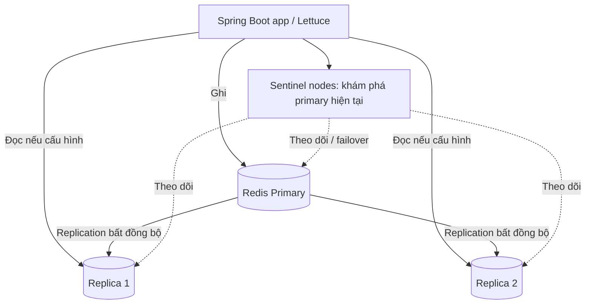
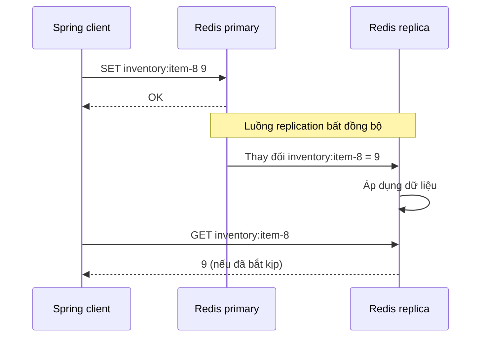
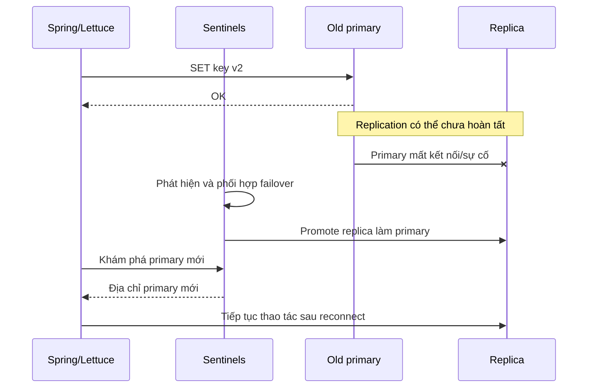

# Độ trễ sao chép và nguy cơ đọc dữ liệu cũ trong Spring Data Redis

## 1. Tình huống: vừa ghi xong nhưng đọc lại thấy giá trị trước đó

Giả sử một dịch vụ Spring Boot lưu số điểm thưởng của người dùng trong Redis. Redis đang chạy theo mô hình **primary–replica**, được Redis Sentinel theo dõi để hỗ trợ failover.

Ứng dụng ghi:

```java
redis.opsForValue().set("loyalty:u-42", "150");
```

Ngay sau đó, một request khác đọc:

```java
String points = redis.opsForValue().get("loyalty:u-42");
```

Trong một số cấu hình có **đọc từ replica**, request thứ hai có thể vẫn thấy `"120"`, thậm chí thấy key chưa tồn tại nếu trước đó key chưa được sao chép.

Điều này không nhất thiết do serializer, Redis TTL hay Spring Data Redis bị lỗi. Nguyên nhân có thể là **replication lag**: primary đã chấp nhận thay đổi, nhưng replica được chọn để đọc chưa nhận và áp dụng xong các lệnh tương ứng.

```text
Application                   Primary                    Replica
    |                            |                          |
    | SET loyalty:u-42 150       |                          |
    |--------------------------->|                          |
    |<---------------------------| OK                       |
    |                            |--- sao chép bất đồng bộ -->|
    | GET loyalty:u-42 (replica) |                          |
    |------------------------------------------------------->|
    |<-------------------------------------------------------| "120"
    |                            |                          |
    |                        replica áp dụng SET 150          |
    |                            |                          |
    | GET loyalty:u-42 (replica) |                          |
    |------------------------------------------------------->|
    |<-------------------------------------------------------| "150"
```

**Nguyên tắc trọng tâm:** Redis replication mặc định là **bất đồng bộ**. Phản hồi ghi thành công từ primary không bảo đảm mọi replica đã cập nhật. Redis Sentinel giúp phát hiện lỗi và phối hợp chọn primary mới; **Sentinel không biến replication thành đồng bộ hoặc bảo đảm strong consistency**.

Trong bài học này, chúng ta phân tích:

1. Primary, replica, Sentinel và cơ chế sao chép trong Redis.
2. Các dạng replication lag và tình huống dẫn tới stale read.
3. Cấu hình Spring Data Redis/Lettuce để đọc từ primary hoặc replica.
4. Các mức nhất quán như *read-your-writes*, *monotonic reads* và *eventual consistency*.
5. Lệnh `WAIT`, các giới hạn của acknowledgment replication và nguy cơ mất dữ liệu khi failover.
6. Cách đo lag, kiểm thử thực tế và lựa chọn kiến trúc cho dữ liệu quan trọng.

## 2. Primary, replica và Sentinel có vai trò khác nhau

| Thành phần | Vai trò chính | Điều không tự bảo đảm |
|---|---|---|
| **Primary** (*master*, thuật ngữ cũ) | Nhận lệnh ghi và phát luồng replication tới replica | Ghi được ACK không có nghĩa replica đã nhận |
| **Replica** | Sao chép trạng thái từ primary; có thể phục vụ đọc | Không nhất thiết có dữ liệu mới nhất tại thời điểm đọc |
| **Redis Sentinel** | Giám sát primary/replica, phát hiện lỗi, bầu chọn và điều phối failover; cho client biết primary hiện tại | Không phải proxy mọi lệnh Redis và không tự tạo consistency mạnh |
| **Spring Data Redis** | Cung cấp Redis connection factory, template và API Java | Không mặc định ép mọi read sau write phải tới primary nếu driver đã được cấu hình replica routing |
| **Lettuce** | Redis client/driver; hỗ trợ Sentinel topology và chính sách `ReadFrom` | Không thể biến replica chậm thành replica đã bắt kịp |

Ví dụ kiến trúc:



Đường nét đứt trong hình biểu diễn chức năng giám sát/phối hợp. Client thường kết nối trực tiếp tới **Redis data nodes** sau khi xác định topology, không gửi tất cả lệnh `GET`/`SET` qua Sentinel như một data proxy.

### 2.1. Replication là cơ chế nhân bản, không phải database transaction phân tán

Primary tiếp nhận các lệnh ghi, ghi nhận tiến độ replication và chuyển các thay đổi tới replica. Replica tiêu thụ luồng lệnh này để cập nhật bản sao.

Hệ thống được thiết kế để replica có thể **tiến tới cùng dữ liệu** sau một khoảng thời gian nếu mạng và Redis ổn định. Nhưng tại một thời điểm bất kỳ, replica có thể ở phía sau primary.

Số replica tăng thường giúp tăng khả năng phục vụ đọc và dự phòng, nhưng cũng đồng nghĩa có thêm các bản sao với **mức độ trễ khác nhau**. Đọc từ replica nhanh nhất về mặt network không đồng nghĩa đó là replica có dữ liệu mới nhất.

## 3. Redis sao chép dữ liệu như thế nào?

Một mô tả khái quát:

1. Replica thiết lập kết nối tới primary.
2. Replica đồng bộ dữ liệu ban đầu, bằng full synchronization hoặc partial resynchronization tùy trạng thái.
3. Primary liên tục gửi các thay đổi phù hợp vào luồng replication.
4. Replica nhận và áp dụng những thay đổi đó theo thứ tự luồng.
5. Nếu kết nối bị ngắt, replica có thể đồng bộ lại phần thiếu nếu điều kiện PSYNC/backlog cho phép, hoặc phải thực hiện full resynchronization.



Trong thực tế, nếu `GET` xảy ra **trước** bước replica áp dụng lệnh ghi, kết quả có thể là giá trị cũ.

### 3.1. Full synchronization và partial resynchronization

Khi replica mới kết nối hoặc không còn đủ lịch sử để tiếp tục từ offset cũ, Redis có thể cần truyền một snapshot dữ liệu và những thay đổi tiếp theo. Giai đoạn này tạo tải CPU, memory, network và disk tùy cấu hình.

Nếu replica chỉ mất kết nối ngắn và primary vẫn giữ đủ replication backlog, nó có thể lấy phần thay đổi còn thiếu mà không cần truyền lại toàn bộ dataset.

Trong hai trường hợp, replica có thể phải **bắt kịp** trước khi được xem là đã có dữ liệu mới nhất. Việc quá trình sync hoàn tất ở cấp kết nối không đồng nghĩa đã đạt yêu cầu nhất quán ở cấp business.

### 3.2. Độ trễ có thể xuất hiện ở nhiều chỗ

```text
Primary đã xử lý SET
   |
   +-- thời gian lệnh được đưa vào luồng replication
   |
   +-- mạng primary -> replica
   |
   +-- replica nhận dữ liệu và áp dụng thay đổi
   |
   +-- client đọc từ replica
```

Những nguyên nhân phổ biến làm lag tăng:

- Mạng giữa các máy có latency cao hoặc bị nghẽn.
- Redis primary nhận rất nhiều lệnh ghi trong thời gian ngắn.
- Replica thiếu CPU, RAM hoặc gặp vấn đề về I/O.
- Replica đang thực hiện initial sync hoặc full resync.
- Kết nối replication bị gián đoạn, replica phải reconnect.
- Lượng dữ liệu/command backlog tăng nhanh.
- Sự kiện failover, thay đổi topology hoặc quá tải trong quá trình vận hành.

Tính nhất quán của dữ liệu người dùng phụ thuộc vào cả **tiến độ replication** lẫn **node cụ thể mà lệnh đọc được định tuyến tới**.

## 4. Hai dạng trễ khác nhau: replication lag và thời gian hoàn tất của ứng dụng

**Replication lag** là độ lệch giữa trạng thái primary và replica. Nó có thể đo ở các khía cạnh khác nhau:

| Cách nhìn | Đơn vị thường gặp | Ý nghĩa |
|---|---|---|
| Chênh lệch replication offset | Byte tiến độ | Replica còn ở sau primary bao nhiêu byte của luồng replication |
| Thời gian phản hồi/heartbeat của replica | Giây | Primary đã bao lâu chưa thấy tín hiệu liên quan từ replica |
| Độ trễ dữ liệu nghiệp vụ | Mili giây/giây | Một cập nhật cụ thể mất bao lâu để xuất hiện khi đọc replica |
| Latency lệnh `GET` của ứng dụng | Mili giây | Một read trả lời nhanh hay chậm, **không tự nói dữ liệu có mới hay không** |

Một request tới replica có thể có latency **1 ms** nhưng vẫn trả dữ liệu **chậm hơn trạng thái primary 5 giây**. Ngược lại, một request chậm 50 ms có thể đọc đúng bản mới nhất. Vì thế, không thể đánh giá consistency chỉ bằng p95 latency của lệnh `GET`.

### 4.1. Lag theo offset không trực tiếp bằng số giây stale

Giả sử:

```text
primary master_repl_offset = 15_000_000
replica offset             = 14_900_000
chênh lệch                 =    100_000 byte
```

Chênh 100.000 byte phản ánh lượng tiến độ luồng replication chưa bắt kịp. Nó không tự động tương đương 100 ms hoặc 1 giây; tốc độ write và tốc độ replica apply mới quyết định khoảng thời gian.

Khi hệ thống không có write, offset có thể gần nhau nhưng vẫn cần kiểm tra tình trạng liên kết replica; khi có write burst lớn, offset có thể nhảy nhanh rồi bắt kịp sau đó.

### 4.2. Điều nguy hiểm là độ trễ có thể biến thiên

Một thiết kế chỉ dựa vào giả định "replica thường chậm không quá 10 ms" có thể bị phá vỡ trong:

- Restart hoặc rolling upgrade.
- Network partition ngắn.
- Redis background operation tạo tải.
- Recovery từ backlog hoặc full resynchronization.
- Failover vừa xảy ra, client chưa cập nhật topology.

Vì thế, hệ thống nên thiết kế cho **giới hạn nhất quán mong muốn**, không chỉ cho con số trung bình trong điều kiện bình thường.

## 5. Các dạng stale read thường gặp

### 5.1. Đọc lại ngay sau khi ghi (*read-after-write*)

```text
T0: primary nhận SET account:42:status ACTIVE
T1: primary trả OK
T2: client GET từ replica chưa áp dụng thay đổi
T3: replica trả INACTIVE
T4: replica bắt kịp, đọc sau đó trả ACTIVE
```

Một ứng dụng hiển thị trạng thái vừa sửa có thể trông như "lưu thất bại", dù primary đã ghi thành công.

### 5.2. Không thấy một key vừa tạo

```text
Primary: EXISTS session:s-101 -> 1
Replica: EXISTS session:s-101 -> 0
```

Điều này xảy ra nếu key được tạo ở primary nhưng chưa được sao chép tới replica. Khi code dùng `Mono.empty()` hoặc `Optional.empty()` để biểu diễn "không tồn tại", ứng dụng có thể nhầm **replication lag** thành **cache miss thật**.

### 5.3. Đọc dữ liệu đã bị xóa trên primary

```text
Primary: DEL revoked:token-42 -> OK
Replica: GET revoked:token-42 -> "valid" (chưa áp dụng DEL)
```

Đọc từ replica cho quyết định bảo mật có thể đặc biệt nguy hiểm nếu kết quả cũ khiến ứng dụng chấp nhận một token hoặc quyền truy cập vừa bị thu hồi.

### 5.4. Đọc hai lần thấy dữ liệu "đi lùi"

Giả sử app có hai replica:

```text
Replica A: version 12
Replica B: version 10

Lần đọc 1 -> A -> version 12
Lần đọc 2 -> B -> version 10
```

Đây là hiện tượng **không bảo đảm monotonic reads**: cùng một client có thể thấy phiên bản thấp hơn phiên bản đã quan sát trước đó, nếu chính sách định tuyến đổi replica.

### 5.5. Quan hệ giữa nhiều key không đồng thời mới nhất

Với hai key:

```redis
SET order:o-101:status PAID
SET order:o-101:paidAt 2026-11-13T10:00:00Z
```

Nếu hai lệnh không được cập nhật như một thao tác nguyên tử, một bản đọc có thể thấy status mới nhưng paidAt cũ. Trong mô hình sao chép, replica còn có thể chưa áp dụng xong một chuỗi thay đổi.

Tuy nhiên, cần phân biệt lỗi do **thiết kế nhiều key không nguyên tử** với lỗi **stale replica**. Chỉ ép đọc từ primary chưa tự giải quyết bất biến giữa nhiều key nếu ứng dụng cập nhật chúng bằng các lệnh độc lập.

## 6. Các mức consistency cần phân biệt

| Thuật ngữ | Kỳ vọng của client | Redis replica đọc mặc định có bảo đảm? |
|---|---|---|
| **Eventual consistency** | Nếu không có cập nhật mới và kết nối phục hồi, replica cuối cùng hội tụ về trạng thái primary | Thường là mô hình kỳ vọng của asynchronous replication |
| **Read-your-writes** | Sau khi client ghi thành công, chính client đó đọc sẽ thấy cập nhật của mình | **Không** nếu lần đọc đi tới replica chưa bắt kịp |
| **Monotonic reads** | Các lần đọc của một client không nhìn thấy trạng thái cũ hơn lần trước | **Không** nếu chuyển giữa replica lệch tiến độ |
| **Strong consistency / linearizability** | Một thao tác hoàn tất phải được quan sát theo thứ tự thời gian thực trên phạm vi yêu cầu | **Không được bảo đảm** chỉ nhờ Redis replication + Sentinel |
| **At-least-once processing** | Công việc có thể được xử lý lại để không bỏ sót | Là vấn đề giao nhận/event, khác với replication read consistency |

Nói "Redis rất nhanh" không trả lời được câu hỏi về consistency. Cần gắn yêu cầu với từng đường nghiệp vụ:

- Dashboard số liệu có thể chấp nhận chậm vài giây?
- Người dùng vừa cập nhật hồ sơ cần thấy ngay giá trị mới?
- Một giao dịch thanh toán có được phép đọc số dư cũ?
- Quyết định cấp quyền có được phép dựa vào bản sao chưa nhận lệnh thu hồi?

Mỗi câu trả lời dẫn tới chính sách routing khác nhau.

## 7. Redis Sentinel làm gì khi primary gặp sự cố?

Sentinel giám sát các node Redis và phối hợp **failover** khi primary không còn đáp ứng theo tiêu chí giám sát.

Một chuỗi điển hình:



Mục tiêu chính là **khả năng phục hồi dịch vụ**, không phải đảm bảo mọi write trước khi primary ngừng hoạt động đều có trên replica được promote.

### 7.1. Viết thành công rồi vẫn có thể mất sau failover

Ví dụ:

```text
T0: Primary P ghi balance = 90, trả OK cho client.
T1: Chưa replica nào nhận/applied thay đổi này.
T2: P chết.
T3: Sentinel chọn Replica R có balance = 100 làm primary.
T4: Client đọc primary mới và thấy balance = 100.
```

Đây là **nguy cơ mất một write đã được ACK ở primary cũ khi failover**. Nó nghiêm trọng hơn stale read tạm thời: phiên bản mới nhất mà ứng dụng từng nhận ACK có thể không còn trên primary mới.

Redis Sentinel không tạo consensus log với cam kết quorum write kiểu một số distributed database. Do đó, dữ liệu yêu cầu ràng buộc cực cao cần chọn hệ thống nguồn sự thật và chiến lược độ bền phù hợp.

### 7.2. Sentinel không phải cổng đọc/ghi

Ứng dụng sử dụng Sentinel để tìm địa chỉ primary và nhận diện thay đổi topology. Redis commands được gửi tới Redis data nodes thông qua driver.

Vì vậy, cấu hình đúng danh sách Sentinel chưa nói gì về việc lệnh đọc đang tới primary hay replica. Điều đó còn phụ thuộc chính sách read routing của Lettuce và cấu hình connection factory.

## 8. Spring Data Redis và chính sách chọn nơi đọc

Trong ứng dụng Spring Data Redis, `RedisConnectionFactory` và Redis driver quyết định đường kết nối đến Redis. Với **Lettuce**, có chính sách `ReadFrom` để lựa chọn đọc từ primary/replica trong các chế độ topology được hỗ trợ.

Một số lựa chọn thường gặp:

| `ReadFrom` | Ý nghĩa cơ bản | Rủi ro cần nhớ |
|---|---|---|
| `ReadFrom.MASTER` | Ưu tiên dùng primary cho đọc theo chế độ này | Tăng tải đọc trên primary; không loại trừ rủi ro dữ liệu cũ qua failover |
| `ReadFrom.MASTER_PREFERRED` | Ưu tiên primary, có thể dùng replica khi cần | Đường đọc dự phòng có thể stale |
| `ReadFrom.REPLICA` | Đọc từ replica | Có nguy cơ lag; có thể thất bại nếu không có replica phù hợp |
| `ReadFrom.REPLICA_PREFERRED` | Ưu tiên replica, có thể fallback sang primary | Kết quả có thể thay đổi freshness giữa những lần đọc |
| `ReadFrom.ANY` | Cho phép chọn node thích hợp theo driver | Không bảo đảm mỗi lần đọc gặp node cập nhật mới nhất |

Các tên hằng và hành vi chính xác thuộc Lettuce version đang sử dụng; một số version mới có thuật ngữ `UPSTREAM` thay `MASTER`. Tên gọi cũng không thay thế việc xác minh topology hỗ trợ đọc từ replica.

**Đừng suy luận** rằng chỉ vì Redis có replica thì Spring Data Redis mặc định sẽ đọc từ replica. Thông thường, nếu không chủ động cấu hình routing replica, nhiều ứng dụng tiếp tục đọc primary.

### 8.1. Khi chọn replica preferred, dữ liệu có thể khác giữa các request

`ReadFrom.REPLICA_PREFERRED` có thể chọn các replica theo driver/topology. Trong một vài trạng thái, client fallback sang primary hoặc đổi sang replica khác.

Vì vậy:

```text
GET lần 1 -> replica A (đã bắt kịp) -> version 8
GET lần 2 -> replica B (chậm)       -> version 7
GET lần 3 -> primary                -> version 8
```

Không nên xây business invariant từ giả định một client luôn được gắn cố định với cùng một replica trừ khi ứng dụng có cơ chế pinning/session consistency đã được thiết kế và kiểm chứng.

## 9. Cấu hình Sentinel trong Spring Boot

Ví dụ Redis Sentinel có tên master logical là `mymaster`:

```yaml
spring:
  data:
    redis:
      sentinel:
        master: mymaster
        nodes:
          - 127.0.0.1:26379
          - 127.0.0.1:26380
          - 127.0.0.1:26381
      timeout: 3s
```

Trong ví dụ:

- `mymaster` là **tên primary group theo Sentinel**, không phải hostname Redis.
- Các port `26379–26381` là endpoints Sentinel minh họa, không phải mặc định các Redis data node.
- Driver cần có quyền truy cập các Redis data nodes mà Sentinel trả về.
- Network/TLS/authentication cho Sentinel và Redis data nodes có thể phải cấu hình riêng tùy hạ tầng.

Khi Boot auto-configure thành công, ứng dụng có thể sử dụng `StringRedisTemplate` hoặc `ReactiveStringRedisTemplate` như bình thường. Tuy nhiên, cấu hình này **chưa chủ động bật đọc từ replica**; cần xem chính sách `ReadFrom` nếu muốn phân tải read.

### 9.1. Redis Sentinel chỉ là một phần của hệ thống HA

Để failover hoạt động thực tế còn cần:

- Nhiều Sentinel nodes có quorum và kết nối mạng phù hợp.
- Redis replica theo dõi primary đúng cách.
- Quyền cấu hình replication/failover cho Sentinel.
- Client Redis có khả năng reconnect, refresh topology và xử lý lỗi trong khoảng failover.
- Theo dõi downtime và khả năng phục hồi ứng dụng.

Một file YAML chỉ nêu endpoint chưa đủ chứng minh hệ thống HA đã sẵn sàng.

## 10. Ví dụ cấu hình Lettuce `ReadFrom.REPLICA_PREFERRED`

Để chủ động định tuyến read qua replica, có thể tạo `LettuceConnectionFactory` với `LettuceClientConfiguration`.

```java
package com.example.redis.config;

import java.time.Duration;

import io.lettuce.core.ReadFrom;

import org.springframework.context.annotation.Bean;
import org.springframework.context.annotation.Configuration;
import org.springframework.data.redis.connection.RedisConnectionFactory;
import org.springframework.data.redis.connection.RedisSentinelConfiguration;
import org.springframework.data.redis.connection.lettuce.LettuceClientConfiguration;
import org.springframework.data.redis.connection.lettuce.LettuceConnectionFactory;

@Configuration
public class ReplicaReadRedisConfig {

    @Bean
    RedisConnectionFactory redisConnectionFactory() {
        RedisSentinelConfiguration sentinels =
            new RedisSentinelConfiguration()
                .master("mymaster")
                .sentinel("127.0.0.1", 26379)
                .sentinel("127.0.0.1", 26380)
                .sentinel("127.0.0.1", 26381);

        LettuceClientConfiguration lettuce =
            LettuceClientConfiguration.builder()
                .readFrom(ReadFrom.REPLICA_PREFERRED)
                .commandTimeout(Duration.ofSeconds(3))
                .build();

        return new LettuceConnectionFactory(sentinels, lettuce);
    }
}
```

Ý nghĩa:

1. `RedisSentinelConfiguration` định nghĩa logical master và endpoints Sentinel.
2. `LettuceClientConfiguration` nêu chính sách read routing qua Lettuce.
3. `LettuceConnectionFactory` tạo kết nối tới Redis theo topology được phát hiện.
4. Các thao tác ghi vẫn phải đi tới primary phù hợp; lệnh đọc có thể đi tới replica theo chính sách driver.

**Đây là phương án cấu hình thay thế** cho auto-configuration thuần của Spring Boot. Nếu ứng dụng đã tự khai báo một `RedisConnectionFactory`, phải hiểu cơ chế Boot bean backoff để tránh tạo factory khác mong muốn.

Quan trọng hơn, trong một số phiên bản driver/topology, khả năng read routing hoặc cách xử lý connection có thể khác nhau. Hãy xác minh bằng kiểm thử thực tế node nào nhận lệnh đọc thay vì suy luận rằng gọi `readFrom` là đã bảo đảm mọi `GET` đi tới replica.

### 10.1. Không phải mọi API Redis đều được định tuyến giống nhau

Một lệnh đọc thông thường như `GET` hoặc `HGET` có thể đủ điều kiện routing replica. Nhưng transaction, scripting, lệnh có tác động ghi, các lệnh server administration và mô hình connection có trạng thái có yêu cầu khác.

Không nên giả định một `SessionCallback`, pipeline hoặc Lua script sẽ chạy trên replica chỉ vì nó có thao tác `GET` trong nội dung. Cần xem ngữ nghĩa lệnh và hợp đồng Spring Data Redis/Lettuce cụ thể.

## 11. Một ứng dụng có thể cần hai chính sách đọc

Ví dụ hệ thống thương mại điện tử:

- Trang danh mục: cho phép dữ liệu tồn kho hiển thị chậm vài trăm mili giây.
- Bước xác nhận đơn hàng: phải dựa trên trạng thái khả dụng mới nhất mà hệ thống kiểm soát.
- Dashboard báo cáo: có thể chấp nhận lag vài giây.
- Kiểm tra token vừa thu hồi: không nên dựa vào replica có thể stale.

Khi đó, một chính sách `REPLICA_PREFERRED` cho **mọi** read là quá rộng.

Một phương án là tạo **hai đường truy cập khác nhau**, ví dụ:

```text
CatalogReadService
    -> RedisTemplate dùng ReadFrom.REPLICA_PREFERRED
    -> replica nếu đủ điều kiện

CheckoutService
    -> RedisTemplate dùng ReadFrom.MASTER
    -> current primary
```

Đường ghi cho cả hai trường hợp vẫn đi tới primary. Nếu dùng hai connection factories cùng Sentinel group, phải đặt tên bean và dùng `@Qualifier` tường minh để tránh inject nhầm.

### 11.1. Ví dụ khai báo hai template theo mục đích

Đoạn sau minh họa cách tách read routing bằng hai factories thay vì thay đổi chính sách trên một template đang dùng chung:

```java
import io.lettuce.core.ReadFrom;

import org.springframework.beans.factory.annotation.Qualifier;
import org.springframework.context.annotation.Bean;
import org.springframework.context.annotation.Configuration;
import org.springframework.data.redis.connection.RedisSentinelConfiguration;
import org.springframework.data.redis.connection.lettuce.LettuceClientConfiguration;
import org.springframework.data.redis.connection.lettuce.LettuceConnectionFactory;
import org.springframework.data.redis.core.StringRedisTemplate;

@Configuration
public class RedisReadPoliciesConfig {

    private RedisSentinelConfiguration sentinelConfig() {
        return new RedisSentinelConfiguration()
            .master("mymaster")
            .sentinel("127.0.0.1", 26379)
            .sentinel("127.0.0.1", 26380)
            .sentinel("127.0.0.1", 26381);
    }

    private LettuceConnectionFactory factory(ReadFrom readFrom) {
        LettuceClientConfiguration config =
            LettuceClientConfiguration.builder()
                .readFrom(readFrom)
                .build();

        return new LettuceConnectionFactory(sentinelConfig(), config);
    }

    @Bean("primaryConnectionFactory")
    LettuceConnectionFactory primaryConnectionFactory() {
        return factory(ReadFrom.MASTER);
    }

    @Bean("replicaConnectionFactory")
    LettuceConnectionFactory replicaConnectionFactory() {
        return factory(ReadFrom.REPLICA_PREFERRED);
    }

    @Bean("primaryRedisTemplate")
    StringRedisTemplate primaryRedisTemplate(
            @Qualifier("primaryConnectionFactory")
            LettuceConnectionFactory connectionFactory) {
        return new StringRedisTemplate(connectionFactory);
    }

    @Bean("replicaReadRedisTemplate")
    StringRedisTemplate replicaReadRedisTemplate(
            @Qualifier("replicaConnectionFactory")
            LettuceConnectionFactory connectionFactory) {
        return new StringRedisTemplate(connectionFactory);
    }
}
```

Đây là **ví dụ cấu hình lựa chọn**, không dùng đồng thời với class `ReplicaReadRedisConfig` trước đó trong cùng context mà không chỉnh lại bean definitions. Với nhiều bean cùng kiểu, các service cũng cần `@Qualifier` hoặc cấu hình lựa chọn rõ ràng.

Ví dụ service:

```java
import org.springframework.beans.factory.annotation.Qualifier;
import org.springframework.data.redis.core.StringRedisTemplate;
import org.springframework.stereotype.Service;

@Service
public class LoyaltyReadService {

    private final StringRedisTemplate primary;
    private final StringRedisTemplate replicaPreferred;

    public LoyaltyReadService(
            @Qualifier("primaryRedisTemplate")
            StringRedisTemplate primary,
            @Qualifier("replicaReadRedisTemplate")
            StringRedisTemplate replicaPreferred) {
        this.primary = primary;
        this.replicaPreferred = replicaPreferred;
    }

    public void update(String userId, String points) {
        primary.opsForValue().set("loyalty:" + userId, points);
    }

    public String readCritical(String userId) {
        return primary.opsForValue().get("loyalty:" + userId);
    }

    public String readForDashboard(String userId) {
        return replicaPreferred.opsForValue().get("loyalty:" + userId);
    }
}
```

Ưu điểm là API nghiệp vụ phân biệt rõ đường "ưu tiên dữ liệu mới" và đường "tối ưu tải đọc". **Đọc từ primary không tự giải quyết mọi race giữa client hoặc nguy cơ lost write qua failover**, nhưng tránh được stale read phát sinh riêng do đọc từ replica đang tụt sau trong điều kiện primary hiện tại hoạt động.

## 12. Làm thế nào đạt read-your-writes khi cần?

Một tình huống:

```text
POST /profiles/u-42
    -> ghi displayName = Linh vào primary
    -> HTTP 200
GET /profiles/u-42
    -> đọc từ replica đang stale
    -> displayName cũ
```

Có nhiều cách xử lý, tùy kiến trúc:

### 12.1. Đọc primary cho thao tác cần dữ liệu ngay sau khi ghi

Đây là phương án đơn giản nhất:

```text
write -> primary
read-after-write -> primary
read thường, chấp nhận lag -> replica
```

Để áp dụng:

- Tách service hoặc template theo chính sách đọc.
- Với request vừa ghi, trả chính dữ liệu đã ghi hoặc cho các read tiếp theo của cùng phiên đi primary trong một khoảng chính sách.
- Không tự định tuyến toàn bộ traffic về replica chỉ vì mục tiêu phân tải.

**Giới hạn:** một primary có thể failover và mất các write mới ACK nhưng chưa được sao chép. Read-your-writes ở primary hiện tại không biến toàn hệ thống thành linearizable khi thay primary.

### 12.2. Trả object vừa ghi thay vì đọc lại từ replica

Nếu API cập nhật cần trả trạng thái mới cho người dùng, có thể xây response từ kết quả vừa ghi, miễn là trạng thái đã được xác nhận theo hợp đồng nghiệp vụ.

```text
PUT /profile
  -> cập nhật nguồn dữ liệu
  -> trả ProfileDto mới
  -> UI hiển thị ProfileDto này
```

Điều này tránh một lần đọc replica ngay sau ghi. Nhưng các request về sau vẫn cần chiến lược consistency rõ ràng nếu chúng có thể đi qua replica lag.

### 12.3. Dùng phiên bản dữ liệu

Khi update, tăng version:

```json
{"userId":"u-42","loyaltyPoints":150,"version":27}
```

Client đã nhận version 27 có thể từ chối dữ liệu read có version nhỏ hơn 27 hoặc chuyển sang đọc primary. Với ứng dụng đa phiên, quy tắc version có thể hỗ trợ monotonic reads và ngăn trạng thái hiển thị "đi lùi".

Tuy nhiên, client phải có **nguồn version đáng tin**, thao tác cập nhật version và nội dung phải được thiết kế nhất quán. Chỉ thêm một field version vào JSON mà không kiểm soát cách tăng không tự bảo đảm điều gì.

### 12.4. Không dùng sleep cố định như một bằng chứng

Anti-pattern:

```java
primary.opsForValue().set(key, value);
Thread.sleep(100);
return replicaPreferred.opsForValue().get(key);
```

Chờ 100 ms có thể đủ trên một mạng đang khỏe nhưng có thể không đủ khi replica đang full resync hoặc mất kết nối. Nó còn tăng độ trễ và chặn thread. Không nên biến khoảng sleep được đo một lần thành hợp đồng nhất quán.

## 13. Lệnh WAIT: đợi replica xác nhận replication offset

Redis có lệnh `WAIT` để client yêu cầu đợi một số replica báo đã nhận/áp dụng luồng replication đến tiến độ tương ứng với các write của **chính kết nối client đó**.

Ví dụ trên **một Redis connection**:

```redis
SET order:o-101:status PAID
WAIT 1 1000
```

Trong đó:

- `1`: mong muốn ít nhất một replica xác nhận đã sao chép đến offset liên quan.
- `1000`: timeout tối đa 1.000 ms.
- Kết quả trả về là **số replica đã xác nhận** theo điều kiện của lệnh.

Nếu Redis trả `1` hoặc lớn hơn, yêu cầu về số replica đã được đáp ứng ở thời điểm chờ. Nếu trả `0` với timeout ví dụ này, không có replica nào đạt tiêu chí trước khi lệnh hoàn tất; **lệnh ghi trước đó vẫn có thể đã thành công trên primary**.

### 13.1. WAIT giảm rủi ro, không thay thế transaction bền vững

`WAIT` hữu ích khi muốn giảm khả năng một write chỉ nằm trên primary. Nhưng nó **không biến Redis thành một hệ thống đồng thuận bảo đảm strong consistency**:

- Replica ACK không phải cam kết dữ liệu đã được fsync bền vững vào ổ đĩa.
- Failover không nhất thiết sẽ promote đúng replica mà client đã đợi.
- Sự cố nhiều node vẫn có thể gây mất dữ liệu.
- Không có bảo đảm tất cả các replica khác đã bắt kịp.
- Một lệnh read được route tới replica khác vẫn có thể stale.

Vì vậy, **`WAIT 1 1000` không chứng minh mọi read sau đó đều thấy write**, nhất là khi client chọn replica khác.

### 13.2. WAIT phải liên quan đúng kết nối đã ghi

Redis theo dõi các offset write theo **client connection**. Một lỗi thiết kế phổ biến là:

```text
Ghi SET qua connection A
Gọi WAIT qua connection B
Kết luận đã đợi đúng SET trên A
```

Kết luận đó không được bảo đảm. Nếu ứng dụng dùng pool hoặc Lettuce connection management, phải bảo đảm việc `WAIT` diễn ra đúng ngữ cảnh kết nối theo semantics Redis.

Khi tự triển khai bằng Spring Data Redis, hãy nghiên cứu cách giữ cùng connection cho chuỗi write + WAIT, thay vì tùy tiện gọi một template khác hoặc một Redis CLI session khác. Không đưa `WAIT` blocking vào Reactor event-loop để "chữa stale read" trong ứng dụng WebFlux.

### 13.3. WAIT không phải cơ chế ACK từ mọi client đọc

`WAIT` đợi trạng thái replication server-side, không đợi người dùng, API gateway hoặc một consumer bất kỳ xử lý business event. Nó không tương đương:

- Xác nhận cache invalidation đã tới mọi service.
- Xác nhận transaction của database khác đã commit.
- Xác nhận một message consumer đã xử lý.
- Bảo đảm primary mới sau failover giữ write.

Những yêu cầu trên cần cơ chế xác nhận/phục hồi riêng.

## 14. min-replicas-to-write: giảm rủi ro khi primary mất liên lạc

Redis có hai tham số liên quan:

```text
min-replicas-to-write
min-replicas-max-lag
```

Khi cấu hình phù hợp, primary có thể từ chối nhận các lệnh ghi nếu không có đủ replica được xem là "healthy" theo điều kiện lag/response.

Ví dụ ý tưởng:

```redis
CONFIG SET min-replicas-to-write 1
CONFIG SET min-replicas-max-lag 10
```

Trên Redis được quản trị đúng và cho phép thay đổi cấu hình, điều này có thể yêu cầu ít nhất một replica thỏa tiêu chí tình trạng phản hồi trong khoảng 10 giây.

Nhưng đây **không phải synchronous replication cho từng write**. Một replica đáp ứng điều kiện healthy tại thời điểm ghi không có nghĩa lệnh vừa ghi đã có ngay trên replica ấy. Đây là chính sách giảm xác suất primary nhận nhiều write khi quá cô lập, không thay thế một acknowledgment per-write hoặc giải pháp lưu trữ có cam kết mạnh.

**Cảnh báo:** không chạy `CONFIG SET` thử nghiệm trên Redis production hoặc managed service khi chưa được quản trị viên phê duyệt. Thay đổi này có thể khiến ứng dụng gặp lỗi ghi khi số replica khả dụng giảm. Cần cấu hình qua cơ chế hạ tầng, và lựa chọn giá trị theo SLA availability/consistency thực tế.

### 14.1. Đổi consistency lấy availability

Khi không đủ replica:

- Cho phép primary tiếp tục nhận write: ứng dụng có thể vẫn ghi được, nhưng tăng rủi ro mất write sau failover.
- Chặn write vì không đủ replica: giảm khả năng ghi một mình, nhưng một phần hệ thống mất khả năng ghi trong sự cố.

Không có một lựa chọn đúng cho mọi workload. Cần phân loại dữ liệu: cache có thể mất, session cần khôi phục, hay dữ liệu nguồn quan trọng đòi hỏi bền vững.

## 15. Redis durability: replication và persistence là hai chiều khác nhau

Các khái niệm dễ nhầm:

| Cơ chế | Giải quyết chính | Không tự bảo đảm |
|---|---|---|
| Replication primary→replica | Có bản sao ở node khác | Mọi replica lập tức có dữ liệu |
| Sentinel failover | Khả năng thay primary khi sự cố | Không mất acknowledged write |
| RDB snapshot | Lưu snapshot định kỳ xuống đĩa | Không mất write giữa các snapshot |
| AOF | Ghi log các thay đổi để khôi phục theo chính sách fsync | Mọi write đã fsync trên mọi node |
| `WAIT` | Đợi replication acknowledgment từ số replica yêu cầu | Durable quorum commit và linearizable reads |
| `WAITAOF` (Redis hỗ trợ từ 7.2) | Đợi một số điều kiện AOF persistence ở local/replica theo lệnh | Không tự tạo consensus hoặc exactly-once business effects |

Khi cần giảm RPO, xem xét **cả replication và disk persistence**, cộng với topology failover và cơ chế business reconciliation. Không nên chỉ nhìn một số replica rồi mặc định dữ liệu không thể mất.

## 16. TTL, DEL và cache invalidation cũng bị lag

Replication lag không chỉ ảnh hưởng lệnh `SET`; nó còn ảnh hưởng những thay đổi về TTL, delete và invalidation.

### 16.1. Key vừa hết hạn hoặc vừa xóa

Ứng dụng có thể xóa một key ở primary:

```redis
DEL session:s-101
```

Replica chưa áp dụng thay đổi có thể tiếp tục trả giá trị cũ trong một khoảng ngắn. Với TTL, Redis có cơ chế xử lý expiration trong replication để giữ trạng thái nhất quán theo tiến độ của primary; nhưng **replica lag vẫn là rủi ro nếu kết quả đọc đến từ bản sao chưa bắt kịp**.

Vì vậy, đối với xác thực, thu hồi token, khóa bảo mật hoặc quyết định số dư, đừng chỉ dựa vào một read từ replica theo chế độ eventual consistency.

### 16.2. Cache-aside có thể bị "hồi sinh" dữ liệu cũ

Giả sử:

```text
T0: Database source = version 6
T1: App cập nhật database source = version 7
T2: App xóa Redis cache trên primary
T3: Một request đọc replica chưa nhận DEL, lấy version 6
T4: Version 6 được coi là cache hit và trả cho người dùng
```

Đây là stale read sau invalidation. Nếu request tiếp tục ghi lại version 6 vào cache bằng một đường xử lý khác mà không có kiểm soát version, dữ liệu cũ còn có thể tiếp tục tồn tại.

Biện pháp giảm rủi ro:

- Đọc primary ở đường nghiệp vụ phải nhất quán sau invalidation.
- Dùng version của dữ liệu nguồn và không cho stale version ghi đè version mới.
- Tách cache key theo version nếu phù hợp.
- Dùng TTL và cơ chế kiểm tra tính hợp lệ phù hợp.
- Khi dữ liệu quan trọng, xem Redis cache như **bản sao có thể sai tạm thời**, không phải nguồn sự thật.

## 17. Đo replication lag qua Redis INFO

Redis cung cấp lệnh:

```redis
INFO replication
```

Trên primary, các trường có thể bao gồm:

```text
role:master
connected_slaves:2
slave0:ip=...,port=...,state=online,offset=14900000,lag=1
slave1:ip=...,port=...,state=online,offset=14750000,lag=2
master_repl_offset:15000000
repl_backlog_active:1
repl_backlog_size:...
repl_backlog_histlen:...
```

Các số trong ví dụ **không phải dữ liệu đo của hệ thống thực**.

Giải thích:

- `master_repl_offset`: tiến độ replication của primary.
- `slaveN offset`: tiến độ theo thông tin replica đang báo/được primary ghi nhận.
- `slaveN lag`: chỉ số độ trễ phản hồi/heartbeat trong `INFO replication`; **không phải số giây dữ liệu nghiệp vụ stale chính xác**.
- `connected_slaves`: số replica đang kết nối theo báo cáo primary.
- `repl_backlog_*`: thông tin backlog hỗ trợ partial resynchronization.

Nếu muốn ước lượng khoảng cách theo offset:

```text
offset_gap = master_repl_offset - replica_reported_offset
```

Không nên biến `offset_gap` thành millis mà không có mô hình tốc độ và dấu thời gian thích hợp.

### 17.1. Quan sát ở phía replica

Trên replica:

```redis
INFO replication
```

Các trường thường thấy:

```text
role:slave
master_host:...
master_port:...
master_link_status:up
master_last_io_seconds_ago:0
master_sync_in_progress:0
slave_repl_offset:...
```

`master_link_status:down` hoặc `master_sync_in_progress:1` là dấu hiệu replica cần được theo dõi chặt khi ứng dụng muốn đọc dữ liệu mới.

Các tên trường có thể thay đổi qua phiên bản Redis. Khi viết dashboard/alert, cần dùng schema metrics tương ứng với version đang vận hành.

### 17.2. Lệnh ROLE

```redis
ROLE
```

Lệnh `ROLE` giúp xác định node đang là primary/replica và một số thông tin replication. Nó hữu ích để đối chiếu dữ liệu topology của Sentinel với Redis nodes thực tế.

Không nên dựa vào một lần gọi `ROLE` để đóng đinh role lâu dài: failover có thể thay đổi role sau thời điểm quan sát.

## 18. Theo dõi Redis Sentinel

Trong redis-cli kết nối tới endpoint Sentinel:

```redis
SENTINEL masters
SENTINEL master mymaster
SENTINEL replicas mymaster
SENTINEL get-master-addr-by-name mymaster
```

Những lệnh này dùng để quan sát Sentinel biết primary/replica nào và trạng thái giám sát hiện tại.

Một số điểm cần phân biệt:

- Sentinel trả lời địa chỉ primary mà nó đang nhận diện.
- Redis data node có thể vừa thay role, nên client cần cơ chế refresh/reconnect.
- Sentinel có thể tạm thời có góc nhìn chưa đồng nhất giữa các instance trong giai đoạn failover.
- Các thông tin role và replica status không tự chứng minh mọi bản sao đã áp dụng write cụ thể.

### 18.1. Những chỉ số nên đưa lên monitoring

| Metric | Điều muốn phát hiện |
|---|---|
| Replica offset gap | Tốc độ replica tụt sau primary |
| Replica master link status | Kết nối replication có bị ngắt không |
| Replica sync in progress | Replica đang full/partial sync và chưa bắt kịp |
| Replication backlog metrics | Nguy cơ full resync khi đứt kết nối |
| Sentinel failover events | Số lần chuyển primary, thay đổi topology |
| Lettuce reconnect/command timeout | Client bị ảnh hưởng trong failover |
| Stale-read rate theo version | Dữ liệu thực tế trả về có cũ hơn mong muốn không |
| Write-to-visible lag | Thời gian một write xuất hiện trên replica |
| Redis CPU/memory/network | Nguyên nhân hạ tầng có thể gây lag |
| Error rate trên đường critical read | Khả năng duy trì chính sách đọc primary |

Chỉ nhìn `PING` thành công ở replica không đủ kết luận replica đã đồng bộ tốt.

## 19. Đo write-to-visible lag ở mức ứng dụng

Nếu cần biết **một write mất bao lâu để xuất hiện trên replica**, nên có phép đo riêng với giá trị hoặc version duy nhất.

Ví dụ phương pháp:

```text
1. Chọn key test riêng: lag-probe:<UUID>.
2. Ghi một phiên bản mới vào primary; ghi lại thời điểm sau ACK.
3. Đọc cùng key qua đường replica-read, với timeout và nhịp thử được giới hạn.
4. Khi đọc thấy version mới, đo elapsed time.
5. Ghi nhận giá trị p50/p95/p99 theo từng replica hoặc route có thể nhận diện.
6. Theo dõi lỗi kết nối, fallback sang primary và topology đang đo.
```

**Cảnh báo về phương pháp:** nếu dùng `REPLICA_PREFERRED`, driver có thể fallback sang primary. Khi đó một lần đọc trả ngay version mới **không chứng minh replica đã bắt kịp**. Muốn đo riêng replica, cần xác nhận node thực tế nhận read hoặc dùng một kết nối thử nghiệm được gắn tới replica phù hợp.

Mô hình probe này đo trải nghiệm end-to-end, bổ sung cho chênh lệch offset trong `INFO replication`.

### 19.1. Phân biệt missing key do routing và key hết hạn

Nếu probe có TTL 2 giây nhưng replica lag 3 giây, key có thể hết hạn trước khi được quan sát như mong muốn. Vì vậy, probe nên dùng TTL đủ dài so với ngưỡng cần đo và chính sách cleanup.

Không dùng dữ liệu user thật hoặc giao dịch quan trọng để tạo tải đo lag; hãy chọn namespace test, payload nhỏ và tần suất phù hợp.

## 20. Bài thực hành với Redis primary và replica

Thực hiện trên một môi trường Redis **riêng để học**, không phải production. Ví dụ này mô tả cách quan sát logic; địa chỉ host/port phải theo hạ tầng test của bạn.

Giả sử:

```text
primary endpoint: 127.0.0.1:6379
replica endpoint: 127.0.0.1:6380
sentinel endpoint: 127.0.0.1:26379
```

### Bước 1 — Xác nhận role từng node

Trong Redis CLI nối primary:

```redis
ROLE
INFO replication
```

Trong CLI nối replica:

```redis
ROLE
INFO replication
```

Phải xác nhận node thứ hai thật sự là replica của primary đã chọn.

### Bước 2 — Ghi một version ở primary

```redis
SET demo:replication:status version-1
```

Sau đó, trên primary và replica:

```redis
GET demo:replication:status
```

Khi hệ thống khỏe và dữ liệu đã bắt kịp, cả hai cùng trả `version-1`.

### Bước 3 — Cập nhật liên tiếp

Ở primary:

```redis
SET demo:replication:status version-2
SET demo:replication:status version-3
```

Đọc nhanh từ replica để quan sát. Trên môi trường local, replication thường quá nhanh khiến bạn **không tái hiện được stale read**, nhưng điều đó không chứng minh không tồn tại replication lag trong môi trường khác.

Để kiểm tra tình huống lag, cần một môi trường thử nghiệm có khả năng kiểm soát network/CPU/replica state và không làm ảnh hưởng dữ liệu production.

### Bước 4 — Kiểm tra offset

Ở primary:

```redis
INFO replication
```

Ghi lại `master_repl_offset` và các offset replica. Ở replica, xem `master_link_status` và `master_sync_in_progress`. Đối chiếu theo thời gian để quan sát việc bắt kịp sau ghi.

### Bước 5 — Thử WAIT trên cùng client

Trong **cùng một phiên redis-cli kết nối primary**:

```redis
SET demo:replication:status version-4
WAIT 1 1000
```

Kiểm tra số replica được xác nhận. Nếu `WAIT` trả giá trị không đạt mục tiêu, không được kết luận `SET` đã rollback; Redis đã có thể chấp nhận lệnh trước đó.

Sau đó so sánh `GET` trên primary và replica.

### Bước 6 — Kiểm tra routing trong ứng dụng Spring

Tạo hai template như ví dụ ở mục 11:

```java
service.update("u-42", "150");

String fromPrimary = service.readCritical("u-42");
String fromReplicaPreferred = service.readForDashboard("u-42");
```

Ở phần lớn thời gian ổn định, hai kết quả có thể giống nhau. Để kiểm tra freshness thật sự, cần đo trong thời gian có write và nhận diện node đọc. Một giá trị khác nhau trong thời gian ngắn là minh họa stale read; không được cho phép điều đó trên đường nghiệp vụ đòi tính đúng nghiêm ngặt.

### Bước 7 — Quan sát Sentinel

Trong kết nối CLI tới Sentinel:

```redis
SENTINEL get-master-addr-by-name mymaster
SENTINEL replicas mymaster
```

Các kết quả phải khớp topology đang thử nghiệm. Không chủ động ngắt primary trên production chỉ để xem failover; nếu cần test failover, dùng môi trường cô lập và phương án khôi phục rõ ràng.

## 21. Kiểm thử Spring Data Redis tránh kết luận sai

### 21.1. Test một đọc–ghi đơn giản chưa đủ

```java
primary.opsForValue().set("test:key", "v2");
assertThat(replicaPreferred.opsForValue().get("test:key"))
    .isEqualTo("v2");
```

Test này có thể luôn pass khi Redis nằm trên một máy và replication nhanh. Nó **không chứng minh** replica read có read-your-writes guarantee.

Một bài test phản ánh rủi ro thật cần:

- Nhiều lần ghi các version tăng dần.
- Nhiều request đọc khi replication có tải.
- Quan sát node thật nhận read.
- Tiêm lỗi mạng/failover trong môi trường test nếu phù hợp.
- So sánh version đọc được với version đã ghi, không chỉ kiểm tra lệnh trả thành công.

### 21.2. Version-based assertions

Ví dụ record:

```java
public record VersionedProfile(
    String id,
    String name,
    long version
) {}
```

Client lưu version mới nhất đã quan sát và kiểm tra:

```java
if (incoming.version() < lastSeenVersion) {
    // Không hiển thị dữ liệu đã lùi version.
    // Đọc lại từ primary hoặc xử lý theo chính sách nhất quán.
}
```

Đây là một **bộ lọc đầu ra** hữu ích cho UI hoặc cache layer, không phải một giải pháp hoàn chỉnh cho write conflict. Để đảm bảo cập nhật dữ liệu không ghi đè version mới, cần dùng thao tác có điều kiện hoặc cơ chế atomicity phù hợp tại nguồn dữ liệu.

### 21.3. Test lỗi mất kết nối

Khi replica down:

- `REPLICA_PREFERRED` có thể fallback sang primary, nếu đường kết nối/topology hỗ trợ.
- `REPLICA` có thể trả lỗi nếu không có replica đáp ứng.
- Driver có thể cần thời gian để phát hiện sự cố và cập nhật topology.
- Application metrics cần cho thấy route fallback và error rate, thay vì chỉ xem HTTP trả 200.

Khi primary failover:

- Một số lệnh ghi/đọc có thể timeout hoặc nhận lỗi trong cửa sổ chuyển đổi.
- Những write chưa được sao chép tới node được chọn làm primary mới có rủi ro biến mất.
- Test phải kiểm tra trạng thái business sau failover, không chỉ endpoint đã reconnect.

## 22. Nhất quán với Redis Cache và Redis Repository

### 22.1. Spring Cache

Ví dụ:

```java
@Cacheable(cacheNames = "products", key = "#id")
public ProductDto findProduct(String id) {
    return productRepository.findById(id);
}
```

Khi `RedisCacheManager` sử dụng một connection factory có replica routing cho các GET phù hợp, **cache hit có thể trả value cũ** sau khi một thao tác khác vừa cập nhật hoặc evict key ở primary.

Một lần đọc stale như vậy có thể đi thẳng ra response mà không gọi repository để kiểm tra nguồn sự thật.

Đừng mặc định `@CacheEvict` lập tức làm mọi replica không còn giá trị cũ. Chiến lược cache cần xét TTL, invalidation, versioning và độ mới yêu cầu.

### 22.2. Redis Repository và secondary indexes

Spring Data Redis Repository có thể lưu entity Hash, keyspace metadata và secondary indexes. Nếu các key đó cập nhật theo nhiều lệnh, đọc một replica đang lag có thể thấy các thành phần ở các mức tiến độ khác nhau.

Ví dụ:

```text
Index chứa ID s-101
Entity Hash s-101 chưa được replica áp dụng
      hoặc
Entity Hash mới nhưng index đang ở trạng thái cũ
```

Vì vậy, nếu một repository query phụ thuộc cả dữ liệu chính và index phụ, không nên mặc định replica-read cho mọi lệnh mức thấp mà không kiểm tra tính phù hợp của mapping, số lệnh và consistency.

### 22.3. ReactiveRedisTemplate

`ReactiveRedisTemplate` giúp I/O theo Reactor nhưng **không tự bảo đảm read consistency mạnh**. Nó dùng kết nối và routing theo cấu hình reactive Redis connection factory.

Một pipeline Reactor có thể ghi vào primary rồi `flatMap` đọc từ một connection được route sang replica. Dù thứ tự hai bước của Flux là đúng, kết quả vẫn có thể stale vì replication bất đồng bộ.

**Thứ tự thực thi trong Java/Reactor và thứ tự dữ liệu được sao chép trên Redis là hai vấn đề khác nhau.**

## 23. Lỗi thiết kế thường gặp và cách sửa

### "Sentinel đảm bảo đọc dữ liệu mới nhất"

Không. Sentinel giám sát và điều phối failover. Nó không bắt buộc mọi replica đồng bộ trước khi nhận GET.

### "SET trả OK tức là replica đã nhận"

Không theo replication bất đồng bộ mặc định. Cần kiểm tra replica progress hoặc dùng cơ chế đợi thích hợp, đồng thời hiểu giới hạn của nó.

### "Dùng REPLICA_PREFERRED thì mọi GET chắc chắn đi replica"

Không. Chính sách preferred có thể fallback sang primary. Muốn đo replica lag, phải nhận diện đúng node.

### "Replica đọc nhanh nghĩa là dữ liệu chính xác"

Latency của GET không phản ánh freshness. Cần so sánh version/offset hoặc đo write-to-visible lag.

### "WAIT 1 đảm bảo mọi read thấy dữ liệu vừa ghi"

Không. WAIT đợi số replica cần thiết đã xác nhận replication offset, không bảo đảm reader chọn đúng replica đó hoặc giữ write qua mọi kiểu failover.

### "WAIT trên connection bất kỳ cũng đợi đúng write"

Không. WAIT gắn với replication offset của client connection; phải giữ đúng ngữ cảnh kết nối.

### "Đợi 100 ms sau ghi là đủ"

Không. Lag có thể biến thiên mạnh theo network, sync và failover. Sleep cố định không phải một cam kết consistency.

### "Đọc primary luôn có strong consistency toàn cục"

Đọc primary hiện tại tránh stale replica trong điều kiện bình thường, nhưng không loại bỏ race giữa nhiều lệnh, lost acknowledged writes khi failover hoặc rủi ro khi primary thay đổi.

### "Thêm nhiều replica luôn tốt hơn"

Replica tăng khả năng phân tải và dự phòng, nhưng cũng tăng số bản sao có thể lag. Kiến trúc cần tính network, tài nguyên và khả năng giám sát.

### "Cache TTL đã hết thì mọi replica đã xóa key"

Việc áp dụng lệnh xóa/expiration theo luồng replication có thể đến trễ; đường đọc nhạy cảm không nên dựa vào dữ liệu replica cũ.

### "Cùng một method GET sẽ luôn đi cùng một replica"

Không có cam kết chung như vậy qua chính sách read routing. Driver có thể chọn node khác hoặc fallback.

### "Một replica được promote chắc chắn có write ACK cuối cùng"

Không. Nếu write chưa tới replica được chọn, nó có thể bị mất sau failover.

## 24. Quyết định thiết kế theo nhu cầu nghiệp vụ

| Nhu cầu | Chính sách nên cân nhắc | Giới hạn |
|---|---|---|
| Dashboard hoặc analytics chấp nhận trễ | Replica reads | Dữ liệu có thể chậm và đôi lúc lùi version |
| Trang danh mục, dữ liệu ít nhạy cảm | `REPLICA_PREFERRED` + TTL/version | Có lúc fallback primary, cần monitoring freshness |
| Người dùng vừa cập nhật thông tin | Trả object vừa ghi hoặc đọc primary | Failover vẫn có thể ảnh hưởng write chưa sao chép |
| Kiểm tra quyền truy cập hoặc token bị thu hồi | Đường read authoritative/primary; tốt hơn dùng nguồn sự thật phù hợp | Không coi Redis replication là strong consistency |
| Trừ tồn kho hoặc thay đổi số dư | Thao tác nguyên tử tại nguồn dữ liệu, không read stale rồi quyết định | Redis replica không phải nơi quyết định dựa trên state mới nhất |
| Muốn giảm nguy cơ lost write | Đánh giá `WAIT` và cấu hình số replica, persistence | Không thành durable consensus |
| HA với Sentinel | Nhiều Sentinel + replicas + client reconnect | Có thời gian failover và nguy cơ mất write |
| Cần cam kết mạnh sau failover | Chọn kiến trúc/storage có consistency và durability tương ứng | Có thể đánh đổi latency và availability |

Một nguyên tắc thực hành là **phân loại đường đọc theo mức độ chấp nhận dữ liệu cũ**, thay vì bật đọc replica toàn cục rồi sửa các bug phát sinh sau.

## 25. Checklist vận hành

Trước khi đưa hệ thống Spring Data Redis + Sentinel vào production:

1. Xác nhận topology thật: primary, replica, Sentinel, quorum, network và quyền truy cập.
2. Ghi rõ mỗi `RedisTemplate`/`ReactiveRedisTemplate` dùng connection factory nào.
3. Ghi rõ những API có thể đọc replica và những API phải đọc primary/nguồn sự thật.
4. Có metric replica offset gap, link status, sync status và failover events.
5. Có test read-after-write và version-based stale read trong môi trường có lag giả lập.
6. Có kế hoạch xử lý lỗi/timeout trong lúc failover mà không retry mù những write không idempotent.
7. Nếu dùng `WAIT`, bảo đảm cùng client connection với write và hiểu điều kiện số replica cần đạt.
8. Không coi `min-replicas-to-write` là per-write synchronous acknowledgment.
9. Kiểm tra tính nhất quán của cache invalidation, TTL và Redis Repository secondary indexes.
10. Xác định RPO/RTO mong muốn và kiểm chứng bằng failover drill ở môi trường cô lập.
11. Giữ nguồn dữ liệu authoritative cho nghiệp vụ không cho phép mất update hoặc quyết định dựa trên stale read.
12. Có rollback và alert khi replica lag vượt ngưỡng nghiệp vụ chấp nhận.

## 26. Kết luận

Redis primary–replica được thiết kế để sao chép dữ liệu và mở rộng khả năng đọc, nhưng **replication mặc định là bất đồng bộ**. Trong khoảng thời gian primary đã ghi thành công nhưng replica chưa áp dụng thay đổi, ứng dụng đọc replica có thể nhìn thấy giá trị cũ, key đã xóa vẫn còn, hoặc key mới chưa xuất hiện.

Redis Sentinel giúp hệ thống **phục hồi khi primary lỗi**, nhưng không tự bảo đảm mỗi write đã ACK được nhân bản tới replica được promote. `Lettuce ReadFrom.REPLICA_PREFERRED` là một lựa chọn phân tải có đánh đổi consistency; đối với các đường cần đọc ngay dữ liệu mới, nên ưu tiên primary hoặc nguồn sự thật phù hợp.

Lệnh `WAIT` có thể giảm nguy cơ bằng việc đợi replication acknowledgments trên **đúng kết nối đã ghi**, nhưng không biến Redis thành strong-consistency database. Muốn đánh giá độ mới của dữ liệu, phải đo cả **replication offset**, **write-to-visible lag**, **node đọc thực tế** và tình huống failover.

**Thông điệp chính:** đừng nhầm *HA* với *consistency*, đừng nhầm *GET nhanh* với *GET mới*, và đừng để một quyết định nghiệp vụ quan trọng dựa vào một replica mà ứng dụng biết có thể chậm hơn primary.

## Tài liệu tham khảo

- [Redis Documentation — Replication](https://redis.io/docs/latest/operate/oss_and_stack/management/replication/)
- [Redis Documentation — High Availability with Sentinel](https://redis.io/docs/latest/operate/oss_and_stack/management/sentinel/)
- [Redis Documentation — WAIT](https://redis.io/docs/latest/commands/wait/)
- [Redis Documentation — WAITAOF](https://redis.io/docs/latest/commands/waitaof/)
- [Redis Documentation — INFO](https://redis.io/docs/latest/commands/info/)
- [Redis Documentation — ROLE](https://redis.io/docs/latest/commands/role/)
- [Redis Documentation — PSYNC](https://redis.io/docs/latest/commands/psync/)
- [Redis Documentation — Redis persistence](https://redis.io/docs/latest/operate/oss_and_stack/management/persistence/)
- [Spring Data Redis Reference — Redis Sentinel](https://docs.spring.io/spring-data/redis/reference/redis/connection-modes.html)
- [Spring Data Redis Reference — Redis Connections / Lettuce](https://docs.spring.io/spring-data/redis/reference/redis/drivers.html)
- [Spring Data Redis Reference — RedisTemplate](https://docs.spring.io/spring-data/redis/reference/redis/template.html)
- [Lettuce Reference — Read from replicas](https://redis.github.io/lettuce/ha-sharding/)
