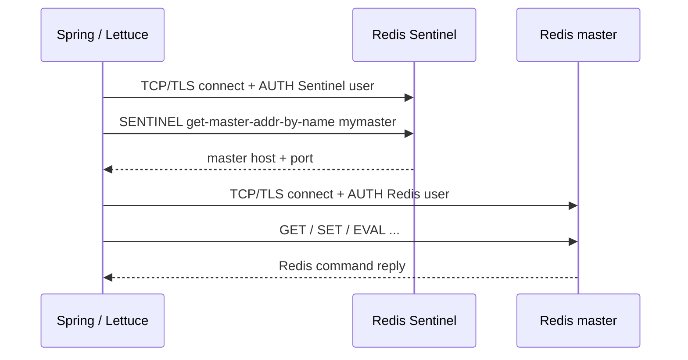
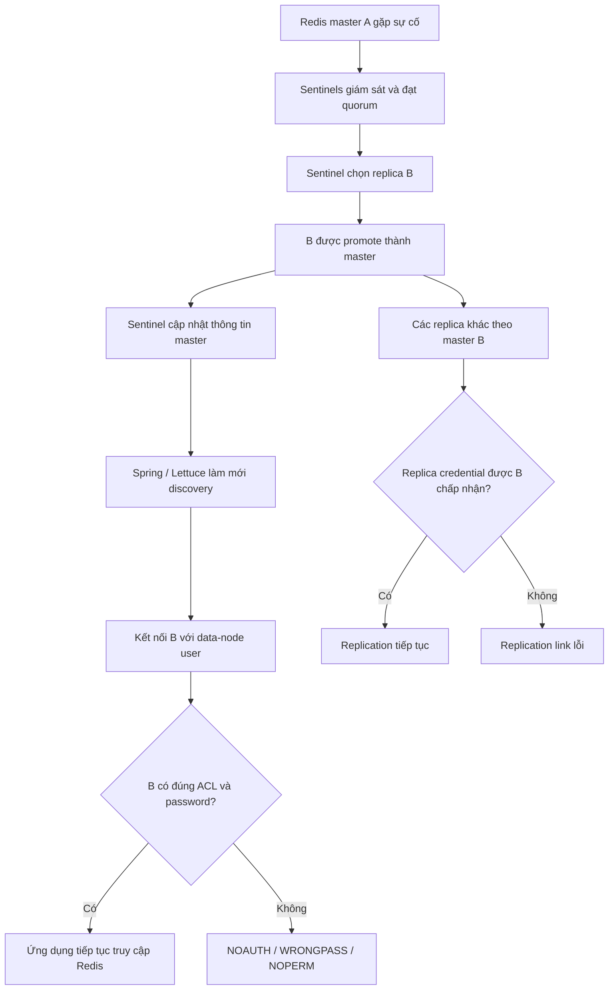

# Cấu hình xác thực cho Sentinel và các nút Redis trong Spring Data Redis

## 1. Vấn đề: một kết nối Redis Sentinel có nhiều lớp xác thực

Trong mô hình **Redis replication + Sentinel**, ứng dụng Spring không chỉ làm việc với một Redis server. Nó thường kết nối tới một hoặc nhiều Sentinel để hỏi **master hiện tại**, sau đó mở kết nối dữ liệu đến master hoặc replica phù hợp. Đồng thời, các Sentinel tự giám sát các Redis node, các replica xác thực với master để sao chép dữ liệu, và các Sentinel còn cần trao đổi thông tin với nhau.

Điều này tạo ra nhiều đường xác thực **độc lập**. Chỉ đặt `spring.data.redis.password` và kết luận "đã cấu hình mật khẩu Redis" là chưa đủ khi cả Sentinel lẫn Redis data nodes đều yêu cầu đăng nhập.

Giả sử một topology:

```text
                   Spring Boot application
                          |
                          | 1. Hỏi master hiện tại
                          |    (Sentinel username/password)
                          v
                +---------------------+
                | Sentinel cluster    |
                | S1, S2, S3 :26379   |
                +---------------------+
                       |         |
          2. Giám sát Redis     | 3. Các Sentinel giao tiếp
             (auth-user/pass)   |    (sentinel-user/pass)
                       v         v
               +----------------------+
               | Redis master :6379   |
               | Redis replica :6380  |
               +----------------------+
                          ^
                          |
              4. Đọc/ghi dữ liệu từ ứng dụng
                 (Redis data-node username/password)

       Redis replica --------AUTH/masteruser/masterauth------> master
                           5. Xác thực replication
```

**Master** ở đây là vai trò hiện thời của Redis data node. Sentinel có thể bầu/promote một replica thành master mới khi failover. Vì vậy cấu hình xác thực phải đúng **trước và sau khi vai trò node thay đổi**.

### 1.1. Năm luồng xác thực cần kiểm soát

| Luồng | Bên kết nối | Đích kết nối | Thông tin xác thực |
|---|---|---|---|
| A | Spring application | Sentinel endpoint | **Sentinel client** username/password |
| B | Spring application | Redis master/replica | **Data-node application** username/password |
| C | Redis Sentinel process | Redis master/replica mà nó giám sát | `sentinel auth-user <master-name>` / `sentinel auth-pass <master-name>` |
| D | Redis replica | Redis master | `masteruser` / `masterauth` hoặc cơ chế password tương ứng |
| E | Redis Sentinel process | Sentinel process khác | `sentinel sentinel-user` / `sentinel sentinel-pass` khi dùng Sentinel ACL phù hợp |

Mỗi luồng có mục tiêu riêng. Tài khoản dùng ở luồng A không bắt buộc giống tài khoản ở luồng C; tài khoản của ứng dụng trong luồng B không nên mặc định được cấp quyền điều khiển replication/failover.

> Một lỗi cấu hình rất phổ biến: ứng dụng xác thực thành công với Sentinel và nhận được IP của master, nhưng thất bại khi kết nối master vì **password của data node** không đúng. Chiều ngược lại cũng có thể xảy ra: truy cập Redis trực tiếp thành công nhưng Sentinel discovery thất bại.

## 2. Vai trò của Sentinel trong discovery và failover

Sentinel không phải một Redis proxy chuyển tiếp mọi lệnh `GET` và `SET`. Quy trình phổ biến của client Sentinel-aware:

1. Client kết nối một trong các Sentinel đã cấu hình.
2. Client xác thực tới Sentinel, nếu Sentinel có ACL/password.
3. Client hỏi `SENTINEL get-master-addr-by-name <master-name>`.
4. Sentinel trả host và port của master mà nó biết.
5. Client tạo kết nối **trực tiếp tới Redis data node** đó bằng tài khoản của data node.
6. Khi failover xảy ra, client/driver làm mới thông tin master và kết nối lại theo cơ chế hỗ trợ.



Tên `mymaster` là **tên logical master group được Sentinel giám sát**, không phải tên người dùng, database hoặc DNS của server. Ứng dụng phải dùng đúng tên khai báo trong `sentinel monitor`.

Ví dụ endpoint:

```text
Sentinel S1: redis-sentinel-1.internal:26379
Sentinel S2: redis-sentinel-2.internal:26379
Sentinel S3: redis-sentinel-3.internal:26379

Redis node A: redis-data-a.internal:6379
Redis node B: redis-data-b.internal:6379
Redis node C: redis-data-c.internal:6379

Sentinel logical master name: mymaster
```

Cổng 26379 và 6379 là mặc định thông dụng, không phải quy tắc bất biến. Môi trường container, TLS, managed service hoặc NAT có thể dùng cổng khác.

## 3. ACL và mật khẩu truyền thống

### 3.1. Redis 6+ dùng ACL

Redis 6 giới thiệu Access Control List (ACL), cho phép:

- Tạo nhiều user với tên riêng và password riêng.
- Giới hạn các command được gọi.
- Giới hạn key pattern mà user được truy cập.
- Giới hạn Pub/Sub channel theo khả năng phiên bản.
- Vô hiệu hóa user hoặc thay đổi credential không cần chia sẻ một password toàn cục.

Về mặt kết nối, cú pháp xác thực thường là:

```redis
AUTH username password
```

hoặc khi một số client dùng Redis protocol hỗ trợ `HELLO`:

```redis
HELLO 3 AUTH username password
```

Trong application code, **không cần tự gửi AUTH thủ công** nếu cấu hình Spring Data Redis/Lettuce đúng; driver thực hiện handshake theo cấu hình. Ví dụ CLI chỉ để hiểu giao thức.

### 3.2. Password-only và user mặc định

Với cấu hình cũ kiểu `requirepass`, client có thể xác thực bằng một password:

```redis
AUTH password
```

Trên Redis 6+, mô hình này tương ứng về mặt xác thực với user `default` theo cách Redis hỗ trợ. Những hệ thống nâng cấp từ Redis cũ có thể vẫn dùng password-only nhưng khó áp dụng least privilege và rotation tách biệt cho từng thành phần.

Với **Sentinel instance**, cần chú ý phiên bản: Sentinel hỗ trợ cơ chế password-only ở những bản trước, còn ACL cho Sentinel process khả dụng từ Redis **6.2**. Đừng suy luận rằng vì Redis data node hỗ trợ ACL từ phiên bản 6.0 nên Sentinel ở mọi deployment Redis 6.0 cũng hỗ trợ ACL như nhau.

### 3.3. Tránh nhầm một password với bốn password khác nhau

Một hệ thống có thể triển khai các giá trị độc lập:

```text
SENTINEL_CLIENT_PASSWORD      # Spring -> Sentinel
REDIS_APP_PASSWORD            # Spring -> Redis data node
SENTINEL_MONITOR_PASSWORD     # Sentinel -> Redis node
REPLICA_PASSWORD              # Replica -> master
SENTINEL_PEER_PASSWORD        # Sentinel -> Sentinel
```

Trong ví dụ này mọi biến chỉ là **tên minh họa**. Có thể có thiết kế dùng một credential cho hơn một luồng, nhưng tách credential thường giúp giới hạn quyền và xoay vòng độc lập hơn. Đừng sao chép password thật vào source code, README, file YAML commit lên Git hoặc lệnh CLI hiển thị trong shell history.

## 4. Cấu hình Spring Boot: tách Sentinel credentials khỏi data-node credentials

Với Spring Boot hiện đại sử dụng Spring Data Redis và Lettuce, cách dễ nhất thường là dùng auto-configuration.

### 4.1. Dependencies

```groovy
dependencies {
    implementation 'org.springframework.boot:spring-boot-starter-data-redis'
}
```

Spring Boot starter thường sử dụng Lettuce làm driver Redis mặc định. Nếu dự án đã thay client hoặc khai báo `RedisConnectionFactory` riêng, những property tự động có hiệu lực hay không phụ thuộc cách xây factory và phiên bản.

### 4.2. application.yml

```yaml
spring:
  data:
    redis:
      # Thông tin xác thực khi ứng dụng kết nối DATA NODE.
      username: app-redis
      password: ${REDIS_APP_PASSWORD}

      # Sentinel discovery dùng credential RIÊNG.
      sentinel:
        master: mymaster
        nodes:
          - redis-sentinel-1.internal:26379
          - redis-sentinel-2.internal:26379
          - redis-sentinel-3.internal:26379
        username: app-sentinel
        password: ${SENTINEL_CLIENT_PASSWORD}

      connect-timeout: 2s
      timeout: 3s
```

Ý nghĩa của những trường quan trọng:

| Property | Dùng để làm gì? |
|---|---|
| `spring.data.redis.sentinel.master` | Tên nhóm master mà Sentinel quản lý |
| `spring.data.redis.sentinel.nodes` | Các host:port Sentinel để discovery |
| `spring.data.redis.sentinel.username` | User khi **ứng dụng kết nối Sentinel** |
| `spring.data.redis.sentinel.password` | Password khi **ứng dụng kết nối Sentinel** |
| `spring.data.redis.username` | User khi **ứng dụng kết nối Redis data node** |
| `spring.data.redis.password` | Password khi **ứng dụng kết nối Redis data node** |
| `spring.data.redis.connect-timeout` | Thời gian chờ thiết lập kết nối, theo driver/configuration |
| `spring.data.redis.timeout` | Thời gian chờ command/đọc phản hồi theo cấu hình Boot |

Khi hai bên dùng password-only thay vì ACL user cụ thể, có thể bỏ trường `username` thích hợp và cấu hình riêng password. **Không bỏ `sentinel.password` chỉ vì đã có `spring.data.redis.password`**: password data node không có nghĩa client được Sentinel chấp nhận.

Ví dụ dùng biến môi trường chỉ là minh họa. Trong production, credentials nên được inject từ Kubernetes Secret, secret manager hoặc cơ chế an toàn của platform; không commit các giá trị thật.

**Chú ý phiên bản Spring Boot:** các dự án Spring Boot 2.x thường sử dụng prefix `spring.redis.*`, trong khi Spring Boot 3.x và các bản mới dùng `spring.data.redis.*`. Đối chiếu version dự án; một property không được bind có thể khiến client thử kết nối không có password mà không hiển thị lỗi cấu hình rõ ràng.

### 4.3. Không nhầm Redis URL với Sentinel topology

`spring.data.redis.url` có khả năng override host/port/username/password của Redis data node theo hợp đồng của Spring Boot, nhưng một URL Redis standalone **không thay thế danh sách Sentinel nodes và master name**. Nếu đã cấu hình Sentinel, tránh đồng thời đặt URL/host standalone mâu thuẫn trừ khi hiểu thứ tự ưu tiên của phiên bản đang dùng.

Đặc biệt, URI chứa username/password thường dễ rò qua log, process arguments hoặc copy/paste. Khi cấu hình Sentinel, dùng property rõ ràng và secret injection thường dễ vận hành hơn.

## 5. Cấu hình RedisSentinelConfiguration bằng Java

Nếu cần cấu hình hoàn toàn bằng code hoặc có logic lấy secret tùy môi trường, Spring Data Redis cung cấp `RedisSentinelConfiguration` và `LettuceConnectionFactory`.

Ví dụ:

```java
package com.example.redis.config;

import java.time.Duration;
import org.springframework.beans.factory.annotation.Value;
import org.springframework.context.annotation.Bean;
import org.springframework.context.annotation.Configuration;
import org.springframework.data.redis.connection.RedisPassword;
import org.springframework.data.redis.connection.RedisSentinelConfiguration;
import org.springframework.data.redis.connection.RedisConnectionFactory;
import org.springframework.data.redis.connection.lettuce.LettuceClientConfiguration;
import org.springframework.data.redis.connection.lettuce.LettuceConnectionFactory;

@Configuration
public class RedisHaConfiguration {

    @Bean
    public RedisConnectionFactory redisConnectionFactory(
            @Value("${redis.auth.data.username}") String dataUsername,
            @Value("${redis.auth.data.password}") String dataPassword,
            @Value("${redis.auth.sentinel.username}") String sentinelUsername,
            @Value("${redis.auth.sentinel.password}") String sentinelPassword) {

        RedisSentinelConfiguration sentinel =
                new RedisSentinelConfiguration()
                        .master("mymaster")
                        .sentinel("redis-sentinel-1.internal", 26379)
                        .sentinel("redis-sentinel-2.internal", 26379)
                        .sentinel("redis-sentinel-3.internal", 26379);

        // Spring application -> Redis master/replica.
        sentinel.setUsername(dataUsername);
        sentinel.setPassword(RedisPassword.of(dataPassword));

        // Spring application -> Redis Sentinel.
        sentinel.setSentinelUsername(sentinelUsername);
        sentinel.setSentinelPassword(
                RedisPassword.of(sentinelPassword)
        );

        LettuceClientConfiguration client =
                LettuceClientConfiguration.builder()
                        .commandTimeout(Duration.ofSeconds(3))
                        .build();

        return new LettuceConnectionFactory(sentinel, client);
    }
}
```

Với cấu hình này, cần cung cấp các property `redis.auth.*` từ nguồn bảo mật, ví dụ environment hoặc secret configuration. Các host trong ví dụ là tên minh họa; thay bằng endpoint có thể định tuyến từ ứng dụng thật.

Những API quyết định:

- `setUsername(...)` / `setPassword(...)`: dùng cho **Redis data nodes**.
- `setSentinelUsername(...)` / `setSentinelPassword(...)`: dùng cho **Sentinel endpoints**.
- `.master("mymaster")`: logical group name của Sentinel.
- `.sentinel(host, port)`: endpoint Sentinel, **không phải Redis master**.

`RedisSentinelConfiguration` có overload và API khác nhau qua các đời Spring Data Redis; ví dụ này dùng các setter phổ biến trong phiên bản hiện đại. Khi có bean `RedisConnectionFactory` do chính mình tạo, Spring Boot có thể không còn tạo factory tự động theo property nữa. **Chọn một nguồn cấu hình rõ ràng** để tránh hai factory cùng tồn tại mà ứng dụng sử dụng nhầm.

### 5.1. Khi nào nên chọn Java configuration?

Ưu tiên YAML/auto-configuration nếu chỉ cần khai báo nodes và credentials. Dùng cấu hình Java khi:

- Cần tích hợp secret provider mà property binding mặc định không đủ.
- Cần tùy biến `LettuceClientConfiguration`.
- Cần cấu hình topology thay đổi theo profile hoặc environment.
- Cần chủ động phân biệt tài khoản cho một số nhóm kết nối.

Cấu hình Java **không thay thế** ba phần khác: Sentinel process phải được cấu hình để xác thực với Redis, replica phải xác thực được với master, và ACL/server-side authorization phải cấp đúng lệnh.

## 6. Xác thực phía Redis data nodes

### 6.1. Tạo tài khoản riêng cho ứng dụng

Một Redis data node có thể có user phục vụ API đọc/ghi. Ví dụ **minh họa tối giản** trên môi trường thử nghiệm:

```redis
ACL SETUSER app-redis on >REPLACE_WITH_SECRET ~app:* +get +set +del +expire +pttl +ping
```

Lệnh này cho phép những thao tác cơ bản trên các key `app:*`. Nó **chưa phải profile đủ cho mọi Spring Cache, Redis Repository, transaction hoặc pipeline**: các API đó có thể cần thêm lệnh như `mget`, `mset`, `unlink`, `scan`, `eval`, Hash/Set/ZSet commands, `client` hoặc lệnh liên quan tùy implementation.

Đừng dùng ACL mẫu làm danh sách quyền production hoàn chỉnh. Thiết kế quyền dựa trên **các command thực tế được ứng dụng gọi**, phiên bản Redis và tính năng sử dụng. Nếu Redis Repository tạo key index hoặc phantom key ngoài prefix giả định, `~app:*` cần được đối chiếu với keyspace thực tế.

Với một client chỉ đọc, tài khoản nên có quyền hạn chế đọc, thay vì dùng user có quyền quản trị hoặc failover. Redis user có thể được tạo bằng ACL file, lệnh quản trị hoặc cấu hình dịch vụ managed tùy môi trường.

### 6.2. Master và replica phải chấp nhận credential sau failover

Nếu một Sentinel failover khiến replica B thành master, Spring driver sẽ kết nối B với **cùng cấu hình data-node username/password**. Vì vậy:

- Tài khoản ứng dụng phải được tạo/đồng bộ trên các node có thể trở thành master.
- Permission pattern phải tương đương trên các node khi nghiệp vụ yêu cầu.
- Mật khẩu không được chỉ cập nhật trên master hiện tại mà bỏ quên replica.
- Nếu chọn đọc từ replica, tài khoản cũng phải có quyền cần thiết trên replica.
- Các khác biệt ACL giữa nodes có thể chỉ lộ ra **sau khi failover**.

Đây là lý do **ACL consistency** trong nhóm Redis được giám sát là yêu cầu HA, không chỉ là việc bảo mật.

## 7. Sentinel xác thực tới Redis data nodes

Sentinel cần giám sát và trong tình huống failover thực hiện các lệnh quản lý role/topology. Khi Redis master/replica bật ACL, Sentinel cần một tài khoản có những quyền điều khiển cần thiết.

Trong file `sentinel.conf`, cấu hình cho logical master group có dạng:

```conf
port 26379

sentinel monitor mymaster redis-data-a.internal 6379 2

# CREDENTIALS SENTINEL -> REDIS DATA NODE
sentinel auth-user mymaster sentinel-monitor
sentinel auth-pass mymaster <SENTINEL_MONITOR_PASSWORD>

sentinel down-after-milliseconds mymaster 10000
sentinel failover-timeout mymaster 60000
```

Các dòng `sentinel auth-user` và `sentinel auth-pass` xác thực **quá trình Sentinel khi kết nối nhóm Redis master/replica**. Chúng **không** tự cấu hình username/password để ứng dụng Spring đăng nhập vào cổng Sentinel 26379.

`mymaster` phải khớp tên master group trong `sentinel monitor` và Spring application. `2` trong `sentinel monitor ... 2` là quorum, không phải số lượng replicas hay lượng password cần khai báo.

Cần triển khai cấu hình này tới **tất cả Sentinel processes có trách nhiệm giám sát nhóm Redis**, đồng thời tạo tài khoản `sentinel-monitor` trên các Redis data nodes liên quan.

### 7.1. ACL của tài khoản Sentinel-monitor

Sentinel thường cần những lệnh như `PING`, `INFO`, `ROLE`, một số lệnh quản lý client, replication và Pub/Sub nội bộ. Redis documentation cung cấp ACL profile gợi ý cho Sentinel; một ví dụ tương ứng:

```redis
ACL SETUSER sentinel-monitor on >REPLACE_WITH_SECRET resetchannels &__sentinel__:hello +multi +slaveof +ping +exec +subscribe +config|rewrite +role +publish +info +client|setname +client|kill +script|kill
```

**Đây là mẫu tham chiếu cho Redis phiên bản phù hợp**, không phải công thức bất biến. Tên command, ACL subcommand và channel permission có thể thay đổi giữa các phiên bản Redis/Valkey. Một số deployment hoặc quy trình failover đòi hỏi thêm quyền theo tài liệu Redis server mà bạn đang chạy. Cần thử đủ các trạng thái giám sát, reconfiguration và failover thực tế.

Một lỗi thường gặp là tạo user Sentinel với `+ping +info` rồi kiểm tra thấy health OK, nhưng đến khi failover cần lệnh thay đổi replication role thì nhận `NOPERM`. **Xác thực thành công không đồng nghĩa quyền failover đã đủ**.

### 7.2. Sentinel cần kết nối đến cả master và replicas

Sentinel theo dõi nhóm master và những replica mà nó khám phá được. Đặt tài khoản `sentinel-monitor` chỉ trên master hiện tại là sai: sau khi replica lên master, Sentinel vẫn phải kiểm tra, phối hợp và cấu hình các node trong nhóm.

Quy tắc:

1. Cấp tài khoản Sentinel-monitor trên tất cả Redis data nodes của nhóm.
2. Giữ credential/ACL đồng nhất trong quá trình failover.
3. Bảo đảm các node mới được thêm có cùng user và quyền trước khi đưa vào HA topology.
4. Kiểm tra network và TLS không chỉ từ application mà còn từ Sentinel processes tới Redis nodes.

Nếu Sentinel thiếu quyền, hệ thống có thể kết nối bình thường trong điều kiện khỏe mạnh nhưng **không tự phục hồi** khi primary gặp sự cố.

## 8. Replica xác thực khi replication tới master

Replica mở kết nối replication tới master. Đây là **luồng xác thực thứ tư**, không được thay thế bằng `spring.data.redis.password` hay `sentinel auth-pass`.

### 8.1. Trường hợp password-only

Với Redis sử dụng password-only, cấu hình có thể gồm:

**Master (minh họa):**

```conf
requirepass <REDIS_MASTER_PASSWORD>
```

**Replica:**

```conf
replicaof redis-data-a.internal 6379
masterauth <REDIS_MASTER_PASSWORD>
```

Khi replica kết nối master, nó phải xác thực bằng password mà master chấp nhận. Các file config trên chỉ minh họa, không nên ghi plaintext secret vào Git hoặc trao quyền đọc file cho user không liên quan.

### 8.2. Trường hợp ACL: masteruser và masterauth

Với Redis ACL, replica có thể dùng một tài khoản phục vụ replication:

**Tại master và các node có thể lên master:**

```redis
ACL SETUSER replica-sync on >REPLACE_WITH_SECRET +psync +replconf +ping
```

**Trong cấu hình của Redis replica:**

```conf
replicaof redis-data-a.internal 6379
masteruser replica-sync
masterauth <REPLICA_SYNC_PASSWORD>
```

Các quyền nêu trên là ví dụ ACL tối thiểu tham chiếu cho replication theo tài liệu Redis; hãy xác minh theo phiên bản/engine thực tế.

Quan trọng: vì Sentinel có thể promote một node thành master và cấu hình lại replica khác theo master mới, user `replica-sync` và mật khẩu phải tương thích trên **mọi node có thể trở thành master**. Không nên xây một hệ thống mà chỉ A chấp nhận replication credential còn B/C thì không.

### 8.3. Kiểm tra replication sau khi bật auth

Trên Redis node:

```redis
INFO replication
ROLE
```

Ở master, có thể xem số replicas và trạng thái. Ở replica, kiểm tra connection với master, sync status và replication offset theo các field phiên bản cung cấp.

Nếu replica gặp lỗi `NOAUTH` hoặc `WRONGPASS` khi tạo replication link, lỗi này có thể không xuất hiện trong log Spring application, vì Spring vẫn kết nối master hiện tại bình thường. Cần quan sát riêng log/metrics Redis nodes.

## 9. Xác thực tới Sentinel instance: client và peer

Một Sentinel có thể yêu cầu client đăng nhập khi kết nối cổng Sentinel. Đây là tài khoản trong **quá trình Sentinel server nhận inbound connections**.

### 9.1. Tài khoản cho Spring application truy vấn Sentinel

Trong môi trường Sentinel ACL (Redis Sentinel 6.2+), có thể tạo một user chỉ phục vụ discovery thay vì cho ứng dụng quyền admin.

Một tập lệnh cần xem xét gồm:

```text
AUTH / HELLO
PING
SENTINEL get-master-addr-by-name
SENTINEL master / masters / replicas / sentinels
CLIENT SETNAME (nếu driver sử dụng)
```

Cấp đúng ACL syntax theo version và nhu cầu driver. Ví dụ Redis documentation có ACL profile inbound client cho Sentinel với `+sentinel|get-master-addr-by-name` cùng một số subcommands discovery. Không cấp `+@all` cho ứng dụng chỉ cần tra cứu master.

Trong application:

```yaml
spring:
  data:
    redis:
      sentinel:
        master: mymaster
        nodes:
          - redis-sentinel-1.internal:26379
          - redis-sentinel-2.internal:26379
          - redis-sentinel-3.internal:26379
        username: app-sentinel
        password: ${SENTINEL_CLIENT_PASSWORD}
```

User `app-sentinel` **tồn tại trong ACL của Sentinel instances**; nó không phải user `app-redis` trên Redis master.

### 9.2. Các Sentinel xác thực với nhau

Trong topology có Sentinel ACL, các Sentinel processes cũng có thể cần credential riêng khi chúng kết nối tới Sentinel peers. Redis Sentinel cung cấp các directive:

```conf
sentinel sentinel-user <SENTINEL_PEER_USERNAME>
sentinel sentinel-pass <SENTINEL_PEER_PASSWORD>
```

Đây là credential **outbound Sentinel-to-Sentinel**, không phải tài khoản ứng dụng dùng cho discovery và cũng không phải `sentinel auth-user mymaster` để kết nối Redis data nodes.

Đồng thời, mỗi Sentinel cần cấu hình inbound ACL tương ứng để những peer hợp lệ có thể xác thực. Redis Sentinel documentation khuyến nghị dùng cấu hình xác thực tương thích trên tất cả Sentinel instances. Nếu user mặc định bị tắt, các Sentinel peers phải có user khác đủ quyền để trao đổi và điều phối.

Trong Redis Sentinel cũ dùng password-only, có thể cấu hình `requirepass` theo hướng dẫn chính thức. Không kết hợp bừa bãi password-only Sentinel và Sentinel ACL trên cùng deployment; kiểm tra version và cơ chế đang được hỗ trợ.

### 9.3. Ma trận cấu hình theo luồng

| Cấu hình | Nằm ở đâu? | Ai sử dụng? |
|---|---|---|
| `spring.data.redis.sentinel.username/password` | Spring Boot | Application đăng nhập Sentinel |
| `spring.data.redis.username/password` | Spring Boot | Application đăng nhập Redis data node |
| `sentinel auth-user mymaster` / `auth-pass` | Sentinel config | Sentinel giám sát Redis data nodes |
| `masteruser` / `masterauth` | Redis replica config | Replica đăng nhập master để replicate |
| `sentinel sentinel-user` / `sentinel-pass` | Sentinel config | Sentinel giao tiếp với Sentinel khác |
| Redis data-node ACL users | Redis server/ACL file | Xác định quyền application, Sentinel monitor, replica |
| Sentinel ACL users | Sentinel server/ACL file | Xác định quyền application discovery và Sentinel peers |

Phần lớn lỗi auth trong topology HA đến từ việc **đúng credential nhưng đặt nhầm vị trí cấu hình**.

## 10. Kiểm tra xác thực riêng từng tầng bằng redis-cli

Để tránh chẩn đoán một lỗi tổng hợp "Redis connection failed", nên kiểm tra các kết nối một cách độc lập. Những lệnh sau chỉ dành cho môi trường được phép truy cập và sử dụng **`--askpass`** để tránh đặt password ngay trong command line.

### 10.1. Kết nối Sentinel

```bash
redis-cli \
  -h redis-sentinel-1.internal \
  -p 26379 \
  --user app-sentinel \
  --askpass \
  PING
```

Nếu thành công, có thể thử truy vấn discovery bằng cùng credential:

```bash
redis-cli \
  -h redis-sentinel-1.internal \
  -p 26379 \
  --user app-sentinel \
  --askpass \
  SENTINEL get-master-addr-by-name mymaster
```

Kỳ vọng là một cặp host/port master. Nếu lệnh `PING` thành công nhưng discovery trả `NOPERM`, credential hợp lệ nhưng **ACL chưa cho phép subcommand discovery**.

Với password-only có thể bỏ `--user app-sentinel`, tùy phương thức auth của Sentinel.

### 10.2. Kết nối trực tiếp data node

```bash
redis-cli \
  -h redis-data-a.internal \
  -p 6379 \
  --user app-redis \
  --askpass \
  PING
```

Kiểm tra command phù hợp với role:

```bash
redis-cli \
  -h redis-data-a.internal \
  -p 6379 \
  --user app-redis \
  --askpass \
  GET app:healthcheck
```

Không dùng `SET` trên production để thử authentication nếu không có key/namespace được phép và cơ chế cleanup. Test `PING` chỉ chứng minh đã đăng nhập và có quyền PING, **không chứng minh đủ quyền cho Hash, Script hoặc Repository**.

### 10.3. Kiểm tra Sentinel giám sát và quorum

Với tài khoản vận hành được cấp quyền tương ứng:

```redis
SENTINEL masters
SENTINEL replicas mymaster
SENTINEL sentinels mymaster
SENTINEL ckquorum mymaster
```

Các command này giúp quan sát discovery, peers, replica và điều kiện quorum/majority của deployment. Chúng không dùng để thay thế kiểm tra replication link thật và không chứng minh Spring application đã cấu hình data-node credential đúng.

`SENTINEL ckquorum` cần quyền phù hợp, có thể không được cấp cho `app-sentinel` chỉ dùng discovery. Đây là hành động vận hành, không phải nhu cầu của mọi ứng dụng.

## 11. TLS và xác thực: hai lớp bảo vệ khác nhau

Username/password xác định **ai được kết nối và được phép làm gì**. TLS bảo vệ **đường truyền** và có thể xác thực server bằng chứng chỉ; trong một số hệ thống còn có mutual TLS theo chính sách provider.

Với topology Sentinel, cần phân biệt các đoạn mạng:

1. Application → Sentinel.
2. Application → Redis master/replica.
3. Sentinel → Redis data nodes.
4. Sentinel ↔ Sentinel.
5. Replica → master.

Nếu chỉ bật TLS cho data node mà Sentinel vẫn chạy plaintext, thông tin discovery hoặc credential trên đoạn application–Sentinel có thể không được bảo vệ như mong muốn.

### 11.1. Spring Boot SSL

Với môi trường dùng TLS và phiên bản Boot hỗ trợ:

```yaml
spring:
  data:
    redis:
      ssl:
        enabled: true
```

Một số phiên bản Spring Boot còn hỗ trợ SSL bundle:

```yaml
spring:
  data:
    redis:
      ssl:
        bundle: redis-client
```

Các mẫu YAML là **lựa chọn cấu hình theo môi trường**, không phải chỉ cần đặt cả hai là mọi đường Sentinel/Redis đều tự tương thích. Kiểm tra kỹ driver, cách tạo `RedisConnectionFactory`, trust store, certificate hostname, SNI và TLS support của mỗi Sentinel/data endpoint.

Nếu viết `LettuceConnectionFactory` tùy chỉnh, phải đặt TLS trong `LettuceClientConfiguration` phù hợp:

```java
LettuceClientConfiguration client =
        LettuceClientConfiguration.builder()
                .useSsl()
                .commandTimeout(Duration.ofSeconds(3))
                .build();
```

Ví dụ này minh họa cấu hình client SSL cơ bản; không cấu hình trust bundle, hostname verification hay mTLS riêng. **Không tắt kiểm tra certificate/hostname để vượt qua lỗi môi trường** nếu không có đánh giá bảo mật nghiêm túc.

### 11.2. Lưu ý khi kiểm tra bằng redis-cli

Khi endpoint Redis dùng TLS, thêm `--tls` vào lệnh `redis-cli` theo cách server hỗ trợ. Ví dụ:

```bash
redis-cli --tls \
  -h redis-sentinel-1.internal -p 26379 \
  --user app-sentinel --askpass \
  SENTINEL get-master-addr-by-name mymaster
```

Nếu chứng chỉ do CA nội bộ cấp, cấu hình CA certificate/trust theo hướng dẫn bảo mật của môi trường. Một lỗi `SSLHandshakeException` khác về bản chất với `WRONGPASS`; không nên đổi password để xử lý lỗi certificate.

## 12. Tình huống failover: xác thực phải còn đúng khi role đổi

Một failover thành công yêu cầu nhiều thành phần phối hợp:



Một hệ thống có thể vượt qua bước discovery và failover nhưng vẫn mất khả năng phục vụ vì ACL không đồng nhất. Những ví dụ:

- `app-redis` chỉ tồn tại trên master A; replica B được promote nhưng không có user này.
- Sentinel giám sát bằng `sentinel-monitor` trên A, nhưng B không có quyền tương đương.
- Replica C dùng `masterauth` cũ; B đã đổi password nên C không replicate được.
- Sentinel peers sử dụng credential khác nhau sau một đợt xoay vòng.
- Spring chỉ biết một Sentinel endpoint bị lỗi và không có seed endpoints còn hoạt động.
- Endpoint Redis mà Sentinel công bố là địa chỉ private không thể truy cập từ mạng ứng dụng.

Vì vậy, **"redis-cli PING master hiện tại thành công" không phải một bài kiểm tra HA đầy đủ**.

### 12.1. Tính nhất quán của tài khoản trên các node

Đối với Redis data nodes có thể thay vai, cần có một quy trình đưa ACL vào tất cả nodes:

- Cùng user ứng dụng và quyền cần thiết.
- Cùng user Sentinel-monitor và quyền giám sát/failover.
- Cùng user replica-sync và password cho replication.
- Kế hoạch phân phối/rotation được đồng bộ trước khi đổi role.
- Kiểm soát cấu hình mới khi scale-out/rejoin.

Tùy Redis version, ACL thay đổi qua `ACL SETUSER` có thể không được sao chép tự động như dữ liệu keyspace; đừng dựa vào giả định "đổi trên master thì replica tự có cùng user". Phải dùng cơ chế ACL file/config management/provider control plane được thiết kế cho topology thực tế.

### 12.2. Địa chỉ do Sentinel công bố phải kết nối được

Khi chạy trong container/Kubernetes hoặc đằng sau NAT, Sentinel có thể trả địa chỉ Redis không truy cập được từ application, dù authentication đúng.

Các dấu hiệu:

```text
SENTINEL get-master-addr-by-name mymaster
=> 10.0.0.12 6379

Ứng dụng ở mạng khác không route được 10.0.0.12.
```

Khi đó lỗi thường là connection timeout, không phải `WRONGPASS`. Cần cấu hình announce address, DNS, endpoint và network policy phù hợp. Đừng xử lý một lỗi route bằng cách cấp thêm quyền admin.

## 13. Xoay vòng mật khẩu mà không gây downtime

Credential rotation trong topology Sentinel cần nhiều bước hơn một ứng dụng standalone. Nếu thay password data node trước khi cập nhật application hoặc replica, Redis có thể bị mất kết nối dữ liệu và replication.

### 13.1. Chiến lược theo từng lớp

| Loại credential | Cần cập nhật ở đâu? | Rủi ro nếu lệch |
|---|---|---|
| Application → Sentinel | Sentinel ACL / client secret của Spring | Không tìm được master |
| Application → Redis data node | Data-node ACL trên tất cả nodes / client secret | Discovery được nhưng auth vào Redis lỗi |
| Sentinel → Redis data node | Data-node Sentinel-monitor ACL / `sentinel auth-user/pass` | Sentinel không giám sát hoặc không failover được |
| Replica → master | Redis ACL trên nodes / `masteruser/masterauth` | Replication link đứt |
| Sentinel → Sentinel | Inbound Sentinel ACL / `sentinel sentinel-user/pass` | Peers không phối hợp đúng |

### 13.2. Thêm trước, cắt sau khi dùng ACL

Một hướng xoay vòng ít rủi ro khi hệ thống hỗ trợ nhiều user/credential:

1. **Tạo user/password mới** hoặc bổ sung credential mới trên tất cả server đích theo security policy.
2. Kiểm tra quyền và khả năng đăng nhập bằng credential mới trên từng nhóm node.
3. Cập nhật các client/process phụ thuộc theo thứ tự vận hành phù hợp.
4. Theo dõi authentication failures, replication state, Sentinel quorum và application latency.
5. Kiểm tra hoạt động ở topology failover hoặc mô phỏng vai trò trước khi thu hồi credential cũ.
6. Chỉ vô hiệu hóa credential cũ sau khi không còn consumer cần nó.

Không mặc định thay một biến môi trường của Spring sẽ lập tức cập nhật mọi kết nối TCP đang giữ trong pool. Có thể cần refresh/restart client, khởi tạo lại connection factory hoặc rollout có kiểm soát tùy driver và secret integration.

Với password-only `requirepass`, việc dùng song song credential cũ/mới thường hạn chế hơn ACL nhiều user. Cần lên kế hoạch thay đổi và thời điểm reconnect cụ thể, có thể phải chấp nhận một cửa sổ bảo trì nếu nền tảng không hỗ trợ rotation liền mạch.

### 13.3. Không lưu secret trong log

Tránh:

- In toàn bộ cấu hình YAML hoặc object `RedisSentinelConfiguration` nếu có password.
- Dùng CLI `-a literal-password` trong command history/process list.
- Commit `sentinel.conf` hoặc `redis.conf` có secret production vào repository.
- Gửi mật khẩu qua ticket hoặc chat không được quản lý.
- Cấp quyền đọc secret quá rộng cho nhiều service.

Có thể dùng `--askpass` hoặc secret injector bảo mật khi kiểm tra thủ công; log chỉ nên chứa loại lỗi, endpoint/role đã được làm mờ thích hợp, không chứa password.

## 14. Quyền tối thiểu và không nhầm security với availability

### 14.1. Quyền ứng dụng

Một application user chỉ đọc cache không cần `CONFIG`, `REPLICAOF` hay `SENTINEL FAILOVER`. Chỉ cấp command và key patterns phục vụ nghiệp vụ.

Tuy nhiên, quyền tối thiểu phải thực tế: Spring Cache có thể dùng `GET`, `SET`, `DEL`, `UNLINK`, `SCAN` hoặc Lua scripts tùy cấu hình; Spring Data Redis Repository còn tạo Hash/Set/TTL và secondary index. Dùng một ACL chỉ cho `GET` rồi báo `NOPERM` khi repository `save` là lỗi quyền, không phải lỗi Sentinel.

### 14.2. Quyền Sentinel-monitor

Sentinel-monitor không phải user ứng dụng. Nó phải có quyền quan sát và **thực hiện failover/reconfiguration** theo tài liệu Redis. Cấp quá ít quyền có thể làm ứng dụng nhìn như "HA đã chạy" trong trạng thái khỏe mạnh nhưng thất bại khi thực sự cần promote replica.

### 14.3. Quyền Sentinel client

Application dùng Sentinel để discovery thường chỉ cần truy vấn status/master endpoint. Không cấp thêm quyền đổi cấu hình Sentinel hoặc ép failover cho client thông thường.

### 14.4. Quyền replica-sync

Replica credential phải đủ thực hiện protocol replication. Không dùng tài khoản ứng dụng có quyền thao tác dữ liệu thay thế chỉ vì nó xác thực thành công.

## 15. Chẩn đoán theo triệu chứng

| Triệu chứng | Khả năng nguyên nhân | Cách xác minh |
|---|---|---|
| `NOAUTH Authentication required` khi hỏi Sentinel | Client thiếu Sentinel credential | Kiểm tra `sentinel.username/password` |
| `WRONGPASS invalid username-password pair` từ Sentinel | Sai Sentinel user/password hoặc user bị tắt | Dùng CLI vào cổng 26379 |
| `PING` Sentinel OK nhưng discovery `NOPERM` | ACL chặn `SENTINEL get-master-addr-by-name` | Test đúng subcommand với same user |
| Sentinel discovery OK nhưng `GET` Redis lỗi `NOAUTH/WRONGPASS` | Sai data-node credential | Test Redis port bằng `app-redis` |
| `GET` Redis OK, `SET` hoặc Repository save `NOPERM` | ACL data node thiếu command/key pattern | Xem lệnh thực tế và ACL |
| Local chạy, failover xong Spring không kết nối | User không đồng nhất trên replica được promote | Kiểm tra ACL trên master mới |
| Sentinel không thấy replicas / báo s_down bất thường | Sentinel-monitor auth, quyền hoặc network sai | Xem Sentinel logs, `SENTINEL replicas` |
| Replica mất master link | `masteruser/masterauth` sai hoặc user thiếu `PSYNC/REPLCONF` | `INFO replication` và Redis logs |
| Sentinel không đạt quorum | Peers thiếu quyền kết nối, network/TLS, chưa đủ Sentinels | `SENTINEL ckquorum` và peer logs |
| `SSLHandshakeException` | TLS CA/hostname/trust hoặc mode TLS mismatch | Kiểm tra endpoint/certificate, không đổi mật khẩu |
| Connection timeout tới master được Sentinel trả về | DNS/NAT/firewall/announce IP | Kiểm tra host/port từ discovery có route được |
| Boot properties có secret nhưng driver vẫn dùng auth cũ | Đặt sai prefix, custom connection factory hoặc restart chưa áp dụng | Kiểm tra property binding, bean và rollout |
| Client kết nối nhưng lỗi `READONLY` khi ghi | Kết nối replica hoặc topology chưa refresh sau failover | Kiểm tra `ROLE`, master discovery, driver state |
| User ứng dụng thiếu quyền tới Hash/Set/Lua | ACL chỉ cho String commands | Mở quyền đúng lệnh cần dùng theo least privilege |
| Một Sentinel seed endpoint chết làm app không khởi động | Chỉ cấu hình một Sentinel hoặc không route tới các seed còn lại | Cấu hình nhiều seed và kiểm tra network |

### 15.1. NOAUTH, WRONGPASS và NOPERM không cùng nghĩa

- **`NOAUTH`:** client chưa xác thực khi server yêu cầu authentication.
- **`WRONGPASS`:** credential không được chấp nhận (sai user/password, user disabled hoặc điều kiện tương đương).
- **`NOPERM`:** authentication đã thành công nhưng user **không đủ quyền thực thi command hoặc truy cập key/channel**.

Đây là ba nhánh điều tra khác nhau. Nếu nhận `NOPERM` khi `SENTINEL master`, đổi password đúng đang dùng sẽ không tự cấp quyền subcommand.

### 15.2. Check đúng port và đúng vai trò

Redis và Sentinel đều có giao thức RESP; `PING` có thể trả `PONG` ở cả hai. Vì vậy **`PONG` không nói bạn đã kết nối tới đúng loại service**.

Với Sentinel, thử `SENTINEL get-master-addr-by-name mymaster`.

Với Redis data node, thử `ROLE` hoặc `INFO replication` bằng tài khoản có quyền tương ứng. User ứng dụng có thể không có quyền những lệnh này; sử dụng tài khoản vận hành được kiểm soát khi cần.

## 16. Một kịch bản triển khai hoàn chỉnh

Giả sử cần triển khai:

- 1 Redis master, 2 replicas.
- 3 Sentinel instances giám sát tên `mymaster`.
- 2 Spring Boot instances dùng Lettuce.
- ACL trên cả Redis nodes và Sentinel nodes.

### Bước 1: xác định các principal

```text
app-redis        : ứng dụng Spring truy cập data nodes
app-sentinel     : ứng dụng Spring hỏi master qua Sentinel
sentinel-monitor : Sentinel giám sát và reconfigure Redis nodes
replica-sync     : replica kết nối master
sentinel-peer    : Sentinel nodes xác thực với nhau
```

Mỗi principal được cấp quyền tối thiểu theo tài liệu Redis/Sentinel, và credentials nằm trong secret manager.

### Bước 2: provision user trên các server đích

- Trên **mọi Redis data node** có thể được promote: `app-redis`, `sentinel-monitor` và `replica-sync` với quyền phù hợp.
- Trên **mọi Sentinel instance**: `app-sentinel` và principal dùng cho peer communication khi bật Sentinel ACL.
- Không chỉ tạo tài khoản trên master hiện tại rồi bỏ quên replicas.

### Bước 3: cấu hình replication credentials

Trên replicas, cấu hình `masteruser` và `masterauth` tương ứng với `replica-sync`, đồng thời bảo đảm data nodes được promote sẽ chấp nhận credential đó.

### Bước 4: cấu hình Sentinel giám sát Redis

Trên Sentinel:

```conf
sentinel monitor mymaster redis-data-a.internal 6379 2
sentinel auth-user mymaster sentinel-monitor
sentinel auth-pass mymaster <SENTINEL_MONITOR_PASSWORD>
```

Tách cấu hình Sentinel inbound authentication/peer credential theo mode Redis version đang dùng.

### Bước 5: cấu hình Spring Boot

```yaml
spring:
  data:
    redis:
      username: app-redis
      password: ${REDIS_APP_PASSWORD}
      sentinel:
        master: mymaster
        nodes:
          - redis-sentinel-1.internal:26379
          - redis-sentinel-2.internal:26379
          - redis-sentinel-3.internal:26379
        username: app-sentinel
        password: ${SENTINEL_CLIENT_PASSWORD}
```

### Bước 6: kiểm tra từng đường kết nối

- CLI → Sentinel bằng `app-sentinel`.
- CLI → Redis data node bằng `app-redis`.
- Sentinel → Redis nodes qua monitoring credential.
- Replica → master qua replication credential.
- Sentinel ↔ Sentinel qua peer configuration.

### Bước 7: kiểm tra end-to-end từ ứng dụng

Thực hiện một nghiệp vụ Redis đơn giản trong namespace thử nghiệm, ví dụ Spring `StringRedisTemplate` ghi rồi đọc cùng key. Theo dõi latency và lỗi authentication.

### Bước 8: diễn tập failover có kiểm soát

Trong môi trường thử nghiệm được phép:

1. Ghi một giá trị thử nghiệm có thể đối chiếu.
2. Gây failover theo runbook của nền tảng.
3. Xác định master mới mà Sentinel trả về.
4. Kiểm tra Spring kết nối master mới bằng `app-redis`.
5. Kiểm tra replicas theo master mới và replication tiếp tục.
6. Xác nhận Sentinel quorum và tài khoản peer hoạt động.
7. Xử lý bất kỳ dữ liệu ghi chưa được replicate theo SLA của replication bất đồng bộ.

Một lần failover có thể mất một số write gần thời điểm lỗi tùy replication/persistence; authentication đúng **không tạo ra synchronous replication**.

## 17. Redis Sentinel và managed Redis: có phải lúc nào cũng cùng mô hình?

Không phải mọi dịch vụ "Redis HA" trên cloud đều công khai các Sentinel endpoints hoặc cho người dùng cấu hình `sentinel.conf`. Một số dịch vụ managed có control plane riêng, endpoint discovery khác và chiến lược failover do provider quản lý.

Nếu nhà cung cấp không cung cấp Redis Sentinel protocol cho client, **không tự cấu hình Spring Sentinel chỉ vì dịch vụ có replica và failover**. Cần dùng connection mode/endpoint chính thức được hỗ trợ, cùng TLS/auth theo provider.

Khi provider cung cấp Sentinel compatibility:

- Xác minh yêu cầu auth có phân tách Sentinel/data node không.
- Xác minh có dùng ACL hay một credential duy nhất.
- Kiểm tra cách driver khám phá địa chỉ master khi failover.
- Xác minh security policy, ports, DNS và network path.
- Không giả định có quyền đọc hoặc sửa Sentinel config.

Cấu hình được trình bày trong bài này phù hợp với **Redis Sentinel topology thực sự**, không phải mọi dạng Redis replicated deployment.

## 18. Checklist kiểm tra thiết kế

| Câu hỏi | Kết luận cần có |
|---|---|
| Tên master logical có trùng `sentinel monitor`? | Spring và Sentinel dùng cùng tên |
| Spring có nhiều Sentinel seed endpoints? | Không phụ thuộc một Sentinel đơn lẻ |
| Application → Sentinel dùng user nào? | `sentinel.username/password` đúng |
| Application → Redis node dùng user nào? | `redis.username/password` đúng |
| Redis ACL trên replica có giống node có thể được promote? | Failover không làm lộ user thiếu |
| Sentinel → Redis được cấp quyền monitoring/failover? | `auth-user/auth-pass` và ACL đủ |
| Replica → master được cấp quyền replication? | `masteruser/masterauth` đúng |
| Sentinel ↔ Sentinel xác thực được? | Peer ACL/password đồng bộ |
| TLS áp dụng đúng mọi đoạn cần bảo vệ? | Không có plaintext ngoài chủ đích |
| Credential lấy từ secret manager? | Không commit password trong source/config |
| ACL có giới hạn key/channel/commands? | Least privilege và đủ chức năng |
| Có xác định xử lý khi rotation/failover? | Runbook và monitor rõ |
| Endpoint discovery có thể truy cập từ app? | DNS/NAT/firewall/announce address đúng |
| Logs/metrics cho auth/replication/quorum? | Có thể phân biệt nguyên nhân lỗi |

## 19. Kết luận

Cấu hình xác thực trong mô hình **Spring Data Redis + Redis Sentinel + replication** không phải một password duy nhất. Ứng dụng cần credential để **hỏi Sentinel**, credential khác để **đọc/ghi Redis data nodes**; bản thân Sentinel cần quyền kết nối và điều khiển Redis; replica cần tài khoản replication; Sentinel peers cũng phải có cơ chế xác thực tương thích.

Trong Spring Boot, phân biệt `spring.data.redis.sentinel.username/password` với `spring.data.redis.username/password`. Khi cấu hình bằng code, các setter `setSentinelUsername/setSentinelPassword` và `setUsername/setPassword` trong `RedisSentinelConfiguration` thể hiện ranh giới này. Ở hạ tầng, `sentinel auth-user/auth-pass`, `masteruser/masterauth` và `sentinel sentinel-user/sentinel-pass` thuộc các luồng khác nhau.

Để HA hoạt động khi thực sự xảy ra failover, mọi node có thể trở thành master phải có ACL/credential tương thích, Sentinel phải đủ quyền giám sát và đổi role, mạng phải định tuyến được tới địa chỉ được công bố, và cơ chế rotation/TLS/monitoring phải được kiểm soát. **Kết nối thành công khi hệ thống đang khỏe mạnh chưa đủ chứng minh xác thực đã đúng cho tình huống failover.**

## Tài liệu tham khảo

- [Redis — High availability with Sentinel](https://redis.io/docs/latest/operate/oss_and_stack/management/sentinel/)
- [Redis — Access Control Lists, ACL rules for Sentinel and replicas](https://redis.io/docs/latest/operate/oss_and_stack/management/security/acl/)
- [Redis — Redis Sentinel configuration template](https://github.com/redis/redis/blob/unstable/sentinel.conf)
- [Spring Data Redis — Connection Modes / Redis Sentinel Support](https://docs.spring.io/spring-data/redis/reference/redis/connection-modes.html)
- [Spring Data Redis — RedisSentinelConfiguration API](https://docs.spring.io/spring-data/redis/reference/api/java/org/springframework/data/redis/connection/RedisSentinelConfiguration.html)
- [Spring Data Redis — LettuceConnectionFactory API](https://docs.spring.io/spring-data/redis/docs/current/api/org/springframework/data/redis/connection/lettuce/LettuceConnectionFactory.html)
- [Spring Boot — Common Application Properties](https://docs.spring.io/spring-boot/appendix/application-properties/)
