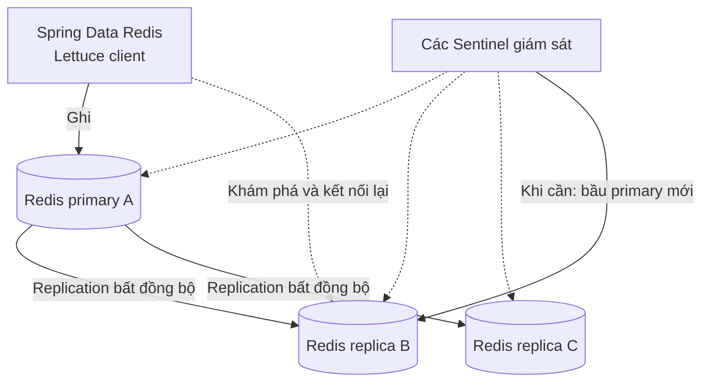
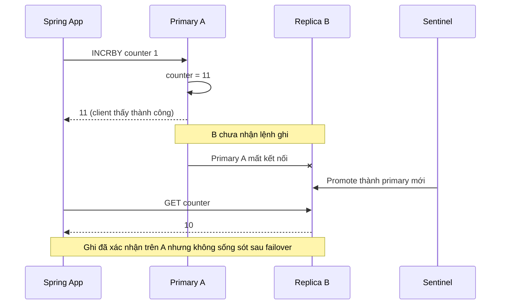
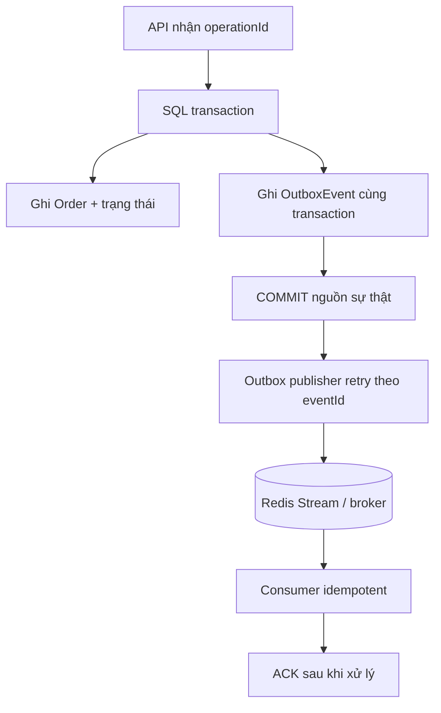
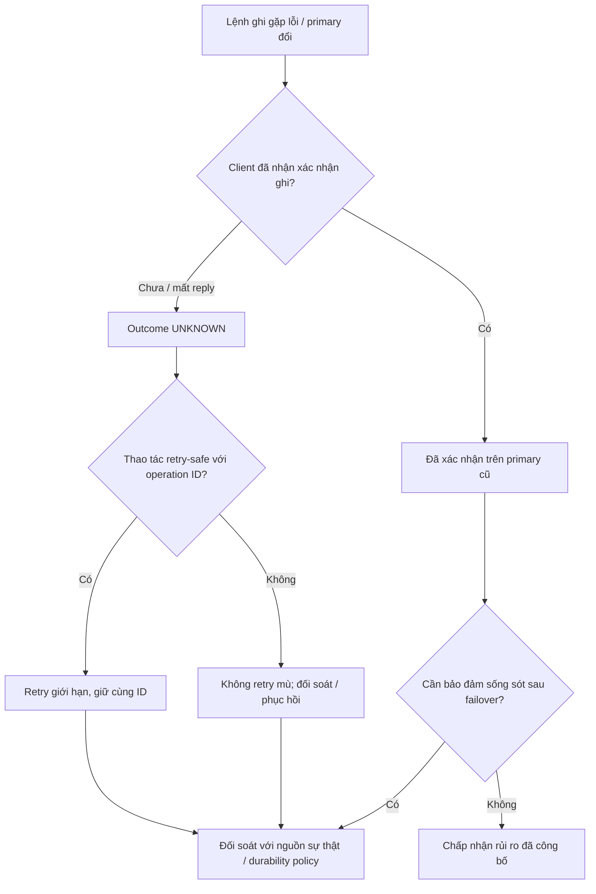

# Lệnh đang thực thi khi chuyển primary và khả năng mất ghi

Trong hệ thống **Spring Data Redis** dùng **replication** và **Redis Sentinel**, dữ liệu thường được ghi vào một Redis **primary**, rồi sao chép sang một hoặc nhiều **replica**. Nếu primary không còn khả dụng, Sentinel có thể chọn replica để trở thành primary mới, sau đó client kết nối lại tới địa chỉ mới.

Điều dễ bị hiểu sai là: **failover không bảo đảm mọi lệnh đã được primary cũ xác nhận đều tồn tại trên primary mới**. Redis replication truyền thống là **bất đồng bộ**. Một lệnh ghi có thể đã thực thi và trả `OK` cho ứng dụng, nhưng chưa kịp tới replica được thăng cấp. Ngược lại, một lệnh có thể đã ghi thành công nhưng phản hồi bị mất giữa lúc client ngắt kết nối; ứng dụng không biết nên retry hay không.

Bài này giải thích số phận của những lệnh **đang thực thi khi primary thay đổi**, sự khác nhau giữa ghi được xác nhận và ghi được giữ lại sau failover, cách Spring Data Redis xử lý kết nối Sentinel, và những mẫu thiết kế cần thiết để tránh **mất ghi** hoặc **ghi lặp**.

## 1. Các khái niệm nền tảng

| Khái niệm | Vai trò | Điều không nên suy ra |
| --- | --- | --- |
| **Primary** | Node tiếp nhận lệnh ghi thông thường và phát luồng replication | Trả `OK` không có nghĩa dữ liệu đã được lưu trên mọi replica |
| **Replica** | Nhận dữ liệu từ primary qua replication | Replica không luôn mới nhất tại mọi thời điểm |
| **Redis Sentinel** | Giám sát primary, phát hiện lỗi, chọn replica thay thế và cung cấp thông tin primary hiện tại | Sentinel không làm replication trở thành đồng bộ hoặc giao dịch có consensus |
| **Failover** | Chuyển vai trò primary sang một node khác | Không bảo đảm phục hồi mọi ghi chưa được replica nhận |
| **Replication offset** | Thước đo tiến độ trong luồng sao chép | Không tự là cam kết dữ liệu bền vững trên ổ đĩa |
| **AOF/RDB** | Cơ chế persistence lưu dữ liệu Redis xuống đĩa | Persistence trên primary cũ không tự bảo đảm replica mới đã nhận mọi lệnh |
| **Client timeout** | Ứng dụng không nhận phản hồi trong thời hạn mong muốn | Không chứng minh lệnh chưa được thực thi |

Với mô hình Sentinel thông thường:



Trong Redis Sentinel, client có thể hỏi Sentinel để biết node primary được công bố cho tên nhóm, ví dụ `mymaster`. Sau failover, client/driver cần cập nhật topology hoặc kết nối lại. Các request đang chạy trên kết nối cũ **không mặc nhiên được chuyển nguyên vẹn** sang node mới.

## 2. Vì sao có thể mất ghi dù Redis đã trả `OK`?

Giả sử có primary A và replica B:

```text
Lúc đầu:
    A: counter = 10
    B: counter = 10

T1. Client gửi INCRBY counter 1 tới A.
T2. A thực thi và trả 11 cho client.
T3. B chưa kịp nhận bản cập nhật này.
T4. A mất kết nối hoặc chết.
T5. Sentinel thăng cấp B thành primary mới.

Sau failover:
    B: counter = 10
    Client từng nhận kết quả 11 từ A.
```

Client không có lỗi ở lần ghi đầu, nhưng hệ thống Redis sau failover có thể không còn bản cập nhật đó. Đây là **mất ghi đã được primary cũ xác nhận** (*acknowledged write loss*) do cửa sổ replication bất đồng bộ.



**Điểm mấu chốt:** xác nhận của một lệnh Redis đơn lẻ nói về việc **node xử lý lệnh đó** đã thực hiện thao tác và trả kết quả. Nó không phải một giao thức **majority commit** như Raft, và không tự cam kết replica được chọn trong tương lai đã lưu dữ liệu ấy.

Khi A hoạt động trở lại, A có thể được cấu hình theo primary mới và phải đồng bộ dữ liệu từ B. Dữ liệu A từng có nhưng B chưa nhận không nhất thiết được "gộp trở lại"; những cập nhật riêng của A có thể bị loại bỏ để theo kịp dòng dữ liệu của primary mới.

## 3. Những thời điểm lệnh có thể gặp failover

Một request có thể ở một trong các trạng thái sau khi primary thay đổi:

| Giai đoạn | Điều có thể xảy ra | Kết luận an toàn của ứng dụng |
| --- | --- | --- |
| Chưa gửi lệnh | Client chưa phát request ra kết nối Redis | Có thể chưa tạo tác dụng phụ, nếu thực sự xác định được lệnh chưa gửi |
| Đang chờ trong queue của driver | Kết nối bị gián đoạn trước khi lệnh được gửi hoặc khi driver chuẩn bị gửi | Phụ thuộc driver, queue/reconnect và điểm lỗi; không đoán từ timeout |
| Đã gửi, primary chưa xử lý | Primary chết hoặc đổi vai trò | **Không chắc chắn** nếu không có xác nhận đáng tin |
| Primary đã xử lý nhưng reply chưa đến | Kết quả bị mất khi socket đóng | **Không chắc chắn**: lệnh có thể đã ghi |
| Client đã nhận reply thành công | Ghi thành công trên primary lúc đó | Vẫn có thể mất sau failover nếu replica chưa nhận |
| Replica đã nhận ghi | Có nhiều bản sao hơn | Giảm rủi ro, nhưng chưa thành cam kết bền vững trên mọi primary tương lai |
| Replica được promote | Trạng thái mới phụ thuộc mức đã đồng bộ của node được chọn | Phải đọc lại trạng thái và đối soát nếu cần |

Hai loại rủi ro cần phân biệt:

1. **Unknown outcome:** Client không biết lệnh đã được primary thực thi hay chưa vì mất phản hồi.
2. **Acknowledged-but-lost write:** Client đã nhận xác nhận thành công, nhưng bản cập nhật không sống sót sau việc chuyển primary.

Chúng có thể xuất hiện ở cùng một hệ thống nhưng cần xử lý khác nhau. Retry idempotent có thể giúp giải quyết *unknown outcome*; nó **không tự giải quyết** việc một bản ghi đã được xác nhận có thể biến mất khi replication/failover thay đổi lịch sử dữ liệu.

## 4. Failover không diễn ra tức thì

Sentinel theo dõi tình trạng của các instance. Khi đủ điều kiện về việc một primary không đáp ứng, Sentinel có thể thực hiện bầu chọn và chuyển một replica lên làm primary. Quá trình này có các khoảng thời gian:

- Phát hiện kết nối không đáp ứng hoặc primary lỗi.
- Đủ các Sentinel cần thiết đánh giá tình trạng và cho phép failover.
- Chọn một replica phù hợp để thăng cấp.
- Yêu cầu những replica khác theo primary mới.
- Công bố địa chỉ primary mới để client tìm lại.

Trong giai đoạn này, ứng dụng có thể gặp:

```text
Timeout khi gọi node cũ
Connection refused / connection reset
READONLY khi ghi tới node nay đã là replica
Không tìm thấy primary trong một khoảng ngắn
Lệnh tồn trong queue chờ reconnect của driver
Độ trễ tăng do reconnect hoặc full/partial resynchronization
```

Đó là những triệu chứng có thể xảy ra, **không phải** danh sách bắt buộc hoặc thứ tự cố định. Một lỗi `READONLY` thường gợi ý client đang ghi tới node không còn giữ vai trò primary, nhưng ứng dụng cũng không nên suy ra mọi thao tác trước đó chắc chắn chưa thực thi.

### 4.1. Quorum và failover không đồng nghĩa quorum ghi

Sentinel có tham số `quorum` giúp xác định khi nào primary bị coi là khách quan không khả dụng; các Sentinel còn thực hiện quá trình phối hợp/bầu chọn để failover.

Tuy nhiên, quorum của **Sentinel để phát hiện và chuyển vai trò** không phải quorum của **các bản ghi dữ liệu đã được nhân bản**.

```text
Sentinel quorum:  đánh giá tình trạng primary và điều phối failover
Replication:     truyền các cập nhật từ primary sang replica
Write durability: quyết định ghi sống sót qua crash/failover hay không
```

Không được khẳng định "có ba Sentinel nên mọi ghi đều được lưu trên ít nhất hai Redis node". Sentinel và replication giải quyết các vấn đề khác nhau.

### 4.2. Cửa sổ phân vùng mạng và primary cũ

Trong phân vùng mạng, primary cũ có thể bị mất liên lạc với đa số Sentinel nhưng vẫn có kết nối với một số application client. Trong khoảng thời gian đó, node cũ **có thể** vẫn chấp nhận ghi nếu chưa bị chặn theo cấu hình. Trong khi đó, Sentinel ở phần mạng còn lại có thể tiến hành promote một replica.

Một hệ thống có thể tạm thời có hai phía mà client nhìn thấy là có thể ghi; sau khi kết nối được khôi phục, dữ liệu theo primary được chọn có thể khiến các ghi ở phía còn lại không được giữ. Đây là một rủi ro cần thiết kế cho replication bất đồng bộ và phân vùng mạng.

Redis có các cấu hình giảm rủi ro chấp nhận ghi khi không còn đủ replica, nhưng không tự biến Sentinel thành một hệ thống tuyến tính hóa ghi trên toàn cluster.

## 5. Vì sao retry mù có thể làm dữ liệu sai?

Giả sử ứng dụng gọi:

```redis
INCRBY account:credits 1
```

Client mất kết nối ngay sau khi gửi, nên không biết Redis đã xử lý hay chưa.

**Trường hợp A — lệnh chưa chạy:**

```text
Primary A không thực thi.
Client retry tới primary B.
B thực thi một lần.
```

**Trường hợp B — lệnh đã chạy và được replica giữ lại:**

```text
A thực thi và replication tới B.
Reply tới client bị mất.
B được promote; giá trị tăng đã tồn tại.
Client retry INCRBY tới B.
Giá trị tăng lần thứ hai.
```

**Trường hợp C — lệnh chạy trên A nhưng bị mất sau failover:**

```text
A thực thi, không kịp replicate tới B.
B được promote với giá trị cũ.
Client retry tới B.
Chỉ thấy lần tăng sau retry ở lịch sử mới.
```

Từ một `RedisConnectionFailureException` hoặc timeout, client không phân biệt được chắc chắn ba trường hợp đó. Vì vậy, với **lệnh không idempotent**, retry vô điều kiện có thể tạo **ghi lặp**; không retry có thể bỏ qua một lệnh mà server thực ra chưa thực thi.

Đây là lý do hệ thống quan trọng cần một hợp đồng **operation ID và đối soát**, không chỉ thêm số lần retry.

## 6. Các loại ghi có mức an toàn retry khác nhau

| Redis command / nghiệp vụ | Nếu gửi lại sau mất phản hồi | Cần cân nhắc |
| --- | --- | --- |
| `GET`, `HGET` | Không tạo tác dụng phụ ghi | Giá trị có thể thay đổi giữa các lần đọc |
| `SET key constant` | Thường hội tụ về cùng giá trị cuối | Có thể ghi đè dữ liệu mới hơn, thay TTL và phát sự kiện |
| `INCRBY`, `DECRBY` | Tăng/giảm lại mỗi lần | Cần ID thao tác và cơ chế chống trùng |
| `LPUSH`, `RPUSH` | Có thể thêm phần tử trùng | Consumer/dedup theo ID |
| `XADD stream * ...` | Có thể sinh nhiều Record ID | `eventId` bền vững, outbox và idempotent consumer |
| `SET key value NX` | Lần sau có thể không đặt được vì key đã tồn tại | Kết quả `NX` không chứng minh ai đã tạo key |
| `DEL key` | Thường hướng tới trạng thái key vắng mặt | Cần kiểm tra tác động tới metadata, các sự kiện và thao tác đang cạnh tranh |
| Lua ghi kèm operation ID | Có thể trả lại kết quả của lần đã xử lý | Chỉ an toàn trong phạm vi ledger còn tồn tại và nguyên tử với ghi |

Một command Redis **nguyên tử** không có nghĩa là **idempotent** khi gửi lại. `INCRBY` là lệnh nguyên tử, nhưng hai lần `INCRBY` tạo hai lần tăng.

Tương tự, việc ứng dụng **không nhận được exception** ở một lần ghi không bảo đảm rằng bản ghi sẽ tồn tại sau failover. Cần phân biệt tính đúng đắn trong lúc primary xử lý với độ bền vững của trạng thái sau khi topology thay đổi.

## 7. `WAIT`: giảm cửa sổ mất ghi, không tạo strong consistency

Redis cung cấp lệnh:

```redis
WAIT numreplicas timeout
```

Sau các lệnh ghi trên **cùng kết nối**, `WAIT` chờ cho đến khi tối thiểu số replica được yêu cầu xác nhận đã nhận và xử lý các ghi trước đó của kết nối, hoặc hết timeout.

Ví dụ:

```redis
SET orders:status:O-101 CONFIRMED
WAIT 1 1000
```

`WAIT 1 1000` yêu cầu đợi tối đa 1.000 mili giây để có ít nhất một replica xác nhận replication tới offset tương ứng với các lệnh ghi trước đó trên cùng connection. Kết quả là **số replica** đã xác nhận.

| Kết quả | Diễn giải |
| --- | --- |
| `1` hoặc cao hơn | Ít nhất một replica đã xác nhận tới offset cần thiết trong thời gian chờ |
| `0` | Chưa đủ replica xác nhận trước timeout; không có nghĩa lệnh `SET` được rollback |
| Timeout/lỗi kết nối khi chờ | Chưa quan sát được bảo đảm mong muốn; trạng thái ghi và replication cần đối soát |

**Cần giữ cùng connection cho lệnh ghi và `WAIT`.** Nếu gọi `StringRedisTemplate.opsForValue().set()` rồi `WAIT` qua một kết nối khác, không nên giả định `WAIT` đang đợi đúng offset của thao tác cần bảo vệ. Trong Spring Data Redis, có thể dùng `SessionCallback` hoặc API kết nối cấp thấp phù hợp để kiểm soát ranh giới kết nối.

### 7.1. Vì sao `WAIT` không loại bỏ hoàn toàn mất ghi?

- Replica đã nhận dữ liệu chưa chắc **đã fsync xuống đĩa**.
- Sentinel không có hợp đồng bắt buộc chọn chính replica đã xác nhận `WAIT` làm primary.
- Replica có thể chết, hoặc xảy ra một sự cố khác trước khi trạng thái được giữ lại đủ bền vững.
- Failover/phân vùng mạng có thể xảy ra trước, trong hoặc ngay sau thời điểm chờ.
- `WAIT` trả về số replica thực tế; ứng dụng phải **kiểm tra** giá trị ấy thay vì chỉ coi lệnh trả về là thành công.

Tài liệu Redis nhấn mạnh `WAIT` **không làm Redis thành một kho dữ liệu nhất quán mạnh**. Nó giảm xác suất mất một ghi đã xác nhận trong các tình huống thực tế, nhưng không cung cấp một cam kết ghi theo consensus.

### 7.2. Nếu không đủ replica đã xác nhận?

Giả sử:

```redis
SET order:O-101:status APPROVED
WAIT 2 500
```

Nếu `WAIT` trả `1`, lệnh `SET` **có thể đã thành công trên primary**, nhưng chưa đạt yêu cầu hai replica. Không nên lập tức gọi lại `SET` rồi tuyên bố lần đầu thất bại; ứng dụng phải biểu diễn đúng rằng **mức replication mong muốn chưa được xác minh**.

Với nghiệp vụ cần cam kết chắc chắn, có thể đánh dấu trạng thái **chưa đủ replication assurance**, chặn thao tác tiếp theo và có đường đối soát/khôi phục. Phải phân biệt yêu cầu replication tối thiểu với kết quả kinh doanh (`APPROVED`), vì một lần ghi đã thực thi có thể không được xác nhận đạt tiêu chí độ bền mong muốn.

## 8. `WAITAOF` và persistence

Redis hỗ trợ các cơ chế persistence như **RDB snapshot** và **AOF (Append Only File)**. Chúng liên quan tới khả năng khôi phục sau crash, nhưng không thay thế thiết kế replication/failover.

Trong những phiên bản Redis hỗ trợ **`WAITAOF`** (từ Redis 7.2), có thể yêu cầu đợi những lệnh ghi trước đó trên kết nối được đồng bộ vào AOF của local node và một số replica:

```redis
WAITAOF 1 1 1000
```

Lệnh ví dụ yêu cầu xác nhận đồng bộ AOF trên local node và một replica, chờ tối đa 1.000 mili giây; kết quả bao gồm số local/replica đáp ứng điều kiện theo hợp đồng lệnh. Việc sử dụng phụ thuộc cấu hình AOF và phiên bản Redis.

| Công cụ | Điều cải thiện | Điều không bảo đảm |
| --- | --- | --- |
| RDB | Có snapshot để phục hồi dữ liệu đã được chụp | Những thay đổi kể từ snapshot mới nhất có thể mất |
| AOF | Ghi lại các thao tác để phát lại sau restart, theo chính sách fsync | Không tự bảo đảm mọi replica/primary mới đã có ghi |
| `WAIT` | Biết bao nhiêu replica đã xác nhận replication tới offset | Không bảo đảm fsync hoặc replica được promote giữ dữ liệu |
| `WAITAOF` | Đợi xác nhận fsync AOF theo yêu cầu khi được hỗ trợ | Không tự biến failover Sentinel thành consensus transaction |

Nếu SLA của ứng dụng yêu cầu "một lần ghi đã xác nhận không được biến mất dù primary lỗi", phải đánh giá kỹ hơn là chỉ bật AOF hoặc thêm `WAIT`. Độ bền đầu-cuối còn phụ thuộc failover, lỗi đồng thời, cấu hình fsync, việc chọn replica và hợp đồng nghiệp vụ. Một cơ sở dữ liệu hoặc log có cơ chế commit bền vững theo quorum có thể phù hợp hơn để làm **nguồn sự thật** cho giao dịch trọng yếu.

## 9. Hạn chế nhận ghi khi replica không theo kịp

Redis có các tùy chọn cấu hình primary như:

```text
min-replicas-to-write 1
min-replicas-max-lag 10
```

Ví dụ này yêu cầu primary chỉ chấp nhận ghi khi có ít nhất một replica đáp ứng tiêu chí độ trễ replication trong giới hạn 10 giây. Mục đích là giảm trường hợp primary cô lập vẫn liên tục nhận ghi khi không còn replica hoạt động đủ gần.

**Giới hạn cần hiểu:**

- Đây là điều kiện **đủ số replica có độ trễ chấp nhận được**, không phải yêu cầu mỗi lệnh ghi được replica ACK trước khi primary trả thành công.
- Khi không đạt điều kiện, Redis có thể từ chối ghi, làm giảm tính sẵn sàng để hạn chế nguy cơ mất dữ liệu.
- Một replica được coi là đủ gần vẫn có thể trễ một số lệnh cụ thể.
- Cấu hình không loại bỏ mọi nguy cơ khi failover và không thay thế `WAIT` hay xử lý idempotency.

Lựa chọn số replica và mức lag là đánh đổi giữa **khả năng nhận ghi** và **rủi ro mất dữ liệu**. Không nên bật thông số theo một ví dụ bất kỳ mà không đo tải, cấu hình triển khai và phương án xử lý khi không đủ replica.

## 10. Cấu hình Spring Boot để kết nối qua Sentinel

Trong ứng dụng Spring Boot 3.x, dùng starter Redis:

```groovy
// build.gradle
dependencies {
    implementation 'org.springframework.boot:spring-boot-starter-data-redis'
}
```

Với một nhóm Sentinel có tên primary `mymaster`:

```yaml
# application.yml
spring:
  data:
    redis:
      sentinel:
        master: mymaster
        nodes:
          - sentinel-1.example.internal:26379
          - sentinel-2.example.internal:26379
          - sentinel-3.example.internal:26379
      connect-timeout: 2s
      timeout: 3s
```

Đây là ví dụ địa chỉ nội bộ giả định. Trong môi trường thật, thay host, port, authentication và TLS theo hạ tầng. Một số triển khai yêu cầu **xác thực riêng cho Sentinel và Redis data nodes**; cần cấu hình đúng cả hai, không tự giả định cùng một mật khẩu.

Spring Boot thường tự cấu hình `RedisConnectionFactory` bằng Lettuce khi starter có mặt và điều kiện auto-configuration phù hợp. `StringRedisTemplate` có thể được inject vào service:

```java
package com.example.shop.redis;

import org.springframework.data.redis.core.StringRedisTemplate;
import org.springframework.stereotype.Service;

@Service
public class InventoryCounter {

    private final StringRedisTemplate redis;

    public InventoryCounter(StringRedisTemplate redis) {
        this.redis = redis;
    }

    public Long increment(String sku) {
        return redis.opsForValue().increment("stock:" + sku);
    }
}
```

**Cảnh báo:** service trên chỉ để minh họa API Spring Data Redis. Phép tăng **không có idempotency**; không gắn retry vô điều kiện vào phương thức này trong quá trình failover.

Sentinel giúp driver **tìm primary hiện tại**, nhưng không tự tạo lại kết quả đúng của lệnh đã chạy trên kết nối cũ. Việc driver tự reconnect, queue lệnh trong lúc mất kết nối hoặc trả exception phụ thuộc cấu hình driver/version; cần kiểm thử thay vì giả định "reconnect thành công = giao dịch cũ đã hoàn tất".

### 10.1. Cấu hình Java thủ công khi cần

Nếu không dùng toàn bộ auto-configuration của Boot, có thể tạo factory dựa trên Redis Sentinel:

```java
package com.example.shop.config;

import org.springframework.context.annotation.Bean;
import org.springframework.context.annotation.Configuration;
import org.springframework.data.redis.connection.RedisSentinelConfiguration;
import org.springframework.data.redis.connection.lettuce.LettuceConnectionFactory;

@Configuration
public class RedisSentinelConfig {

    @Bean
    public LettuceConnectionFactory redisConnectionFactory() {
        RedisSentinelConfiguration sentinel =
                new RedisSentinelConfiguration()
                        .master("mymaster")
                        .sentinel("sentinel-1.example.internal", 26379)
                        .sentinel("sentinel-2.example.internal", 26379)
                        .sentinel("sentinel-3.example.internal", 26379);

        return new LettuceConnectionFactory(sentinel);
    }
}
```

Đoạn này là **một phương án thay thế** cho cấu hình được Boot tạo, không phải yêu cầu thêm đồng thời một factory khác. Trong dự án thật cần cấu hình xác thực, TLS, timeout, tài nguyên client và lifecycle phù hợp. Nếu có nhiều `RedisConnectionFactory`, phải kiểm soát bean nào được `RedisTemplate` sử dụng.

## 11. Cách xử lý exception trong Spring Data Redis

Khi failover, Spring Data Redis có thể trả về các lỗi được chuyển đổi từ driver như `RedisConnectionFailureException`, `RedisSystemException` hoặc các `DataAccessException` khác, tùy tình huống.

Điều không nên làm:

```java
// Không an toàn cho lệnh trừ/tăng không idempotent:
public long incrementWithBlindRetry(String key) {
    for (int i = 0; i < 3; i++) {
        try {
            return redis.opsForValue().increment(key);
        } catch (org.springframework.dao.DataAccessException ex) {
            // Lần trước có thể đã thực thi, nên retry mù có thể tăng hai lần.
        }
    }
    throw new IllegalStateException("Redis unavailable");
}
```

Một `DataAccessException` không cho biết chắc Redis đã **không** thực thi lệnh, và ba lần thử không tự tương đương "ít nhất một lần thành công". Với lệnh ghi trọng yếu, cần định nghĩa ba nhóm kết quả:

| Kết quả | Ý nghĩa |
| --- | --- |
| `CONFIRMED` | Nhận xác nhận theo hợp đồng command; có thể cần mức durability khác nếu nghiệp vụ yêu cầu |
| `REJECTED` | Ghi không được chấp nhận theo một điều kiện đã biết chắc, ví dụ dữ liệu sai hoặc quy tắc nghiệp vụ từ chối |
| `UNKNOWN` | Không thể xác định lệnh đã thực thi hoặc còn tồn tại sau failover hay chưa |

Một API trả `UNKNOWN` cần hỗ trợ **tra cứu/đối soát theo operation ID**. Việc HTTP trả timeout, `503` hoặc `504` không làm yêu cầu đã gửi vào Redis tự biến mất.

### 11.1. Phân biệt timeout với chắc chắn chưa gửi

Ở một số điểm lỗi trước khi phát lệnh, tầng driver có thể biết lệnh chưa đi tới Redis. Nếu thư viện và trường hợp lỗi có hợp đồng đủ rõ, hệ thống có thể retry theo chính sách. Tuy nhiên, **không nên suy luận điều đó chỉ từ tên exception chung**. Lỗi mạng khi socket đang chờ reply là trường hợp điển hình có kết quả không xác định.

Không nên tự động xóa cache, thực hiện compensating action hoặc gửi lệnh ngược (`DECRBY` sau `INCRBY`) chỉ vì timeout. Nếu lệnh gốc chưa chạy, thao tác bù có thể tạo lỗi mới; nếu lệnh gốc chạy rồi nhưng bị mất sau failover, thao tác bù cũng có thể sai.

## 12. Mẫu idempotency với operation ID

Giả sử thao tác **giữ một lượng tồn kho** theo `operationId`. Mục tiêu là:

1. Chỉ trừ kho nếu đủ hàng.
2. Nếu cùng một operation được gửi lại, trả lại kết quả cũ **trong lịch sử dữ liệu Redis hiện có**.
3. Nếu cùng ID được gửi lại với số lượng khác, từ chối.
4. Khi không nhận được reply, caller có thể gửi lại **cùng ID** thay vì tạo lệnh mới.

Hai Redis key:

```text
stock:{sku-42}                   -> string số lượng tồn kho
stock-ops:{sku-42}:request-123   -> hash ghi amount, outcome cho operation
```

Hai key có cùng hash tag `{sku-42}` để tương thích với điều kiện cùng hash slot khi dùng Redis Cluster. Với Sentinel trên Redis độc lập, hash tag không bắt buộc nhưng vẫn giúp giữ cách đặt tên đồng nhất nếu kiến trúc thay đổi sau này.

### 12.1. Lua thực hiện kiểm tra và ghi nguyên tử trên primary

```lua
-- KEYS[1]: stock key
-- KEYS[2]: operation record key
-- ARGV[1]: amount dạng số nguyên dương

local previous = redis.call('HGET', KEYS[2], 'outcome')
if previous then
    if redis.call('HGET', KEYS[2], 'amount') ~= ARGV[1] then
        return -3    -- operation ID được dùng với amount khác
    end
    return tonumber(previous)
end

local amount = tonumber(ARGV[1])
if not amount or amount <= 0 or amount % 1 ~= 0 then
    return redis.error_reply('Invalid amount')
end

local current = redis.call('GET', KEYS[1])
if not current then
    redis.call('HSET', KEYS[2], 'amount', ARGV[1], 'outcome', -1)
    return -1       -- không tìm thấy kho
end

local available = tonumber(current)
if not available or available < 0 or available % 1 ~= 0 then
    return redis.error_reply('Invalid stock value')
end

if available < amount then
    redis.call('HSET', KEYS[2], 'amount', ARGV[1], 'outcome', 0)
    return 0        -- không đủ hàng
end

redis.call('DECRBY', KEYS[1], amount)
redis.call('HSET', KEYS[2], 'amount', ARGV[1], 'outcome', 1)
return 1            -- đã giữ hàng
```

Kết quả:

| Giá trị | Ý nghĩa |
| --- | --- |
| `1` | Operation thành công; có thể là lần đầu hoặc reply của lần xử lý trước |
| `0` | Không đủ hàng |
| `-1` | Key tồn kho không tồn tại |
| `-3` | Cùng operation ID nhưng tham số không khớp |

**Chú ý:** script nguyên tử đối với lệnh khác trên một Redis primary, nhưng không có cơ chế rollback toàn bộ các lệnh đã chạy trước một lỗi Lua runtime. Mã ví dụ còn cần validation về kiểu key, giới hạn số nguyên và điều kiện tài nguyên trước khi dùng production.

### 12.2. Gọi qua `StringRedisTemplate`

```java
package com.example.shop.redis;

import java.util.List;
import org.springframework.data.redis.core.StringRedisTemplate;
import org.springframework.data.redis.core.script.DefaultRedisScript;
import org.springframework.stereotype.Service;

@Service
public class IdempotentStockService {

    private final StringRedisTemplate redis;
    private final DefaultRedisScript<Long> script;

    public IdempotentStockService(StringRedisTemplate redis) {
        this.redis = redis;

        // Nạp script đúng theo phần Lua ở trên. Trong dự án thực tế,
        // nên đặt script trong classpath resource và quản lý phiên bản.
        String lua = """
                local previous = redis.call('HGET', KEYS[2], 'outcome')
                if previous then
                    if redis.call('HGET', KEYS[2], 'amount') ~= ARGV[1] then
                        return -3
                    end
                    return tonumber(previous)
                end
                local amount = tonumber(ARGV[1])
                if not amount or amount <= 0 or amount % 1 ~= 0 then
                    return redis.error_reply('Invalid amount')
                end
                local current = redis.call('GET', KEYS[1])
                if not current then
                    redis.call('HSET', KEYS[2], 'amount', ARGV[1], 'outcome', -1)
                    return -1
                end
                local available = tonumber(current)
                if not available or available < 0
                   or available % 1 ~= 0 then
                    return redis.error_reply('Invalid stock value')
                end
                if available < amount then
                    redis.call('HSET', KEYS[2], 'amount', ARGV[1], 'outcome', 0)
                    return 0
                end
                redis.call('DECRBY', KEYS[1], amount)
                redis.call('HSET', KEYS[2], 'amount', ARGV[1], 'outcome', 1)
                return 1
                """;
        this.script = new DefaultRedisScript<>(lua, Long.class);
    }

    public long reserve(
            String sku, String operationId, long amount) {

        if (sku == null || !sku.matches("[A-Za-z0-9_-]{1,64}")) {
            throw new IllegalArgumentException("Invalid sku");
        }
        if (operationId == null ||
                !operationId.matches("[A-Za-z0-9_-]{1,100}")) {
            throw new IllegalArgumentException("Invalid operationId");
        }
        // Phạm vi ví dụ giữ số nguyên ở vùng biểu diễn an toàn
        // cho các phép so sánh tonumber trong Lua.
        if (amount <= 0 || amount > 1_000_000_000L) {
            throw new IllegalArgumentException("Invalid amount");
        }

        String stock = "stock:{" + sku + "}";
        String operation = "stock-ops:{" + sku + "}:" + operationId;

        Long result = redis.execute(
                script,
                List.of(stock, operation),
                Long.toString(amount));

        if (result == null) {
            // Trong pipeline/transaction có thể chưa có reply trực tiếp.
            throw new IllegalStateException("Redis result unavailable");
        }
        return result;
    }
}
```

Đoạn Java dựa trên **một Lua script cùng hai key**, vì check `operationId`, trừ kho và lưu kết quả không được tách thành ba lệnh độc lập. Nếu sau timeout, ứng dụng gọi lại **cùng `operationId` và amount**, Lua có thể trả kết quả đã lưu mà không trừ thêm.

**Giới hạn cốt lõi trong failover:** operation record cũng là dữ liệu trên **primary Redis** và cũng được replication bất đồng bộ. Nếu primary chết trước khi replica nhận đủ các thay đổi, **cả ghi nghiệp vụ lẫn dấu idempotency có thể bị mất**. Script ngăn lặp trong một dòng lịch sử dữ liệu Redis đang sống, chứ **không bảo đảm một sự kiện nghiệp vụ đã được ghi nhận bởi client sẽ tồn tại qua mọi failover**.

Với tiền, đơn hàng hoặc giao dịch có ràng buộc mạnh, cần một nguồn sự thật bền vững hơn và một quy trình đối soát; không coi Lua + Redis Sentinel là bảo đảm exactly-once xuyên failover.

### 12.3. Retry và thời điểm quyết định

Khi nhận một lỗi mạng không xác định, ứng dụng có thể:

1. Giữ nguyên `operationId` và payload.
2. Chờ Redis primary mới ổn định theo chính sách backoff có jitter và giới hạn thời gian.
3. Thực hiện lại script **có chống trùng** hoặc truy vấn trạng thái operation tương ứng.
4. Nếu vẫn không thể xác nhận, trả `UNKNOWN` và lưu công việc để đối soát.

Đừng tạo `operationId` mới ở mỗi attempt. Đồng thời không nên hồi phục một business transaction đã được xác nhận trên hệ thống ngoài Redis bằng cách chỉ suy ra từ trạng thái Redis mới.

## 13. Khi cần chắc chắn không mất nghiệp vụ: nguồn sự thật và outbox

Giả sử hệ thống bán hàng có PostgreSQL làm nguồn dữ liệu chính, còn Redis phục vụ tra cứu nhanh và phân phối sự kiện. Một thiết kế tin cậy hơn:



Khi Redis failover:

- Dữ liệu chính về `Order` và outbox vẫn nằm trong kho có hợp đồng durability phù hợp.
- Publisher có thể tạm lỗi hoặc gửi lại event với **cùng eventId**.
- Nếu Redis mất một bản ghi stream vì failover, publisher/reconciliation còn đường kiểm tra và phát lại theo thiết kế.
- Consumer phải chịu được event lặp; không nên thực hiện thanh toán hai lần chỉ vì hai record stream cùng một nghiệp vụ.

Một outbox SQL không tự đồng bộ với Redis theo kiểu exactly-once, nhưng cung cấp **nguồn lưu ý định và trạng thái phải thực hiện** để phục hồi sau crash/timeout.

Nếu Redis là nguồn dữ liệu chính duy nhất, cần chấp nhận và công bố rõ mức rủi ro mất ghi của replication/persistence đang triển khai, hoặc cân nhắc kiến trúc datastore có giao thức commit phù hợp hơn với SLA.

## 14. Đọc từ replica sau ghi có thể thấy dữ liệu cũ

Một vấn đề khác sau khi ghi thành công là **stale read**:

```text
Client ghi SET status:O-101 PAID lên primary A -> OK.
Client sau đó GET từ replica B khi replication chưa tới.
Replica B trả PENDING.
```

Không cần failover để tình huống này xảy ra: chỉ riêng replication bất đồng bộ đã đủ. Khi primary vừa thay đổi, ứng dụng càng cần xem xét dữ liệu mình đang đọc đến từ đâu.

Trong Spring Data Redis với Lettuce, chính sách đọc từ replica có thể được cấu hình theo API client, nhưng **không nên dùng đọc replica cho quyết định cần read-your-writes hoặc trạng thái mới nhất** nếu chưa có cơ chế bảo đảm tương ứng. Khi nghiệp vụ cần tính nhất quán cao, ưu tiên đọc từ primary hiện tại và đối soát theo version/operation ID; ngay cả đọc primary mới cũng không khôi phục được ghi đã mất trước failover.

Khi phát hiện giá trị sau failover nhỏ hơn giá trị đã quan sát trước đó, đừng tự động coi đó là bug của serializer hoặc cache. Đây có thể là dấu hiệu của **replication lag/write loss** và cần kiểm tra lịch sử failover, replication offset và log thao tác nghiệp vụ.

## 15. Quan sát trạng thái replication và Sentinel

Trong môi trường vận hành, một số lệnh hữu ích:

```redis
# Trên Redis data node
ROLE
INFO replication
INFO persistence

# Khi thực hiện trên kết nối tới Sentinel
SENTINEL get-master-addr-by-name mymaster
SENTINEL masters
SENTINEL replicas mymaster
```

`ROLE` giúp xác định node đang là primary hay replica. `INFO replication` chứa thông tin về số replica, trạng thái liên kết và offset. `INFO persistence` liên quan đến RDB/AOF. Các lệnh `SENTINEL ...` dùng trên Sentinel endpoint, **không phải** mọi Redis data node.

Ví dụ kiểm tra chính sách ghi:

```redis
CONFIG GET min-replicas-to-write
CONFIG GET min-replicas-max-lag
```

Ở managed Redis, một số lệnh `CONFIG` hoặc Sentinel administration có thể không được cấp quyền; dùng metric/API từ nhà cung cấp.

### 15.1. Những chỉ số cần theo dõi

| Chỉ số | Câu hỏi cần trả lời |
| --- | --- |
| Số lần failover / promotion | Primary có chuyển vai trò thường xuyên không? |
| Replication offset và lag | Replica có đang theo kịp primary không? |
| Replica link status | Replica có liên kết ổn định không? |
| Redis command latency, timeout | Ứng dụng có gặp gián đoạn khi primary đổi không? |
| Reconnect count của driver | Client có mất kết nối và phải khám phá lại primary không? |
| `READONLY` errors | Có request ghi đang tới node không còn là primary không? |
| Kết quả `WAIT` / `WAITAOF` | Có đạt mức replication/persistence mong muốn không? |
| AOF fsync status, RDB age | Persistence có hoạt động theo chính sách không? |
| Unknown outcomes | Bao nhiêu thao tác client chưa xác minh được? |
| Idempotency duplicates | Có bao nhiêu retry được nhận diện là cùng operation? |
| Reconciliation backlog | Bao nhiêu thao tác cần đối soát sau failover? |

Khi điều tra một sự cố mất ghi, thu thập **timeline** (thời điểm lệnh, thời điểm nhận reply, failover, reconnect), node/role, operation ID, replication lag và trạng thái persistence. Không đưa credential hay nội dung nhạy cảm của Redis vào log.

### 15.2. Bài thử failover có kiểm soát

Trên **môi trường thử nghiệm** dùng Redis Sentinel:

1. Chạy producer gửi các operation có ID duy nhất, ghi log thời điểm gửi và nhận kết quả.
2. Dùng một kho đối chứng độc lập ghi lại những operation đã được ứng dụng xác nhận.
3. Tạo lưu lượng đọc/ghi đồng thời; nếu phù hợp, mô phỏng replica lag.
4. Kích hoạt failover **chỉ theo quy trình test đã được phê duyệt**.
5. Đợi client khám phá primary mới; đọc lại các operation ID và dữ liệu sau failover.
6. So sánh: xác nhận thành công nhưng dữ liệu không còn, timeout nhưng dữ liệu đã tồn tại, duplicate do retry.
7. Đo tác động của các cấu hình `WAIT`, `min-replicas-*`, persistence và retry idempotent.

Không chủ động làm chết primary hoặc cô lập mạng trên Redis production chỉ để thử một giả thuyết. Bài thử cần có kịch bản khôi phục và giới hạn ảnh hưởng.

## 16. Các hiểu nhầm và lỗi triển khai thường gặp

### 16.1. “Sentinel đảm bảo không mất ghi”

Không. Sentinel giúp tự động chuyển primary, còn replication mặc định là bất đồng bộ. Bản ghi chưa tới replica được promote có thể bị mất dù client đã nhận reply thành công.

### 16.2. “Đã nhận OK nghĩa là đã ghi xuống ổ đĩa của mọi node”

Không. Phản hồi lệnh trên primary không đồng nghĩa fsync AOF ở replica. Nếu cần mức durability cao hơn, xem xét `WAIT`/`WAITAOF`, chính sách persistence và giới hạn còn lại của failover.

### 16.3. “Timeout chứng minh lệnh không chạy”

Không. Lệnh có thể đã chạy và chỉ mất phản hồi. Với `INCRBY`, retry mù có thể cập nhật hai lần.

### 16.4. “Driver tự reconnect cũng sẽ tự khôi phục đúng mọi command”

Không có bảo đảm tổng quát đó. Driver có thể khôi phục kết nối và thực thi những lệnh còn phù hợp với trạng thái của mình, nhưng không thể suy ra một kết quả duy nhất, không trùng và không mất cho mọi command đã gửi trước failover.

### 16.5. “WAIT đủ một replica nghĩa là không mất ghi”

`WAIT` xác nhận replication theo offset trên các replica đáp ứng, nhưng không nhất thiết bảo đảm replica đó được promote, đã fsync hay sống sót qua các lỗi đồng thời.

### 16.6. “Cấu hình min-replicas-to-write biến Redis thành đồng bộ”

Cấu hình giới hạn việc primary chấp nhận ghi khi không đủ replica có độ trễ chấp nhận được, chứ không đợi mỗi lệnh phải được tất cả replica xác nhận trước khi trả OK.

### 16.7. “Script Lua chống trùng là đủ để có exactly-once xuyên failover”

Script chỉ nguyên tử trên node xử lý. Nếu cả cập nhật lẫn ledger bị mất khi failover, idempotency state cũng có thể biến mất. Với tác dụng phụ ngoài Redis, cần nguồn ghi nhận bền vững và hợp đồng phục hồi riêng.

### 16.8. “Có thể bù một lệnh không chắc chắn bằng lệnh ngược”

Nếu không biết lệnh gốc đã thực thi, thực hiện `DECRBY` để bù cho `INCRBY` có thể làm dữ liệu sai. Bù trừ phải dựa trên trạng thái nghiệp vụ đã xác minh và có idempotency.

### 16.9. “Replica đọc thấy giá trị cũ nghĩa là SET đã thất bại”

Không nhất thiết. Replica có thể chưa theo kịp. Cần phân biệt stale read trước failover với ghi thật sự bị mất sau promote.

### 16.10. “Dùng Redis lock sẽ ngăn old primary và new primary cùng chấp nhận ghi”

Một Redis lock bản thân cũng chịu rủi ro replication/failover. Nếu hệ thống cần quyền sở hữu độc quyền cho một tài nguyên ngoài Redis, cần fencing token và một hệ thống xác minh phiên bản/quyền tại đích; không lấy một key lock đơn thuần làm bảo đảm tuyệt đối.

## 17. Quy trình quyết định theo mức quan trọng của dữ liệu

| Nhu cầu | Hướng xử lý |
| --- | --- |
| Cache có thể tái tạo, chấp nhận mất dữ liệu mới ghi | Sentinel + replication + retry đọc có giới hạn; theo dõi lag |
| Cập nhật counter chỉ mang tính thống kê | Chấp nhận một mức mất/duplicate đã định hoặc dùng cơ chế ghi nhận bền vững |
| Giữ kho, quota, job state trong Redis | Operation ID + cập nhật nguyên tử + retry idempotent, đối soát khi failover |
| Cần giảm khả năng mất ghi trong Redis | Xem xét `WAIT`, `WAITAOF`, AOF, replication lag và chính sách min-replicas |
| Cần event không mất khi SQL đã commit | Transactional outbox + publisher retry + consumer idempotent |
| Thanh toán, sổ cái hoặc số dư tiền | Dùng nguồn sự thật với durability/transaction phù hợp; Redis làm cache hoặc trợ giúp, không coi Sentinel là consensus |
| Client gặp timeout khi đang ghi | Trả trạng thái `UNKNOWN`, giữ operation ID và có API đối soát |

### Quy tắc thiết kế cốt lõi



Nhánh "đã nhận xác nhận" không có nghĩa ứng dụng phải retry ngay. Nếu dữ liệu mới không còn sau failover, khôi phục phải dựa trên **ý định nghiệp vụ** và cơ chế kiểm soát trùng, thay vì phát lại ngẫu nhiên một lệnh cập nhật.

## 18. Tổng kết

Khi Redis Sentinel chuyển primary, **các lệnh đang thực thi có thể thất bại, đã chạy nhưng mất phản hồi, hoặc đã được xác nhận trên primary cũ nhưng không được replica mới giữ lại**. Nguyên nhân cốt lõi là replication bất đồng bộ cùng với thời gian phát hiện lỗi, chọn replica và kết nối lại của client.

Spring Data Redis/Lettuce giúp ứng dụng tìm primary và khôi phục kết nối, nhưng **không tự bảo đảm exactly-once hoặc zero data loss**. `WAIT`, `WAITAOF`, AOF và `min-replicas-*` có thể giảm rủi ro trong những điều kiện nhất định, song chúng không tạo một giao thức commit consensus cho Sentinel.

Đối với thao tác không idempotent, hãy phân biệt `CONFIRMED`, `REJECTED` và `UNKNOWN`, giữ operation ID qua các lần retry, chống trùng tại điểm ghi, và có đường đối soát khi kết quả không rõ. Nếu mất ghi không được phép xảy ra ở tầng nghiệp vụ, cần một **nguồn sự thật bền vững và cơ chế phục hồi** như transactional outbox thay vì chỉ dựa vào Redis primary/replica.

### Tài liệu tham khảo

- [Redis — Replication](https://redis.io/docs/latest/operate/oss_and_stack/management/replication/): replication bất đồng bộ, offset, failover và những giới hạn nhất quán.
- [Redis — Sentinel](https://redis.io/docs/latest/operate/oss_and_stack/management/sentinel/): phát hiện lỗi, chuyển primary, client discovery và khả năng mất ghi.
- [Redis — WAIT](https://redis.io/docs/latest/commands/wait/): đợi replica xác nhận replication, số ACK và giới hạn durability.
- [Redis — WAITAOF](https://redis.io/docs/latest/commands/waitaof/): đợi ghi AOF được đồng bộ theo yêu cầu.
- [Redis — Persistence](https://redis.io/docs/latest/operate/oss_and_stack/management/persistence/): RDB, AOF và các đánh đổi về độ bền dữ liệu.
- [Spring Data Redis — Redis Sentinel](https://docs.spring.io/spring-data/redis/reference/redis/connection-modes.html#redis:sentinel): cấu hình Sentinel và `RedisConnectionFactory`.
- [Spring Data Redis — RedisTemplate](https://docs.spring.io/spring-data/redis/reference/redis/template.html): thao tác Redis, serializer, callback và connection.
