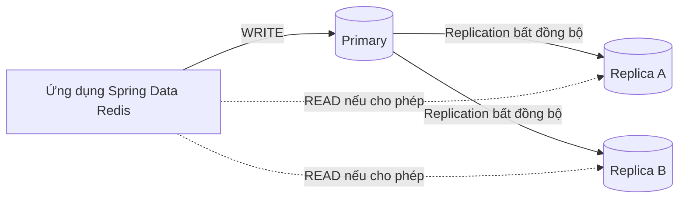
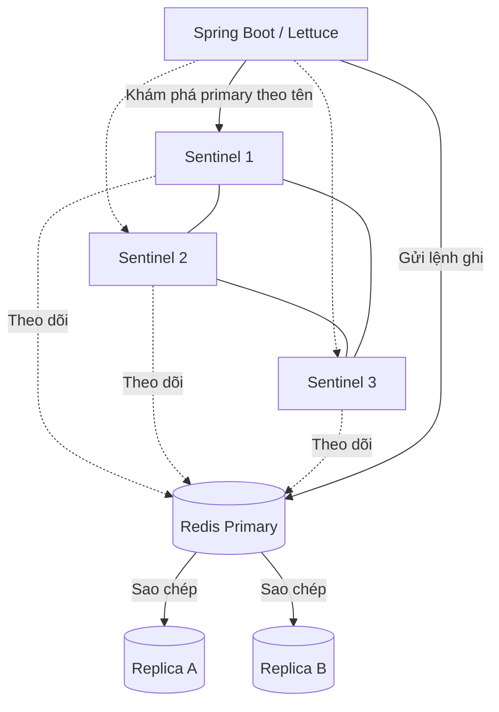
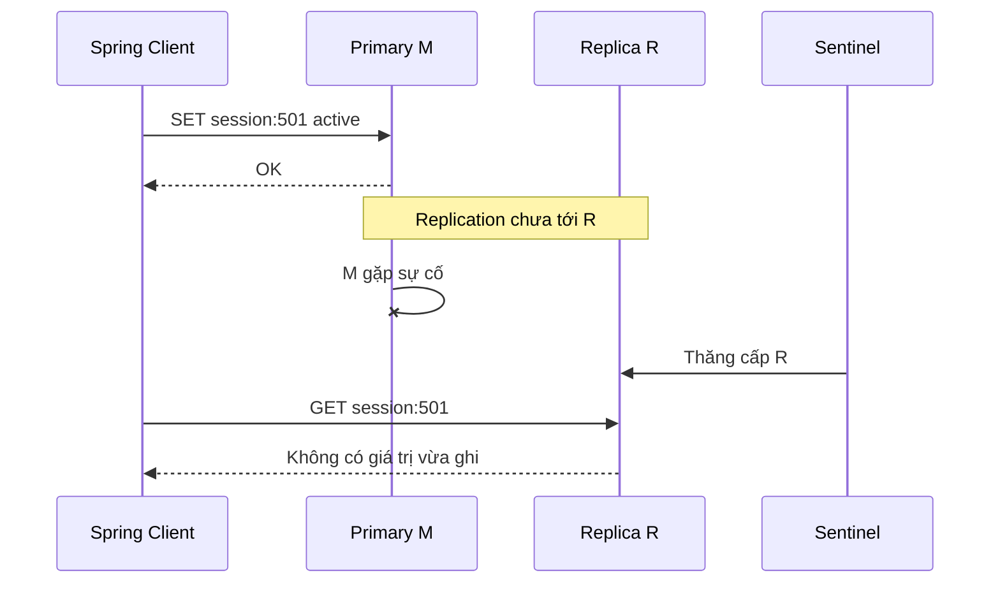

# Phân biệt độ sẵn sàng cao với bảo đảm không mất dữ liệu trong Redis Replication và Sentinel

## 1. Hai mục tiêu thường bị nhầm lẫn

Trong một ứng dụng Spring Data Redis, Redis thường được triển khai với một **primary** để ghi, một hoặc nhiều **replica** để sao chép dữ liệu, và các tiến trình **Sentinel** để theo dõi, phát hiện lỗi và tự động chuyển vai trò. Kiến trúc đó nâng cao khả năng **phục hồi dịch vụ** khi primary gặp sự cố.

Tuy nhiên, “có Sentinel” **không đồng nghĩa với “không bao giờ mất dữ liệu”**.

Giả sử một API vừa lưu trạng thái đơn hàng:

```text
Client Spring Boot  -> Redis Primary: SET order:901:status PAID
Redis Primary       -> Client: OK
Redis Primary       -x-> Replica: bản cập nhật chưa truyền đến
Redis Primary       -> crash
Sentinel            -> thăng cấp replica thành primary mới
Client              -> đọc order:901:status từ primary mới
```

Nếu replica chưa nhận được bản cập nhật trước khi primary cũ hỏng, primary mới có thể **không chứa** trạng thái `PAID` vừa được xác nhận. Dịch vụ đã hoạt động trở lại, nhưng dữ liệu gần thời điểm lỗi đã mất.

Cần tách biệt:

- **High availability (HA):** khả năng tiếp tục hoặc sớm phục hồi phục vụ request khi thành phần hạ tầng bị lỗi.
- **Durability:** khả năng giữ lại dữ liệu đã được ghi khi một hoặc nhiều node gặp sự cố.
- **Replication consistency:** mức độ cập nhật giữa primary và các replica, bao gồm tình huống replica trả dữ liệu cũ.
- **Zero data loss:** cam kết rất mạnh rằng dữ liệu đã được chấp nhận không bị mất trong **phạm vi loại lỗi được cam kết**.

Sentinel tập trung vào **phát hiện sự cố và failover**, không tự biến replication bất đồng bộ thành giao thức commit bền vững trên mọi replica.

## 2. RTO và RPO: hai thước đo khác nhau

| Chỉ số | Ý nghĩa | Câu hỏi cần trả lời |
|---|---|---|
| **RTO** (*Recovery Time Objective*) | Mục tiêu thời gian phục hồi sau gián đoạn | “Sau lỗi primary, dịch vụ cần ghi/đọc được trở lại trong bao lâu?” |
| **RPO** (*Recovery Point Objective*) | Mục tiêu lượng dữ liệu có thể mất, thường biểu diễn theo thời gian | “Nếu gặp lỗi, có thể mất bao nhiêu giây dữ liệu gần nhất?” |

Ví dụ yêu cầu hệ thống:

```text
RTO = 30 giây
RPO = 5 giây
```

Nghĩa là nhóm vận hành đặt mục tiêu dịch vụ phục hồi trong 30 giây và không mất quá khoảng 5 giây dữ liệu trong những tình huống lỗi đã xét. Đây là **mục tiêu để thiết kế, đo lường**, không phải mức bảo đảm có sẵn chỉ bằng cách bật Sentinel.

Một hệ thống có thể phục hồi sau 8 giây nhưng mất ghi phát sinh 1 giây trước khi lỗi. Khi đó khả năng phục hồi có thể tốt, còn bảo đảm dữ liệu phải được đánh giá riêng.

Ngược lại, một thiết kế có ghi dữ liệu bền vững hơn vẫn có thể mất nhiều thời gian để đưa dịch vụ trở lại vì phải khôi phục hoặc xác minh trạng thái.

**Kết luận quan trọng:** RTO tốt không chứng minh RPO bằng 0; RPO thấp không tự chứng minh thời gian gián đoạn ngắn.

## 3. Redis Replication: primary xác nhận trước khi replica kịp nhận

Kiến trúc cơ bản:



Trong cơ chế replication thông thường của Redis:

1. Client gửi lệnh ghi tới primary.
2. Primary thực thi lệnh và có thể trả thành công.
3. Redis chuyển các thay đổi qua luồng replication.
4. Replica nhận và áp dụng thay đổi theo tiến độ riêng.

**Primary không mặc định chờ mọi replica nhận lệnh trước khi trả kết quả.**

### Ví dụ theo dòng thời gian

```text
10:00:00.000  Primary nhận SET key value.
10:00:00.002  Client nhận OK.
10:00:00.004  Primary mất điện.
10:00:00.006  Replica chưa nhận SET.
10:00:08.000  Sentinel chọn replica làm primary mới.
```

Những thời điểm trên chỉ minh họa. Nếu replica chưa nhận lệnh, kết quả `OK` từ primary **không bảo đảm** dữ liệu còn sau failover.

### Replication lag

**Replication lag** xuất hiện khi replica chậm hơn primary. Nguyên nhân có thể là mạng chậm/mất kết nối, I/O hoặc CPU replica quá tải, ghi nhiều hơn tốc độ áp dụng, replica đang đồng bộ lại, hoặc failover/resharding ảnh hưởng topology.

Một replica được báo là đang kết nối **không đồng nghĩa** nó đã áp dụng ghi mới nhất. Số replica cao cũng không tự đồng nghĩa có nhiều bản sao mới nhất.

### Đồng bộ đầy đủ và tiếp tục từ offset

Khi kết nối lại, Redis có thể đồng bộ phần thay đổi còn thiếu theo replication offset/backlog nếu điều kiện cho phép; nếu không, cần đồng bộ lại dữ liệu đầy đủ. Replica đang trong quá trình đồng bộ chưa chắc phù hợp để đọc dữ liệu mới nhất hoặc thăng cấp ngay lập tức.

Cần theo dõi **trạng thái replication, offset và lag**, chứ không chỉ đếm số node đang chạy.

## 4. Redis Sentinel bảo đảm điều gì?

Sentinel là thành phần **giám sát và điều phối** cho Redis primary–replica. Nó có thể:

- Giám sát primary và các replica.
- Phát hiện primary không đáp ứng.
- Phối hợp nhiều Sentinel để xác nhận lỗi.
- Tổ chức bầu chọn quá trình failover.
- Chọn một replica phù hợp để chuyển thành primary.
- Cập nhật cấu hình replica và cung cấp thông tin primary hiện hành cho client.

Sơ đồ:



**Sentinel không phải một nơi lưu bản sao của từng lệnh SET đã được xác nhận.** Quorum Sentinel dùng cho việc phát hiện và điều phối lỗi, không phải quorum commit dữ liệu.

### Sentinel và Redis Cluster không giống nhau

| Tiêu chí | Redis Sentinel | Redis Cluster |
|---|---|---|
| Mục đích chính | HA cho một tập primary/replica | Chia keyspace thành nhiều shard và HA |
| Phân bố key | Một primary nắm vùng dữ liệu đang phục vụ ghi | Nhiều primary sở hữu các hash slot khác nhau |
| Ai tổ chức failover? | Các tiến trình Sentinel | Cơ chế cluster giữa các node |
| Tự mở rộng dung lượng ghi bằng sharding? | Không | Có |
| Sao chép mặc định | Bất đồng bộ | Bất đồng bộ |
| Cam kết không mất ghi đã ack mặc định | Không | Không |

Có nhiều shard trong Cluster không loại bỏ được cửa sổ mất dữ liệu khi một primary lỗi trước lúc replica của shard bắt kịp.

## 5. Từ phát hiện lỗi tới failover

### SDOWN – Subjectively Down

Một Sentinel không nhận được phản hồi hợp lệ từ primary trong khoảng cấu hình sẽ đánh giá primary có thể đã lỗi: **SDOWN**. Đây là nhận định từ góc nhìn của một Sentinel.

### ODOWN – Objectively Down

Khi đủ số Sentinel đồng ý primary đang không khả dụng theo **quorum** cấu hình, tình trạng được xác định là **ODOWN**. Đây là bước cần thiết trước quy trình tự động failover.

### Bầu leader và chọn replica

Để failover diễn ra, các Sentinel còn cần điều kiện ủy quyền/bầu chọn **đa số** theo giao thức. Một Sentinel được chọn điều phối quá trình, xác định replica ứng viên theo những yếu tố như khả năng kết nối, `replica-priority` và độ mới của replication rồi chuyển replica đó thành primary.

Không nên đồng nhất “quorum = 2” với “hai replica đã lưu mỗi ghi”. Quorum ở đây liên quan tới **ý kiến của các Sentinel về sự cố**, không phải xác nhận nội dung từng bản ghi.

### Client chuyển sang primary mới

Client có hỗ trợ Sentinel sẽ khám phá địa chỉ primary theo tên logic, thiết lập lại kết nối khi topology thay đổi và tiếp tục gửi lệnh.

Trong giai đoạn chuyển vai trò có thể xuất hiện timeout, disconnect, lỗi read-only hoặc lệnh không đến được node phù hợp. Failover tự động **giảm công việc thủ công**, nhưng không hứa rằng mọi request đều thành công không gián đoạn.

```text
T0  Primary M đang nhận ghi
T1  M gặp lỗi hoặc bị cô lập
T2  Sentinel đánh giá SDOWN
T3  Các Sentinel xác nhận ODOWN
T4  Bầu chọn Sentinel điều phối
T5  Replica R được thăng cấp
T6  Client tìm primary mới
T7  Ứng dụng phục vụ trở lại
```

Khoảng T1–T7 liên quan RTO. Việc R ở T5 có chứa những ghi mới nhất từ M hay không liên quan RPO.

## 6. Ba kịch bản mất dữ liệu điển hình

### 6.1. Primary crash ngay sau khi trả OK



Sentinel hoạt động đúng chức năng HA, nhưng dữ liệu đã ack tại M có thể không còn trên R.

### 6.2. Network partition và split-brain

```text
Nhóm A:   Primary M + một số client
                 |
             MẤT MẠNG
                 |
Nhóm B:   Replica R + đa số Sentinel + client khác
```

Nhóm B có thể xác định M không khả dụng và thăng cấp R. Trong khi đó, client vẫn truy cập M phía A có thể tiếp tục ghi trong một khoảng thời gian.

Khi mạng phục hồi, primary cũ thường phải gia nhập lại topology theo primary mới. Những ghi chỉ tồn tại tại nhánh M cũ có thể bị loại bỏ trong quá trình đồng bộ lại.

Vì vậy, failover không đồng nghĩa Redis tự **merge** mọi ghi từ hai nhánh thành một lịch sử chung.

### 6.3. Mất nhiều node hoặc dữ liệu chưa kịp fsync

Nếu primary và replica cùng mất nguồn hoặc storage gặp lỗi, bản sao trong bộ nhớ của nhiều node cũng có thể mất. Nếu persistence chưa kịp ghi bền vững, việc có replica không cứu được mọi ghi.

Đây là lý do cần tách:

- **Replication:** bản sao dữ liệu giữa các node.
- **Persistence:** khả năng phục hồi dữ liệu của từng node sau crash/restart.
- **Failover:** cách hệ thống chọn primary mới.
- **Nguồn dữ liệu chuẩn:** nơi ứng dụng có thể tái tạo hoặc đối soát dữ liệu mất.

## 7. WAIT giúp gì và không giúp gì?

Redis hỗ trợ `WAIT` để một client đợi số replica đạt replication offset của **những ghi trước đó trên cùng kết nối**.

Ví dụ Redis CLI:

```redis
SET demo:order:901:status PAID
WAIT 1 1000
```

`WAIT 1 1000` yêu cầu chờ tối đa 1.000 mili giây để ít nhất một replica xác nhận mốc replication. Lệnh trả **số replica đã xác nhận thực tế**. Có thể nhận `0`, `1` hoặc một kết quả khác tùy hệ thống.

`WAIT` làm giảm rủi ro mất ghi trong nhiều tình huống, nhưng **không tạo bảo đảm zero data loss**:

1. Replica xác nhận đã nhận dữ liệu, không nhất thiết dữ liệu đã được fsync xuống đĩa.
2. Replica được thăng cấp sau lỗi có thể không phải replica đã xác nhận.
3. Có thể có lỗi chung ảnh hưởng nhiều node.
4. Redis vẫn không trở thành giao thức commit consensus đồng bộ mạnh.

### Phải dùng đúng kết nối

`WAIT` xác định offset theo những ghi trước đó trên **connection client**. Nếu ứng dụng dùng `RedisTemplate` để `SET` rồi thực hiện `WAIT` trên một connection khác do pool cấp, ý nghĩa chờ có thể không tương ứng với ghi cần bảo vệ.

Khi cần dùng `WAIT` trong Spring Data Redis, phải bảo đảm thao tác ghi và chờ được tổ chức trên cùng Redis connection/phiên phù hợp, sử dụng API/driver được hỗ trợ.

### WAIT timeout không có nghĩa ghi đã bị hủy

Nếu `WAIT` trả ít replica hơn mục tiêu, lệnh `SET` trước đó **có thể vẫn đã thành công tại primary**. Client không được suy ra “chưa ghi gì” rồi retry các thao tác không idempotent mà không kiểm tra.

Với lệnh như `INCR` hoặc một thao tác nghiệp vụ có side effect, trạng thái có thể là **không chắc chắn**. Cần request ID, kiểm soát idempotency hoặc nguồn dữ liệu chuẩn để đối soát.

## 8. WAITAOF, AOF và RDB: thêm một lớp độ bền

Redis có thể duy trì dữ liệu qua restart bằng các cơ chế persistence.

### RDB – snapshot

RDB tạo ảnh chụp dữ liệu tại một thời điểm. Nếu node crash sau snapshot và chưa có snapshot mới, các ghi phát sinh sau đó có thể không tồn tại trong ảnh chụp được phục hồi.

RDB hữu ích cho backup/khôi phục và một số workload, nhưng **không đảm bảo từng ghi gần nhất đã được persist**.

### AOF – Append Only File

AOF ghi lại các thao tác thay đổi dữ liệu, với chính sách đồng bộ file:

| Chính sách | Đặc tính chính | Đánh đổi |
|---|---|---|
| `appendfsync always` | Cố gắng fsync rất thường xuyên theo từng ghi | Tăng chi phí I/O, độ trễ |
| `appendfsync everysec` | Thường fsync khoảng mỗi giây | Có cửa sổ dữ liệu chưa fsync |
| `appendfsync no` | Để hệ điều hành quyết định fsync | Ít kiểm soát hơn về độ bền theo thời gian |

Chính sách AOF giải quyết durability **trên node**, không tự đảm bảo rằng một replica được chọn để failover có đủ ghi mới nhất từ primary.

### WAITAOF

Trong các phiên bản Redis hỗ trợ, bắt đầu từ Redis 7.2, `WAITAOF` cho phép đợi số điều kiện **AOF fsync** tại server cục bộ và replica.

Ví dụ cú pháp:

```redis
SET demo:order:902:status PAID
WAITAOF 1 1 1000
```

Các tham số là số yêu cầu xác nhận local, số replica và timeout (mili giây). Cần kiểm tra phiên bản Redis, cấu hình AOF, ràng buộc execution context và diễn giải kết quả lệnh trước khi áp dụng.

Dù kết quả đáp ứng điều kiện đã chọn, `WAITAOF` **không tự bảo đảm** replica được bầu làm primary sau lỗi thuộc tập đã fsync đúng ghi, hoặc rằng mọi node đều tránh được một sự cố chung.

### Cách hiểu đúng

```text
Sentinel          -> chuyển vai trò, phục hồi dịch vụ
Replication       -> truyền bản sao giữa các node
WAIT              -> xác nhận tiến độ replication từ replica
AOF/RDB           -> cơ chế lưu bền vững của từng node
WAITAOF           -> chờ điều kiện AOF fsync khi được hỗ trợ
Nguồn dữ liệu gốc -> phục hồi và đối soát nghiệp vụ
```

Các lớp bổ sung lẫn nhau, nhưng không lớp nào cho phép tự tuyên bố “zero loss trong mọi lỗi”.

## 9. min-replicas-to-write: giảm rủi ro cô lập nhưng đánh đổi availability

Redis có thể từ chối ghi khi không đủ replica theo kịp, ví dụ:

```conf
min-replicas-to-write 1
min-replicas-max-lag 10
```

Ý nghĩa: primary cần có ít nhất một replica đáp ứng tiêu chí độ trễ theo cấu hình; nếu không đủ điều kiện, Redis có thể từ chối những lệnh ghi.

Cơ chế này hữu ích trong một số tình huống primary bị cô lập hoặc replica tụt lại quá nhiều. Nhưng:

- Nó **không** yêu cầu replica ack riêng cho từng lệnh trước khi trả OK.
- Replication vẫn có thể bất đồng bộ.
- Khi replica kết nối kém, primary còn khỏe vẫn có thể không cho ghi.
- Cấu hình nghiêm ngặt làm giảm mức sẵn sàng ghi để hạn chế một nhóm rủi ro mất dữ liệu.

Vì vậy, `min-replicas-to-write` là **chính sách đánh đổi an toàn/khả dụng**, không phải tùy chọn bật “đồng bộ 100%”.

## 10. Đọc từ replica và tình huống stale read

Ngoài failover, replica còn có thể được dùng để mở rộng lưu lượng đọc. Tuy nhiên, vì replication bất đồng bộ, đọc từ replica ngay sau khi ghi primary có thể trả dữ liệu cũ.

```text
Primary: SET inventory:sku:1001 7
Primary: trả OK

Replica chưa nhận cập nhật:
  GET inventory:sku:1001 -> 8
```

Đây là **stale read**. Không nên giả định một hệ thống Sentinel sẽ tự cấp tính chất “read your writes” khi client được phép định tuyến truy vấn tới replica.

Trong Lettuce, các cấu hình đọc như `ReadFrom.REPLICA_PREFERRED` có thể được dùng cho những workload phù hợp. Tuy vậy, không bật đọc replica cho mọi thao tác nếu nghiệp vụ cần trạng thái mới nhất.

| Luồng nghiệp vụ | Có thể đọc replica? | Lưu ý |
|---|---|---|
| Hiển thị danh mục ít thay đổi | Có thể | Chấp nhận dữ liệu trễ |
| Dashboard thống kê không yêu cầu tức thời | Có thể | Ghi rõ độ trễ dữ liệu |
| Đọc lại sau khi cập nhật profile | Cân nhắc primary | Tránh thấy giá trị cũ |
| Kiểm tra tồn kho lúc chốt đơn | Cần nguồn đúng thời điểm quyết định | Không dựa vào replica lag |
| Kiểm tra đã xử lý thanh toán/idempotency | Không suy luận từ bản sao cũ | Cần kiểm soát bền vững |

Những lệnh ghi và các quyết định quan trọng nên đi qua đường dữ liệu có mức nhất quán phù hợp với yêu cầu.

## 11. Cấu hình Redis Sentinel: ví dụ hạ tầng

Giả sử có:

- Một Redis primary ban đầu tại `10.0.0.10:6379`.
- Hai replica ở những node khác.
- Ba Sentinel chạy trên các failure domain riêng.

Ví dụ một file `sentinel.conf`:

```conf
port 26379

sentinel monitor mymaster 10.0.0.10 6379 2
sentinel down-after-milliseconds mymaster 5000
sentinel failover-timeout mymaster 60000
sentinel parallel-syncs mymaster 1
```

Trong đó:

- `mymaster` là tên logic để các Sentinel và client tham chiếu.
- `2` là quorum để xác định trạng thái ODOWN của primary.
- `down-after-milliseconds 5000` là ngưỡng một Sentinel coi primary không đáp ứng; **không phải bảo đảm RTO 5 giây**.
- `failover-timeout` điều khiển những mốc trong quy trình failover; không phải giới hạn trên chắc chắn của thời gian khôi phục.
- `parallel-syncs` ảnh hưởng số replica đồng bộ với primary mới trong một số giai đoạn tái cấu hình.

Một replica có thể được khai báo:

```conf
replicaof 10.0.0.10 6379
replica-read-only yes
```

Các địa chỉ là ví dụ học tập. Vận hành thật cần xét xác thực, TLS, DNS, NAT, container announce address, quyền truy cập và điều kiện bầu chọn.

**Ba tiến trình Sentinel trên cùng một máy vật lý không tương đương ba failure domain độc lập.** Sự cố mất máy/nguồn chung có thể làm nhiều Sentinel ngừng hoạt động đồng thời.

## 12. Kết nối Spring Boot/Spring Data Redis tới Sentinel

Ứng dụng Spring Boot dùng Spring Data Redis có thể cấu hình Sentinel:

```yaml
spring:
  data:
    redis:
      sentinel:
        master: mymaster
        nodes:
          - sentinel-1.example.internal:26379
          - sentinel-2.example.internal:26379
          - sentinel-3.example.internal:26379
      password: CHANGE_ME_VIA_SECRET_MANAGER
      timeout: 2s
      connect-timeout: 2s
```

Giải thích:

- `sentinel.master` là **tên master logic**, không phải hostname cố định của một node.
- `sentinel.nodes` cung cấp các địa chỉ Sentinel để client tìm primary.
- `password` là ví dụ cấu hình xác thực Redis data connection; thực tế hãy cung cấp bằng secret manager hoặc biến môi trường, không hard-code mật khẩu.
- Sentinel authentication có thể dùng tài khoản/mật khẩu khác data node; cần cấu hình thuộc tính Sentinel phù hợp với phiên bản Spring Boot và dịch vụ đang dùng.
- Timeout phải khớp với hạ tầng và ngân sách request, không có một giá trị phù hợp cho mọi hệ thống.

### Tại sao không trỏ thẳng host cũ?

Nếu ứng dụng chỉ khai báo:

```yaml
spring:
  data:
    redis:
      host: redis-primary-1.internal
      port: 6379
```

thì khi Sentinel thăng cấp replica ở một host khác, ứng dụng có thể tiếp tục cố kết nối primary cũ. Client **Sentinel-aware** có thể tra cứu địa chỉ primary mới theo `mymaster` và chuyển kết nối mà không cần sửa code nghiệp vụ.

### Dùng RedisTemplate theo abstraction

```java
package com.example.orders.redis;

import org.springframework.data.redis.core.StringRedisTemplate;
import org.springframework.stereotype.Service;

@Service
public class OrderStatusStore {

    private final StringRedisTemplate redis;

    public OrderStatusStore(StringRedisTemplate redis) {
        this.redis = redis;
    }

    public void markPaid(String orderId) {
        redis.opsForValue().set(
                "demo:orders:" + orderId + ":status",
                "PAID"
        );
    }

    public String findStatus(String orderId) {
        return redis.opsForValue().get(
                "demo:orders:" + orderId + ":status"
        );
    }
}
```

Service không gắn địa chỉ primary vào mã. Driver và connection factory chịu trách nhiệm lựa chọn endpoint theo cấu hình.

Nhưng khi Redis chuyển primary, `markPaid` vẫn có thể timeout hoặc lỗi. **RedisTemplate không tự đảm bảo lệnh thành công một lần duy nhất sau failover.** Hệ thống cần xử lý trạng thái không chắc chắn và các ràng buộc nghiệp vụ.

Ví dụ trạng thái `PAID` chỉ minh họa thao tác Redis; với thanh toán thật, nguồn chuẩn xác nhận thanh toán không nên phụ thuộc duy nhất vào key Redis dạng này.

## 13. Quan sát replication và failover với Redis CLI

Các lệnh sau hữu ích để kiểm tra topology trong môi trường quản trị hoặc thử nghiệm.

### Trên Redis data node

```redis
ROLE
INFO replication
```

`ROLE` cho biết node hiện là primary hay replica. `INFO replication` có thể cung cấp trạng thái link, số replica kết nối, thông tin offset và các field khác theo phiên bản Redis.

Để đánh giá rủi ro dữ liệu, không chỉ nhìn thấy `connected_slaves` hoặc tên node: cần theo dõi **replication lag/offset** trong bối cảnh topology.

### Trên Redis Sentinel

Kết nối port Sentinel, thường ví dụ `26379`:

```redis
SENTINEL masters
SENTINEL get-master-addr-by-name mymaster
SENTINEL replicas mymaster
SENTINEL sentinels mymaster
```

Những lệnh này cho biết Sentinel đang nhận diện master logic, primary hiện tại và những replica/Sentinel liên quan.

### Trong một buổi diễn tập có kiểm soát

Ở môi trường thử nghiệm, có thể ghi lại:

1. Primary và replica đang đồng bộ tới offset nào.
2. Một tập lệnh ghi có request ID riêng.
3. Thời điểm primary không còn phục vụ.
4. Thời điểm Sentinel xác định sự cố và thăng cấp node mới.
5. Thời điểm ứng dụng ghi thành công trở lại.
6. Những request trước sự cố nào thực sự còn giá trị trên primary mới.
7. Những request timeout nào có thể đã được thực thi.
8. Độ trễ reconnect, ảnh hưởng read replica và khả năng rebuild.

Không tự ý dừng primary hoặc ép failover trên production chỉ để kiểm tra; cần kế hoạch và quyền vận hành tương ứng.

Một lần diễn tập không mất dữ liệu **không đủ chứng minh** RPO luôn bằng 0. Có thể trong lần đó replica đã nhận kịp mọi ghi trước khi primary hỏng.

## 14. Khi primary cũ quay lại sau failover

Nếu primary cũ chỉ bị chia cắt mạng, sau đó kết nối phục hồi, Sentinel có thể yêu cầu nó trở thành replica của primary mới.

Điều này quan trọng: Redis không giải quyết hai lịch sử ghi song song bằng một phép merge nghiệp vụ tự động. Các ghi chỉ được nhận tại primary cũ trong khoảng phân tách có thể bị mất khi node đó đồng bộ theo primary mới.

Vì vậy, với nghiệp vụ cần đảm bảo **một người dùng không bị báo ghi thành công rồi mất kết quả**, cần xây dựng cơ chế kiểm tra lại kết quả ở một nguồn đáng tin cậy hoặc một kiến trúc có tính nhất quán/durability phù hợp hơn.

### Ví dụ nguy cơ với idempotency key

```text
Primary M:  SET payment:request-123 processed
Client:     nhận OK
M:          fail trước khi replica nhận
R:          được thăng cấp, không có payment:request-123
Client:     retry cùng request
```

Nếu Redis key là hàng rào chống thanh toán trùng duy nhất, việc mất key có thể khiến lần retry bị xử lý lại.

Với thanh toán và các thao tác không được phép lặp, cần một dấu idempotency **bền vững** hoặc unique constraint/transaction ở nguồn dữ liệu chuẩn, thay vì chỉ dựa vào một key Redis có replication bất đồng bộ.

## 15. Cache, session và trạng thái giao dịch có RPO khác nhau

| Trường hợp | Nếu mất một số key khi failover | Chính sách phù hợp cần cân nhắc |
|---|---|---|
| Cache danh mục sản phẩm | Tăng cache miss, tải dữ liệu lại | Redis HA + source of truth + tránh cache stampede |
| Cache gợi ý | Giảm hiệu năng tạm thời | Có thể chấp nhận RPO cache lớn hơn |
| Session | Người dùng có thể bị đăng xuất | Xem mức chấp nhận mất session và bảo mật |
| Giỏ hàng chưa lưu nơi khác | Mất thao tác người dùng | Cân nhắc đồng bộ bền vững/khôi phục |
| Bộ đếm rate-limit | Có thể vượt hạn mức | Cơ chế dự phòng hoặc fail-closed với endpoint nhạy cảm |
| Distributed lock | Hai worker có thể thực thi trùng | Fencing/idempotency và điều kiện ghi tại hệ thống đích |
| Idempotency key thanh toán | Nguy cơ xử lý trùng | Nguồn bền vững, unique constraint và đối soát |
| Redis Stream cho sự kiện quan trọng | Có thể mất event chưa replicate | Outbox/queue bền vững và cơ chế replay |
| Dashboard tạm | Có thể tính lại | Rebuild từ nguồn chính |
| Sổ cái tài chính | Sai dữ liệu nghiệp vụ nghiêm trọng | Dùng hệ lưu trữ với bảo đảm transaction/durability phù hợp |

Điểm mấu chốt không phải “Redis tốt hay xấu cho dữ liệu quan trọng”, mà là **kiến trúc đã chứng minh được yêu cầu RPO và tính nhất quán của nghiệp vụ hay chưa**.

## 16. Spring Data Redis khi gặp lỗi: timeout có thể không rõ outcome

Giả sử ứng dụng gửi:

```redis
INCR orders:sequence
```

Primary thực thi lệnh, nhưng kết nối mất trước khi trả kết quả. Client nhận timeout.

Không thể kết luận chắc chắn:

- Lệnh chưa tới Redis.
- Lệnh đã chạy ở primary.
- Lệnh đã tới replica.
- Kết quả sau failover có hay không.

Nếu service lập tức retry `INCR`, có thể làm tăng counter hai lần trong trường hợp lệnh đầu đã thành công.

### Hướng xử lý

- Phân biệt lệnh idempotent và lệnh có side effect không idempotent.
- Có request ID hoặc event ID nghiệp vụ để phát hiện trùng.
- Không retry vô hạn mọi exception.
- Dùng backoff và giới hạn retry.
- Đối soát trạng thái từ nguồn chuẩn trước khi thực hiện lại thao tác quan trọng.
- Với cache tùy chọn, có thể cho phép cache miss và nạp lại từ database.
- Với quyền truy cập, lock hoặc idempotency bắt buộc, không tự cho phép khi Redis mất khả dụng.

**Reconnect của Lettuce không đồng nghĩa tự động exactly-once.** Driver có thể khôi phục kết nối, nhưng không thể thay thế quyết định nghiệp vụ khi kết quả ghi trước sự cố không chắc chắn.

### @Transactional không sửa được tính chất replication

Ngay cả khi ứng dụng cấu hình transaction support cho `RedisTemplate` và sử dụng `@Transactional`, Redis `MULTI/EXEC` trên primary không khiến replication sang replica trở thành đồng bộ bền vững.

Tương tự, gắn `@Transactional` khi vừa ghi SQL vừa ghi Redis không tự tạo distributed transaction nguyên tử giữa hai hệ thống.

**Atomicity của lệnh/transaction tại primary khác với durability sau failover.**

## 17. Bảo vệ dữ liệu bằng nhiều lớp, nhưng hiểu giới hạn

Có thể cân nhắc các lớp sau:

1. **Nhiều replica tách failure domain.** Giảm xác suất một lỗi phá hủy mọi bản sao, nhưng không khiến mọi replica luôn theo kịp.
2. **Sentinel với cấu hình quorum/đa số phù hợp.** Tăng khả năng tự tổ chức failover, không bảo đảm dữ liệu mới nhất.
3. **Replication lag monitoring.** Quan sát replica chậm và cảnh báo theo mục tiêu RPO.
4. **Persistence RDB/AOF.** Tăng khả năng phục hồi dữ liệu từng node, cần chọn fsync thích hợp.
5. **WAIT/WAITAOF khi được hỗ trợ.** Nâng mức xác nhận sao chép/fsync cho những thao tác cần thiết, nhưng không thay thế commit protocol mạnh.
6. **min-replicas-to-write/min-replicas-max-lag.** Hạn chế primary tiếp tục ghi khi replica không đủ khả dụng, đổi lại giảm write availability.
7. **Idempotency và reconciliation.** Xử lý request timeout/ghi không chắc chắn, không chấp nhận lặp tác vụ không kiểm soát.
8. **Nguồn dữ liệu bền vững và outbox.** Giữ dữ liệu nghiệp vụ trọng yếu, cho phép cập nhật hoặc tái tạo Redis sau sự cố.
9. **Thử nghiệm failover thực tế.** Đo RTO/RPO dưới các kiểu lỗi có chủ đích.
10. **Quan sát theo hành trình ứng dụng.** Đo tới lúc HTTP/API phục vụ lại, không chỉ đến lúc Sentinel đổi role Redis.

Không có cờ cấu hình đơn lẻ nào thay thế việc chọn mức rủi ro mất dữ liệu chấp nhận được.

## 18. Bảng tình huống thường gặp

| Tình huống | Redis có thể tiếp tục phục vụ? | Dữ liệu có thể gặp vấn đề gì? |
|---|---|---|
| Primary crash sau khi mọi replica đã theo kịp | Có thể sau failover | Vẫn phải xét persistence và request đang xử lý |
| Primary crash trước khi replica nhận ghi | Có thể sau failover | Mất ghi đã ack |
| Replica lag nhiều giây | Có ứng viên failover nhưng chưa mới nhất | RPO cao hơn dự kiến |
| Primary và replica cùng mất điện, AOF chưa fsync | Có thể cần restore hoặc không phục hồi ngay | Mất một số ghi mới |
| Network partition | Có thể có failover phía đa số | Ghi trên nhánh cũ có thể mất |
| Sentinel không đủ đa số để bầu | Failover tự động có thể không xảy ra | Dịch vụ có thể gián đoạn lâu |
| Client chỉ biết IP primary cũ | Redis có thể đã failover | Ứng dụng vẫn lỗi vì không tìm endpoint mới |
| Đọc từ replica sau ghi primary | Vẫn trả kết quả | Có thể là giá trị cũ |
| `WAIT` đạt một replica | Có thêm bản sao xác nhận | Chưa chắc replica được chọn hoặc dữ liệu đã fsync |
| `min-replicas-to-write` không đủ điều kiện | Primary có thể từ chối ghi | Availability giảm để hạn chế rủi ro |
| Redis dùng làm cache và mất key | Ứng dụng có thể fallback | Cache miss, tăng tải nguồn chính |
| Redis giữ lock và lock biến mất | Worker khác có thể lấy lock | Có thể chạy trùng side effect |

## 19. Các hiểu nhầm cần tránh

### “Ba Sentinel nên ghi được sao chép ba lần”

Sai. Sentinel là tiến trình giám sát/điều phối, không phải ba bản sao dữ liệu. Phải xét số Redis replica riêng và tiến độ replication của chúng.

### “Quorum 2 nghĩa là hai node đồng ý về mọi giá trị”

Sai. Quorum Sentinel liên quan đánh giá lỗi; không phải mỗi lệnh ghi có hai xác nhận durable.

### “Có một replica là không thể mất dữ liệu”

Sai. Replication bất đồng bộ tạo cửa sổ giữa primary ack và replica nhận ghi.

### “WAIT trả đủ nghĩa là dữ liệu luôn sống sót”

Không bảo đảm. WAIT xác nhận replication offset, không đồng nghĩa fsync và không bảo đảm replica được chọn sau failover có dữ liệu.

### “AOF everysec nghĩa là không thể mất một giây dữ liệu”

Không thể khẳng định một ngưỡng mất dữ liệu tuyệt đối cho mọi loại sự cố. Cơ chế fsync có cửa sổ rủi ro, cần xét hệ điều hành, storage và topology.

### “Client timeout là lệnh chưa chạy”

Sai. Redis có thể đã thực thi rồi response mới thất lạc. Retry phải có idempotency/đối soát.

### “Replica đọc luôn thấy ghi mới nhất”

Sai khi replica có lag. Read-after-write cần tuyến đọc hoặc điều kiện nhất quán phù hợp.

### “Failover sẽ không có request lỗi”

Không đúng. Trong khoảng thay primary, request vẫn có thể lỗi; client cần reconnect, timeout và chính sách retry.

### “Redis Cluster thì hết nguy cơ mất dữ liệu”

Không đúng. Redis Cluster cũng dựa trên cơ chế replication có thể bất đồng bộ giữa primary và replica của shard.

### “Redis transaction đảm bảo SQL và Redis cùng commit”

Không đúng. Spring transaction synchronization không biến hai kho dữ liệu thành một distributed commit nguyên tử.

## 20. Câu hỏi luyện tập

**1.** Sentinel phát hiện primary lỗi và chuyển sang replica trong 9 giây. Có thể kết luận RPO bằng 0 không?

**Giải thích:** không. Thời gian chuyển đổi liên quan RTO; RPO phụ thuộc những ghi đã đến replica và còn tồn tại.

**2.** Primary trả OK cho `SET` và crash trước khi replica nhận lệnh. Replica được promote nhưng không có key đó. Redis Sentinel hoạt động sai?

**Giải thích:** không nhất thiết. Đó là giới hạn đã biết của replication bất đồng bộ. Failover thành công không bảo đảm mọi ghi đã ack được giữ lại.

**3.** `WAIT 1 1000` trả `1`. Có thể nói ghi đã được fsync trên replica?

**Giải thích:** không. WAIT xác nhận replication, không phải cam kết fsync của replica. Cần phân biệt với cơ chế persistence/WAITAOF.

**4.** `min-replicas-to-write 1` có làm mỗi SET đợi ít nhất một replica ack không?

**Giải thích:** không. Nó có thể từ chối ghi khi không đủ replica theo tiêu chí, không phải một giao thức xác nhận đồng bộ cho mỗi lệnh.

**5.** Sau khi cập nhật tồn kho từ 8 xuống 7 trên primary, một GET gửi đến replica vẫn thấy 8. Nên kết luận gì?

**Giải thích:** có thể có replication lag. Với quyết định chốt đơn, phải kiểm tra trạng thái qua nguồn có mức nhất quán phù hợp.

**6.** Redis lock chống chạy trùng job biến mất sau failover. Có nguy cơ gì?

**Giải thích:** hai worker có thể cùng thực thi tác vụ. Cần cơ chế idempotency, fencing hoặc điều kiện ghi tại hệ thống đích.

**7.** Client nhận timeout sau `INCR` rồi retry ngay. Rủi ro là gì?

**Giải thích:** lệnh đầu có thể đã chạy, retry có thể tăng hai lần. Cần quản lý outcome không chắc chắn.

**8.** Một sản phẩm được lưu trong SQL và cache Redis. Cache key mất sau failover. Có nên báo mất đơn hàng?

**Giải thích:** không. Nếu SQL là nguồn chuẩn, Redis cache có thể được xây lại. Cần chống cache stampede khi nhiều request tải lại cùng lúc.

**9.** Có ba Sentinel nhưng đều chạy trên một máy. Có chịu được lỗi mất máy đó không?

**Giải thích:** không. Ba tiến trình không thay thế ba failure domain độc lập.

**10.** Yêu cầu nghiệp vụ “tuyệt đối không mất bất kỳ ghi đã xác nhận nào trong mọi lỗi”. Chỉ dùng Sentinel, replica và AOF everysec có đủ không?

**Giải thích:** không. Phải định nghĩa phạm vi lỗi và kiến trúc commit/durability đáp ứng yêu cầu, không suy ra zero-loss từ topology Redis bất đồng bộ.

## 21. Checklist thiết kế trước khi đưa vào production

1. **Nguồn dữ liệu chuẩn:** Redis chỉ là cache hay giữ trạng thái nghiệp vụ không thể tái tạo?
2. **Mục tiêu RTO:** ứng dụng phải phục vụ trở lại trong bao lâu, kể cả reconnect của driver?
3. **Mục tiêu RPO:** chấp nhận mất bao nhiêu ghi và loại ghi nào tuyệt đối không được mất?
4. **Failure domain:** primary, replica và Sentinel có nằm trên các node/zone/nguồn điện khác nhau không?
5. **Quorum và đa số:** Sentinel có đủ số node cùng thấy được topology để thực hiện failover?
6. **Lag monitoring:** có cảnh báo replica tụt lại trước khi xảy ra sự cố?
7. **Persistence:** AOF/RDB, fsync, backup/restore có phù hợp yêu cầu?
8. **Điều kiện ghi:** có cần `min-replicas-to-write` và đã chấp nhận đánh đổi availability?
9. **Xác nhận replication:** có cần WAIT/WAITAOF và đã hiểu rõ giới hạn chưa?
10. **Client Sentinel-aware:** Spring Boot/Lettuce có cấu hình đúng master logic và danh sách Sentinel?
11. **Đọc replica:** những API nào cho phép stale read và những API nào phải đọc nguồn mới nhất?
12. **Retry:** mọi thao tác ghi quan trọng có request ID/idempotency và chính sách xử lý timeout?
13. **Khôi phục:** cache có thể rebuild, trạng thái giao dịch có thể đối soát và event có thể replay?
14. **Diễn tập:** đã kiểm tra primary crash, network partition, replica lag và lỗi sát thời điểm client nhận OK?
15. **Quan sát:** đã đo độ trễ ứng dụng, kết quả request và dữ liệu sau failover thay vì chỉ quan sát Redis role?

## 22. Kết luận

**Redis Sentinel nâng cao khả năng sẵn sàng, nhưng không tự bảo đảm không mất dữ liệu.** Điểm phân biệt quan trọng nhất là:

- **Sentinel** giúp phát hiện lỗi, bầu chọn và chuyển primary, chủ yếu liên quan RTO.
- **Redis replication mặc định bất đồng bộ**, vì vậy dữ liệu đã được primary xác nhận vẫn có thể chưa tồn tại trên replica được promote, tạo rủi ro RPO.
- **WAIT/WAITAOF**, persistence và các giới hạn ghi khi thiếu replica giúp tăng mức bảo vệ trong những điều kiện nhất định, nhưng không biến Sentinel thành hệ thống commit đồng bộ có zero-loss vô điều kiện.
- **Spring Data Redis với client Sentinel-aware** giúp kết nối lại theo primary mới, không tự giải quyết stale read, timeout có outcome không chắc chắn hoặc retry gây tác động trùng.
- **Nghiệp vụ quyết định mức bảo đảm cần thiết**: một cache có thể tái tạo từ SQL khác hoàn toàn một sổ cái, một sự kiện thanh toán hoặc một dấu idempotency không được phép mất.

Khi thiết kế, luôn trả lời riêng hai câu hỏi: **“Dịch vụ phục hồi nhanh tới đâu?”** và **“Dữ liệu nào có thể mất trong phạm vi sự cố nào?”**. Chỉ sau khi phân biệt hai câu hỏi đó mới có thể chọn Sentinel topology, replication/persistence và nguồn dữ liệu bền vững phù hợp.

### Tài liệu tham khảo

- [Redis — Replication](https://redis.io/docs/latest/operate/oss_and_stack/management/replication/)
- [Redis — Sentinel high availability](https://redis.io/docs/latest/operate/oss_and_stack/management/sentinel/)
- [Redis — Persistence](https://redis.io/docs/latest/operate/oss_and_stack/management/persistence/)
- [Redis — WAIT](https://redis.io/docs/latest/commands/wait/)
- [Redis — WAITAOF](https://redis.io/docs/latest/commands/waitaof/)
- [Redis — INFO](https://redis.io/docs/latest/commands/info/)
- [Redis — ROLE](https://redis.io/docs/latest/commands/role/)
- [Spring Data Redis — Redis Drivers](https://docs.spring.io/spring-data/redis/reference/redis/drivers.html)
- [Spring Data Redis — Connection Modes](https://docs.spring.io/spring-data/redis/reference/redis/connection-modes.html)
- [Spring Boot — Redis Support](https://docs.spring.io/spring-boot/reference/data/nosql.html#data.nosql.redis)
